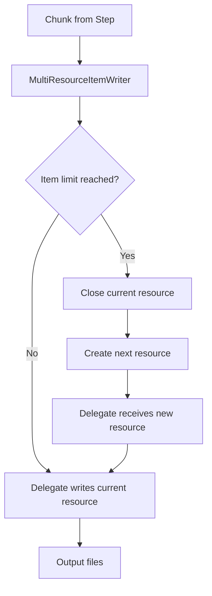

# MultiResourceItemWriter

In Spring Batch, a job may have to export hundreds of thousands or millions of records to files. Writing everything into a single file can produce a file too large to download, transfer, store, or process downstream. A common approach is splitting output into multiple files of roughly similar size.

**MultiResourceItemWriter** is a writer wrapper that writes items across multiple resources according to a per-resource item limit. It manages switching to the next resource and delegates actual writing operations to another writer, typically `FlatFileItemWriter`.

For example, if configured with a maximum of 1,000 items per resource and a step writes 2,350 items, the writer creates files in order:

| Resource | Item count |
|---|---:|
| orders.1 | 1,000 |
| orders.2 | 1,000 |
| orders.3 | 350 |

This limit is an **item count**, not a file size in bytes. If items vary in length, resulting file sizes will also vary.

## 1. What problem does MultiResourceItemWriter solve?

A standard `FlatFileItemWriter` writes output to a single resource. When output must be split into multiple files, writing custom file-rotation logic inside a processor or writer forces the application to manage:

- How many items have been written to the current file.
- When to close the old file and open a new file.
- Naming the next file.
- Headers and footers for each file.
- Checkpoints and state on restart.
- The `open`, `update`, and `close` lifecycle of the delegate writer.

`MultiResourceItemWriter` encapsulates this coordination. The application simply supplies a base resource, an item limit per resource, and a delegate writer capable of accepting new resources.



`MultiResourceItemWriter` does not format objects into CSV/JSON itself. The delegate is responsible for serializing items into bytes or records in the desired format.

## 2. Key components

A `MultiResourceItemWriter` configuration typically involves four components:

| Component | Responsibility |
|---|---|
| Base resource | Basis for generating output resource names |
| `itemCountLimitPerResource` | Maximum number of items written to each resource |
| `ResourceSuffixCreator` | Generates the suffix portion for each resource |
| Delegate writer | Performs actual data writes to the current resource |

The delegate must implement the appropriate contract, typically `ResourceAwareItemWriterItemStream`. This contract allows the wrapper to assign new resources and manage the writer's lifecycle.

For instance, a `FlatFileItemWriter` delegate can receive a new resource via `setResource(...)`, then open and write to that file.

## 3. Basic configuration with FlatFileItemWriter

Spring Batch 5 example using `MultiResourceItemWriterBuilder`:

```java
@Bean
FlatFileItemWriter<Order> orderFileDelegate() {
    return new FlatFileItemWriterBuilder<Order>()
            .name("orderFileDelegate")
            .lineAggregator(order ->
                    order.orderId() + ","
                            + order.customerId() + ","
                            + order.amount())
            .encoding("UTF-8")
            .headerCallback(writer ->
                    writer.write("orderId,customerId,amount"))
            .build();
}

@Bean
MultiResourceItemWriter<Order> multiResourceOrderWriter(
        FlatFileItemWriter<Order> orderFileDelegate) {

    return new MultiResourceItemWriterBuilder<Order>()
            .name("multiResourceOrderWriter")
            .resource(new FileSystemResource(
                    "output/orders.csv"))
            .delegate(orderFileDelegate)
            .itemCountLimitPerResource(1000)
            .resourceSuffixCreator(index -> "." + index)
            .build();
}
```

In this example:

- `orderFileDelegate` formats each `Order` into a CSV line.
- Base resource is `output/orders.csv`.
- `itemCountLimitPerResource(1000)` limits each file to 1,000 items.
- `ResourceSuffixCreator` appends an index-based suffix.
- `MultiResourceItemWriter` manages resource rotation and calls the delegate.

Actual filenames are formed by combining the base resource with the suffix returned by `ResourceSuffixCreator`. With suffixes like `.1`, `.2`, filenames become `orders.csv.1`, `orders.csv.2`, and so on. If you need a different naming convention, supply a custom suffix creator and verify filenames in integration tests.

Depending on your Spring Batch version, the builder may require other properties or different delegate setup. Use the API matching your project's actual dependency.

## 4. Delegate must be a ResourceAwareItemWriterItemStream

`MultiResourceItemWriter` does not write file contents directly. It requires a delegate that can accept the current resource and participate in `ItemStream` operations.

The essential contract is `ResourceAwareItemWriterItemStream`:

- Accepts a resource via `setResource(Resource)`.
- Supports writing items via `ItemWriter`.
- Supports `open`/`update`/`close` via `ItemStream`.

`FlatFileItemWriter` satisfies this contract, making it the most common delegate.

A custom writer can also serve as a delegate if it implements the full contract. When the wrapper rotates to a new resource, the custom writer must close the old resource, accept the new resource, and reopen properly.

Never use a writer implementing only `ItemWriter` if it has no way to receive a new resource. `MultiResourceItemWriter` needs to control the delegate's resource and lifecycle.

## 5. How does itemCountLimitPerResource work?

`itemCountLimitPerResource` defines the maximum number of items written to a resource before the wrapper rotates to the next resource.

For example, with a limit of 3 items and 8 input items:

```text
File orders.1: item 1, item 2, item 3
File orders.2: item 4, item 5, item 6
File orders.3: item 7, item 8
```

The limit counts items received and written by the writer, not bytes or physical lines after formatting. Even if a delegate formats one item into multiple lines, `MultiResourceItemWriter` still counts items per the `ItemWriter` contract.

Set a positive, operationally meaningful limit. Too small a limit creates excessive files; too large a limit can make files hard to distribute or process downstream.

### Item count is not chunk size

Chunk size determines how many items belong to a transaction chunk. `itemCountLimitPerResource` determines how many items go into each file.

For example:

- Chunk size = 100.
- Item limit per resource = 250.

A file can receive two full chunks (200 items) plus part of the next chunk (50 items). Once 250 is reached, the remaining items of that chunk are written to the next resource as the wrapper splits the chunk.

The two values do not need to match. Choose chunk size for transaction and writer performance; choose item limit based on file-splitting requirements.

## 6. Chunks can cross resource boundaries

Chunks and resources are independent boundaries. One chunk can contain the last items of the current file and the first items of the next file.

For example:

- Current file already has 90 items.
- `itemCountLimitPerResource` is 100.
- Next chunk contains 30 items.

The writer writes the first 10 items to the current file, rotates to a new resource, and writes the remaining 20 items.


This ensures the per-resource item limit is respected even when chunk size exceeds the remaining capacity of the current file. In tests, use a chunk size that does not evenly divide the item limit to verify boundary behavior.

## 7. ResourceSuffixCreator and naming conventions

`ResourceSuffixCreator` determines the suffix appended to the base resource for each file. Suffixes should be:

- Unique within a run.
- Naturally sortable if downstream needs to concatenate files.
- Free of characters invalid on the target filesystem.
- Non-colliding with filenames from other executions.
- Consistent across restarts of the same `JobInstance`.

Example three-digit sequence suffix:

```java
.resourceSuffixCreator(index ->
        String.format(".part-%03d", index))
```

Or a name reflecting ordering:

```java
.resourceSuffixCreator(index ->
        String.format("-segment-%05d.csv", index))
```

If the base resource is `output/orders`, suffix `-segment-00001.csv` produces `orders-segment-00001.csv` according to the writer's resource-and-suffix concatenation rule.

Do not assume whether indexing starts at 0 or 1 if filenames are part of a downstream contract. Configure the suffix explicitly and write tests checking the first resource name, subsequent resource names, and names after restart on your Spring Batch version.

## 8. Organizing output directories

`MultiResourceItemWriter` typically uses `FileSystemResource` for output files. The target directory must exist and the job process must have write permissions.

For example:

```java
Resource outputBase =
        new FileSystemResource("/data/export/orders");
```

Before launching the job, a preparation step can:

- Confirm the output directory exists.
- Create the directory if application policy allows.
- Verify write permissions.
- Confirm filenames will not collide with another batch.
- Record metadata for the batch ID and output directory.

Never use `ClassPathResource` as a file write target. Classpath resources typically reside inside JARs or application directories and are not writable output locations.

Avoid sharing one output directory across multiple `JobInstance` executions if suffixes reset from the same starting index. Two concurrent jobs could both create `orders.1`, causing overwrites or file-open errors.

## 9. Configuring a step to use MultiResourceItemWriter

`MultiResourceItemWriter` is injected into a step like any standard `ItemWriter`:

```java
@Bean
Step exportOrdersStep(
        JobRepository jobRepository,
        PlatformTransactionManager transactionManager,
        ItemReader<Order> orderReader,
        MultiResourceItemWriter<Order> multiResourceOrderWriter) {

    return new StepBuilder("exportOrdersStep", jobRepository)
            .<Order, Order>chunk(100, transactionManager)
            .reader(orderReader)
            .writer(multiResourceOrderWriter)
            .build();
}
```

The step does not need to know how many files the writer creates. It passes each chunk to `MultiResourceItemWriter`, while the wrapper decides which resource receives each item.

If the step has a processor, the processor's output type must match the delegate writer's input type.

## 10. Writing headers and footers per resource

When the delegate is `FlatFileItemWriter`, you can configure `headerCallback` and `footerCallback`. Because the delegate reopens for each resource, the header callback executes as each file opens. The footer callback is called when the delegate closes a resource according to the writer lifecycle.

For example:

```java
@Bean
FlatFileItemWriter<Order> orderFileDelegate() {
    return new FlatFileItemWriterBuilder<Order>()
            .name("orderFileDelegate")
            .lineAggregator(order ->
                    order.orderId() + ","
                            + order.customerId() + ","
                            + order.amount())
            .headerCallback(writer ->
                    writer.write("orderId,customerId,amount"))
            .footerCallback(writer ->
                    writer.write("# end of file"))
            .encoding("UTF-8")
            .build();
}
```

If headers/footers are part of the downstream format, verify every file has the proper header and footer. Some consumers reject comments or footers; configure strictly according to the file contract.

For headers containing batch ID, export date, or schema version, the callback can read configuration injected into the delegate. Ensure those values remain stable across restarts.

## 11. Writing CSV files with LineAggregator

`FlatFileItemWriter` uses a `LineAggregator` to turn an item into a line. Manual string concatenation works for simple data, though it is unsafe for general CSV if fields contain commas, quotes, or newlines.

Example using `DelimitedLineAggregator`:

```java
@Bean
FlatFileItemWriter<Order> orderFileDelegate() {
    DelimitedLineAggregator<Order> aggregator =
            new DelimitedLineAggregator<>();
    aggregator.setDelimiter(",");

    BeanWrapperFieldExtractor<Order> extractor =
            new BeanWrapperFieldExtractor<>();
    extractor.setNames(new String[] {
            "orderId", "customerId", "amount"
    });
    aggregator.setFieldExtractor(extractor);

    return new FlatFileItemWriterBuilder<Order>()
            .name("orderFileDelegate")
            .lineAggregator(aggregator)
            .encoding("UTF-8")
            .build();
}
```

This snippet illustrates separating field extraction and delimiter configuration. If data involves complex CSV quoting or escaping rules, use an aggregator/formatter compatible with the downstream dialect rather than manual concatenation.

`MultiResourceItemWriter` does not alter record contents. All encoding, delimiter, quoting, escaping, and line-ending rules belong to the delegate.

## 12. Suffixes by batch ID and execution

One batch can export multiple files, and multiple batches can run concurrently. Filenames must distinguish individual executions.

For example:

```java
@Bean
@StepScope
MultiResourceItemWriter<Order> multiResourceOrderWriter(
        FlatFileItemWriter<Order> orderFileDelegate,
        @Value("#{jobParameters['batchId']}") String batchId) {

    return new MultiResourceItemWriterBuilder<Order>()
            .name("multiResourceOrderWriter")
            .resource(new FileSystemResource(
                    "/data/export/" + batchId + "/orders"))
            .delegate(orderFileDelegate)
            .itemCountLimitPerResource(1000)
            .resourceSuffixCreator(index ->
                    String.format(".%05d.csv", index))
            .build();
}
```

This example uses `@StepScope` because the output path depends on the run's `JobParameters`. In production, `batchId` must be validated before constructing paths. Never concatenate untrusted values into filesystem paths without normalizing and confining to the allowed root directory.

A dedicated directory per batch prevents two executions from creating identical filenames. If a job restarts, the same identifying parameters must resolve to the same batch directory and base resource.

## 13. MultiResourceItemWriter and late binding

The base resource can depend on `JobParameters` or `JobExecutionContext`. When it does, declare the writer as `@StepScope` so SpEL expressions resolve when an active `StepExecution` exists.

For example:

```java
@Bean
@StepScope
MultiResourceItemWriter<Order> multiResourceWriter(
        FlatFileItemWriter<Order> delegate,
        @Value("#{jobParameters['output.directory']}") String directory,
        @Value("#{jobParameters['batchId']}") String batchId) {

    Resource baseResource = new FileSystemResource(
            Path.of(directory, batchId, "orders").toFile());

    return new MultiResourceItemWriterBuilder<Order>()
            .name("multiResourceWriter")
            .resource(baseResource)
            .delegate(delegate)
            .itemCountLimitPerResource(5000)
            .resourceSuffixCreator(index -> "." + index + ".csv")
            .build();
}
```

If using `JobExecutionContext`, the key must be populated before the target writer is instantiated. Do not read a previous step's `StepExecutionContext` inside the current step; each step has its own context.

Late binding resolves the resource only when the target bean is created. If the output directory or batch ID changes between restarts of the same `JobInstance`, the writer could point to a different resource than the previous run.

## 14. ResourceSuffixCreator and index

The suffix creator receives the resource index and returns a suffix string. Treat the index as the output segment sequence.

For example:

```java
ResourceSuffixCreator suffixCreator =
        index -> String.format(".part-%04d", index);
```

Output may look like:

```text
orders.part-0001
orders.part-0002
orders.part-0003
```

Verify the indexing convention of your Spring Batch version with a small test. If downstream relies on filenames, do not let default suffixes change without updating the contract.

The suffix creator should be pure and deterministic: the same index must always return the same suffix. Never embed the current timestamp or a random UUID in the suffix when restartability is needed, because resource names must be reconstructed consistently.

## 15. Saving state and restarting

`MultiResourceItemWriter` is an `ItemStreamWriter` and must save state to resume at the exact position on restart. Relevant state includes:

- Current resource index.
- Number of items already written to the current resource.
- Delegate writer state, such as file write position.
- A stable writer name to identify keys in `ExecutionContext`.

With the builder, configure a stable name and enable `saveState` when restart is required:

```java
return new MultiResourceItemWriterBuilder<Order>()
        .name("multiResourceOrderWriter")
        .resource(baseResource)
        .delegate(orderFileDelegate)
        .itemCountLimitPerResource(1000)
        .saveState(true)
        .build();
```

When a job restarts the same `JobInstance`:

1. Spring Batch restores the saved `StepExecutionContext`.
2. `MultiResourceItemWriter` reads the saved resource index and item count.
3. The delegate is bound to the corresponding resource.
4. The writer resumes from the current file's state.
5. Once the limit is reached, the writer moves to the next resource.

This is why writer name, base resource, suffix rule, and item limit must remain stable across a restartable `JobInstance`.

Do not change `itemCountLimitPerResource`, suffix creator, or output base path between the initial run and a restart without designing corresponding state migration. Such changes can prevent old indexes/state from pointing to the right files.

## 16. saveState and writer name

`saveState` lets the writer record required metadata in `ExecutionContext`. Disabling `saveState` can prevent restarts from restoring the resource position and written item count.

The writer name must be:

- Non-empty.
- Stable across runs with the same configuration.
- Unique within the step if multiple stream writers exist.
- Never changing dynamically with timestamps or random data.

For example:

```java
.name("multiResourceOrderWriter")
```

Do not reuse the same name for two independent writers in the same step because state keys will collide. If there are multiple output streams, give each writer a distinct name and distinct base resource.

## 17. Restart and pre-existing files

On restart, some segment files may already have been written in committed chunks. The writer needs to resume the current resource and preserve prior files per execution state.

Distinguish between:

- **Restarting the same `JobInstance`**: resumes the failed batch using the same identifying parameters and established output layout.
- **Running a new `JobInstance`**: produces a new export, typically requiring a new directory or batch ID.
- **Intentional reprocessing**: reprocesses the same data under a new version/reprocess ID so prior output is not overwritten.

Do not wipe the entire output directory before every startup if the run might be a restart. Cleanup logic must distinguish a fresh execution from a restart and remove only authorized resources.

If output is already published downstream before the job finishes, restarts can produce inconsistent states. It is safer to write into a dedicated staging directory and publish/rename the directory only after the job completes successfully.

## 18. Transactions and file rotation

Chunk-oriented steps normally commit via a transaction manager. A `FlatFileItemWriter` delegate uses buffering/transactional state to coordinate file writes with chunk commits. `MultiResourceItemWriter` coordinates resource rotation outside the delegate.

When a chunk crosses a file boundary, the writer may write part of the chunk to the current resource and the remainder to the new resource. If the chunk fails, file rollback depends on the delegate's `ItemStream`/transactional behavior and step configuration.

Never assume a filesystem provides database-like ACID transactions. If a step writes to both a database and multiple files, the transaction manager cannot automatically unify both into an atomic distributed transaction across all configurations.

Practical safeguards:

- Use `FlatFileItemWriter` or a delegate supporting transaction/chunk lifecycles.
- Avoid side effects outside the writer without idempotency mechanisms.
- Keep output files in staging while the job runs.
- Publish only when the job completes successfully.
- Produce a manifest recording file segments and checksums if downstream needs completeness verification.

## 19. Empty input and output resources

If the reader returns zero items, the application must decide whether an empty file should be created. Actual behavior depends on when `MultiResourceItemWriter` initializes resources and opens the delegate, as well as version and configuration.

Do not assume an output file always exists when input is empty. If downstream requires an empty file with a header, handle it explicitly via a dedicated file/manifest creation step or test writer behavior with empty input.

Similarly, if the item count is an exact multiple of the item limit, verify the writer does not create an extra empty trailing segment file. Boundary tests catch differences across versions or delegate configurations.

## 20. Using a custom ResourceAwareItemWriterItemStream

The delegate does not have to be `FlatFileItemWriter`. You can use a custom writer as long as it can switch resources and manage streams:

```java
public class JsonResourceWriter<T>
        implements ResourceAwareItemWriterItemStream<T> {

    private Resource resource;
    private BufferedWriter writer;

    @Override
    public void setResource(Resource resource) {
        this.resource = resource;
    }

    @Override
    public void open(ExecutionContext executionContext) {
        // Open the current resource and restore state if needed.
    }

    @Override
    public void write(Chunk<? extends T> chunk) throws Exception {
        // Serialize and write items to the current resource.
    }

    @Override
    public void update(ExecutionContext executionContext) {
        // Save required checkpoint state.
    }

    @Override
    public void close() {
        // Flush and close the current resource.
    }
}
```

This is an illustrative skeleton, not a production-ready writer. A custom delegate must carefully handle exceptions, encoding, resource open/close, checkpointing, restart, flushing, and cleanup. Prefer built-in writers whenever the output format is already supported.

## 21. Splitting by item count or by file size?

`MultiResourceItemWriter` splits by item count. It does not guarantee equal byte sizes across files.

For example:

| File | Item count | Illustrative size |
|---|---:|---:|
| orders.1 | 1,000 | 1.2 MB |
| orders.2 | 1,000 | 8.5 MB |
| orders.3 | 1,000 | 2.0 MB |

If some records contain long descriptions, the corresponding file can be much larger despite having the exact same item count.

If the requirement is a strict byte-size cap, `MultiResourceItemWriter` does not satisfy it directly. You may need a custom writer tracking byte counts, a post-export file-splitting step, or fixed-length record formatting. When writing custom rotation, account for encoding, newlines, headers/footers, and never splitting records mid-line.

Do not use `itemCountLimitPerResource` to promise files will always stay under a specific megabyte threshold.

## 22. Splitting files by date, tenant, or data type

`MultiResourceItemWriter` creates resources sequentially by index; it does not automatically group items by business key. If each tenant or business date needs its own file, choose an appropriate strategy:

- Sort inputs by key and use a custom routing writer.
- Use `ClassifierCompositeItemWriter` to route to a writer per item.
- Create separate steps for each group.
- Use partitioning if groups should execute independently.

`MultiResourceItemWriter` fits when sequentially splitting one item stream into count-bounded segments.

You can combine a classifier writer with multiple `MultiResourceItemWriter` beans if each route needs multiple segments, while maintaining distinct state and writer names per route. Never share a common base resource across multiple routes that may write concurrently.

## 23. Parallel execution and thread safety

`MultiResourceItemWriter` holds state including resource index, item count, and current delegate. Because this state mutates during writes, do not assume a shared instance can be called safely from multiple threads simultaneously.

For multi-threaded steps:

- Verify thread safety of both the writer and delegate.
- Avoid multiple threads rotating the same resource concurrently.
- If parallelism is needed, consider partitioning with dedicated output per worker.
- Use distinct base resources or directories per partition ID.
- Combine outputs after all partitions finish.

Example filenames per partition:

```text
export/partition-0/orders.1
export/partition-0/orders.2
export/partition-1/orders.1
export/partition-1/orders.2
```

Each worker owns an isolated output namespace so workers never overwrite each other's files. A final step can generate an aggregated manifest or move files into a shared publish directory.

`@StepScope` creates a separate writer target per `StepExecution`, which helps partition workers. However, scoping alone does not make shared singleton dependencies used by the delegate thread-safe.

## 24. Integration with ItemStream and lifecycle

`MultiResourceItemWriter` must manage the delegate's lifecycle:

1. When the step opens the stream, the wrapper opens the delegate with the current resource.
2. When the item limit is reached, the wrapper closes the current resource.
3. The wrapper creates a new resource and calls `setResource(...)` on the delegate.
4. The delegate is opened for the new resource.
5. The next items are written to the new resource.
6. When the step ends, the wrapper closes the delegate.
7. On commit, the wrapper/delegate update state in `ExecutionContext`.

Never invoke `open`/`close` on the delegate directly from a processor or another listener while `MultiResourceItemWriter` manages it. Doing so can trigger duplicate lifecycle calls or leave the current resource inconsistent.

If using a custom delegate, verify it supports being reopened multiple times within the same `StepExecution` across different resources per the wrapper contract.

## 25. Testing file count and items per file

Integration tests should use a small input dataset and a low item limit so rotation is easy to verify.

For example, 7 input items with a limit of 3:

```text
orders.1 -> 3 items
orders.2 -> 3 items
orders.3 -> 1 item
```

Tests should verify:

- Exactly three resources are created.
- Each of the first resources has three items.
- The last resource has one item.
- Total items across all resources equal valid items from the reader.
- No items are lost or duplicated.
- Each file's contents preserve input order if ordering is required.

Do not check only that files exist. Read back every file and assert business keys to verify rotation boundaries are exact.

## 26. Testing chunks crossing file boundaries

This is a critical test because chunk size and item limit rarely match.

For example:

- Chunk size = 4.
- Item limit = 5.
- Input has 11 items.

Expected distribution by item count:

| File | Items |
|---|---|
| orders.1 | 1, 2, 3, 4, 5 |
| orders.2 | 6, 7, 8, 9, 10 |
| orders.3 | 11 |

The second chunk containing items 5–8 is split across two resources: item 5 finishes the first file, and items 6–8 go into the second file. Verify the delegate receives the split chunks properly without duplicating or reordering items.

## 27. Testing restarts

To verify restarts, build a test job that fails after several chunks have committed:

1. Configure a small item limit, such as 3.
2. Read enough data to produce at least two resources.
3. Intentionally trigger a failure after several committed chunks.
4. Verify files and state are saved per execution.
5. Restart the same `JobInstance` with the same identifying parameters.
6. Verify the writer resumes at the exact resource/index and item count.
7. Read all files to verify no missing or duplicated items.

When testing restarts:

- Keep `MultiResourceItemWriter` name stable.
- Keep delegate name stable.
- Keep base resource and suffix rule stable.
- Keep `itemCountLimitPerResource` unchanged.
- Reuse identifying `JobParameters`.
- Do not delete staging output before restarting.

If any of these factors change, treat it as a restart configuration change requiring dedicated testing.

## 28. Testing headers, footers, and empty files

With a `FlatFileItemWriter` delegate, verify per resource:

- Does the header appear at the top of every file?
- Does the footer appear when each file closes?
- Does the final file have the expected line count?
- Does empty input create a resource or not?
- When item count is an exact multiple of the limit, is an extra empty file created?
- On job restart, are headers/footers duplicated or missing?

Headers and footers are usually per-resource properties, not batch-wide properties. If downstream needs a single header for the whole batch, a separate manifest or summary metadata file may be needed.

## 29. Testing suffixes and collisions

Test `ResourceSuffixCreator` as part of the output contract:

| Index | Illustrative suffix |
|---:|---|
| 1 | `.part-0001.csv` |
| 2 | `.part-0002.csv` |
| 3 | `.part-0003.csv` |

Verify:

- Suffixes do not collide.
- Names are valid on the target filesystem.
- Segments sort naturally in order.
- Two distinct batches never share an output path.
- Restarts regenerate the exact filenames already used.

If downstream consumes the file list via a manifest, record filenames in exact order and publish the manifest only after all segments finish.

## 30. Publishing files after job completion

While a step runs, downstream consumers must not read incomplete segments. A safe deployment pattern:

1. Write all files into a batch-ID-scoped staging directory.
2. Wait for `JobExecution` to complete successfully.
3. Validate file count, item count, and checksums if needed.
4. Generate a manifest listing segments in order.
5. Rename or move the staging directory to the publish location if the filesystem supports appropriate operations.
6. Notify downstream only after publishing completes.

If the job fails, staging output can be retained for restart or investigation. Never let consumers treat partial files as a complete export.

On object storage, renames may be non-atomic or absent compared to traditional filesystems. In that case, use manifest/completion markers and design consumers to read only batches carrying the marker.

## 31. Common pitfalls

**Confusing item limits with byte limits.** `MultiResourceItemWriter` counts items, not file bytes. If you need a megabyte cap, use a different strategy.

**Confusing item limits with chunk size.** The two values govern different boundaries. One chunk can span two resources.

**Delegate lacking ResourceAwareItemWriterItemStream.** The wrapper cannot inject new resources or manage lifecycle properly. Use a compatible delegate.

**Forgetting a stable writer name.** State in `ExecutionContext` may fail to save/restore properly or collide with another writer.

**Using timestamps/randomness in the suffix creator.** Restarts may generate different resource names. Use deterministic suffixes derived from the index.

**Two jobs sharing a base resource.** Segment files can collide. Use isolated directories or batch IDs.

**Output directory missing or lacking write permissions.** The delegate fails when opening the resource. Validate output directories before exporting.

**Assuming headers appear only once.** The delegate opens for each resource, so header callbacks can fire per file. Verify the downstream contract.

**Not testing chunks crossing boundaries.** Items can go to the wrong file or be dropped if configuration is unverified. Use a chunk size that does not divide the item limit evenly.

**Disabling saveState when restarts are needed.** The wrapper cannot restore the resource position and item count as expected.

**Deleting output on restart.** This can destroy already-committed segment files. Distinguish restarts from fresh executions.

**Sharing one writer instance across multiple threads.** Resource index and delegate state can race. Use per-partition outputs or proper serialization.

**Publishing files before job completion.** Downstream may read an incomplete batch. Use staging and completion manifests/markers.

## 32. MultiResourceItemWriter implementation workflow

When splitting output into multiple files, follow this sequence:

1. Clarify why files are split: record limits, distribution convenience, or downstream requirements.
2. Confirm whether the limit is by item count or byte size.
3. Choose a delegate writer suited to the output format.
4. Ensure the delegate implements `ResourceAwareItemWriterItemStream`.
5. Choose a base resource and a batch-isolated output directory.
6. Set `itemCountLimitPerResource` according to operational needs.
7. Configure a deterministic, naturally sortable `ResourceSuffixCreator`.
8. Set a stable `name` and enable `saveState` if restarts are required.
9. Wire `MultiResourceItemWriter` into the step with an independently chosen chunk size.
10. Test rotation, boundary chunks, headers/footers, empty input, restarts, and collisions.
11. Write a manifest and publish output after the job succeeds if downstream expects complete batches.

Keep base path, suffix rule, item limit, and writer names stable across restarts. If the output layout must change, launch a new `JobInstance` or design explicit state migration.

## 33. Practical conclusion

`MultiResourceItemWriter` enables Spring Batch to split an item stream across multiple resources based on a per-resource item limit. It coordinates resource creation, suffix switching, and delegate lifecycle, while a delegate such as `FlatFileItemWriter` handles content formatting and writing.

`itemCountLimitPerResource` counts items rather than bytes. It is independent of chunk size, allowing a single chunk to be split across two files. `ResourceSuffixCreator` must produce deterministic, unique names; both the writer and delegate need stable names and proper `saveState` settings to support restarts.

Use a batch-specific output directory, verify write permissions, test chunk/resource boundaries, confirm per-file headers/footers, and keep configuration immutable during restarts. For parallel jobs, assign isolated resources to each partition. Publish segments only after job completion with a manifest or marker confirming completeness. This structure breaks large outputs into manageable pieces while preserving order, recoverability, and data integrity.
