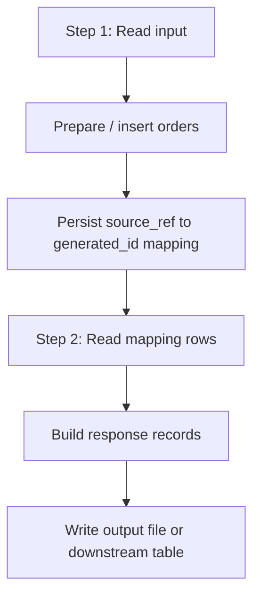
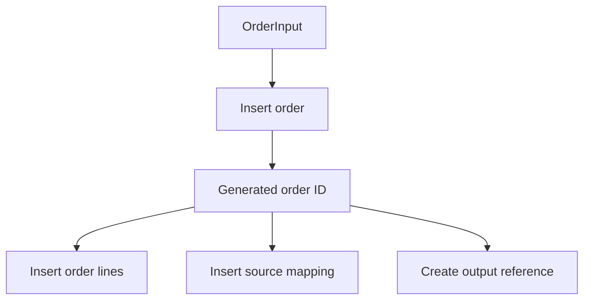

# Generated Keys and Output Mapping

In Spring Batch, a JDBC step often reads data, transforms items, and writes new records into a database. Many tables use auto-generated primary keys (identity, auto-increment, or sequence). When an insert succeeds, the database produces a **generated key**. The application sometimes needs to retain that key to write related tables, produce an output file, or link the input item to the newly created record.

This is the problem of **generated keys and output mapping**: how to retrieve the database-generated key and map it back to the corresponding item or business key.

First, understand that `JdbcBatchItemWriter` is designed to write a chunk using JDBC batch updates. It does not provide a portable contract for returning a generated key per item. Driver support for returning generated keys from batches and how those keys map back to individual items depend on the database and driver. Therefore, when accurate mapping is required, choose an explicit strategy: allocate keys before inserting, insert row by row with `KeyHolder`, use database-specific `RETURNING`/`OUTPUT` statements, or read the mapping from the database in a subsequent step.

## 1. What Is a Generated Key?

A generated key is a key value created by the database when inserting a row. Common mechanisms include:

- **Identity / auto-increment**: the database automatically increments a value on insert.
- **Sequence**: the application or database fetches the next value from a sequence and uses it in the insert.
- **Default expression**: a column with a default expression generates a value on insert.
- **Trigger**: a trigger assigns a value to the key or another column during the insert.
- **Application-generated UUID**: the application generates an ID before inserting; chronologically this is not database-generated, yet it often solves the same identification requirement.

Example table:

```sql
create table orders (
    id bigint generated by default as identity primary key,
    source_ref varchar(80) not null,
    amount decimal(18, 2) not null
);
```

The application inserts `source_ref` and `amount`, and the database generates `id`:

```sql
insert into orders (source_ref, amount)
values ('SRC-1001', 250.00);
```

After the insert, the row might receive `id = 84521`. The exact value is decided by the database. If the next step needs to store `orders.id` in another table, the application must retrieve this key and associate it with `source_ref` or an identifier from the input item.

## 2. What Does Output Mapping Mean?

In batch processing, output mapping typically means linking input items or processed data to results created by the database.

Example:

| Input reference | Generated order ID |
|---|---:|
| SRC-1001 | 84521 |
| SRC-1002 | 84522 |
| SRC-1003 | 84523 |

This mapping can be used to:

- Write child tables with a foreign key pointing to the newly created order.
- Generate a response file for the upstream system.
- Maintain a cross-reference table between source references and database IDs.
- Update processing status for each input record.
- Allow a subsequent step to read back the newly generated IDs.

The generated key is the created value; output mapping is the relationship between that value and the corresponding business item. Simply getting a list of IDs without knowing which ID belongs to which item is not enough for safe mapping.

## 3. Where Generated Keys Sit in the Chunk Pipeline

A chunk step typically executes in this order:


The processor runs before the writer. If the database generates the key only when the writer performs the insert, the processor cannot know that key during the current processing pass.

The `ItemWriter` contract also does not return a list of output items. In Spring Batch 5, the writer receives `Chunk<? extends T>` and writes data; it has no return value to pass generated keys back to the processor.

Therefore, if you need the generated ID inside the output object before writing, generate the ID before inserting. If database-assigned identity is mandatory, retrieve the key inside the writer and persist the mapping somewhere a later step can read.

## 4. JdbcBatchItemWriter and Generated Keys

`JdbcBatchItemWriter` is a good choice for inserting/updating many items in a chunk. It uses JDBC batch updates and supports binding values from items via `ItemPreparedStatementSetter` or `ItemSqlParameterSourceProvider`.

Example:

```java
@Bean
JdbcBatchItemWriter<OrderToInsert> orderBatchWriter(
        DataSource dataSource) {

    return new JdbcBatchItemWriterBuilder<OrderToInsert>()
            .dataSource(dataSource)
            .sql("""
                    insert into orders (id, source_ref, amount)
                    values (?, ?, ?)
                    """)
            .itemPreparedStatementSetter((item, statement) -> {
                statement.setLong(1, item.id());
                statement.setString(2, item.sourceRef());
                statement.setBigDecimal(3, item.amount());
            })
            .assertUpdates(true)
            .build();
}
```

In this example, the item already has `id` before the writer runs, so the writer can batch-insert with known keys.

If you omit the `id` column so the database auto-generates it, `JdbcBatchItemWriter` can still perform inserts, but the writer does not offer a standard mechanism to return the generated key corresponding to each item. Do not assume that after `write(chunk)` you can obtain a `KeyHolder` containing a list of keys ordered identically to the input.

JDBC drivers and databases vary in how well they support generated keys for batches. Return order, number of key columns, trigger support, and behavior on partial batch failure can differ. If you rely on a driver-specific batch generated-keys API, treat it as a database-specific implementation and test directly on the exact production driver and version.

## 5. Strategy 1: Generate Keys Before Inserting

If the application is allowed to choose the key, the simplest approach is generating the key in the processor or before writing begins:

- Generate a UUID in the application.
- Fetch values from a database sequence before batch inserting.
- Allocate IDs from a centralized ID service.

Once the key is already inside the item, output mapping becomes straightforward: the processor creates an output object carrying both the ID and source reference; the writer batch-inserts that object.

Example models:

```java
public record OrderInput(
        String sourceRef,
        BigDecimal amount) {
}

public record OrderToInsert(
        long id,
        String sourceRef,
        BigDecimal amount) {
}
```

Processor using a sequence incrementer:

```java
@Bean
ItemProcessor<OrderInput, OrderToInsert> prepareOrder(
        DataFieldMaxValueIncrementer orderIdIncrementer) {

    return input -> new OrderToInsert(
            orderIdIncrementer.nextLongValue(),
            input.sourceRef(),
            input.amount());
}
```

`DataFieldMaxValueIncrementer` is Spring JDBC's abstraction for fetching the next value from a database-appropriate sequence or increment mechanism. The concrete implementation configuration depends on the database and schema.

Afterward, `JdbcBatchItemWriter` inserts `id`, `source_ref`, and `amount` in one batch. The output object already holds the preallocated ID for writing related tables or producing mapping files.

### Advantages and Limitations

- Easy to batch-insert since every item already has a key.
- Mapping between input and ID is explicit, with no guesswork about generated key ordering.
- Multiple tables can be written in subsequent writers/steps using the same ID.
- Sequences can leave gaps if transactions roll back; sequences do not guarantee contiguous numbers.
- If using UUIDs, column types and ID generation rules must be aligned across systems.

If business logic only requires a unique key rather than database-assigned identity, this is usually the simplest and most scalable option.

## 6. Configuring JdbcBatchItemWriter for Preallocated Keys

More complete writer example:

```java
@Bean
JdbcBatchItemWriter<OrderToInsert> orderBatchWriter(
        DataSource dataSource) {

    return new JdbcBatchItemWriterBuilder<OrderToInsert>()
            .dataSource(dataSource)
            .sql("""
                    insert into orders (id, source_ref, amount)
                    values (?, ?, ?)
                    """)
            .itemPreparedStatementSetter((item, statement) -> {
                statement.setLong(1, item.id());
                statement.setString(2, item.sourceRef());
                statement.setBigDecimal(3, item.amount());
            })
            .assertUpdates(true)
            .build();
}
```

With this approach, the ID is known before writing. If a related table must also be written:

```java
@Bean
JdbcBatchItemWriter<OrderToInsert> orderAuditWriter(
        DataSource dataSource) {

    return new JdbcBatchItemWriterBuilder<OrderToInsert>()
            .dataSource(dataSource)
            .sql("""
                    insert into order_audit (order_id, source_ref)
                    values (?, ?)
                    """)
            .itemPreparedStatementSetter((item, statement) -> {
                statement.setLong(1, item.id());
                statement.setString(2, item.sourceRef());
            })
            .assertUpdates(true)
            .build();
}
```

The two writers can be combined in a composite writer if the same chunk needs to write both tables and transactions are configured appropriately. Ensure insert order respects foreign keys: parent table first, child table second.

## 7. Strategy 2: Retrieving a Single Generated Key with KeyHolder

If database-generated identity is mandatory, Spring JDBC supports `KeyHolder` for single-row inserts. `GeneratedKeyHolder` holds the value returned by the JDBC driver.

Example with `JdbcTemplate`:

```java
KeyHolder keyHolder = new GeneratedKeyHolder();

int updated = jdbcTemplate.update(connection -> {
    PreparedStatement statement = connection.prepareStatement(
            """
            insert into orders (source_ref, amount)
            values (?, ?)
            """,
            new String[] { "id" });

    statement.setString(1, input.sourceRef());
    statement.setBigDecimal(2, input.amount());
    return statement;
}, keyHolder);

if (updated != 1) {
    throw new IllegalStateException(
            "Expected one inserted order");
}

Number generatedKey = keyHolder.getKey();
if (generatedKey == null) {
    throw new IllegalStateException(
            "Database did not return the generated order ID");
}

long orderId = generatedKey.longValue();
```

Here:

- `PreparedStatement` is created specifying the key column name to return.
- `JdbcTemplate.update` performs a single insert.
- `GeneratedKeyHolder` receives the generated key from the driver.
- `getKey()` works when the result has exactly one row and one key column.

Some databases/drivers use `Statement.RETURN_GENERATED_KEYS` instead of a column name array. Check your JDBC driver and choose the supported overload.

### KeyHolder Does Not Automatically Map a Batch

The example above retrieves the key for a single insert. If you loop over many items and create a `KeyHolder` for each item, the application knows precisely which key belongs to which item, at the cost of one insert round trip per item.

If you want to batch-insert multiple rows and receive a list of generated keys, verify whether the driver supports it, how the API returns keys, and whether a stable correlation key exists to map results back to inputs. Never assume returned key order always matches input order in the chunk.

## 8. Strategy 3: Custom ItemWriter Using KeyHolder and Persisting Mapping

When database-generated identity is required alongside exact mapping, you can write a custom writer. The writer receives a chunk, inserts each item, retrieves the key immediately after each insert, and persists the relationship between source reference and generated ID.

Example:

```java
public class OrderIdentityWriter
        implements ItemWriter<OrderInput> {

    private final JdbcTemplate jdbcTemplate;

    public OrderIdentityWriter(JdbcTemplate jdbcTemplate) {
        this.jdbcTemplate = jdbcTemplate;
    }

    @Override
    public void write(Chunk<? extends OrderInput> chunk) {
        for (OrderInput item : chunk) {
            KeyHolder keyHolder = new GeneratedKeyHolder();

            int updated = jdbcTemplate.update(connection -> {
                PreparedStatement statement = connection.prepareStatement(
                        """
                        insert into orders (source_ref, amount)
                        values (?, ?)
                        """,
                        new String[] { "id" });

                statement.setString(1, item.sourceRef());
                statement.setBigDecimal(2, item.amount());
                return statement;
            }, keyHolder);

            if (updated != 1 || keyHolder.getKey() == null) {
                throw new IllegalStateException(
                        "Could not obtain generated order ID");
            }

            long orderId = keyHolder.getKey().longValue();

            jdbcTemplate.update(
                    """
                    insert into order_output_mapping
                        (source_ref, order_id)
                    values (?, ?)
                    """,
                    item.sourceRef(),
                    orderId);
        }
    }
}
```

This writer executes per item:

1. Insert the parent row.
2. Retrieve the generated key.
3. Write the mapping table with source reference and key.
4. Proceed to the next item.

This illustrates a database supporting generated keys in the configured JDBC way. Ensure `JdbcTemplate` uses the same `DataSource` and transaction manager as the chunk step if order inserts and mappings must commit/roll back together.

### Performance Trade-off

A separate insert per item is usually slower than JDBC batching due to more database calls. Use this approach when immediate generated keys are required and the driver offers no reliable batch mapping mechanism, or when chunk sizes are small and throughput is acceptable.

For high data volumes, consider preallocating sequences/UUIDs or using database-specific statements that return keys alongside a correlation value.

## 9. Strategy 4: Database RETURNING or OUTPUT

Some databases support insert syntax that returns newly created data:

- PostgreSQL supports `RETURNING`.
- SQL Server supports `OUTPUT INSERTED....`.
- Oracle has `RETURNING ... INTO` with appropriate JDBC usage.

PostgreSQL example for a single item:

```java
Long orderId = jdbcTemplate.queryForObject(
        """
        insert into orders (source_ref, amount)
        values (?, ?)
        returning id
        """,
        Long.class,
        input.sourceRef(),
        input.amount());
```

SQL Server example:

```sql
insert into orders (source_ref, amount)
output inserted.id
values (?, ?);
```

These statements are not portable SQL. How they are invoked from Spring JDBC depends on the driver and the query/update API supporting statements that return result sets.

### Returning Both Generated Key and Correlation Key

If the database allows returning multiple columns, return both the key and business reference:

```sql
insert into orders (source_ref, amount)
values (?, ?)
returning id, source_ref;
```

When receiving results, map based on `source_ref` rather than relying on row position in the batch. For multi-row batch inserts, syntax and multi-row return capabilities depend on the database; check documentation and test on the exact dialect.

## 10. Do Not Map Generated Keys by Order Alone Without Guarantees

A common mistake is:

1. Send 100 items in a batch insert.
2. Receive 100 generated keys back.
3. Assign the first key to the first item, the second key to the second item.

This is only safe if the specific database/driver/API guarantees the count and order of generated keys correspond to input order. JDBC batch generated-key behavior is not uniform across all drivers.

Potential issues:

- The driver does not return generated keys for batches.
- The driver returns fewer keys than successful inserts.
- The batch suffers a partial failure or special update counts.
- Triggers generate or alter keys in custom ways.
- Result ordering does not follow the application's assumption.

When reliable mapping is required, prefer:

- Keys allocated before batch inserting.
- Unique business keys/source references stored with each row.
- Databases returning keys paired with a correlation field.
- Item-by-item inserts with `KeyHolder` when the cost is acceptable.

## 11. Output Mapping Using a Cross-Reference Table

A dedicated mapping table persists the relationship between source data and new primary keys:

```sql
create table order_output_mapping (
    batch_id varchar(80) not null,
    source_ref varchar(80) not null,
    order_id bigint not null,
    primary key (batch_id, source_ref),
    foreign key (order_id) references orders(id)
);
```

Example data:

| batch_id | source_ref | order_id |
|---|---|---:|
| BATCH-2026-11 | SRC-1001 | 84521 |
| BATCH-2026-11 | SRC-1002 | 84522 |
| BATCH-2026-11 | SRC-1003 | 84523 |

`batch_id` distinguishes import runs; `source_ref` identifies the source record; `order_id` is the database-generated primary key.

The next step can read the mapping:

```sql
select source_ref, order_id
from order_output_mapping
where batch_id = :batchId
order by source_ref;
```

This works well when generating response files, updating upstream systems, or writing child tables after inserts finish. It also avoids holding a huge map in memory or in `StepExecutionContext`.

## 12. Output Mapping via a Subsequent Step

If generated keys are only created inside the writer, a clean design splits the work into two steps:



Step 1 inserts rows and saves the mapping within the same chunk transaction. Step 2 reads the mapping by batch ID and produces the output.

An example reader for step 2 can use `JdbcPagingItemReader`:

```java
@Bean
@StepScope
JdbcPagingItemReader<OrderMapping> orderMappingReader(
        DataSource dataSource,
        PagingQueryProvider mappingQueryProvider,
        @Value("#{jobParameters['batchId']}") String batchId) {

    return new JdbcPagingItemReaderBuilder<OrderMapping>()
            .name("orderMappingReader")
            .dataSource(dataSource)
            .queryProvider(mappingQueryProvider)
            .parameterValues(Map.of("batchId", batchId))
            .pageSize(500)
            .rowMapper((rs, rowNum) -> new OrderMapping(
                    rs.getString("source_ref"),
                    rs.getLong("order_id")))
            .saveState(true)
            .build();
}
```

Step 2 can write a CSV, call an API, or update upstream status. Reading mappings from the database makes restart and pagination far easier than keeping all generated IDs in memory.

## 13. Why Not Keep the Entire Mapping in ExecutionContext?

`ExecutionContext` is meant for small state needed for restarts, such as offsets, file positions, partition ranges, or a few identifiers.

Do not store hundreds of thousands or millions of mapping pairs in `ExecutionContext`:

- The metadata database bloats.
- Every context update must serialize large amounts of data.
- Restart must deserialize and restore a massive object.
- Mapping data is hard to query and audit.
- It can exceed column size or serialization limits.

Persist large mappings in a dedicated business/staging table or controlled mapping file. `ExecutionContext` should hold only the batch ID, resource name, or required checkpoint.

## 14. Strategy 5: Application-Generated UUIDs

If the database schema permits UUID primary keys, the application can generate IDs before inserting:

```java
public record OrderToInsert(
        UUID id,
        String sourceRef,
        BigDecimal amount) {
}

@Bean
ItemProcessor<OrderInput, OrderToInsert> prepareOrder() {
    return input -> new OrderToInsert(
            UUID.randomUUID(),
            input.sourceRef(),
            input.amount());
}
```

The writer batch-inserts the UUID alongside the other fields. Because the ID exists before writing, it can be used for child tables and output mapping.

Advantages:

- No round trip needed to acquire keys.
- IDs can be generated independently of the database.
- Useful for distributed imports or multiple concurrent workers creating data.

Trade-offs:

- UUIDs consume more storage than some integer types.
- Indexes can exhibit different locality characteristics than ascending sequences.
- UUID representation must be aligned across Java, JDBC, and the database.
- Random UUIDs do not replace business keys or idempotency keys.

Time-ordered UUID variants can be considered if supported by your database and systems, provided format and indexing strategies are aligned.

## 15. Generated Keys and Idempotency on Restart

Restart or retry can cause the same item to be reprocessed. If the writer inserts a new row and the database assigns a new identity each time, one input can produce duplicate business records.

Example:

1. Chunk inserts the order into the database successfully.
2. Transaction/metadata commit ends inconsistently due to multi-resource setup or an error at the commit boundary.
3. The job restarts and re-reads the item.
4. The writer inserts another new row with a different generated ID.

To prevent duplicates:

- Store the source reference with a unique constraint.
- Use `batch ID + source reference` as an idempotency key.
- Use upsert/merge where supported by database and business rules.
- Check whether the record already exists before inserting when necessary.
- Ensure order inserts and mapping inserts participate in the same transaction if in the same database.

Example unique constraint:

```sql
alter table orders
add constraint uk_orders_source_ref
unique (source_ref);
```

If source references are unique only within a batch, include the batch ID in the constraint. Choose idempotency keys based on the source data contract rather than assuming a reference is globally unique.

Sequences/identities can leave gaps after rollbacks. This is normal behavior; never treat contiguous IDs as a batch correctness assertion.

## 16. Transactions When Retrieving Generated Keys

When `JdbcTemplate` uses the same `DataSource` and transaction manager as the step, JDBC calls inside `ItemWriter.write` typically participate in the active chunk transaction.

Example within one writer:

1. Insert the `orders` row.
2. Retrieve the generated key.
3. Insert the `order_output_mapping` row.
4. Writer finishes.
5. Chunk commits.

If step 3 fails and the exception triggers chunk rollback, the insert in step 1 is also rolled back provided both statements share the same transaction and transactional resource.

Verify:

- The writer uses the right `DataSource`.
- The step's transaction manager manages that `DataSource`.
- The mapping table lives in the same database/transaction if atomicity is desired.
- No independent out-of-transaction connection is opened accidentally.
- Exceptions are propagated so Spring Batch knows the chunk failed.

If `orders` and the mapping live in two different databases, a local JDBC transaction will not automatically commit both atomically. In that case, use an outbox, saga, or an appropriate reconciliation/retry process.

## 17. Batch Inserts, KeyHolder, and Performance

Strategies have different performance profiles:

| Strategy | Batching capability | Immediate key availability | Characteristics |
|---|---|---|---|
| Preallocate sequence/UUID | Good | Yes, before insert | Fits high throughput |
| `JdbcBatchItemWriter` with known key | Good | Key already available | Easy to batch many items |
| `JdbcTemplate` + `KeyHolder` per item | Lower | Yes | Direct mapping, many round trips |
| Database `RETURNING`/`OUTPUT` | Depends on database/API | Yes | Efficiency and semantics depend on dialect |
| Insert then read mapping in next step | Good for write step | Not needed in processor | Clean separation, easy to restart |

Benchmark with real data and drivers. Do not pick a strategy based purely on lines of code.

If you need to insert many items per chunk and produce large output mappings, sequence preallocation or UUIDs generally preserve batching. If database-generated identity is mandatory, check whether your database supports multi-row insert returning with a correlation key.

## 18. Using Generated Keys to Write Child Tables

When inserting a parent table followed by child tables with foreign keys, there are two models:

### Preassigning IDs

The processor creates `OrderToInsert(id, ...)`. Writers can insert parent and child using the same ID. With a composite writer, ensure parent is written before child and both writers join the same transaction.

### Retrieving IDs in the Writer

A custom writer inserts the parent, reads `KeyHolder`, and then inserts children using the retrieved ID:

```java
long orderId = insertOrderAndReturnId(orderInput);

jdbcTemplate.update(
        """
        insert into order_line (order_id, sku, quantity)
        values (?, ?, ?)
        """,
        orderId,
        line.sku(),
        line.quantity());
```

This is a direct approach when database identity is required. Process all children inside the same chunk transaction or design idempotency so restarts do not duplicate parents or children.

## 19. Mapping Multiple Tables from One Input

A single input can create multiple database rows:



Identify everywhere the generated ID needs to go:

- Parent table: main row.
- Child table: foreign key.
- Mapping table: source reference to generated ID.
- Output file/API: response to upstream system.

If multiple outputs need the same key, a custom writer can retrieve the key once and reuse it for all inserts in the same transaction. If steps have different lifecycles, persist the mapping durably and let a later step read it.

## 20. Data Types of Generated Keys

Not every generated key is a `long`. You may encounter:

- Integer or bigint.
- UUID.
- Strings generated by triggers/defaults.
- Composite keys spanning multiple columns.

With `KeyHolder`:

- `getKey()` fits when there is a single scalar key value.
- `getKeys()` can be used when the driver returns multiple key columns for one row.
- `getKeyList()` can represent multiple key maps if the API/driver returns multiple generated-key rows.

These methods do not guarantee driver support across every scenario. Inspect row count, column count, and actual data types before casting.

Do not force an arbitrary generated key to `long` if the database returns a UUID or string. Define output DTOs matching the actual key type and use explicit conversions.

## 21. Testing KeyHolder Against a Real or Compatible Test Database

A test for single-row insert should verify:

1. Exactly one row is inserted successfully.
2. `KeyHolder` receives a non-null key.
3. The key has a type and value that convert accurately.
4. Querying back the row by key returns the expected source reference.
5. The mapping table stores the right `sourceRef` and generated ID.

Example:

```java
@Test
void insertReturnsGeneratedOrderId() {
    OrderInput input = new OrderInput(
            "SRC-1001",
            new BigDecimal("250.00"));

    long orderId = orderRepository.insertAndReturnId(input);

    assertTrue(orderId > 0);
    assertEquals(
            "SRC-1001",
            jdbcTemplate.queryForObject(
                    "select source_ref from orders where id = ?",
                    String.class,
                    orderId));
}
```

This test must run against a database whose identity/sequence behavior matches the SQL and driver in use. H2 can be useful for fast feedback, though it cannot fully substitute for integration tests against the production database when generated-key behavior is critical.

## 22. Testing Output Mapping

For a mapping table, tests should verify both directions:

- Looking up from source reference yields the right generated ID.
- Looking up from generated ID traces back to the right source reference/batch.

Example:

```java
@Test
void persistsSourceToGeneratedIdMapping() {
    OrderInput input = new OrderInput(
            "SRC-2001",
            new BigDecimal("175.50"));

    writer.write(new Chunk<>(List.of(input)));

    OrderMapping mapping = jdbcTemplate.queryForObject(
            """
            select source_ref, order_id
            from order_output_mapping
            where source_ref = ?
            """,
            (rs, rowNum) -> new OrderMapping(
                    rs.getString("source_ref"),
                    rs.getLong("order_id")),
            "SRC-2001");

    assertNotNull(mapping);
    assertTrue(mapping.orderId() > 0);
}
```

This is a test skeleton for a custom writer. If the writer relies on Spring-managed transactions, test through a step integration test rather than calling `write` directly without transaction context.

## 23. Testing Rollback and Retry

Test the scenario where parent insert succeeds but mapping write fails:

1. Start the chunk transaction.
2. Insert the order and retrieve the generated key.
3. Intentionally fail the mapping insert.
4. Verify the chunk rolls back.
5. Verify the order row is absent when both statements share the same transaction.
6. Restart or retry items per policy.
7. Verify no duplicate business records are created.

Sequences may have consumed a value even if the transaction rolled back. Never require rolled-back IDs to be reused.

If a writer calls external APIs or writes to a different database, local rollback cannot undo those side effects. Use an outbox or idempotent operations to avoid half-completed states.

## 24. Testing Driver Batch Generated Keys

If you decide to use generated keys from batch inserts, create integration tests on the exact database and JDBC driver:

- Insert a chunk with multiple items.
- Verify the driver returns the expected count of generated keys.
- Verify each key maps to the right source reference.
- Test behavior when one row violates a constraint.
- Check whether the batch returns special update counts.
- Check whether triggers/defaults affect the result.
- Test restart and retry.

Do not test with just a single item because batch generated-key behavior can differ with multiple items. Also do not test solely on H2 when production uses PostgreSQL, Oracle, SQL Server, or MySQL.

Without clear ordering/correlation guarantees, never use the index in a returned generated-keys list to map back to input items.

## 25. Common Pitfalls

**Expecting JdbcBatchItemWriter to return generated keys.** This writer focuses on batch updates and provides no portable contract for returning keys per item. Preallocate keys or use an appropriate custom writer.

**Using one KeyHolder for an entire batch without verifying the driver.** APIs and drivers may not return all keys or guarantee ordering. Test the exact database/driver and use correlation fields.

**Mapping keys by positional order by default.** If generated key ordering is not guaranteed, output mapping can assign wrong IDs. Use a unique source reference.

**Expecting the processor to use keys created by the writer in the same chunk.** Processors run before writers. Preallocate keys or persist mappings for a subsequent step to read.

**Storing millions of mapping pairs in ExecutionContext.** Metadata bloats and restarts suffer. Use a dedicated mapping table or output file.

**Omitting business/source references.** With only generated IDs, the application may not know which input record owns which key. Store a correlation key alongside each row.

**Not handling rollback between parent and mapping.** Can leave orphan rows or missing mappings. Share the same transaction where possible and test rollback.

**Assuming sequences have no gaps.** Sequences normally do not roll back allocated values. Never rely on contiguous IDs as a business invariant.

**Not designing for idempotency.** Restarts can re-insert the same input as a new row. Use unique business keys, batch/source references, or appropriate upserts.

**Forcing every key to long.** UUIDs or composite keys require different data types. Match your model to the database schema.

**Assuming RETURNING syntax works across all databases.** `RETURNING`/`OUTPUT` is database-specific. Isolate dialects and test on the actual driver.

## 26. Process for Choosing a Generated Key Strategy

When a step needs generated keys and output mapping, evaluate in order:

1. Determine who must generate the key: application, sequence, identity, default, or trigger.
2. Determine when the key is needed: before insert, immediately in the writer, or in a subsequent step.
3. Determine which fields output mapping needs to persist: batch ID, source reference, generated ID, and status.
4. If permitted, allocate UUIDs/sequences before insert to preserve JDBC batching benefits.
5. If identity is mandatory, use `KeyHolder` for single inserts or database-specific `RETURNING`/`OUTPUT`.
6. Never assume batch generated keys match input order unless the driver guarantees it.
7. Persist large mappings or mappings needed by later steps durably.
8. Ensure inserts and mappings share the same transaction when in the same database.
9. Design unique keys/idempotency so retries and restarts never create duplicates.
10. Test key retrieval, mapping, rollback, retry, and driver behavior on the target database.

## 27. Practical Conclusion

A generated key is a key created by the database upon insert; output mapping is the relationship between that key and the corresponding item or source reference. `JdbcBatchItemWriter` excels at batch inserts but does not provide a portable way to return a generated key per item. Because processors run before writers and `ItemWriter` returns no output list, processors cannot expect to receive identities generated during the same write pass.

When you have control over key generation, allocate UUIDs or pull sequences before inserting so you can batch-insert items that already carry their IDs. When database-generated identity is mandatory, use `KeyHolder` on single inserts or database-specific `RETURNING`/`OUTPUT` syntax in a custom writer. For large output mappings or restartable pipelines, store source references and generated IDs in a mapping table for a subsequent step to read.

Keep mappings backed by explicit correlation keys, avoid relying on generated key order unless guaranteed by the driver, and make inserts and mappings transactional and idempotent. Test on the target database and JDBC driver, including rollback, retry, and restart. When key allocation and mapping storage are designed upfront, batch jobs preserve write throughput while producing accurately traceable results.
