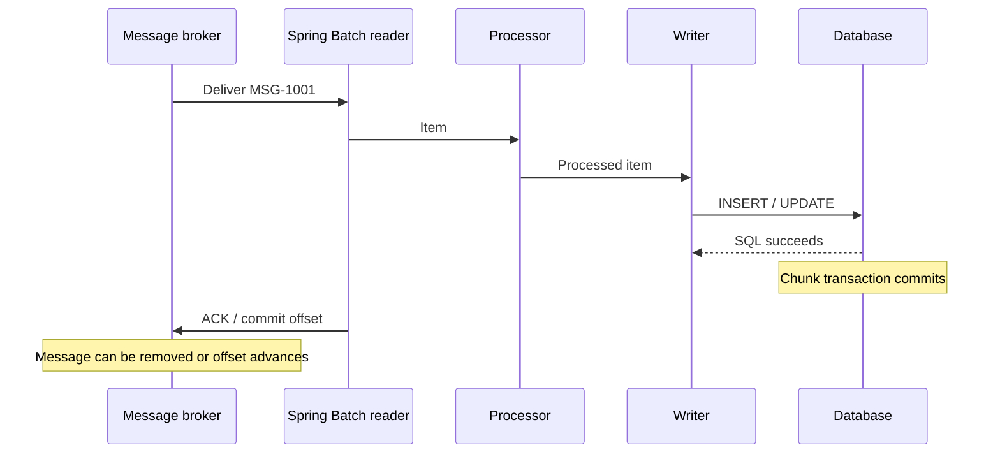
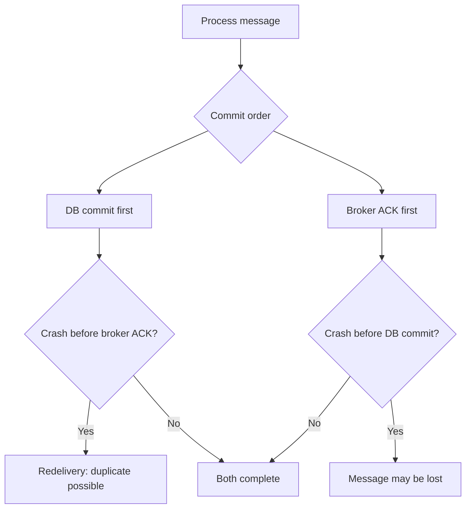
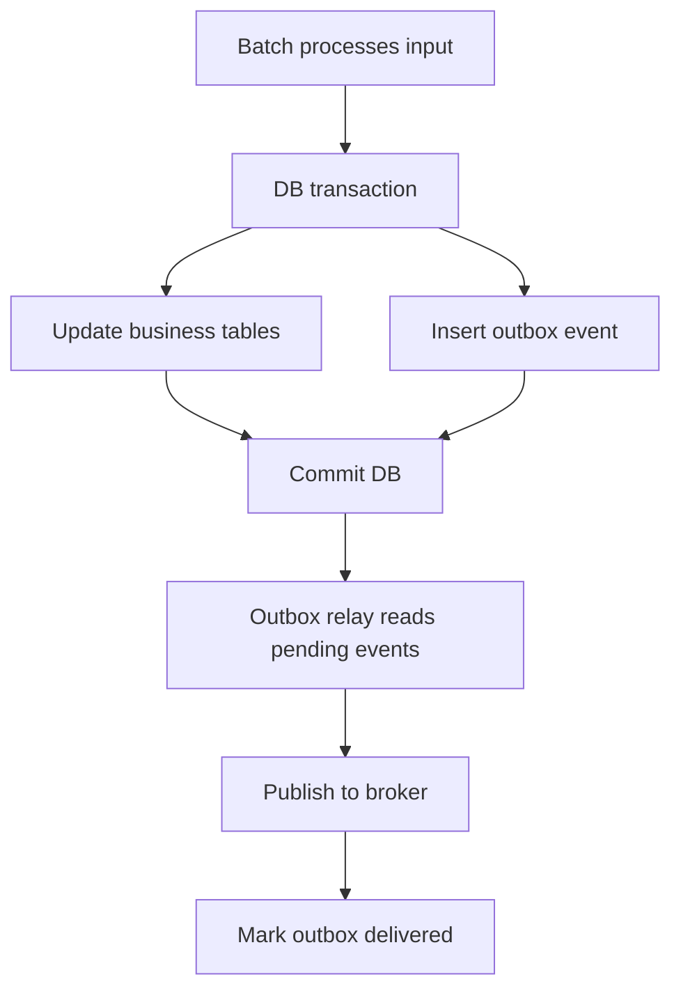
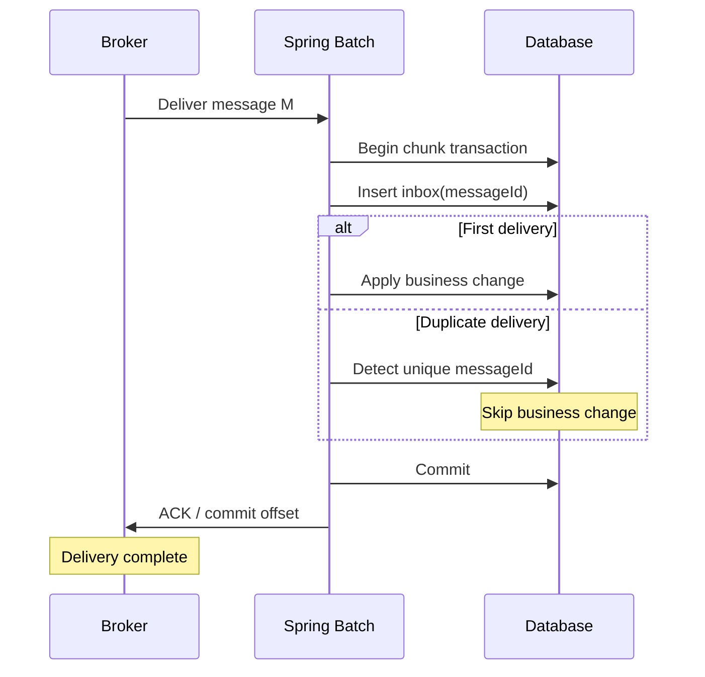

# Batch Commit vs. Broker Commit

When Spring Batch processes messages from Kafka, RabbitMQ, JMS, or another message broker, at least two states must be managed: business data committed to the database, and messages confirmed as processed by the broker. These two operations are commonly called **batch/database commit** and **broker commit** (or acknowledgement/offset commit depending on the broker).

The two operations serve different goals:

- **Batch commit** confirms that the chunk's transaction has completed. Business changes in the database are committed by the step's transaction manager.
- **Broker commit** confirms that messages have been consumed or offsets saved. The broker relies on this state to decide whether to redeliver messages.

If the two operations are not part of a single atomic transaction, there is a window where one side has committed while the other has not. That is the root source of duplicate processing or message loss.

Therefore, when designing message processing with Spring Batch, do not merely ask "when does the chunk commit?". Determine how the reader receives messages, where broker acks/offsets happen, which transaction manager governs each resource, and what happens if the process dies between the two commits.

## 1. Two Types of Commits Solve Two Different Problems

Suppose a job reads messages requesting order creation:

1. Broker delivers message `MSG-1001`.
2. Spring Batch reads and converts the message into an item.
3. Processor validates and builds order data.
4. Writer inserts the order into the database.
5. Chunk transaction commits.
6. Broker is notified the message was processed.

Batch commit makes business data durable. Broker commit/ack stops the message from continuing to be delivered as unprocessed.



The diagram illustrates the desired order in a common design. Actual ordering depends on the reader, listener container, transaction manager, and broker integration. Not every `ItemReader` waits until chunk commit before acking messages.

## 2. What Is a Batch Commit?

In a chunk-oriented step, Spring Batch reads and processes items in groups. With a chunk size of 100, the step typically reads up to 100 items, processes them, invokes the writer, and then commits the chunk's transaction if everything succeeds.

Example:

```java
return new StepBuilder("consumeMessagesStep", jobRepository)
        .<IncomingMessage, Order>chunk(100, transactionManager)
        .reader(messageReader)
        .processor(messageProcessor)
        .writer(orderWriter)
        .build();
```

Here `transactionManager` manages the chunk's transaction according to application configuration. If the writer uses JDBC/JPA and the same resource managed by that transaction manager, database changes commit or roll back per chunk.

A batch commit typically includes:

- Inserts/updates/deletes of business data.
- Writes to inbox/deduplication tables if sharing the same database transaction.
- Checkpoint/`ExecutionContext` updates per the Spring Batch and `JobRepository` lifecycle.
- Committing the step-managed transaction.

A batch commit does not automatically mean the broker has acked messages. Nor is `JobRepository` a message broker; job metadata and broker offsets/acks are two separate kinds of state.

## 3. What Does Broker Commit Mean?

"Broker commit" is a general phrase. Exact APIs vary by broker:

| Technology | Common Operation | Meaning |
|---|---|---|
| Kafka | Commit consumer offset | Persists how far a consumer group has processed |
| RabbitMQ | ACK delivery | Confirms a delivery has been processed |
| JMS transacted session | Session commit | Commits the JMS transaction, including acking messages received in the session |
| JMS `CLIENT_ACKNOWLEDGE` | Message/session acknowledge per JMS semantics | Confirms messages have been consumed |

Do not say "commit offset" for RabbitMQ or call a JMS ACK a Kafka offset. Although their goals are similar, their semantics and failure behaviors differ.

### Kafka Offsets

Kafka stores messages in partitions by offset. Consumer groups commit offsets so the broker knows where to resume reading when consumers start or rebalance.

If a consumer processes through offset 105 and commits the next offset 106, the consumer group can resume from 106. Committing offsets does not delete records from the log; retention policy governs how long records stay.

### RabbitMQ Acknowledgement

RabbitMQ delivers messages to consumers. Once a consumer sends an ACK, the broker can remove the message from the queue. If the consumer/channel closes before ACK, unconfirmed messages can be requeued and redelivered per configuration.

ACKs are normally tied to a channel-scoped delivery tag. A delivery tag is not a business ID and should not be persisted as a durable message identifier.

### JMS Acknowledgement/Transactions

With a JMS transacted session, committing the session confirms messages received within the transaction and commits messages sent in the same session transaction. With other acknowledgement modes, timing and scope depend on session mode and provider.

A local JMS transaction does not automatically include a database transaction without proper coordination.

## 4. Why Can the Two Commits Diverge?

Databases and brokers are usually two independent resources. A local database transaction commits only the database; a broker acknowledgement updates only consumption state on the broker.

If the application runs two operations sequentially:

1. Commit database.
2. Ack message.

then the process can stop after step 1 and before step 2. The database already saved the result, yet the broker still redelivers the message.

If the order is reversed:

1. Ack message.
2. Commit database.

the process can stop after step 1 and before step 2. The broker thinks the message is done, while the database rolled back or never saved the data. The message can be lost from the pipeline.



These are the two fundamental failure windows. Choosing commit order can prioritize preventing message loss, yet idempotency is still required to handle duplicates.

## 5. DB Commit First, Broker ACK Second

This is the common approach when preventing message loss is the priority:

1. Receive message.
2. Process and write to database.
3. Commit database.
4. Only then ACK or commit offset.

If the process dies after step 3, the broker can redeliver the message. Because the database has already committed, the redelivery must be recognized as a duplicate and produce no additional business effect.

Benefits:

- Never ACKs a message before business data is saved.
- If an error occurs before database commit, the message can still be redelivered.
- Achieves at-least-once delivery combined with idempotent processing.

Trade-offs:

- Duplicate deliveries are normal inside the failure window.
- Requires business keys or an inbox table for deduplication.
- Prolonged ACK failures can cause the broker to redeliver repeatedly.

Do not call this exactly-once merely because database commit precedes ACK. This is at-least-once with safe duplicate handling.

## 6. Broker ACK First, DB Commit Second

If a message is ACKed before the database transaction commits, a subsequent database error can remove the message from the queue/consumer group without corresponding business data.

Example:

1. Consumer receives `MSG-1001`.
2. Broker receives ACK or offset commit.
3. Database insert fails.
4. Chunk rolls back.
5. Broker does not redeliver because the message was already confirmed.

This order is generally unsuitable when zero data loss is required.

Choose these semantics only when another durable mechanism already saved the message earlier, or the business accepts message loss at this step. Otherwise, place ACKs after data has committed or use proper transaction coordination.

## 7. At-Most-Once, At-Least-Once, and Exactly-Once

Three concepts describe how many times a message can produce processing effects:

| Semantics | Characteristics | Primary Risk |
|---|---|---|
| At-most-once | Messages are not processed twice, but may be lost | Data loss |
| At-least-once | Messages are redelivered until confirmed; may be processed multiple times | Duplicate side effects |
| Exactly-once effect | Business outcome is applied once observationally | Requires appropriate transactions/deduplication |

A broker may offer delivery/consumption features with certain semantics, but that does not automatically make a database update and a broker ACK one atomic operation.

For example, Kafka transactions can support atomic consume-transform-produce within Kafka: output records and consumer offsets commit in the same Kafka transaction. This does not automatically include an external relational database.

In database-writing applications, the common practical approach is at-least-once delivery plus idempotent database writes. Phrase it accurately as "effectively-once application of business effects" when the system deduplicates successfully, rather than claiming the broker delivers every message strictly once.

## 8. Idempotency Is Essential When Commits Are Independent

Idempotent processing means processing the same message multiple times yields no extra business effect beyond the result applied the first time.

Each message should carry a stable identifier, such as:

- Producer-generated `messageId`.
- `eventId` in the payload.
- Unique business transaction reference.
- Combination of producer ID and sequence if defined by contract.

Do not use a delivery tag, a standalone Kafka consumer offset, or receive timestamp as a business idempotency key. Delivery tags are channel-scoped; offsets only have meaning within one topic/partition; timestamps can collide.

An inbox table can record processed messages:

```sql
create table processed_message (
    message_id varchar(120) primary key,
    processed_at timestamp not null,
    result_ref varchar(120)
);
```

Within the same database transaction:

1. Attempt to insert `messageId` into the inbox table.
2. If the insert succeeds, apply business changes.
3. Commit both the inbox row and business data.
4. ACK the message only after commit.
5. If the message is redelivered, the unique key detects the duplicate and the application skips the second business update.

Critical condition: the inbox marker and business changes must share the same transaction. If you write and commit the inbox separately before the business update, a crash can cause redeliveries to be treated as processed even though business data was never written.

## 9. Example Inbox Pattern with Spring

A message-processing service can use a database transaction:

```java
@Service
public class MessageProcessingService {

    private final ProcessedMessageRepository processedMessages;
    private final OrderRepository orders;

    public MessageProcessingService(
            ProcessedMessageRepository processedMessages,
            OrderRepository orders) {
        this.processedMessages = processedMessages;
        this.orders = orders;
    }

    @Transactional
    public ProcessingResult process(IncomingMessage message) {
        if (processedMessages.existsById(message.messageId())) {
            return ProcessingResult.ALREADY_PROCESSED;
        }

        processedMessages.save(
                new ProcessedMessage(message.messageId()));

        orders.apply(message.toOrderCommand());

        return ProcessingResult.APPLIED;
    }
}
```

This is an illustrative skeleton. Under concurrent execution, check-then-insert has a race condition if you only call `existsById` followed by `save`. Rely on a unique constraint on `message_id` and handle duplicate-key conflicts safely, or use database-specific insert-if-absent/upsert.

If the transaction rolls back, both the inbox row and business update roll back. If commit succeeds but ACK fails, redelivery sees `message_id` already exists and does not reapply the business update.

## 10. Avoiding Race Conditions When Deduplicating

Two consumers or two redeliveries can process the same message nearly simultaneously. This pattern is unsafe:

```java
if (!repository.existsById(messageId)) {
    repository.save(new ProcessedMessage(messageId));
    applyBusinessChange();
}
```

Both transactions can see the record missing and both run business logic before one is rejected by the unique constraint.

Let the database enforce uniqueness:

```sql
insert into processed_message(message_id, processed_at)
values (:messageId, current_timestamp)
on conflict (message_id) do nothing;
```

This is PostgreSQL syntax. Other databases may use `MERGE`, `INSERT IGNORE`, or equivalent mechanisms. After inserting, check the created row count; only the transaction winning the insert applies the business update.

With JPA, you can rely on a unique constraint and catch duplicate-key exceptions at an appropriate transaction boundary. Be careful: after a persistence exception, the transaction may already be marked rollback-only; do not continue using that transaction as if it were still valid.

## 11. Chunk Size vs. Broker Batch Size

Spring Batch chunk size and the number of messages a broker delivers in one poll/delivery are two different parameters.

For example:

- The reader may poll up to 500 messages.
- Step chunk size is 100 items.
- One poll can feed multiple chunks.
- Each chunk commits the database separately.

Never infer that polling 500 messages means 500 messages are ACKed at the exact same instant. Readers/containers may manage acks, buffers, and checkpoints with distinct semantics.

| Parameter | Controls |
|---|---|
| Chunk size | Number of items in one Spring Batch chunk transaction |
| Broker poll/fetch size | Number of messages the broker returns in one fetch/poll |
| Prefetch (e.g., RabbitMQ) | Number of unacked deliveries the broker can push before consumer ACK |
| Commit interval/offset batch | Record count or timing for committing offsets per integration |

Parameters interact around throughput and memory, but do not substitute for one another.

## 12. Does a Message-Reading Reader ACK Immediately on Read?

This must be verified for the specific implementation. An `ItemReader` may:

- Read messages from a queue via JMS APIs.
- Use a listener container to receive messages upfront into a buffer.
- Poll a Kafka consumer and hold records in memory.
- Use a Spring Integration or Spring Cloud Stream adapter.
- Use a custom reader managing offsets/acks.

Some integrations ACK when a callback/listener completes, some hold messages in a transacted session, and some commit offsets per batch or checkpoint. You cannot deduce ACK timing merely from a step using chunk size 100.

When evaluating a reader, answer:

1. When does the broker deliver the message?
2. Is the message buffered in memory or fetched directly inside `read()`?
3. Does the reader ACK/commit offsets inside `read()`, `update()`, `close()`, or via a listener container?
4. If the processor/writer fails, is the message redelivered?
5. If the process dies after DB commit, has the offset/ack been saved yet?
6. Does a Spring Batch restart recover `ExecutionContext`, or does the broker redeliver messages itself?

If you cannot answer these from code and configuration, you cannot assert the job will not lose or duplicate messages.

## 13. Spring Batch ExecutionContext Is Not a Broker Offset

Spring Batch saves reader checkpoints in `ExecutionContext` to restart a `StepExecution`. Brokers maintain offset/ack state using their own mechanism.

The two states can diverge:

- `ExecutionContext` saved item position, yet the broker offset has not committed.
- The broker offset committed, yet `ExecutionContext` has not saved the checkpoint.
- The broker redelivers messages that the Batch checkpoint considers already passed.
- A Batch restart re-reads items while the broker consumer group advances from a later offset.

When a reader manages message positions, decide which state is the source of truth and how the two checkpoints stay synchronized.

Never arbitrarily store broker offsets in `ExecutionContext` while simultaneously letting the consumer auto-commit. The two mechanisms can compete and produce inconsistent restart positions.

## 14. Kafka: Offset Commits and Database Transactions

With Kafka, consumer groups commit offsets per partition. If the application enables auto-commit, offsets can commit on the consumer's timer, independent of whether the database chunk committed.

For database-writing batch jobs, auto-commit is risky because consumers can commit offsets before data is durably persisted. A crash can prevent records from being redelivered.

Common principles:

- Disable or explicitly control auto-commit when offsets must align with processing outcomes.
- Commit offsets only after the business transaction commits when preventing message loss takes priority.
- Use idempotency because a crash between DB commit and offset commit can still trigger redelivery.
- Preserve per-partition processing order if business logic relies on ordering.
- Understand rebalances and consumer groups when workers stop or drop heartbeats.

Spring Kafka has its own acknowledgement modes and transaction support for listener containers. If Spring Batch reads directly via `KafkaItemReader` or a custom `KafkaConsumer` reader, semantics depend on the reader implementation. Do not mechanically apply listener container settings to `KafkaItemReader`.

### Offset Represents the Next Position

When committing an offset, the value typically indicates the next position the consumer will read in that partition. For instance, once the record at offset 25 finishes processing, the consumer group normally commits 26 so the next run starts at 26.

Be careful when comparing "last processed offset" with "committed offset"; they differ by one under the next-offset convention.

## 15. Kafka Consume-Transform-Produce Within a Kafka Transaction

If a job reads from Kafka and writes results back to Kafka, Kafka transactions can support atomic consume-transform-produce within Kafka:

1. Consumer reads records.
2. Producer sends output records within the transaction.
3. Consumer offsets are added to the transaction.
4. Kafka commits the transaction.

If the transaction aborts, output records and offsets in the transaction are not marked committed. Other consumers configured with `isolation.level=read_committed` will not read uncommitted output records.

This is useful when both input and output live in Kafka. It does not automatically commit a JPA/JDBC database in the same transaction. If the same step both writes PostgreSQL and produces to Kafka, add outbox/inbox or explicit transaction coordination.

## 16. RabbitMQ: ACK, NACK, and Requeue

RabbitMQ uses acknowledgements per delivery or group of deliveries depending on the API:

- ACK confirms a message was processed.
- NACK/Reject can requeue or discard/dead-letter a message depending on parameters/configuration.
- If the consumer/channel closes before ACK, unconfirmed messages can be redelivered.

In a design prioritizing zero message loss:

1. Receive delivery.
2. Write to database inside transaction.
3. Commit database.
4. ACK delivery.

If the process dies between 3 and 4, the message can be redelivered. Inbox/idempotency handles the duplicate.

With a Spring AMQP listener container, acknowledgement mode, channel transactions, and transaction managers must be configured explicitly. A channel transaction and a database transaction are not automatically one atomic distributed transaction.

Publisher confirms also differ from consumer ACKs:

- Publisher confirm verifies the broker received/persisted the publish per broker semantics.
- Consumer ACK verifies the consumer processed the delivery.

Never substitute publisher confirms for consumer acknowledgements.

## 17. JMS: Transacted Sessions and Database Transactions

JMS has a transacted session mode. Inside a JMS session transaction, acknowledgements of received messages and outbound sends can commit together via `session.commit()`.

However, if the application simultaneously updates a database via a local JDBC/JPA transaction, the two resources remain independent unless proper XA/JTA coordination is used.

Modes to distinguish:

- Transacted session: commits/rolls back the JMS session.
- `AUTO_ACKNOWLEDGE`: provider acknowledges automatically per rules after the listener receives the message successfully.
- `CLIENT_ACKNOWLEDGE`: client explicitly acknowledges per JMS semantics.
- `DUPS_OK_ACKNOWLEDGE`: allows lazy acknowledgement with potential duplicates.

ACK timing and scope depend on session settings and provider. With Spring JMS, `DefaultMessageListenerContainer` or other adapters may manage session transactions instead of direct reader code.

When using a JMS reader in Spring Batch, check the actual transaction manager and session mode. Never assume the chunk's `transactionManager` automatically commits a JMS session if the reader does not participate in that transaction.

## 18. XA/JTA: Coordinating Database and Broker

XA/JTA can coordinate multiple XA-capable resources in a distributed transaction via two-phase commit (2PC).

Conceptually:

1. Transaction manager starts a global transaction.
2. Database and broker join the transaction.
3. Prepare phase: each resource confirms it can commit.
4. Commit phase: transaction manager instructs resources to commit.
5. If prepare fails, the transaction manager can instruct a rollback.

When both database and broker properly participate in an XA transaction, the goal is avoiding states where one resource commits while the other rolls back during normal operation.

However, XA carries prerequisites:

- Both database driver and broker must support compatible XA resources.
- Requires a JTA transaction manager and proper resource enlistment configuration.
- Incurs coordination and logging overhead.
- Can produce in-doubt/heuristic outcomes during severe resource or network failures.
- Recovery logs and transaction managers add operational complexity.
- Not every broker integration or cloud service supports XA.

Never enable XA just by adding an annotation. Properly configure the transaction manager, XA datasources/connection factories, and test crash/recovery.

## 19. Local Transaction Synchronization Is Not XA

Some Spring integrations allow synchronizing two local transactions by commit order—for example, committing the database transaction first and the broker transaction second, or vice versa per configuration.

This is transaction synchronization, not XA 2PC. If the second resource fails to commit after the first already committed, no atomic rollback automatically reverses the first resource.

Inspect carefully:

- The step's primary transaction manager.
- The broker's secondary transaction manager.
- Commit ordering.
- How exceptions during commit phase propagate to the step.
- Recovery behavior after a process crash.

A test that only passes the happy path does not prove two local transactions are atomic. Test failure windows or choose suitable idempotent/outbox patterns.

## 20. Outbox Pattern When Batch Writes Database and Publishes Messages

A common scenario is a batch job reading messages, updating a database, and emitting new events. If updating the database and publishing messages happen separately, you risk:

- DB commits while publish fails: downstream misses the event.
- Publish succeeds while DB rolls back: downstream receives an event inconsistent with database state.

The outbox pattern solves this by writing business data and an outbox row in the same database transaction:



The batch transaction commits both business data and the outbox row. A separate relay reads the outbox and publishes. If the relay crashes after publishing but before marking delivered, the event may be published again; consumers still need idempotency.

Outbox does not guarantee strictly once publishing, yet it eliminates the window where "business DB committed with no durable record to publish."

## 21. Combining Inbox and Outbox

In event-driven systems:

- Inbox protects consumers from processing the same message multiple times.
- Outbox ensures business transactions persist events that need publishing.

A batch job can:

1. Receive an input message.
2. Insert an inbox marker.
3. Update business data.
4. Insert an outbox event.
5. Commit a single database transaction.
6. ACK the input message after commit.
7. Let the outbox relay publish output events.

Steps 2–4 share one database transaction. Input broker ACK remains a separate operation, so a crash after DB commit can trigger redelivery; the inbox prevents duplicate business effects.

When outputs publish from an outbox, the relay also needs retries, publisher confirms, and consumer-side idempotency.

## 22. Skip, Poison Messages, and Dead-Letter Queues

Not every message can be processed successfully:

- Malformed payload format.
- Missing required fields.
- Business rule violations.
- Transient database errors.
- Oversized messages or limit violations.

Distinguish:

| Error | Typically Appropriate Behavior |
|---|---|
| Transient errors like timeout/deadlock | Bounded retry with backoff |
| Permanently invalid messages | Reject/quarantine or dead-letter |
| Widespread config/infrastructure failure | Fail step/job and leave messages unacked |
| Already-processed duplicate | Do not repeat business effects, then ACK/commit per policy |

With Spring Batch skip, an item can be skipped inside a chunk. However, whether skipping triggers a broker ACK depends on the reader/container integration. Define whether skipped messages are:

- Intentionally ACKed and discarded.
- Published to a DLQ and only then ACKed.
- Written to a reject table/outbox in the DB transaction and then ACKed.
- Retained while failing the step for investigation.

Never configure skip and assume the broker will automatically move messages to a DLQ. Skip policy and broker dead-letter policy are two separate mechanisms.

If publishing failing messages to a DLQ, design so messages are not lost between DLQ publishing and source ACK. Use suitable broker transactions, outboxes, or idempotent DLQ publishers.

## 23. Retries and Broker Redelivery

Spring Batch retries and broker redeliveries also differ:

- **Batch retry**: Spring Batch re-attempts an operation within chunk/retry policy scope.
- **Broker redelivery**: the broker re-sends a message after a consumer fails to ACK, rolls back a session, or leaves an offset uncommitted.

An item may be retried within the same step before the chunk rolls back. If the step fails, the message may be redelivered by the broker on the next run/consumer depending on ack semantics.

Avoid infinite retries on permanent data errors. Use retry limits, backoff, and exception classification:

```java
return new StepBuilder("consumeMessagesStep", jobRepository)
        .<IncomingMessage, Order>chunk(50, transactionManager)
        .reader(messageReader)
        .processor(messageProcessor)
        .writer(orderWriter)
        .faultTolerant()
        .retry(TransientDataAccessException.class)
        .retryLimit(3)
        .skip(InvalidMessageException.class)
        .skipLimit(20)
        .build();
```

This only configures policy for the chunk step. It does not configure Kafka offsets, Rabbit ACKs, or JMS session commits. Broker integration must be configured and tested separately.

## 24. Ordering and Partitions

Brokers can guarantee ordering within a defined boundary:

- Kafka guarantees order per partition.
- RabbitMQ order is affected by queues, consumer concurrency, requeues, and redeliveries.
- JMS order depends on provider, sessions, selectors, and consumer concurrency.

If a chunk collects messages from multiple partitions or queues, batch commits can finish messages out of broker order. When business logic needs ordering by customer/order key:

- Partition messages by business key.
- Process sequentially within each partition.
- Avoid concurrent processing of messages with strict ordering dependencies.
- Ensure offsets/acks advance only past safely processed messages per broker semantics.

With Kafka, never commit an offset higher than an unprocessed record in the same partition if doing so skips the failing record. Consumer offset commits typically reflect a contiguous processed position; parallel processing must track completed offsets per partition.

## 25. Chunk-Based Batch Commit vs. Partition-Based Broker Commit

Kafka offset commits are typically per partition, whereas a Spring Batch chunk may contain messages from multiple partitions.

Example:

| Partition | Offsets in Chunk |
|---|---|
| P0 | 10, 11, 12 |
| P1 | 40, 41 |

If all items in the chunk commit to the database successfully, you can commit the next positions per partition as `P0:13` and `P1:42`, provided the reader has contiguously processed up to those offsets.

If `P0` offset 11 fails while 12 finishes in parallel, you cannot simply commit `P0:13` and skip 11. The reader/consumer integration must track contiguous completed offsets.

With a custom batch reader, store partition and offset alongside the message ID. Never store only a single global offset across all partitions.

## 26. Reader-Managed Broker State vs. Listener Container

Two architectures are common:

### Spring Batch Reader Polls Directly

The reader invokes consumer/queue APIs to pull messages and manages positions/acks. The reader can implement `ItemStream` to persist checkpoints. Buffering uncommitted messages while a chunk has not committed requires careful design.

### Listener Container Receives Messages First

A listener container manages consumers, threads, acknowledgements, and error handling; the application can feed messages into a queue/buffer for the batch step to process. This introduces an extra boundary between the listener transaction and batch transaction.

There is no single right answer for every system. Choose based on throughput, ordering, backpressure, restart, and transaction requirements.

If the listener ACKs a message right after pushing it into an in-memory queue, a process crash can lose unprocessed messages from memory. When buffering between listener and batch, either make the buffer durable or have the listener ACK only after data is saved to a durable staging/inbox table.

## 27. Backpressure and Memory Limits

If the broker delivers messages faster than the batch can process them, the reader or listener can accumulate messages in memory.

Parameters to consider:

- Kafka `max.poll.records` and poll interval.
- RabbitMQ prefetch count.
- JMS consumer/session buffering.
- Batch chunk size.
- Thread count and partition count.
- Average/maximum payload size.
- Per-item processing time and writer latency.

A large chunk size does not solve backpressure on its own. It can lengthen transactions and increase the number of messages waiting to commit.

Bound in-flight message counts, monitor queue/consumer lag, chunk duration, and heap usage. For listener-to-batch buffers, use bounded queues and pause/resume or flow-control policies.

## 28. Observing Commits and Redeliveries

For operations, monitor both sides:

**Spring Batch**

- Job/step statuses.
- Read, write, filter, and skip counts.
- Commit/rollback counts.
- Chunk durations.
- Restart counts and failure exceptions.

**Broker**

- Kafka committed offsets and consumer lag per partition.
- RabbitMQ ready/unacked messages, redelivery counts, and DLQ depth.
- JMS queue depth, pending/in-flight messages, and provider redelivery counts.
- ACK/commit failures and consumer rebalances/reconnects.

**Database**

- Transaction commits/rollbacks.
- Lock waits, deadlocks, and connection pool usage.
- Inbox duplicate counts.
- Business write counts and constraint errors.

Do not look solely at `JobExecution` `COMPLETED`. A job may complete while consumer lag grows or messages redeliver endlessly. Conversely, low broker lag does not prove the database wrote accurately.

## 29. Happy-Path Testing Is Not Enough

An integration test checking only:

1. Publish message.
2. Launch job.
3. Job `COMPLETED`.
4. Database contains one row.

does not test the failure window between batch commit and broker commit.

Test these scenarios:

- Message received, then processor throws an exception.
- Writer fails before database commit.
- Database commit succeeds, then broker ACK/offset commit fails.
- Broker ACK succeeds, then process dies before Batch checkpoint.
- Messages redelivered after restart.
- Two consumers receive the same message nearly simultaneously.
- Chunk contains messages from multiple partitions.
- Poison message routed to DLQ.

The goal is verifying zero message loss and ensuring duplicates never produce duplicate business effects.

## 30. Testing Crash After DB Commit Before ACK

This is a critical test for at-least-once:

1. Publish a message with a fixed `messageId`.
2. Let the batch write business data and inbox marker, then commit.
3. Simulate a failure before ACK/offset commit.
4. Verify the broker redelivers the message.
5. Rerun the consumer/job.
6. Verify the inbox recognizes the duplicate.
7. Verify the business row was applied only once.
8. Verify the message is eventually ACKed/offset-committed after the duplicate is handled safely.

You can use fault-injection hooks in tests to trigger failures at this exact boundary. Do not rely on random timing or manual process kills for repeatable tests.

## 31. Testing Failure Before DB Commit

Another test:

1. Publish message.
2. Reader receives message.
3. Writer makes partial changes and intentionally throws an exception before commit.
4. Verify database rolls back.
5. Verify the message has not been ACKed or the offset has not advanced past it.
6. Restart/retry.
7. Verify the message processes successfully.

If the message was already ACKed before the writer failed, the test exposes a message-loss risk. This is why actual acknowledgement modes must be verified.

## 32. Testing Kafka Consumer Offsets

With Kafka, integration tests should verify:

- Records are read from expected partitions/offsets.
- Offsets are not committed before the business transaction completes.
- On DB rollback, records can be re-read.
- When DB commits but offset commit fails, redelivery causes no duplicates.
- Offsets commit per partition without skipping unprocessed records.
- Rebalances do not lose in-flight records.

Use Embedded Kafka or Testcontainers Kafka matching your Spring Kafka version. When testing consumer group behavior, use an isolated group ID per test and inspect committed offsets via consumer/admin APIs.

## 33. Testing RabbitMQ ACKs and Redelivery

With RabbitMQ, verify:

- Unacked messages are requeued when the consumer/channel closes.
- ACK after DB commit removes the message from the queue.
- DB rollback before ACK triggers message redelivery.
- DB commit followed by ACK failure triggers redelivery while inbox prevents duplicates.
- NACK/reject requeues or dead-letters per configuration.
- Publisher confirms for DLQ/outbox publishing are tested separately from consumer ACKs.

Use Testcontainers RabbitMQ or a compatible test broker. Avoid mocking only `Channel.basicAck`, because mocks do not verify whether the broker actually redelivers or routes messages to a DLQ.

## 34. Testing JMS Transactions

With JMS, verify:

- Transacted session commit confirms received messages.
- Session rollback allows messages to be redelivered per provider semantics.
- `AUTO_ACKNOWLEDGE` and `CLIENT_ACKNOWLEDGE` behave as expected with the listener/reader.
- Database transaction rollbacks do not accidentally let the JMS session commit.
- If using XA, test prepare/commit/rollback and recovery behavior on an XA-capable broker/DB.

JMS providers can differ in redelivery counts, delays, and dead-letter policies. Test on a provider close to production rather than assuming identical behavior across providers.

## 35. Testing Spring Batch and Broker Restarts

Restarting Spring Batch and reconnecting a consumer are not the same thing.

A restart test must determine:

- Is the `JobInstance` resumed or newly created?
- Which reader position does `ExecutionContext` restore?
- Where is the broker offset/ack state?
- Are unacked messages redelivered?
- Are messages that were ACKed before the Batch checkpoint updated skipped?
- Does inbox/idempotency guard against duplicates?

With Kafka, a consumer group can resume from committed offsets; Spring Batch may have its own checkpoint. If both control position, define a clear strategy to avoid excessive re-reading or skipping records.

With RabbitMQ/JMS, unacked messages are usually redelivered by the broker after a consumer/session drops, while Batch `ExecutionContext` may still hold its own state. Verify the real interaction via restart tests.

## 36. Example At-Least-Once Design with Inbox

A conceptual flow:



If a crash occurs after DB commit and before ACK, the broker redelivers `M`. The inbox detects the duplicate, skips reapplying the business change, and ACKs after the duplicate-handling transaction completes.

This is how you achieve once-applied business effects even though deliveries can repeat. It requires stable message IDs, a unique constraint, and proper transactions.

## 37. Example Combining Inbox and Outbox

When a batch both consumes messages and emits new events:

```text
Input broker
    -> Batch reader
    -> DB transaction:
         - insert inbox marker
         - update business state
         - insert outbox event
    -> DB commit
    -> ACK input
    -> Outbox relay publishes output event
```

Benefits:

- Duplicate inputs do not repeat business updates.
- Business updates and event publishing intent are saved atomically in the database.
- The outbox relay can retry after broker failures.
- Downstream consumers can likewise use an inbox to deduplicate.

The outbox relay can publish duplicates if the broker accepts an event and the relay dies before marking delivered. Downstream consumers still need idempotency.

## 38. Transaction Options and When to Use Them

| Pattern | Suitable When | Trade-Offs |
|---|---|---|
| DB commit then ACK + Inbox | Want zero message loss and accept redelivery | Requires deduplication |
| XA/JTA | Both DB and broker support XA and distributed coordination is needed | Complex operations and recovery |
| Kafka transaction | Consume-transform-produce runs entirely within Kafka | Does not automatically cover external DBs |
| Inbox + Outbox | Need consistent DB state with input dedup and output events | Extra tables and relay |
| ACK before DB commit | Only when another durable staging layer exists or loss is acceptable | Risk of message loss |

Choose according to business semantics, broker/database capabilities, and operational capacity. No single Spring Batch annotation solves every type of commit.

## 39. Design Checklist

Before implementing batch message processing, answer:

1. Is the broker Kafka, RabbitMQ, JMS, or another technology?
2. Which reader/adapter receives messages, and who owns the consumer/session/channel?
3. When are messages ACKed or offsets committed?
4. When does the chunk database transaction commit?
5. Do both resources participate in XA/JTA, or only local transactions?
6. If DB commit succeeds but ACK fails, how are duplicates handled?
7. If ACK succeeds but DB rolls back, is there a durable copy for recovery?
8. Do messages have stable message IDs/business keys?
9. Do inbox/dedup markers share the same transaction as business changes?
10. Where do skipped/poison messages go: DLQ, reject table, or fail job?
11. Are Batch `ExecutionContext` and broker offset/ack states synchronized?
12. Can ordering, partitions, and concurrency advance offsets past unprocessed messages?
13. Are crashes tested at every failure window?
14. Do metrics track batch commits, broker commits, redeliveries, and consumer lag?

If commit ordering and failure behavior are not yet established, do not enable auto-ack/auto-commit in a job writing critical business data.

## 40. Common Mistakes

**Assuming chunk commit automatically commits the broker.** Chunk transactions manage only resources participating in that transaction. ACKs/offsets may be managed separately by the reader or listener container.

**Committing the broker before the database.** A process crash can make messages disappear while the business transaction rolls back. Prefer committing DB before ACK when at-least-once is needed.

**Committing DB before ACK without idempotency.** A crash between the two causes redelivery and duplicate business writes. Use an inbox or unique business key.

**Confusing Spring Batch checkpoints with Kafka offsets.** The two states have different lifecycles and storage. Define the source of truth and synchronization strategy.

**Using auto-commit without understanding poll/processing duration.** Offsets can advance before a chunk completes. Check consumer configuration and disable/control auto-commit when needed.

**Assuming Kafka exactly-once covers databases.** Kafka transactions coordinate operations within Kafka only, unless separate transaction coordination exists.

**Confusing RabbitMQ publisher confirms with consumer ACKs.** Publisher confirms and consumer ACKs operate in opposite directions.

**Assuming JMS local transactions cover JPA/JDBC.** Session transactions do not automatically enlist local database transactions. You need XA/JTA or another pattern.

**Treating Spring Batch skip as a DLQ.** Skip policies only decide whether item exceptions are bypassed. Routing messages to a DLQ is the responsibility of integration/broker configuration or a dedicated writer.

**ACKing messages as soon as they enter an in-memory queue.** A process crash loses messages not yet processed by the batch. Use durable staging or ACK only after durable persistence.

**Committing offsets past unprocessed records.** Especially dangerous during parallel processing within the same Kafka partition. Commit only contiguous completed offsets.

**Skipping crash-window tests.** Happy-path tests miss duplicates and data loss between DB commits and broker commits. Use fault injection and real brokers in integration tests.

## 41. Implementation Workflow

A practical sequence:

1. Identify the broker and its ack/offset semantics.
2. Identify the reader/adapter and where broker state is committed.
3. Define the transaction manager for the chunk database.
4. Choose the order of DB commit and broker ACK/offset commit.
5. Without an atomic transaction across both resources, favor at-least-once and idempotent processing.
6. Establish stable message IDs and an inbox table with a unique constraint.
7. If publishing output events, write outbox rows inside the same business transaction.
8. Classify retryable, skippable, and fatal errors; design DLQ/reject flows.
9. Tune chunks, poll/fetch, prefetch, and concurrency for throughput/backpressure.
10. Test DB rollbacks, ACK failures, redeliveries, duplicates, restarts, and ordering.
11. Monitor Batch metrics, broker lag/redeliveries, and database transaction metrics.
12. Claim exactly-once only when atomic/idempotent mechanisms prove end-to-end semantics.

## 42. Practical Conclusion

Batch commit and broker commit are two separate operations. Batch commit makes chunk changes durable in the database; broker commit/ACK/offset commit confirms messages were consumed per broker semantics. When the two operations do not share one distributed transaction, there is always a failure window where one side committed and the other did not.

For database-writing message processing, the common and operationally manageable model is DB commit first, broker ACK second, combined with stable message IDs and the Inbox pattern so redeliveries produce no duplicate business effects. If the batch also emits events, the Outbox pattern stores publishing intent in the same transaction as business data. XA/JTA can coordinate database and broker when both support it and the system accepts its operational cost; Kafka transactions only guarantee atomicity within Kafka.

Verify exactly which reader/container manages ACKs or offsets, never confuse `ExecutionContext` with broker checkpoints, and test crash scenarios between the two commits. A reliable design must explain both the happy path and recovery when the database commits successfully yet the broker has not confirmed, or vice versa.
