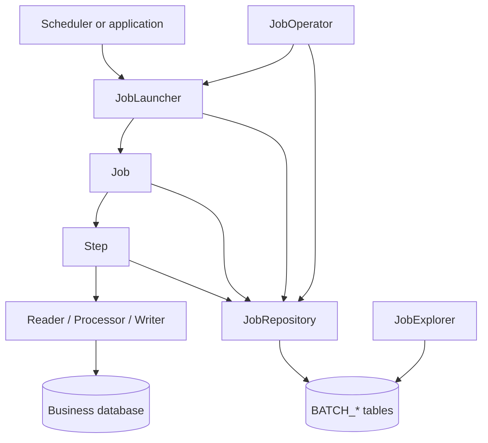
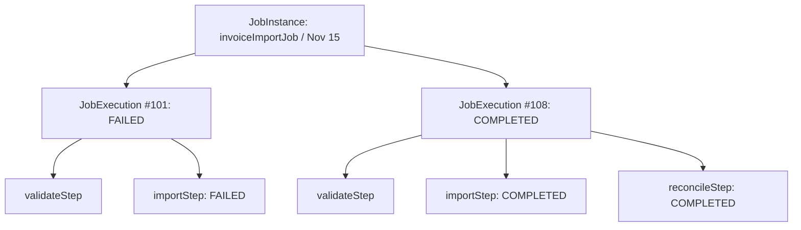
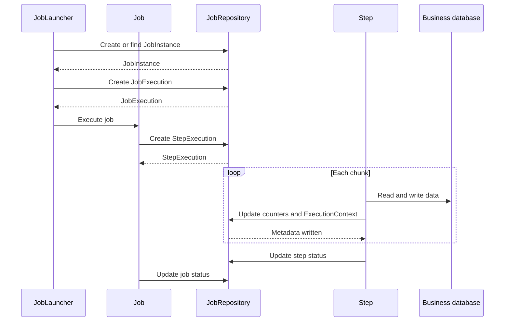

# How Does JobRepository Store Batch Metadata?

In Spring Batch, a job does not simply do its work and then end. The framework also needs to know which job has been launched, which parameters that run used, which steps have completed, how many items were read or written, whether the run failed, and where it can resume from. This operational information is called **batch metadata**.

`JobRepository` is the component responsible for storing and retrieving that metadata. With the common JDBC configuration, the data is stored in database tables with the `BATCH_` prefix. Metadata helps Spring Batch distinguish a logical run from individual executions, manage restarts, prevent certain duplicate runs, and supply data to monitoring tools.

This article goes from the object model to the storage tables, the metadata-writing lifecycle, transactions, restart, how to query, and the decisions needed when operating in production. The examples focus on Spring Batch 5.x and Spring Boot 3.x; specific column names or schemas may differ between Spring Batch generations and database management systems.

## 1. What Is JobRepository?

`JobRepository` is the central abstraction Spring Batch uses to manage the state of jobs and steps. Components such as `JobLauncher`, `Job`, `Step`, and tasklet/chunk steps interact with the repository during launch and execution.

With a JDBC repository, metadata is written to the database so that it survives application restarts. This is the common configuration in real environments because a process can stop, a container can be recreated, and a job may need to resume after an incident.

The main responsibilities of `JobRepository` include:

- Creating and storing a `JobInstance` when there is a new logical run.
- Creating a `JobExecution` for each execution of that instance.
- Creating and updating `StepExecution` as steps start, finish, or change state.
- Storing the `JobParameters` used to identify and describe the run.
- Storing the `ExecutionContext` to restore the state needed on restart.
- Updating the status, run times, item counts, and the number of commits and rollbacks.
- Coordinating transactions and controlling execution creation when there are concurrent launch requests.

`JobRepository` is not the place that stores all of the batch's business data. For example, imported invoices still live in business tables or staging tables. The repository only stores metadata describing the process of handling those invoices.

### Where JobRepository Sits in the Architecture



The business processing flow reads and writes data through the reader, processor, and writer. In parallel with that flow, Spring Batch uses the repository to record progress and state. `JobExplorer` reads metadata for lookup purposes; `JobOperator` provides operational actions such as start, stop, or restart through the corresponding batch services.

## 2. Distinguishing JobInstance, JobExecution, and StepExecution

These are the three most important concepts when reading metadata.

### 2.1. JobInstance — A Logical Run

`JobInstance` represents a logical run of a job. Its identity is determined by:

- The job name.
- The `JobParameters` marked as identifying.

For example, the job `invoiceImportJob` processes the file `invoice-2026-11-15.csv` for the business date `2026-11-15`. If these two parameters are identifying, they determine one `JobInstance`.

When the same job is called again with exactly that set of identifying parameters, Spring Batch recognizes it as the same instance. This is very important for restart: the next run must be tied to the instance that failed, so the framework can restore the previous metadata and state.

### 2.2. JobExecution — A Specific Execution

`JobExecution` represents one execution of a `JobInstance`. One instance can have multiple executions:

- The first execution starts but fails because the database temporarily loses its connection.
- The next execution restarts the same instance and completes.
- Each execution has its own ID, start/end times, status, and error information.

Therefore, `JobInstance` and `JobExecution` are not two names for the same thing. The instance describes the logical work to be processed; the execution describes one attempt to perform that work.

### 2.3. StepExecution — One Execution of a Step

Each time a step is executed within a `JobExecution`, Spring Batch creates or updates a corresponding `StepExecution`. The step's metadata records:

- The step name and the ID of the parent job execution.
- The status and exit status.
- The start time, end time, and most recent update time.
- The number of items read, written, filtered, and skipped.
- The number of commits and rollbacks.
- The number of read, process, or write errors that were skipped.
- The step's execution context.

A job with multiple steps has multiple step execution records while it runs. This lets operators know exactly which phase has completed and which phase hit an error.

### Relationship Between the Three Objects



The diagram shows that one instance can have a failed execution and a restart execution that completes. Each execution has its own set of step executions. The IDs in the diagram are only examples to illustrate the relationships.

| Object | Question It Answers | Commonly Used Identifier |
|---|---|---|
| `JobInstance` | Which logical batch of work is this? | Job name + identifying parameters |
| `JobExecution` | Which specific execution is this? | Job execution ID |
| `StepExecution` | Which step within that execution? | Step execution ID, step name, and job execution ID |

## 3. How Are JobParameters Stored and Used for Identification?

`JobParameters` is the set of parameters passed when launching a job. They can contain input information such as:

- The path or code of the source file.
- The business date.
- The batch code or request code.
- The time range to process.
- Control options supported by the job.

Each parameter has a name, value, data type, and an identifying attribute. Only identifying parameters take part in forming the `JobInstance` identity.

For example:

```java
JobParameters parameters = new JobParametersBuilder()
        .addString("inputFile", "invoice-2026-11-15.csv", true)
        .addString("businessDate", "2026-11-15", true)
        .addString("requestId", "request-8f21", false)
        .toJobParameters();

jobLauncher.run(invoiceImportJob, parameters);
```

In the example:

- `inputFile` is an identifying parameter.
- `businessDate` is an identifying parameter.
- `requestId` is a non-identifying parameter, useful for tracing but does not change the instance identity.

Two launches with the same job name, the same file, and the same business date point to the same `JobInstance`, even if `requestId` differs. If the job has already completed, Spring Batch usually refuses to run that instance again as a new run. If the previous execution failed and can be restarted, the application can restart the same instance.

When you need to process a new business batch, pass a new meaningful identifying parameter, such as a new business date or batch code. Do not add a random timestamp just to avoid the already-completed-instance error: that creates a different instance and loses the restart semantics.

### The JobExecutionParams Table

In the Spring Batch 5 schema, the table is usually named `BATCH_JOB_EXECUTION_PARAMS`. This table stores the parameters associated with a job execution, including the parameter name, type, value, identifying flag, and the related execution ID.

The column names of this table have changed between versions. The older schema may use columns such as `TYPE_CD`, `KEY_NAME`, `STRING_VAL`, `LONG_VAL`, `DOUBLE_VAL`, or `DATE_VAL`; the Spring Batch 5 schema uses the `PARAMETER_NAME`, `PARAMETER_TYPE`, `PARAMETER_VALUE`, and `IDENTIFYING` model. When writing operational SQL, always check against the actual schema of the application version.

## 4. The Main Metadata Tables

With the JDBC `JobRepository`, Spring Batch uses a group of relational tables. The default names usually start with `BATCH_`.

| Table | Contents |
|---|---|
| `BATCH_JOB_INSTANCE` | Identity of job instances |
| `BATCH_JOB_EXECUTION` | Each job execution, its status and times |
| `BATCH_JOB_EXECUTION_PARAMS` | The job parameters of an execution |
| `BATCH_STEP_EXECUTION` | Status and counters of each step execution |
| `BATCH_JOB_EXECUTION_CONTEXT` | Execution context at the job level |
| `BATCH_STEP_EXECUTION_CONTEXT` | Execution context at the step level |

Some databases or schemas also have sequence tables such as `BATCH_JOB_SEQ`, `BATCH_JOB_EXECUTION_SEQ`, and `BATCH_STEP_EXECUTION_SEQ` to allocate IDs. How IDs are allocated depends on the database and the schema provided for that platform.

### 4.1. BATCH_JOB_INSTANCE

This table stores the logical identity of each instance. Common columns:

| Column | Meaning |
|---|---|
| `JOB_INSTANCE_ID` | Primary key of the instance |
| `VERSION` | Version used for optimistic locking |
| `JOB_NAME` | Job name |
| `JOB_KEY` | A value representing the set of identifying parameters |

Spring Batch uses the job name and a key generated from the identifying parameters to recognize an instance. The database schema has a corresponding unique constraint to avoid creating two identical instances under normal conditions.

`JOB_KEY` is not a place that stores all parameters for operators to read. Parameter details are stored in the job execution parameters table.

### 4.2. BATCH_JOB_EXECUTION

This table stores each specific execution. Common fields include:

| Column | Meaning |
|---|---|
| `JOB_EXECUTION_ID` | ID of the execution |
| `JOB_INSTANCE_ID` | Parent instance |
| `CREATE_TIME` | Time the execution was created |
| `START_TIME` | Time execution started |
| `END_TIME` | Time execution ended |
| `STATUS` | Technical status of the execution |
| `EXIT_CODE` | Exit code used for flow and reporting |
| `EXIT_MESSAGE` | Information explaining the result or error |
| `LAST_UPDATED` | Time the metadata was last updated |
| `VERSION` | Version for optimistic locking |

A running execution may not yet have an `END_TIME`. Therefore, you should not conclude that a job is hung based on this field alone; combine it with `STATUS`, `LAST_UPDATED`, the application's heartbeat if any, and actual process information.

### 4.3. BATCH_STEP_EXECUTION

This table helps observe progress per step. Besides the step name, parent execution, and status, the common counters include:

| Counter | Meaning |
|---|---|
| `READ_COUNT` | Number of items the reader has read |
| `WRITE_COUNT` | Number of items the writer has successfully written according to the step's statistics |
| `FILTER_COUNT` | Number of items filtered out by the processor by returning null |
| `READ_SKIP_COUNT` | Number of items skipped due to read errors per the skip policy |
| `PROCESS_SKIP_COUNT` | Number of items skipped due to processing errors |
| `WRITE_SKIP_COUNT` | Number of items skipped due to write errors |
| `COMMIT_COUNT` | Number of commits recorded |
| `ROLLBACK_COUNT` | Number of rollbacks recorded |

The counters are operational figures following Spring Batch semantics. They do not replace business reconciliation in the target database. For example, `WRITE_COUNT` does not by itself prove that every invoice was written correctly or that none was written twice in a system outside the transaction.

### 4.4. BATCH_JOB_EXECUTION_CONTEXT and BATCH_STEP_EXECUTION_CONTEXT

These two tables store the `ExecutionContext` at the job level and step level respectively.

- The job execution context stores state needed for the whole job or shared between steps.
- The step execution context stores the step's own state, commonly used by readers/writers to restore position or progress.

With a file-reading reader, the execution context may contain the line position or offset to continue reading from. With a database reader, the context may contain paging state or the last key, depending on the implementation.

The JDBC schema usually has columns such as `SHORT_CONTEXT` and `SERIALIZED_CONTEXT`, but the details depend on the schema and version. The context content may be serialized; do not assume every value will be stored as an easily readable SQL column.

Do not put passwords, access tokens, sensitive personal data, or large payloads into the execution context. The context is state for recovery, not a secrets vault or a store for business data.

## 5. How Is Metadata Written During a Job's Lifecycle?

A run usually passes through the following milestones:



At a conceptual level, the steps proceed as follows:

1. `JobLauncher` receives the job name and `JobParameters`.
2. The repository finds or creates the `JobInstance` corresponding to the identifying parameters.
3. The repository creates a new `JobExecution` for the execution.
4. When a step starts, Spring Batch creates a `StepExecution` and stores its initial state.
5. While running, the framework updates counters, times, and the execution context.
6. When the step ends, the step's status and exit status are updated.
7. When the job ends, the job's status and exit status are updated.

Not every metadata field is written exactly once. Some fields are updated during the run, such as chunk counters, `LAST_UPDATED`, the execution context, and the status.

### Why Store State Per Chunk?

Suppose a file has 10,000 lines and the chunk size is 500. If the first 6 chunks have committed and then the 7th chunk hits an error, the metadata can show that the step has processed up to the previous commit boundary. A reader capable of saving state can restore the corresponding position when the job is restarted.

If only a single state were stored at the end of the job, the system would not know which part had completed and would have to re-read the whole file. The chunk boundary together with the execution context helps Spring Batch track progress in finer detail.

This depends on the reader/writer supporting state saving and being configured correctly. For example, `saveState(false)` on a reader that supports state turns off state saving for that reader; on restart, the application must have another strategy to determine where to continue.

## 6. Transactions and Consistency Between Metadata and Business Data

Metadata needs to be consistent with processing progress. If business data has committed but the metadata says the chunk has not completed, or vice versa, a restart can cause omissions or duplicate processing.

With the common chunk configuration, the step performs read, process, and write within a transaction boundary. Updates to the execution context and chunk-related metadata are coordinated with the transaction according to the repository and transaction manager configuration.

### When Metadata and Business Data Use the Same Transaction

If the business writer and the JDBC `JobRepository` participate in the same transaction manager on the same transactional resource, writing business data and updating chunk state can be committed or rolled back together. This is a favorable condition for restarting accurately at the chunk boundary.

However, this should not be generalized to every architecture. If the metadata repository and the business database are two different datasources, or the writer calls an HTTP service, sends a message, or writes to object storage, a single database transaction cannot automatically roll back all of those side effects.

### When Metadata and Business Data Are in Separate Databases

If the two databases are different, you need to define clearly how they are coordinated:

- Accept and handle the possibility that one system has committed while the other has not.
- Use a distributed transaction mechanism if the platform and requirements truly need it, while understanding the operational cost.
- Design an idempotent writer so the operation can be safely repeated.
- Use a staging table and a controllable merge step.
- Use a transactional outbox when you need to publish events after business data has been committed.

Do not assume that `JobRepository` automatically turns external databases or systems into one atomic transaction.

### Optimistic Locking

Some metadata tables have a `VERSION` column. The repository uses the version mechanism to detect unwanted concurrent updates. If two threads update the same execution based on the same version, one thread may get an optimistic locking error instead of silently overwriting the other's state.

When you hit an optimistic locking error, review whether the same execution is being updated concurrently from multiple threads/processes, the repository and transaction configuration, and how the step is partitioned or run in parallel.

### Isolation When Creating an Execution

When two requests to launch the same job with the same identifying parameters arrive almost simultaneously, the repository must prevent both from creating a conflicting instance or execution. The JDBC repository can use a high isolation level for the job-execution creation operation; the default is usually configured toward `SERIALIZABLE` for this creation step.

The isolation level can be adjusted when configuring the repository, but changing it should be based on the database, the concurrent launch load, and how the application orchestrates jobs. Do not lower the isolation just to avoid locks without checking the risk of creating duplicate executions.

## 7. Status: BatchStatus and ExitStatus

Metadata stores status to describe the technical lifecycle of a job/step. You need to distinguish `BatchStatus` from `ExitStatus`.

### BatchStatus

`BatchStatus` is the lifecycle status managed by Spring Batch. Common statuses include:

| Status | General Meaning |
|---|---|
| `STARTING` | The execution is being initialized |
| `STARTED` | The execution is running |
| `STOPPING` | A stop has been requested and is awaiting processing |
| `STOPPED` | The execution has stopped as requested |
| `COMPLETED` | The execution completed along the technical flow |
| `FAILED` | The execution failed |
| `ABANDONED` | The execution has been marked as not to be restarted |
| `UNKNOWN` | The status cannot be determined with certainty |

The specific statuses and valid transitions need to be checked against the framework version.

### ExitStatus

`ExitStatus` describes the ending result and can be used in flow transitions. Besides common codes such as `COMPLETED`, `FAILED`, or `STOPPED`, an application can create its own exit codes such as `COMPLETED_WITH_WARNINGS`.

For example, a step may complete technically but have some records skipped. The application can use a custom exit status to route to a reconciliation step or raise a warning.

Do not just look at `BatchStatus=COMPLETED` and conclude the business data is entirely correct. Check the exit code, skip counts, reconciliation results, and business metrics.

## 8. How Do JobRepository, JobExplorer, and JobOperator Differ?

The three components often appear together but have different roles:

| Component | Role |
|---|---|
| `JobRepository` | Writes and manages metadata during execution |
| `JobExplorer` | Reads metadata to look up job instances, executions, and step executions |
| `JobOperator` | Provides operational actions such as start, stop, restart, and abandon |

### Using JobExplorer to View History

Example of a service that looks up the recent instances of a job:

```java
@Service
public class BatchHistoryService {

    private final JobExplorer jobExplorer;

    public BatchHistoryService(JobExplorer jobExplorer) {
        this.jobExplorer = jobExplorer;
    }

    public List<JobExecution> recentExecutions(String jobName) {
        List<JobInstance> instances =
                jobExplorer.findJobInstancesByName(jobName, 0, 20);

        return instances.stream()
                .flatMap(instance ->
                        jobExplorer.getJobExecutions(instance).stream())
                .sorted(Comparator.comparing(
                        JobExecution::getCreateTime).reversed())
                .toList();
    }
}
```

This is a basic lookup example. In a real application, you should paginate results, handle the case where there is no execution yet, and return only the fields needed for the screen or API.

### Using JobOperator for Operational Actions

`JobOperator` provides higher-level execution management operations, such as:

- Start a job with the job name and a parameter string in a supported format.
- Restart an execution that is eligible for restart.
- Send a stop request to a running execution.
- Abandon an execution according to operational policy.

These operations need to be protected with authorization and audit logs. Do not leave a public endpoint that lets any user restart or stop production batches.

## 9. Querying Metadata with SQL

`JobExplorer` is the right API for an application to read metadata using the Spring Batch model. Direct SQL is useful for investigation, internal dashboards, or operational reports, but it must depend precisely on the schema of the version being deployed.

### 9.1. Viewing Recent Runs

Example using common table and column names in the JDBC schema:

```sql
SELECT
    ji.JOB_NAME,
    je.JOB_INSTANCE_ID,
    je.JOB_EXECUTION_ID,
    je.STATUS,
    je.EXIT_CODE,
    je.CREATE_TIME,
    je.START_TIME,
    je.END_TIME,
    je.LAST_UPDATED
FROM BATCH_JOB_INSTANCE ji
JOIN BATCH_JOB_EXECUTION je
    ON je.JOB_INSTANCE_ID = ji.JOB_INSTANCE_ID
WHERE ji.JOB_NAME = 'invoiceImportJob'
ORDER BY je.CREATE_TIME DESC;
```

This query shows the executions belonging to the selected job, including the instance ID, execution ID, status, and times. You can add conditions by date or status depending on the database and dashboard.

### 9.2. Viewing Step Counters

```sql
SELECT
    STEP_EXECUTION_ID,
    STEP_NAME,
    STATUS,
    READ_COUNT,
    WRITE_COUNT,
    FILTER_COUNT,
    READ_SKIP_COUNT,
    PROCESS_SKIP_COUNT,
    WRITE_SKIP_COUNT,
    COMMIT_COUNT,
    ROLLBACK_COUNT,
    START_TIME,
    END_TIME
FROM BATCH_STEP_EXECUTION
WHERE JOB_EXECUTION_ID = :jobExecutionId
ORDER BY STEP_EXECUTION_ID;
```

This query helps identify which step reads a lot of data, which step has skips or rollbacks, and which step has no end time yet. Use bind parameters instead of concatenating IDs from input strings.

### 9.3. Viewing an Execution's Parameters — Spring Batch 5 Schema

```sql
SELECT
    PARAMETER_NAME,
    PARAMETER_TYPE,
    PARAMETER_VALUE,
    IDENTIFYING
FROM BATCH_JOB_EXECUTION_PARAMS
WHERE JOB_EXECUTION_ID = :jobExecutionId;
```

If the system uses the older schema, the query needs its column names changed according to the actual DDL. Do not run SQL based on the 5.x schema against a database that still uses the older schema.

### 9.4. Finding Executions Running Too Long

You can start with a query that finds executions in the `STARTED` status whose `LAST_UPDATED` is older than the operational threshold:

```sql
SELECT
    ji.JOB_NAME,
    je.JOB_EXECUTION_ID,
    je.STATUS,
    je.START_TIME,
    je.LAST_UPDATED
FROM BATCH_JOB_INSTANCE ji
JOIN BATCH_JOB_EXECUTION je
    ON je.JOB_INSTANCE_ID = ji.JOB_INSTANCE_ID
WHERE je.STATUS IN ('STARTED', 'STARTING', 'STOPPING')
ORDER BY je.LAST_UPDATED ASC;
```

This is only a list to investigate. A job can legitimately run for a long time without updating metadata often; conversely, a process may have died while its metadata has not been recovered. Combine it with logs, metrics, container/process status, and the SLA before deciding to stop or restart.

## 10. Configuring and Initializing the JDBC JobRepository

In a Spring Boot application with the Spring Batch starter and a suitable datasource, Boot usually auto-configures the batch infrastructure, including `JobRepository`, and then provides beans for jobs/steps to use.

A job should receive the repository through dependency injection:

```java
@Configuration
public class InvoiceJobConfig {

    @Bean
    Job invoiceImportJob(
            JobRepository jobRepository,
            Step importInvoicesStep) {

        return new JobBuilder("invoiceImportJob", jobRepository)
                .start(importInvoicesStep)
                .build();
    }
}
```

There is no need to create your own `JobRepository` implementation in each job. Let the application's infrastructure configuration manage the repository and use that bean in the builders.

### Schema Initialization

Spring Batch provides DDL for the supported databases. In development or test environments, Spring Boot can initialize the schema automatically with the configuration:

```properties
spring.batch.jdbc.initialize-schema=always
```

Common options include `always`, `embedded`, and `never`; the default value and specific behavior depend on the Spring Boot version. When using an embedded database, the schema may be initialized automatically by default.

In production, you should manage the metadata DDL with controlled migrations. Choose a schema version compatible with the Spring Batch that is running, deploy the migration before putting the new application version into use, and check the database user's permissions.

Do not drop and recreate the `BATCH_*` tables on every deployment. Doing so loses history, execution contexts, and the ability to restart.

### Table Prefix and a Separate Schema

In some systems, metadata needs to live in a separate schema or group of tables. The JDBC repository supports configuring a table prefix; how to configure it depends on how the application enables the batch infrastructure and on the Spring Batch/Spring Boot version.

If you change the prefix, you must ensure that all related metadata tables, the DDL, `JobRepository`, and `JobExplorer` all point to the correct group of tables. A prefix does not replace a database schema and does not create new tables by itself.

### Notes on Using @EnableBatchProcessing

`@EnableBatchProcessing` can be used to enable and customize the Spring Batch infrastructure. In a Spring Boot application, adding this annotation yourself may change, or cause part of Boot's batch auto-configuration to no longer be applied, depending on the version. Only add it when you need to control the infrastructure deliberately and understand the impact on the current configuration.

## 11. How Does Restart Rely on Metadata?

When a job fails, metadata helps Spring Batch know:

- Which instance is being restarted.
- Which status the previous execution ended with.
- Which steps have completed.
- Which steps failed or have not run.
- Which recovery state the execution context contains.

When restarting with the same identifying parameters, Spring Batch can create a new `JobExecution` for the same `JobInstance`. Steps that have completed are usually not run again in the standard restart flow; steps that have not completed are executed according to the stored state and the job configuration.

For example, a job has three steps:

1. `validateFileStep` completes.
2. `importInvoicesStep` fails at the 7th chunk.
3. `reconcileStep` has not run.

On a valid restart, Spring Batch can skip the completed validation step, continue the import step from the saved state, and run reconcile only after the import completes.

### Conditions for a Meaningful Restart

- Reuse exactly the same identifying parameters to match the old instance.
- The reader supports saving state and keeps a stable name.
- The input is not changed between the original run and the restart.
- The execution context can be deserialized by the current application version.
- The writer has a policy against duplicate writes, or its side effects are protected.
- The metadata schema and transaction manager remain consistent.

If the reader uses `saveState(false)`, the data source is unstable, or the writer creates non-idempotent side effects, a restart may not produce the correct business result even though the repository has stored the metadata in full.

### Restart Differs from Reprocess

Restart continues the same instance that has not completed. Reprocess deliberately processes data that has already completed again, or creates a new logical run. Reprocess needs a new batch code/version or identifying parameter, and a clearly designed rule for rewriting the data.

Do not directly edit `BATCH_JOB_EXECUTION` or delete metadata to force a job to run again. Use the supported operational API and an audited reprocess procedure.

## 12. Schema Changes and Compatibility Between Versions

The metadata schema is part of the application infrastructure. Upgrading Spring Batch can come with changes to the DDL, column names, data types, or how parameters and the execution context are stored.

Some points to note:

- The Spring Batch 5 schema has a different structure for storing job parameters than the older schema.
- The column type that stores the execution context depends on the database and the DDL provided.
- Sequence tables may differ between databases with native sequences and databases that use sequence tables.
- The repository, explorer, and running jobs must all understand one compatible schema.
- Do not let two incompatible application versions write metadata into the same schema during a rolling deployment.

When upgrading:

1. Read the migration guide for the target Spring Batch version.
2. Compare the current DDL with the DDL provided for the new version.
3. Back up the metadata database according to the backup policy.
4. Run the migration in a test environment with representative metadata.
5. Test reading history, restarting a failed execution, and launching a new job.
6. Plan the deployment to avoid the old and new versions both writing an incompatible schema.

Do not rename columns or change data types based solely on an SQL example from the Internet. The DDL of the running application is the accurate basis.

## 13. Performance, Indexes, and Metadata Size

Metadata is usually smaller than business data, but a system that runs many jobs every day over a long period can still accumulate millions of execution records.

### Factors Affecting Performance

- The number of job instances and executions created.
- The frequency of step execution and execution context updates.
- The size of the serialized data in the execution context.
- The number of workers/partitions updating metadata concurrently.
- Isolation level and lock contention at launch.
- Indexes and constraints on join and search keys.
- The commit speed of the metadata database.

Do not optimize by arbitrarily reducing metadata updates. First, measure query time, lock waits, transactions, and context size.

### Indexes and Constraints

Spring Batch's standard DDL creates the keys and indexes needed for the common relationships. When you have a dashboard or your own investigation queries, look at the execution plan before adding indexes. Additional indexes also increase the write cost when jobs update metadata continuously.

Keep the schema's unique constraints. They are part of protecting metadata integrity, especially with concurrent launches.

### Metadata Cleanup

Metadata may need to be retained for a long time for auditing, supporting investigations, and restarts. Establish a retention policy based on business requirements:

- Keep executions that are running or can still be restarted.
- Keep the history needed for auditing and reporting.
- Only delete old metadata when you are sure no dependencies remain.
- Use a tool or cleanup procedure that has been tested against the current schema and version.
- Back up before cleanup according to the operational policy.

Do not delete from a single table or a single execution row with an arbitrary SQL statement. The tables have foreign keys and relationships among instances, executions, step executions, parameters, and contexts. Deleting in the wrong order can break references or lose the ability to investigate.

## 14. Metadata Security and Reliability

Job parameters and the execution context may contain file paths, customer codes, routing information, or operational data. Therefore:

- Only store values that are truly needed for identification or restart.
- Do not store credentials, secrets, or tokens.
- Limit personal data and sensitive business data.
- Authorize read/write access to the metadata tables by role.
- Do not grant direct update/delete permissions to dashboard users.
- Protect APIs that use `JobExplorer` and `JobOperator`.
- Error logs should include the execution ID and a reference code instead of dumping the entire context.

`EXIT_MESSAGE` and exception messages can contain sensitive information if the code puts input data into the exception content. Standardize error messages and control who can view metadata.

The metadata database also needs backup and restore according to policy. If you restore the business database to one point in time but the metadata repository is at another, the batch state may not match the committed data. The disaster recovery plan must consider both sides and define how to reconcile/reprocess after recovery.

## 15. Common Errors When Working with JobRepository

### JobInstanceAlreadyCompleteException

The common cause is launching a job with the same identifying parameters after the instance has completed. Check the job name and identifying parameters. If it is a new business batch, use a new identifying parameter; if you want to continue a failed execution, use the appropriate restart procedure.

### JobExecutionAlreadyRunningException

Spring Batch sees that the corresponding instance has a running execution. Check the process, scheduler, and duplicate launch requests before acting. Do not modify the state in the database yourself to get past the check.

### JobRestartException

The previous execution may not be eligible for restart, may have been abandoned, or its status/metadata may be inappropriate. Look at `BatchStatus`, `ExitStatus`, the logs, and the job's restart policy.

### OptimisticLockingFailureException

This can happen when multiple threads update a metadata record based on an old version. Check the multithreading configuration, partitioning, transactions, and whether multiple processes are acting on the same execution.

### BadSqlGrammarException or Missing Table/Column Errors

This is usually related to a schema that was not initialized, using the DDL of a different version by mistake, a wrong table prefix, or the datasource configuration. Compare the SQL log, the current database/schema, and the DDL of the correct version.

### Restart Reads the Wrong Position or Processes Data Twice

The repository may have stored the state correctly, but the data source has changed, the reader does not support state, or the writer is not idempotent. Check the input identity/checksum, the reader name, `saveState`, the execution context, and the transaction boundary.

## 16. JobRepository Design Checklist for Production

Before putting a batch job into production, confirm that:

- The JDBC repository uses a datasource and transaction manager that are configured deliberately.
- The metadata schema matches the Spring Batch version that is running.
- The schema is managed through migrations and has backups.
- The job name and identifying parameters have a stable business meaning.
- The reader/writer support restart according to the data contract.
- The execution context does not contain secrets or large payloads.
- Job/step status, exit status, and counters are observed.
- There are alerts for executions that run too long, fail, or have skips exceeding a threshold.
- There are authorized procedures for restart, stop, abandon, and reprocess.
- There is a retention policy and a safe cleanup.
- There are restart tests after some chunks have committed.
- There is a plan for upgrading the schema and recovering metadata together with business data.

## 17. Summary of the Model to Remember

`JobRepository` is the metadata foundation of Spring Batch. It stores the relationships among job instance, job execution, and step execution; stores parameters and the execution context; updates statuses and counters; and also supports restart and controls execution creation.

When investigating a batch, follow this chain:

1. Find the `JOB_NAME` and `JOB_INSTANCE_ID` to identify the logical batch.
2. Look at the `JOB_EXECUTION_ID` values to see the history of each run.
3. Look at `BATCH_STEP_EXECUTION` to identify the step and the counters that caused the problem.
4. Check the parameters to confirm the input and business date.
5. Check the execution context when you need to understand the restart state.
6. Compare against business data to confirm the final result.

Understanding metadata helps design jobs that can recover, operations that can be observed, and investigations that are well grounded. The repository tells you which steps Spring Batch has performed; only business reconciliation confirms whether the final data matches the requirements.
