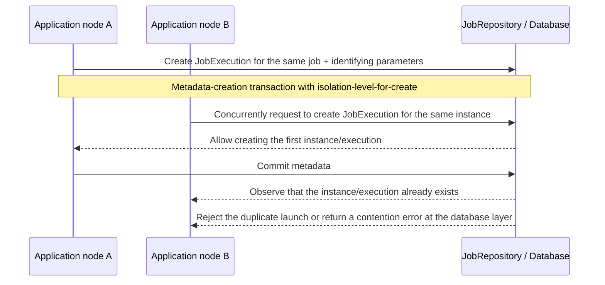

# Isolation When Starting the Same Job

In a Spring Batch system running on multiple threads or multiple servers, the same job launch request can arrive almost simultaneously from a scheduler, an API, an operator's action, or multiple application instances. If two requests both try to create a run for the same business work, the system needs to coordinate to avoid creating two identical `JobInstance`s or unintentionally executing twice.

Spring Batch handles this coordination through `JobRepository` and the database transaction. An important setting is the **isolation level for create**: the transaction isolation level used when the repository creates metadata for a new launch. By default, this setting is usually `SERIALIZABLE`, intended to protect the execution-creation operation against concurrent launch requests for the same `JobInstance`.

To understand this mechanism, you need to distinguish launching the same job definition from launching the same `JobInstance`. The repository's isolation protects the instance identity in metadata; it does not by itself lock all the business data the job will process.

## 1. Why Can Two Launch Requests Collide?

Suppose the system has a job `dailySettlementJob` that processes the transactions of one business date. The scheduler runs at 01:00, but the application is deployed on two servers. Because the schedule is triggered simultaneously, both servers call `JobLauncher` with the same parameter `businessDate=2026-11-15`.

Without suitable coordination, the two processes can both check the repository and both see that no instance exists for that date. Both then try to create metadata and launch the work. The consequences may be:

- Two processes process the same set of transactions.
- Both write results, create duplicate records, or update figures twice.
- Two executions contend for resources such as data tables, input files, or a partner API.
- Execution history becomes hard to understand if metadata is not protected properly.

This is a race condition: the outcome depends on the order and timing in which transactions run. Checking with a query and then calling the launcher is not enough to prevent a race condition, because another process can launch right after the check.

## 2. What Determines That Two Launches Have the Same JobInstance?

Spring Batch distinguishes `Job`, `JobInstance`, and `JobExecution`:

- **Job** is the process definition, for example `dailySettlementJob`.
- **JobInstance** is a specific business job, determined by the job name together with the `JobParameters` that have the identifying attribute.
- **JobExecution** is a specific execution of a `JobInstance`.

Therefore, two requests calling the same job name are not necessarily two requests for the same instance. What decides it is the set of identifying parameters.

For example:

| JobParameters | Identifying? | Result for JobInstance |
|---|---|---|
| `businessDate=2026-11-15` | Yes | Determines the business date to process |
| `requestedBy=scheduler-A` | No | Does not change the instance identity |
| `requestedBy=operator-B` | No | Can still be the same instance as the request above |
| `businessDate=2026-11-16` | Yes | Creates a different instance for the new date |
| `run.id=42` | Yes | Makes the identity different if used as an identifying parameter |

Two requests with the same job name and the same identifying parameters point to the same `JobInstance`, even when non-identifying parameters such as `requestedBy` differ.

Example of creating parameters:

```java
JobParameters parameters = new JobParametersBuilder()
        .addString("businessDate", "2026-11-15", true)
        .addString("requestedBy", "scheduler-A", false)
        .toJobParameters();

jobLauncher.run(dailySettlementJob, parameters);
```

Here `businessDate` is an identifying parameter, while `requestedBy` only adds information about the person or component that launched it. Another request that uses `requestedBy=operator-B` but keeps `businessDate` unchanged still targets the same instance.

Do not mechanically add a timestamp or request ID as an identifying parameter if the goal is to allow only one processing per business date. Each different timestamp will create a different `JobInstance` and can nullify the duplicate-launch protection for that day's work.

## 3. How Does JobRepository Coordinate Launches?

`JobRepository` is where the metadata of the job, instance, execution, and step execution is stored. When `JobLauncher` launches a job, the repository creates or retrieves the `JobInstance`, checks the previous executions, and creates a new `JobExecution` if the state allows.

The metadata-creation part must be performed in a transaction. Spring Batch sets an isolation level for the repository's create methods to coordinate concurrent requests.

General flow when two nodes launch the same instance:



The exact sequence of events depends on the database and the moment the two transactions touch. The goal is to ensure that metadata has no two instances with the same identity and the repository does not accept two concurrent executions for the same instance under Spring Batch's lifecycle rules.

In the default metadata schema, the `BATCH_JOB_INSTANCE` table has a unique constraint based on the job name and job key. The job key is generated from the identifying parameters. This constraint protects uniqueness at the database layer; transaction isolation helps the metadata check-and-create operations happen safely under contention.

## 4. What Is Isolation Level for Create?

The isolation level determines the degree to which a transaction sees and interacts with changes made concurrently by other transactions. The levels commonly found in relational databases include:

| Isolation Level | General Characteristics | Relation to Concurrent Launch |
|---|---|---|
| `READ_UNCOMMITTED` | Can read uncommitted data; a low isolation level | Not suitable for relying on a metadata check before creating |
| `READ_COMMITTED` | Reads only committed data; each statement may see a new snapshot | Two transactions can both read the no-instance state before one transaction commits; you need to additionally rely on unique constraints and conflict handling |
| `REPEATABLE_READ` | Keeps data already read stable within the transaction; phantom handling varies by database | A higher level of protection, but behavior with non-existent records and phantoms depends on the management system |
| `SERIALIZABLE` | The strongest isolation under the SQL model; the result is equivalent to some valid sequential execution order | Suitable for protecting instance/execution creation from race conditions |

In Spring Batch, `isolationLevelForCreate` determines the isolation of the metadata-creation operations. The default value is usually `SERIALIZABLE`. This is why two nodes launching the same instance cannot simply rely on both reading "no instance exists yet" and then both creating successfully.

`SERIALIZABLE` can make one transaction wait for another or be aborted by the database due to a serialization conflict/deadlock. How databases implement this isolation level differs: some systems use locks, some use conflict checking and abort one transaction. Therefore, you should not assume every database returns the same kind of error or the same wait time.

## 5. Why Is the Default Usually SERIALIZABLE?

Creating a `JobInstance` and `JobExecution` is a short but decisive operation. If two processes both create metadata for one instance, the job can run in duplicate right from the start. The cost of protecting the creation transaction is usually smaller than the risk of processing business data twice.

Spring Batch therefore usually chooses `SERIALIZABLE` as the default for the `create*` operations of `JobRepository`. This level helps protect the situation where two launchers send the same job name and identifying parameters almost simultaneously.

The important point is that this isolation does **not surround the entire time the job runs**. The execution-creation transaction ends after the launch metadata is created. The steps then use their own transactions, such as a transaction for each chunk. Therefore, a job that runs for many hours does not hold a `SERIALIZABLE` transaction for many hours.

The repository's isolation also does not replace transactions and constraints on business data. It protects the job's metadata creation. If two different `JobInstance`s update the same account or read the same file, the application still needs a suitable protection mechanism for that data.

## 6. Configuring isolation-level-for-create

When using Spring Batch XML configuration, you can declare the isolation level on `job-repository`:

```xml
<job-repository id="jobRepository"
                data-source="dataSource"
                transaction-manager="transactionManager"
                isolation-level-for-create="SERIALIZABLE" />
```

With Java configuration using `@EnableBatchProcessing`, the corresponding attribute in the versions that support it can be set as follows:

```java
@Configuration
@EnableBatchProcessing(
        isolationLevelForCreate = "ISOLATION_SERIALIZABLE"
)
public class BatchConfiguration {
}
```

You only need to configure according to the infrastructure mechanism in use. The attribute name and how the `JobRepository` is built can differ between Spring Batch versions or when the application creates a `JobRepositoryFactoryBean` itself; use the exact API of the project's version.

In most applications, you should keep the default `SERIALIZABLE`. Only consider a lower level when you have evidence of contention in the repository's creation transaction, clearly understand the database's isolation behavior, and have a way to handle conflicts at the application layer. Do not lower the isolation just to make a duplicate-launch error disappear without identifying the cause.

## 7. When Two Requests Launch Together, What Happens?

The second request's result depends on the state of the `JobInstance` at the moment the repository checks.

### The First Request Is Still Running

If a `JobExecution` of the instance is already in a running state, the second request must not create another concurrently running execution for the same instance. Spring Batch usually reports `JobExecutionAlreadyRunningException`.

This is a common situation when two nodes receive the same schedule or a user presses the run button multiple times.

### The Instance Has Completed

If the instance's most recent execution is `COMPLETED`, a request to launch the same job and identifying parameters again is usually rejected with `JobInstanceAlreadyCompleteException`.

To run for a new business period, use a different identifying parameter, for example a new business date. If you need to re-run an already-completed period to correct data, you need to design a clear reprocess procedure and control the business impact.

### The Previous Instance Failed or Stopped

If the previous execution ended `FAILED` or `STOPPED`, the new request may be treated as a restart of the same instance, if the job allows restart and the metadata meets the conditions. Spring Batch creates a new `JobExecution` attached to the same `JobInstance`.

If the job is declared non-restartable or the previous state does not allow continuing, the repository may reject with `JobRestartException`.

### Database-Layer Errors

When two transactions contend very closely, some databases may return a serialization error, a deadlock, or a duplicate key. The specific error depends on the database, the isolation, and the commit timing. The application needs to record the root cause and distinguish a launch conflict from an ordinary infrastructure error.

| Situation | Common Result |
|---|---|
| The same instance has a running execution | `JobExecutionAlreadyRunningException` |
| The same instance has completed | `JobInstanceAlreadyCompleteException` |
| The instance failed/stopped and allows restart | Creates a new execution to restart |
| The job does not allow restart or the state is not suitable | `JobRestartException` |
| The metadata-creation transactions collide in the database | May hit a serialization error, deadlock, or duplicate key depending on the database |

You should not catch all these errors and ignore them as if the job had run successfully. Record the job name, identifying parameters, the execution ID if any, and the root cause so operators know the actual state.

## 8. The Difference Between a Duplicate Launch and Intentional Parallel Runs

The isolation of `JobRepository` protects the creation of executions for the same `JobInstance`. It does not forbid every form of parallel running in Spring Batch.

For example:

- Two requests with the same `businessDate=2026-11-15` for `dailySettlementJob`: the same instance; the repository coordinates to avoid two concurrent launches.
- Two requests with `businessDate=2026-11-15` and `businessDate=2026-11-16`: two different instances; they can run concurrently if the application and resources allow.
- A job using a multi-threaded step or partitioning: workers process portions of the work that is split within the same flow/execution per the configuration; this is intentional parallelism, not two duplicate launches of an instance.
- Two differently named jobs updating the same business table: the repository sees them as different jobs; you need a separate data synchronization mechanism if there is a conflict.

If each business date is an independent unit, running the dates in parallel can be reasonable. If multiple dates update one aggregate balance or the same account, you still need business locks, transactions, unique constraints, or a safe write design.

## 9. JobParametersIncrementer and run.id Can Change the Outcome

Some applications use `RunIdIncrementer` or a `run.id` parameter to create a new instance on every launch. This is useful when the business truly needs multiple independent instances, but it can also nullify the duplicate-launch protection for one data period.

For example, two nodes both want to run reconciliation for November 15:

- If both use `businessDate=2026-11-15` as the identifying parameter and add no other identifying parameter, they target the same instance.
- If each node creates a different `run.id` itself and `run.id` is identifying, they create two different instances. The repository does not consider that a duplicate launch.

Therefore, you should not add `run.id` just to avoid `JobExecutionAlreadyRunningException`. Before using an incrementer, determine the meaning of a new run: is it a new business period, a permitted re-run, or just a duplicate request that the scheduler sent repeatedly?

If the scheduler can emit the same event multiple times, use stable identifying parameters that represent the business job. Information such as the server name, the requester, or the time a request was received is usually better suited to non-identifying parameters or operational logs.

## 10. All Nodes Must Share the Same JobRepository

Isolation can only coordinate processes that access one metadata source with a common transaction mechanism and constraints. In a multi-node environment, the application instances need to share the `JobRepository` database.

If node A and node B have two independent metadata databases, each node may not see the `JobInstance` created on the other node. Both may assume the work has never run and execute it together. Configuring `SERIALIZABLE` separately on each database does not solve this situation.

Points to align in a multi-node deployment:

- Connect to the same shared metadata database.
- The same Spring Batch schema and table prefix.
- The same rules for creating `JobParameters`, especially identifying parameters.
- The transaction manager configured correctly for the repository's datasource.
- The metadata schema is initialized and managed consistently; do not arbitrarily delete or edit execution history while jobs are active.

`JobExplorer` can be used to read execution status and history. However, reading status through `JobExplorer` and then calling `JobLauncher` is not an atomic locking mechanism. The state can change between the read and the launch. Let `JobRepository` perform the check and the execution creation in its own transaction.

## 11. Handling Duplicate Launch Requests in the Application

A scheduler or REST endpoint can receive duplicate requests due to HTTP retries, schedules on multiple replicas, or a user pressing a button multiple times. The application should handle these cases as a normal part of operations.

For example, the following snippet distinguishes common launch errors:

```java
try {
    JobExecution execution = jobLauncher.run(dailySettlementJob, parameters);
    log.info("Started job execution id={}", execution.getId());
} catch (JobExecutionAlreadyRunningException ex) {
    log.info("The same job instance is already running");
} catch (JobInstanceAlreadyCompleteException ex) {
    log.info("The same job instance has already completed");
} catch (JobRestartException ex) {
    log.error("The job instance cannot be restarted", ex);
} catch (JobParametersInvalidException ex) {
    log.error("Invalid job parameters", ex);
}
```

This is an illustrative example; the application needs to configure the logger and the response approach suited to its own API or scheduler. With a REST API, you can return a result indicating that the instance is running or has completed. With a scheduler, you can record the duplicate trigger as an event that has been handled.

Some handling principles:

- Do not relaunch with new identifying parameters just to dodge the instance-already-running error.
- Do not mark a running execution as failed yourself just because another node did not receive a launch response.
- If the database returns a serialization error or deadlock, only retry the launch-creation operation with appropriate limits and backoff; do not arbitrarily repeat business side effects.
- After an error with an unclear state, check the repository and the actual execution before deciding to restart.
- Log the important identifying parameters so you can trace which node a request came from.

## 12. Repository Isolation Does Not Replace Idempotency

Even if the repository guarantees that only one execution of the same instance is created at a time, a job can still be re-run after `FAILED` or `STOPPED`. In addition, another job or another instance can write to the same business data.

For example, a step sends a payment request to a partner API and then hits an error before the metadata records the chunk as complete. On restart, the same payment request may be sent again. The isolation of `JobRepository` cannot roll back a request that the partner system has already accepted.

To protect business side effects, you should combine:

- A unique business key for a transaction or a processing period.
- An idempotency key if the target API supports it.
- Upsert or write operations that can be safely re-run.
- A transactional outbox when you need to coordinate committing data and sending events.
- A reconciliation process to detect uncertain results after a timeout or crash.

Isolation solves the race in creating metadata; idempotency solves re-executing a business operation without creating duplicate side effects. The two mechanisms serve two different scopes and usually need to coexist.

## 13. Testing Concurrent Launch Behavior

When building a multi-node application, you should test contention behavior on the exact type of database that will be used in the deployment environment. A simple test can create two threads or two processes that call the same job with the same identifying parameters at the same time.

Points to observe:

1. Both requests use the same job name and identifying parameters.
2. The two requests are actually sent almost simultaneously, rather than running sequentially.
3. Both nodes access the same `JobRepository` and the same database schema.
4. There is only one `JobInstance` for that job name and job key.
5. The repository accepts only one running execution for the instance; the other request is handled according to the instance state or reports a conflict.
6. If the database returns a serialization/deadlock error, the application records it and handles it according to the defined retry policy.

You should run the test with a transaction manager and isolation identical to production. A simulated repository or an in-memory database does not necessarily show the correct locking, phantom read, unique constraint, and serialization behavior of the real database.

## 14. Principles to Remember

- A duplicate launch is determined by the same job name and the same identifying `JobParameters`, i.e. the same `JobInstance`.
- `JobRepository` creates metadata in a transaction and uses `isolationLevelForCreate` to protect the creation operation.
- The default is usually `SERIALIZABLE`, to avoid race conditions when multiple launchers create the same instance.
- This isolation applies to the metadata-creation operation; it does not hold a serializable transaction for the whole time the job runs.
- The metadata schema has a unique constraint on the job name and job key; the database constraint complements transaction isolation.
- An instance that is already running usually leads to `JobExecutionAlreadyRunningException`; an instance that has completed usually leads to `JobInstanceAlreadyCompleteException`.
- A failed or stopped instance can be restarted if the job and the metadata state allow.
- Adding an identifying `run.id` or timestamp can create a new instance and turn two seemingly duplicate requests into two different jobs.
- Every node must share the same `JobRepository` to coordinate launches in a distributed environment.
- The repository's isolation does not lock business data and does not replace idempotency.

Understanding `isolationLevelForCreate` helps design a safe launch mechanism when multiple schedulers or nodes are operating. When you combine a stable `JobInstance` identity, a shared repository, and idempotent handling of side effects, the application can control duplicate launches and restart reliably.
