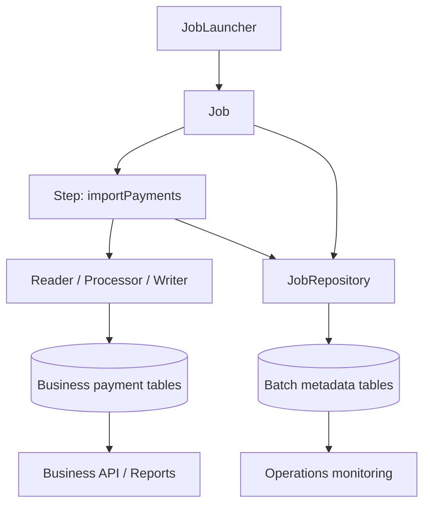

# Do Not Treat the Metadata Repository as Business Data

In Spring Batch, `JobRepository` stores metadata so the framework can manage the lifecycle of jobs and steps: which run is executing, which step has completed, how many items have been read or written, where the checkpoint is, and which state the job can restart from. This information is very important for batch operations, but it is not the application's business data.

For example, a payment-import job may have a `JobExecution` with the status `COMPLETED`. That tells you the Spring Batch execution flow completed per the configuration. It does not by itself prove that every payment is valid, has been recorded correctly, has had its money transferred successfully, or has been reconciled with external systems. To know the business status of each payment, the application needs to store and read data from the corresponding business tables or services.

Clearly distinguishing the two kinds of data helps avoid depending on Spring Batch's internal structure, preserves long-term business history, and builds reliable restart, reconciliation, and audit mechanisms.

## 1. What Does JobRepository Store?

`JobRepository` is a Spring Batch infrastructure component that provides the ability to store and retrieve metadata about executions. The job launcher, steps, and lifecycle-management components use this repository to register and update state.

The kinds of metadata usually stored include:

- **JobInstance:** identifies one business processing by the job name and the `JobParameters` marked identifying.
- **JobExecution:** information about one specific execution of a `JobInstance`, including start/end times, status, `ExitStatus`, and error information.
- **StepExecution:** the execution information of each step, such as `BatchStatus`, `ExitStatus`, the number of items read, written, filtered, skipped, and the number of commits and rollbacks.
- **JobParameters:** the parameters passed when launching the job, including identifying and non-identifying parameters.
- **ExecutionContext:** key-value state needed to restore a job or step, usually containing checkpoints and small pieces of information that support restart.

With the common JDBC configuration, Spring Batch uses a group of metadata tables. The default table names usually have the `BATCH_` prefix, for example:

| Metadata Table | Main Role |
|---|---|
| `BATCH_JOB_INSTANCE` | Stores the identity of job instances |
| `BATCH_JOB_EXECUTION` | Stores the information of each job execution |
| `BATCH_JOB_EXECUTION_PARAMS` | Stores the parameters of the execution |
| `BATCH_STEP_EXECUTION` | Stores the status and counters of each step execution |
| `BATCH_JOB_EXECUTION_CONTEXT` | Stores the job execution context |
| `BATCH_STEP_EXECUTION_CONTEXT` | Stores the step execution context |

Table names, column structure, and how parameters are stored can differ by version, schema, or prefix configuration. This is a metadata schema managed by Spring Batch; the application should initialize and upgrade the schema following the guidance corresponding to the version in use.

## 2. How Does Metadata Differ from Business Data?

Metadata describes **the running process**. Business data describes **the objects and results the system is managing**.

For example, with an invoice-processing job:

| Question | Appropriate Data Source |
|---|---|
| Which job is running? | `JobRepository` |
| Has the invoice-import step completed? | `JobRepository` |
| How many items did the run read or write? | `StepExecution` metadata |
| Which checkpoint should the reader continue from? | The step `ExecutionContext` |
| Has invoice INV-1001 been recorded? | The business invoice table |
| Has the invoice been paid? | The payment status in the business domain |
| Who approved the invoice adjustment and when? | The business audit record |
| Which message did the external system receive? | An outbox/inbox or a business integration table |

A `StepExecution` record can tell you the writer wrote 500 items in a step. It does not replace the list of 500 invoices, the amounts, the customers, the payment status, or the change history of each invoice. The counter fields are designed to observe the processing, not to query or reconstruct the entire business result.

## 3. Why Not Use the Metadata Repository as a Business Data Store?

### 3.1. Different Lifecycles and Retention Policies

Metadata is usually kept according to operational needs: tracking runs, supporting restart, investigating incidents, and monitoring job history. An organization can set a policy for cleaning old metadata after the time needed for restart has passed or after the operational retention period.

Business data usually has a longer lifecycle and follows its own requirements: retention periods for invoices, payment records, customer history, audit, or legal regulations. If you store the only copy of business results in metadata, a batch data-cleanup run could inadvertently delete business evidence.

### 3.2. The Metadata Schema Is Managed by the Framework

The structure of the `BATCH_*` tables serves Spring Batch's internal mechanisms. The framework can change the schema or how data is stored between versions. If the application uses internal columns directly as a business data contract, it creates a tight dependency on the framework version and makes upgrades difficult.

The application should interact with metadata through the APIs provided, such as `JobRepository`, `JobExplorer`, or `JobOperator`, depending on the purpose. You should not write your own `INSERT`, `UPDATE`, or `DELETE` statements into the metadata tables to control job state.

### 3.3. Job Status Does Not Equal Business Status

`BatchStatus.COMPLETED` tells you the job or step completed along the execution flow. A job can still complete when some items are skipped per the configured policy. An exception-handling branch can also be designed to record an error and then end the flow with the framework status of completed.

Conversely, a job can be in the `FAILED` status after some chunks have committed successfully. The business data written in those chunks can still exist. Therefore:

- Do not infer that all business records succeeded just from a `JobExecution` with the `COMPLETED` status.
- Do not infer that every business change has been rolled back just from the `FAILED` status.
- Do not use a custom `ExitStatus` as the official status of an invoice, order, or payment.
- Read the status of each business object from the authoritative business data store.

### 3.4. Metadata Is Not a Ledger or a Business Audit Trail

Metadata tells you which job/step ran from the framework's perspective and the execution result at the job/step level. It does not by itself provide the full history of each business change: the values before and after, the actor who performed it, the reason for the change, the approval, the data source, or the external transaction code.

If you need auditing, design a separate business audit log or ledger with an identifier, time, actor, cause, and the changed data per the requirements. Do not try to reconstruct business history from the batch logs or execution context.

### 3.5. Metadata Is Not a Query Interface for the Product

The metadata tables are optimized for managing execution and restart, not for providing an API for business screens or revenue reports. Using direct queries on these tables to answer product questions can create hard-to-maintain logic, queries with the wrong meaning, and an impact on the performance of the batch repository.

If you need operational reports, you can read metadata through `JobExplorer` or a suitable observability solution. If you need business reports, use business tables, views, or a read model designed for that need.

## 4. Example: A Payment-Import Job

Suppose a job reads a payment file, validates each line, and writes the payments into the database. The architecture should divide responsibilities as follows:



`JobRepository` receives metadata about the job and step. `ItemWriter` writes the payments into the business tables. The operations screen can display job progress from metadata, while the finance screen gets payment status from the business tables.

Example of a business table with a key that prevents duplicate imports:

```sql
CREATE TABLE payment_record (
    payment_id        BIGINT GENERATED ALWAYS AS IDENTITY PRIMARY KEY,
    batch_reference   VARCHAR(80) NOT NULL,
    source_payment_id VARCHAR(80) NOT NULL,
    account_id        VARCHAR(80) NOT NULL,
    amount            DECIMAL(18, 2) NOT NULL,
    payment_status    VARCHAR(30) NOT NULL,
    processed_at      TIMESTAMP,
    CONSTRAINT uq_payment_source
        UNIQUE (batch_reference, source_payment_id)
);
```

The unique key `(batch_reference, source_payment_id)` helps the application control a source payment being imported repeatedly within the same batch. This table can serve business queries, reconciliation, and audit per its own design. This is data owned by the application, different from Spring Batch's metadata.

When building the writer, write to the business repository or the application's JDBC client:

```java
@Bean
ItemWriter<Payment> paymentWriter(PaymentRepository paymentRepository) {
    return chunk -> paymentRepository.saveAll(chunk.getItems());
}
```

This is a condensed example to illustrate the responsibility boundary: the writer writes `Payment` objects to the business data store. Handling unique-key conflicts, updating existing records, and transactions need to be designed per the specific payment rules.

In the job configuration, `JobRepository` is used when building the job/step so Spring Batch manages metadata:

```java
@Bean
Step importPaymentsStep(
        JobRepository jobRepository,
        PlatformTransactionManager transactionManager,
        ItemReader<PaymentInput> reader,
        ItemProcessor<PaymentInput, Payment> processor,
        ItemWriter<Payment> paymentWriter) {

    return new StepBuilder("importPaymentsStep", jobRepository)
            .<PaymentInput, Payment>chunk(100, transactionManager)
            .reader(reader)
            .processor(processor)
            .writer(paymentWriter)
            .build();
}
```

Here, `JobRepository` is passed to `StepBuilder` to manage metadata. `paymentWriter` is responsible for saving the payment data. There is no need, and you should not, write a row into `BATCH_STEP_EXECUTION` yourself to mark a payment as successful.

## 5. ExecutionContext Is Also Not a Business Data Store

One easily confusing point is that `ExecutionContext` lets the application store custom key-values. This does not turn the context into a business store.

The step ExecutionContext suits small data needed to restore the step, for example:

- The offset or line number the reader has confirmed.
- The next page to read.
- The last key of a data range that has completed.
- The identifier of a temporary file or the partition being processed.

The job ExecutionContext suits a small amount of data that needs to be shared among steps in the same execution, for example the reference code of an artifact created in a previous step.

You should not store entire invoices, payment lists, customer records, or business history in the context. Store that data in a database, object storage, or an appropriate business system, and then only store a reference key in the context if a later step needs to keep using it.

For example, instead of storing the entire list of invoice IDs in the context, you can store `stagingBatchId` and query the staging table by batch code. This keeps the context small, easy to serialize, and easy to restore.

## 6. Transactions Between Metadata and Business Data

In chunk-oriented processing, the writer and the metadata checkpoint update usually take part in the step's transaction mechanism. If the business writer and `JobRepository` use the same database and a suitable shared transaction manager, the chunk's business data changes and the metadata update can be committed in the same transaction. This helps avoid the situation where business data has committed but the corresponding checkpoint has not been written, or vice versa.

However, you should not assume every architecture is atomic in this way. If business data and metadata are in two databases, use two transaction managers, or call external systems such as an HTTP API, email, or a message broker, an ordinary database transaction cannot roll back all those resources by itself.

For example, the writer calls a partner API and the partner has processed the payment but the application times out before receiving the response. When the chunk is retried or the job restarts, the API may receive the request again. You need to design an idempotency key, outbox/inbox, integration state storage, and a reconciliation process to handle this case.

Some practical principles:

- Use the same transaction manager when the business write and metadata need to be committed atomically in the same database, if the architecture allows.
- Do not rely on metadata status to guess whether an external side effect has happened.
- Use a business key or unique constraint to prevent duplicate writes on retry/restart.
- For external messages or APIs, consider a transactional outbox and an idempotency key.
- Build a reconciliation process to detect discrepancies between internal state and dependent systems.

## 7. Reading Metadata the Right Way

There are cases where you need to know job status to display on a dashboard, support operations, or investigate incidents. In that case, use Spring Batch's API instead of turning the metadata tables into the application's query interface.

`JobExplorer` provides the ability to query job instance, job execution, and step execution information. It suits the need to observe and look up metadata. `JobOperator` provides job management actions such as launching, restarting, or stopping per the application's capabilities and configuration.

Example of reading recent executions through `JobExplorer`:

```java
@Service
public class BatchOperationsService {

    private final JobExplorer jobExplorer;

    public BatchOperationsService(JobExplorer jobExplorer) {
        this.jobExplorer = jobExplorer;
    }

    public List<JobExecution> recentExecutions(String jobName) {
        List<JobInstance> instances =
                jobExplorer.getJobInstances(jobName, 0, 20);

        return instances.stream()
                .flatMap(instance -> jobExplorer
                        .getJobExecutions(instance).stream())
                .toList();
    }
}
```

The snippet illustrates reading metadata for operations. In a real application, you need to sort, paginate, and limit results appropriately; do not use this list of executions to replace querying payment or order status.

## 8. Managing Retention and Cleaning Up Metadata

The metadata repository needs to be operated as an infrastructure component. Without a retention policy, the execution tables can grow continuously with the number of runs, especially for frequently running jobs or those with many partitions.

When building a data-cleanup policy, consider:

- How long to keep job history for investigation and to meet operational requirements.
- Executions that are running, stopped, or failed but still need restart.
- The reference relationships among job instance, job execution, step execution, parameters, and execution context.
- A deletion process using the API or tools supported for the Spring Batch version in use.
- Backup, access permissions, and the ability to recover metadata in an incident.

Do not directly delete arbitrary `BATCH_*` rows to reduce size. Deleting incompletely or in the wrong order can break metadata relationships, so restart or history lookup no longer works correctly. Do not delete the metadata of executions that still need recovery. If the organization needs to keep business history long-term, store that history in a business system independent of the batch retention policy.

## 9. Security and Access Permissions

Metadata can contain job names, launch parameters, error information, and the values in the execution context. Although this is not the main business data, it can still reveal file paths, reference codes, or sensitive information if the application puts them into the context or parameters.

You should:

- Only store the parameters and context needed for execution; avoid putting passwords, tokens, or secrets into metadata.
- Restrict access to the metadata schema to the application account and the responsible operators.
- Do not display entire exceptions or contexts to end users if they could leak internal information.
- Protect operations dashboards and logs per the organization's security policy.
- Keep sensitive business data in a store with access control, encryption, and appropriate audit.

## 10. Common Misuses

**Using `BATCH_STEP_EXECUTION.WRITE_COUNT` to compute the number of paid invoices.** The counter tells the number of items the writer processed from the step's perspective. It does not represent the final payment status of each invoice, especially when there are skips, retries, or multiple systems involved.

**Using `BATCH_JOB_EXECUTION.STATUS` as the business batch status.** `COMPLETED` is the framework's execution status. If you need business statuses such as `RECONCILED`, `PARTIALLY_ACCEPTED`, or `SETTLED`, store them in the business model with clear state-transition rules.

**Reading the `BATCH_*` tables directly from the product API.** This creates a dependency on the internal schema and can make product queries affect batch performance. Use `JobExplorer` for operational information and a business read model for product information.

**Storing all processing results in the `ExecutionContext`.** The context can be serialized and stored as metadata, but it is not designed as a large data store. Store data in an appropriate place and only keep a checkpoint or reference in the context.

**Deleting old metadata without checking restart capability.** A failed job may need the old metadata to restart. Apply retention according to the execution lifecycle and the recovery policy.

**Directly editing metadata status with SQL.** Changing the status or deleting an execution yourself can make the framework misunderstand the state and break data relationships. Use a supported API or administration process.

## 11. How to Divide Responsibilities When Designing an Application

When starting a batch job, decide clearly which data belongs to the framework and which belongs to the business domain:

| Need | Component to Use |
|---|---|
| Identify a run by business date | `JobParameters` |
| Track whether a job/step is running or failed | `JobRepository` and `JobExplorer` |
| Store a reader or tasklet checkpoint | The step `ExecutionContext` |
| Pass a small value between steps | The job `ExecutionContext` or a promotion listener |
| Store invoices, orders, payments | A business repository/tables |
| Store business change history | An audit table or event store per the application design |
| Prevent recording the same transaction multiple times | A unique key, idempotency key, or business ledger |
| Publish a message after writing data | An outbox and a message-publishing process |
| Display batch run progress | `JobExplorer` or an operations dashboard |
| Report revenue or object status | A read model or a business data query |

Before deploying, ask yourself: if all the metadata of an old job is archived or cleaned up per the operational policy, does the system still know which invoices were imported, which payments were processed, and who approved the changes? If the answer is no, business data is being put in the wrong place.

## Conclusion

`JobRepository` is the metadata store that serves Spring Batch's execution management, checkpoints, and restart. It stores information about job instance, job execution, step execution, parameters, and execution context. The `BATCH_*` tables are infrastructure structures managed by the framework, not the application's business schema.

Store orders, invoices, payments, business status, audit trail, and reconciliation data in data models owned by the application. Use `JobRepository`, `JobExplorer`, and Spring Batch APIs for managing and observing execution. When these two responsibilities are separated correctly, the metadata retention policy can change without losing business data, while the job still has clear restart and monitoring mechanisms.
