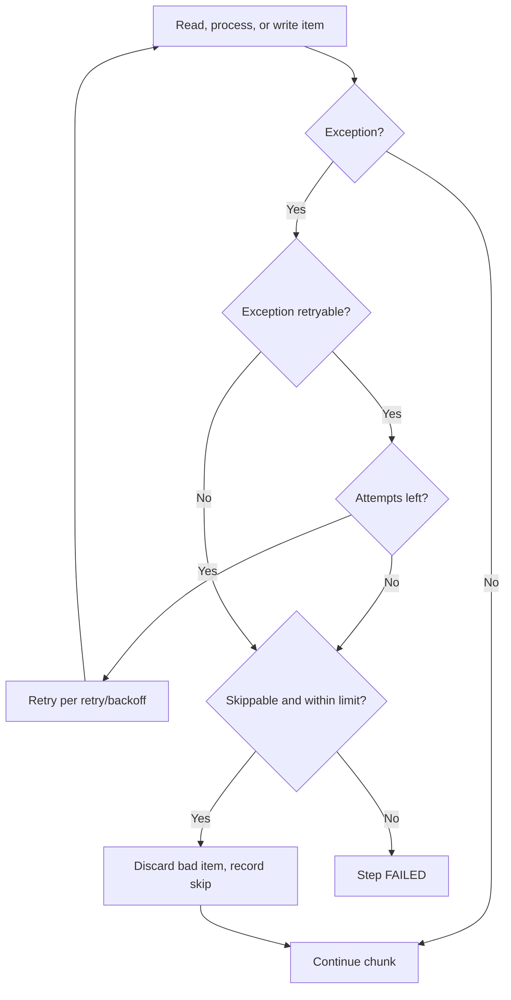

# Testing Skip and Retry in Spring Batch

A batch job processing thousands or millions of records can rarely avoid malformed data, transient connection errors, or database write contention. Spring Batch provides **skip** to bypass unprocessable records and **retry** to re-attempt operations likely to succeed on subsequent tries. When testing, what matters is not only whether the job finishes: you must prove **which records are processed, which errors are skipped, which operations are retried, that limits take effect, and that final data is accurate after rollbacks**.

This lesson focuses on testing both mechanisms in **chunk-oriented processing** (`ItemReader → ItemProcessor → ItemWriter`). Examples use the Spring Batch 5.x / Spring Boot 3.x Java DSL; if your project uses another version, cross-check API signatures and infrastructure configuration accordingly. Testing principles, job statuses, and counter semantics apply broadly.

## 1. Distinguishing Skip, Retry, and Filter Before Writing Tests

Suppose a step reads transactions from a file:

| Record / Incident | Cause | Appropriate Behavior |
|---|---|---|
| `TX-01,150000` | Valid data | Process and write |
| `TX-02,abc` | Invalid amount | **Skip** the record, if policy permits |
| `TX-03,250000` but write hits deadlock | Transient error | **Retry** the write operation |
| `TX-04,0` excluded by business rule | Valid record needing no output | **Filter**: processor returns `null` |
| Writer always throws programming bug `NullPointerException` | Error not classified as recoverable | **Fail** for investigation |

**Skip** accepts dropping a specific input record under a configured policy. **Retry** keeps the goal of successfully processing that record/operation and performs additional attempts upon failure. **Filter** is not an error: when `ItemProcessor.process(...)` returns `null`, the item is excluded from output and counted in `filterCount`, not `skipCount`.

The decision flow can be visualized as:



This is a conceptual model. When an error occurs in the writer, Spring Batch may roll back and replay the chunk, then isolate the offending item. Therefore, **processor/writer invocation counts do not necessarily equal committed item counts**.

## 2. Fault-Tolerance Configuration That Tests Should Guard

Example of a step converting input strings to integers, skipping at most one invalid string, and retrying transient write failures:

```java
@Bean
Step importStep(
        JobRepository jobRepository,
        PlatformTransactionManager transactionManager,
        ItemReader<String> reader,
        ItemWriter<Integer> writer) {

    return new StepBuilder("importStep", jobRepository)
            .<String, Integer>chunk(10, transactionManager)
            .reader(reader)
            .processor(Integer::parseInt)
            .writer(writer)
            .faultTolerant()
            .skip(NumberFormatException.class)
            .skipLimit(1)
            .retry(TemporaryWriteException.class)
            .retryLimit(3)
            .noRetry(NumberFormatException.class)
            .noSkip(TemporaryWriteException.class)
            .build();
}

class TemporaryWriteException extends RuntimeException {
    TemporaryWriteException(String message) {
        super(message);
    }
}
```

Key points to understand so you set accurate expectations:

- `faultTolerant()` enables skip/retry configuration for a chunk step. Without it, exceptions normally fail the step.
- `skip(NumberFormatException.class)` defines the **skippable** error type; `skipLimit(1)` permits only **one skip** in the step. The next skippable error fails the step for exceeding the limit. The limit is the **combined total** of skips across reader, processor, and writer.
- `retry(TemporaryWriteException.class)` and `retryLimit(3)` define the retryable error type and the retry policy's limit. When needing to verify exact invocation counts, measure through a fake dependency or listener; avoid vaguely assuming `3` means three **additional** retries beyond the first call.
- `noRetry(...)` and `noSkip(...)` make policy boundaries explicit: data errors should not be pointlessly retried; transient errors should not automatically be treated as bad records. They are especially useful when configuration includes a broad parent exception.
- Subclasses of an exception can inherit the parent class's classification rules. Tests should cover subclasses and exclusion rules if the system uses a complex exception hierarchy.

In real systems, replace `NumberFormatException` with a clear business exception such as `InvalidPaymentRowException`. Classify only errors with a reasonable expectation of recovery (deadlocks, short timeouts, transient network glitches) as retryable. Data validation failures, permanent business violations, or programming bugs should not be broadly retried.

### When Both Skip and Retry Apply to the Same Error Type

If an exception is registered for both retry and skip, the behavior that usually needs testing is: **retry first; if it still fails after exhausting retries, consider skipping according to the skip policy and remaining skip limit**. Do not rely on this behavior implicitly: write dedicated tests to confirm the intended rule and ensure critical write failures are not silently discarded.

## 3. Counters and Statuses to Assert

After execution, retrieve `JobExecution` and `StepExecution` to inspect results:

| Information | Meaning | How to Test |
|---|---|---|
| `JobExecution.getStatus()` | Overall status `COMPLETED`, `FAILED`, ... | Compare against expected outcome |
| `StepExecution.getStatus()` | Status of the specific step | Confirm the step actually completed/failed |
| `getReadSkipCount()` | Number of errors skipped in the reader | Assert when the reader encounters skippable errors |
| `getProcessSkipCount()` | Number of items skipped in the processor | Assert when validation/conversion fails |
| `getWriteSkipCount()` | Number of items skipped in the writer | Assert when the writer isolates failing items |
| `getSkipCount()` | Total skips across all three stages | Compare against configured limit |
| `getFilterCount()` | Number of items filtered by processor returning `null` | Distinguish from skips |
| `getWriteCount()` | Number of items recorded as successfully written | Compare against committed output |
| `getFailureExceptions()` | List of exceptions causing step failure | Verify root cause when `FAILED` |

There is no general retry counter on `StepExecution` equivalent to `getSkipCount()`. To prove retries occurred, record call counts in a fake service/writer, use a `RetryListener`, or collect application metrics. Prefer asserting **observable behavior** (succeeding after transient failures, accurate final data, extra attempts made) rather than coupling tightly to framework internals.

Example of a three-item input `10`, `bad`, `20`, with `skipLimit` equal to 1:

```text
Job status         = COMPLETED
Read skip count    = 0
Process skip count = 1
Write skip count   = 0
Total skip count   = 1
Filter count       = 0
Write count        = 2
Committed output   = [10, 20]
```

These outcomes hold only when the writer ultimately persists successfully and no other filtering logic applies.

## 4. An Integration Test Combining Skip and Retry

The example below uses a short job: reads `10`, `bad`, `20`; the processor skips parse errors; the writer intentionally fails on the first call and succeeds thereafter. This is predictable **failure injection**, avoiding dependence on random network or database errors.

To run the example in a Spring Boot 3 project, you need Spring Boot testing libraries, `spring-batch-test`, and a test database (such as H2) to store `JobRepository` metadata. Place the configuration classes within the application's component-scan scope; in tests, disable automatic batch launching on context startup using `spring.batch.job.enabled=false`.

### 4.1. Job Configuration and Observation Object

```java
import java.util.List;
import java.util.concurrent.CopyOnWriteArrayList;
import java.util.concurrent.atomic.AtomicInteger;

import org.springframework.batch.core.Job;
import org.springframework.batch.core.Step;
import org.springframework.batch.core.SkipListener;
import org.springframework.batch.core.configuration.annotation.StepScope;
import org.springframework.batch.core.job.builder.JobBuilder;
import org.springframework.batch.core.repository.JobRepository;
import org.springframework.batch.core.step.builder.StepBuilder;
import org.springframework.batch.item.ItemReader;
import org.springframework.batch.item.ItemWriter;
import org.springframework.batch.item.support.ListItemReader;
import org.springframework.context.annotation.Bean;
import org.springframework.context.annotation.Configuration;
import org.springframework.transaction.PlatformTransactionManager;

final class TestProbe {
    final AtomicInteger writerCalls = new AtomicInteger();
    final List<Integer> successfulWrites = new CopyOnWriteArrayList<>();
    final List<String> skippedInProcessor = new CopyOnWriteArrayList<>();
}

final class TemporaryWriteException extends RuntimeException {
    TemporaryWriteException(String message) {
        super(message);
    }
}

@Configuration
class DemoBatchConfiguration {
    @Bean
    TestProbe testProbe() {
        return new TestProbe();
    }

    @Bean
    @StepScope
    ItemReader<String> demoReader() {
        // Each StepExecution gets a fresh reader.
        return new ListItemReader<>(List.of("10", "bad", "20"));
    }

    @Bean
    Step demoStep(JobRepository repository,
                  PlatformTransactionManager transactionManager,
                  ItemReader<String> demoReader,
                  TestProbe probe) {
        ItemWriter<Integer> flakyWriter = chunk -> {
            int currentCall = probe.writerCalls.incrementAndGet();
            if (currentCall == 1) {
                throw new TemporaryWriteException("Temporary destination failure");
            }
            probe.successfulWrites.addAll(chunk.getItems());
        };

        SkipListener<String, Integer> skipEvents = new SkipListener<>() {
            @Override
            public void onSkipInRead(Throwable error) {
                // No reader errors in this scenario.
            }

            @Override
            public void onSkipInProcess(String item, Throwable error) {
                probe.skippedInProcessor.add(item);
            }

            @Override
            public void onSkipInWrite(Integer item, Throwable error) {
                // No writer errors skipped in this scenario.
            }
        };

        return new StepBuilder("demoStep", repository)
                .<String, Integer>chunk(3, transactionManager)
                .reader(demoReader)
                .processor(Integer::parseInt)
                .writer(flakyWriter)
                .faultTolerant()
                .skip(NumberFormatException.class)
                .skipLimit(1)
                .retry(TemporaryWriteException.class)
                .retryLimit(3)
                .listener(skipEvents)
                .build();
    }

    @Bean
    Job demoJob(JobRepository repository, Step demoStep) {
        return new JobBuilder("demoJob", repository)
                .start(demoStep)
                .build();
    }
}
```

`TestProbe` observes writer invocations and related items. The in-memory list here is **for illustration only**, as it is not bound to database transactions. When testing a real writer, query data **after commit** in a database or a transactional destination. `ListItemReader` is also only suitable for short demos; tests for restart/checkpoints require a reader implementing `ItemStream` capable of saving and restoring read positions.

### 4.2. Test Launching the Job and Verifying Results

```java
import static org.junit.jupiter.api.Assertions.*;

import java.util.List;

import org.junit.jupiter.api.Test;
import org.springframework.batch.core.BatchStatus;
import org.springframework.batch.core.JobExecution;
import org.springframework.batch.core.JobParametersBuilder;
import org.springframework.batch.core.StepExecution;
import org.springframework.batch.test.JobLauncherTestUtils;
import org.springframework.batch.test.context.SpringBatchTest;
import org.springframework.beans.factory.annotation.Autowired;
import org.springframework.boot.test.context.SpringBootTest;

@SpringBatchTest
@SpringBootTest(properties = "spring.batch.job.enabled=false")
class SkipRetryIntegrationTest {
    @Autowired
    JobLauncherTestUtils jobLauncherTestUtils;

    @Autowired
    TestProbe probe;

    @Test
    void skipsInvalidItemAndRetriesTemporaryWriterFailure() throws Exception {
        JobExecution execution = jobLauncherTestUtils.launchJob(
                new JobParametersBuilder()
                        .addLong("run.id", System.nanoTime())
                        .toJobParameters());

        StepExecution step = execution.getStepExecutions()
                .iterator().next();

        assertEquals(BatchStatus.COMPLETED, execution.getStatus());
        assertEquals(BatchStatus.COMPLETED, step.getStatus());

        assertEquals(0, step.getReadSkipCount());
        assertEquals(1, step.getProcessSkipCount());
        assertEquals(0, step.getWriteSkipCount());
        assertEquals(1, step.getSkipCount());
        assertEquals(0, step.getFilterCount());
        assertEquals(2, step.getWriteCount());

        assertEquals(List.of("bad"), probe.skippedInProcessor);
        assertEquals(List.of(10, 20), probe.successfulWrites);
        assertTrue(probe.writerCalls.get() >= 2,
                "Writer must be called again after temporary failure");
    }
}
```

If the application has multiple `Job` beans, pass the exact job to `JobLauncherTestUtils` (for example, call `setJob(...)` in setup) so the test does not launch the wrong job. Create distinct `JobParameters` per independent run; when testing **restart**, intentionally keep **the exact same identifying parameters** of the failed JobInstance instead of generating a new `run.id`.

This test simultaneously proves:

1. The parse error is **skipped in the processor** and does not turn into a whole-job failure.
2. The writer hits a transient error and receives **at least one subsequent call**.
3. The job ends `COMPLETED`, with only the two valid values recorded.
4. A retried writer error does **not** increment `writeSkipCount`.

To avoid overloading a single test with too many responsibilities in a real project, add separate tests for each failure branch in the matrix below.

## 5. Matrix of Test Scenarios

| Scenario | Setup | Key Expectations |
|---|---|---|
| No errors | All items valid; writer succeeds | `COMPLETED`; skip = 0; writeCount equals output count |
| Processor skip within limit | One invalid string; `skipLimit(1)` | `COMPLETED`; processSkip = 1; invalid item absent |
| Skip limit exceeded | Two invalid strings; `skipLimit(1)` | Step `FAILED` when unable to skip further; verify root cause |
| Skippable reader error | Reader can advance past a corrupted record | `readSkipCount` increments; remaining data still processed |
| Skippable writer error | Writer isolates failing item, within limit | `writeSkipCount` increments; valid items commit accurately |
| Recoverable retry | Dependency fails initially then succeeds | `COMPLETED`; multiple attempts occurred; final data written once |
| Retries exhausted | Dependency always throws retryable exception | `FAILED` if no valid skip policy follows |
| Unclassified error | Processor/writer throws non-skippable/non-retryable exception | `FAILED`; item is not silently dropped |
| Retry then skip | Same exception allowed for both retry and skip | After exhausting retries, skips if within limit; assert both phases |
| Valid filter | Processor returns `null` | `filterCount` increments; `skipCount` unchanged |
| Restart after failure | Rerun `FAILED` JobInstance with checkpointable reader | Committed portion not re-read/re-written; final data accurate |

Each row in the matrix should be a test with data and faults controlled via fakes/stubs, bounded mocks, or a test database. Do not try to induce real deadlocks in unit tests, as randomness diminishes test value.

### 5.1. Testing Skip Limit Exceeded

Keep `skipLimit(1)` but change input to `["10", "bad-A", "bad-B", "20"]`. The test must assert step/job `FAILED` upon encountering a record that cannot be skipped further. Also verify `getFailureExceptions()` contains the appropriate cause and confirm **there was no false COMPLETED run**.

Do not always assert `processSkipCount == 2` for the limit-exceeded run: the second bad item may be **the failure that breaks the step** rather than becoming a successfully skipped item. Base assertions on the actual recorded skip count and the exception/message behavior of your version.

### 5.2. Testing Successful Retry and Exhausted Retries

A fake service can deliberately fail for the first `N` attempts:

```java
final class FlakyGateway {
    private final AtomicInteger attempts = new AtomicInteger();
    private final int failFirst;

    FlakyGateway(int failFirst) {
        this.failFirst = failFirst;
    }

    void send(int value) {
        int attempt = attempts.incrementAndGet();
        if (attempt <= failFirst) {
            throw new TemporaryWriteException("attempt=" + attempt);
        }
        // Record successful send in fake.
    }

    int attempts() {
        return attempts.get();
    }
}
```

For recovery, set `failFirst=1`, confirm subsequent attempts occurred, and verify successful output. For continuous failure, set `failFirst` higher than the retry limit and verify `FAILED` along with the root-cause exception. Avoid relying on `Thread.sleep(...)` or inferred framework call counts: a fake proves the limit via direct observation while catching infinite retries.

If production config uses real backoff delays, substitute a zero-wait policy or very short delay in tests so the suite runs fast and reliably. In production, choose appropriate backoff so you do not flood a failing downstream service with immediate bursts.

### 5.3. Testing Skips in Reader and Writer

**Reader:** Some readers encounter a malformed record and still advance to the next record; other readers throw an exception without advancing the read cursor. The latter risks an infinite loop on the same record. Tests must prove the reader bypasses the bad record cleanly without losing other records, and that `readSkipCount` increments as expected. For transactional sources such as message queues, reader/rollback configuration must align with requeuing semantics.

**Writer:** Writers normally receive a `Chunk` rather than a single item. If a writer throws an exception, Spring Batch can **roll back the entire chunk, replay it, and split the work to isolate the unwriteable item**. Tests must assert the **committed** dataset, `writeSkipCount`, absence of duplicates, and recovery behavior. Do not rigidly assert the writer is called exactly once per item.

## 6. Transactions, Rollback, and Retry-Counting Pitfalls

In a chunk-oriented step, the framework buffers items up to chunk size and executes the write inside a transaction. Error handling affects transactions by phase:

- For a skippable **processor** error, Spring Batch can normally skip the bad item without rolling back the entire chunk.
- For a **writer** error, a rollback usually occurs even when retry or skip is enabled. Items in the chunk may be reprocessed/rewritten during recovery.
- For a **reader** error, behavior depends on the reader, data source, and transaction management; do not assume the reader has already consumed the corrupted record.
- Options such as `noRollback(...)` or `readerIsTransactionalQueue()` alter transaction behavior. Use them only when you understand the data source and add corresponding rollback tests.

For instance, if a writer calls an external API, sends emails, or publishes messages, a JDBC transaction **cannot automatically undo** external side effects. If the first attempt succeeded on the remote system while the client timed out, retrying can cause duplicate writes. Writer design should incorporate an **idempotency key**, unique constraint, upsert, or deduplication mechanism. Tests should simulate "server received request but client saw an error," not only "server never received request."

A reliable test can follow this sequence:

1. Prepare a clean test database and an input dataset with unique identifiers.
2. Intentionally fail the writer after it starts acting within a chunk.
3. Let the framework retry or recover per policy.
4. Query the database **outside the rolled-back transaction** and compare the record set, row count, and unique keys.
5. Verify committed rows are accurate, with no missing or duplicate entries, even when the writer or processor was re-invoked.

Never use an `ArrayList` or mock invocation counts as a substitute for verifying transaction commits: they do not roll back alongside the database.

### Is Processor Re-Invocation a Bug?

Not necessarily. After a rollback, the framework may re-read or reprocess buffered data, or re-execute part of a chunk. If the processor is heavy or has side effects, evaluate its purity/idempotency. Spring Batch offers `processorNonTransactional()` to cache processor results across certain retries/rollbacks, but enabling it must be accompanied by tests for cached data, transactions, and restart behavior.

## 7. Using Listeners to Observe Skipped Items and Reasons

In tests, `SkipListener<I, O>` collects skipped items along with their exceptions:

```java
SkipListener<String, Integer> listener = new SkipListener<>() {
    @Override
    public void onSkipInRead(Throwable t) {
        // No guaranteed input item available to log when error occurs in reader.
    }

    @Override
    public void onSkipInProcess(String item, Throwable t) {
        // Can log item ID and error type for auditing.
    }

    @Override
    public void onSkipInWrite(Integer item, Throwable t) {
        // Can log ID of rejected output item.
    }
};
```

Listeners help assert **exactly which item** was skipped, since `skipCount=1` does not tell you which item was dropped. For retries, you can register a Spring Retry `RetryListener` to observe retry context open/close events and per-attempt errors; keep attempt counts distinct from skip counters. When writing production audit logs, consider data sensitivity and ensure audit records are not unintentionally duplicated after rollbacks.

When testing listeners, verify that the event fired and recorded the item identifier. Do not couple tests tightly to internal callback ordering or callback counts across recovery branches unless business rules require it.

## 8. Testing Restart After Skip/Retry Failure

Retry handles errors **within a single step execution**; restart is a **subsequent run of the same JobInstance** after failure. These two mechanisms serve different goals and must be tested separately.

A representative restart test:

1. Create a job with a checkpointable reader (such as `FlatFileItemReader` or `JdbcPagingItemReader` configured with state), an idempotent writer, and a deterministic chunk size.
2. Allow the first few chunks to commit successfully; then make the write service fail continuously until retries are exhausted, turning the job `FAILED`.
3. Restore the fake dependency to healthy operation; re-run the job with **the exact same identifying JobParameters**.
4. Verify the new job completes `COMPLETED`, the previously committed portion is not rewritten, all remaining records are present, and skip/retry events reflect each individual execution.

Note that the new `JobExecution` has its own `StepExecution` and counters; do not arbitrarily sum counters across runs and compare directly against a single step execution's skip limit. A `COMPLETED` job normally cannot be re-run for the same JobInstance with the old identifying parameters; use a fresh instance for independent scenarios.

If the reader does not save state, the writer is not idempotent, or the job processes a source dataset that mutates during downtime, restart tests can uncover lost or duplicated records even while single-execution retry tests remain green.

## 9. Common Testing Mistakes

| Mistake | Consequence | Appropriate Practice |
|---|---|---|
| Asserting only `BatchStatus.COMPLETED` | May silently skip too much valid data | Assert counters, item identities, and output data |
| Confusing `filterCount` with `skipCount` | Misreports error record counts | Test processor returning `null` separately from processor throwing exceptions |
| Expecting one writer call per item | False failures when framework replays chunk after rollback | Assert committed data with no duplicates |
| Retrying every `Exception` | Masks programming bugs, stalls jobs pointlessly | Classify exceptions and test non-retryable types |
| Testing only successful retries | Fails to prove limits stop execution | Include a persistent-failure test reaching `FAILED` |
| Testing only below `skipLimit` | Unknown job behavior when limit is exceeded | Test both exact threshold and over-limit cases |
| Creating a new `run.id` for restart tests | Actually runs a brand-new JobInstance | Keep identifying parameters and observe a new JobExecution |
| Reusing one stateful reader across tests | Order-dependent tests, pre-consumed input | Create fresh reader per step execution or reset source |
| Using an in-memory list to claim commit | Misses rolled-back data | Query the transactional target after job finishes |
| Using random network/deadlocks for faults | Slow, flaky tests | Use fakes/stubs or test DB with controlled fault injection |

## 10. Completion Criteria for a Skip/Retry Test Suite

A valuable test suite should help readers answer concrete questions: which bad data was skipped; why it was skipped; whether the skip limit halted execution at the right point; whether transient errors were retried and recovered; whether persistent errors failed the step; whether writer rollbacks caused duplicates; and whether restart wrote only the remaining portion.

At a minimum, include tests for **skip within limit**, **skip limit exceeded**, **recoverable retry**, **exhausted retries**, **unclassified exceptions**, and **post-transaction data outcomes**. For batches handling critical data, add **writer skip**, **idempotency**, and **restart/checkpoint** tests. Only then is `COMPLETED` status backed by evidence that the job processed data accurately rather than merely running without throwing an uncaught error.
