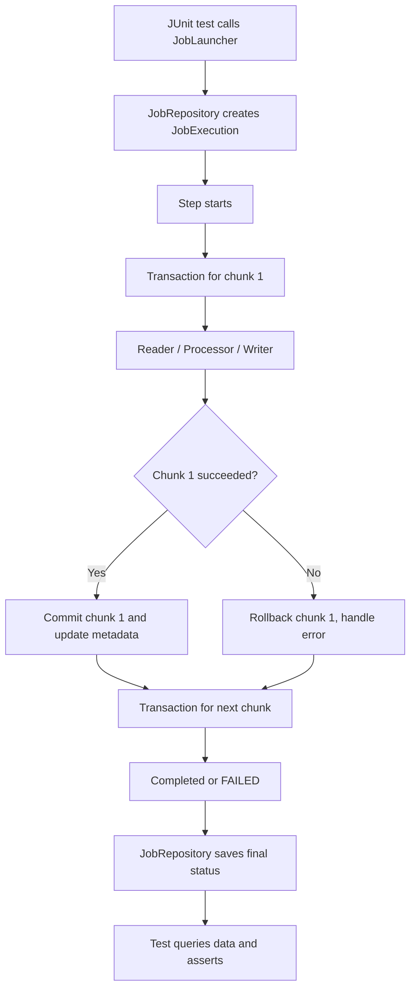

# Transaction Managers in Spring Batch Testing

When testing Spring Batch, a `JobExecution` ending with `COMPLETED` does not by itself prove that data was committed properly. Likewise, when a job fails, verifying that a mock writer was invoked does not prove that real write operations rolled back. The **transaction manager** governs transaction boundaries, commit timing, rollback behavior, and whether resources (JDBC, JPA, message queues, etc.) participate in the same transaction.

This lesson explains how to choose, configure, and verify a transaction manager in Spring Batch **test infrastructure**, especially with chunk-oriented steps, `JobRepository`, `@SpringBatchTest`, and Spring Test's `@Transactional`. Examples use Java, Spring Boot 3.x / Spring Batch 5.x, JUnit 5, and an H2 database. Bean names and auto-configuration details may differ when a project uses multiple data sources or different framework versions.

## 1. Multiple Transactions Can Exist in a Single Test

Before writing tests, separate three roles that are frequently confused:

| Role | Who Controls It | Purpose |
|---|---|---|
| **JobRepository transaction** | Spring Batch infrastructure | Creates/updates `JobInstance`, `JobExecution`, `StepExecution`, and `ExecutionContext` in metadata |
| **Step/chunk transaction** | `PlatformTransactionManager` passed to `StepBuilder.chunk(...)` | Wraps read/process/write operations at chunk boundaries and commits or rolls back each chunk |
| **Spring Test-managed transaction** | `@Transactional` on the test, with `TransactionalTestExecutionListener` | Wraps calls inside the test method and typically rolls back after the test for cleanup |

These three roles can share **the same transaction manager**, but that does not mean every operation executes inside one giant transaction. Spring Batch infrastructure opens metadata and chunk transactions at different points in time, while a test transaction has its own lifecycle.

A simplified job execution flow:



This diagram is conceptual: metadata transactions and business transactions can use two different managers or two different data sources, so metadata updates are not always inside the same JDBC transaction as business data writes.

**The first question for any test:** are you verifying pure logic, a single repository operation inside a transaction, or **an entire job genuinely committing/rolling back chunks**? The answer determines the test type and how you use the transaction manager.

## 2. Which Transaction Manager Fits?

Spring defines the `PlatformTransactionManager` interface. Different implementations have distinct responsibilities:

| Manager | Typical Data Source | Role in Tests |
|---|---|---|
| `DataSourceTransactionManager` or `JdbcTransactionManager` | JDBC, `JdbcTemplate`, JDBC writers | Verifies SQL commit/rollback on the same `DataSource` |
| `JpaTransactionManager` | JPA, `EntityManager`, Spring Data JPA | Verifies persistence context transactions, flushes, and entity commit/rollback |
| `JtaTransactionManager` | Multiple resources joining a distributed transaction when supported by infrastructure | Tests XA/JTA environments requiring coordinated transactions |
| `ResourcelessTransactionManager` | Does not manage a real transactional resource | Used in some lightweight logic/infrastructure tests; **cannot prove JDBC/JPA rollback** |
| Fake/mock `PlatformTransactionManager` | Simulates only the API contract | Verifies invocations or wiring; **does not test real commits** |

For a JDBC source, two principles are critical:

1. The transaction manager used by a chunk must manage **the exact `DataSource` used by the writer**. If the writer writes through another source, chunk commit/rollback may not cover those SQL statements.
2. When using JPA, the transaction manager must match the writer/repository's `EntityManagerFactory`. Verify flushing, caching, and transaction propagation rather than inferring behavior solely from the number of `save(...)` calls.

When using Spring Boot auto-configuration with a single `DataSource`, Spring can usually create the right manager automatically. If the application defines multiple managers or multiple data sources, use `@Qualifier` or meaningful bean names to avoid accidentally picking the wrong one.

Example explicitly declaring the manager for a step:

```java
@Bean
Step importStep(
        JobRepository jobRepository,
        @Qualifier("businessTransactionManager")
        PlatformTransactionManager businessTransactionManager,
        ItemReader<OrderRow> reader,
        ItemWriter<OrderRow> writer) {

    return new StepBuilder("importStep", jobRepository)
            .<OrderRow, OrderRow>chunk(100, businessTransactionManager)
            .reader(reader)
            .writer(writer)
            .build();
}
```

This snippet assumes `OrderRow`, reader, writer, and the `businessTransactionManager` bean already exist. Spring Batch 5 requires passing the transaction manager directly to `chunk(size, transactionManager)`. Examples based on `StepBuilderFactory` from older Spring Batch generations can be misleading when applied to Spring Batch 5.

### Can the JobRepository Manager Differ from the Chunk Manager?

Yes. A system can store Batch metadata in database A and write business data to database B, each with its own transaction manager. However, **two independent transactions do not automatically guarantee atomicity across both databases**: business data might commit right before a metadata update fails. Tests must simulate and verify recovery or idempotent writes.

If the business requires a true distributed transaction, implementation depends on JTA/XA infrastructure or an alternative consistency design. Two independent `DataSourceTransactionManager` beans should never be treated as a single shared transaction.

## 3. Choose the Test Level Before Enabling Transactions

| Test Level | Components Executed | Suggested Infrastructure | What It Can Prove |
|---|---|---|---|
| Processor unit test | Direct call to `ItemProcessor.process(...)` | JUnit and fake dependencies | Transformation logic, validation, exceptions |
| Writer unit test | Direct call to `ItemWriter.write(...)` | Mock/fake repository or gateway | Data passed to the dependency |
| Repository/service integration test | Real test database | `JdbcTemplate` / JPA + real manager + `TransactionTemplate` | Commit, rollback, constraints, isolation of that operation |
| Step/job integration test | `JobLauncher`, `JobRepository`, reader, writer, real metadata | `@SpringBatchTest`, `@SpringBootTest`, test database | Chunk boundaries, status, counters, post-commit data |
| Multi-resource end-to-end test | Job with external systems or production-like environment | Testcontainers, sandbox services, output observation | Cross-service effects, idempotency, recovery |

**Pure calculations do not need a real transaction manager.** Conversely, to prove that data rolled back after a writer failure, you must have a real transactional resource and query the data after the job ends. An in-memory `List<Integer>` or a mock `JdbcTemplate` does not reflect database rollbacks.

## 4. Why You Should Not Blindly Put `@Transactional` on Job-Running Tests

Spring Test provides a convenient feature: a test method annotated with `@Transactional` is typically wrapped in a transaction and rolled back after the test. That works well for many repository tests, but easily causes misconceptions in Spring Batch tests.

An **inappropriate** example when the goal is to verify real job commits:

```java
@SpringBatchTest
@SpringBootTest
class MyJobTest {
    @Test
    @Transactional
    void runsJob() throws Exception {
        // Call JobLauncher and infer that chunks committed to the DB.
    }
}
```

There are two classes of problems:

- `JobRepository` may refuse to create a `JobExecution` when it detects an already open transaction. A typical error message resembles **"Existing transaction detected in JobRepository"**, depending on repository and transaction propagation settings.
- If the job joins the test-opened transaction (same thread/same manager), the data may be rolled back when the test finishes. A query **inside the test transaction** can read uncommitted data, leading to the false conclusion that the job committed.

Jobs using an asynchronous executor make this even harder to observe: the test's transaction is thread-bound and does not naturally propagate to batch worker threads.

For **full-job integration tests**, the cleaner approach is usually:

- Do not put `@Transactional` on the test class or method calling `JobLauncher`.
- Seed fixtures beforehand via SQL or repositories in committed transactions; clean up fixtures using `@Sql`, `JdbcTemplate`, or dedicated test utilities.
- Launch the job with appropriate `JobParameters`, wait for completion if the launcher is asynchronous, and then query data via a fresh connection outside any test transaction.
- Verify `BatchStatus`, `StepExecution`, rollback counts, and actually persisted data.

If you are only testing an isolated repository or service, `@Transactional` on the test remains useful. Just remember that test-managed commits differ from production chunk commits.

### Does `@Rollback(false)` Completely Solve It?

No. `@Rollback(false)` only tells Spring Test **not to automatically roll back the test-managed transaction**. It does not fix having an open transaction before `JobRepository` creates an execution, does not guarantee the right manager was chosen, and does not verify individual chunk transaction boundaries. For job tests, the more controllable approach is to remove the test-level transaction wrapper and let the job drive commits itself.

## 5. Integration Test Example: First Chunk Commits, Second Chunk Rolls Back

Goal: given four IDs `1, 2, 3, 4`, the step writes two items per chunk. The writer intentionally throws an exception after executing the INSERT for ID `4`. Because the writer runs inside the chunk transaction, both INSERTs in the chunk containing `3, 4` roll back, while the previously committed chunk containing `1, 2` remains.

Expected state after job failure:

```text
Chunk 1: INSERT 1, INSERT 2  → COMMIT
Chunk 2: INSERT 3, INSERT 4  → exception → ROLLBACK

BatchStatus              = FAILED
Final rows in table      = [1, 2]
```

The example uses a single H2 data source for both Batch metadata and business tables. In a Spring Boot 3 project, you need `spring-boot-starter-batch`, `spring-boot-starter-jdbc`, H2 for tests, `spring-batch-test`, and Spring Boot test/JUnit. Boot needs to create the Spring Batch metadata schema; set `spring.batch.jdbc.initialize-schema=always` in the test configuration.

### 5.1. Job and Transaction Manager Configuration

```java
import java.util.List;

import org.springframework.batch.core.Job;
import org.springframework.batch.core.Step;
import org.springframework.batch.core.configuration.annotation.StepScope;
import org.springframework.batch.core.job.builder.JobBuilder;
import org.springframework.batch.core.repository.JobRepository;
import org.springframework.batch.core.step.builder.StepBuilder;
import org.springframework.batch.item.ItemReader;
import org.springframework.batch.item.ItemWriter;
import org.springframework.batch.item.support.ListItemReader;
import org.springframework.boot.SpringBootConfiguration;
import org.springframework.boot.autoconfigure.EnableAutoConfiguration;
import org.springframework.context.annotation.Bean;
import org.springframework.jdbc.core.JdbcTemplate;
import org.springframework.transaction.PlatformTransactionManager;

@SpringBootConfiguration
@EnableAutoConfiguration
public class TestBatchApplication {

    @Bean
    @StepScope
    ItemReader<Integer> txReader() {
        // New reader for each step execution.
        return new ListItemReader<>(List.of(1, 2, 3, 4));
    }

    @Bean
    Step txStep(
            JobRepository jobRepository,
            PlatformTransactionManager transactionManager,
            ItemReader<Integer> txReader,
            JdbcTemplate jdbcTemplate) {

        ItemWriter<Integer> writer = chunk -> {
            for (Integer id : chunk.getItems()) {
                jdbcTemplate.update(
                        "INSERT INTO business_result (id) VALUES (?)", id);

                if (id == 4) {
                    // Error occurs after the INSERT statement is sent to the DB.
                    throw new IllegalStateException("Injected failure");
                }
            }
        };

        return new StepBuilder("txStep", jobRepository)
                .<Integer, Integer>chunk(2, transactionManager)
                .reader(txReader)
                .writer(writer)
                .build();
    }

    @Bean
    Job txJob(JobRepository jobRepository, Step txStep) {
        return new JobBuilder("txJob", jobRepository)
                .start(txStep)
                .build();
    }
}
```

`@EnableBatchProcessing` is omitted here so Spring Boot creates the default Batch/transaction manager infrastructure via auto-configuration. In an application that manually configures the entire Batch infrastructure, use the project's existing configuration rather than mixing both mechanisms.

The decisive line is:

```java
.chunk(2, transactionManager)
```

This manager wraps each chunk's writes. `JdbcTemplate` automatically participates in the active transaction **if it uses the same `DataSource` managed by that manager**. Throwing an exception at ID `4` rolls back the second chunk's transaction. Since the first chunk already committed independently, rows `1, 2` remain intact.

### 5.2. Testing with `@SpringBatchTest`

```java
import static org.junit.jupiter.api.Assertions.*;

import java.util.List;
import java.util.UUID;

import org.junit.jupiter.api.BeforeEach;
import org.junit.jupiter.api.Test;
import org.springframework.batch.core.BatchStatus;
import org.springframework.batch.core.JobExecution;
import org.springframework.batch.core.JobParametersBuilder;
import org.springframework.batch.core.StepExecution;
import org.springframework.batch.test.JobLauncherTestUtils;
import org.springframework.batch.test.context.SpringBatchTest;
import org.springframework.beans.factory.annotation.Autowired;
import org.springframework.boot.test.context.SpringBootTest;
import org.springframework.jdbc.core.JdbcTemplate;

@SpringBatchTest
@SpringBootTest(
    classes = TestBatchApplication.class,
    properties = {
        "spring.batch.job.enabled=false",
        "spring.batch.jdbc.initialize-schema=always",
        "spring.datasource.url=jdbc:h2:mem:batch_tx_test;DB_CLOSE_DELAY=-1"
    })
class BatchTransactionIntegrationTest {

    @Autowired
    JobLauncherTestUtils jobLauncherTestUtils;

    @Autowired
    JdbcTemplate jdbcTemplate;

    @BeforeEach
    void prepareBusinessTable() {
        jdbcTemplate.execute("""
                CREATE TABLE IF NOT EXISTS business_result (
                    id INTEGER PRIMARY KEY
                )
                """);
        jdbcTemplate.update("DELETE FROM business_result");
    }

    @Test
    void commitsSuccessfulChunkAndRollsBackFailedChunk() throws Exception {
        JobExecution job = jobLauncherTestUtils.launchJob(
                new JobParametersBuilder()
                        .addString("case-id", UUID.randomUUID().toString())
                        .toJobParameters());

        StepExecution step = job.getStepExecutions()
                .iterator()
                .next();

        assertEquals(BatchStatus.FAILED, job.getStatus());
        assertEquals(BatchStatus.FAILED, step.getStatus());
        assertTrue(step.getRollbackCount() >= 1);
        assertFalse(step.getFailureExceptions().isEmpty());

        List<Integer> persistedIds = jdbcTemplate.queryForList(
                "SELECT id FROM business_result ORDER BY id",
                Integer.class);

        assertEquals(List.of(1, 2), persistedIds);
    }
}
```

**Test explanation:**

1. `@SpringBatchTest` provides utilities such as `JobLauncherTestUtils` and listeners supporting Spring Batch test scopes.
2. `spring.batch.job.enabled=false` prevents Spring Boot from auto-running the job when the context initializes; the test explicitly calls `launchJob(...)`.
3. The test is **not** annotated with `@Transactional`, so real transactions are managed by `JobRepository` and the step.
4. The `business_result` table is created and cleared in `@BeforeEach` outside any test transaction. Each run uses a unique identifying job parameter.
5. The writer executes SQL through `JdbcTemplate`. The exception in the second chunk forces that chunk's changes to roll back. Querying after the job ends finds **only IDs `1, 2`**.

If the application has multiple `Job` beans, assign the right job to `JobLauncherTestUtils` (for instance `setJob(txJob)` in setup) so the test does not run the wrong job. If the launcher is configured asynchronously, wait until the `JobExecution` reaches a terminal status before asserting. The test uses `ListItemReader` because it only needs a single pass; to test restart, choose a reader that manages `ExecutionContext`.

### 5.3. What Does the Test Actually Prove?

The test proves via persisted data that:

- The transaction manager controlled JDBC writes per chunk.
- The committed first chunk survived after the overall step ended as `FAILED`.
- The failing chunk's INSERTs rolled back as a unit.
- Batch status and persisted data state match each other.

The test does not by itself prove XA behavior across two databases, transaction isolation under concurrent jobs, or idempotency against external APIs. Those requirements need dedicated tests.

## 6. Testing Service-Level Rollback with `TransactionTemplate`

When you do not need to run an entire job, `TransactionTemplate` lets you create an explicit transaction boundary. For example:

```java
@Autowired
PlatformTransactionManager transactionManager;

@Autowired
JdbcTemplate jdbcTemplate;

@Test
void rollsBackDatabaseChangesWhenServiceThrows() {
    TransactionTemplate template =
            new TransactionTemplate(transactionManager);

    assertThrows(IllegalStateException.class, () ->
            template.executeWithoutResult(status -> {
                jdbcTemplate.update(
                        "INSERT INTO business_result(id) VALUES (?)", 99);
                throw new IllegalStateException("Force rollback");
            }));

    Integer count = jdbcTemplate.queryForObject(
            "SELECT COUNT(*) FROM business_result WHERE id = 99",
            Integer.class);

    assertEquals(0, count);
}
```

This test assumes the table already exists and does not yet contain ID `99`; a setup similar to the previous example can be used. `TransactionTemplate` rolls back on runtime exceptions by default. This approach works well for verifying the exact contract of a service/repository against the database, but **does not replace** step integration tests because it does not exercise `ItemReader`, `ItemWriter`, `JobRepository`, or chunk boundaries.

Conversely, if a test uses `@Transactional` and only asserts that data is gone after the test ends, it is hard to distinguish application-driven rollback from automatic test-framework rollback. `TransactionTemplate` makes the exact boundary under test explicit.

## 7. Transaction Managers in Skip and Retry Scenarios

Skip and retry alter how many times operations may execute, while the transaction manager decides **what gets committed**:

| Scenario | Transaction Behavior to Observe | Key Assertions |
|---|---|---|
| Processor throws skippable exception | Failed item is skipped according to policy | `processSkipCount` and data for valid items |
| Writer throws retryable exception then succeeds | Chunk may roll back and replay | Final data has no gaps/duplicates; writer retried |
| Writer keeps throwing and exhausts retries | Failing chunk rolls back; step may become `FAILED` | `BatchStatus.FAILED`, previously committed data intact |
| Writer throws skippable exception | Framework may roll back and isolate the bad item | `writeSkipCount`, only valid items committed |
| Reader reads from a transactional queue | Message may be returned to the queue on rollback | No accidental message loss or duplicate processing |
| `noRollback(...)` enabled | Certain exceptions do not trigger rollback per config | Data and status match that exception policy |

In particular, **do not infer transaction counts or writer call counts from the number of successful items**. When a writer fails, Spring Batch may retry, roll back, replay the chunk, or isolate the offending item. A test asserting `writerCalls == 1` can fail even when the post-commit data is completely accurate.

In integration tests, prioritize checking **actual database state after the job completes**, skip/rollback counts on `StepExecution`, and `COMPLETED`/`FAILED` status. Invocation counts from mocks/fakes remain useful, but they measure calls made rather than transactions committed.

### External Side Effects Do Not Automatically Roll Back with JDBC

If a writer both writes to a database and calls a REST API or sends a message, the JDBC transaction only controls operations on resources enlisted in that transaction. A case where the API processes a request successfully while the client sees a timeout and retries can easily produce duplicate records.

Example testing strategy:

1. Have a simulated API accept the request and store an idempotency key, then return a timeout.
2. Have the job retry the same request.
3. Assert that the target system applies the business operation **once**, even though multiple requests were sent.
4. Query the database to verify consistent commits as designed.

For flows requiring reliable delivery, use the outbox pattern or downstream idempotency mechanisms. You cannot treat JDBC `@Transactional` as evidence that all external side effects roll back.

## 8. When Testing a JPA Writer

With `JpaItemWriter` or Spring Data JPA, there are additional nuances:

- `EntityManager.persist(...)` or `repository.save(...)` does not necessarily emit SQL INSERT immediately. SQL may only execute on `flush()` or transaction commit.
- Constraint exceptions may be thrown at flush/commit time rather than during the `save(...)` call.
- The persistence context caches entities. A query inside the same transaction may not give the same view as a fresh transaction after commit.
- A rollback can leave entities still sitting in test memory even though the database rows are gone. Do not rely on in-memory object state to prove commit.

To verify rollback with JPA, use the manager bound to the exact `EntityManagerFactory`, run the step, and inspect the database from an independent transaction/connection. When necessary, explicitly `flush()` and `clear()` so the test does not read data solely from the persistence context. With multiple managers, inject using `@Qualifier`.

Wiring example:

```java
@Bean
Step jpaStep(
        JobRepository jobRepository,
        @Qualifier("businessJpaTransactionManager")
        PlatformTransactionManager txManager,
        ItemReader<Customer> reader,
        ItemWriter<Customer> writer) {

    return new StepBuilder("jpaStep", jobRepository)
            .<Customer, Customer>chunk(50, txManager)
            .reader(reader)
            .writer(writer)
            .build();
}
```

Here `Customer` and the business beans are illustrative placeholders. Tests should confirm that the manager actually controls the `EntityManagerFactory` used by the writer, rather than assuming the first manager in the context is the right one.

## 9. Multiple DataSources and the Risk of Transactions Not Covering the Writer

Suppose a project defines:

```text
batchDataSource    → BATCH_JOB_EXECUTION, BATCH_STEP_EXECUTION, ...
businessDataSource → orders, payments, invoices, ...

batchTxManager     → batchDataSource
businessTxManager  → businessDataSource
```

The step must receive the business manager if the writer needs transactions on `businessDataSource`:

```java
return new StepBuilder("orderStep", jobRepository)
        .<Order, Order>chunk(200, businessTxManager)
        .reader(orderReader)
        .writer(orderWriter)
        .build();
```

If `batchTxManager` is accidentally passed in, metadata may still update normally and simple tests may still pass. However, SQL issued by `orderWriter` on the other data source may run in autocommit mode or outside the intended transaction. This bug is especially dangerous because tests that only count writer invocations will not catch it.

A test should intentionally:

1. Let chunk 1 write successfully, and let chunk 2 write partially before throwing an exception.
2. Query **businessDataSource** after the job fails.
3. Assert there are no partial writes from chunk 2.
4. Query **batchDataSource** to confirm metadata recorded the corresponding job/step failure.

When there are two databases, never assume metadata and business data commit simultaneously: tests must cover crashes between the two operations, recovery, restart, and idempotency.

## 10. Isolation, Propagation, and Connections in Tests

Even with the right transaction manager chosen, transaction settings still affect test outcomes:

**Propagation:** `REQUIRED` normally joins an existing transaction; `REQUIRES_NEW` opens an independent transaction; `NOT_SUPPORTED` suspends the current transaction. If a service called by a writer uses `REQUIRES_NEW`, work inside that service can commit **even if the outer chunk later rolls back**. Add tests proving this is intentional rather than silently leaving orphaned data.

**Isolation:** `READ_COMMITTED`, `REPEATABLE_READ`, and other levels govern consistency when multiple transactions access data concurrently. H2 works well for basic rollback examples but can differ from PostgreSQL, Oracle, or MySQL on locking, deadlocks, and isolation. For logic relying on specific database behaviors, use Testcontainers or a test database matching production.

**Connection binding:** `JdbcTemplate`, Spring Data, and many Spring adapters use transaction synchronization to obtain connections participating in the transaction. If code manually calls `dataSource.getConnection()` and manages connections/autocommit on its own, or uses a different data source from the manager, rollback tests can uncover writes happening outside the transaction.

**Checked vs. runtime exceptions:** Spring transactions roll back on runtime exceptions and errors by default. For services using `@Transactional`, checked exceptions may require `rollbackFor`. Spring Batch chunks have their own exception-handling and rollback policies; check the actual policy and writer exception types instead of assuming identical behavior to every `@Transactional` method.

**Timeouts and concurrency:** Concurrent job tests should not sleep arbitrarily hoping to trigger a deadlock. Use barriers/latches where appropriate, create data with deterministic lock contention, and assert state and effects after transactions finish. For systems with an async job launcher, always synchronize before querying.

## 11. Managing Fixtures and Metadata Between Tests

Spring Batch stores execution state in the database. Metadata and business data have different lifecycles and should be cleaned separately:

- Use unique identifying `JobParameters` for independent runs; rerunning with the same parameters after a `COMPLETED` execution may be rejected because the JobInstance already finished.
- When testing restart, intentionally reuse **the same JobInstance** with the old identifying parameters after a `FAILED` execution; changing `run.id` creates another instance and does not test restart.
- Use `JobRepositoryTestUtils` from `spring-batch-test` when cleaning execution metadata in a controlled test environment. Do not delete metadata tables manually in arbitrary order because of foreign keys.
- Use SQL/fixture setup to clean business tables. If a data source is shared across parallel tests, clean only data belonging to the test or use separate schemas/databases.
- Do not rely on automatic rollback of a `@Transactional` test method to clean up work that Batch already committed in its own transactions.

Short test parameter pattern:

```java
// Independent: fresh run with a new JobInstance.
var firstRun = new JobParametersBuilder()
        .addString("case-id", UUID.randomUUID().toString())
        .toJobParameters();

// Restart: reuse the exact identifying parameters from the FAILED run.
var restartParameters = failedExecution.getJobParameters();
```

If tests use an in-memory database, pay attention to context lifecycle and database URLs. Sharing an H2 name across multiple contexts/test classes can inadvertently share data. Separate schemas or explicit cleanup strategies keep tests independent and repeatable.

## 12. Diagnosing Common Transaction Errors

| Symptom | Possible Cause | How to Check |
|---|---|---|
| `Existing transaction detected in JobRepository` | Test opened a transaction before `launchJob(...)` | Remove test-level `@Transactional` or check propagation/repository configuration |
| Job `FAILED` yet partial failing chunk exists in DB | Writer used wrong data source/manager; autocommit; service opened its own transaction | Cross-check manager, data source, and actual connection |
| Test sees data inside test, gone afterward | Query ran inside an uncommitted test transaction | Query outside test transaction or remove `@Transactional` wrapper |
| Mock reports writer wrote rows, DB has none | Mock does not participate in transactions or writer never committed | Use an integration test with a real DB |
| `JpaRepository.save(...)` does not throw constraint error where expected | SQL was deferred until flush/commit | Call `flush()` or test failure at the transaction boundary |
| `COMPLETED` yet duplicate data on retry | Wrote outside transaction or non-idempotent writer | Check unique constraints, retry/replay behavior, and target data |
| Second test run hits `JobInstanceAlreadyCompleteException` | Reused identifying parameters for an already completed job | Generate fresh parameters for independent runs |
| Missing `BATCH_*` tables | Spring Batch metadata schema not created | Check JDBC schema initialization and metadata data source |
| `NoUniqueBeanDefinitionException` for manager | Multiple `PlatformTransactionManager` beans | Use `@Qualifier`/`@Primary` and explicit bean names |
| Transaction test passes on H2 but fails in production | Differences in SQL dialect, isolation/locking, or constraints | Run integration tests on the target DB engine |

### Reading Signals from `StepExecution`

In a failing-chunk test, inspect at least:

```java
StepExecution step = execution.getStepExecutions()
        .iterator().next();

System.out.println("status = " + step.getStatus());
System.out.println("commitCount = " + step.getCommitCount());
System.out.println("rollbackCount = " + step.getRollbackCount());
System.out.println("readCount = " + step.getReadCount());
System.out.println("writeCount = " + step.getWriteCount());
System.out.println("failures = " + step.getFailureExceptions());
```

`commitCount` and `rollbackCount` give signals that transactions occurred; they **do not replace querying the database**. The framework also manages transactions for status and recovery, so do not assume `commitCount` equals the exact number of input chunks in every error scenario. Per-execution counters also do not reflect totals across prior restarts.

## 13. A Reliable Transaction Testing Strategy

For a Spring Batch job writing critical data, build your test suite incrementally:

1. **Pure logic:** test processors/validators without a database to prove mapping and exceptions.
2. **Repository/service transactions:** use a test database and `TransactionTemplate` or targeted tests to prove inserts, constraints, and rollbacks.
3. **Chunk commit/rollback:** use `JobLauncherTestUtils`, a real manager, and SQL checks after the job; include at least one test where the first chunk commits and a subsequent chunk fails.
4. **Skip/retry:** inject deterministic errors in the reader/processor/writer and assert post-commit data, counters, limits, and absence of duplicates.
5. **Restart:** rerun a failed JobInstance with a checkpointed reader and idempotent writer, ensuring already committed work is not duplicated.
6. **Production specifics:** if using JPA, multiple data sources, isolation rules, distributed side effects, or vendor-specific DB features, test in a matching environment.

The key principle is that **the scope governed by the manager must match the scope the test aims to prove**. When testing chunk transactions, let Spring Batch open and close transactions, trigger the failure inside a chunk, and measure persisted data from the outside. When testing a service's transaction, establish an explicit transaction boundary and assert after rollback. That way test results explain both **why the job succeeded or failed** and **what data actually committed**.
