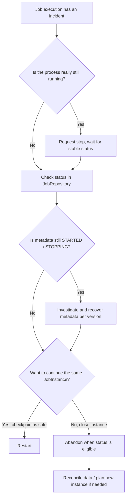

# Abandoning a Job Execution in Spring Batch

In Spring Batch, **abandoning a job execution** is the operation of marking a job execution as `ABANDONED` so the system treats that execution as **permanently abandoned**. This is a critical operational decision: Spring Batch **does not restart the same `JobInstance` once its latest execution has been abandoned**. Abandoning does not mean the job completed successfully, does not automatically roll back data, and is not a command to forcibly terminate a running process.

This topic belongs to **Execution control** because operators often have to choose between **stop**, **restart**, **recover**, and **abandon** when a job fails, runs for the wrong data period, or crashes unexpectedly. This article explains the mechanism, usage conditions, APIs, operational scenarios, and ways to test Spring Batch's behavior. The main examples use Spring Batch 5.2 / Spring Boot 3; a dedicated section notes differences in Spring Batch 6.

## 1. Understanding Job, JobInstance, and JobExecution

To abandon the right target, you first need to distinguish three concepts:

- **`Job`**: the job definition, including its name, flow, and steps.
- **`JobInstance`**: a *logical* run from a business perspective, identified by **job name + identifying `JobParameters`**. For example, the `dailySettlement` job with `businessDate=2026-11-15`.
- **`JobExecution`**: a single **execution attempt** of a `JobInstance`. An instance that fails and is restarted can have multiple executions with different execution IDs.

Example:

```text
Job: dailySettlement
└─ JobInstance #120 (businessDate=2026-11-15)
   ├─ JobExecution #501 → FAILED
   ├─ JobExecution #506 → STOPPED
   └─ JobExecution #509 → ABANDONED

JobInstance #120 cannot be restarted after #509 becomes ABANDONED.
```

The abandon API operates on **`jobExecutionId`**, not the job name and not `jobInstanceId`. Picking the wrong ID can mistakenly mark a different run. When inspecting history, check the job name, identifying parameters, instance ID, execution ID, and current status together.

Restart eligibility also depends on the state of the instance and its latest execution, not solely on whether an older execution once had status `FAILED`. Therefore, in the example above you cannot use #501 to bypass the `ABANDONED` status of #509.

## 2. What Does `BatchStatus.ABANDONED` Mean?

`ABANDONED` is a value in the `org.springframework.batch.core.BatchStatus` enum. It describes an operational state that ended due to a decision to give up, distinct from a business completion outcome.

| Status | Operational Meaning | Relationship to Restart |
|---|---|---|
| `STARTING` / `STARTED` | Execution is starting / running according to metadata | Do not restart concurrently; verify whether a real process still exists |
| `STOPPING` | Stop requested, awaiting completion | Not guaranteed to have stopped yet; monitor |
| `STOPPED` | Stopped via Batch's controlled mechanism | Usually restartable if the job allows it |
| `FAILED` | Failed | Usually restartable if the job allows it and checkpoint data is valid |
| `COMPLETED` | Completed successfully | The JobInstance is normally complete and not restarted as a failure |
| **`ABANDONED`** | Decided to abandon the execution/instance | **Framework will not restart the same JobInstance** |
| `UNKNOWN` | Metadata cannot determine a reliable status | Investigate before acting |

When abandoning through `JobOperator`, Spring Batch updates the execution metadata in `JobRepository`. Records already committed earlier to business tables, output files, queues, or external systems **are not automatically deleted**. Thus, `ABANDONED` status can coexist with partially committed data.

**`BatchStatus` differs from `ExitStatus`**: `BatchStatus` is the lifecycle status managed by the framework; `ExitStatus` represents the outcome code used for flow decisions and completion logic. Abandoning should not be assumed to automatically turn every job/step exit code into a specific value. For reporting, read `STATUS`, `EXIT_CODE`, and `EXIT_MESSAGE` from metadata.

## 3. When Should You Abandon?

Abandoning is appropriate when you have determined that an execution will **not be resumed or recovered under the same `JobInstance`**.

### 3.1. Job Canceled by Business Decision

For example, the `generateMonthlyInvoice` job processed October using an outdated set of rules. After discovering the rules were wrong and planning a replacement workflow, operations decides to stop recovering this execution. If the job is `FAILED` or `STOPPED`, it can be abandoned to reflect the decision to permanently close the execution.

Separate issue to resolve: already-committed invoice records, exported files, and sent notifications may need business cancellation or reconciliation; `ABANDONED` does not perform compensation.

### 3.2. Process Died with No Intention of Restarting the Old Instance

A JVM killed with `kill -9` or a server crash can leave `BATCH_JOB_EXECUTION.STATUS` as `STARTED` even though the process is dead. Spring Batch cannot reliably infer that an execution has stopped just by looking at metadata.

After verifying no worker is still processing and assessing already-written data, operators have two paths:

- If it is safe to resume: recover the metadata status using the appropriate mechanism, then **restart**.
- If the old instance must not resume: update the status via a **controlled metadata recovery procedure**, then **abandon** when the API allows it, or use the corresponding administration tool.

Note: `JobOperator.abandon(...)` does not bypass checking for `STARTED` status in metadata. An execution that is dead in reality but still marked `STARTED` can be **rejected because the framework considers it running**. Fix the stale metadata state first; do not repeatedly call abandon or treat it as a kill command.

### 3.3. Checkpoint Data or Input Source Is No Longer Valid

A file-reading job had its input file modified mid-run; `ExecutionContext` stores the old offset; restarting could read duplicates or skip records. If you decide to cancel this processing batch and reprocess everything with a new job instance and deduplication measures, abandoning can represent closing the lifecycle of the old instance.

In cases where the checkpoint can be accurately restored and the data source is fixed, restart remains the first option to consider.

## 4. Distinguishing Stop, Restart, Recover, and Abandon

| Operation | Goal | Typical Result | Resumes Same JobInstance? |
|---|---|---|---|
| `stop` | Request a running execution to stop | `STOPPING` then `STOPPED` once the job responds | Possibly, after a clean stop |
| `restart` | Resume a previously `FAILED`/`STOPPED` job instance | Creates a **new JobExecution** for the existing instance | Yes |
| `recover` | Fix stuck metadata after a crash, when supported by the API/version | Execution is marked so it can be restarted | Possibly |
| **`abandon`** | Permanently close an execution upon deciding to give up | `ABANDONED` | **No** |
| `start` with new identifying parameters | Run a **new JobInstance** | New execution for a new instance | No; this is a different instance |

`stop` is a **cooperative request**. If a step is executing business code that does not return control to the framework, the stop signal may not take effect immediately. `abandon` is a **metadata change to a terminal status**, not a mechanism to control the thread running inside the JVM.

`restart` preserves identifying parameters so Spring Batch links the new execution to the old instance and applies step/checkpoint rules. `start` with new identifying parameters is a brand-new job from the framework's perspective; it **does not automatically resume from the old checkpoint position**.



## 5. Using `JobOperator.abandon(...)` in Spring Batch 5.x

Spring Batch provides the `JobOperator` interface for monitoring and controlling jobs. In Spring Batch 5.2:

```java
JobExecution abandon(long jobExecutionId)
    throws NoSuchJobExecutionException,
           JobExecutionAlreadyRunningException;
```

**Input:** `jobExecutionId` is the ID of an existing `JobExecution`.

**Result:** returns the `JobExecution` marked `ABANDONED` if successful. Key exceptions:

- `NoSuchJobExecutionException`: the execution ID was not found in `JobRepository`.
- `JobExecutionAlreadyRunningException`: the execution status does not allow abandoning because the framework considers it running or not yet in a closable state.

This is an operation that mutates persisted metadata, so it must be based on actual status, not merely on a scheduler request or a UI prompt.

Example of an administration service for **executions that are `FAILED` or `STOPPED`**:

```java
import org.springframework.batch.core.BatchStatus;
import org.springframework.batch.core.JobExecution;
import org.springframework.batch.core.explore.JobExplorer;
import org.springframework.batch.core.launch.JobOperator;
import org.springframework.stereotype.Service;

@Service
public class BatchExecutionAdminService {

    private final JobExplorer jobExplorer;
    private final JobOperator jobOperator;

    public BatchExecutionAdminService(
            JobExplorer jobExplorer,
            JobOperator jobOperator) {
        this.jobExplorer = jobExplorer;
        this.jobOperator = jobOperator;
    }

    public JobExecution abandonFinishedWithError(long executionId)
            throws Exception {

        JobExecution execution = jobExplorer.getJobExecution(executionId);
        if (execution == null) {
            throw new IllegalArgumentException(
                    "Unknown executionId: " + executionId);
        }

        BatchStatus status = execution.getStatus();
        if (status != BatchStatus.FAILED
                && status != BatchStatus.STOPPED) {
            throw new IllegalStateException(
                    "Execution is not eligible for abandon: " + status);
        }

        // Verify operator permissions, actual process state, and business data
        // at the operations layer before calling here.
        return jobOperator.abandon(executionId);
    }
}
```

The code intentionally restricts itself to the two common states to avoid misusing it on running or completed executions. Pre-checking provides a clearer error message; `JobOperator` remains the authoritative enforcer during the update. In environments with multiple schedulers/operators, status can change between reading and abandoning; business operations need proper coordination and auditing.

### 5.1. Declaring `JobOperator` If Not Already Provided by the Application

In Spring Batch configurations, `JobOperator` may already be available. If manual declaration is needed in Spring Batch 5.2, `SimpleJobOperator` takes these dependencies:

```java
@Bean
SimpleJobOperator jobOperator(
        JobExplorer jobExplorer,
        JobRepository jobRepository,
        JobRegistry jobRegistry,
        JobLauncher jobLauncher) {

    SimpleJobOperator operator = new SimpleJobOperator();
    operator.setJobExplorer(jobExplorer);
    operator.setJobRepository(jobRepository);
    operator.setJobRegistry(jobRegistry);
    operator.setJobLauncher(jobLauncher);
    return operator;
}
```

Add this bean only if the context does not already have a `JobOperator` to avoid duplicate bean definitions. If Spring Batch uses a custom table prefix/schema, `JobExplorer` and `JobRepository` must access the same set of metadata tables. `JobRegistry` must know about the `Job`s that can be restarted.

### 5.2. Using the Execution ID from `JobExplorer`

`JobExplorer` provides a read-only API to verify before and after the operation:

```java
long executionId = 509L; // Example: obtained from operations dashboard or logs.

JobExecution before = jobExplorer.getJobExecution(executionId);
if (before == null) {
    throw new IllegalArgumentException("Execution not found");
}

System.out.println("job=" + before.getJobInstance().getJobName());
System.out.println("instance=" + before.getJobInstance().getInstanceId());
System.out.println("execution=" + before.getId());
System.out.println("parameters=" + before.getJobParameters());
System.out.println("before=" + before.getStatus());

JobExecution abandoned = jobOperator.abandon(executionId);

JobExecution after = jobExplorer.getJobExecution(abandoned.getId());
System.out.println("after=" + after.getStatus()); // ABANDONED
```

This snippet illustrates an operation **already approved operationally**, not a recommendation to automatically abandon every unsuccessful execution. In a real application, record the reason, requester/component, timestamp, and data processing state.

## 6. Why Is `STARTED` After a Process Crash a Special Case?

Consider this timeline:

```text
09:00  JobExecution #601 starts, metadata STATUS=STARTED
09:05  Chunk 1 committed
09:06  Server loses power
09:10  Scheduler sees no process; DB still shows STATUS=STARTED
09:11  Operator wants to permanently close execution #601
```

The `STARTED` metadata **no longer reflects a live process**, yet `JobOperator.abandon(601)` can still throw `JobExecutionAlreadyRunningException` because the framework evaluates the persisted status. This is the gap between **actual liveness** and **recorded status**.

Do not recklessly update `BATCH_JOB_EXECUTION.STATUS` to `ABANDONED` and consider the matter closed: step statuses, execution contexts, in-flight transactions, and committed data may not be reconciled yet. Recovery procedures must consider the Spring Batch version, job ownership, and restartability; in some systems, administrative tools are required to update execution/step metadata consistently.

Practical investigation steps:

1. Identify the execution ID, job name, identifying parameters, execution host, scheduler ID, and last update timestamp.
2. Prove the corresponding worker/process **has terminated** on every node capable of running the job, or isolate the system so it cannot continue.
3. Inspect committed steps, checkpoints, business data, and external side effects such as sent messages.
4. Decide whether to **restart** or **abandon**; if not restartable, document the specific reason.
5. Apply the version-appropriate metadata recovery mechanism and administrative tooling; call abandon only once the execution is in an eligible state.
6. Re-read metadata and output data, then update operational tracking.

**Version difference:** Spring Batch 6 adds `JobOperator.recover(JobExecution)` to handle executions stuck after an abrupt shutdown with the goal of making them restartable. In Spring Batch 5.x, do not assume this API exists; handling stuck metadata must rely on appropriate infrastructure and administrative procedures. Also, do not treat `recover` as synonymous with `abandon`.

## 7. Verifying `ABANDONED` via Metadata

Spring Batch uses metadata tables such as `BATCH_JOB_INSTANCE`, `BATCH_JOB_EXECUTION`, `BATCH_STEP_EXECUTION`, and `BATCH_*_CONTEXT`. A read-only query helps inspect the target execution:

```sql
SELECT
    je.JOB_EXECUTION_ID,
    je.JOB_INSTANCE_ID,
    ji.JOB_NAME,
    je.STATUS,
    je.EXIT_CODE,
    je.START_TIME,
    je.END_TIME
FROM BATCH_JOB_EXECUTION je
JOIN BATCH_JOB_INSTANCE ji
  ON ji.JOB_INSTANCE_ID = je.JOB_INSTANCE_ID
WHERE je.JOB_EXECUTION_ID = :executionId;
```

Check the steps belonging to that execution:

```sql
SELECT
    STEP_EXECUTION_ID,
    STEP_NAME,
    STATUS,
    EXIT_CODE,
    READ_COUNT,
    WRITE_COUNT,
    COMMIT_COUNT,
    ROLLBACK_COUNT
FROM BATCH_STEP_EXECUTION
WHERE JOB_EXECUTION_ID = :executionId
ORDER BY STEP_EXECUTION_ID;
```

Column names and parameter syntax can be adjusted to your schema/version/SQL tool. Note that `STATUS=ABANDONED` on **JobExecution** does not mean every **StepExecution** changes to `ABANDONED`. Do not infer that all data was rolled back or that no step committed.

When inspecting via `JobExplorer`, replace the SQL queries above with `getJobExecution(executionId)` and `getStepExecutions()`, avoiding direct dependency on the SQL schema unless operationally required.

## 8. Integration Test Example: Job `FAILED` Then Abandoned

A good test should prove three things: the job can genuinely fail initially; abandoning updates metadata; and the same `JobInstance` cannot be restarted afterward. You do not need to simulate killing an entire JVM to prove this fundamental rule.

### 8.1. Configuring an Intentionally Failing Job

Spring Batch 5.x example using a `Tasklet` that throws an exception to produce a `FAILED` execution:

```java
import org.springframework.batch.core.Job;
import org.springframework.batch.core.Step;
import org.springframework.batch.core.job.builder.JobBuilder;
import org.springframework.batch.core.repository.JobRepository;
import org.springframework.batch.core.step.builder.StepBuilder;
import org.springframework.boot.SpringBootConfiguration;
import org.springframework.boot.autoconfigure.EnableAutoConfiguration;
import org.springframework.context.annotation.Bean;
import org.springframework.transaction.PlatformTransactionManager;

@SpringBootConfiguration
@EnableAutoConfiguration
public class AbandonDemoApplication {

    @Bean
    Step failStep(JobRepository repository,
                  PlatformTransactionManager transactionManager) {
        return new StepBuilder("failStep", repository)
                .tasklet((contribution, chunkContext) -> {
                    throw new IllegalStateException(
                            "Simulated permanent batch failure");
                }, transactionManager)
                .build();
    }

    @Bean
    Job abandonDemoJob(JobRepository repository, Step failStep) {
        return new JobBuilder("abandonDemoJob", repository)
                .start(failStep)
                .build();
    }
}
```

With Spring Boot tests, you need the corresponding dependencies: Spring Batch, Spring JDBC or JPA infrastructure, a test database (such as H2), `spring-batch-test`, and Spring Boot Test/JUnit 5. If the context does not provide `JobOperator`, register `SimpleJobOperator` as shown in the earlier example. Avoid duplicate bean registration if your project's autoconfiguration already creates one.

### 8.2. Testing Metadata and Restartability

```java
import static org.junit.jupiter.api.Assertions.*;

import java.util.UUID;

import org.junit.jupiter.api.Test;
import org.springframework.batch.core.BatchStatus;
import org.springframework.batch.core.JobExecution;
import org.springframework.batch.core.JobParametersBuilder;
import org.springframework.batch.core.explore.JobExplorer;
import org.springframework.batch.core.launch.JobOperator;
import org.springframework.batch.core.repository.JobInstanceAlreadyCompleteException;
import org.springframework.batch.test.JobLauncherTestUtils;
import org.springframework.batch.test.context.SpringBatchTest;
import org.springframework.beans.factory.annotation.Autowired;
import org.springframework.boot.test.context.SpringBootTest;

@SpringBatchTest
@SpringBootTest(
        classes = AbandonDemoApplication.class,
        properties = {
                "spring.batch.job.enabled=false",
                "spring.batch.jdbc.initialize-schema=always"
        })
class AbandonJobExecutionTest {

    @Autowired
    JobLauncherTestUtils launcher;

    @Autowired
    JobOperator operator;

    @Autowired
    JobExplorer explorer;

    @Test
    void abandonedExecutionCannotBeRestarted() throws Exception {
        JobExecution failed = launcher.launchJob(
                new JobParametersBuilder()
                        .addString("caseId", UUID.randomUUID().toString())
                        .toJobParameters());

        assertEquals(BatchStatus.FAILED, failed.getStatus());

        long executionId = failed.getId();
        long instanceId = failed.getJobInstance().getInstanceId();

        JobExecution abandoned = operator.abandon(executionId);
        assertEquals(BatchStatus.ABANDONED, abandoned.getStatus());

        JobExecution fromRepository = explorer.getJobExecution(executionId);
        assertNotNull(fromRepository);
        assertEquals(BatchStatus.ABANDONED, fromRepository.getStatus());
        assertEquals(instanceId,
                fromRepository.getJobInstance().getInstanceId());

        assertThrows(JobInstanceAlreadyCompleteException.class,
                () -> operator.restart(executionId));
    }
}
```

The test creates a distinct `JobInstance` for each run using the identifying `caseId` parameter, avoiding metadata collisions across test runs. `spring.batch.job.enabled=false` prevents Boot from auto-running the job when initializing the context. `@SpringBatchTest` provides `JobLauncherTestUtils`. The example assumes only one job is wired to the test utility; when the context has multiple jobs, explicitly assign the target job via `setJob(...)`.

Depending on the version and repository configuration, attempting to restart an `ABANDONED` instance can pass through different validation layers before throwing an exception. What the test must assert is that **the restart is rejected and no new execution is allowed to continue the same instance**. `JobInstanceAlreadyCompleteException` is the typical outcome in Spring Batch 5.x; for multi-version tests, base assertions on the supported contract of each version.

### 8.3. Additional Scenarios to Test

| Scenario | How to Set Up | What to Assert |
|---|---|---|
| Abandon a `FAILED` execution | Tasklet/writer throws a deterministic error | Status transitions to `ABANDONED` |
| Abandon a `STOPPED` execution | Job responds to stop and finishes | Status transitions to `ABANDONED` |
| Abandon a running execution | Async job held with a latch | API rejects the operation while still running |
| Non-existent execution ID | Use an ID absent from the repository | `NoSuchJobExecutionException` |
| Restart after abandon | Call `restart` with the abandoned ID | Rejected; no new valid execution created |
| Read metadata after abandon | Reload via `JobExplorer` | Persisted status is `ABANDONED` |
| Partial commit before abandon | Chunk 1 commits, chunk 2 fails | Chunk 1 data remains present |
| Creating a new instance | Change identifying parameters after deciding to re-run | Different instance ID; output must handle deduplication per business rules |

For tests stopping/abandoning while a job is running, use a `CountDownLatch` or bounded synchronization mechanism instead of arbitrary `Thread.sleep(...)`. Ensure the job has actually stopped before the test ends so asynchronous tasks do not interfere with subsequent tests.

## 9. Abandoning a StepExecution vs. Abandoning a JobExecution

Spring Batch can also use `ABANDONED` status at the **step level**. This is easily confused with the operational action of abandoning a job.

**JobExecution `ABANDONED`:** the instance's latest execution is abandoned; the framework will not allow restarting the same instance.

**StepExecution `ABANDONED`:** in a job instance that is still eligible to restart under appropriate conditions, a step marked `ABANDONED` in history can be skipped when the flow reaches that step, per Spring Batch's design.

Flow example:

```text
importStep → enrichStep → exportStep

JobExecution #700: FAILED
  importStep: COMPLETED
  enrichStep: ABANDONED (marked at the step level)
  exportStep: FAILED

Restart same JobInstance:
  importStep is normally skipped because it is COMPLETED
  enrichStep is skipped per step-level ABANDONED semantics
  exportStep runs again if flow and checkpoint allow
```

This is flow/step management behavior that must be designed and verified separately. **Calling `JobOperator.abandon(jobExecutionId)` does not automatically mark individual steps as `ABANDONED` or allow skipping a specific step on restart.** In operations, always specify the scope of intervention: job or step.

Do not manually edit a step's status just to bypass a failed validation step without understanding data dependencies, flow conditions, exit codes, and that step's side effects.

## 10. Impact on Transactions and Written Data

Abandoning updates metadata **after the fact**; it does not open a transaction to undo chunks committed in the past.

Suppose a job processes five chunks:

```text
Chunk 1    commits 100 rows
Chunk 2    commits 100 rows
Chunk 3    commits 100 rows
Chunk 4    fails and rolls back
Chunk 5    not executed

JobExecution: FAILED → ABANDONED
Database:     300 rows from chunks 1–3 remain
```

In a business system, that data may represent submitted payments, created invoices, or emitted events. Cases to distinguish:

- **Writer writes to DB in the same chunk transaction:** committed data from earlier chunks persists; the failing chunk typically rolls back per transaction policy.
- **Writer calls an external non-transactional API:** requests that succeeded before the failure may have already affected the target system; Spring Batch does not undo them.
- **Writer outputs files or writes object storage:** files/objects may already exist even if database metadata reports failure.
- **Job uses retry, skip, or multi-threading:** dependency call counts may not match committed record counts; inspect the final data sink.

If you later run a **new JobInstance**, it normally starts over from the input data and logic of the new instance rather than automatically resuming from the abandoned instance's checkpoint. You therefore need idempotency keys, unique constraints, deduplication logic, business compensation, or period-based data partitioning.

**Example:** Job A successfully sent invoice `INV-001` but failed while updating its tracking table. Job A is abandoned. Running Job B from the beginning without checking already-sent IDs can send `INV-001` a second time. `ABANDONED` status does not prevent duplicate data in external systems.

## 11. Operational Runbook

Procedure for a specific execution:

### Step 1 — Identify the Exact Execution

Collect `jobName`, `jobInstanceId`, `jobExecutionId`, identifying `JobParameters`, application version, start/end timestamps, and the execution node. If the scheduler has its own execution ID, record both to avoid confusing the scheduler ID with the Spring Batch ID.

### Step 2 — Verify the Actual Process State

Check the JVM/container/pod, scheduler, queues, and related workers. Do not rely solely on a `STARTED` metadata row, as metadata may not be updated after a crash. If the process is still running, perform a controlled stop and wait for a stable state.

### Step 3 — Assess Restartability

Inspect `ExecutionContext`, reader checkpoints, `restartable` configuration, step statuses, commit scope, and whether the input source has changed. If a safe restart is possible, abandoning forfeits that option for the same instance.

### Step 4 — Verify Emitted Data

Reconcile written record counts, business keys, output files, messages, and downstream API effects. Document what must be compensated or skipped when creating a new job instance.

### Step 5 — Abandon via the API / Operations System

For `FAILED`/`STOPPED` executions meeting the criteria, call `JobOperator.abandon(executionId)`. If metadata is still `STARTED` even though the worker is dead, perform a version-appropriate controlled metadata recovery step first; do not treat abandon as a kill command.

### Step 6 — Re-read and Archive Evidence

Reload via `JobExplorer` or metadata queries to confirm `ABANDONED`. Record the reason, approver/operator, execution ID, timestamp, and completion of reconciliation. Update alerts/schedulers so they do not attempt to auto-restart the abandoned instance.

Sample operations log record:

```text
jobName: dailySettlement
jobInstanceId: 120
jobExecutionId: 509
identifyingParameters: businessDate=2026-11-15
previousStatus: FAILED
newStatus: ABANDONED
decisionReason: Input file corrupted, reprocessing required
committedRecords: 300
compensationPlan: Reconcile payment IDs before new run
operator: batch-operations
changedAt: <timestamp>
```

In a real environment, replace this example with verified values; reason/audit fields typically live in a separate operations system rather than default Spring Batch table columns.

## 12. Common Errors and How to Diagnose Them

| Symptom | Common Cause | Resolution |
|---|---|---|
| Calling `abandon` with an ID throws `NoSuchJobExecutionException` | Wrong execution ID, wrong database, or metadata purged | Cross-check `JobExplorer`, datasource, and ID |
| `JobExecutionAlreadyRunningException` even though server is dead | Metadata still shows `STARTED`/running state | Verify no worker is running, then recover metadata per runbook |
| Scheduler still shows job running | Scheduler keeps separate state or is out of sync | Sync operations state; check the real process |
| After abandon, restarting with same parameters fails | `ABANDONED` blocks restarting the same `JobInstance` | Do not try to bypass; if a new run is needed, design a new instance with deduplication |
| DB data remains after abandon | Earlier chunks already committed | Reconcile/compensate per business rules; do not expect full-job rollback |
| UI shows exit code `FAILED` while status is `ABANDONED` | `ExitStatus` and `BatchStatus` are distinct | Display and explain both fields |
| Changing parameters to re-run creates duplicate records | New instance reprocesses old data | Use idempotency, period boundaries, and deduplication |
| Abandoned the wrong run | Confused instance ID, execution ID, or scheduler ID | Require checking job name, parameters, ID, and status before acting |
| Manual SQL metadata edits cause inconsistent state | Edited one table while skipping related step/context rows | Use proper APIs/admin tools and reconcile metadata |

## 13. What Must Not Be Inferred from `ABANDONED`

1. **"The job process has stopped."** False: abandon does not control execution threads; you must verify worker state.
2. **"Data has been rolled back."** False: previously committed chunks remain, and external side effects may still exist.
3. **"It can be restarted like `FAILED`."** False: a final execution with `ABANDONED` blocks restarting the same instance.
4. **"A job with the same name can never run again."** False: the job can have **another JobInstance** with different identifying parameters, depending on configuration and business rules.
5. **"Seeing `STARTED` status alone proves a process is running."** False: after a crash, metadata can remain stuck in the old state.
6. **"Abandoning a job equals abandoning every step."** False: job and step statuses have separate scopes and effects.

## 14. API Notes Between Spring Batch 5 and 6

The `long` ID examples above follow Spring Batch 5.2:

```java
JobExecution abandoned = jobOperator.abandon(jobExecutionId);
```

Starting in Spring Batch 6.0, the API prefers accepting a `JobExecution` object:

```java
JobExecution execution = jobRepository.getJobExecution(jobExecutionId);
if (execution == null) {
    throw new IllegalArgumentException("Unknown execution ID");
}
JobExecution abandoned = jobOperator.abandon(execution);
```

In Spring Batch 6, the `abandon(long)` signature is **deprecated** in favor of `abandon(JobExecution)`. Spring Batch 6 also adds `recover(JobExecution)` to help recover executions stuck due to abnormal shutdown so they can be restarted. Do not copy 5.x examples into 6.x without checking against the actual version.

Several launch/statistics APIs on `JobOperator` also changed across major releases. However, the core business principles stay the same: **abandon is the decision to give up on an execution/instance; stop requests termination; restart resumes an old instance when eligible; start with new parameters creates a different instance**.

## 15. Official References

- [Spring Batch 5.2 — Advanced Metadata Usage, Stopping/Aborting a Job](https://docs.spring.io/spring-batch/reference/5.2/job/advanced-meta-data.html)
- [Spring Batch 5.2 — JobOperator API](https://docs.spring.io/spring-batch/docs/5.2.2/api/org/springframework/batch/core/launch/JobOperator.html)
- [Spring Batch 6 — JobOperator API](https://docs.spring.io/spring-batch/reference/api/org/springframework/batch/core/launch/JobOperator.html)

In operations, the central questions are: **is this execution still actually running, can it be safely restarted, what data has already committed, and does abandoning truly fit the business requirements?** Only after answering those questions does `ABANDONED` accurately represent an intentionally closed run rather than masking a broken job.
