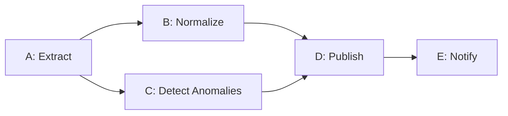
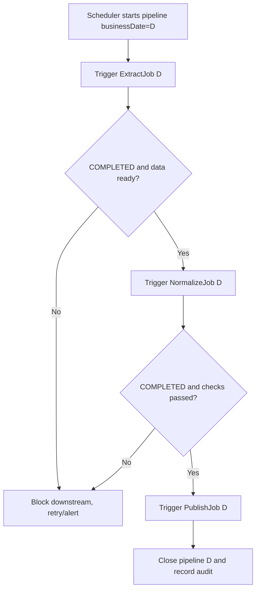
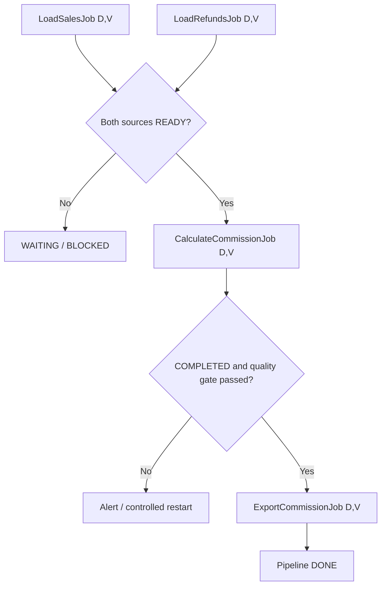

# Dependencies Between Jobs in Spring Batch

In batch systems, multiple jobs often form a data processing pipeline: once the extraction job completes, the normalization job may run; once both normalization and reconciliation complete, the reporting job may publish. This is **inter-job dependency**: the condition for a job to start or be considered ready depends on the **outcome of one or more other jobs**, for the matching data period and input version.

Example end-of-day pipeline:

```text
ImportTransactionsJob  →  ValidateTransactionsJob  →  PublishLedgerJob
       (A)                         (B)                       (C)

A failed               →  B and C have not run
A succeeded; B errored →  C has not run
A and B succeeded      →  C is allowed to run
```

Spring Batch manages the lifecycle, transactions, checkpoints, and restarts of **individual `JobInstance`/`JobExecution`s**. A cron expression or independent schedule for each job **does not by itself create dependency guarantees across jobs**. To run an A → B → C chain safely, you need an orchestration mechanism that checks statuses, identifies data periods, handles failures, and controls relaunches.

This lesson focuses on **Scheduling → Dependencies between jobs** in Spring Batch Core Processing. Java examples illustrate Spring Batch 5.x with Spring Boot 3.x; the concepts of dependencies, state, and data safety apply to other versions, even though configuration APIs may change.

## 1. What Is an Inter-Job Dependency?

Suppose a system processes transactions for `2026-11-15` using three jobs:

1. **`ExtractJob`**: fetches transactions from source systems and writes to staging tables.
2. **`NormalizeJob`**: reads staging, normalizes, and reconciles.
3. **`PublishJob`**: exports validated data to the accounting system.

Conditions that must hold:

- `NormalizeJob` may run only when **`ExtractJob` for the same business date** has validly completed.
- `PublishJob` may run only when **`NormalizeJob` for the same business date** has validly completed.
- If an upstream job fails, downstream jobs must not read incomplete staging data.
- When a failed job is later restarted and succeeds, downstream jobs are then allowed to proceed.

A **dependency** is not merely “run later in clock time.” It is a **verified precondition**. For example, scheduling `NormalizeJob` at 02:30 does not guarantee `ExtractJob` scheduled at 02:00 has finished; processing time fluctuates or the first job may fail.

Distinguish common dependency types:

| Dependency type | Example | Condition for downstream job |
|---|---|---|
| **Success dependency** | B requires A to succeed | A has an accepted completion status/outcome |
| **Data readiness** | B reads a file produced by A | File/dataset for the exact period is completely published and verified |
| **AND dependency** | D requires B **and** C | Both B and C for the same period are ready |
| **OR/conditional dependency** | D uses alternative source B or C | One branch meets the defined business rule |
| **Cross-date dependency** | Monthly aggregation needs every day | All days in the month range are closed |
| **Resource dependency** | Two jobs update the same partition | Exclusive access/coordination lock acquired before running |

Dependencies may exist between jobs in the same application, across applications, across clusters, or with non-Spring-Batch systems. As scope widens, persistent orchestration state becomes increasingly important.

## 2. Step Dependencies vs. Job Dependencies

Spring Batch already supports sequencing **steps inside a single job**:

```java
@Bean
Job dailyJob(JobRepository jobRepository,
             Step extractStep,
             Step normalizeStep,
             Step publishStep) {
    return new JobBuilder("dailyJob", jobRepository)
            .start(extractStep)
            .next(normalizeStep)
            .next(publishStep)
            .build();
}
```

In this example, step order lives inside **one Job** definition; Spring Batch manages flow and step restarts via that Job's `JobExecution`/`StepExecution`. This is usually the simplest option if the stages share a lifecycle, always run sequentially together, and use the same job parameters.

By contrast, **multiple independent Jobs** have separate names, instances, executions, and restart lifecycles:

```text
ExtractJob:   JobInstance(date=2026-11-15) → JobExecution #101
NormalizeJob: JobInstance(date=2026-11-15) → JobExecution #102
PublishJob:   JobInstance(date=2026-11-15) → JobExecution #103
```

Spring Batch does not automatically know that #102 depends on #101 just because they share a date parameter. An orchestrator is needed to launch, observe, and enforce conditions.

| Criterion | One Job with multiple Steps | Multiple Jobs with dependencies |
|---|---|---|
| Lifecycle unit | Single `JobInstance` | Each Job has its own `JobInstance` |
| Flow | Declared via Job DSL | Controlled by coordinator/scheduler |
| Restart | Spring Batch controls steps within the instance | Must coordinate each job's restart |
| Parameters | Steps share job parameters | Must pass/map parameters across jobs |
| Independent deployment | Steps usually deploy together | Jobs can reside in different apps/nodes |
| Reuse | Steps can be reused by configuration | Each job can serve multiple pipelines |
| Dependency observability | By single-job flow | By dependency graph and per-job status |

**When to choose which?** If the three stages form one cohesive workflow without independent schedules/SLAs, a single multi-step Job is usually less complex. If each stage has its own schedule, owning team, resource profile, shared outputs for other pipelines, or spans multiple systems, inter-job dependencies are appropriate.

Spring Batch also supports **`JobStep`** to run a child job as a step inside a parent job. That is a middle-ground option with a parent job, though job parameter mapping, parent/child statuses, and restart behavior must be designed carefully. It does not replace a distributed scheduler when jobs span multiple systems.

## 3. Modeling Dependencies as a DAG

For multi-branch pipelines, model dependencies explicitly as a **directed acyclic graph** (DAG):



In this graph:

- B and C can run **in parallel** after A succeeds, provided data reads are safe.
- D must wait for **both B and C** to finish under an AND rule.
- E sends notifications only after D publishes successfully.
- A, B, C, D, and E must use the **same business key** (such as date and data version) when checking readiness.

A dependency like A → B → A creates a **cycle** with no clear starting point. DAG schedulers normally reject or cannot resolve cycles; redesign by separating versions/periods, e.g., day D's A depends on day D-1's B.

Annotate the graph with concrete condition metadata:

```text
Prerequisite:   ExtractJob
Dependent:      NormalizeJob
Business key:   businessDate
Required state: COMPLETED
Data contract:  staging partition published + checksum valid
Failure action: BLOCK downstream, alert owner
Retry policy:   retry/restart ExtractJob within agreed limits
```

Whenever a dependency is casually described as “done,” clarify **done in what sense**: process exited, job `COMPLETED`, file created, data committed, or quality checks passed.

## 4. Spring Batch Concepts Used for Orchestration

### 4.1. `JobInstance` and Identifying `JobParameters`

A `JobInstance` is identified by **job name + identifying job parameters**. For periodic jobs, pass a stable business key:

```java
JobParameters parameters = new JobParametersBuilder()
        .addString("businessDate", "2026-11-15")
        .toJobParameters();
```

With the same `businessDate`, each job is still a **separate `JobInstance`** because job names differ. This makes tracking pipelines by date straightforward. Adding a random identifying parameter like `run.id` on every retry makes Spring Batch create a new instance, **no longer restarting** the failed instance.

Distinguish:

- **Business key**: data period/partition/batch ID that dependencies must match on.
- **Technical run ID**: identifier of an operational run or scheduler attempt.
- **JobInstance ID**: Spring Batch's per-job instance identifier.
- **JobExecution ID**: identifier of each attempt of an instance, including restarts.

In systems supporting data rebuilds, you may also include `dataVersion` or `pipelineVersion` as an identifying parameter. Parameter rules must align with restartability, output data, and duplicate-write prevention.

### 4.2. `BatchStatus` and `ExitStatus`

When launching a job via `JobLauncher`, you receive a `JobExecution`, but you must interpret status accurately:

| `BatchStatus` | Typical dependency interpretation |
|---|---|
| `COMPLETED` | Eligible to pass the gate, if data conditions and exit code pass |
| `FAILED` | Block downstream; evaluate restart/recovery |
| `STOPPED` | Block downstream until a new execution completes |
| `STARTING`, `STARTED`, `STOPPING` | Not yet terminal; wait or monitor |
| `ABANDONED` | Instance abandoned; do not auto-restart with same identifying parameters |
| `UNKNOWN` | Investigate; never treat as success |

`ExitStatus` is the result code used in job flows and can be customized by the application. A job with `BatchStatus.COMPLETED` can still carry an exit code indicating **completed with warnings** or quality-threshold violations. For strict pipelines, gates must check **status, exit code, and output data**; never trigger downstream solely because an OS process exited with code 0.

### 4.3. `JobLauncher`, `JobRepository`, `JobExplorer`, and `JobOperator`

| Component | Role in dependencies |
|---|---|
| `JobLauncher` | Requests launching a Job with `JobParameters` |
| `JobRepository` | Persists metadata and history of JobExecutions/StepExecutions |
| `JobExplorer` | Queries status and historical executions for observation |
| `JobOperator` | Provides operational actions like start, stop, restart depending on version |
| External scheduler/orchestrator | Schedules, resolves dependencies, orchestrates retries, alerts, backfills, and coordinates across apps |

Never equate **successful submission** with **successful job completion**. `JobLauncher.run(...)` can return very quickly if configured with an async executor. `JobExecution.getStatus()` may still be `STARTING` or `STARTED`; the coordinator must keep waiting/polling until terminal completion before opening the gate to downstream jobs.

## 5. Approach 1 — Sequential Coordination via a Spring Service

In smaller applications, a coordinator can run A, run B only if A succeeded, then run C only if B succeeded.

The following example assumes a **synchronous `JobLauncher`**. It looks up the last execution of the same `JobInstance` to support re-running the coordinator after failures: a `COMPLETED` job is skipped; a `FAILED` or `STOPPED` job is retried/restarted with the same identifying parameters; invalid states are blocked.

```java
import java.time.LocalDate;

import org.springframework.batch.core.BatchStatus;
import org.springframework.batch.core.Job;
import org.springframework.batch.core.JobExecution;
import org.springframework.batch.core.JobParameters;
import org.springframework.batch.core.JobParametersBuilder;
import org.springframework.batch.core.launch.JobLauncher;
import org.springframework.batch.core.repository.JobRepository;
import org.springframework.beans.factory.annotation.Qualifier;
import org.springframework.stereotype.Service;

@Service
public class DailyPipelineCoordinator {

    private final JobLauncher jobLauncher;
    private final JobRepository jobRepository;
    private final Job extractJob;
    private final Job normalizeJob;
    private final Job publishJob;

    public DailyPipelineCoordinator(
            JobLauncher jobLauncher,
            JobRepository jobRepository,
            @Qualifier("extractJob") Job extractJob,
            @Qualifier("normalizeJob") Job normalizeJob,
            @Qualifier("publishJob") Job publishJob) {
        this.jobLauncher = jobLauncher;
        this.jobRepository = jobRepository;
        this.extractJob = extractJob;
        this.normalizeJob = normalizeJob;
        this.publishJob = publishJob;
    }

    public void runForDate(LocalDate businessDate) throws Exception {
        JobParameters parameters = new JobParametersBuilder()
                .addString("businessDate", businessDate.toString())
                .toJobParameters();

        ensureCompleted(extractJob, parameters);
        ensureCompleted(normalizeJob, parameters);
        ensureCompleted(publishJob, parameters);
    }

    private void ensureCompleted(Job job, JobParameters parameters)
            throws Exception {

        JobExecution previous = jobRepository.getLastJobExecution(
                job.getName(), parameters);

        if (previous != null) {
            BatchStatus previousStatus = previous.getStatus();

            if (previousStatus == BatchStatus.COMPLETED) {
                // Already completed within the same JobInstance: do not rerun.
                return;
            }

            if (previousStatus != BatchStatus.FAILED
                    && previousStatus != BatchStatus.STOPPED) {
                throw new IllegalStateException(
                        "Cannot continue job " + job.getName()
                        + " from status " + previousStatus);
            }
        }

        JobExecution execution = jobLauncher.run(job, parameters);

        // Only valid if JobLauncher synchronously waits for job completion.
        if (execution.getStatus() != BatchStatus.COMPLETED) {
            throw new IllegalStateException(
                    "Job " + job.getName()
                    + " did not complete: " + execution.getStatus());
        }
    }
}
```

**Behavior to understand:**

1. The same `businessDate` is passed to every job, avoiding wiring day D's output to day D+1's input.
2. If `ExtractJob` fails, the method throws an exception and **never calls** `NormalizeJob`/`PublishJob`.
3. If Extract is `COMPLETED` and Normalize fails, fixing the issue and re-invoking the coordinator skips Extract, attempts to restart Normalize, and runs Publish only after Normalize succeeds.
4. If the last execution is `STARTED`, `ABANDONED`, or `UNKNOWN`, the coordinator refuses to guess and halts.
5. If a job sets `preventRestart()` or checkpoints cannot be reused, restart may be rejected; reprocess using a new instance according to business policy.

This demonstrates the core mechanism. For production, add a **data readiness gate**, `ExitStatus` checks, logging/auditing, retry limits, per-period locking, and alerts. Checking the last execution then calling the launcher is not an atomic lock against two coordinators running concurrently.

### 5.1. Why Not Generate a New `run.id` on Every Coordinator Run?

Suppose Extract completed, while Normalize failed:

```text
Run 1: date=2026-11-15, run.id=101
  Extract COMPLETED → Normalize FAILED

Run 2: date=2026-11-15, run.id=102
  Extract reruns as a new JobInstance
```

If `run.id` is identifying, Run 2 creates a new instance for every job. That makes sense for an **intentional full reprocess**, not for restarting Normalize from Run 1's checkpoint. To restart, reuse the failed instance's identifying parameters.

### 5.2. Asynchronous `JobLauncher` Must Track Terminal Status

If the launcher uses an async `TaskExecutor`, never write:

```java
JobExecution execution = jobLauncher.run(extractJob, parameters);
jobLauncher.run(normalizeJob, parameters); // Wrong: Extract may still be STARTED.
```

Replace with one of:

- Use a synchronous launcher for small orchestrations that do not require fast request return.
- With an async launcher, take the `executionId` and monitor via `JobExplorer`/completion events until terminal status; only then evaluate dependencies.
- Use a scheduler with built-in DAG and persistent event/status tracking.

If polling, design timeouts, backoff, alerts, and hung-job detection; avoid busy-wait loops. Jobs ending `FAILED`, `STOPPED`, or `UNKNOWN` must be treated as unsatisfied dependencies.

## 6. Approach 2 — Scheduling with `@Scheduled` Plus a Coordinator

Spring Framework provides `@Scheduled` to trigger a workflow on a schedule:

```java
import java.time.LocalDate;
import java.time.ZoneId;

import org.springframework.scheduling.annotation.Scheduled;
import org.springframework.stereotype.Component;

@Component
public class DailyPipelineSchedule {

    private static final ZoneId BUSINESS_ZONE =
            ZoneId.of("Asia/Ho_Chi_Minh");

    private final DailyPipelineCoordinator coordinator;

    public DailyPipelineSchedule(DailyPipelineCoordinator coordinator) {
        this.coordinator = coordinator;
    }

    @Scheduled(cron = "0 10 2 * * *", zone = "Asia/Ho_Chi_Minh")
    public void trigger() throws Exception {
        LocalDate businessDate = LocalDate.now(BUSINESS_ZONE)
                .minusDays(1);
        coordinator.runForDate(businessDate);
    }
}
```

Scheduling must be enabled with `@EnableScheduling` in application configuration. The example fires at 02:10 Vietnam time and processes the previous day's data. Business date selection depends on domain rules: some pipelines process *today*, some close *yesterday*, and some backfill *multiple days*.

**Key point:** cron decides only **when to invoke the coordinator**. Coordinator logic decides whether B may run after A. Never create three independent crons “A at 02:10, B at 02:20, C at 02:30” and assume dependencies are enforced.

Limitations of `@Scheduled` in multi-instance deployments:

- Each application instance can fire its own schedule; multiple coordinators may compete on the same day.
- An app outage at trigger time can miss the trigger depending on operations.
- Lacks built-in DAGs, backfills, SLAs, dependency history, and dashboards found in dedicated schedulers.
- Exceptions from a run may be logged, but do not automatically turn into a controlled retry plan.

For multi-node setups, use **leader election/distributed locks** per business key, or delegate triggering to a central scheduler. Locks need timeouts, owner metadata, and dead-node handling. Never rely solely on in-memory boolean flags.

## 7. Approach 3 — External Orchestrator or Scheduler

When pipelines span multiple applications, parallel branches, distinct SLAs, or backfill requirements, let an orchestrator manage the DAG. Common products/tools include **Airflow, Control-M, Argo Workflows, Quartz with an orchestration layer, or enterprise schedulers**.

Model:



The orchestrator can call batch admin APIs, send launch messages, run commands/containers, or trigger Spring Batch tasks as configured. Crucially, it must **wait for actual completion**, not merely HTTP 202 Accepted or queue enqueueing.

### Comparing Options

| Option | Best suited when | Caveats |
|---|---|---|
| Single Spring Batch Job with multiple Steps | Shared lifecycle and simple flow | Does not create independent Jobs |
| Spring coordinator + `JobLauncher` | Single app, few dependencies, easy control | Must build locking, error handling, observability |
| `@Scheduled` calling coordinator | Simple periodic schedules | Cron alone does not enforce dependencies |
| `JobStep` | Wrapping child Jobs inside a parent Job | Must carefully design parameter passing and two-level restart |
| Quartz + custom dependency state | In-app persistent schedules, flexible triggers | Quartz triggers do not inherently understand cross-job data dependencies |
| Dedicated DAG orchestrator | Multi-system, multi-branch, backfill, and SLAs | Must accurately sync `JobExecution` and data readiness states |
| Event-driven orchestration | Completed job emits event to trigger downstream | Needs durable messaging, deduplication, and idempotency |

No single solution fits every case. Every approach must guarantee **dependent jobs never run until prerequisites pass**, and dependency state is persisted and recoverable after failures.

## 8. Success Conditions Must Bind to the Same Data Period

A common mistake is an operational check asking:

```text
"Has the latest ExtractJob run COMPLETED?"
```

Suppose day D-1's Extract completed, while day D's Extract failed. If the coordinator simply checks “latest COMPLETED” or “latest successful run” without filtering parameters, it can launch day D's Normalize against day D-1's data.

The proper gate checks:

```text
jobName       = ExtractJob
businessDate  = D
dataVersion   = V (if applicable)
status        = COMPLETED
requiredExit  = accepted
artifact      = matching partition D, valid checksum/rowCount
```

Spring Batch metadata records `JobParameters` in its tables. You can query `JobRepository`/`JobExplorer` for the exact instance's execution. When multiple systems participate, maintain a shared **business readiness record** rather than coupling to another app's internal metadata tables.

### Readiness Manifest / Data Status Table

Example table recording published data:

```sql
CREATE TABLE batch_artifact_ready (
    pipeline_name   VARCHAR(100) NOT NULL,
    business_date   DATE NOT NULL,
    stage_name      VARCHAR(100) NOT NULL,
    data_version    VARCHAR(50) NOT NULL,
    ready_status    VARCHAR(20) NOT NULL,
    record_count    BIGINT,
    checksum        VARCHAR(128),
    published_at    TIMESTAMP,
    PRIMARY KEY (
        pipeline_name, business_date, stage_name, data_version
    )
);
```

`NormalizeJob` should read a partition only once it transitions to `READY` with matching version and mandatory checks. Setting `READY` must occur **after all data is completely written**, following the transaction/publish strategy of the storage medium.

For object storage or files, the safe pattern is: write to a staging path, complete verification, then publish the manifest/final path. File existence alone does not prove writing finished. If the marker and data reside on separate stores, account for network drops between the two writes.

## 9. Retry and Restart When Dependencies Fail

Step-level retry and job-level restart operate at different levels:

- **Retry**: reattempts a transient failing operation inside the same step execution under a fault-tolerant policy.
- **Restart**: creates a new `JobExecution` for the **same `JobInstance`** after `FAILED`/`STOPPED`, if restartable.
- **Pipeline retry**: coordinator/scheduler re-evaluates the DAG, skips already-completed prerequisites, and resumes blocked portions.
- **New instance / reprocess**: starts processing under new identifying parameters, typically tied to a versioning/rebuild policy.

Example A → B → C:

| Run | Extract A | Normalize B | Publish C | Coordination |
|---|---|---|---|---|
| 1 | `FAILED` | Not run | Not run | Block B, C |
| 2 | Restart → `COMPLETED` | `FAILED` | Not run | Block C |
| 3 | Already `COMPLETED` | Restart → `COMPLETED` | `COMPLETED` | Pipeline complete |

Run 3 need not rerun A if A's data remains valid. Conversely, if A was **rerun with corrected data**, an earlier completed B may now be stale. Manage **`dataVersion`** and downstream invalidation/reprocess policies rather than looking solely at each job's `COMPLETED` status.

### `ABANDONED` and `UNKNOWN`

When the latest execution of a `JobInstance` is `ABANDONED`, do not treat it as auto-restartable. The scheduler needs an explicit branch: lock the pipeline and escalate to authorized operators. For `UNKNOWN` or `STARTED` stuck after a crash, verify actual worker and data state before launching anything new.

### Multi-Day Backfills

If day D-2 failed while D-1 succeeded upstream, a scheduler running only “yesterday” will miss D-2. Store pipeline state **by `businessDate`**, support selecting date ranges for backfill, and enforce dependencies per day. Independent days can run in parallel if they do not contend on data, or sequentially if day N depends on day N-1's ending balance.

## 10. Ensuring Single Execution and Preventing Concurrent Runs

Two coordinators might simultaneously receive triggers for `businessDate=D`:

```text
Node 1 checks ExtractJob D: does not exist yet
Node 2 checks ExtractJob D: does not exist yet
Node 1 sends start request
Node 2 sends start request
```

Spring Batch uses `JobRepository` to manage `JobInstance`/`JobExecution` validity and block multiple active executions of the **same instance** under proper conditions. However, that does not protect an **entire multi-job pipeline**, downstream data, two distinct schedulers, or varying identifying parameters.

Combine:

1. A **distributed lock** or claim record keyed by `pipeline + businessDate + dataVersion` before orchestrating.
2. Stable identifying parameters on jobs so Spring Batch applies restart semantics properly.
3. Writers with **idempotency keys**, unique constraints, or upserts so retries/restarts do not duplicate records.
4. Unique IDs on dependency state and events; duplicate completion events must not trigger downstream endlessly.
5. Lock-release/investigation runbooks when a lock-holding node dies mid-run.

Avoid wrapping an entire multi-hour pipeline in one giant database transaction. Each job/chunk commits independently; the orchestrator ensures consistency **across commit boundaries** via durable state, data quality gates, and recovery workflows.

## 11. Testing Inter-Job Dependencies

A good test suite verifies orchestration logic **independently** of each job's business processing, then adds integration tests against a real `JobRepository` to verify metadata and restart behavior.

### 11.1. Unit Test: Upstream Failure Blocks Downstream

Using the coordinator from section 5, Mockito can prove a failed execution blocks downstream jobs:

```java
import static org.junit.jupiter.api.Assertions.assertThrows;
import static org.mockito.ArgumentMatchers.any;
import static org.mockito.ArgumentMatchers.eq;
import static org.mockito.Mockito.*;

import java.time.LocalDate;

import org.junit.jupiter.api.Test;
import org.junit.jupiter.api.extension.ExtendWith;
import org.mockito.Mock;
import org.mockito.junit.jupiter.MockitoExtension;
import org.springframework.batch.core.BatchStatus;
import org.springframework.batch.core.Job;
import org.springframework.batch.core.JobExecution;
import org.springframework.batch.core.JobParameters;
import org.springframework.batch.core.launch.JobLauncher;
import org.springframework.batch.core.repository.JobRepository;

@ExtendWith(MockitoExtension.class)
class DailyPipelineCoordinatorTest {
    @Mock JobLauncher launcher;
    @Mock JobRepository repository;
    @Mock Job extractJob;
    @Mock Job normalizeJob;
    @Mock Job publishJob;

    @Test
    void doesNotStartDependentJobWhenExtractFails() throws Exception {
        when(extractJob.getName()).thenReturn("extractJob");
        when(repository.getLastJobExecution(
                eq("extractJob"), any(JobParameters.class)))
                .thenReturn(null);

        JobExecution failedExecution = mock(JobExecution.class);
        when(failedExecution.getStatus()).thenReturn(BatchStatus.FAILED);
        when(launcher.run(
                eq(extractJob), any(JobParameters.class)))
                .thenReturn(failedExecution);

        DailyPipelineCoordinator coordinator =
                new DailyPipelineCoordinator(
                        launcher, repository,
                        extractJob, normalizeJob, publishJob);

        assertThrows(IllegalStateException.class,
                () -> coordinator.runForDate(
                        LocalDate.of(2026, 11, 15)));

        verify(launcher, never()).run(
                eq(normalizeJob), any(JobParameters.class));
        verify(launcher, never()).run(
                eq(publishJob), any(JobParameters.class));
    }
}
```

This test verifies the **orchestration contract**: dependent jobs do not launch when a prerequisite fails. It does not verify transactions or read/write outputs of each job; test Jobs/Steps separately.

### 11.2. Integration Test Matrix for the Pipeline

| Scenario | Setup | What to verify |
|---|---|---|
| Full success | A, B, C succeed | Exact order, statuses, complete C output |
| A fails | A throws error | B/C have no new execution for that business key |
| B fails | A succeeds, B throws error | C does not run; A's commits remain intact |
| Rerun after B fails | A `COMPLETED`, B has `FAILED` execution | A does not rerun; B restarts; C waits for B |
| C already `COMPLETED` | Re-run coordinator with same params | No duplicate execution for completed jobs |
| Job A still `STARTED` | Async launcher or mocked running status | Does not trigger B prematurely |
| Different business dates | D-1's A succeeded, D's A failed | D's B is blocked |
| Missing data readiness | A `COMPLETED` but manifest not `READY` | B blocked by data contract |
| New version | A produces V2 data, B finished V1 | V1's B is not used to publish V2 |
| Two parallel coordinators | Two triggers for same key | Only one pipeline owner; zero duplicate side effects |
| Restart after crash | Metadata/job state needs recovery | Never treat `STARTED` as success; pipeline recovers cleanly |
| One DAG branch fails | A succeeds; B completes; C fails; D needs B AND C | D stays blocked until C recovers |

For integration tests, use `@SpringBatchTest`, `JobLauncherTestUtils`, `JobExplorer`, and a test metadata database. With multiple Job beans, select the target job explicitly in test utilities or invoke `JobLauncher` directly per job. Tests should verify both **execution history** and **committed data**, not just mock call counts.

Never use arbitrary `Thread.sleep` to force ordering in async tests. Use latches/barriers, fake events, bounded awaits, or a test scheduler with a controllable clock.

## 12. Monitoring Dependencies and Incident Operations

When a pipeline spans multiple Jobs, observing individual JobExecutions alone is insufficient. Track operational fields **per pipeline run / business key**:

| Field | Purpose |
|---|---|
| `pipelineName` | Identifies the DAG/workflow |
| `businessDate`, `dataVersion` | Binds every job to exact data |
| `upstreamJob`, `downstreamJob` | Visualizes dependency edges |
| `jobInstanceId`, `jobExecutionId` | Drills down into Spring Batch history |
| `dependencyStatus` | App-defined `WAITING`, `READY`, `RUNNING`, `BLOCKED`, `FAILED`, `DONE` |
| `lastSuccessAt` | Identifies timestamp of latest valid data |
| `recordCount`, `checksum` | Validates data readiness |
| `attemptCount`, `errorReason` | Aids investigation and retry limits |
| `owner`, `SLA` | Routes alerts to the right team |

Values like `WAITING` or `BLOCKED` above are **application-defined orchestration statuses**, not `BatchStatus` enum values.

Useful alert template:

```text
Pipeline: daily-ledger
BusinessDate: 2026-11-15
Blocked job: PublishJob
Dependency: NormalizeJob
Upstream JobExecution: 8842
Upstream status: FAILED
Last completed stage: ExtractJob
Data version: v3
Recommended action: Inspect NormalizeJob failure; restart same
                    JobInstance if checkpoint and data are valid.
```

Alerts should distinguish jobs **not yet due**, **running normally**, **failed**, and **breaching SLA**. If every waiting state pages operators as an error, real incidents get buried in noise.

### Runbook When Downstream Is Blocked

1. Locate the blocked business key; identify the exact prerequisite and latest execution for the **same key**.
2. Inspect `BatchStatus`, `ExitStatus`, step errors, update timestamps, checkpoints, and artifact readiness.
3. Determine whether it is a transient failure safe to restart, bad data needing correction, or an abandoned/invalid instance.
4. Reconcile already-committed chunks or external side effects before deciding to rerun.
5. If restart is safe, resume with the same identifying parameters and release downstream only after gates pass.
6. If a rebuild is needed, create a new version/instance and invalidate the old version as an eligible data source.
7. Verify downstream consumed the exact right artifact and period without duplicate writes; update audit and pipeline state.

## 13. Common Pitfalls

| Mistake | Why it is dangerous | Alternative |
|---|---|---|
| Scheduling A at 02:00, B at 02:10 independently | A may run long or fail | Orchestrate on actual completion/readiness |
| Checking only OS process exit code 0 | With async launchers, job may be submitted but unfinished | Wait for terminal `JobExecution` and evaluate outcomes |
| Checking any `COMPLETED` upstream run | Consumes another period's data | Query by identifying parameters/business key |
| Mixing V1 artifact with V2 downstream | Inconsistent data | Pass matching data version, verify manifests |
| Adding a new `run.id` on every retry | Loses restart/checkpoint semantics | Keep identifying parameters when restarting |
| Letting downstream run despite upstream `FAILED` | Reads incomplete data | Strict gates, failure branches, clear alerts |
| Checking `COMPLETED` only, skipping quality gate | Pipeline publishes empty/corrupt data | Check exit status and published data metrics |
| Relying on in-memory locks across multiple nodes | Two instances both own the pipeline | Distributed lock/claim record with expiry |
| Using `JobExecutionListener.afterJob` as primary orchestrator | Downstream calls hard to retry/audit after crash | Coordinator/scheduler with durable state |
| Wrapping multiple Jobs in one giant transaction | No atomic cross-job rollback | Idempotency, outbox/manifest, compensation where needed |
| Auto-restarting `ABANDONED` or `UNKNOWN` jobs | Causes contention or duplicate writes | Investigate and run controlled recovery |

## 14. Exercise: Designing a Pipeline with Dependencies

Given an end-of-day commission pipeline with four Jobs:

- `LoadSalesJob` extracts sales transactions from source.
- `LoadRefundsJob` extracts refunds.
- `CalculateCommissionJob` computes commissions from **both sales and refunds**.
- `ExportCommissionJob` exports results to the payout system.

Requirements:

1. Both load jobs may run concurrently.
2. The calculate job runs only when both sources for the **same businessDate** are ready.
3. The export job runs only when calculate succeeds, record counts validate, and the output version is published.
4. If `LoadRefundsJob` fails, `LoadSalesJob` is not needlessly rerun during recovery.
5. If sales are re-imported under a new version, old calculate/export results must no longer be used.

One design:



An operational solution should include: a shared `(businessDate, dataVersion)` key, separate readiness states for both sources, an AND gate before calculate, per-JobInstance restart policies, and export idempotency. Whenever data version increments, downstream states tied to older versions must be invalidated per business rules.

## 15. Core Principle

Inter-job dependency is a **guarantee that downstream input data and preconditions are genuinely ready**. Spring Batch provides execution and per-job state persistence, while the scheduler/coordinator connects them into a pipeline with ordering, branching, retry limits, and recovery history.

A resilient design simultaneously satisfies five conditions: **accurate `JobInstance` per business key; verified terminal status and exit policy; validated published data; zero duplicate execution under retries/concurrency; and clear restart/backfill plans when upstream fails**. Once these five conditions are explicit, an A → B → C pipeline remains safe under variable runtimes, crashes, late data, and reruns.
