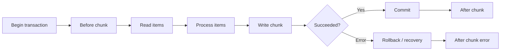
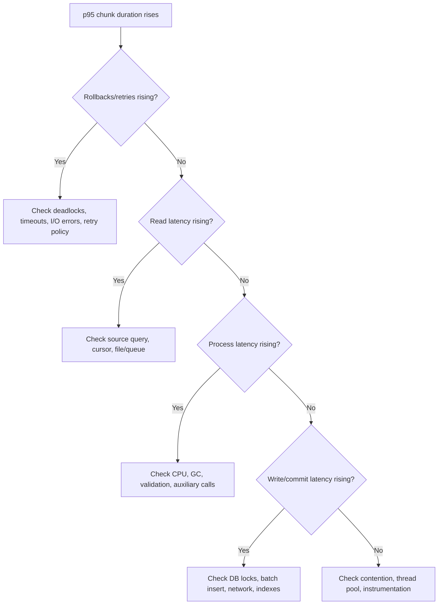

# Monitoring Per-Chunk Duration in Spring Batch

A batch job may report **COMPLETED** yet take longer than expected, or its throughput may steadily degrade even as total record volume grows. To find the root cause, measuring total job duration alone is usually not enough. With **chunk-oriented processing**, measuring **per-chunk** duration helps pinpoint abnormal processing segments: a chunk waiting on a database lock, a chunk writing to a slow API, a chunk repeatedly rolling back and retrying, or a batch of records with higher processing cost than the rest.

This lesson belongs to **Spring Batch Core Processing → Monitoring**, focusing on measurement design, listener integration, logging and metrics, dashboarding, alerting, and testing measurement logic. Examples use Java, Spring Batch 5.x, Spring Boot 3.x, and Micrometer. Some built-in framework metric names vary by version; the examples below define **custom metrics** to guarantee clear semantics and naming.

## 1. What Unit of Processing Is a Chunk?

In a chunk-oriented step, Spring Batch reads and processes data in groups and then calls the writer within a transaction boundary. For example:

```java
@Bean
Step importStep(
        JobRepository jobRepository,
        PlatformTransactionManager transactionManager,
        ItemReader<RawRow> reader,
        ItemProcessor<RawRow, ValidRow> processor,
        ItemWriter<ValidRow> writer) {

    return new StepBuilder("importStep", jobRepository)
            .<RawRow, ValidRow>chunk(200, transactionManager)
            .reader(reader)
            .processor(processor)
            .writer(writer)
            .build();
}
```

Here, `RawRow` and `ValidRow` are hypothetical business data types. `chunk(200, transactionManager)` creates a step with a commit interval of 200. A chunk may have **fewer than 200 written items** if the processor filters items with `null`, items are skipped, or it is the final chunk; do not infer the number of committed records solely from `chunkSize`.

Typical cycle:



Spring Batch can handle errors via skip, retry, and chunk replay. When a rollback occurs, the same item or group of items may be reprocessed, so **the number of processing runs, the number of writer calls, and the number of committed chunks are distinct quantities**.

## 2. Precisely Defining "Per-Chunk Duration"

A timing number is only useful when you know where it starts and ends.

| Measurement | Start point | End point | Question answered |
|---|---|---|---|
| **Chunk elapsed time** | `beforeChunk` callback | `afterChunk` or `afterChunkError` | How long does one chunk processing attempt take? |
| **Read latency** | Before calling `ItemReader.read()` | When read returns/throws | Is reading the source slow? |
| **Process latency** | Before `ItemProcessor.process()` | After processing/throwing | Is computation or validation heavy? |
| **Write latency** | Before `ItemWriter.write()` | After writer returns/throws | Is writing to the target slow? |
| **Job duration** | Job starts | Job ends | How long does the entire job take? |
| **Scheduling delay** | Scheduled start time | Job actually starts | Was the job delayed by scheduling or resources? |

Under Spring Batch's `ChunkListener` contract, `beforeChunk` is called after the chunk transaction begins and before the read phase; `afterChunk` is called after the chunk commits. When a chunk fails, `afterChunkError` allows recording the error path.

Therefore, **duration measured via callbacks typically includes read, process, write, and most of transaction/commit handling**, but excludes scheduler queue wait time and any work outside the callbacks. With rollbacks and retries, each attempt or recovery pass can produce separate observations; do not assume "one measurement = one unique data chunk."

### Distinguishing Elapsed Time from CPU Time

Measuring with the monotonic clock `System.nanoTime()` captures **wall-clock elapsed duration**. It may include network waits, I/O, database locks, thread scheduling, backoff, and GC pauses. That is appropriate for monitoring chunk latency.

If the goal is CPU profiling, separate profilers or CPU metrics are needed. A chunk taking 4 seconds does not necessarily consume 4 seconds of continuous CPU; it may execute for only a few milliseconds and spend the rest waiting on the database.

Avoid using `System.currentTimeMillis()` to measure short intervals because the system clock can be adjusted by NTP or administrators. `System.nanoTime()` is better suited for taking **the difference between two points in time**, while wall-clock timestamps can be used for logging.

## 3. Choosing an Observation Strategy

There are three common ways to monitor chunk duration.

| Measurement approach | Pros | Limitations |
|---|---|---|
| **`ChunkListener` + logs** | Simple; easy to spot slow job/step/chunk when searching logs | Hard to aggregate percentiles from logs alone; many chunks can bloat log volume |
| **`ChunkListener` + Micrometer Timer** | Counts samples, tracks total time and histograms/percentiles; ideal for dashboards/alerts | Requires a registry, histogram config, tags, and a collection pipeline |
| **Tracing/Observation combined with built-in metrics** | Links chunks to DB/HTTP spans for deep tracing | Granularity and available metrics depend on version, sampling, and instrumentation |

Use a Micrometer Timer as the primary metric channel, log when a chunk exceeds a threshold or errors, and enable tracing when you need to pinpoint slow calls inside a chunk. If the application already enables Spring Batch's built-in metrics, check their definitions and units before adding new metrics so you do not double-count the same observation.

A minimal useful metric set:

- Duration of successful and failed chunks (in seconds when exported to Prometheus).
- Chunk observation counts by `job`, `step`, and `outcome`.
- Step totals for read/write/skip/filter and commit/rollback counts.
- Step/job duration, failed job counts, backlog, or scheduling lag.

## 4. Implementing a Timing `ChunkListener`

The example below creates a metric named **`batch.chunk.duration`**, recording one sample for each callback finishing a chunk either successfully or in error. The listener stores the start time in a `ThreadLocal` so worker threads processing chunks concurrently do not overwrite each other's timer.

### 4.1. Listener Using Micrometer and Slow-Chunk Logging

```java
import java.time.Duration;
import java.util.concurrent.TimeUnit;
import java.util.function.LongSupplier;

import io.micrometer.core.instrument.MeterRegistry;
import io.micrometer.core.instrument.Timer;
import org.slf4j.Logger;
import org.slf4j.LoggerFactory;
import org.springframework.batch.core.ChunkListener;
import org.springframework.batch.core.scope.context.ChunkContext;

public final class ChunkDurationListener implements ChunkListener {

    private static final Logger log =
            LoggerFactory.getLogger(ChunkDurationListener.class);
    private static final String METRIC_NAME = "batch.chunk.duration";

    private final MeterRegistry meterRegistry;
    private final LongSupplier nanoClock;
    private final long slowThresholdNanos;

    // Each worker thread keeps its own start timestamp.
    private final ThreadLocal<Long> startedAtNanos = new ThreadLocal<>();

    public ChunkDurationListener(MeterRegistry meterRegistry) {
        this(meterRegistry, System::nanoTime, Duration.ofSeconds(2));
    }

    // Allows injecting a fake clock in unit tests.
    ChunkDurationListener(
            MeterRegistry meterRegistry,
            LongSupplier nanoClock,
            Duration slowThreshold) {
        this.meterRegistry = meterRegistry;
        this.nanoClock = nanoClock;
        this.slowThresholdNanos = slowThreshold.toNanos();
    }

    @Override
    public void beforeChunk(ChunkContext context) {
        startedAtNanos.set(nanoClock.getAsLong());
    }

    @Override
    public void afterChunk(ChunkContext context) {
        recordEnd(context, "success");
    }

    @Override
    public void afterChunkError(ChunkContext context) {
        recordEnd(context, "error");
    }

    private void recordEnd(ChunkContext context, String outcome) {
        Long startedAt = startedAtNanos.get();
        startedAtNanos.remove(); // Prevent state leaks when threads are reused.

        if (startedAt == null) {
            return; // No valid start timestamp.
        }

        long elapsedNanos = Math.max(
                0L, nanoClock.getAsLong() - startedAt);

        String jobName = context.getStepContext().getJobName();
        String stepName = context.getStepContext().getStepName();

        Timer.builder(METRIC_NAME)
                .description("Elapsed time of a Spring Batch chunk attempt")
                .tags(
                        "job", jobName,
                        "step", stepName,
                        "outcome", outcome)
                .publishPercentileHistogram()
                .register(meterRegistry)
                .record(elapsedNanos, TimeUnit.NANOSECONDS);

        if (elapsedNanos >= slowThresholdNanos) {
            long durationMs =
                    TimeUnit.NANOSECONDS.toMillis(elapsedNanos);

            log.warn(
                    "Slow batch chunk: job={} step={} outcome={} durationMs={}",
                    jobName, stepName, outcome, durationMs);
        }
    }
}
```

**Notable design decisions:**

1. **`beforeChunk` → `afterChunk`/`afterChunkError`:** the same measurement span covers both success and error paths; the `outcome` tag distinguishes the two sample sets.
2. **`System.nanoTime()`:** measures duration with a monotonic clock. The clock supplier is injected so tests do not need `Thread.sleep()`.
3. **`ThreadLocal`:** supports a singleton listener shared by worker threads in a multithreaded step, provided callbacks for **a single chunk** execute on the same thread, as in standard chunk execution. In architectures that hop callbacks across threads, store state by chunk/execution key or an appropriate context mechanism.
4. **`remove()`:** clears the start time after recording the metric so pooled threads do not retain data from a previous chunk.
5. **`Timer`:** tracks count/total time and can export histograms; no need to keep a list of all durations in RAM.
6. **Log only slow chunks:** reduces log volume and I/O overhead. You can log every chunk in development, but production should pick sensible thresholds and sampling.

In this example, each successful or failed callback pass produces one sample; that is **chunk attempt duration**, not total elapsed time until a group of items commits across multiple retries. Keep this definition explicit in dashboard descriptions and operational runbooks.

### 4.2. Registering the Listener on a Step

```java
@Bean
ChunkDurationListener chunkDurationListener(MeterRegistry registry) {
    return new ChunkDurationListener(registry);
}

@Bean
Step importStep(
        JobRepository jobRepository,
        PlatformTransactionManager transactionManager,
        ItemReader<RawRow> reader,
        ItemProcessor<RawRow, ValidRow> processor,
        ItemWriter<ValidRow> writer,
        ChunkDurationListener chunkDurationListener) {

    return new StepBuilder("importStep", jobRepository)
            .<RawRow, ValidRow>chunk(200, transactionManager)
            .reader(reader)
            .processor(processor)
            .writer(writer)
            .listener(chunkDurationListener)
            .build();
}
```

The `RawRow` and `ValidRow` classes represent application data and should be replaced with real types. In Spring Batch 5, the builder takes `JobRepository` and `chunk(size, transactionManager)`. Ensure the listener is attached to **the step you want to measure**; declaring the bean without registering it on the step will not emit metrics automatically.

If a job has three chunk steps, the same singleton listener can be shared to emit the same metric with distinct `step` tags. Do not register two listeners performing the same measurement unless you intend to record twice.

### 4.3. Sample Log When a Slow Chunk Occurs

```text
WARN Slow batch chunk:
  job=transactionImport
  step=importStep
  outcome=success
  durationMs=3187
```

The log shows that one chunk processing pass took about 3.2 seconds. It **does not yet show** whether the slowdown was in the reader, processor, writer, or transaction commit; finding the root cause requires combining phase timing and JDBC/HTTP/CPU/GC metrics.

## 5. Enabling Micrometer and Exporting Metrics to Prometheus

If using Spring Boot Actuator, add the corresponding dependencies in your build (for example Gradle):

```groovy
dependencies {
    implementation 'org.springframework.boot:spring-boot-starter-batch'
    implementation 'org.springframework.boot:spring-boot-starter-actuator'
    runtimeOnly 'io.micrometer:micrometer-registry-prometheus'
}
```

Versions should be managed via the Spring Boot BOM to avoid mismatches between Micrometer and the framework. Example endpoint exposure configuration:

```yaml
management:
  endpoints:
    web:
      exposure:
        include: health, info, prometheus
```

With Actuator's default configuration, the Prometheus endpoint is typically at `/actuator/prometheus`. In production deployments, restrict access according to your security policies and monitoring infrastructure.

Because the example listener calls `publishPercentileHistogram()`, Prometheus can scrape histograms for the metric following Micrometer conventions, with typical names like:

```text
batch_chunk_duration_seconds_count{job="transactionImport",
  step="importStep",outcome="success"} 120
batch_chunk_duration_seconds_sum{job="transactionImport",
  step="importStep",outcome="success"} 18.42
batch_chunk_duration_seconds_bucket{job="transactionImport",
  step="importStep",outcome="success",le="1.0"} ...
```

This is an **illustrative format**; exact values, buckets, and formatting depend on the registry and version. The Micrometer name `batch.chunk.duration` is typically converted to `batch_chunk_duration_seconds_*` in Prometheus. Inspect the running endpoint to confirm the actual series names before building dashboards.

### Why Use Timer Instead of Gauge?

`Timer` accumulates observed durations, providing counts, total time, and histograms. `Gauge` typically describes an **instantaneous value** (such as the number of chunks currently in flight), which is unsuitable for computing percentiles over past durations.

To compute reliable p95/p99 across multiple instances, prefer histograms that can be aggregated across instances. Computing percentiles per instance and averaging them is usually **not** the true system-wide p95.

## 6. Dashboard: p50, p95, p99, and Throughput

A good dashboard shows **duration distributions** rather than only a single average value.

For example, suppose four chunks take `90 ms, 110 ms, 110 ms, 900 ms`. The average is `302.5 ms`, yet the first three chunks were fast and the last chunk was an outlier. Looking only at the average makes it hard to tell a uniformly slow step apart from one with occasional stalls.

Key statistics:

| Metric | Interpretation | Question |
|---|---|---|
| **p50 (median)** | Half of samples have durations at or below this value | Is the typical case healthy? |
| **p95** | Roughly 95% of samples fall at or below this mark | Are there many slow tail chunks? |
| **p99** | Mark corresponding to 99% of samples | Are there severe outliers? |
| **Average** | Total duration divided by sample count | What is the mean cost? |
| **Max** | Largest sample in the window | Was there an unusually slow chunk? |
| **Count/rate** | Number of chunk attempts in the window | How many passes ran? |
| **Item throughput** | Items processed/written per second | How much data is the pipeline producing? |
| **Rollback/retry rate** | Rollbacks/retries relative to activity | Is time being lost to error recovery? |

Percentiles depend on the **time window**, sample count, and histogram buckets. For a step running only a few chunks per day, a 5-minute windowed p99 is noisy or meaningless; instead, inspect per-chunk durations or compare across a complete JobExecution.

### 6.1. PromQL: p95 of Successful Chunks

If the registry exports the corresponding histogram:

```promql
histogram_quantile(
  0.95,
  sum by (le, job, step) (
    rate(batch_chunk_duration_seconds_bucket{
      outcome="success"
    }[5m])
  )
)
```

This is the p95 latency **of success samples** over a 5-minute window, grouped by job/step name and aggregated across instances. With classic histograms, `le` must remain in `sum by` for `histogram_quantile` to work.

### 6.2. PromQL: Average Duration

```promql
sum by (job, step) (
  rate(batch_chunk_duration_seconds_sum{outcome="success"}[5m])
)
/
sum by (job, step) (
  rate(batch_chunk_duration_seconds_count{outcome="success"}[5m])
)
```

The numerator is accumulated time per second, and the denominator is samples per second; the ratio gives **seconds per chunk attempt**. If there are no samples in the window, the expression may return no meaningful value; dashboards should clearly display data gaps.

### 6.3. PromQL: Failed Chunk Attempts

```promql
sum by (job, step) (
  increase(batch_chunk_duration_seconds_count{
    outcome="error"
  }[15m])
)
```

Counting chunk errors via callbacks is **not equivalent** to the number of `FAILED` JobExecutions. A chunk error may be retried or skipped and the job can still end `COMPLETED`. To count failed jobs, use JobExecution metrics or metadata.

### 6.4. Relationship Between Duration and Throughput

For a sequential step, if the chunk size is 200 and an average chunk takes 1 second, you might expect close to 200 input items/second when there is no filtering, no skipping, minimal overhead, and no other bottleneck. This is only an illustrative estimate:

```text
Approx input throughput ≈ input items per committed chunk
                          / average elapsed time per chunk
```

In practice, the final chunk is smaller, items vary in cost, writers batch SQL, retries replay chunks, and steps can run across multiple threads. Measure **item throughput** directly from `StepExecution`/business counters and compare it against duration, rather than treating this formula as an official metric.

## 7. Chunk Duration Under Skip, Retry, and Rollback

This is the most important point when interpreting operational metrics.

Suppose a writer writes 200 items but hits a deadlock on the first attempt:

```text
beforeChunk
  read/process/write → writer error → rollback
afterChunkError             duration=1600ms, outcome=error

beforeChunk
  reprocess / retry → write succeeds → commit
afterChunk                  duration=2100ms, outcome=success
```

**The result can be two duration samples for one group of data.** This is expected when the metric is defined per **attempt**. Do not sum sample counts to deduce the number of committed chunks. Conversely, looking only at `outcome=success` hides time spent in failed attempts and underestimates true cost.

| Case | Impact on metrics | How to read |
|---|---|---|
| No errors | One success measurement per chunk | Typically represents chunk completion time |
| Retry in read/process/write | May stretch a single measurement or produce extra measurements | Pair with retry counters/phase metrics |
| Writer fails, rollback, replay | May record an error sample followed by a success sample | Error count does not mean job failure |
| Skipped bad item | Chunk may finish with fewer outputs than inputs | Track `skipCount` alongside duration |
| Processor returns `null` | Item is filtered, not an error | Track `filterCount` |
| Step is STOPPED | Earlier chunks may have committed | Step/job status differs from chunk outcome |
| Error occurs before `beforeChunk` | Listener has no start timestamp | Track step/job error metrics as well |

Why can `readCount` and `writeCount` differ? The processor may filter; reader/processor/writer may skip; the writer may fail; the last chunk may be short. Therefore, **per-chunk duration** must always be interpreted alongside workload size and committed item counts.

### Chunk Commits and Spring Batch Counters

Useful counters on `StepExecution`:

```java
StepExecution step = jobExecution.getStepExecutions()
        .iterator().next();

long readCount = step.getReadCount();
long writeCount = step.getWriteCount();
long filterCount = step.getFilterCount();
long skipCount = step.getSkipCount();
long commitCount = step.getCommitCount();
long rollbackCount = step.getRollbackCount();
```

These numbers describe outcomes **of the StepExecution** and are updated as processing progresses. They do not provide per-chunk durations on their own; the listener fills that gap. `commitCount`/`rollbackCount` should also not be combined by simple subtraction against callback counts to infer individual chunks, because framework lifecycle and transaction recovery can be more complex than simple counting.

## 8. Diagnosing Slow Chunks: Read, Process, Write, or Commit?

When the p95 chart spikes, move from overall signals to specific causes.



Common symptoms:

| Symptom | Possible cause | Additional signals to inspect |
|---|---|---|
| Chunks steadily slower as data grows | Heavier items, unindexed queries | Record size, CPU, SQL plan, time/item |
| Only a few chunks are very slow | Outlier items, lock contention, network jitter | p95/p99, slow logs, DB wait events |
| Duration rises along with rollbackCount | Deadlocks, timeouts, repeated retries | Exception class, retry count, lock metrics |
| Duration rises while CPU stays low | Waiting on I/O, connection pool, network | DB waits, pool queue, remote latency |
| First chunk is slow | Warm-up, caches, JIT, initial connections | Compare first chunk against later chunks |
| Last chunk has low duration | Fewer remaining items | Pair duration with item count |
| Increasing chunk size increases duration | More items per transaction | Measure throughput, memory, lock duration |
| Low chunk duration yet job is very slow | Slow scheduling, gaps between steps, or queueing | Scheduling delay, step gap, job duration |

### Measuring Each Phase in Detail

Spring Batch offers phase listeners such as `ItemReadListener`, `ItemProcessListener`, and `ItemWriteListener`; you can pair them with instrumentation at the datasource or HTTP client to measure actual operation latency. However:

- Read is typically called **many times** per chunk; to get a chunk's read time, sum the read passes within the right context.
- Processor may be called again on rollback, so total process time can include replays.
- Writer may be called multiple times for the same items due to retry/recovery; writer timing does not equal transaction commit.
- An `afterWrite` measurement ends when the writer returns; **transaction commit may happen afterward**. The gap between summed read/process/write and chunk duration can include commit, transaction, scheduling, and other overhead, but should not be treated as an exact commit measurement without dedicated transaction instrumentation.

For JDBC-based systems, combine connection pool metrics (HikariCP), slow SQL logs, JDBC traces, and database metrics to identify lock waits, query plans, batch sizes, or index overhead. For REST writers, monitor HTTP latency, timeouts, circuit breakers, and client-side retries.

## 9. Designing Tags So Metrics Stay Operable

Micrometer creates a new time series whenever tag values change. Appropriate tags typically include:

| Tag | Example | Should you use it? |
|---|---|---|
| `job` | `dailyImportJob` | Yes, bounded number of jobs |
| `step` | `importStep` | Yes, bounded number of steps |
| `outcome` | `success` / `error` | Yes, small fixed value set |
| `environment` | `prod` / `staging` | Can be attached via registry config |
| `businessDate` | `2026-11-15`, changes daily | **Avoid** in long-lived metrics |
| `jobExecutionId` | New ID per execution | **Avoid** due to cardinality growth |
| `chunkIndex` | 1, 2, 3, ... | **Avoid** because it creates series per chunk |
| `itemId`, `customerId` | Very high cardinality and sensitive | **Never attach** to metrics |
| `exceptionMessage` | Continuously changing error text | **Avoid**; use normalized exception classes if truly needed |

When drilling down by execution ID or business date is required, use **structured logs/tracing** with that ID and timestamp; keep metrics to low-cardinality tags. For instance, a dashboard detects that `importStep` is slow, and then you filter logs by timestamp and execution ID to find the exact chunk.

Histograms consume significantly more memory and time series than simple counters. As the number of jobs/steps grows, evaluate useful buckets/SLOs rather than enabling unbounded tag combinations. Avoid logging every item just to time a chunk: excessive logging itself can become the bottleneck slowing down the job.

## 10. Setting Alert Thresholds Aligned with Business Goals

No single `2 seconds/chunk` threshold fits every job. Thresholds should reflect historical baselines, chunk size, data volume, completion SLAs, and seasonal patterns.

Suppose a job has 50,000 items with chunk size 500, roughly 100 chunks:

```text
Expected chunks                   = 50,000 / 500 = 100
Average duration at 0.8s          ≈ 80 seconds of chunk processing
Average duration at 2.5s          ≈ 250 seconds of chunk processing
Difference                        ≈ 170 seconds
```

This only covers chunk time under a simplified sequential model; total job time also includes startup, step transitions, checkpoints, metadata, resource waits, and other overhead. If a job uses multiple threads or partitions, summing every chunk's duration sequentially exceeds the job's wall-clock runtime.

An alerting strategy:

1. **Warning:** p95 chunk duration exceeds the baseline or calibrated threshold across several consecutive windows.
2. **Critical:** item write rate drops enough that projected completion misses the SLA, or rollbacks/retries surge sharply.
3. **Traffic gate:** evaluate percentile alerts only when the window has enough samples; for jobs with few chunks, inspect single-execution duration or individual outliers.
4. **Context:** include job, step, environment, time range, throughput, rollbackCount, and links to logs/traces in the alert.

Example alert logic: p95 above 2 seconds continuously for 10 minutes **and** at least 20 successful samples in the corresponding window. These numbers are illustrative and must be tuned per workload.

For jobs running once per day with only a few chunks, 5-minute percentile alerts usually lack sufficient samples. Instead, alert when a chunk breaches an absolute threshold (via logs/events) or when **step duration/SLA** exceeds its limit, while retaining per-execution duration charts.

## 11. Testing the Listener Without Relying on the Real Clock

Because the listener constructor accepts a `LongSupplier`, unit tests can supply a fake clock. Tests require no sleeping, do not depend on CI machine CPU speed, and verify exact metric tags.

### 11.1. Testing a Successful Measurement

```java
import static org.junit.jupiter.api.Assertions.assertEquals;
import static org.mockito.Mockito.mock;
import static org.mockito.Mockito.when;

import java.time.Duration;
import java.util.concurrent.TimeUnit;
import java.util.concurrent.atomic.AtomicLong;

import io.micrometer.core.instrument.Timer;
import io.micrometer.core.instrument.simple.SimpleMeterRegistry;
import org.junit.jupiter.api.Test;
import org.springframework.batch.core.scope.context.ChunkContext;
import org.springframework.batch.core.scope.context.StepContext;

class ChunkDurationListenerTest {

    @Test
    void recordsElapsedTimeForSuccessfulChunk() {
        SimpleMeterRegistry registry = new SimpleMeterRegistry();
        AtomicLong clock = new AtomicLong(1_000_000_000L);

        ChunkDurationListener listener = new ChunkDurationListener(
                registry, clock::get, Duration.ofSeconds(2));

        ChunkContext context = mockContext(
                "transactionImport", "importStep");

        listener.beforeChunk(context);
        clock.addAndGet(TimeUnit.MILLISECONDS.toNanos(2_500));
        listener.afterChunk(context);

        Timer timer = registry.get("batch.chunk.duration")
                .tags(
                        "job", "transactionImport",
                        "step", "importStep",
                        "outcome", "success")
                .timer();

        assertEquals(1L, timer.count());
        assertEquals(
                2_500.0,
                timer.totalTime(TimeUnit.MILLISECONDS),
                0.001);

        registry.close();
    }

    private static ChunkContext mockContext(
            String jobName, String stepName) {
        ChunkContext context = mock(ChunkContext.class);
        StepContext stepContext = mock(StepContext.class);
        when(context.getStepContext()).thenReturn(stepContext);
        when(stepContext.getJobName()).thenReturn(jobName);
        when(stepContext.getStepName()).thenReturn(stepName);
        return context;
    }
}
```

The test requires JUnit 5, Mockito, and the Micrometer test runtime as provided by `spring-boot-starter-test` alongside `spring-batch-test` (depending on dependency setup). The `2_500 ms` value comes from advancing the fake clock rather than wall-clock timing, making results deterministic.

### 11.2. Testing the Error Path and Preventing Duplicate Recording

In the same test class, add:

```java
@Test
void recordsErrorAndClearsStartTime() {
    SimpleMeterRegistry registry = new SimpleMeterRegistry();
    AtomicLong clock = new AtomicLong(0L);
    ChunkDurationListener listener = new ChunkDurationListener(
            registry, clock::get, Duration.ofSeconds(10));
    ChunkContext context = mockContext("jobA", "stepB");

    listener.beforeChunk(context);
    clock.addAndGet(TimeUnit.MILLISECONDS.toNanos(300));
    listener.afterChunkError(context);

    // If another callback is mistakenly invoked without a new beforeChunk,
    // the listener must not record an extra sample.
    listener.afterChunk(context);

    Timer errorTimer = registry.get("batch.chunk.duration")
            .tags("job", "jobA", "step", "stepB", "outcome", "error")
            .timer();
    assertEquals(1L, errorTimer.count());
    assertEquals(
            300.0,
            errorTimer.totalTime(TimeUnit.MILLISECONDS),
            0.001);

    registry.close();
}
```

This test verifies `ThreadLocal` cleanup after the error callback. In production, when callbacks fire and in what order is controlled by Spring Batch; this unit test verifies only the **listener** logic.

### 11.3. Integration Testing the Step

After unit tests, add an integration test running a short job with `@SpringBatchTest`, `JobLauncherTestUtils`, and `SimpleMeterRegistry`. The test can:

1. Create a reader with deterministic data and a writer writing to a test database.
2. Register the listener on a step with a small chunk size, such as 2.
3. Launch the job with identifying `JobParameters` dedicated to the test run.
4. Assert `JobExecution` and `StepExecution` are in `COMPLETED` status.
5. Assert the Timer recorded `outcome=success` samples and output data is correct after commit.
6. In a scenario where the writer intentionally fails, assert the error callback was recorded while also verifying `BatchStatus` and rollback using real data.

Do not rigidly assert `Timer.count() == writeCount / chunkSize` in every case. EOF read cycles, skips/filters, transaction recovery, and retries make callback counts differ from simple division. In integration tests, focus on verifying that the metric exists with valid duration values, and assert outcome figures from `StepExecution` and the database.

## 12. Real-World Measurement Issues

### 12.1. Multithreaded Steps and Partitioning

If a step uses multiple worker threads, chunks can execute in parallel. `ThreadLocal` in the example separates start timestamps across threads, but does not enforce chunk completion order or a one-to-one mapping between chunks and data.

With partitioning, each worker may create its own `StepExecution` with a worker/partition step name. If partition names contain unbounded dynamic values, passing them directly into the `step` tag increases cardinality. Normalize the tag to the logical step name and put partition IDs in logs or traces.

**The sum of durations of parallel chunks does not equal wall-clock job time.** For example, 4 chunks running concurrently taking 1 second each sum to 4 seconds of sample duration, yet wall-clock elapsed time may be around 1 second plus overhead.

### 12.2. Chunk Size and Duration

Increasing chunk size can reduce per-item commit overhead, but causes:

- Longer duration per transaction.
- Higher memory/buffering requirements.
- More items replayed when a rollback occurs.
- Higher lock contention when the writer updates the database.

Reducing chunk size can shorten individual chunk durations while increasing total transaction count and metadata/commit overhead. Optimize based on **throughput, transaction cost, retry/rollback behavior, memory, and SLA**, not solely on "make chunks as fast as possible."

### 12.3. Long-Running Chunks and Visibility

The `Timer` metric is recorded when `afterChunk` or `afterChunkError` runs—meaning **after the attempt finishes**. A chunk hung for a long time will not emit a new duration sample yet, making the Timer chart look quiet right in the middle of an outage.

To detect stalled in-flight chunks, add an **in-progress duration** signal or a dedicated watchdog/heartbeat, or monitor `StepExecution` update timestamps, thread dumps, DB locks, and timeouts. For systems requiring live visibility, you can track start time and active chunk count via `LongTaskTimer` or an appropriate observation, ensuring samples stop on every exit path.

### 12.4. Failures from the Monitoring System Itself

Recording metrics and logs must have low overhead and never fail a job just because the monitoring backend is temporarily unavailable. With common registries, recording a `Timer` happens locally in memory while scraping/exporting runs separately. Do not make synchronous HTTP calls to a monitoring service inside `afterChunk`.

If a listener itself throws an exception, it can disrupt the batch lifecycle and complicate investigations. Keep listener logic simple: avoid business database queries, avoid heavy I/O, do not serialize entire items, and never log sensitive data.

### 12.5. Clocks and Cross-Node Comparability

`System.nanoTime()` measures elapsed time **within the same process**; never compare raw `nanoTime` values across two nodes. When correlating logs across multiple hosts, use timezone-normalized timestamps and centralized logging; use histograms/metrics to compare durations across nodes.

### 12.6. Caching and Warm-Up Skewing Measurements

The first chunk may spend extra time opening connections, JIT warming up, populating caches, or loading metadata. Do not silently drop the first chunk; if you want to separate warm-up effects from steady-state operational latency, define an explicit policy and retain raw data for investigations.

## 13. Real-World Dashboard Reading Scenario

An overnight job shows the following time series:

| Time window | p50 chunk | p95 chunk | Chunk errors | Write throughput |
|---|---:|---:|---:|---:|
| 01:00–01:10 | 180 ms | 310 ms | 0 | 8,200 items/min |
| 01:10–01:20 | 200 ms | 450 ms | 0 | 7,900 items/min |
| 01:20–01:30 | 210 ms | 3,200 ms | 9 | 4,100 items/min |
| 01:30–01:40 | 190 ms | 330 ms | 0 | 8,000 items/min |

Reading the results:

1. p50 is nearly flat: most chunks did not slow down significantly.
2. p95 spikes sharply in the 01:20–01:30 window: a slow tail of chunks appeared.
3. In the same window, chunk errors appear and throughput drops: investigate rollbacks/retries, DB locks, or timeouts rather than jumping to the conclusion that processor CPU increased.
4. After 01:30 the system returns to baseline: the bottleneck is likely periodic or tied to shared resource contention.

Suppose logs show:

```text
01:23:11 ERROR Deadlock detected while updating ledger
01:23:14 WARN  Slow batch chunk: job=ledgerJob step=writeStep
               outcome=error durationMs=3020
01:23:16 WARN  Slow batch chunk: job=ledgerJob step=writeStep
               outcome=success durationMs=2180
```

That signals a need to investigate deadlocks/transactions and retry policies, not evidence that more CPU is needed. After fixing, re-check p95, errors, and item throughput to verify improvement.

## 14. Per-Chunk Monitoring Implementation Checklist

| Question to answer | Corresponding action |
|---|---|
| Are start/end boundaries defined? | Document the exact semantics of `beforeChunk` and `afterChunk/afterChunkError` |
| Are success and error paths separated? | Use an `outcome` tag or separate metrics |
| Are retries and rollbacks visible? | Combine `StepExecution`, exception logs, and retry metrics |
| Is there data for p95/p99? | Enable histograms and choose windows with enough samples |
| Are tags low-cardinality? | Use job, logical step, outcome; avoid executionId/itemId |
| Are slow logs controlled? | Use thresholds and sampling; never log every item |
| Are read/process/write measured when needed? | Add phase instrumentation or DB/HTTP tracers |
| Can stalled chunks be detected before finishing? | Long task timers/heartbeats/timeouts or thread/DB monitoring |
| Is the listener unit-tested? | Unit test with a fake clock and `SimpleMeterRegistry` |
| Is there an integration test? | Run the step with a test database, assert status and committed data |
| Are thresholds tied to SLAs? | Calibrate against baseline, throughput, and completion deadlines |

## 15. Conclusion

Monitoring per-chunk duration reveals bottlenecks that job-level or step-level metrics obscure. A solid baseline implementation starts with a **`ChunkListener` measuring elapsed duration with `System.nanoTime()`**, exporting a **Micrometer Timer** tagged with `job`/`step`/`outcome`, logging slow chunks, and building p50/p95/p99 dashboards.

The value of the measurement lies in how it is interpreted: **chunk attempts can fail and be retried; item counts can differ from chunk size; transactions can roll back; multiple chunks can run in parallel**. Only by combining duration with throughput, skips/retries, rollbacks, data readiness, and traces of slow operations can operations distinguish whether to optimize reads/writes, tune chunk size, resolve database locks, or adjust scheduling.
