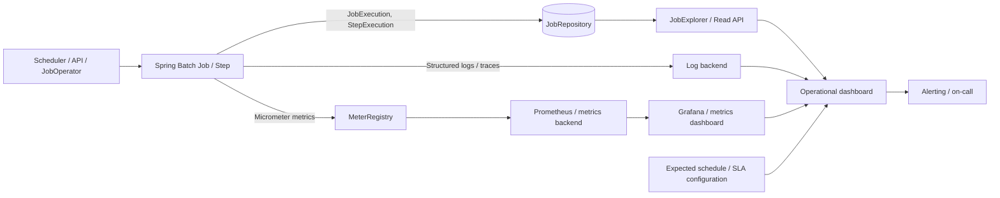

# Operational Batch Dashboard in Spring Batch Core Processing

A batch job reporting `COMPLETED` does not automatically mean the system fulfilled its operational obligations. A job may finish past its SLA, write 0 records due to bad input, skip too many items, or succeed only after multiple retries. Conversely, a job in `STARTED` status is not guaranteed to be making progress: the process may have lost its database connection, stalled on I/O, or crashed before recording a terminal status. An **operational batch dashboard** helps on-call operators spot these situations, locate the exact `JobExecution`/`StepExecution`, and decide the next action.

Within Spring Batch, an effective dashboard must answer concrete questions:

1. Which jobs **must run** in this period, have they been triggered, and did they finish on time?
2. What is the status of each job's latest run; how long has it been running; did it fail or stop?
3. How many items did each step read, write, filter, and skip; are there rollbacks, retries, or abnormal trends?
4. When an error occurs, can operators open execution details, view exceptions, related logs, and restart history?
5. Is the system showing signs of slowing down or stalling before breaching its SLA?

A dashboard does not replace `JobRepository` or `JobExplorer`. It is a **presentation and alerting layer** combining execution metadata, metrics, and log systems with business SLA rules.

## 1. Architecture Overview



The three groups of data sources serve different purposes:

| Source | What it tells you | What not to infer |
| --- | --- | --- |
| `JobRepository` via `JobExplorer` | `JobInstance`, `JobExecution`, `StepExecution`, statuses, timestamps, counters, exit codes | Fine-grained performance of individual reader/writer calls or full failure reasons if not logged |
| Micrometer and metrics backend | Job/step durations, read/process/write timings, active task counts per instrumentation | Durable business record counts from timer sample counts alone |
| Application logs/tracing | Exceptions, correlation IDs, data source info, downstream systems | Final execution status from the last log line alone |
| Expected schedule and SLA | When jobs were supposed to run, completion deadlines, missing business periods | Cannot be obtained from `JobRepository` alone if the job was never launched |

**Authoritative source rule:** Batch metadata is the primary source for the status and counters of **an execution**; metrics suit time-series charts; logs suit troubleshooting; business schedules reveal a **missing run** even when the repository has zero rows.

## 2. Entities That Must Be Distinguished on the Dashboard

Spring Batch has a hierarchical model:

```text
Job name: importOrders
   |
   +-- JobInstance A (businessDate=2025-01-15)
   |      +-- JobExecution 101  FAILED
   |      |      +-- StepExecution 201  read=1000 write=950
   |      +-- JobExecution 102  COMPLETED (restart)
   |             +-- StepExecution 202  read=200 write=200
   |
   +-- JobInstance B (businessDate=2025-01-16)
          +-- JobExecution 103  COMPLETED
                 +-- StepExecution 203  read=1100 write=1098
```

- **`Job`**: the processing workflow definition, such as `importOrders`.
- **`JobInstance`**: a logical unit of work defined by job name and identifying `JobParameters`, such as `businessDate=2025-01-15`.
- **`JobExecution`**: a single attempt to run a job. One instance can have multiple executions when restarted after errors.
- **`StepExecution`**: the outcome of running a step within an execution; holds `read`, `write`, `filter`, `skip`, `commit`, and `rollback` counters.

If a dashboard groups all data by `jobName` and shows only one row, operators easily miss concurrent instances of the same job or repeated restarts of one instance. A detail row should always include **`jobExecutionId`**, **`jobInstanceId`**, **`jobName`**, and the corresponding `stepExecutionId`s.

### Status and Exit Status

`BatchStatus` represents the execution lifecycle state. Key values to understand:

| `BatchStatus` | Operational meaning | Display guidance |
| --- | --- | --- |
| `STARTING` | Startup initiated, not yet in main processing | Waiting to start; watch startup timeout |
| `STARTED` | Execution has started | Running; compare progress against SLA |
| `STOPPING` | Stop requested, waiting for processing step to respond | Stop in progress; do not treat as stopped yet |
| `STOPPED` | Stopped in a controlled manner | Needs reason and decision on resuming |
| `COMPLETED` | Batch execution ended successfully per framework definition | Also verify volume, duration, and data quality |
| `FAILED` | Execution failed | Investigate error; determine restartability |
| `ABANDONED` | Execution/step marked abandoned, typically no longer restartable via normal paths | Requires attention in recovery workflows |
| `UNKNOWN` | Framework cannot determine status with certainty | Inspect metadata and system state |

`ExitStatus` (`getExitStatus().getExitCode()`) expresses **the exit outcome**, which flows or listeners can customize. Dashboards should display **both** `BatchStatus` and exit code to avoid mistaking a `COMPLETED` status for an unremarkable business result when a custom exit code is set. `EXIT_MESSAGE` may be length-truncated by the schema, so include links to execution logs.

## 3. Designing Screens and Operational KPIs

Not all viewers need the same level of detail. A practical dashboard has three tiers: **overview**, **per-job history**, and **execution/step detail**.

### 3.1. Shift-Operations Overview

Illustrative hypothetical data (not metrics from a real system):

```text
┌─────────────────────────────────────────────────────────────────┐
│ BATCH OPERATIONS · 2025-01-16 · timezone Asia/Ho_Chi_Minh       │
├─────────────────────────────────────────────────────────────────┤
│ Expected today: 12     Completed: 9   Running: 1   SLA Late: 2  │
│ Failed: 1              Missing run: 1 Needs action: 3           │
├─────────────────────────────────────────────────────────────────┤
│ JOB                DATA PERIOD  STATUS      DUE      DELAY      │
│ importOrders       2025-01-15   COMPLETED   08:00    12 min     │
│ reconcilePayment   2025-01-15   STARTED     08:30    18 min     │
│ archiveLogs        2025-01-15   FAILED      09:00    —          │
│ sendSettlement     2025-01-15   NOT_RUN     09:15    —          │
└─────────────────────────────────────────────────────────────────┘
```

The `NOT_RUN` field in the example is **a dashboard-computed state derived from expected schedules**; it is not a Spring Batch `BatchStatus` value. Clearly separate framework statuses from dashboard-computed SLA states such as `MISSING_EXPECTED_RUN`, `SLA_BREACHED`, and `SUSPECTED_STALLED`.

Overview cards should specify an explicit time range and timezone. For example, "completed today" may mean **executions that finished today**, whereas "today's data period" may refer to yesterday's `businessDate`; state both filter criteria explicitly.

### 3.2. History List and Drill-Down

Each execution should have its own row:

| Column | Value and interpretation |
| --- | --- |
| Job / business key | Job name, data date, tenant, or required business identifiers |
| `jobInstanceId`, `jobExecutionId` | IDs linking to the exact run; needed for restarts/investigations |
| `BatchStatus`, `ExitStatus` | Lifecycle status and exit outcome |
| `startTime`, `endTime`, duration | Start/end timestamps and runtime |
| `lastUpdated` | Most recent metadata persistence timestamp; not automatically a heartbeat |
| SLA / expected run | On time, late, not run, or not yet scheduled |
| Read / write / filter / skip | Data summary across steps, with aggregation rules |
| Detail link | Opens step breakdown, error messages, logs, and correlation ID |

If a job has multiple steps reading the same item at different stages, **do not sum every step's `readCount` and call it unique input records**. Display per step, or aggregate only across steps explicitly defined as summable by business semantics.

### 3.3. Execution Detail Page

A detail page can be laid out as:

```text
JobExecution #102 | importOrders | COMPLETED | Exit: COMPLETED
JobInstance #48  | businessDate=2025-01-15
Started: 08:02:11 | Ended: 08:08:45 | Duration: 6m34s

STEP                    STATUS      READ   WRITE  FILTER SKIP  ROLLBACK
loadOrders              COMPLETED   1,000  970    20     10    1
enrichOrders            COMPLETED     970  968     2      0    0
publishSummary          COMPLETED       0    0     0      0    0

Related: [logs by jobExecutionId] [previous executions] [alerts]
```

`publishSummary` may be a tasklet that only writes a summary report, so zero item counters are completely valid. The dashboard should know **what kind of step** it is before treating `writeCount=0` as an error signal.

## 4. KPIs to Measure and How to Interpret Them

| KPI | Formula / source | Pitfalls to avoid |
| --- | --- | --- |
| Completed executions | Count `JobExecution`s with `BatchStatus=COMPLETED` in window | One `JobInstance` can be attempted multiple times |
| Failed executions | Count `FAILED`, optionally separating `STOPPED`/`UNKNOWN` | Do not lump `STOPPED` into technical failures by default |
| Success rate | `COMPLETED / total finished executions` in defined window | Exclude still-`STARTED` executions; clarify whether `STOPPED` counts |
| Duration | `endTime - startTime` for finished runs | Never use `now - startTime` as the final duration of a running job |
| SLA breach | `completedAt > deadline` or unfinished past cutoff | Requires schedules and business deadlines outside Batch metadata |
| Processing throughput | Delta in written items between two snapshots / elapsed time | Read snapshots post-commit; separate executions across rollbacks/restarts |
| Skip rate | Can use `skipCount / (readCount + readSkipCount)` for 1-to-1 item steps | Context-dependent metric; cannot be applied identically to all steps |
| Filter rate | `filterCount / readCount` for a step with a processor | Filtering can be normal business logic, not necessarily an error |
| Rollback / retry | `rollbackCount` from `StepExecution`, paired with error and retry logs | `rollbackCount` does not equal exact retry attempt count |
| Missing run | Compare expected runs against observed jobs/parameters or business keys | Cannot detect jobs that were **never triggered** from repository alone |

No single threshold fits all jobs. A validation step may legitimately filter 90% of records by design, while a funds-transfer step may require zero skips. Tie thresholds to **the specific job, step, period, and business SLA**.

## 5. Authoritative Data from `JobRepository` and `JobExplorer`

`JobRepository` stores metadata across multiple tables (with the default JDBC repository), while `JobExplorer` provides an API to **read** history and status without writing SQL for every lookup.

| Table | Contents | Use on dashboard |
| --- | --- | --- |
| `BATCH_JOB_INSTANCE` | Job name and job instance identity | Group runs by logical job |
| `BATCH_JOB_EXECUTION` | Execution ID, status, timestamps, exit code/message, last updated | History list, durations, outcomes |
| `BATCH_JOB_EXECUTION_PARAMS` | Execution `JobParameters` | Business period, identifying params, drill-down metadata |
| `BATCH_STEP_EXECUTION` | Step status, counters, transaction counts, timestamps | Read/write/filter/skip breakdown, rollbacks |
| `BATCH_JOB_EXECUTION_CONTEXT` and `BATCH_STEP_EXECUTION_CONTEXT` | Application/checkpoint state of execution | Troubleshooting and restarts; rarely displayed raw |

### Common `JobExplorer` APIs in Spring Batch 5.2

```java
jobExplorer.getJobNames();
jobExplorer.getJobInstances("importOrders", 0, 20);
jobExplorer.getJobExecutions(jobInstance);
jobExplorer.getJobExecution(jobExecutionId);
jobExplorer.getStepExecution(jobExecutionId, stepExecutionId);
jobExplorer.findRunningJobExecutions("importOrders");
```

- `getJobNames()` returns **job names with history in the repository**, not necessarily the authoritative list of job definitions loaded in the application. To find launchable jobs, check `JobRegistry`.
- `getJobInstances(name, start, count)` returns paginated instances. Pagination is by **instance**, not directly by execution; one instance can hold multiple executions after restarts.
- `getJobExecutions(instance)` returns execution history for that instance; you may need `getStepExecution(...)` for a specific step if execution contexts are not fully hydrated.
- `findRunningJobExecutions(name)` fetches executions **recorded as running in the repository**. If a process dies abruptly, metadata may stay `STARTED`; the API does not prove the process is still alive.

### Sample API to Read Details of One Execution

The example below uses **Spring Batch 5.2.x, Spring Boot 3.x, and Java 17**. It exposes an internal endpoint `GET /internal/batch/executions/{executionId}` returning status and counters. The code assumes `JobExplorer` and Spring MVC are configured:

```java
import java.time.LocalDateTime;
import java.util.Comparator;
import java.util.List;

import org.springframework.batch.core.JobExecution;
import org.springframework.batch.core.StepExecution;
import org.springframework.batch.core.explore.JobExplorer;
import org.springframework.http.HttpStatus;
import org.springframework.web.bind.annotation.GetMapping;
import org.springframework.web.bind.annotation.PathVariable;
import org.springframework.web.bind.annotation.RequestMapping;
import org.springframework.web.bind.annotation.RestController;
import org.springframework.web.server.ResponseStatusException;

@RestController
@RequestMapping("/internal/batch/executions")
public class BatchExecutionReadController {

    private final JobExplorer jobExplorer;

    public BatchExecutionReadController(JobExplorer jobExplorer) {
        this.jobExplorer = jobExplorer;
    }

    @GetMapping("/{executionId}")
    public ExecutionView get(@PathVariable Long executionId) {
        JobExecution execution = jobExplorer.getJobExecution(executionId);
        if (execution == null) {
            throw new ResponseStatusException(
                    HttpStatus.NOT_FOUND, "Unknown execution: " + executionId);
        }

        List<StepView> steps = execution.getStepExecutions().stream()
                .sorted(Comparator.comparing(StepExecution::getStepName))
                .map(step -> new StepView(
                        step.getId(),
                        step.getStepName(),
                        step.getStatus().name(),
                        step.getReadCount(),
                        step.getWriteCount(),
                        step.getFilterCount(),
                        step.getReadSkipCount(),
                        step.getProcessSkipCount(),
                        step.getWriteSkipCount(),
                        step.getSkipCount(),
                        step.getRollbackCount()))
                .toList();

        return new ExecutionView(
                execution.getId(),
                execution.getJobInstance().getId(),
                execution.getJobInstance().getJobName(),
                execution.getStatus().name(),
                execution.getExitStatus().getExitCode(),
                execution.getStartTime(),
                execution.getEndTime(),
                steps);
    }

    public record ExecutionView(
            Long executionId,
            Long instanceId,
            String jobName,
            String status,
            String exitCode,
            LocalDateTime startTime,
            LocalDateTime endTime,
            List<StepView> steps) {
    }

    public record StepView(
            Long stepExecutionId,
            String stepName,
            String status,
            long read,
            long write,
            long filter,
            long readSkip,
            long processSkip,
            long writeSkip,
            long totalSkip,
            long rollbacks) {
    }
}
```

The `record`s contain only the data the dashboard needs, avoiding exposing raw internal entities or `ExecutionContext`. This endpoint also performs no `start`, `stop`, or `restart` actions and never touches Batch write transactions. For production use, add authentication, authorization, and rate limiting, restricting access to operations teams.

For history lists, expose a separate paginated endpoint such as `GET /internal/batch/jobs/{jobName}/executions?limit=20`. Define ordering carefully: an older `JobInstance` may be restarted **after** a newer instance, so fetching only the "latest instance" and assuming it holds the "latest execution" can be wrong. To report all executions chronologically accurately, scan instances within a clear scope or build an optimized reporting query over the execution table.

## 6. SQL Queries for the Operations Console

With a JDBC repository and default `BATCH_` table prefix, the query below retrieves metadata for one execution and its steps. It uses `:executionId` named-parameter syntax; in raw SQL clients, replace it with the appropriate bind syntax:

```sql
SELECT
    ji.JOB_NAME,
    je.JOB_INSTANCE_ID,
    je.JOB_EXECUTION_ID,
    je.STATUS AS JOB_STATUS,
    je.EXIT_CODE AS JOB_EXIT_CODE,
    je.START_TIME AS JOB_START_TIME,
    je.END_TIME AS JOB_END_TIME,
    je.LAST_UPDATED AS JOB_LAST_UPDATED,
    se.STEP_EXECUTION_ID,
    se.STEP_NAME,
    se.STATUS AS STEP_STATUS,
    se.READ_COUNT,
    se.WRITE_COUNT,
    se.FILTER_COUNT,
    se.READ_SKIP_COUNT,
    se.PROCESS_SKIP_COUNT,
    se.WRITE_SKIP_COUNT,
    se.COMMIT_COUNT,
    se.ROLLBACK_COUNT
FROM BATCH_JOB_EXECUTION je
JOIN BATCH_JOB_INSTANCE ji
  ON ji.JOB_INSTANCE_ID = je.JOB_INSTANCE_ID
LEFT JOIN BATCH_STEP_EXECUTION se
  ON se.JOB_EXECUTION_ID = je.JOB_EXECUTION_ID
WHERE je.JOB_EXECUTION_ID = :executionId
ORDER BY se.STEP_EXECUTION_ID;
```

`LEFT JOIN` ensures a job execution that already has metadata but no step executions yet still appears. A job with multiple steps produces multiple rows, so **do not sum job-level columns** after joining without accounting for duplicated rows. Step metrics belong to **each individual step execution**, not automatically to unique business records.

For historical dashboards, use **pagination**, time-range filters, and job/status predicates. Avoid scanning the entire metadata set on every refresh: a long-lived repository can accumulate millions of execution rows, especially for frequent jobs. Operational queries should enforce limits, select only needed columns, and use a read replica or dedicated reporting store when read load is high.

### Timestamps and Update Lag

`LAST_UPDATED` reflects the most recent metadata write. A step performing long work inside an uncommitted transaction may not update counters immediately; a tasklet waiting on an external API may also not write metadata frequently. Therefore, **a large `now - lastUpdated` does not prove the job is dead**. Combine process health, dedicated application heartbeats, logs, `spring.batch.*.active` metrics, and step characteristics to identify likely stalls.

When displaying `startTime`, `endTime`, or `lastUpdated`, standardize database/JVM timezone conventions and convert to an explicitly labeled display timezone such as `Asia/Ho_Chi_Minh`. Never assume a timezone-less timestamp is UTC. SLA checks should use instants or accurately converted business times, especially across multi-timezone deployments.

## 7. Micrometer and Spring Boot Actuator

Since Spring Batch 4.2, the framework includes built-in metrics via Micrometer. In **Spring Batch 5.2.x**, built-in meters typically include:

| Micrometer metric | Type | What it represents |
| --- | --- | --- |
| `spring.batch.job` | `TIMER` | Job execution duration by name/status |
| `spring.batch.job.active` | `LONG_TASK_TIMER` | Currently active jobs |
| `spring.batch.step` | `TIMER` | Step execution duration |
| `spring.batch.step.active` | `LONG_TASK_TIMER` | Currently active steps |
| `spring.batch.item.read` | `TIMER` | Duration of item read operations |
| `spring.batch.item.process` | `TIMER` | Duration of item processing |
| `spring.batch.chunk.write` | `TIMER` | Duration of chunk writes |

Duration metrics help detect slowing jobs and bottlenecks. They **do not directly expose** all `StepExecution` counters like `readCount`, `writeCount`, `filterCount`, and `skipCount`. Specifically, the sample count of `spring.batch.chunk.write` records the number of measured chunk write calls, not the number of items successfully written.

In Spring Boot applications, add Actuator and the Prometheus registry:

```groovy
dependencies {
    implementation 'org.springframework.boot:spring-boot-starter-batch'
    implementation 'org.springframework.boot:spring-boot-starter-actuator'
    implementation 'org.springframework.boot:spring-boot-starter-web'
    runtimeOnly 'io.micrometer:micrometer-registry-prometheus'
}
```

Dependency versions should be governed by the Spring Boot BOM or your project's dependency management. Endpoint exposure configuration for an internal system might look like:

```yaml
management:
  endpoints:
    web:
      exposure:
        include: health,info,prometheus
  metrics:
    tags:
      application: order-batch
```

With Prometheus registry and Actuator properly configured, Prometheus scrapes `/actuator/prometheus` on the permitted management port. **Never expose this endpoint directly to the public internet**; restrict via internal networks, authentication, or access policies.

Micrometer uses dotted names like `spring.batch.job`, while Prometheus normalizes them to forms like `spring_batch_job_seconds_*` for timers (depending on registry version and naming rules). Before writing PromQL, inspect actual series names at the scrape endpoint. For example, the query below counts failed job observations per second over 1 hour, assuming series `spring_batch_job_seconds_count` with tag `status="FAILURE"`:

```promql
sum by (name) (
  rate(spring_batch_job_seconds_count{status="FAILURE"}[1h])
)
```

This is **the rate of failed execution observations within the time window**, not the number of currently failing job instances or the failure ratio across the expected schedule. To compute a failure ratio, define which executions form the denominator and verify the status tag values for your version. Long task timers and standard timers must be visualized according to their respective semantics; never mix "concurrently active count" with "completed job count."

## 8. `read`, `write`, `filter`, and `skip` Counters on the Dashboard

Each `StepExecution` provides getters:

```java
stepExecution.getReadCount();
stepExecution.getWriteCount();
stepExecution.getFilterCount();
stepExecution.getReadSkipCount();
stepExecution.getProcessSkipCount();
stepExecution.getWriteSkipCount();
stepExecution.getSkipCount();
stepExecution.getCommitCount();
stepExecution.getRollbackCount();
```

`skipCount = readSkipCount + processSkipCount + writeSkipCount`. `filterCount` is not a skip: a processor returning `null` due to business rules increments filter, whereas a skip is an error allowed to be skipped by the skip policy. These two metrics require distinct colors, alerts, and evaluation thresholds.

In a hypothetical example where a step reads 10,000 items successfully, filters 150, skips 20 in processing, and writes 9,830 items:

```text
readCount           10,000
writeCount           9,830
filterCount            150
processSkipCount        20
readSkipCount            0
writeSkipCount           0
skipCount               20
rollbackCount            1
```

When the processing model is at most one output per input, the balance check `read ≈ write + filter + processSkip + writeSkip` can help spot anomalies. **Do not treat it as a universal law for every batch step**: retries, rollbacks, reader/writer designs, and aggregating steps complicate interpretation. Use committed counters and business data reconciliation before concluding items were lost or duplicated.

A dashboard can plot rising `writeCount` over time for a running execution, yet repository snapshots update only when the framework persists metadata. If a step commits large chunks or spends a long time between commits, the chart may look flat and then jump. That is not necessarily a progress bug.

## 9. Logs, Correlation IDs, and Investigation Links

Metadata tells you **which execution failed**, while logs usually tell you **why**. Every key log message should carry enough context to filter by run:

```text
timestamp=2025-01-16T08:03:18+07:00
level=ERROR
jobName=importOrders
jobInstanceId=48
jobExecutionId=102
stepName=loadOrders
stepExecutionId=202
errorCode=DB_TIMEOUT
message="Write chunk failed after retry"
```

In production, attach MDC/log fields in listeners or via application observability integration. The goal is clicking a job row on the dashboard and jumping straight to logs filtered by `jobExecutionId` or `stepExecutionId`, rather than searching manually across every log server.

Avoid dumping full `JobParameters`/`ExecutionContext` into logs or APIs if they contain tokens, passwords, sensitive paths, customer data, or private details. `EXIT_MESSAGE` can also hold error details requiring access control. When troubleshooting details must be surfaced, apply redaction and authorization.

Error logs from `ItemReadListener`, `ItemProcessListener`, and `ItemWriteListener` may appear multiple times due to retries; **counting exception logs is not equivalent to `skipCount`**. To know which items were actually skipped, pair `SkipListener` with the final counters in `StepExecution`.

## 10. SLAs, Expected Schedules, and Alerting

`JobRepository` knows only about executions that were created. A job scheduled for 02:00 whose scheduler failed to trigger will have **no execution row** for that period. Dashboards need an independent business schedule model:

```yaml
# Example business configuration managed by the operations system.
batchOperations:
  jobs:
    importOrders:
      zone: Asia/Ho_Chi_Minh
      expectedAt: "02:00"
      deadlineAt: "03:00"
      businessDateRule: previous-day
      maxDurationMinutes: 45
      maxSkippedItems: 0
```

This is **illustrative application YAML**, not standard Spring Batch properties. Actual schedulers may use cron, Quartz, an orchestration platform, or an external service. Map **expected schedule + business period** against recorded `JobParameters`/instances to detect missing or delayed runs.

Example alert rules:

| Alert | Example condition | On-call action |
| --- | --- | --- |
| `MISSING_RUN` | Past expected start time plus grace period with no execution for the data period | Check scheduler, trigger, message queue, system permissions |
| `SLA_BREACH` | Deadline reached without a matching `COMPLETED` execution | Prioritize handling by job criticality |
| `JOB_FAILED` | Execution transitioned to `FAILED` | Open exit message, logs, failing step, and dependencies |
| `STOPPED_OR_UNKNOWN` | Unplanned `STOPPED`/`UNKNOWN` | Confirm stop action, repository status, and recovery plan |
| `SUSPECTED_STALLED` | Still `STARTED`, past expected duration with no progress signals | Check threads, logs, I/O, locks, liveness; do not prematurely declare dead |
| `HIGH_SKIP_RATE` | Skip count/rate exceeds step threshold | Inspect input data and skip policy |
| `ZERO_OUTPUT` | Job completed where writer should produce output yet `writeCount=0` | Check reader, filter, source query, business conditions |
| `DURATION_REGRESSION` | p95 duration exceeds baseline across multiple periods | Inspect input size, database, network, writer throughput |

**Preventing alert storms:** group alerts by `jobName + businessDate + alertType`, enforce cooldowns and acknowledgment states, and prevent one failing execution from sending hundreds of notifications across poll cycles. After a successful restart, display both the prior failure and the new execution so responders understand what happened. Avoid infinite auto-restarts when errors stem from bad data or non-idempotent writes.

### Define SLAs Precisely

If a job runs at 02:00 and must finish before 03:00, clarify:

- Which timezone defines "03:00" and how are DST days handled?
- Does the deadline apply to **the business period** or also to ad-hoc manual runs?
- Does `COMPLETED` with 1,000 skips satisfy quality SLAs?
- Does a late run that eventually completed still count as a breach in historical reports?
- After a restart, do you measure end-to-end lead time from the first launch or the final successful execution's end time?

Store these decisions in operational config and show them clearly on the dashboard rather than applying an opaque timestamp comparison across all jobs.

## 11. Handling Long-Running `STARTED` Jobs and Orphaned States

A common incident: the job process is killed or loses power before Spring Batch records a failed status. `BATCH_JOB_EXECUTION.STATUS` may stay `STARTED` even though no worker is actually running.

Never alter the status via SQL solely because `LAST_UPDATED` looks old. Investigate step by step:

1. Check whether the process/pod/container is still alive and actually processing that execution.
2. Search logs by `jobExecutionId` and `stepExecutionId`; check for deadlocks, network timeouts, and upstream status.
3. Cross-check active metrics, JVM threads, datasource pools, and application heartbeats if present.
4. Inspect `JobRepository` to see if metadata is still updating or a long transaction/chunk is running.
5. Follow the application's official recovery policy. Only after verifying actual state should you handle orphaned metadata or restart.

A long-running tasklet may emit zero item counters while validly doing work. For such jobs, instrument business progress directly (API pages processed, files compressed, partitions finished) or emit controlled heartbeats. Never treat `writeCount=0` alone as proof a job is hung.

## 12. Restarts and Counting in Reports

Suppose one `JobInstance` has two runs:

| Execution | `BatchStatus` | `readCount` | `writeCount` | Notes |
| --- | --- | ---: | ---: | --- |
| #101 | `FAILED` | 1,000 | 950 | Early chunks committed; failed later |
| #102 | `COMPLETED` | 200 | 200 | Restart resumed from checkpoint |

The dashboard should display **two separate executions**, linked through `jobInstanceId`. If reporting *number of run attempts*, the answer is 2. If reporting *whether the business period completed*, the answer is completed after execution #102. If reporting *how many unique business records were written*, never automatically conclude `950 + 200 = 1,150`; check checkpoints, idempotency, and business keys.

Also distinguish:

- **Job completed:** `COMPLETED` for one execution under the Batch model.
- **Business period completed:** operational rule confirming the period's expected work finished completely and on time.
- **All input items converted to outputs:** requires reconciling against source/target data, filters, skips, and business rules.

Never use the dashboard table directly as an ad-hoc `JobRepository` editor. If the UI offers **stop/restart** controls, route them through an authorized control API that validates parameters, confirms impact, and writes audit logs. Read-only status/metrics views should operate independently from state-mutating batch actions.

## 13. Phased Dashboard Rollout

A practical roadmap delivers value early while keeping the system maintainable:

| Phase | Components | Value delivered to operators |
| --- | --- | --- |
| 1 — Metadata | `JobExplorer`, read-only API, execution/step tables | Know which jobs ran, statuses, timings, counters, and errors |
| 2 — Performance | Micrometer, Actuator, Prometheus/Grafana | Track durations, active job counts, latency trends |
| 3 — Investigation | Structured logs, correlation IDs, links to log backend | Jump from a failed execution straight to step logs |
| 4 — SLA | Expected schedules, business keys, deadlines, data thresholds | Catch missing runs, late runs, and quality-degraded completions |
| 5 — Operations | Alert routing, acknowledgments, runbooks, audits | Consistent on-call operations and incident response |

In multi-node deployments, each node emits its own metrics; Prometheus aggregates across instances while `JobRepository` may serve as a shared metadata store. Avoid summing active metrics or execution counts without considering the `instance` label, which can double-count or misread distributed jobs. Read-only APIs should query the right repository source and bound polling load.

### Refresh, Caching, and Performance

A dashboard refreshing progress every few seconds looks appealing yet can place unnecessary read load on `JobRepository`. Match refresh cadence to chunk duration and SLAs: multi-hour jobs can refresh every 30–60 seconds; short jobs usually need only final outcomes and periodic metric charts. These are **design examples**, not Spring Batch defaults.

APIs should apply pagination, job/status filters, time windows, short response caching, and bounded queries. Enforce timeouts on operational queries so the dashboard never exhausts the connection pool of running jobs. For large historical datasets, build a separate read model or analytics store synced reliably from metadata instead of repeatedly scanning live tables.

## 14. Common Dashboard Design Mistakes

| Symptom | Cause | Fix |
| --- | --- | --- |
| Dashboard shows "no errors" when scheduler stopped | Tracks only existing executions | Add expected schedules and missing-run detection |
| Sees `COMPLETED` and assumes data is complete | Ignores filters/skips/business reconciliation | Add quality KPIs and per-job validation |
| One row per job name loses restart history | Conflates `JobInstance` and `JobExecution` | Track distinct IDs and an execution timeline per instance |
| Long `STARTED` marked as "dead" | Treats `LAST_UPDATED` as a guaranteed heartbeat | Verify process, logs, metrics, and chunk/tasklet traits |
| `writeCount` differs from database row count | Item writer may write multiple rows or upsert | Use separate business metrics when counting real DB rows |
| Grafana shows timers only, no `skipCount` | Built-in Micrometer metrics focus on duration/active counts | Read counters from `JobExplorer`/metadata or publish custom metrics |
| Counts jump unexpectedly after restart | Blindly sums multiple executions/steps | Separate executions and aggregate by business data semantics |
| Dashboard API slows down batch jobs | Heavy SQL polling on shared repository | Bound queries, cache, or offload to a read model |
| Too many metric series | Put `executionId`/itemId into tags | Keep low-cardinality tags; put detailed IDs in logs/APIs |
| SLA deadline off by one hour | Mixes UTC, JVM timezone, and business timezone | Normalize instants and display explicit timezones and business dates |
| UI lets anyone restart any job | Lacks per-job/environment authorization | Gate admin APIs with authorization, audits, and policies |

## 15. References

Code examples and metric names in this article use **Spring Batch 5.2.x** alongside Spring Boot 3.x and Java 17. In Spring Batch 6.x, some packages/APIs and observability mechanisms change; verify against your actual version's documentation during implementation. Console layouts and SLA YAML snippets are **design patterns**, not built-in Spring Batch dashboard features.

- [Spring Batch 5.2 — Monitoring and metrics](https://docs.spring.io/spring-batch/reference/5.2/monitoring-and-metrics.html)
- [Spring Batch 5.2 — Advanced metadata usage and `JobExplorer`](https://docs.spring.io/spring-batch/reference/5.2/job/advanced-meta-data.html)
- [Spring Batch 5.2 API — `JobExplorer`](https://docs.spring.io/spring-batch/docs/5.2.6/api/org/springframework/batch/core/explore/JobExplorer.html)
- [Spring Batch 5.2 API — `JobExecution`](https://docs.spring.io/spring-batch/docs/5.2.6/api/org/springframework/batch/core/JobExecution.html)
- [Spring Batch 5.2 API — `StepExecution`](https://docs.spring.io/spring-batch/docs/5.2.6/api/org/springframework/batch/core/StepExecution.html)
- [Spring Batch 5.2 — Metadata schema](https://docs.spring.io/spring-batch/reference/5.2/schema-appendix.html)
- [Spring Boot — Actuator metrics](https://docs.spring.io/spring-boot/reference/actuator/metrics.html)
- [Spring Boot — Prometheus support](https://docs.spring.io/spring-boot/reference/actuator/metrics.html#actuator.metrics.export.prometheus)
- [Micrometer — Concepts: meters and timers](https://docs.micrometer.io/micrometer/reference/concepts/timers.html)

A trustworthy **operational batch dashboard** cleanly connects **expected schedule → JobInstance → JobExecution → StepExecution → logs/metrics**. `JobExplorer` and Batch metadata answer what ran and how it ended; Micrometer reveals progress and performance trends; logs explain failures; SLAs define what *should have happened*. Keeping these sources distinct lets operators catch missing, late, failed, or quality-degraded runs and open the exact execution to resolve issues without confusing restart history with business progress.
