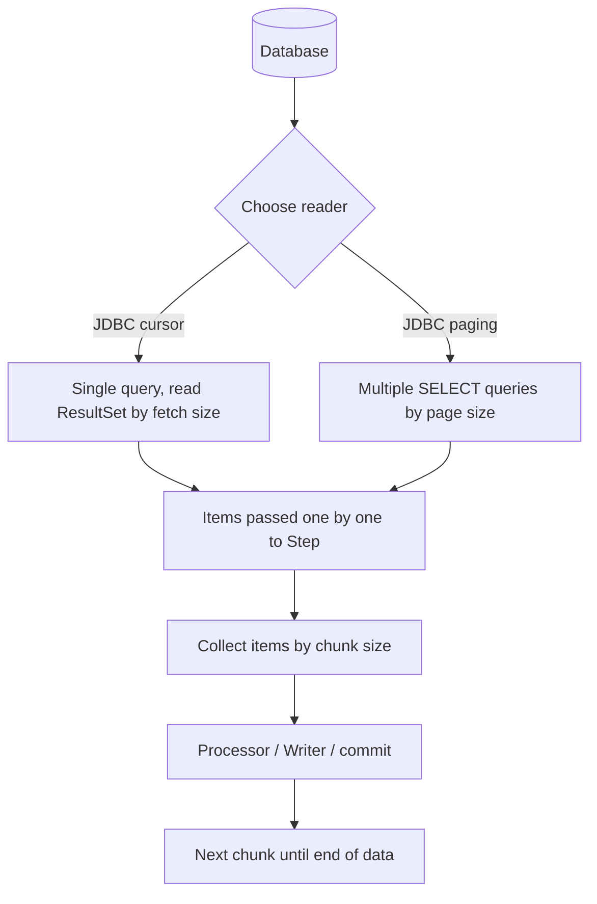

# Fetch Size and Page Size in Spring Batch

When Spring Batch must read hundreds of thousands or millions of records, processing speed does not depend solely on code inside `ItemProcessor` and `ItemWriter`. How the reader fetches data from the database determines the number of network round-trips, temporary memory usage, wait times, and failure recovery behavior. Two parameters that frequently appear when optimizing data reads are **fetch size** and **page size**.

They are easily confused with **chunk size**, yet the three serve distinct purposes:

- **Fetch size:** hints to the JDBC driver how many rows to retrieve per batch when iterating over a `ResultSet`.
- **Page size:** the number of rows a paging reader requests in each paginated query.
- **Chunk size:** the number of input items accumulated under the chunk policy before writing and executing a commit boundary.

One job might use `fetchSize=500`, another `pageSize=500`, and both `chunk(100)`, yet their query patterns, connection handling, and checkpoint behavior will differ substantially.

This article belongs to **Spring Batch Core Processing → Performance** and covers the nature of both parameters, configuring `JdbcCursorItemReader`, `JdbcPagingItemReader`, and JPA/repository readers, their impact on transactions and restarts, and safe benchmarking methods. Examples follow Spring Batch 5.x / Spring Boot 3.x; actual JDBC behavior and pagination SQL depend on the database, driver, and framework version.

## 1. Distinguishing the Three "Sizes" Through an Example

Suppose we need to import **100,000 transactions** from a `transactions` table. The processor normalizes each row and the writer persists to a target table. Let:

```text
Total rows N         = 100,000
Fetch size F         = 500     (if using cursor)
Page size P          = 500     (if using paging)
Chunk size C         = 100
```

An approximation assuming no skipping, filtering, or retries and sequential execution:

| Quantity | Estimate | Controlled By |
|---|---:|---|
Driver fetch batches when cursor actually fetches in batches | `ceil(100000 / 500) ≈ 200` | `fetchSize` |
Page queries when paging | `ceil(100000 / 500) ≈ 200` | `pageSize` |
Groups of 100 items to write/commit | `ceil(100000 / 100) = 1000` | `chunkSize` |

This is a **mental model for understanding impact**, not a strict guarantee of round-trip counts: the driver may ignore the fetch-size hint, a cursor may need an extra fetch to detect end-of-data, paging may run an additional empty page query, and Spring Batch may perform metadata/recovery transactions. When items are filtered or skipped, write count also differs from read count.



**Core takeaway:** Fetch size and page size govern the *data retrieval path*. Chunk size governs the *processing and transaction unit*. They are independent and do not have to be equal.

## 2. What Is Fetch Size?

In JDBC, `Statement.setFetchSize(int)` is a **hint** sent to the driver indicating how many rows to retrieve per round-trip when reading a `ResultSet`. Spring Batch lets you configure this hint on cursor-based readers such as `JdbcCursorItemReader`.

Conceptual flow:

```text
JDBC executeQuery("SELECT ...")
            │
            ▼
       ResultSet / cursor
            │
            ├── fetch batch 1: up to ~F rows
            ├── fetch batch 2: up to ~F rows
            ├── ...
            └── until ResultSet ends
            │
            ▼
    Spring Batch reads one item at a time
```

When a driver supports server-side cursors and streams results properly, an appropriate fetch size reduces network round-trips compared to row-by-row fetching while avoiding loading the entire result set into the heap. However:

- `setFetchSize(500)` does **not** append `LIMIT 500` to the SQL query.
- `fetchSize=500` does **not** restrict the entire query to returning only 500 rows.
- Drivers may interpret the hint differently or ignore it altogether.
- A small fetch size does not automatically guarantee low RAM usage if the driver still buffers the entire result set.
- A large fetch size can reduce round-trips while increasing driver/client buffer memory and per-batch transfer latency.

### 2.1. Configuring `JdbcCursorItemReader`

Example reading the transactions table with a cursor:

```java
import java.math.BigDecimal;

import javax.sql.DataSource;

import org.springframework.batch.item.database.JdbcCursorItemReader;
import org.springframework.batch.item.database.builder.JdbcCursorItemReaderBuilder;
import org.springframework.context.annotation.Bean;

record TransactionRow(long id, BigDecimal amount) {}

@Bean
JdbcCursorItemReader<TransactionRow> transactionCursorReader(
        DataSource dataSource) {

    return new JdbcCursorItemReaderBuilder<TransactionRow>()
            .name("transactionCursorReader")
            .dataSource(dataSource)
            .sql("""
                    SELECT id, amount
                    FROM transactions
                    WHERE status = 'READY'
                    ORDER BY id
                    """)
            .rowMapper((rs, rowNum) -> new TransactionRow(
                    rs.getLong("id"),
                    rs.getBigDecimal("amount")))
            .fetchSize(500)
            .saveState(true)
            .build();
}
```

`JdbcCursorItemReader` executes the query and advances a cursor across rows, mapping each row to an item. When the reader is opened and closed according to lifecycle rules, Spring Batch manages reading and can persist state in `ExecutionContext`. `name(...)` is important when `saveState(true)` is enabled so checkpoint keys are uniquely and stably identified.

Note: Saving the count of items read **does not mean the physical database cursor stays open across a restart**. Upon restart, the reader must re-execute the query and reposition to the saved offset. If source rows changed in order or membership, the old offset may no longer point to the same record.

### 2.2. Connection and Transaction Characteristics of Cursors

A cursor typically keeps a `ResultSet`/connection open throughout reading, rather than issuing a short query per page. This brings benefits and risks:

| Benefits | Costs / Risks |
|---|---|
One main query; no repeated pagination SELECT generation | Cursor/connection stays open for a long time |
Well suited for large sequential scans | Vulnerable to timeouts, transaction limits, and network drops |
Fetches data in batches if driver supports streaming | Driver may still materialize the full result set |
Easy to follow query sort order | Restart must reposition, requiring a stable source |

By default, `JdbcCursorItemReader` typically uses a dedicated connection for the cursor; there is an option to share the connection with the transaction via `useSharedExtendedConnection` when using a compatible proxy/driver. Do not assume that committing each chunk automatically closes and reopens the cursor per chunk. If a cursor must survive commits on a shared connection, verify driver holdability support and transaction configuration.

### 2.3. Actual Fetch Size Behavior Depends on the Driver

Notable cases to remember:

- **PostgreSQL JDBC:** to fetch via a cursor instead of loading the entire result set at once, you generally need a positive fetch size, a connection **with auto-commit disabled**, and a query/cursor meeting driver streaming requirements. Otherwise, setting `fetchSize` may not stream as expected.
- **MySQL Connector/J:** cursor fetch behavior depends on driver settings such as `useCursorFetch` and prepared statement configuration; do not assume `setFetchSize(500)` behaves like PostgreSQL without verifying.
- **Oracle JDBC:** row prefetch and fetch size interact differently depending on driver and version. Tune via real measurements on Oracle rather than copying a magic number.
- **H2 test database:** fine for verifying logic and row mapping, but does not represent production database network fetch, cursor, lock, or memory behavior.

For each database, consult the **documentation of the exact driver in use**, pool/transaction configuration, and the number of rows actually transferred per round-trip. Never apply a single "universal recommended" fetch size across all RDBMS engines.

## 3. What Is Page Size?

**Page size** specifies how many items the reader requests from the database in **each paginated query**. In Spring Batch, `JdbcPagingItemReader` generates pagination SQL via a database-specific `PagingQueryProvider`; `JpaPagingItemReader` fetches pages via the JPA query API; `RepositoryItemReader` fetches pages using a repository method returning `Page`.

Example with `pageSize=500`:

```text
Query page 1 → fetch up to 500 rows
Query page 2 → fetch up to 500 rows
Query page 3 → fetch up to 500 rows
...
Spring Batch reads rows one by one from current page
Page exhausted → query next page
```

Unlike fetch size, each page is typically a **separate SQL/JPA query** with a bounded result set. Page size affects:

1. Number of data-retrieval queries (smaller pages mean more queries).
2. Amount of data held in the page buffer.
3. Per-query latency and wait time for the next page.
4. Checkpoint/restart behavior, especially if underlying data changes mid-run.
5. Contention levels and ability to partition reads.

### 3.1. Configuring `JdbcPagingItemReader`

Example reading the same `transactions` table ordered by `id`:

```java
import java.util.Map;
import javax.sql.DataSource;

import org.springframework.batch.item.database.JdbcPagingItemReader;
import org.springframework.batch.item.database.Order;
import org.springframework.batch.item.database.builder.JdbcPagingItemReaderBuilder;
import org.springframework.context.annotation.Bean;

@Bean
JdbcPagingItemReader<TransactionRow> transactionPagingReader(
        DataSource dataSource) {

    return new JdbcPagingItemReaderBuilder<TransactionRow>()
            .name("transactionPagingReader")
            .dataSource(dataSource)
            .selectClause("SELECT id, amount")
            .fromClause("FROM transactions")
            .whereClause("WHERE status = 'READY'")
            .sortKeys(Map.of("id", Order.ASCENDING))
            .rowMapper((rs, rowNum) -> new TransactionRow(
                    rs.getLong("id"),
                    rs.getBigDecimal("amount")))
            .pageSize(500)
            .saveState(true)
            .build();
}
```

This code assumes `TransactionRow` was declared above. The builder uses `SELECT`/`FROM`/`WHERE` and sort keys to construct SQL suited to the database. If the DataSource or SQL dialect cannot be auto-detected properly, supply an explicit `PagingQueryProvider`.

**Sort keys must produce a deterministic, unique ordering** across the rows the reader traverses. `ORDER BY created_at` alone can be ambiguous when multiple rows share the same timestamp; `ORDER BY created_at, id` with a unique `id` is unambiguous. In Spring Batch, sort keys are not merely for presentation; they govern how subsequent page queries are generated and how restart recovery works.

### 3.2. Paging in Spring Batch Is Not Always Plain OFFSET

Many SQL examples illustrate paging with:

```sql
SELECT id, amount
FROM transactions
ORDER BY id
LIMIT 500 OFFSET 500;
```

This helps visualize "page two", but you should not assume every `JdbcPagingItemReader` emits that exact `LIMIT/OFFSET` pattern. Spring Batch's `PagingQueryProvider` can use **sort keys and the last key value of the previous page** to build the next query, depending on the database/provider.

With keyset pagination, the conceptual SQL looks like:

```sql
-- First page:
SELECT id, amount
FROM transactions
WHERE status = 'READY'
ORDER BY id
FETCH FIRST 500 ROWS ONLY;

-- Next page, assuming last id of previous page is 10500:
SELECT id, amount
FROM transactions
WHERE status = 'READY'
  AND id > 10500
ORDER BY id
FETCH FIRST 500 ROWS ONLY;
```

This syntax is illustrative and **not** runnable verbatim on every database. Keyset pagination advances by **key value** instead of scanning and discarding an ever-growing offset; performance is typically strong when the sort key is properly indexed. Either way, a **unique/stable sort key** remains essential.

### 3.3. Indexes and the SELECT Clause Dictate Performance

A small page size cannot rescue a query that performs a full table scan or sorts millions of rows on every page. Check these factors:

- Does `WHERE` narrow down by partition, date, or status properly?
- Does `ORDER BY` use a unique, stable key?
- Does an index support both the filter predicate and sort order?
- Are unnecessary large columns (BLOB/CLOB/JSON) being selected?
- Does a join multiply a single business key into duplicate rows?
- Can projections reduce network payload?

For instance, a query with `WHERE status = 'READY' ORDER BY id` may benefit from an index suited to data cardinality and distribution, such as an index on `(status, id)`; however, index decisions must be backed by actual query plans, write overhead, and database characteristics.

## 4. Page Size in JPA and Spring Data Repositories

Page size is not limited to JDBC. ORM/repository-based readers also use paging, adding entity mapping and persistence context costs to read latency.

### 4.1. `JpaPagingItemReader`

Example:

```java
import jakarta.persistence.EntityManagerFactory;
import java.util.Map;

import org.springframework.batch.item.database.JpaPagingItemReader;
import org.springframework.batch.item.database.builder.JpaPagingItemReaderBuilder;

@Bean
JpaPagingItemReader<OrderEntity> orderJpaReader(
        EntityManagerFactory entityManagerFactory) {

    return new JpaPagingItemReaderBuilder<OrderEntity>()
            .name("orderJpaReader")
            .entityManagerFactory(entityManagerFactory)
            .queryString("""
                    SELECT o
                    FROM OrderEntity o
                    WHERE o.status = :status
                    ORDER BY o.id
                    """)
            .parameterValues(Map.of("status", OrderStatus.READY))
            .pageSize(300)
            .saveState(true)
            .build();
}
```

`OrderEntity` and `OrderStatus` are hypothetical application types. The reader pages through JPA queries (using provider-handled offset/limit) and manages the persistence context per page so it does not retain every read entity indefinitely. Depending on mappings, lazy loading or entity graphs can trigger N+1 queries; thus **`pageSize=300` does not mean a page executes just one SQL query** if the processor accesses unloaded associations.

With JPA, measure separately:

- Actual SQL statements issued by the reader and lazy associations.
- Entity instantiation/hydration time.
- Memory consumed by the persistence context and entity graph.
- Flush/clear overhead and transaction interactions.
- Page size suited to column/entity width and heap limits.

If the batch only needs a few columns, DTO projections or a JDBC reader can eliminate ORM overhead, weighed against code complexity and domain requirements.

### 4.2. `RepositoryItemReader`

Example repository with a query method:

```java
public interface OrderRepository extends JpaRepository<OrderEntity, Long> {
    Page<OrderEntity> findByStatus(OrderStatus status, Pageable pageable);
}
```

Corresponding reader:

```java
import java.util.List;
import java.util.Map;
import org.springframework.batch.item.data.RepositoryItemReader;
import org.springframework.batch.item.data.builder.RepositoryItemReaderBuilder;
import org.springframework.data.domain.Sort;

@Bean
RepositoryItemReader<OrderEntity> orderRepositoryReader(
        OrderRepository repository) {

    return new RepositoryItemReaderBuilder<OrderEntity>()
            .name("orderRepositoryReader")
            .repository(repository)
            .methodName("findByStatus")
            .arguments(List.of(OrderStatus.READY))
            .pageSize(300)
            .sorts(Map.of("id", Sort.Direction.ASC))
            .saveState(true)
            .build();
}
```

The repository method signature must accept the `Pageable` passed by the reader. In Spring Data JPA, returning `Page<T>` may trigger an extra count query or additional logic depending on how the query/repository is implemented; inspect actual SQL statements rather than counting only reader page calls.

Additionally, some `RepositoryItemReader` usages differ in page-level error recovery compared to item-by-item reading: if the repository call throws an exception while fetching a page, skipping a single *bad item* may be impossible because the failing item hasn't been isolated. Test skip/retry behavior explicitly here.

## 5. How Does Chunk Size Relate to Page Size?

Consider `pageSize=500` and `chunkSize=200`:

```text
Page 1 contains 500 items:
  Chunk 1: items   1–200 → commit
  Chunk 2: items 201–400 → commit
  Chunk 3: items 401–600 → must read 100 more items from Page 2

Page 2 contains items 501–1000:
  Chunk 4: items 601–800 → commit
  Chunk 5: items 801–1000 → commit
```

**Page boundaries and chunk boundaries do not have to align.** Spring Batch can hold part of a page in its buffer across chunk commits and vice versa. That is completely normal.

| Configuration | Potential Advantage | Potential Cost |
|---|---|---|
`pageSize=100, chunkSize=500` | Small page buffer | One chunk triggers multiple SELECTs; higher query overhead |
`pageSize=500, chunkSize=100` | Fewer page queries; frequent chunk commits | Larger page buffer; more transactions |
`pageSize=500, chunkSize=500` | Simpler mental model without errors/filters | Alignment is not guaranteed; rollback may reprocess |
`pageSize=2000, chunkSize=100` | Very few page queries | Large page buffer; slower queries and higher memory |

Many guides suggest setting `pageSize` roughly equal to `chunkSize` to simplify initial testing. That is a **starting point**, not a mandatory rule or universal optimum. If query latency is high and items are tiny, a `pageSize` larger than `chunkSize` can work well; if entities are heavy and heap is tight, a `pageSize` smaller than or close to `chunkSize` may be more stable.

**Fetch size does not need to equal chunk size either.** A cursor fetching 1,000 rows per batch can still write and commit every 100 items. When the driver streams cursors properly, fetching is about transferring rows from the server; committing is about Step transaction boundaries.

## 6. Factors Governing Value Selection

There is no standard `fetchSize` or `pageSize` for every system. Weigh these factors together:

| Factor | When It Matters Most | How to Reason |
|---|---|---|
Row count | Thousands vs. millions | Large datasets benefit most from fewer round-trips |
Row width | 200 bytes vs. 20 KB | Large pages of heavy rows quickly bloat heap |
App-to-DB latency | Same LAN vs. cross-region | Tiny batches amplify round-trip penalties |
Data skew | Uniform small rows vs. rare huge rows | Size buffers for p95/p99 row payloads |
SQL query/index | Fast index seek vs. sort/full scan | Fix the query before enlarging page size |
Transactions and locks | Writers holding long locks | Tune chunk size independently of page/fetch |
JPA mappings | Flat fields vs. lazy associations | Large pages can trigger N+1 storms or heap/GC spikes |
Threads/partitions | 1 reader vs. 16 concurrent readers | Total buffer/connection usage scales with concurrency |
Restart requirements | Multi-hour jobs prone to mid-run failures | Requires stable ordering, checkpoints, and idempotency |
Driver behavior | True streaming vs. full materialization | Benchmark on the real production DB and driver |

### 6.1. Simple Memory Model

Suppose mapped items average **2 KiB/item** in memory. With `pageSize=1000`:

```text
1 page × 1000 items × 2 KiB/item ≈ 2 MiB payload
```

If **8 partitions** hold pages of this size concurrently, the raw payload alone is roughly **16 MiB**, before object headers, collections, entity graphs, driver buffers, byte arrays, chunk buffers, and GC overhead. This is an illustrative model, not actual heap profiling.

Do not bump page size from 1,000 to 20,000 just to cut SELECT count without considering heap, concurrency, and record size. With JPA entity graphs, memory amplification can be many times larger than raw SQL row size.

### 6.2. Simple Round-Trip Model

If a streaming cursor actually fetches every 100 rows, reading 100,000 rows takes roughly 1,000 fetches. Raising it to 1,000 rows/fetch drops that to roughly 100 fetches. Actual gains depend on network latency, packet size, and server execution time.

Similarly, paging 100,000 rows with `pageSize=100` takes around 1,000 queries, whereas `pageSize=1000` takes around 100 queries. **However, each larger page query can take longer**, holding resources longer and raising tail query latency.

Reducing query count **does not always** reduce total runtime. If larger queries force excessive sorting, scanning, or entity hydration, throughput can get worse.

## 7. Impact on Restarts and Concurrently Mutating Data

This is critical for batch jobs running for hours. A fast read configuration that drops or duplicates records after a restart is unacceptable.

### 7.1. Paging Requires Deterministic Ordering

Suppose a reader sorts by `created_at`, where multiple rows share identical timestamps:

```text
Page 1: ... created_at = 10:01:00
Page 2: ... created_at = 10:01:00
```

Without a unique tie-breaker column, the database may return tied rows in arbitrary order. Across page queries or after a crash/restart, items risk being duplicated or skipped.

The standard fix is a compound sort:

```sql
ORDER BY created_at ASC, id ASC
```

where `id` is unique, immutable, and indexed. Configure matching `sortKeys` in `JdbcPagingItemReader`. Prefer sort keys that **never mutate during the batch run**.

### 7.2. New Data Appearing Between Pages

Suppose page 1 reads `READY` transactions, and meanwhile another process inserts new rows or flips older rows to `READY`. Even with a unique `ORDER BY id`, two pages can reflect **two different points in time**.

Consistency options:

1. **Snapshot/staging:** freeze target IDs or rows into a staging table for a `businessDate`/batch ID, then page over the static snapshot.
2. **Watermark:** fix an upper-bound key or cutoff timestamp before starting, combined with strict, stable predicates.
3. **Version/manifest:** read a published, immutable data version for the duration of the execution.
4. **Isolation:** evaluate transaction/snapshot isolation if the database supports it at acceptable cost.
5. **Idempotency:** have the writer use unique business keys, upserts, or deduplication to limit damage if items are re-read.

Merely adding `WHERE id <= maxId` **cannot** prevent updates to older rows; it blocks new IDs above the watermark, but does not freeze the state/values of older IDs. Design around actual source mutation patterns.

### 7.3. Cursors and Restartability

`JdbcCursorItemReader` can store its read count in `ExecutionContext` when `saveState(true)` is set. On restart, it re-executes the query and skips forward to the saved position. This assumes a relatively stable result set and ordering; if rows were inserted or deleted prior to the checkpoint, "resume at row N" may no longer align with the same record.

Against a mutating source, cursor readers do **not automatically** guarantee safer restarts than paging. Use fixed snapshots/ID lists, proper isolation, and duplicate-safe writes.

### 7.4. Multi-Threaded Steps and Stateful Readers

Stateful readers such as cursor/paging readers **should not be blindly shared across worker threads** assuming thread safety. Some wrappers add synchronization or recommend disabling `saveState` in multi-threaded Steps, which alters restartability.

For high-volume parallelism, a cleaner, more controllable pattern is **partitioning by ID range or partition key**, giving each partition its own reader instance, parameters, and `StepExecution`/checkpoint. Each reader still needs deterministic sort keys. Never share a single stateful reader across threads without thoroughly understanding its concurrency guarantees.

## 8. Impact on Skips, Retries, and Chunk Transactions

Fetch/page size does not control rollbacks itself; the transaction manager and chunk Step govern commit boundaries. Still, read configuration changes recovery costs:

- **Writer retries:** a chunk may roll back and re-execute. A page buffer might retain already-fetched items, though you should not assume all readers/transactions avoid re-querying.
- **Reader failures:** row-level errors in a cursor behave differently from page-level query failures; a failed page query may not isolate a single skippable item.
- **Skips/filters:** items yielded by the reader can differ from items passed to the writer. Page size does not equal `writeCount`.
- **Chunk commits:** an oversized `chunkSize` lengthens transactions and expands rollback blast radius; a large `pageSize` does not necessarily enlarge write transactions if `chunkSize` is small.
- **ExecutionContext:** reader position is persisted at state/checkpoint boundaries per the Step lifecycle. The reader must remain consistent with source data for restarts to be accurate.

Example:

```text
pageSize = 1000
chunkSize = 100

700 items read and committed → crash
Reader may already have fetched the entire 1,000-item page

Restart:
  - Restore checkpointed logical position
  - Must not treat the remaining 300 buffered items as committed
  - Must not skip the 300 uncommitted items
```

To verify this, write an integration test that injects a failure after a few committed chunks, restarts the same `JobInstance` using the **same identifying JobParameters**, and compares the final business keys in the database. Counting raw `read()` calls alone can confuse recovery re-reads with committed progress.

## 9. How to Benchmark Fetch Size and Page Size

Optimization must rely on repeatable measurements against the same dataset and database engine. A practical workflow:

### Step 1 — Keep Baseline Conditions Stable

Prepare a representative dataset: row count, row width, fraction of oversized records, distribution of `WHERE` predicates and sort keys, indexes, partition count, and cache state. Use a production-equivalent database and driver for performance testing. Fix an initial chunk size and writer workload to isolate reader effects.

### Step 2 — Choose a Test Sweep

Starting matrix example:

| Run | Cursor `fetchSize` | Paging `pageSize` | Chunk Size |
|---|---:|---:|---:|
| A1 | 100 | — | 200 |
| A2 | 500 | — | 200 |
| A3 | 1000 | — | 200 |
| B1 | — | 100 | 200 |
| B2 | — | 500 | 200 |
| B3 | — | 1000 | 200 |

Do not change driver, isolation level, connection pool, SQL, reader type, and chunk size at the same time if you want to measure a single variable's impact. The values 100/500/1000 are merely a **starting point**; adjust for very wide rows or platform-specific limits.

### Step 3 — Collect Multiple Metrics

| Metric | Purpose |
|---|---|
Total Job/Step duration | Confirm whether the change actually improves SLA |
Item throughput (items/s) | Compare successful processing rate |
Reader latency and query time | Identify read bottlenecks |
SELECT / round-trip count | Verify fetch/page operates as expected |
p50/p95/p99 latency | Spot outliers and spikes |
Live heap, peak heap, GC pauses | Measure buffering/page/entity memory cost |
Connection pool active/wait | Detect long-held cursor connections or pool starvation |
CPU/IO and DB waits/locks | Separate app vs. database/network costs |
`readCount`, `writeCount`, `skipCount`, `rollbackCount` | Verify runs performed identical work |

With fetch size, **counting `read()` calls does not equal network fetches**: Spring Batch invokes the reader once per item even when the driver fetches in batches. Use JDBC driver logging, network traces, or database diagnostics to inspect actual round-trips. With paging, inspect generated SELECT counts and individual query durations.

### Step 4 — Repeat and Pick a Balanced Value

Run multiple iterations with proper warm-up and account for cache effects. Record both the median and variance of total job duration. Never conclude from a single run. Select the configuration that delivers strong throughput **while keeping memory stable, avoiding database overload, and preserving clean restarts**.

Once fetch/page size is chosen, test changing chunk size separately to observe its impact on commit count, rollback cost, memory, and lock duration.

## 10. Integration Example: Verifying Complete Paging Reads

To keep correctness testing separate from performance benchmarking, first build a test that verifies deterministic paginated reading.

Assume an H2 test database with this table:

```sql
CREATE TABLE transactions (
    id BIGINT PRIMARY KEY,
    amount DECIMAL(18, 2) NOT NULL,
    status VARCHAR(20) NOT NULL
);

INSERT INTO transactions (id, amount, status) VALUES
(1, 10.00, 'READY'),
(2, 20.00, 'READY'),
(3, 30.00, 'READY'),
(4, 40.00, 'READY'),
(5, 50.00, 'READY'),
(6, 60.00, 'READY'),
(7, 70.00, 'IGNORED');
```

The test sets `pageSize=2` to force the reader across multiple page boundaries:

```java
import static org.junit.jupiter.api.Assertions.assertEquals;

import java.util.ArrayList;
import java.util.List;
import java.util.Map;
import javax.sql.DataSource;

import org.junit.jupiter.api.Test;
import org.springframework.batch.item.ExecutionContext;
import org.springframework.batch.item.database.JdbcPagingItemReader;
import org.springframework.batch.item.database.Order;
import org.springframework.batch.item.database.builder.JdbcPagingItemReaderBuilder;
import org.springframework.beans.factory.annotation.Autowired;
import org.springframework.boot.test.context.SpringBootTest;

@SpringBootTest
class PagingReaderIntegrationTest {

    @Autowired
    DataSource dataSource;

    @Test
    void readsEveryReadyRowAcrossPageBoundaries() throws Exception {
        // Assume the fixture table above has been created and populated.
        JdbcPagingItemReader<TransactionRow> reader =
                new JdbcPagingItemReaderBuilder<TransactionRow>()
                        .name("testPagingReader")
                        .dataSource(dataSource)
                        .selectClause("SELECT id, amount")
                        .fromClause("FROM transactions")
                        .whereClause("WHERE status = 'READY'")
                        .sortKeys(Map.of("id", Order.ASCENDING))
                        .rowMapper((rs, rowNum) -> new TransactionRow(
                                rs.getLong("id"),
                                rs.getBigDecimal("amount")))
                        .pageSize(2)
                        .saveState(false)
                        .build();

        List<Long> ids = new ArrayList<>();
        reader.open(new ExecutionContext());
        try {
            TransactionRow row;
            while ((row = reader.read()) != null) {
                ids.add(row.id());
            }
        } finally {
            reader.close();
        }

        assertEquals(List.of(1L, 2L, 3L, 4L, 5L, 6L), ids);
    }
}
```

This example intentionally disables checkpointing (`saveState(false)`) because it invokes the reader directly without a `StepExecution` or `JobRepository`. In a real job integration test, run the reader inside a Step and test `ExecutionContext`/restart behavior if production requires recovery.

For the test above to run, the project needs an H2 DataSource configuration and SQL fixture loading (for example via `@Sql` or the application's test DB setup). This test proves `pageSize=2` neither drops nor duplicates IDs on a static dataset; **it does not prove it is faster than `pageSize=500`**.

### 10.1. Restart Tests Matter More Than Read-Only Tests

A representative restart test:

1. Populate 1,000 rows in a fixed snapshot or partition, with a writer enforcing a unique key.
2. Run the job with `pageSize=125` and `chunkSize=50`; inject a writer failure after several committed chunks.
3. Verify the first execution ends `FAILED`, query committed rows, and record the execution ID.
4. Clear the injected failure and relaunch using the **exact same identifying parameters** to restart that instance.
5. Verify `COMPLETED` status and confirm the target table holds exactly 1,000 unique keys with zero gaps or duplicates.
6. Repeat when `pageSize` differs from `chunkSize`, and test source-mutation rules where applicable.

Do not place `@Transactional` on the entire test method running `JobLauncher` when testing real chunk commits and rollbacks; Spring Test's outer transaction alters transaction boundaries.

### 10.2. Comparing Cursor vs. Paging on the Same Workload

Using the exact same dataset and writer, run two jobs differing only in reader configuration:

```text
Job A: JdbcCursorItemReader(fetchSize=500) + chunk(200)
Job B: JdbcPagingItemReader(pageSize=500) + chunk(200)
```

Record total runtime, query counts, heap usage, connection usage, and target data checksums. Differences can be attributed to the read strategy only if SQL/filters/sorts, dataset, writer, concurrency, and caches are held equal. Never compare Job A on an idle database against Job B during peak production load and declare B inferior.

## 11. When to Use Cursor vs. When to Use Paging

| Criterion | `JdbcCursorItemReader` | `JdbcPagingItemReader` |
|---|---|---|
Mechanism | Iterates over a single ResultSet/cursor | Executes multiple paginated queries |
Primary parameter | `fetchSize` | `pageSize` |
Query cost | One main query execution | Many queries; depends on page size and indexes |
Connections | May hold a cursor/connection open long | Page queries are shorter, tied to reader lifecycle/tx |
Memory | Depends on whether driver truly streams | Holds a page buffer; roughly proportional to page size |
Restart | Relies on position checkpoint and re-querying source | Relies on checkpoint + sort order and page state |
Mutating sources | Needs snapshot/isolation for consistency | Needs unique sort and snapshot/watermark |
Indexes | SELECT/ORDER BY still need optimization | Sort key and indexes are especially critical |
Partitioning | Can run one cursor per partition | Can instantiate per-key-range partitioned readers |
Key risks | Long-lived connections, driver buffering, timeouts | Many queries, unstable sorts, large pages bloating heap |

**Selection guidelines:**

- Use **cursor** when scanning large datasets sequentially, the database/driver supports reliable streaming, connections can remain open safely, and the source is stable.
- Use **paging** when you want bounded query chunks, have a strong unique sort key and matching index, need explicit buffer sizing, or source/queries fit paginated access.
- Use **JPA paging/repository readers** when domain logic requires entity/repository abstractions, while closely monitoring N+1 queries, hydration cost, count queries, and persistence context size.

At very large scale, do not rely solely on increasing sizes. Consider **key-range partitioning**, narrowing SELECT columns, proper indexing, snapshots, and scaling the writer and database resources accordingly.

## 12. Common Mistakes

| Mistake | Why It Is Wrong | Correct Approach |
|---|---|---|
| Setting `fetchSize=500` and thinking SQL only fetches 500 rows | Fetch size is a JDBC hint, not `LIMIT` | Observe `ResultSet` and driver behavior |
| Treating `pageSize=chunkSize` as mandatory | Page and chunk govern different boundaries | Tune independently for query/memory vs. transactions |
| Raising fetch size when the driver does not stream | Entire result set still loads into RAM | Check auto-commit, cursor flags, and driver docs |
| Paging with non-unique `ORDER BY created_at` | Row order can drift across pages/restarts | Add a unique tie-breaker such as `id` |
| Missing indexes for sort/filter | Every page query re-scans or re-sorts | Inspect execution plans and indexes |
| Reading a mutating source without a snapshot | Items can be skipped or duplicated | Lock down business keys, data versions, or watermarks |
| Setting huge page size with JPA entities | Heap and GC spike; N+1 queries hide | Measure SQL count, entity graphs, and memory |
| Using `fetchSize` to control commits | Fetch size is not a transaction boundary | Configure `chunk(...)` and transaction manager separately |
| Measuring only total job runtime | Hides whether reader, writer, or DB is slow | Measure stage timings, queries/round-trips, and heap |
| Counting `read()` calls to infer network fetches | `read()` runs per item even when driver batches | Use JDBC/DB instrumentation |
| Sharing a stateful reader across threads | Race conditions and broken checkpoints | Partition by range with dedicated readers |
| Changing identifying params on restart | Creates a new `JobInstance` instead of resuming | Reuse identifying params for restarts |
| Benchmarking on H2 and extrapolating to production | Drivers, isolation, network, and planners differ | Benchmark on production-equivalent DB/driver |

## 13. Pipeline Optimization Exercise

A nightly batch job reads 2 million orders from PostgreSQL. Average row payload is ~1 KiB with some much larger outliers; the processor calls an internal service, and the writer uses batch writes. Initial configuration:

```text
JdbcCursorItemReader(fetchSize = 10)
chunkSize = 1000
Job duration = 3 hours
Heap stays stable, but network read round-trips are very high
```

A controlled optimization plan:

1. Verify the JDBC driver actually performs cursor streaming with compatible connection settings; otherwise, changing fetch size may have no effect.
2. Keep `chunkSize=1000` and workload unchanged; test `fetchSize=100`, `500`, and `1000`.
3. Record runtime, network round-trips, pool wait times, CPU, heap, and p95 read latency.
4. Once the reader is no longer the bottleneck, stop tuning fetch size and inspect the processor's service call and writer.
5. To test `JdbcPagingItemReader`, ensure a unique sort key, appropriate index, and static snapshot/partition; benchmark separately with `pageSize=200`, `500`, and `1000`.
6. Inject a failure and restart a test run to confirm zero missing or duplicate rows at the destination.

Suppose `fetchSize=500` cuts network round-trips yet total runtime drops only 3% because the processor spends most of its time calling the downstream service. Raising `fetchSize` to 10,000 will likely just consume more memory without fixing the real bottleneck. Always analyze **where the majority of time goes** before tuning further.

## 14. Production Design Checklist

A sound data-reading configuration should answer five questions:

1. **How do SQL and the driver retrieve rows?** True cursor streaming or full materialization; which `PagingQueryProvider` and sort keys are used?
2. **What resources does each batch consume?** Row width, buffer/entity memory, network round-trips, and connection lifetime.
3. **Which transaction boundary governs commits?** Chunk size and transaction manager—not fetch size or page size.
4. **What happens if data changes or the job restarts?** Are snapshots, deterministic ordering, checkpoints, and writer idempotency verified?
5. **What numbers prove improvement?** Throughput, elapsed time, SQL/query count, p95 latency, heap usage, rollbacks, and output correctness on the same workload.

**Fetch size** optimizes how the JDBC driver transfers rows from a `ResultSet`; **page size** optimizes how much data each paginated query fetches; **chunk size** optimizes Spring Batch's processing and commit unit. Choose each setting for correctness first, then benchmark against your real database and workload to achieve sustainable performance.
