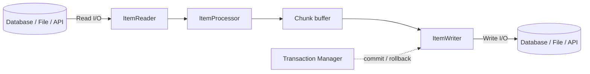

# Reader and Writer I/O in Spring Batch

For a batch job processing millions of records, CPU time inside `ItemProcessor` is sometimes only a small fraction of total runtime. Most of the time can be spent with the reader **waiting for data** from a database, file, or API, and the writer **waiting for write acknowledgments** from a database, object storage, or downstream service. That is **I/O (Input/Output)** cost. Optimizing I/O properly increases throughput, shortens connection hold times, and avoids overloading external resources.

In Spring Batch, `ItemReader<I>` fetches input items, `ItemProcessor<I, O>` transforms data, and `ItemWriter<O>` receives a `Chunk<? extends O>` to write. How the framework invokes them per chunk directly affects transactions, read/write counts, rollbacks, retries, and restarts.

This lesson belongs to **Spring Batch Core Processing → Performance** and focuses on identifying, measuring, and optimizing reader and writer I/O. Examples use Spring Batch 5.x, Spring Boot 3.x, JDBC, and Java; the same principles apply to files, JPA, message queues, REST APIs, and object storage, with specifics depending on drivers and infrastructure.

## 1. Where Does I/O Sit in a Batch Step?

A typical chunk processing flow:



Readers and writers may wait on different resources:

| Location | I/O Examples | Where Latency Typically Comes From |
|---|---|---|
| JDBC reader | `SELECT`, fetching next rows from `ResultSet` | Query plan, disk/DB cache, network round-trips, locks, driver fetch |
| Paging reader | One query per page | Scans/sorts, indexes, count queries, paging strategy |
| File reader | Block reads, UTF-8 decoding, CSV parsing | Disk, network filesystem, object storage, buffers, decompression |
| API reader | HTTP/GraphQL paginated fetches | Network, DNS/TLS, server latency, rate limits, retries |
| JDBC writer | `INSERT`/`UPDATE` or batch SQL | Indexes/constraints, transaction logs, locks, DB round-trips, commits |
| File writer | Serializing items, flushing buffer to file | Encoding, flushes, disk throughput, filesystem metadata |
| API writer | Sending batches and waiting for responses | Payload size, service latency, quotas, backoff |
| Message writer | Publishing events to a broker | Acknowledgments, replication, batching, network, broker backpressure |

**Latency** answers "how long does one operation take"; **throughput** answers "how many items/bytes complete per second"; **utilization** shows whether a resource is nearing saturation. Cutting latency on a single query may not speed up the job if the bottleneck is in the writer or processor.

### Simple Timing Model

For a sequential step, you can picture:

```text
Job elapsed time
  ≈ startup / scheduling / metadata
    + total read wait
    + total process work
    + total write wait
    + total commit / rollback / retry overhead
```

This is an analytical model, not an exact equality for every job. Reads and writes can overlap with buffering, multi-threading, partitioning, or async I/O; operation counts can rise on retries. Measure each phase and actual wall-clock runtime rather than mechanically summing durations.

## 2. Three Sizes Controlling Three Different Costs

When optimizing I/O, three parameters frequently appear:

| Parameter | Layer | What It Controls |
|---|---|---|
| `fetchSize` | JDBC driver / cursor reader | Hints how many rows the driver fetches per batch from `ResultSet` |
| `pageSize` | Paging reader | Number of items requested per paginated query |
| `chunkSize` | Step transaction / write | Number of items under chunk policy before writing and committing |

Example: 50,000 items, `fetchSize=500`, `chunkSize=100`:

- The cursor may retrieve rows in batches of ~500 **if supported by the driver**.
- Spring Batch still feeds items one by one to the processor.
- The writer receives chunks of ~100 items—around 500 chunk writes assuming no errors, skips, or filtering and ignoring end-of-input boundaries.
- Commits and rollbacks belong to the step's transaction, **not `fetchSize`**.

With paging `pageSize=500`, the reader executes queries page by page; this differs fundamentally from cursor prefetching. Do not treat `pageSize` as synonymous with `fetchSize`, and do not force `pageSize == chunkSize`.

## 3. Optimizing JDBC Reader I/O

For `JdbcCursorItemReader`, reducing round-trips only works if the driver genuinely fetches in batches. `setFetchSize(...)` is a **JDBC hint**, not a SQL `LIMIT` clause, and does not guarantee the driver streams as expected.

### 3.1. Cursor Reader Example with Fetch Size

```java
import java.math.BigDecimal;
import javax.sql.DataSource;

import org.springframework.batch.item.database.JdbcCursorItemReader;
import org.springframework.batch.item.database.builder.JdbcCursorItemReaderBuilder;
import org.springframework.context.annotation.Bean;

record PaymentRow(long id, BigDecimal amount) {}

@Bean
JdbcCursorItemReader<PaymentRow> paymentReader(DataSource dataSource) {
    return new JdbcCursorItemReaderBuilder<PaymentRow>()
            .name("paymentReader")
            .dataSource(dataSource)
            .sql("""
                    SELECT id, amount
                    FROM payment_source
                    WHERE batch_key = '2026-11-15'
                    ORDER BY id
                    """)
            .rowMapper((rs, rowNumber) -> new PaymentRow(
                    rs.getLong("id"),
                    rs.getBigDecimal("amount")))
            .fetchSize(500)
            .saveState(true)
            .build();
}
```

The code hardcodes a batch key for readability; in real applications, use **job parameters** and bound SQL parameters instead of rebuilding queries per run. If the reader maintains restart state, keep its reader name stable so Spring Batch can locate its checkpoint.

Factors to measure when tuning:

1. **SQL and indexes:** does the query incur costly full scans/sorts, or do indexes support `WHERE`/`ORDER BY`?
2. **Column projection:** select only needed columns; avoid pulling huge BLOB/CLOB/JSON columns unused by the processor.
3. **Fetch behavior:** verify the driver actually streams rather than materializing the whole result set in memory.
4. **Connection lifetime:** cursors can hold connections/result sets open for long durations; check pool size, statement timeouts, and network timeouts.
5. **Snapshot and ordering:** does the dataset/ordering remain stable across a long job or restart?

### 3.2. Fetch Size Reduces Round-Trips While Growing Buffers

Suppose the DB and app are separated by **8 ms network latency per round-trip** across 50,000 rows. If the driver actually fetches in full batches:

```text
fetchSize = 100  → ~500 batches × 8 ms ≈ 4,000 ms waiting on round-trips
fetchSize = 1000 →  ~50 batches × 8 ms ≈   400 ms waiting on round-trips
```

These numbers illustrate **only round-trip overhead**, excluding SQL execution, byte transfer, object mapping, commits, and driver mechanics. If the real bottleneck is a table scan or the writer, increasing fetch size may barely move total runtime.

Overly large fetch sizes can bloat driver heap buffers or lengthen individual transfers. Measure **peak heap, GC pauses, network bytes transferred, round-trips, and throughput** on your real database/driver before settling on a value.

### 3.3. Notable Driver Differences

- **PostgreSQL JDBC:** cursor streaming generally requires a positive fetch size plus conditions such as `autoCommit=false`; verify your transaction and driver setup.
- **MySQL Connector/J:** cursor fetching depends on driver flags, prepared statements, and streaming modes; `setFetchSize(500)` is not guaranteed to behave like PostgreSQL.
- **Oracle JDBC:** row prefetch and fetch size have distinct defaults and interactions affecting batch retrieval.
- **H2:** useful for logic tests, but does not represent production DB network round-trips or memory behavior.

In your specific environment, inspect driver logs, DB monitoring, or packet/SQL traces to confirm whether the fetch hint takes effect.

### 3.4. Paging Readers: Optimizing Page Queries and Sort Keys

With `JdbcPagingItemReader`, page size governs how many items are requested **per query**, unlike cursor fetch size:

```java
import java.util.Map;
import javax.sql.DataSource;

import org.springframework.batch.item.database.JdbcPagingItemReader;
import org.springframework.batch.item.database.Order;
import org.springframework.batch.item.database.builder.JdbcPagingItemReaderBuilder;

@Bean
JdbcPagingItemReader<PaymentRow> pagingPaymentReader(
        DataSource dataSource) {
    return new JdbcPagingItemReaderBuilder<PaymentRow>()
            .name("pagingPaymentReader")
            .dataSource(dataSource)
            .selectClause("SELECT id, amount")
            .fromClause("FROM payment_source")
            .whereClause("WHERE status = 'READY'")
            .sortKeys(Map.of("id", Order.ASCENDING))
            .rowMapper((rs, rowNumber) -> new PaymentRow(
                    rs.getLong("id"),
                    rs.getBigDecimal("amount")))
            .pageSize(500)
            .saveState(true)
            .build();
}
```

`id` in this example is a unique key. A non-unique sort key (such as `created_at` when rows share timestamps) can produce unstable page ordering, causing skipped or duplicated items in some scenarios. When sorting by multiple columns, append a unique tie-breaker at the end and create indexes supporting the filter and sort order.

Spring Batch uses a database-appropriate `PagingQueryProvider` to generate queries, which can leverage sort keys to advance pages; do not assume every provider literally emits `LIMIT ... OFFSET ...`. Measure actual query counts with SQL instrumentation.

## 4. Optimizing File and Object Storage Readers

File readers perform **block** I/O and per-line parsing. When files reside on network filesystems or object storage, opening and downloading latency can also be significant.

### 4.1. `FlatFileItemReader` and Record-by-Record Streaming

Example CSV with header `id,amount`:

```java
import org.springframework.batch.item.file.FlatFileItemReader;
import org.springframework.batch.item.file.builder.FlatFileItemReaderBuilder;
import org.springframework.core.io.Resource;

@Bean
FlatFileItemReader<PaymentRow> csvPaymentReader(Resource sourceFile) {
    return new FlatFileItemReaderBuilder<PaymentRow>()
            .name("csvPaymentReader")
            .resource(sourceFile)
            .encoding("UTF-8")
            .linesToSkip(1)
            .delimited()
            .names("id", "amount")
            .fieldSetMapper(fields -> new PaymentRow(
                    fields.readLong("id"),
                    fields.readBigDecimal("amount")))
            .build();
}
```

The reader emits items sequentially using streaming/buffering under the hood, avoiding loading the whole file into a giant `List` before processing. Still, costs can arise from:

- Very long lines or many columns to parse.
- CSVs heavy in escape characters/quotes or complex validation.
- Gzipped files requiring sequential decompression; many compression formats do not support efficient random seeks.
- Files on network mounts with low throughput or transient timeouts.
- Reopening files and skipping past many lines upon restart.

With object storage, prefer reading from an **immutable object version** or staging snapshot rather than a path that could be overwritten mid-run. For huge files, consider splitting across partitions/buckets **if the format splits safely**—never split mid-record inside a quoted CSV field containing newlines.

### 4.2. Right-Sized Buffering and Avoiding Per-Item Remote Calls

A common slowdown comes from issuing an HTTP call or extra SQL query **per item** inside the processor:

```text
Reader yields 100,000 payments
Each item calls GET /customer/{id}
→ 100,000 extra HTTP round-trips
```

If the API supports bulk lookups or reference data can be cached, round-trips drop sharply. For instance, preload reasonably sized mapping tables, join in the reader SQL, or batch customer IDs with **bounded payload sizes, quotas, and timeouts**.

Never cache unbounded records in memory: a giant cache simply trades a network bottleneck for GC pauses or OOMs. When reference data changes over time, enforce explicit TTL or versioning rules to avoid stale reads.

## 5. Writer I/O: Why One `write()` Call Does Not Mean One Round-Trip

Spring Batch 5 defines:

```java
public interface ItemWriter<T> {
    void write(Chunk<? extends T> chunk) throws Exception;
}
```

The writer receives a **chunk**, but the implementation decides how that chunk maps to I/O calls. Looping and calling a separate network SQL INSERT per item still incurs hundreds of round-trips. Conversely, `JdbcBatchItemWriter` translates a chunk into a JDBC batch operation so the driver and database can execute it efficiently.

### 5.1. Comparing Per-Item Writes vs. Batch Writes

**High-overhead approach**:

```java
ItemWriter<PaymentRow> slowWriter = chunk -> {
    for (PaymentRow item : chunk.getItems()) {
        jdbcTemplate.update(
                "INSERT INTO payment_output(source_id, amount) VALUES (?, ?)",
                item.id(), item.amount());
    }
};
```

Each `update` call adds framework, driver, and database overhead; round-trip counts depend on the driver, prepared statements, and connection setup. At high volume, use batch APIs.

**Using `JdbcBatchItemWriter`**:

```java
import javax.sql.DataSource;

import org.springframework.batch.item.database.JdbcBatchItemWriter;
import org.springframework.batch.item.database.builder.JdbcBatchItemWriterBuilder;
import org.springframework.jdbc.core.namedparam.MapSqlParameterSource;

@Bean
JdbcBatchItemWriter<PaymentRow> paymentWriter(DataSource dataSource) {
    return new JdbcBatchItemWriterBuilder<PaymentRow>()
            .dataSource(dataSource)
            .sql("""
                    INSERT INTO payment_output(source_id, amount)
                    VALUES (:id, :amount)
                    """)
            .itemSqlParameterSourceProvider(item ->
                    new MapSqlParameterSource()
                            .addValue("id", item.id())
                            .addValue("amount", item.amount()))
            .build();
}
```

The writer uses JDBC batching per chunk via Spring JDBC. **JDBC batching does not always result in a single physical network round-trip**: actual behavior depends on the driver, JDBC URL flags, database wire protocol, payload size, update counts, constraints, and batch-rewrite support. Measure actual statement/batch executions, DB latency, and committed rows instead of guessing from Java `write()` call counts.

If the target table enforces a unique constraint on `source_id`, design the writer with **upsert/idempotency** so restarts and retries cannot create duplicate rows. Upsert syntax is database-specific and should be implemented and tested explicitly.

### 5.2. How Chunk Size Affects Writer Invocations

Example with 100,000 items and no filtering/skipping:

| Chunk Size | Approximate `write()` Calls | Costs That Can Rise |
|---|---:|---|
| 20 | 5,000 | Frequent write/commit overhead |
| 100 | 1,000 | More balanced |
| 500 | 200 | Longer chunks, larger buffers and rollbacks |
| 2,000 | 50 | Large transactions/locks/payloads, costlier recovery |

This division illustrates the basic relationship—not exact call counts when jobs fail, retry, skip, filter, or hit EOF. A failing writer call can trigger a framework rollback followed by **re-invoking the writer** or splitting chunks to isolate bad items. Therefore, `write()` call count does not always equal committed chunk count.

Tuning chunk size balances throughput against:

- Memory holding input/output items.
- Transaction and database lock hold durations.
- Rollback/replay cost when an item fails.
- Sink request payload limits and timeouts.
- Connection counts and concurrent database load.

Do not raise chunk size solely to cut writer call counts if database lock times or p99 latency degrade.

## 6. File Writers: Buffering, Flushing, and Safe Output Publishing

`FlatFileItemWriter` is commonly used to export CSV/text files. Example:

```java
import org.springframework.batch.item.file.FlatFileItemWriter;
import org.springframework.batch.item.file.builder.FlatFileItemWriterBuilder;
import org.springframework.core.io.FileSystemResource;

@Bean
FlatFileItemWriter<PaymentRow> csvPaymentWriter() {
    return new FlatFileItemWriterBuilder<PaymentRow>()
            .name("csvPaymentWriter")
            .resource(new FileSystemResource("output/payments-staging.csv"))
            .encoding("UTF-8")
            .lineAggregator(row -> row.id() + "," + row.amount())
            .saveState(true)
            .build();
}
```

This simple example writes only numbers and IDs; for fields containing delimiters, newlines, or quotes, use a proper CSV formatter/serializer rather than manual string concatenation.

Key I/O considerations:

1. **Buffered writes:** writing item-by-item directly to physical disk adds severe overhead; writer buffering coalesces disk I/O calls.
2. **Encoding:** UTF-8, escaping rules, and number/date formatting affect serialization cost and downstream compatibility.
3. **Flush vs. fsync:** flushing a buffer does not guarantee durable persistence to physical disk across all filesystems. Do not equate `flush()` with `fsync()`.
4. **File lifecycle:** opening, appending, truncating, writing headers/footers, renaming, and cleanup are all I/O operations.
5. **Transactional semantics:** `FlatFileItemWriter`'s buffering/state recovery integrates with chunk transactions inside the framework, yet ordinary filesystems **are not XA resources enlisted with JDBC transactions**.

### Preventing Consumers from Reading Partial Files

A safe publishing pipeline typically follows:

```text
1. Writer writes output/payments-2026-11-15.tmp
2. Job finishes; reconcile row count / checksum
3. Publish via rename/move to final name
4. Create manifest/READY marker for downstream
5. Consumers read only published output
```

A rename can be atomic **when the filesystem and move target support it**, but it is not guaranteed atomic across different filesystems or buckets. On object storage, verify copy, versioning, and marker-publishing semantics. Never treat a file's mere appearance as proof writing has finished.

When restarting a file writer, keep the resource path, writer name, checkpoint, and append/truncate settings consistent. If the partial file was altered externally, the saved write offset may no longer be valid.

## 7. API and Message Writers: Batching and Backpressure

Not every sink offers JDBC-like transactions. For REST APIs, message brokers, or cloud object storage, throughput depends heavily on request rate, payload size, acknowledgments, and quotas.

### 7.1. Batch Requests When the Endpoint Supports It

Suppose an HTTP service accepts up to 500 items per request. Sending 50,000 items individually issues 50,000 requests; batching 250 items per call requires ~200 requests. Savings are huge when per-request latency is significant.

However, oversized batches risk:

- HTTP 413 Payload Too Large.
- Timeouts because the server takes too long on one request.
- Rate limits, throttling, or byte/item-based quotas.
- Failing an entire batch due to a single invalid item.
- Ambiguity over which items succeeded if the response is lost.

Clarify the **bulk API contract**: all-or-nothing atomic batch, per-item partial success, or asynchronous completion via a task ID. The writer can accurately confirm success only when respecting that contract.

### 7.2. Retries, Timeouts, and Idempotency

Real-world scenario:

```text
Writer sends payment ID P-200 to API
Server processes and commits successfully
Response times out in transit
Spring Batch sees IOException and retries
→ Without API deduplication, the payment may be recorded twice
```

Safeguards:

- Pass a downstream **idempotency key** or unique business ID.
- Retry only classified transient errors, with bounded attempts, backoff, and jitter.
- Separate per-item errors from whole-request errors when APIs return partial success.
- Configure explicit connect timeouts, read timeouts, and HTTP connection pool limits.
- Cap concurrency to stay within rate limits.
- For reliable message publishing, consider the transactional outbox pattern and consumer-side deduplication.

A JDBC `@Transactional` block cannot roll back an already-sent HTTP request or broker message. When designing a writer, analyze **what happens if a chunk rolls back after an external side effect succeeded**.

### 7.3. Backpressure Matters More Than Unbounded Threads

If a sink handles at most 2,000 items/s while the reader can supply 20,000 items/s, adding threads endlessly creates queues, pool waits, timeouts, or OOMs. Cap concurrent jobs/partitions/workers, bound queue capacities, and use backoff retries so send rates match sink capacity.

With multiple partitions, total connections and request rates roughly equal **per-partition usage × active partitions**, so writer limits must be budgeted across the whole application/cluster—not just one step.

## 8. How Transactions, Rollbacks, and Restarts Affect I/O

In a chunk-oriented step, the writer normally executes inside a transaction managed by the step's `PlatformTransactionManager`. With a compatible JDBC writer and DataSource, a runtime exception in the writer rolls back the chunk's SQL.

Example:

```text
Chunk 1: write 100 rows → COMMIT
Chunk 2: write 100 rows → exception → ROLLBACK
Chunk 3: not yet executed

After error:
  Committed data from chunk 1 remains.
  Chunk 2 SQL is rolled back if within the same JDBC transaction.
  Reader may have to re-read/replay part of input on restart/retry.
```

Distinguish three quantities:

- **Rows read:** items yielded by the reader; can increase due to re-reads.
- **Rows sent to writer:** items passed to the writer across attempts; may include duplicate attempts.
- **Rows committed:** records actually persisted after transaction commit; the true outcome of a transactional writer.

### 8.1. I/O Optimizations Must Preserve Restart Correctness

With `JdbcCursorItemReader` or `JdbcPagingItemReader` using `saveState(true)`, Spring Batch stores read position in `ExecutionContext`. If a job crashes, restarting with the same identifying `JobParameters` resumes the valid `JobInstance`.

However, checkpoints only work reliably when **the input source and read order stay stable**. If a job queries `WHERE status = 'NEW'` and the writer or another process immediately flips processed rows out of `'NEW'`, the restart query sees a shifted result set. Position- or key-based readers can then skip or duplicate items.

Common remedies:

1. Lock in a **snapshot** or batch ID before running.
2. Sort by a unique, immutable key; never sort by a field mutated during processing.
3. With paging, ensure `sortKeys` align with indexes and source mutations cannot skip unprocessed items.
4. Make the writer idempotent via unique constraints, upserts, or idempotency keys.
5. Test mid-run failures and real restarts against a test database.

Never wrap an entire job test in `@Transactional` when testing chunk commits and rollbacks: Spring Test's transaction alters observed boundaries.

### 8.2. Skips and Retries Increase I/O

When the writer throws a retryable exception, Spring Batch rolls back and re-invokes the writer, increasing SQL or HTTP requests. When skipping writer errors, the framework may isolate the failing item by retrying smaller groups or individual items.

Therefore, never compare two configurations using `ItemWriter.write()` call counts alone; measure:

- Committed `writeCount`, `skipCount`, and `rollbackCount`.
- Actual SQL queries, HTTP requests, and network round-trips.
- Total bytes sent/received and per-phase latency.
- Final destination completeness with zero gaps or duplicates after failure/restart.

For remote APIs whose side effects do not roll back, track outgoing request counts alongside server-accepted record counts.

## 9. Measuring Reader and Writer I/O with Micrometer

A chart showing only total job runtime does not tell you whether to optimize reads or writes. Add targeted metrics:

| Group | Metrics | Usage |
|---|---|---|
| Reader | `read()` elapsed, DB query latency, file bytes/s, API latency | Inspect time waiting on sources |
| Writer | `write(chunk)` elapsed, DB batch latency, request size, error rate | Inspect time waiting on sinks |
| Chunk | Duration, success/error, actual chunk size | Compare per-transaction overhead |
| Step | `readCount`, `writeCount`, `skipCount`, `rollbackCount` | Verify pipeline outcomes |
| Database | Connection pool active/wait, lock waits, slow queries | Identify DB bottlenecks |
| Runtime | CPU, heap, GC pauses, thread pools | Separate CPU/memory from I/O |

### 9.1. Wrapper Timing Reads While Preserving `ItemStream`

If a reader supports checkpoints via `ItemStreamReader<T>`, the wrapper must forward `open`/`update`/`close`; omitting these callbacks breaks restarts:

```java
import java.util.concurrent.TimeUnit;

import io.micrometer.core.instrument.Timer;
import org.springframework.batch.item.ExecutionContext;
import org.springframework.batch.item.ItemStreamReader;

public final class TimedItemStreamReader<T>
        implements ItemStreamReader<T> {

    private final ItemStreamReader<T> delegate;
    private final Timer timer;

    public TimedItemStreamReader(
            ItemStreamReader<T> delegate, Timer timer) {
        this.delegate = delegate;
        this.timer = timer;
    }

    @Override
    public T read() throws Exception {
        long started = System.nanoTime();
        try {
            return delegate.read();
        } finally {
            timer.record(
                    System.nanoTime() - started,
                    TimeUnit.NANOSECONDS);
        }
    }

    @Override
    public void open(ExecutionContext context) {
        delegate.open(context);
    }

    @Override
    public void update(ExecutionContext context) {
        delegate.update(context);
    }

    @Override
    public void close() {
        delegate.close();
    }
}
```

The wrapper measures **wall-clock elapsed time** for every `read()` call, including the `null` EOF call and exception calls. This includes row mapping/parsing performed inside `read()`; it is **not pure network time**. Pair it with JDBC/HTTP instrumentation to separate network round-trips from app processing.

When the reader is a `@StepScope` bean, construct the wrapper in the same scope or inject the lifecycle-managed delegate. Never wrap with an anonymous object that drops `ItemStream` or other required lifecycle interfaces.

### 9.2. Wrapper Timing Writers per Chunk

```java
import java.util.concurrent.TimeUnit;

import io.micrometer.core.instrument.Timer;
import org.springframework.batch.item.Chunk;
import org.springframework.batch.item.ItemWriter;

public final class TimedItemWriter<T> implements ItemWriter<T> {

    private final ItemWriter<T> delegate;
    private final Timer timer;

    public TimedItemWriter(ItemWriter<T> delegate, Timer timer) {
        this.delegate = delegate;
        this.timer = timer;
    }

    @Override
    public void write(Chunk<? extends T> chunk) throws Exception {
        long started = System.nanoTime();
        try {
            delegate.write(chunk);
        } finally {
            timer.record(
                    System.nanoTime() - started,
                    TimeUnit.NANOSECONDS);
        }
    }
}
```

`write()` duration measures up to when the writer returns or throws, **usually excluding transaction commit cost that follows**. To capture total chunk duration and commit overhead, also use a `ChunkListener` measuring from `beforeChunk` to `afterChunk`/`afterChunkError`. If the writer implements `ItemStream`, a production wrapper must implement and forward `open`/`update`/`close` just like the reader wrapper.

### 9.3. Registering Timers

```java
import io.micrometer.core.instrument.MeterRegistry;
import io.micrometer.core.instrument.Timer;

Timer readTimer = Timer.builder("batch.reader.io.duration")
        .description("Elapsed time of reader.read() calls")
        .tags("job", "dailyPaymentJob", "step", "importStep")
        .publishPercentileHistogram()
        .register(meterRegistry);

Timer writeTimer = Timer.builder("batch.writer.io.duration")
        .description("Elapsed time of writer.write(chunk) calls")
        .tags("job", "dailyPaymentJob", "step", "importStep")
        .publishPercentileHistogram()
        .register(meterRegistry);
```

These two Timers are wired once during configuration, never inside the item loop. With `SimpleMeterRegistry` or Prometheus, they record sample counts, total duration, and optional histograms/percentiles. Keep tags low-cardinality such as job/step/sink type; avoid `itemId`, `jobExecutionId`, full SQL strings, or exception messages that explode time-series cardinality.

**Built-in Spring Batch/Micrometer metrics can be used** if observability is already enabled in your app. Check metric definitions, units, and tags before adding custom metrics to avoid double-counting or comparing mismatched quantities.

## 10. Distinguishing Latency, Throughput, and Backpressure

Suppose a job reads fast yet writes slowly:

```text
Reader rate:  15,000 items/s
Writer rate:   1,500 items/s
CPU:              25%
DB pool:          100% active, heavy waiting
```

Adding more read partitions will not help: the writer/database is the bottleneck. It can even worsen contention as writers compete for connections and locks, raising p95 latency and lowering throughput.

A simple sequential capacity model:

```text
Effective item throughput
    ≤ min(reader capacity, processor capacity, writer capacity)
```

With multiple partitions and independent resources, aggregate throughput can scale. Yet every component hits shared limits: database max connections, disk IOPS, API quotas, network bandwidth, broker partitions, and CPU. Thus **raising concurrency helps only until the first shared resource saturates**.

### Byte Throughput vs. Item Throughput

Two jobs both hitting 5,000 items/s behave very differently if one processes 200-byte items and the other 20-KB items. When payloads vary, also track:

- Rows/items per second.
- Bytes read/written per second.
- Actual page/chunk sizes.
- Query/request p50/p95 latency.
- Peak heap and GC pauses.

Never treat `readCount` or `writeCount` as I/O byte volume; Spring Batch counters count **items**, not bytes transferred over the wire.

## 11. Controlled Benchmarking

Pick optimal settings using the exact same dataset and environment—not intuition or a single run. A useful measurement procedure:

### 11.1. Establish a Baseline

Example production-like test with 1 million rows read from PostgreSQL and written via JDBC:

```text
Rows input       = 1,000,000
Reader           = JdbcCursorItemReader(fetchSize=100)
Writer           = JdbcBatchItemWriter
Chunk size       = 100
Concurrency      = 1
Job duration     = 22 minutes
JDBC pool active = 2–5 connections
```

These are illustrative values, not typical benchmarks for all setups. Document **driver version, database, SQL/query plans, indexes, network latency, row width, JVM heap, GC settings, and pool config** so runs stay comparable.

### 11.2. Vary One Parameter Group at a Time

| Run | Reader | Fetch/Page Size | Chunk Size | Writer | Purpose |
|---|---|---:|---:|---|---|
| A | Cursor | 100 | 100 | JDBC batch | Baseline |
| B | Cursor | 500 | 100 | JDBC batch | Measure driver fetch gain |
| C | Cursor | 1000 | 100 | JDBC batch | Check saturation point |
| D | Cursor | 500 | 500 | JDBC batch | Measure commit/batch cost |
| E | Paging | 500 | 100 | JDBC batch | Compare paging query mechanism |

Do not compare Run A against Run E and attribute every difference to one parameter: reader type, query pattern, and connection lifecycle all changed. Isolate experiments by the question you want to answer.

### 11.3. Multi-Dimensional Measurement

| Metric | Question Answered |
|---|---|
Total job/step duration | Did the change finish earlier? |
Items/s and bytes/s | Did true throughput improve? |
Reader/query p95 | Is the source stalling? |
Writer/batch p95 | Is the sink slow or spiking? |
SQL/HTTP request count | Did I/O calls drop or just shift into bigger payloads? |
DB pool wait, lock waits, disk IOPS | Which resource is saturated? |
Heap, allocations, GC | Do buffers/pages/chunks strain memory? |
Rollbacks/retries/skips | Did tuning increase errors and rework? |
Committed rows/checksum | Is output complete, accurate, and duplicate-free? |

Run enough iterations to smooth out cache warm-up, workload spikes, and network jitter. Combine a JVM profiler, Micrometer, database query monitors, logs, and tracing. Only tune a knob when metrics prove time is actually spent in that component.

### 11.4. Choosing a Balanced Configuration

If `fetchSize=1000` cuts reader latency by 20% while bloating peak heap and triggering GC pauses, `500` may be better overall. If enlarging chunk size boosts throughput by 2% while making failed-chunk rollbacks five times slower, weigh the operational risk.

Batch performance includes **failure recovery speed**. A job that runs fast on the happy path yet takes hours to replay on restart can underperform a slightly slower configuration with stable checkpoints and bounded I/O.

## 12. Testing I/O and Transactions

Proper testing separates **wrapper behavior**, **read/write results**, and **post-transaction correctness**.

### 12.1. Unit Testing Reader Call Counts and Duration

With `TimedItemStreamReader` above, use a fake reader and `SimpleMeterRegistry`:

```java
import static org.junit.jupiter.api.Assertions.*;

import java.util.concurrent.TimeUnit;

import io.micrometer.core.instrument.Timer;
import io.micrometer.core.instrument.simple.SimpleMeterRegistry;
import org.junit.jupiter.api.Test;
import org.springframework.batch.item.ExecutionContext;
import org.springframework.batch.item.ItemStreamReader;

class TimedReaderTest {

    @Test
    void recordsEveryReadCallIncludingEof() throws Exception {
        SimpleMeterRegistry registry = new SimpleMeterRegistry();
        try {
            Timer timer = registry.timer("test.reader.duration");

            ItemStreamReader<Integer> fake = new ItemStreamReader<>() {
                private int next = 1;

                @Override
                public Integer read() {
                    return next++ <= 2 ? next - 1 : null;
                }

                @Override
                public void open(ExecutionContext context) {}

                @Override
                public void update(ExecutionContext context) {}

                @Override
                public void close() {}
            };

            TimedItemStreamReader<Integer> reader =
                    new TimedItemStreamReader<>(fake, timer);

            reader.open(new ExecutionContext());
            assertEquals(1, reader.read());
            assertEquals(2, reader.read());
            assertNull(reader.read());
            reader.close();

            assertEquals(3L, timer.count());
            assertTrue(timer.totalTime(TimeUnit.NANOSECONDS) >= 0);
        } finally {
            registry.close();
        }
    }
}
```

This test verifies the wrapper **does not drop the EOF read call**; it says nothing about how a database driver fetches rows. For real latency, inspect query monitors, network traces, or DB-specific metrics.

### 12.2. Integration Test: Writer Chunk Rollback

A valuable test scenario for JDBC writers:

1. Seed a source table with 6 items and a target table with a unique constraint on business ID.
2. Run a `chunk(2, transactionManager)` step with reader/writer sharing the proper DataSource and transaction manager.
3. Inject a writer failure in the second chunk **after executing at least one INSERT**, causing the step to end `FAILED`.
4. Query the target table outside the test transaction: first chunk's rows remain committed; failed chunk's rows are rolled back.
5. Clear the injected failure and restart with the exact same identifying parameters; confirm the target table holds all 6 business IDs with zero gaps or duplicates.

Mocking the writer without a real database cannot prove rollback works. Wrapping the test class in `@Transactional` around `JobLauncher` can mask real commits/rollbacks or cause `JobRepository` to reject an already-active transaction.

### 12.3. Integration Test: Speed and Query Counts

For SQL readers, verify SELECT query counts and execution plans on a production-like test database. For batch writers, use a SQL proxy or driver instrumentation to count JDBC batch operations and measure network round-trips.

Never assert a hardcoded millisecond threshold in shared CI: timings fluctuate with host load, GC, and contention. Instead, separate:

- Functional tests: item counts, checkpoints, post-commit data.
- Instrumentation tests: meter presence, valid counts/durations.
- Performance benchmarks: comparing repeated runs in a controlled environment with recorded baselines and variance.

## 13. Diagnosing Common I/O Issues

| Symptom | Likely Cause | What to Check |
|---|---|---|
| Slow reader, low CPU | Network/DB scans/many fetch round-trips | SQL plan, driver fetch behavior, pool waits |
| Memory stays huge despite raising fetch size | Driver materializing full `ResultSet` | Streaming flags, auto-commit, driver docs |
| Paging slows down progressively | Deep offsets, poor sort/index | Paging provider, sort keys, execution plan |
| Writer slow with small chunks | High per-write/commit overhead | JDBC batching, chunk size, commit count |
| Writer slow with large chunks | Long transaction locks, big payloads, GC | Write/commit p95, lock waits, memory |
| DB pool constantly exhausted | Cursor holding connection, excess concurrency | Active/wait counts, cursor lifetime, pool sizing |
| Throughput drops when adding threads | Saturated sink, locks, or rate limits | Quotas, pool waits, DB IOPS |
| File created yet downstream sees missing rows | Consumer reads incomplete file | Staging + rename/marker publishing |
| API writer retries create duplicates | Server succeeded before client timed out | Idempotency keys, deduplication, API contract |
| Restarts drop or duplicate records | Mutating source, broken ordering/checkpoints | Snapshots, immutable sort keys, idempotent writer |
| High read count yet low `writeCount` | Filtering, skipping, or writer errors | `filterCount`, skip counts, rollbacks, target queries |
| Chunk duration rises while read/write look fine | Commit/transaction locks or other overhead | Transaction timing, DB waits, GC, thread contention |

## 14. Practice Exercise: Optimizing I/O from Real Symptoms

A job reads 2 million transactions from PostgreSQL into a summary table. Initial setup:

```text
Reader          JdbcCursorItemReader(fetchSize=10)
Processor       Currency conversion math (no API calls)
Writer          jdbcTemplate.update(...) per row
Chunk size      50
Concurrency     1
Duration        4 hours
Reader p95      2.5 ms/read
Writer p95      110 ms/chunk
CPU             18%
```

A structured approach:

1. Verify the query plan and confirm PostgreSQL JDBC actually uses cursor fetching under your transaction configuration. Fix driver/connection settings first if not.
2. Benchmark fetch sizes `100`, `500`, and `1000` with chunk size held fixed; observe round-trips and heap.
3. Replace the per-row update writer with `JdbcBatchItemWriter`; measure batch operations and writer latency.
4. Once the writer batches properly, test chunk sizes `100`, `250`, and `500`; monitor throughput alongside DB locks, heap, and rollback duration.
5. Keep a fixed source snapshot and idempotent writer; test failure and restart to verify output correctness.
6. If the DB remains the bottleneck after SQL/I/O tuning, increase partitions/concurrency only within database connection, IOPS, and write capacity limits.

Base conclusions on before/after measurements rather than assuming `fetchSize=1000` or `chunkSize=500` is universally fastest. If write I/O dominates, raising fetch size alone yields minimal benefit.

## 15. Design Principles for Efficient Reader/Writer I/O

A sustainably performant Spring Batch step typically satisfies these principles:

1. **Read only what you need:** project required columns, filter at the source, and stream or page with appropriate buffers.
2. **Batch I/O with restraint:** leverage JDBC batching, bulk HTTP APIs, and file buffering while respecting payload and lock limits.
3. **Separate fetch/page from chunk:** tune data transfer independently from transaction boundaries.
4. **Measure the true bottleneck:** track read/write/commit timings, item/byte counts, p95 latency, errors/retries, and resource utilization.
5. **Protect data across failures:** use checkpointable readers, stable sources, idempotent writers, and tested restarts/rollbacks.
6. **Respect downstream capacity:** bound concurrency, timeouts, and backpressure instead of spawning unbounded threads.
7. **Publish output safely:** ensure consumers read only committed or atomically published outputs.

Optimizing reader and writer I/O means **cutting data transfer and write overhead while preserving transaction accuracy and recoverability**. By pairing targeted metrics with batching, streaming, query tuning, and restart tests, Spring Batch can handle high data volumes reliably without pushing every knob to its extreme.
