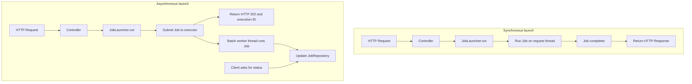
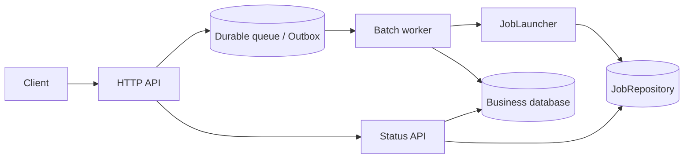

# Don't Hold the Request Thread for Long Jobs

A batch job can take a few seconds, a few minutes, or longer to complete. If an HTTP controller calls `JobLauncher.run()` synchronously, the entire job run time sits on the request thread that is handling the user's request. The request thread is tied up until the job finishes, making it hard for the application to serve other requests and prone to timeouts at the client, reverse proxy, or API gateway.

For long jobs, the appropriate organization is usually: the API accepts the request, validates the parameters, launches the job on an executor dedicated to batch, and then returns an execution code so the client can look up the status. The request ends quickly; the batch job continues running in a thread or worker process that is managed separately.

In Spring Batch, `JobLauncher` can run a job synchronously or asynchronously depending on the configured `TaskExecutor`. Merely calling `JobLauncher.run()` does not mean the job automatically runs in the background. If the launcher uses `SyncTaskExecutor` (the common default configuration), the job runs right on the calling thread. To free the request thread, you need to configure an asynchronous executor or hand the request off through a separate queue/worker.

## 1. Why shouldn't you run a long job on the request thread?

In a web application, the server usually has a finite pool of request threads. Each request needs a thread to read the request, run the controller/service, and produce the response. If a request holds a thread for several minutes to wait for a batch job, that thread cannot serve other requests during that time.

Common consequences:

- **Request thread exhaustion:** many long jobs launched at the same time can occupy all the threads of the servlet container, making normal APIs slow or unable to accept new requests.
- **Timeouts:** the browser, client SDK, load balancer, reverse proxy, or API gateway may close the connection before the job completes.
- **Unintended retries:** a client that does not receive a response may resend the request while the first job continues to run. This easily creates two runs of the same batch if there is no deduplication lock.
- **Hard to scale:** the number of request threads is bound by the job run time instead of only the request-acceptance time.
- **Hard to report progress:** the caller has to keep the connection open and wait, instead of receiving an execution code and then querying the status when needed.
- **Hard to handle disconnects:** a client closing the connection does not mean the job is stopped safely. The job may keep running even though the caller has given up.

For example, if an API has 100 request threads and 100 users each submit a job that takes 2 minutes, all request threads may be occupied for nearly 2 minutes. Other APIs such as login, data lookup, or health-related endpoints may also be affected if they share resources.

Freeing the request thread does not make the batch job run faster. It separates the HTTP lifecycle from the batch processing lifecycle, allowing the web tier to keep serving requests while the job is executed and monitored independently.

## 2. Distinguishing synchronous and asynchronous launches

`JobLauncher` receives the job name and `JobParameters`, creates or finds the `JobInstance`, registers a `JobExecution` in the `JobRepository`, and then asks for the job to be executed.

The deciding factor for which thread the job runs on is the `TaskExecutor` that the launcher uses:

| Configuration | Behavior |
|---|---|
| `SyncTaskExecutor` | Runs the task right on the thread calling `JobLauncher.run()`; the controller must wait for the job to finish |
| `ThreadPoolTaskExecutor` | Sends the job to a pool thread; the controller can receive the `JobExecution` before the job completes |
| Other asynchronous executors | Behavior depends on the executor, resource limits, and the task rejection policy |

Comparison diagram:



With a synchronous launch, the request ends only after the job has finished running. With an asynchronous launch, the request ends after the launcher accepts the work and sends it to the executor. The job continues running on another thread.

Note: asynchronous does not mean distributed. If the executor is in the same JVM, the job still runs in the same application and shares the CPU, heap, database connection pool, and other resources. This is a way of separating threads; separating processes or servers requires a dedicated worker architecture.

## 3. Configuring JobLauncher to use an asynchronous executor

In Spring Batch 5+, you can configure `TaskExecutorJobLauncher` with a `TaskExecutor`. The example below uses a `ThreadPoolTaskExecutor` with a bounded number of threads and queue:

```java
@Configuration
public class BatchLauncherConfiguration {

    @Bean
    ThreadPoolTaskExecutor batchJobExecutor() {
        ThreadPoolTaskExecutor executor = new ThreadPoolTaskExecutor();
        executor.setCorePoolSize(2);
        executor.setMaxPoolSize(4);
        executor.setQueueCapacity(20);
        executor.setThreadNamePrefix("batch-job-");
        executor.setRejectedExecutionHandler(
                new ThreadPoolExecutor.AbortPolicy());
        executor.setWaitForTasksToCompleteOnShutdown(true);
        executor.setAwaitTerminationSeconds(60);
        return executor;
    }

    @Bean
    JobLauncher jobLauncher(
            JobRepository jobRepository,
            ThreadPoolTaskExecutor batchJobExecutor) throws Exception {

        TaskExecutorJobLauncher launcher = new TaskExecutorJobLauncher();
        launcher.setJobRepository(jobRepository);
        launcher.setTaskExecutor(batchJobExecutor);
        launcher.afterPropertiesSet();
        return launcher;
    }
}
```

In this configuration:

- `corePoolSize` is the number of background threads kept at the base level.
- `maxPoolSize` limits the number of jobs that this executor can execute concurrently.
- `queueCapacity` limits the number of tasks waiting to be executed.
- `threadNamePrefix` helps identify batch threads in logs and thread dumps.
- `AbortPolicy` rejects a task when the executor is full, so the application can respond that the system is overloaded.
- `waitForTasksToCompleteOnShutdown` and `awaitTerminationSeconds` help wait for tasks during a controlled shutdown, within the configured time limit.

This is an example for Spring Batch 5+. Older versions may use `SimpleJobLauncher` instead of `TaskExecutorJobLauncher`; the principle of configuring a `TaskExecutor` remains similar. When using Spring Boot, you need to check which launcher the application is using and avoid declaring a duplicate bean or unintentionally replacing the auto-configuration without intent.

You should not use an executor that creates unbounded threads for long jobs. A large volume of requests can create too many threads, putting pressure on memory, CPU, the database, and dependent services. Set thread and queue limits based on the system's capacity.

## 4. The controller returns an early response and provides an execution ID

When a job is launched asynchronously, the API typically uses HTTP `202 Accepted` to indicate the request has been accepted and processing will continue in the background. The response should return an execution identifier so the client can look up the status.

An example controller:

```java
@RestController
@RequestMapping("/api/imports")
public class ImportController {

    private final JobLauncher jobLauncher;
    private final Job importJob;

    public ImportController(JobLauncher jobLauncher, Job importJob) {
        this.jobLauncher = jobLauncher;
        this.importJob = importJob;
    }

    @PostMapping
    public ResponseEntity<LaunchResponse> launch(
            @RequestBody ImportRequest request) throws JobExecutionException {

        JobParameters parameters = new JobParametersBuilder()
                .addString("businessDate", request.businessDate().toString())
                .addString("requestId", request.requestId())
                .toJobParameters();

        JobExecution execution = jobLauncher.run(importJob, parameters);
        URI statusUri = URI.create(
                "/api/batch-executions/" + execution.getId());

        LaunchResponse body = new LaunchResponse(
                execution.getId(), statusUri.toString());

        return ResponseEntity.accepted()
                .location(statusUri)
                .body(body);
    }
}

record ImportRequest(LocalDate businessDate, String requestId) {}

record LaunchResponse(Long executionId, String statusUrl) {}
```

The example assumes `requestId` is a stable idempotency key provided by the client or the intake system. `businessDate` and `requestId` here are added as identifying parameters according to the default overload of `JobParametersBuilder`. For the same business request, the client needs to resend the same identifying values to avoid unintentionally creating a different `JobInstance`.

When using an asynchronous executor, `JobLauncher.run()` usually returns the `JobExecution` when the job has just been sent off or is starting, not when the job has completed. Therefore the response should only indicate that the request has been accepted along with the execution ID. You must not assume the status at return time is `COMPLETED`.

In a real application, you need to handle cases such as `JobInstanceAlreadyCompleteException`, `JobExecutionAlreadyRunningException`, invalid parameters, or the executor rejecting the task. If the client resends the same `requestId`, the API can look up the corresponding execution and return the current status instead of creating duplicate work. This behavior needs to be specified clearly in the API contract.

## 5. Providing a status lookup API

After receiving the execution ID, the client can query a status endpoint instead of keeping the POST connection open for the entire time the job runs.

An example using `JobExplorer`:

```java
@RestController
@RequestMapping("/api/batch-executions")
public class BatchExecutionController {

    private final JobExplorer jobExplorer;

    public BatchExecutionController(JobExplorer jobExplorer) {
        this.jobExplorer = jobExplorer;
    }

    @GetMapping("/{executionId}")
    public ResponseEntity<ExecutionStatusResponse> getStatus(
            @PathVariable Long executionId) {

        JobExecution execution = jobExplorer.getJobExecution(executionId);
        if (execution == null) {
            return ResponseEntity.notFound().build();
        }

        ExecutionStatusResponse response = new ExecutionStatusResponse(
                execution.getId(),
                execution.getStatus().name(),
                execution.getExitStatus().getExitCode(),
                execution.getStartTime(),
                execution.getEndTime());

        return ResponseEntity.ok(response);
    }
}

record ExecutionStatusResponse(
        Long executionId,
        String batchStatus,
        String exitCode,
        LocalDateTime startTime,
        LocalDateTime endTime) {}
```

The response can contain a status such as `STARTING`, `STARTED`, `COMPLETED`, `FAILED`, or `STOPPED`, depending on the current state of the `JobExecution`. The API should return a small, stable DTO instead of serializing the entire `JobExecution` object and its metadata relationships.

The client can poll the endpoint at a reasonable interval, or receive notifications through WebSocket, Server-Sent Events, or a webhook if the product needs proactive updates. With polling, you should use backoff so as not to create unnecessary additional load. The endpoint also needs to check whether the caller has permission to view that execution; knowing an execution ID should not automatically imply access rights.

The job status here is Spring Batch's execution status. If users need to know whether a data batch has been reconciled or paid successfully, the endpoint should also read the business status from the corresponding business data store.

## 6. Choosing an appropriate thread pool and queue size

An asynchronous executor still uses the application's resources. A configuration that is too small makes jobs wait a long time; a configuration that is too large can overload the database or dependent systems.

When choosing the parameters, consider:

- The number of jobs that need to run concurrently and the average run time.
- The number of database connections each job/step can use.
- The CPU and memory load of the processor.
- The request, connection, and rate limits of external APIs.
- Steps that use multi-threading, partitioning, or remote chunking inside the job.
- The priority between job types and the acceptable wait time.
- The ability to scale up at peak hours and how to reject requests when the limit is reached.

For example, if the database only allocates 20 connections to the application and other APIs also need connections, you should not let dozens of jobs run together with each job opening many connections. You need to reserve capacity for interactive traffic and other background tasks.

`queueCapacity` is also a business limit. A queue that is too large can cause jobs to be accepted but wait a very long time, while holding many tasks and parameters in memory. A queue that is too small can reject requests sooner but gives a clearer overload response. Monitor the queue depth, the number of active threads, the number of rejected tasks, and the wait time before a job starts.

Avoid configuring `CallerRunsPolicy` for an executor that receives jobs from the request thread if the goal is to free the request thread. This policy can require the calling thread to perform the task when the pool is full; in that case, the controller again has to run the long job right on the request thread. Use a controlled rejection policy and return an appropriate response, or switch to a durable queue.

## 7. Handling when the executor is overloaded

When all threads are busy and the queue is full, the executor needs to reject the task or apply a deliberately designed policy. You should not silently create unbounded threads or let requests wait indefinitely.

The API can map the overload condition to `503 Service Unavailable` or `429 Too Many Requests`, depending on the contract and the meaning of the limit. You can send `Retry-After` if the system has a basis for suggesting a retry time. The client needs to keep the same idempotency key when retrying the same request.

In addition, you need to distinguish two situations:

- **The request has not been accepted:** the executor rejects the task before the job is successfully scheduled; the API reports an error that can be retried according to policy.
- **The request has been accepted:** the job already has an execution ID and is waiting or running; the client should look up that execution instead of sending a new request.

Creating the `JobExecution` and sending the task to the executor need to be handled according to the behavior of the launcher and the version in use. Check the metadata state after the executor rejects, so the API does not wrongly answer that the job has been scheduled. You should not update the `BATCH_*` tables yourself with SQL to fix the status.

## 8. Managing duplicates and idempotency

A client may resend a POST because of a timeout, lost connection, or not receiving a response. Meanwhile, the original job may still be running. If each request creates new `JobParameters` with a random timestamp, Spring Batch may create multiple `JobInstance`s for the same business request.

Design a stable identity:

- Use `businessDate`, the file code, `batchId`, or `requestId` to identify the correct business scope.
- Use an idempotency key sent by the client, or generated and durably stored by the intake system.
- A retry of the same request must reuse the identifying parameters.
- Put a unique constraint on the business table to prevent duplicate records.
- Distinguish re-launching a failed `JobInstance` from creating a new business batch.

`JobRepository` helps Spring Batch control the identity and state of the job instance, but it does not replace unique keys or idempotency in the business data. In particular, if the job calls an external API, you need to use an idempotency key or an appropriate outbox/inbox mechanism.

## 9. An in-JVM executor versus a separate worker process

Using `ThreadPoolTaskExecutor` is a simple way to avoid holding the request thread, but the work still runs in the same JVM as the web application. This has some limitations:

- When the process is killed or the server restarts abruptly, tasks sitting in the in-memory queue may be lost.
- A running job may be interrupted and needs its state checked/restarted through the `JobRepository`.
- The batch job and HTTP requests compete for CPU, heap, connection pool, and other shared resources.
- Scaling the web application to multiple instances also gives each instance its own executor and queue; you need to control where jobs are received and executed to avoid duplicate launches.

For important jobs, long jobs, or jobs with high reliability requirements, you can use an architecture that separates the web tier and the batch worker:



The API writes the request to the database or an outbox in a transaction and then returns `202 Accepted`. The worker reads unprocessed requests, launches the job, and updates the acceptance status. Because the request is stored durably, the worker can keep picking up work after the process restarts. You need a claim/lease mechanism, retry, dead-letter, or an error state so that multiple workers do not unintentionally process the same request.

If you use a message broker, a transactional outbox can help ensure that saving the business request and creating the message are synchronized. The consumer still needs to be idempotent because a message broker can usually redeliver messages. The `JobRepository` continues to store Spring Batch's execution metadata, while the queue/outbox is responsible for storing requests waiting to be processed.

You should not regard the in-memory queue of `ThreadPoolTaskExecutor` as a durable queue. It is suitable when it is acceptable that waiting tasks can be lost when the application stops, or when the system has another mechanism to detect and resubmit incomplete requests.

## 10. Request context and the data the job needs

The request thread has a short lifecycle; a batch job can run much longer. Therefore, you should not let the batch logic depend on objects that exist only within the request, such as `HttpServletRequest`, request-scoped beans, or data in thread-locals.

Instead:

- Authenticate and validate the request before launching.
- Convert the necessary values into `JobParameters` or store them in a durable request record.
- Store the user ID or actor ID if you need an audit, according to the data protection policy.
- Read business data from the repository/service inside the job, and do not hold a large request object in memory.
- Do not assume the transaction, security context, or MDC of the request thread is automatically passed to the executor thread.
- If you truly need to pass the security context for a background operation, configure an explicit propagation mechanism; for a long batch, it is usually better to store the actor and necessary permissions in a controlled way and re-authenticate at the worker.

If the controller creates input data in a transaction and then immediately launches an asynchronous job, the worker may start before the request's transaction commits and not see that data. In this case, launch after the commit or use a transactional outbox so the worker only receives requests that have been stored durably.

## 11. Shutdown, restart, and monitoring

Separating the request thread does not remove the need to manage the job lifecycle. The application still needs a policy for deploys, shutdowns, a full executor, or a worker losing its connection.

**Graceful shutdown:** configure the executor to wait for the current tasks for a limited period. At the same time, design steps with checkpoints and jobs that can restart. Do not assume every job will complete within the allowed shutdown time.

**Restart:** if a job is interrupted, use the same identifying `JobParameters` and an appropriate restart mechanism. Check the last `JobExecution`, the step state, the checkpoint, and the side effects that have already occurred before restarting.

**Monitoring:** monitor the number of running jobs, queue depth, wait time, execution time, failure status, retry count, skipped item count, and resource usage. `JobExplorer` can provide metadata for an operations dashboard.

**Logs:** log the job name, execution ID, business batch ID, and correlation ID to link logs between the API, the worker, and dependent services. Do not write secrets or entire sensitive data into logs.

**Stopping jobs:** provide a controlled stop procedure through an administration API or `JobOperator` where appropriate. A client canceling the POST request or closing the browser should not automatically be interpreted as a command to stop the batch job.

## 12. Common design mistakes

**Assuming JobLauncher always runs in the background by default.** If the launcher uses `SyncTaskExecutor`, the job runs on the calling thread. Check the actual configuration and use an asynchronous executor when needed.

**Returning HTTP 202 but still running synchronously.** If the controller only returns the response after `jobLauncher.run()` finishes, the status code does not free the request thread. You need to configure a genuinely asynchronous launcher or send the work to a worker.

**Using `CallerRunsPolicy` when the pool is full.** This policy can make the request thread run the job, causing the original problem to reappear exactly when the system is overloaded.

**Using an unbounded pool.** Too many concurrent jobs can exhaust database connections, heap, CPU, or API quotas. Limit threads and the queue.

**Not returning an execution ID.** The client has no reliable way to know whether the job has been received and has to resend the request. Return the ID along with a lookup endpoint.

**Creating a random identifying parameter on every retry.** The same request can become multiple job instances. Use a stable idempotency key.

**Treating an in-memory queue as durable.** Waiting tasks can be lost when the process stops. If you need a guarantee of acceptance, store the request in a database/outbox or a durable broker.

**Passing request objects or request-scoped beans to the job.** These objects have a lifecycle tied to the HTTP request and are not suitable for a long job to use. Pass the necessary data through parameters or a data store.

**Treating a client disconnect as job cancellation.** The job can continue after the HTTP connection closes. To stop a job, you need a separate administrative action and a safe stop procedure.

## 13. Testing the asynchronous launch flow

Testing needs to confirm both the HTTP behavior and the batch lifecycle:

1. Call the API and confirm the response returns quickly with `202 Accepted` and an execution ID.
2. Confirm the job runs on an executor thread, not the request thread.
3. Confirm the initial status may be `STARTING` or `STARTED`, and then moves to a final status.
4. Poll the status endpoint and confirm the API returns the correct DTO for the execution.
5. Resend the same idempotency key and confirm it does not create a duplicate business batch.
6. Fill up the executor to test the rejection policy and the overload response.
7. Stop the application while jobs are waiting or running to test graceful shutdown, the metadata state, and restartability.
8. Test access control on the status endpoint so users cannot view other people's executions.
9. With a queue/outbox architecture, test that the worker restarts and reprocesses incomplete requests without creating duplicate side effects.

You should not only check that the controller returns `202`. You need to prove that the job actually runs asynchronously, has its metadata stored, can be looked up, and has clear behavior on errors or overload.

## Conclusion

For long jobs, the request thread should only accept and validate the request, launch the work through a background mechanism, and then return the execution ID for the client to look up. In Spring Batch, configuring `JobLauncher` with a bounded asynchronous `TaskExecutor` is the direct way to separate job processing time from the lifetime of the HTTP request.

Manage the thread pool, queue, task rejection, idempotency, status endpoint, shutdown, and restart as parts of the design. If the requirement is to guarantee that work has been accepted even when the application restarts, store the request in a durable queue or a transactional outbox and let a separate worker launch the job. The `JobRepository` continues to track batch execution; the API only needs to respond quickly and provide a clear way to observe progress.
