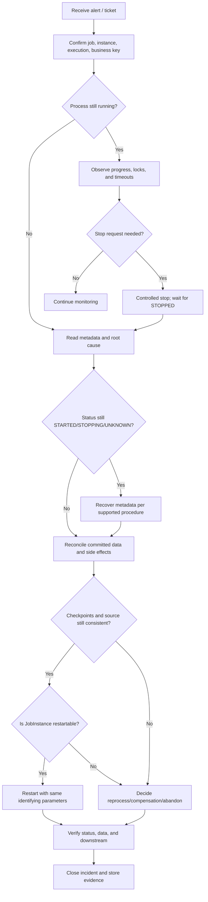

# Runbook for Handling Failures in Spring Batch

A **failure-handling runbook** is a repeatable operational procedure when a Spring Batch job fails, stops, runs past expected duration, or cannot continue after an infrastructure incident. A solid runbook answers: **which job failed, what data already committed, what the root cause is, whether the same JobInstance can restart or needs different remediation, and what evidence proves recovery succeeded**.

This is a practical guide for **Spring Batch Core Processing → Failure recovery**. Examples follow Spring Batch 5.x / Spring Boot 3.x; for other versions, verify corresponding APIs and infrastructure settings. The workflow illustrates a daily transaction-import job using chunk processing, database writes, and potential external system calls.

> **Operational principle:** `FAILED` status does not mean all data rolled back, and `STARTED` in metadata does not prove the process is still alive. Every decision to restart, launch fresh, or abandon must rely on **actual process state + JobRepository + persisted data**.

## 1. Runbook Goal and Scope

An example pipeline:

```text
dailySettlementJob
  ├─ loadStep       : reads payments from database/file, writes to staging
  ├─ validateStep   : validates data and reconciles
  └─ publishStep    : writes ledger and emits downstream notifications

Business key: businessDate=2026-11-15
```

The runbook is triggered by signals such as:

- Scheduler reports job `FAILED`, `STOPPED`, `UNKNOWN`, or an unacceptable business exit code.
- Job runs past SLA, stops updating progress, or emits continuous errors in logs.
- JVM/container/pod died while Batch metadata remains `STARTED` or `STOPPING`.
- Output data is missing, duplicated, mismatched in count, or downstream missed results despite `COMPLETED`.
- Restart attempts fail with `JobExecutionAlreadyRunningException`, `JobInstanceAlreadyCompleteException`, or `JobRestartException`.
- A step exhibits abnormal retries/skips, repeated rollbacks, or exhausts configured fault tolerance.

The goal is not merely flipping status to `COMPLETED`. An incident is resolved only when **output data is accurate, downstream dependencies are consistent, and operational audit trails are recorded**.

### Minimum Information Needed Before Acting

| Field | Example | Why Needed |
|---|---|---|
| `jobName` | `dailySettlementJob` | Identifies the job definition |
| `jobInstanceId` | `427` | Identifies the Spring Batch business unit |
| `jobExecutionId` | `1198` | Identifies the specific run attempt under investigation |
| Identifying parameters | `businessDate=2026-11-15` | Prevents touching the wrong period or spawning a new instance |
| Failed step | `publishStep` | Scopes reader, processor, or writer |
| `BatchStatus` / `ExitStatus` | `FAILED` / `FAILED` | Separates lifecycle status from application exit result |
| Timestamps | Start, last update, end | Scopes log windows and SLA checks |
| Runtime location | Pod/host, deployment version | Verifies live processes and code version |
| Target resources | Database, file, API, queue | Locates completed side effects |
| Incident ID / owner | `INC-2041` / batch on-call | Tracks ownership and decision history |

If any field above is missing, retrieve it via scheduler, logs, and `JobExplorer` before rerunning. Notably, **scheduler execution ID** and **Spring Batch JobExecution ID** are often two different identifiers.

## 2. Spring Batch Status Map for Action Decisions

Spring Batch distinguishes three layers:

1. **`Job`**: processing definition (job name and steps).
2. **`JobInstance`**: a logical business unit defined by **job name + identifying `JobParameters`**.
3. **`JobExecution`**: a single run attempt of a JobInstance. Restarting creates **a new JobExecution for the same JobInstance**, rather than mutating the failed execution into a fresh run.

```text
Job: dailySettlementJob
└─ JobInstance #427 (businessDate=2026-11-15)
   ├─ JobExecution #1198 → FAILED
   └─ JobExecution #1210 → COMPLETED  (restart after incident handling)
```

| `BatchStatus` | Interpretation | Runbook Action |
|---|---|---|
| `STARTING` | Execution initializing per metadata | Check process and wait window before intervening |
| `STARTED` | Metadata shows execution started | Verify if a real worker is still alive; **never trigger duplicates** |
| `STOPPING` | Stop requested, not yet terminated | Wait for confirmation or investigate why stopping stalled |
| `STOPPED` | Execution stopped cleanly | Evaluate restart if job and checkpoints allow |
| `FAILED` | Execution failed | Classify root cause, reconcile committed data, then restart or remediate |
| `COMPLETED` | Framework recorded completion | Verify outcomes/quality gates; never restart same JobInstance as an error |
| `ABANDONED` | Execution intentionally abandoned | Do not auto-restart same JobInstance; follow operational decision |
| `UNKNOWN` | Untrusted state | Block automatic retries; investigate metadata/transactions |

`BatchStatus` tracks execution lifecycle; `ExitStatus` is the job/step business or flow exit code, potentially customized. For instance, a job can end `BatchStatus.COMPLETED` with exit code `COMPLETED WITH WARNINGS`. If business rules forbid publishing on warnings, the runbook treats the quality gate as unmet.

**Never declare a job "finished" solely from an HTTP 200 accepting a start request:** `JobLauncher` may use an asynchronous executor and return a `JobExecution` that has not finished yet.

## 3. Decision Workflow on Failure



This is a general decision tree. In systems that execute payments, send emails, or write across multiple databases, the **reconcile side effects** branch may need to complete before any rerun.

## 4. Phase 1 — Incident Intake and Blast-Radius Scoping

When an alert fires, start by opening an operational incident record. Never let multiple people trigger restarts on the same instance before establishing incident ownership.

### 4.1. Verify the Signal

1. Check **scheduler**: job name, trigger timestamp, execution/request ID, and whether auto-retries already ran.
2. Check **JobRepository**: job/instance/execution IDs, `STATUS`, `EXIT_CODE`, `START_TIME`, `END_TIME`, and last update.
3. Check **actual processes**: is the container/pod/host still alive, or is a worker running on another node?
4. Check **logs/tracing**: first meaningful stack trace, root exception, DB/HTTP error codes, and exact failure time.
5. Check **affected data**: which business period is impacted, and which consumers/downstream jobs are waiting.

If the job has not breached SLA and is still progressing normally, intervention may be unnecessary. If stalled, inspect thread dumps, pool waits, lock waits, queue depths, timeouts, or GC before requesting a stop.

### 4.2. Assess Impact

| Question | Data to Check |
|---|---|
| Is financial or customer data impacted? | Business keys, source/target, committed records |
| Could downstream read incomplete data? | Readiness markers, manifests, trigger schedules |
| Are multiple jobs failing together? | Timestamps, shared datasources, shared dependencies |
| How much SLA remains? | Business deadline, backlog, current throughput |
| Is duplicate execution possible? | Scheduler auto-retries, sibling workers, lock owners |
| Is this a permanent data error? | Record IDs, validation rules, constraints |

For broad incidents, temporarily **pause downstream triggers** and isolate the affected data period. Gate downstream on pipeline/readiness state rather than manually toggling multiple unrelated schedules.

## 5. Phase 2 — Collecting Evidence from JobRepository

Spring Batch persists history in tables such as `BATCH_JOB_INSTANCE`, `BATCH_JOB_EXECUTION`, `BATCH_STEP_EXECUTION`, and `ExecutionContext` tables. Depending on configuration, table prefixes or schemas may vary.

### 5.1. Query Execution and Business Keys

Read-only SQL to inspect an execution:

```sql
SELECT
    ji.JOB_NAME,
    ji.JOB_INSTANCE_ID,
    je.JOB_EXECUTION_ID,
    je.STATUS,
    je.EXIT_CODE,
    je.EXIT_MESSAGE,
    je.CREATE_TIME,
    je.START_TIME,
    je.END_TIME,
    je.LAST_UPDATED
FROM BATCH_JOB_EXECUTION je
JOIN BATCH_JOB_INSTANCE ji
  ON ji.JOB_INSTANCE_ID = je.JOB_INSTANCE_ID
WHERE je.JOB_EXECUTION_ID = :executionId;
```

Reading execution parameters:

```sql
SELECT
    JOB_EXECUTION_ID,
    PARAMETER_NAME,
    PARAMETER_TYPE,
    PARAMETER_VALUE,
    IDENTIFYING
FROM BATCH_JOB_EXECUTION_PARAMS
WHERE JOB_EXECUTION_ID = :executionId
ORDER BY PARAMETER_NAME;
```

Columns `PARAMETER_NAME`/`PARAMETER_TYPE`/`PARAMETER_VALUE` illustrate Spring Batch 5's metadata schema. Earlier versions use a different structure; verify DDL for your actual version during upgrades.

**Important:** never grab an execution merely because it is the most recent run for that job name. For daily jobs, verify **identifying parameters** so day D is never reconciled against day D-1.

### 5.2. Query Per-Step Status

```sql
SELECT
    STEP_EXECUTION_ID,
    STEP_NAME,
    STATUS,
    EXIT_CODE,
    EXIT_MESSAGE,
    READ_COUNT,
    WRITE_COUNT,
    FILTER_COUNT,
    READ_SKIP_COUNT,
    PROCESS_SKIP_COUNT,
    WRITE_SKIP_COUNT,
    COMMIT_COUNT,
    ROLLBACK_COUNT,
    START_TIME,
    END_TIME,
    LAST_UPDATED
FROM BATCH_STEP_EXECUTION
WHERE JOB_EXECUTION_ID = :executionId
ORDER BY STEP_EXECUTION_ID;
```

Interpretation:

- `READ_COUNT`: items read per StepExecution statistics.
- `WRITE_COUNT`: items recorded by the framework as successfully written.
- `FILTER_COUNT`: items dropped by the processor returning `null`; **not a skip**.
- `READ_SKIP_COUNT`, `PROCESS_SKIP_COUNT`, `WRITE_SKIP_COUNT`: failures bypassed under skip policies.
- `COMMIT_COUNT`, `ROLLBACK_COUNT`: indicators of chunk transactions and recovery.
- `EXIT_MESSAGE`: may hold error descriptions but is length-bounded; logs/traces remain essential for root cause.

Counters belong to **one StepExecution**, not cumulative totals across restarts. Writers re-invoked during retries/rollbacks can make actual call counts differ from `WRITE_COUNT`.

### 5.3. Inspecting via Java API Instead of SQL

Inside an application, `JobExplorer` offers a clean read-only API for metadata:

```java
import org.springframework.batch.core.JobExecution;
import org.springframework.batch.core.StepExecution;
import org.springframework.batch.core.explore.JobExplorer;

public void printExecution(
        JobExplorer jobExplorer, long executionId) {
    JobExecution execution = jobExplorer.getJobExecution(executionId);
    if (execution == null) {
        throw new IllegalArgumentException(
                "JobExecution not found: " + executionId);
    }

    System.out.printf(
            "job=%s instance=%s execution=%s status=%s exit=%s%n",
            execution.getJobInstance().getJobName(),
            execution.getJobInstance().getInstanceId(),
            execution.getId(),
            execution.getStatus(),
            execution.getExitStatus().getExitCode());

    System.out.println(
            "parameters=" + execution.getJobParameters());

    for (StepExecution step : execution.getStepExecutions()) {
        System.out.printf(
                "step=%s status=%s read=%d write=%d skip=%d "
                + "commit=%d rollback=%d%n",
                step.getStepName(),
                step.getStatus(),
                step.getReadCount(),
                step.getWriteCount(),
                step.getSkipCount(),
                step.getCommitCount(),
                step.getRollbackCount());

        for (Throwable failure : step.getFailureExceptions()) {
            System.out.println(
                    "failure=" + failure.getClass().getName()
                    + ": " + failure.getMessage());
        }
    }
}
```

This is **read-only diagnostic code**; in production, avoid printing full parameters if they hold sensitive data. Log business keys and execution IDs in searchable structured formats while keeping stack traces in centralized logging.

## 6. Phase 3 — Root-Cause Classification

A generic `JobExecution.FAILED` can originate at any stage and require distinct recovery paths:

| Failure Class | Common Symptoms | Investigation Action |
|---|---|---|
| **Reader — data** | Parse error, malformed CSV, invalid data type | Find record/file/offset, skip policy, whether source can be fixed |
| **Reader — connectivity** | SQL timeout, network reset, connection refused | Inspect datasource/pool/driver and retryability |
| **Processor — business** | Validation rule, null, mapping, exception | Identify record and rule; fix data or code |
| **Writer — constraint** | Duplicate key, foreign key, length | Inspect output data, idempotency, batch SQL, target keys |
| **Writer — transient** | Deadlock, lock timeout, throttling | Review retry policy, DB locks, rate limits, backoff |
| **Transaction** | Unexpected rollback, optimistic lock, wrong manager | Check datasource, propagation, transaction manager, commit counts |
| **Infrastructure** | OOM, disk full, pod evicted, DB failover | Inspect JVM/host, disk/CPU/heap, crash timing |
| **Metadata/checkpoint** | ExecutionContext error, JobRepository unavailable | Inspect schema, permissions, reader/writer state |
| **Scheduler/concurrency** | Duplicate run, already running, lock contention | Check multiple triggers, lock owners, and job parameters |
| **Downstream** | API 429/5xx, message broker unavailable | Check contract, delivery state, retries, idempotency |

Always find the **first causal error**, because an initial writer exception can cascade into secondary exceptions during rollback, close, or metadata updates. Looking only at the last exception often blames the wrong component.

### 6.1. Distinguishing Transient vs. Permanent Errors

- **Transient:** brief disconnect, deadlock, 503, rate limit with backoff guidance; recoverable via retry/restart once conditions clear.
- **Permanent for current data:** malformed CSV, business constraint violation, unsupported mapping; retries cannot fix bad inputs.
- **Ambiguous:** connection drops after sending a write so server commit state is unknown; **reconcile side effects before retrying**.
- **Code/configuration bug:** missing bean, schema mismatch, serialization bug; fix and assess checkpoint compatibility before restarting.

An exception transient in one integration can be permanent in another. Maintain an **explicit list of classified exceptions/error codes** tailored to your application and dependency versions instead of retrying every `Exception`.

## 7. Phase 4 — Reconciling Data Before Rerunning

In chunk-oriented steps, each chunk commits independently. If chunks 1–5 commit and chunk 6 fails, earlier chunks **do not roll back automatically when the job becomes FAILED**.

```text
Job dailySettlementJob, businessDate=D

Chunk 1    100 rows → COMMIT
Chunk 2    100 rows → COMMIT
Chunk 3    100 rows → COMMIT
Chunk 4    100 rows → COMMIT
Chunk 5    100 rows → COMMIT
Chunk 6     40 rows → exception → ROLLBACK
Chunk 7     not yet executed

JobExecution = FAILED
Rows committed in DB = 500 (assuming no other filters/skips)
```

Numbers above are illustrative. In real jobs, query actual target data to confirm committed rows, because skips, filters, retries, and external side effects can change counts.

### Reconciliation Checklist by Target

| Target Resource | What to Check | Risk on Retry/Restart |
|---|---|---|
| Database sharing chunk transaction | Rows by business key, unique keys, checksums, commit status | Rewriting committed rows if reader/checkpoint drifted |
| Separate transaction database | Independent commits, upserts, key constraints | One side committed while the other rolled back |
| REST API | Request ID, idempotency key, server-side status | Timeout despite server completion; duplicate submission |
| Message broker | Message key, ack, delivery/consumer offsets | At-least-once delivery causes duplicate consumption |
| File/CSV | Object version, size, checksum, footer, publish marker | Downstream reading partial file or overwritten file |
| Object storage | Version/ETag, manifest, publish status | Copy/upload finished before job failed |
| Downstream job | Consumed data period and version | Reading incomplete source data |

When output is keyed by `(business_date, transaction_id)`, reconciliation queries can start with:

```sql
-- Count persisted results for the target data period.
SELECT COUNT(*) AS persisted_count
FROM ledger_entry
WHERE business_date = :businessDate;

-- Find duplicate transaction IDs within a period.
SELECT transaction_id, COUNT(*) AS duplicated
FROM ledger_entry
WHERE business_date = :businessDate
GROUP BY transaction_id
HAVING COUNT(*) > 1;

-- Reconcile monetary totals if applicable to the domain.
SELECT SUM(amount) AS total_amount
FROM ledger_entry
WHERE business_date = :businessDate;
```

Table/column names are illustrative. Also verify **the exact key set**, checksums, filter conditions, and skipped records; matching `COUNT(*)` alone does not prove two datasets are identical.

### When Is a Side Effect Truly Safe to Retry?

This can be answered only after verifying writer **idempotency**:

- JDBC writer using unique constraints or upserts on business keys: retries can avoid creating duplicates.
- API supporting idempotency keys and caching results by key: retrying with the same key returns the same business outcome.
- File writer writing to staging and publishing only after completion: downstream never sees partial writes.
- Message consumer deduplicating by event ID: redelivery does not trigger business actions twice.

If the writer is non-idempotent and you cannot tell whether the target processed the request, **never auto-restart simply because the exception looks transient**. Perform verification or compensation first.

## 8. Phase 5 — Choosing Restart, Reprocess, Stop, or Abandon

| Decision | When Appropriate | Preconditions to Ensure |
|---|---|---|
| **Wait/observe** | Job is still running and making progress | Monitoring deadline and progress signals exist |
| **Controlled stop** | Need to halt an active execution | Worker honors stop request and exits before next step |
| **Restart same JobInstance** | Execution `FAILED`/`STOPPED`, checkpoints and data safe | Keep identifying parameters; job allows restarts |
| **Reprocess via new JobInstance** | Must recompute all or source/version changed | Use new version/business key and handle old output |
| **Compensation** | Unrollbackable side effects occurred | Auditable business reversal/reconciliation rules |
| **Abandon** | Decided not to resume the old instance | Documented rationale, audit, and downstream data plan |
| **Escalate** | Conflicting statuses, `UNKNOWN`, broken checkpoints, ambiguous commits | Block risky actions until state is understood |

### 8.1. Restart: Keep Identifying Parameters Identical

A `JobInstance` is defined by **job name + identifying `JobParameters`**. To restart a failed instance:

```text
Job name: dailySettlementJob
Parameters: businessDate=2026-11-15

JobExecution #1198 → FAILED
restart with same parameters
JobExecution #1210 → STARTED → COMPLETED

JobInstance ID remains #427
```

Adding a new **identifying** `run.id` during recovery forces Spring Batch to create a **new JobInstance** and potentially re-read from the start instead of resuming from the failed execution's checkpoint.

Not every job is restartable. `preventRestart()`, `COMPLETED`/`ABANDONED` statuses, corrupted metadata, or other constraints can reject restarts. Review job configuration and latest execution status before attempting.

### 8.2. Controlling via `JobOperator`

In Spring Batch 5.x, operational code can stop/restart executions:

```java
import org.springframework.batch.core.JobExecution;
import org.springframework.batch.core.explore.JobExplorer;
import org.springframework.batch.core.launch.JobOperator;

public final class RecoveryOperations {
    private final JobExplorer explorer;
    private final JobOperator operator;

    public RecoveryOperations(JobExplorer explorer, JobOperator operator) {
        this.explorer = explorer;
        this.operator = operator;
    }

    public Long restartFailedExecution(long executionId)
            throws Exception {
        JobExecution before = explorer.getJobExecution(executionId);
        if (before == null) {
            throw new IllegalArgumentException(
                    "Unknown executionId: " + executionId);
        }
        if (before.getStatus() !=
                org.springframework.batch.core.BatchStatus.FAILED
                && before.getStatus() !=
                org.springframework.batch.core.BatchStatus.STOPPED) {
            throw new IllegalStateException(
                    "Execution not restartable from status "
                            + before.getStatus());
        }

        // Call after reconciliation and concurrent-operator checks.
        // Spring Batch 5.x: restart(long) returns the new execution ID.
        return operator.restart(executionId);
    }
}
```

This snippet illustrates **the execution call after safety checks**, not reconciliation itself. The API can still reject if the job is non-restartable, status changed, or another execution is active. For Spring Batch 6, verify `JobOperator` method signatures for your version rather than copying 5.x code directly.

After calling `restart(...)`, do not immediately mark the incident resolved. With an async launcher, the new execution may still be `STARTING/STARTED`; wait for terminal status and re-verify data.

### 8.3. Stop vs. Kill vs. Abandon

- `JobOperator.stop(executionId)` is a **cooperative stop request**. The job may take time to finish its current chunk or reach a checkpoint.
- Abruptly killing a process/JVM/container can leave metadata `STARTED` alongside committed side effects.
- `JobOperator.abandon(executionId)` marks an execution abandoned; it is **not a kill command** and does not delete data.

Once an instance's latest execution is `ABANDONED`, Spring Batch disallows standard restarts for that instance. Abandon only when closing out the old instance under a documented remediation/reprocess plan.

## 9. Special Case: Process Died Yet Metadata Remains `STARTED`

Example timeline:

```text
02:00  JobExecution #1198 STARTED
02:03  Chunks 1–5 committed
02:04  Node loses power; no JVM processing anymore
02:05  BATCH_JOB_EXECUTION.STATUS still STARTED
02:08  Scheduler wants to restart to meet SLA
```

Calling `JobOperator.restart(1198)` directly will be rejected because metadata says the execution is still running. Conversely, a pod disappearing from one node does not prove **no other worker is still processing that instance**.

Safe procedure:

1. Confirm processes/workers have stopped across **every node** authorized to run the job; check schedulers, leases/locks, heartbeats, and replacement deployments.
2. Identify the active database/JobRepository, last update timestamp, open steps, and committed data.
3. Reconcile checkpoints/readers and side effects; decide whether restart is safe or reprocess/compensation is required.
4. Use **the official metadata recovery mechanism or vetted admin procedure for your Spring Batch version**. Never update a single `STATUS` column and assume all metadata is synchronized.
5. Once metadata is valid and zero live executions remain, restart or close the instance per the recorded decision.
6. Monitor the new execution and verify final data.

**Never run blanket SQL `UPDATE` statements turning all `STARTED` rows into `FAILED`.** Live jobs, inconsistent execution contexts, or in-flight transactions may still exist.

Newer Spring Batch versions may provide recovery APIs for executions stuck after ungraceful shutdowns; names and signatures depend on version. Before adding them to a production runbook, check official docs and rehearse on a recovery environment with realistic metadata.

## 10. Playbooks by Failure Category

### 10.1. Database Timeout/Deadlock in Writer

**Symptoms:** SQL timeout, deadlock victim, `CannotAcquireLockException`, `DeadlockLoserDataAccessException`, or rising rollback count.

**Actions:**

1. Identify the failing database and query; capture lock waits/deadlock graphs, timestamps, and active transactions.
2. Determine whether it is transient or caused by poor query/index/transaction design; if the DB is still overloaded, restarting immediately may fail again.
3. Inspect chunks committed prior to failure, duplicate keys, and writer idempotency.
4. If internal retries exhausted and execution is `FAILED`, fix the DB issue and restart **the same instance** if checkpoints are safe.
5. Monitor `rollbackCount`, write throughput, commit count, and actual target row counts on rerun.

**Avoid:** raising `retryLimit` indefinitely or increasing concurrency while the database suffers lock contention; that worsens deadlocks.

### 10.2. Malformed Source Data

**Symptoms:** CSV parse error, `NumberFormatException`, invalid date, missing required column, processor exception.

**Actions:**

1. Identify file version, record ID/line offset, and violated validation rule.
2. Review `skip(...)` and `skipLimit(...)` policy: is skipping allowed, and must the record go to quarantine?
3. If unskippable, fix data in **a version-controlled source** or fix the mapper, then check whether existing checkpoints remain valid.
4. If the input file was altered mid-job, evaluate restarting from an old offset; a fresh snapshot and controlled reprocess may be required.
5. Reconcile input, processed, filtered, skipped, output, and reject-table counts to confirm no forbidden drops occurred.

**Avoid:** bumping skip limits just to turn the job `COMPLETED` without data-quality signoff.

### 10.3. API Request Timed Out with Unknown Receiver Outcome

**Symptoms:** HTTP read timeout or connection reset after sending payload; writer reports `FAILED`, yet downstream may have received the call.

**Actions:**

1. Gather business IDs, idempotency keys/request IDs, timestamps, and correlation IDs.
2. Query business status downstream rather than inferring outcome from HTTP timeouts.
3. If downstream honors idempotency keys, ensure retries pass **the exact same key** and respect API contracts.
4. If downstream processed the call while local state lagged, perform reconciliation or business compensation.
5. Restart only after establishing duplicate protection and handling partial batch success.

**Avoid:** blindly resending the whole batch without knowing which records the server already committed.

### 10.4. Out of Disk Space or File Write Failure

**Symptoms:** `No space left on device`, permission denied, corrupt file, writer fails on flush/close.

**Actions:**

1. Identify filesystem/pod volume/bucket and check capacity, quotas, and write permissions.
2. Check whether the output file is still staging or already published, and whether consumers saw a READY marker.
3. Restore storage capacity/permissions via infrastructure procedures, then verify file/object versions and writer checkpoints.
4. If the file was modified or writer state is incompatible, create a new output version or run controlled reprocessing.
5. On completion, validate row counts/checksums, footers, and publish markers before releasing to downstream.

**Avoid:** appending blindly to finished files or deleting files without checking downstream state.

### 10.5. Job Killed or OOM Mid-Run

**Symptoms:** pod `OOMKilled`, abnormal JVM exit code, lost heartbeat; metadata may still read `STARTED`.

**Actions:**

1. Identify infrastructure cause: heap/GC, off-heap, container memory, page/chunk buffers, and concurrency.
2. Confirm the actual worker stopped and check whether the scheduler launched a duplicate.
3. Inspect StepExecution, checkpoints, and committed data.
4. Recover metadata via supported operational tooling; fix the OOM root cause before restarting.
5. During restart, monitor heap usage, throughput, rollbacks, and final record counts.

**Avoid:** bumping memory and relaunching with new identifying parameters before checking what the prior run wrote.

### 10.6. `JobInstanceAlreadyComplete` Error

**Symptoms:** `JobInstanceAlreadyCompleteException` when launching with the same job name and identifying parameters.

**Interpretation:** that JobInstance already finished in a state disallowing reruns under Batch rules; not every occurrence is a system bug.

**Actions:**

1. Inspect history and the final execution, including `COMPLETED`/`ABANDONED`.
2. If output data is already valid, treat the repeated scheduler trigger as a no-op/idempotent.
3. If a rebuild is genuinely required, design **a new JobInstance** with an updated data version/business key and clear handling of prior outputs.
4. Never wipe metadata to force a rerun without a data plan.

### 10.7. Metadata Shows `UNKNOWN` or Conflicts with Business DB

**Symptoms:** `UNKNOWN` status, metadata says `FAILED` while data published completely, or unreadable execution context.

**Actions:**

1. Block auto-retries and downstream if duplication or data quality is uncertain.
2. Query metadata, business DB, transaction logs, and external files/APIs/brokers by business key.
3. Check for independent commits between JobRepository and writer, failovers/rollbacks, or out-of-transaction side effects.
4. Coordinate with application and data owners to decide metadata recovery, reconciliation, compensation, or reprocessing.
5. Test on snapshots/staging when checkpoint changes carry risk before touching production.

**Avoid:** manually setting `COMPLETED` to silence alerts before proving data correctness.

## 11. Phase 6 — Executing Restart and Monitoring the New Execution

Once preconditions are verified and root causes fixed:

1. Log in the incident: failed execution ID, business key, decision, operator, and reconciliation evidence.
2. Ensure only one coordinator/operator owns the restart for that key.
3. Invoke `JobOperator.restart(failedExecutionId)` or equivalent operational action **for the same JobInstance**.
4. Capture the **new JobExecution ID** from the result; do not monitor the old failed ID for current status.
5. Verify which steps skipped as `COMPLETED` and which actually reran per job flow/restart policy.
6. Watch progress, new errors, skips/retries, DB pools, throughput, API quotas, and deadlines.
7. Proceed to data validation only after the new execution reaches an acceptable terminal state.

Example timeline:

```text
03:20  JobExecution #1198 FAILED at publishStep
03:25  Reconcile: 20,000 staging records, 15,000 ledger records committed
03:35  Fix transient writer issue, confirm idempotency
03:37  Restart old JobInstance → JobExecution #1210 STARTED
03:45  JobExecution #1210 COMPLETED
03:47  Reconcile: 20,000 distinct ledger keys, 0 duplicates
03:50  Data READY marker published, downstream released
```

This timeline is illustrative; real figures must come from the specific incident's data and metadata.

### Do `COMPLETED` Steps Always Skip?

Normally on restart, Spring Batch **skips already completed steps** and runs the failed step, depending on flow configuration. However, steps with `allowStartIfComplete(true)` will rerun, and `ABANDONED` steps or conditional flows have their own semantics. Always inspect `StepExecution` history after restart rather than assuming which steps ran or skipped.

### Reader Checkpoints Can Break Across Deployments

If a new release renames beans/streams, `ExecutionContext` keys, sort orders, SQL, deserialization formats, or source structures, checkpoints from an older execution may become unusable. Runbooks should track **application versions** and checkpoint compatibility across deployments. Never assume restarting under a new code release is safe just because the Java API allows the call.

## 12. Phase 7 — Confirming Recovery with Data Metrics

A `COMPLETED` execution after restart is necessary, yet for critical batches also verify:

| Check Group | Example Evidence |
|---|---|
| Batch status | New JobExecution `COMPLETED`; acceptable exit code |
| Correct data period | Identifying parameters match output businessDate/version |
| Volume | Expected input, read, filtered, skipped, persisted counts |
| Key set | Zero missing or duplicate business IDs; unique constraints intact |
| Values | Monetary totals/checksums reconcile against authoritative source |
| Files/objects | Checksums, versions, footers, manifests, publish status |
| APIs/brokers | Deliveries/acks, idempotency, downstream applied record counts |
| Downstream | Triggered only after data readiness passes; using right version |
| Operations | Alerts closed; scheduler holds no pending duplicate retries |

Example reconciliation rule:

```text
expectedInput        = 20,000
validInput           = 19,998
acceptedSkips        = 2 (approved)
persistedDistinctIds = 19,998
duplicateIds         = 0
totalAmountMatch     = true
downstreamReady      = true
```

Never assume `readCount - skipCount = writeCount` always holds: filters, reader/writer skips, split flows, multi-step jobs, and rollbacks/retries affect counters. Formulas must match **the specific job's processing contract**.

If reconciliation fails after `COMPLETED`, treat it as a **data quality incident**, not "incident resolved." Keep data readiness blocked and run business reprocessing or compensation.

## 13. Role of JobListener, StepListener, and Observability

To make runbooks easy to execute, emit rich contextual logs and metrics from day one:

| Mechanism | Signals |
|---|---|
| `JobExecutionListener.beforeJob/afterJob` | Job name, business key, execution ID, terminal status, duration |
| `StepExecutionListener.beforeStep/afterStep` | Step name, counts, errors, exit status |
| `SkipListener` | Error category and skipped item identifiers |
| Retry listener/metrics | Attempt numbers, exception class, backoff durations |
| Micrometer/Actuator | Duration, throughput, rollbacks, error rates, connection pools |
| Log/trace correlation | Execution ID, trace ID, request ID, downstream acknowledgments |

Example listener logging job completion:

```java
import org.slf4j.Logger;
import org.slf4j.LoggerFactory;
import org.springframework.batch.core.JobExecution;
import org.springframework.batch.core.JobExecutionListener;

public class BatchAuditListener implements JobExecutionListener {
    private static final Logger log =
            LoggerFactory.getLogger(BatchAuditListener.class);

    @Override
    public void afterJob(JobExecution execution) {
        log.info(
                "Batch finished job={} instance={} execution={} "
                + "status={} exitCode={}",
                execution.getJobInstance().getJobName(),
                execution.getJobInstance().getInstanceId(),
                execution.getId(),
                execution.getStatus(),
                execution.getExitStatus().getExitCode());
    }
}
```

Register the listener with `.listener(batchAuditListener)` in `JobBuilder` or equivalent config. This shows concise logging; production should emit structured logs while keeping sensitive data out of parameters/exceptions. Listeners should avoid heavy synchronous network calls or data mutations during error handling, since listeners themselves can fail.

### Helpful Alert Payload

Example:

```text
ALERT: Spring Batch job failed
service: settlement-service
jobName: dailySettlementJob
businessDate: 2026-11-15
jobInstanceId: 427
jobExecutionId: 1198
failedStep: publishStep
batchStatus: FAILED
exceptionClass: DeadlockLoserDataAccessException
lastCommittedBusinessId: P-15999
nextAction: reconcile committed output and check DB locks
runbook: <internal-runbook-link>
```

Populate `lastCommittedBusinessId` only from a genuinely authoritative tracker; never infer it from `readCount` if the reader does not scan contiguous IDs or if skips/filters occur.

## 14. Reusable Per-Job Runbook Template

The template below can be copied into application operations docs. Bracketed fields must be populated for your concrete architecture and job before production use:

```markdown
# Runbook: [jobName]

## Ownership
- Service/team: [team]
- On-call / escalation: [contact channel]
- Scheduler and time zone: [scheduler, cron, zone]
- SLA and maximum safe recovery time: [duration]

## Business contract
- Identifying parameters: [businessDate, tenant, dataVersion, ...]
- Input source and snapshot strategy: [source]
- Output destinations: [DB/file/API/queue]
- Data readiness gate: [rules]
- Idempotency keys: [columns, request IDs]
- Expected count/checksum reconciliation: [queries/logic]

## First response
- Confirm job, instance, execution ID and real process state.
- Pause downstream for affected business key if incomplete.
- Capture JobRepository status, StepExecution counters and stack trace.
- Classify reader/processor/writer/infrastructure/metadata failure.

## Recovery decision
- Restart allowed for statuses: [FAILED/STOPPED subject to checks]
- Checkpoint assumptions: [stable source, ordering, state format]
- Retry policy and limits: [exceptions, attempts, backoff]
- Conditions requiring reprocess/compensation: [conditions]
- Conditions requiring manual escalation: [conditions]

## Execute
- Record owner and approval: [incident]
- Restart same JobInstance or create new version as decided.
- Observe new execution ID and all downstream side effects.

## Verify and close
- Final BatchStatus/ExitStatus: [accepted values]
- Reconciliation: [expected, actual, distinct, checksum]
- Output manifest: [READY/version]
- Downstream release: [trigger/ack]
- Incident evidence and preventive action: [links]
```

This template is not Spring Batch YAML metadata. It is **operational documentation** suitable for incident tools or internal wikis. Gradually automate read-only checks into **read-only diagnostics**, while guarding state-changing actions with ownership and audit trails.

## 15. Example Completed Runbook for a Hypothetical Failure

Suppose a daily settlement batch runs. Sequence:

```text
02:00  dailySettlementJob starts for 2026-11-15
02:04  loadStep COMPLETED
02:07  validateStep COMPLETED
02:09  publishStep FAILED due to database deadlock
02:10  Scheduler raises alert, downstream blocked
```

Operator actions:

1. Read metadata: instance #427, execution #1198, `publishStep FAILED`, rollback count increased.
2. Verify JVM ended the execution while the app remains healthy; inspect database deadlock graph.
3. Query ledger table for day D: 15,000 business IDs committed with zero duplicates; no READY marker emitted yet.
4. Confirm writer uses unique key `(business_date, payment_id)` and reader has stable checkpoints.
5. Resolve lock contention and confirm no sibling coordinator is restarting.
6. Restart execution #1198 with old identifying parameters; receive execution #1210.
7. Monitor #1210 to `COMPLETED`. Verify 20,000 distinct business IDs, matching monetary total, and skipped rows within policy.
8. Publish READY marker and release downstream only after reconciliation.
9. Close incident, document deadlock root cause, tune queries/indexes/transactions if needed, and monitor over the next week.

If step 3 revealed an external payment API already applied several items unrecorded in the local database, you cannot simply proceed to steps 5–6. Add **API status reconciliation, idempotency keys, and a compensation plan** before rerunning.

## 16. Testing Runbooks via Failure Injection

An unrehearsed runbook easily misses restart quirks or side effects. Maintain integration tests/game days for reproducible scenarios:

| Test Scenario | How to Inject Fault | What to Verify |
|---|---|---|
| Reader data error | Malformed record | Skip/fail rules behave properly; item identified |
| Transient writer error | Fake dependency fails then recovers | Retry/restart completes; zero duplicates |
| Writer fails after chunks | Throw after committed chunk | Earlier commits remain; failing chunk rolls back |
| API timeout after server commit | Fake server processes yet times out | Idempotency blocks duplicate side effects |
| Killed process | Terminate JVM after checkpoint | Metadata verification and version-supported recovery work |
| Partial file output | Halt mid-file write | Consumers never see non-READY output |
| Restart with old params | JobInstance `FAILED` then restart | New JobExecution ID, unchanged instance ID |
| Duplicate scheduler trigger | Two coordinators for same business key | Single pipeline ownership; zero duplicate side effects |
| Incompatible checkpoint | Alter source/sort/schema | Runbook blocks unsafe restart |
| Downstream failure | Final job has not published | Readiness gate keeps blocking consumers |

Spring Batch tests can use `@SpringBatchTest`, `JobLauncherTestUtils`, a test database, fake dependencies, and `JobExplorer` to inspect history. Crucially, assert **committed target data** alongside framework statuses.

### 16.1. Restart Integration Test Scenario

A thorough test can:

1. Load 12 records into a source snapshot identified by unique keys.
2. Configure chunk size 3, stateful reader, and transactional JDBC writer.
3. Let initial chunks succeed, then inject an error in a later chunk to produce `JobExecution FAILED`.
4. Query the target table after the first run and record committed row counts.
5. Disable fault injection and rerun with **the exact same identifying JobParameters**.
6. Assert new JobExecution is `COMPLETED`, JobInstance ID matches, final row count is 12, and zero duplicate keys exist.
7. Reconcile expected/actual checksums and skip/rollback counters.

If the reader is a stateless `ListItemReader` or input changes between runs, the test does not prove production checkpointing; use an `ItemStream` reader and immutable input when testing restartability. When testing transaction commits, never wrap the test method calling `JobLauncher` in Spring Test's `@Transactional` and draw conclusions about job commits.

### 16.2. Testing Policies That Forbid Auto-Restart

Not every incident should auto-recover. Build test cases for:

- Execution metadata is `STARTED` without verified worker termination.
- Status `UNKNOWN` or incompatible execution context.
- Non-idempotent writer API returning ambiguous timeouts.
- `ABANDONED` JobInstance.
- Data quality gate failed despite `BatchStatus COMPLETED`.

In these cases, the coordinator under test must **block downstream and require operator action** rather than generating a new instance with `run.id`.

## 17. Role Responsibility Matrix During an Incident

| Role | Responsibility |
|---|---|
| **Batch operator/on-call** | Intake alerts, verify process and metadata, coordinate remediation |
| **Application owner** | Classify code/config errors, assess checkpoints and restart semantics |
| **Data owner** | Verify source/target data, approve skips, checksums, and compensation |
| **DBA/infrastructure owner** | Investigate locks, connections, disk, memory, failovers, and capacity |
| **Downstream owner** | Confirm what consumers received; hold/release data readiness |
| **Incident coordinator** | Track decisions and SLAs across multi-system incidents |

For simpler jobs, one person may wear several hats. What matters is that **data-impacting decisions** have explicit owners, preventing infrastructure teams from restarting on `FAILED` while data teams are still investigating duplicates.

## 18. Common Recovery Mistakes

| Mistake | Consequence | Proper Practice |
|---|---|---|
| Restarting the instant `FAILED` appears | Repeats side effects or repeats the failure | Reconcile data and classify error first |
| Assuming `FAILED` rolled back the whole job | Overlooks already-committed chunks | Query persisted output by business key |
| Creating a new identifying `run.id` to "restart" | Spawns a different JobInstance, drops checkpoints | Keep identifying parameters of the failed instance |
| Assuming `STARTED` metadata means live process | Misses crashed jobs or acts wrongly | Verify live workers across all nodes |
| Assuming dead process means `FAILED` metadata | Hits already-running exception on restart | Recover metadata cleanly under controlled procedure |
| Running ad-hoc SQL `STATUS` updates | Metadata and checkpoints diverge | Follow supported recovery procedures |
| Treating `COMPLETED` as sufficient | Output may lack data or fail exit checks | Verify quality gates and output |
| Enabling skip on all errors | Silently loses valid data | Skip only allowed error types within quotas |
| Retrying API timeouts infinitely | Causes duplicates or overloads downstream | Bounded retries, backoff, idempotency |
| Deleting metadata to rerun | Erases history; risks double processing | Use planned versions/new instances |
| Triggering downstream on fixed cron | Reads partial output | Trigger only when READY and reconciled |
| Missing logs/correlation IDs | Cannot trace emitted side effects | Attach business keys, execution IDs, request IDs |
| Testing only happy paths | Runbook breaks during real crashes | Rehearse fault injection, restarts, and reconciliation |

## 19. Incident Closure Checklist

A Spring Batch incident should be closed only with evidence answering every item below:

- [ ] Exact job name, business key, JobInstance ID, and all related JobExecutions identified.
- [ ] Zero lingering workers/processes or unintended scheduler retries for the same business key.
- [ ] Root cause identified or isolated, with remediation applied.
- [ ] Committed data and external side effects reconciled before restart/reprocessing.
- [ ] Decision to restart, compensate, reprocess, or abandon documented with rationale.
- [ ] New execution (if any) reached an acceptable status and exit status.
- [ ] Record counts, distinct IDs, checksums/monetary totals, and skip policies match business rules.
- [ ] File/API/message outputs and downstream readiness verified.
- [ ] No pending retries or duplicate schedules can reprocess the same data.
- [ ] Logs, read-only SQL, metrics, execution IDs, and preventive follow-ups linked to the incident.

## 20. Summary of Recovery Principles

A dependable failure-handling runbook follows the strict order: **identify incident → cross-check metadata and processes → classify root cause → reconcile data → choose recovery path → monitor rerun → verify business outcomes**.

Spring Batch provides `JobRepository`, `JobExplorer`, `JobOperator`, `JobExecution`, `StepExecution`, and `ExecutionContext` to manage lifecycles and checkpoints. Still, the framework cannot decide on its own whether an external payment may be resent or a modified file is safe to resume. Those decisions require pre-designed data contracts, idempotency, clear ownership, and reconciliation checks.

**What must ultimately be protected is accurate data after recovery**, not merely flipping a metadata row from `FAILED` to `COMPLETED`. When a runbook ties every recovery choice to technical evidence and business outcomes, batch failures become controlled, testable, and continuously improvable operational procedures.
