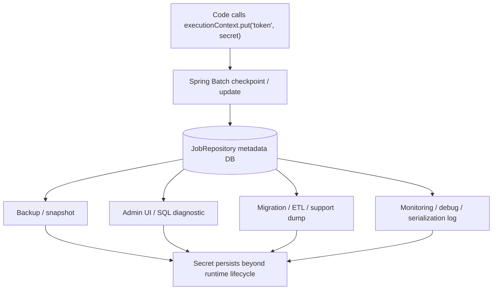
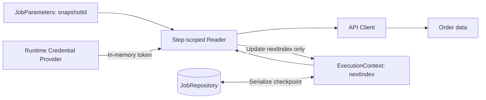

# Never Write Credentials into ExecutionContext in Spring Batch

In a Spring Batch job, `ExecutionContext` is commonly used to store state for **restarting** after a job failure: file read position, offset, last processed key, current page number, or a stage marker flag. Because it looks like a convenient `Map<String, Object>`, developers sometimes put access tokens, database passwords, or API keys into it "to reuse on the next run."

This is a security design flaw. **`ExecutionContext` is not a secret store**. Data is persisted by Spring Batch into `JobRepository` to recover executions, so credentials can outlive a single run, be copied into backups, be read through admin tools, or appear in dumps/diagnostics. Disk encryption or database access permissions do not make it an appropriate place to store tokens.

Lesson principle:

> **Store minimal checkpoints and business identifiers in `ExecutionContext`; retrieve credentials at runtime via a controlled provider/secret manager. Never store raw secrets in `ExecutionContext`, `JobParameters`, or logs.**

This article belongs to **Spring Batch Core Processing → Security** and demonstrates how to identify, avoid, detect, and remediate this risk in Spring Batch 5.x / Spring Boot 3.x. Secret provider examples represent integration interfaces; actual implementations depend on Vault, cloud secret managers, workload identity, or organizational infrastructure.

## 1. What is ExecutionContext actually for?

Spring Batch manages three levels of objects:

- **`JobInstance`:** a logical run in business terms, identified by the job name and identifying `JobParameters`.
- **`JobExecution`:** a single attempt to run a `JobInstance`; a restart can create a new `JobExecution` for the same instance.
- **`StepExecution`:** an execution of a step, with its own counters and state.

`ExecutionContext` is a key/value dataset attached to a **JobExecution** or **StepExecution**. Readers, writers, and the framework use the context to store information that can be recovered upon restart.

Example of a reader reading data in a deterministic order:

```text
Job: importExternalOrders
JobParameters: businessDate=2026-11-15, snapshotId=orders-v7

StepExecutionContext:
  externalOrders.nextIndex = 1200

After crash:
  Previous JobInstance is restarted
  Reader reopens orders-v7 source and resumes from checkpoint 1200
```

The value `1200` is **processing state**, not authentication information. An access token for calling an orders API is a **secret that grants access**, and should not be treated as state to checkpoint.

### Two context scopes

| Scope | Examples of appropriate data | Characteristics |
|---|---|---|
| `StepExecution.getExecutionContext()` | Offset, line number, non-sensitive paging cursor, watermark | Usually serves reader/writer restart within the step |
| `JobExecution.getExecutionContext()` | Published artifact name, confirmed count, data version | Shares results across steps via configured mechanisms |

**Both** are managed through `JobRepository`. Moving a token from step context to job context does not make it any safer. Likewise, using `ExecutionContextPromotionListener` to promote credentials to the job level only widens the secret's blast radius.

## 2. Why can credentials in context be exposed?

Simple flow diagram:



Spring Batch stores execution context in metadata tables, typically including:

- `BATCH_JOB_EXECUTION_CONTEXT`;
- `BATCH_STEP_EXECUTION_CONTEXT`.

Common schemas have columns representing the data such as `SHORT_CONTEXT` and `SERIALIZED_CONTEXT`. Context data is serialized according to the configured `ExecutionContextSerializer` and can remain until metadata is purged under retention policy.

**Do not assume data is protected simply because it is not immediately readable as plain text in a column.** A serializer is not equivalent to encryption; even with encryption at rest, applications or accounts with read privileges can still decrypt or access the context via APIs. Backups, replicas, SQL exports, and support bundles often have different access lifecycles than the original process.

### Minimal threat model

| Risk surface | Scenario | Consequence |
|---|---|---|
| Metadata database | Operations accounts with SELECT privilege on Batch tables | Can read checkpointed secrets |
| Backup/replica | Database is backed up, snapshotted, or replicated across regions | Secrets exist in multiple copies outside runtime |
| Debug log | Logging the entire `ExecutionContext` object | Secrets enter long-term logging systems |
| Error handling | Exception includes Authorization header/token | Secrets appear in traces, alerts, and tickets |
| Support/diagnostics | Exporting execution context for investigation | Secrets shared outside authorized groups |
| Job restart | Old token deserialized after days | Token expired or revoked; job fails again |
| Remote execution | Partition workers receive the context | Secrets transmitted widely to multiple workers/nodes |

This is both a **security** and a **reliability** issue: a short-lived token saved for restart may already be expired right when recovery is needed.

## 3. Data classification: what can and cannot be stored?

| Data | Store in `ExecutionContext`? | Reason |
|---|---|---|
| Lines read, offset, page number | **Yes**, if needed for restart | Recoverable checkpoint |
| Last record ID or watermark | **Conditionally** | Not a secret; still requires data classification and ordering guarantees |
| Snapshot version, non-sensitive artifact name | **Conditionally** | Helps pin the data source across restarts |
| Read/skip/write counters | **Only when truly needed** | Many counters are already managed by `StepExecution` |
| Database password | **No** | Long-lived credential that can grant DB access |
| API key, bearer token, OAuth access/refresh token | **No** | Grants access and has a rotation lifecycle |
| Private key, client secret, certificate password | **No** | Signing/auth secret with severe impact if leaked |
| Session cookie, session ID, sensitive signed URL | **No** | Can grant temporary access |
| Authorization header string or connection URL with password | **No** | May contain credentials even if the key is not named `password` |
| Sensitive personal data, confidential payload | **Avoid** | Context is metadata, not a business data store |
| Non-authenticating secret alias/ID | **Consider carefully** | Only if non-sensitive per policy, allowlisted, and required for restart |

A **secret reference** (such as a secret name in a secret manager) might technically not allow login by itself, yet it still reveals system structure or environment names. Store references only when classified as non-sensitive and genuinely necessary; it is better to load configuration from the deployment environment when per-job reference pinning is unnecessary.

**Do not inspect only key names.** A key like `checkpoint` or `extraState` could accidentally hold an object containing a token. Every value put into the context must be evaluated before serialization.

## 4. Anti-pattern: storing a token to "reuse after restart"

**Insecure** pattern:

```java
// DO NOT DO THIS: the token risks being persisted with Batch metadata.
ExecutionContext context =
        stepExecution.getExecutionContext();

String token = authClient.requestAccessToken();
context.putString("api.accessToken", token);

// Later:
String previousToken = context.getString("api.accessToken");
apiClient.fetchOrders(previousToken);
```

Potential consequences include:

1. When Spring Batch saves a checkpoint, the token is serialized into `JobRepository`.
2. Backups and metadata query tools can retain that copy of the token.
3. The token expires between executions, making restarts unreliable.
4. When the token is revoked, restarting from the old context uses an invalid credential.
5. If the application logs the context for debugging, the token can spread to logs and alerts.

Another unsafe variant:

```java
executionContext.put("clientConfiguration", Map.of(
        "baseUrl", "https://api.example.invalid",
        "username", username,
        "password", password)); // DO NOT DO THIS
```

Do not assume a secret hidden inside a `Map`, DTO, custom serialized object, or JSON string is safe. **Secrets must never enter the context in the first place**, even if you plan to remove the key a few lines later: an unexpected checkpoint, exception, or diagnostic dump can persist it.

### Do not move credentials into JobParameters

`JobParameters` are also persisted in Batch metadata to identify `JobInstance` and support restarts. This example is **unsafe**:

```java
// DO NOT DO THIS: password/token in JobParameters.
JobParameters params = new JobParametersBuilder()
        .addString("businessDate", "2026-11-15")
        .addString("apiToken", token)
        .toJobParameters();
```

This is especially dangerous if the credential is an **identifying parameter**, because every rotation causes Spring Batch to treat it as a new JobInstance. Setting `identifying=false` also **does not solve the leak**, since non-identifying values are still persisted with the execution.

Instead pass:

```java
// GOOD: pass only necessary, non-sensitive business parameters.
JobParameters params = new JobParametersBuilder()
        .addString("businessDate", "2026-11-15")
        .addString("snapshotId", "orders-v7")
        .toJobParameters();
```

Credentials are supplied at runtime from configuration/identity/secret providers, not from the parameter list.

## 5. Secure design pattern: separate checkpoint, separate secret

Designing a reader that calls a token-authenticated API:



Separate three responsibilities:

- **Business input:** business date and non-sensitive snapshot ID to select the right dataset.
- **Restart state:** offset or last read key for recovery.
- **Authentication:** a provider fetches the current credential based on workload identity/secret manager without serializing credentials.

### 5.1. API integration contract

Example application interfaces:

```java
import java.math.BigDecimal;

record ApiOrder(String id, BigDecimal amount) {}

public interface AccessTokenProvider {
    // Get a valid token; implementation may cache and refresh.
    String currentAccessToken();
}

public interface ApiOrderClient {
    // null means end of data; snapshotId and index must be stable.
    ApiOrder fetchByIndex(
            String snapshotId, int index, String accessToken);
}
```

In production code, the API client needs timeouts, bounded retries, clear error codes, and must omit tokens from exception messages. The example uses `fetchByIndex` to focus on checkpointing; a real API might use a **cursor token** or pagination key. If that cursor token carries authentication/data-access privileges like a bearer credential, **do not store it directly in the context**: map it to non-sensitive state or an appropriate snapshot/server-side handle.

### 5.2. Reader storing only the offset

```java
import org.springframework.batch.item.ExecutionContext;
import org.springframework.batch.item.ItemStreamReader;

public final class SecureApiOrderReader
        implements ItemStreamReader<ApiOrder> {

    private static final String NEXT_INDEX_KEY =
            "externalOrders.nextIndex";

    private final String snapshotId;
    private final ApiOrderClient client;
    private final AccessTokenProvider tokenProvider;
    private int nextIndex;

    public SecureApiOrderReader(
            String snapshotId,
            ApiOrderClient client,
            AccessTokenProvider tokenProvider) {
        this.snapshotId = snapshotId;
        this.client = client;
        this.tokenProvider = tokenProvider;
    }

    @Override
    public void open(ExecutionContext context) {
        nextIndex = context.getInt(NEXT_INDEX_KEY, 0);
    }

    @Override
    public ApiOrder read() {
        // Credential is used only during the runtime call.
        String token = tokenProvider.currentAccessToken();
        ApiOrder order = client.fetchByIndex(
                snapshotId, nextIndex, token);

        if (order != null) {
            nextIndex++;
        }
        return order;
    }

    @Override
    public void update(ExecutionContext context) {
        // Only checkpointable state is placed into the context.
        context.putInt(NEXT_INDEX_KEY, nextIndex);
    }

    @Override
    public void close() {
        // No need to retain credentials across executions.
    }
}
```

Explanation:

1. When the step opens, the reader restores `nextIndex` from `ExecutionContext`.
2. On each `read()`, the reader asks the provider for the current token and calls the API.
3. When Spring Batch asks to save state, `update(...)` puts only an **integer** into the context.
4. The token stays in an in-memory local variable and is never assigned to a checkpoint field or `ExecutionContext`.
5. When the job restarts, the new bean/reader instance can receive a fresh token from the provider while still using the saved offset.

This is a **minimal checkpoint logic** example. Correctness on restart also depends on the API returning data in a **stable snapshot/ordering**, and the writer handling idempotency when re-reading part of an uncommitted chunk. If the API can insert, delete, or reorder items during the batch run, plain offsets can miss or duplicate records; a stable snapshot or keyset pagination design is required.

**Security limitation to understand:** The `String token` variable still resides in JVM memory during the API call. This approach avoids **long-term persistence in metadata**, rather than guaranteeing secrets cannot leak via heap dumps, crash dumps, instrumentation, or careless logging. Runtime protection and limiting token lifetime/permissions remain essential.

### 5.3. Creating the reader with step scope

```java
import org.springframework.batch.core.configuration.annotation.StepScope;
import org.springframework.batch.item.ItemStreamReader;
import org.springframework.beans.factory.annotation.Value;
import org.springframework.context.annotation.Bean;

@Bean
@StepScope
ItemStreamReader<ApiOrder> apiOrdersReader(
        @Value("#{jobParameters['snapshotId']}") String snapshotId,
        ApiOrderClient apiClient,
        AccessTokenProvider tokenProvider) {
    return new SecureApiOrderReader(
            snapshotId, apiClient, tokenProvider);
}
```

`@StepScope` allows the reader to receive `snapshotId` after the step starts. `tokenProvider` is a Spring-managed dependency configured to retrieve credentials from a secure source in the deployment environment. **Do not use `@Value("#{jobParameters['apiToken']}")`** because that requires placing the token into persisted JobParameters.

Corresponding step example:

```java
@Bean
Step importOrdersStep(
        JobRepository jobRepository,
        PlatformTransactionManager transactionManager,
        ItemStreamReader<ApiOrder> apiOrdersReader,
        ItemWriter<ApiOrder> orderWriter) {
    return new StepBuilder("importOrdersStep", jobRepository)
            .<ApiOrder, ApiOrder>chunk(100, transactionManager)
            .reader(apiOrdersReader)
            .writer(orderWriter)
            .build();
}
```

The snippet uses the Spring Batch 5.x builder API. The writer and transaction infrastructure are defined per application; the writer should enforce unique business keys so data is not duplicated after retry/restart.

## 6. Fetching credentials safely at runtime

`AccessTokenProvider` is an **abstraction**; not every application needs to call a secret manager on every read. Options include:

| Credential source | When suitable | Notes |
|---|---|---|
| Workload identity / managed identity | Cloud/containers support workload identity | Prefer short-lived tokens and least privilege |
| Secret manager/Vault | Centralized management of API keys, client secrets, rotation | Restrict secret read access per service, audit, and TTL |
| Cloud SDK credential provider | SDK automatically refreshes access credentials | Do not serialize credential objects into context |
| OAuth client credentials flow | Downstream API authenticates with OAuth | Cache valid token in provider, refresh as needed |
| Environment/secret mount | Simple environment, secrets injected at deploy time | Protect process access, dumps, configs, and deployment history |

Avoid hardcoding secrets in source code, Dockerfiles, CI artifacts, or committed config files. With a secret manager, grant access only to the **exact secrets** needed by that job and audit reads.

### 6.1. Provider can cache/refresh without checkpointing

A practical provider may keep a token in memory until close to expiration, then refresh it based on TTL. Note the distinction:

```text
Runtime cache (in-process):
  accessToken + expiresAt     → May be needed, protected

Spring Batch ExecutionContext (in JobRepository):
  nextIndex=1200              → Allowed
  accessToken=...             → Forbidden
  refreshToken=...            → Forbidden
```

If a token is revoked mid-job, the provider/client must follow the API's authentication policy: refresh safely, bound retry attempts, and never log the old token. Avoid multiple threads refreshing concurrently ("thundering herd"); the provider can use single-flight or appropriate synchronization, without storing refresh results in the context.

### 6.2. Rotation and restart

An advantage of separating secrets from checkpoints is:

```text
Execution #501:
  checkpoint = nextIndex 1200
  token A is issued at runtime
  job FAILED

Security team rotates credential:
  token A is revoked, token B is active

Execution #502 (restarts same JobInstance):
  checkpoint = nextIndex 1200
  provider fetches token B
  resumes reading snapshot from the right position
```

If the credential had been tied to `ExecutionContext`, the restart would risk reusing token A, which is expired or no longer permitted. Rotation also makes long-term token storage in metadata hard to govern.

**Special case:** A partner requires processing data with the exact credential/identity of a specific tenant or period. Store a **non-sensitive tenant ID/credential alias** if policy allows, and have the provider resolve the appropriate secret at runtime. Do not store the actual secret or access token. If the tenant ID itself is classified as sensitive, use a tokenized/access-controlled business reference.

## 7. Blocking indirect secret leaks

Keeping tokens out of context is necessary but not sufficient. A job can still leak secrets through other paths.

### 7.1. Logging `JobParameters` and `ExecutionContext`

Unsafe logging:

```java
// DO NOT DO THIS: may dump sensitive data.
log.info("parameters={}", execution.getJobParameters());
log.debug("context={}", stepExecution.getExecutionContext());
```

Replace with an **allowlist of permitted fields**:

```java
log.info(
        "batch job={} executionId={} status={} businessDate={}",
        execution.getJobInstance().getJobName(),
        execution.getId(),
        execution.getStatus(),
        execution.getJobParameters().getString("businessDate"));
```

`businessDate` in the example is classified as non-sensitive; in multi-tenant systems or special datasets, apply an appropriate logging policy as well. Do not automatically serialize full `JobExecution`/`StepExecution` objects in REST responses or debug consoles.

### 7.2. Exceptions from HTTP clients

An HTTP interceptor or logger with wire-level debug enabled may log request headers, including:

```text
Authorization: Bearer <secret>
Cookie: session=<secret>
X-API-Key: <secret>
```

When investigating errors, log only details such as URLs stripped of sensitive query params, HTTP status, retry count, correlation ID, endpoint name, and latency. Configure **redaction at the HTTP client, tracing, gateway, and log exporter layers**; do not rely on log readers manually ignoring tokens.

Do not throw exceptions like:

```java
// DO NOT DO THIS: exceptions may be stored or forwarded to alerts.
throw new IllegalStateException(
        "Remote API rejected token=" + accessToken);
```

Keep meaningful error codes/exception types without including secrets:

```java
throw new IllegalStateException(
        "Remote API authentication failed; status=401");
```

### 7.3. Job/step listeners and monitoring

Listeners such as `JobExecutionListener`, `StepExecutionListener`, and `SkipListener` may record exceptions or failing items. If an item contains a secret/token, listeners can expose it too. Do not embed secrets inside item payloads just to reuse them in the writer; inject the provider separately into the client/writer.

Do not put tokens, sensitive usernames, raw request headers, or high-cardinality item IDs into **Micrometer tags**. Metrics are typically retained longer, replicated, and accessed more broadly than business logs.

### 7.4. Promotion and remote partitioning

If using `ExecutionContextPromotionListener` to promote a key from step context to job context, promote only allowlisted keys. With remote partitioning, the execution context may be sent over messaging/transport to workers; putting tokens into the context expands secret exposure to multiple nodes or persisted message payloads.

**Rule:** the context carries **work to do and checkpoints**, never credentials. Each worker acquires its identity/credentials from the runtime environment authorized for that worker.

## 8. Restricting access to JobRepository metadata

Preventing credential writes is the most important control, yet metadata still needs protection:

1. **Separation of duties:** the Batch runtime account gets required metadata privileges; read-only/BI/admin accounts do not inherently need to see full contexts.
2. **No public admin endpoints:** restrict APIs exposing JobExecution/ExecutionContext, apply RBAC, and audit access.
3. **Encryption in transit and at rest:** TLS to the database, encryption at rest/backups per policy; do not treat this as an excuse to store secrets.
4. **Retention management:** purge/archive old metadata on schedule while respecting foreign-key integrity and restartability; avoid retaining contexts indefinitely for jobs that no longer need recovery.
5. **Backups/exports:** classify the metadata database as potentially sensitive, restricting dump downloads and retention duration.
6. **Log systems and crash dumps:** protect heap dumps, support archives, CI logs, and alert channels accordingly.
7. **Access auditing:** monitor anomalous queries/exports and secret reads from the secret manager.

Do not arbitrarily delete production metadata to "erase traces" when a secret is found. `BATCH_*` tables are linked by foreign keys and hold critical restart state; cleanup must follow a runbook and data/security policies.

## 9. Testing: confirming context contains only checkpoints

A test should verify that a fake credential is **used by the client**, yet **never** written to the context. Use fake strings meant only for testing, never real credentials.

### 9.1. Unit test for the reader

```java
import static org.junit.jupiter.api.Assertions.*;

import java.math.BigDecimal;
import java.util.concurrent.atomic.AtomicInteger;

import org.junit.jupiter.api.Test;
import org.springframework.batch.item.ExecutionContext;

class SecureApiOrderReaderTest {

    @Test
    void checkpointsIndexButNeverPersistsAccessToken() {
        String fakeToken = "TEST_TOKEN_DO_NOT_PERSIST_123";
        AtomicInteger providerCalls = new AtomicInteger();

        AccessTokenProvider provider = () -> {
            providerCalls.incrementAndGet();
            return fakeToken;
        };

        ApiOrderClient client = (snapshot, index, token) -> {
            assertEquals("orders-v7", snapshot);
            assertEquals(fakeToken, token);
            return index == 0
                    ? new ApiOrder("order-1", BigDecimal.TEN)
                    : null;
        };

        ExecutionContext context = new ExecutionContext();
        SecureApiOrderReader reader =
                new SecureApiOrderReader("orders-v7", client, provider);

        reader.open(context);
        assertEquals("order-1", reader.read().id());
        assertNull(reader.read());
        reader.update(context);
        reader.close();

        assertEquals(1, context.getInt("externalOrders.nextIndex"));
        assertFalse(context.containsKey("api.accessToken"));
        assertFalse(context.containsKey("refreshToken"));
        assertEquals(2, providerCalls.get());

        // Additional allowlist check: only the checkpoint key is stored.
        assertEquals(
                java.util.Set.of("externalOrders.nextIndex"),
                context.keySet());
    }
}
```

This test verifies `SecureApiOrderReader`'s contract against an in-memory `ExecutionContext`. It **does not yet** prove production metadata is completely free of secrets inserted by other components; integration tests and code review policies are needed.

### 9.2. Integration test with a real JobRepository

Once the job has run against a test database, use `JobExplorer` to read back the context from metadata:

```java
@Autowired JobExplorer jobExplorer;

@Test
void persistedContextContainsOnlyAllowedKeys() throws Exception {
    // Assumes the test launched the job and obtained executionId.
    JobExecution execution = jobExplorer.getJobExecution(executionId);
    assertNotNull(execution);

    StepExecution step = execution.getStepExecutions()
            .iterator().next();

    ExecutionContext persisted = step.getExecutionContext();
    assertTrue(persisted.containsKey("externalOrders.nextIndex"));
    assertFalse(persisted.containsKey("api.accessToken"));
    assertFalse(persisted.containsKey("refreshToken"));
}
```

This is an **illustrative code snippet** placed inside an integration test that has already set up the context, `JobLauncher`/`JobLauncherTestUtils`, the job, and `executionId`. The rest of the test needs to capture the real execution ID from `JobExecution` after the job completes. If `JobExplorer` returns a `StepExecution` whose context has not been loaded in a specific configuration, use the infrastructure's corresponding context-loading method or query metadata directly.

Do not only look for key names like `password`/`token`. An arbitrary object can hide secrets under another key. Define an **allowlist of keys** for the job's readers/writers and inspect all serialized values using the actual serializer in the test environment.

### 9.3. Inspecting serialized metadata content

If the application uses a metadata schema with `SHORT_CONTEXT` and `SERIALIZED_CONTEXT` columns, you can run a **read-only** check on the test database:

```sql
SELECT SHORT_CONTEXT, SERIALIZED_CONTEXT
FROM BATCH_STEP_EXECUTION_CONTEXT
WHERE STEP_EXECUTION_ID = :stepExecutionId;
```

With a unique fake token like `TEST_TOKEN_DO_NOT_PERSIST_123`, read/deserialize the result using the same configured `ExecutionContextSerializer` and verify the token does not appear. Substring searching only `SHORT_CONTEXT` **is insufficient**, because the full content may reside in `SERIALIZED_CONTEXT` and the serializer may compress/encode it into a non-plaintext format.

Tests should also check `BATCH_JOB_EXECUTION_CONTEXT` and JobParameters if any code path can write data there. Never run tests with production secrets "to see if they leak."

### 9.4. Testing restart after token rotation

A combined security and reliability scenario:

1. The job processes several chunks successfully and saves a checkpoint, then encounters an injected error.
2. On the first run, the provider returns fake token `TOKEN_A`; the test API server accepts it.
3. Fake token `TOKEN_A` is "revoked"; the provider switches to `TOKEN_B`.
4. Restart the **same JobInstance** using the original identifying parameters.
5. The reader restores the offset and requests a fresh token; the server accepts only `TOKEN_B`.
6. Verify the job is `COMPLETED`, output has no missing/duplicate items, and metadata contains neither `TOKEN_A` nor `TOKEN_B`.

This scenario proves checkpoints are independent of credentials. Restart correctness still depends on a stable data source and an idempotent writer, so verify both.

## 10. Controls via code review and CI

To prevent recurrence, incorporate rules into the development workflow:

| Rule | Enforcement |
|---|---|
| Key allowlist for `ExecutionContext` | Allow only classified offsets, indices, versions, and checkpoints |
| No secrets in `JobParameters` | Audit builders and all entry points such as CLI/REST/scheduler |
| Forbid dumping metadata objects in logs | Review `log.info/debug("{}", context)` and serializers |
| Never log Authorization/cookie headers | Configure redaction in HTTP clients/gateways/tracing |
| No arbitrary context promotion | Audit `ExecutionContextPromotionListener` and remote partition contexts |
| Secrets from centralized providers | Use identity/secret manager with least privilege |
| Unit/integration tests | Fake sentinels, allowlists, and real metadata inspection |
| Secret scanning | Scan source, configs, test logs, and artifacts before release |
| Rotation drills | Ensure restarts fetch fresh credentials without relying on old state |

A static rule can flag suspicious patterns:

```text
ExecutionContext.putString("password", ...)
ExecutionContext.put("accessToken", ...)
ExecutionContext.put("credentials", ...)
JobParametersBuilder.addString("apiKey", ...)
log.debug("executionContext={}", ...)
```

Pattern matching on names is a starting point and **does not replace data-flow code review**: a field named `state`/`metadata` may hold a secret, whereas a field named `tokenizedId` may be a non-sensitive identifier. The goal is tracing data from credential sources to all storage/log sinks.

## 11. If credentials were accidentally written into ExecutionContext

This is a potential security incident, not merely a coding-style bug. Remediation should follow your organization's incident policy:

1. **Stop further writes:** patch code/deployments so credentials are not placed in JobParameters, ExecutionContext, logs, or remote messages.
2. **Revoke and rotate:** identify the type of exposed credential; revoke tokens/rotate passwords/keys in infrastructure and assess impact on other jobs.
3. **Determine scope:** locate JobExecutions/StepExecutions, environments, backups, replicas, logs, dumps, and exports that may hold the secret.
4. **Audit access:** review audit logs for the database, secret manager, and support systems; identify relevant access privileges.
5. **Controlled cleanup:** follow security/retention procedures to handle metadata and copies; do not run blanket DELETE/UPDATE statements that corrupt restart history or violate retention requirements.
6. **Recover jobs safely:** if old executions need restarting, check checkpoints/serializers and ensure fresh credentials come from the provider; do not deserialize and reuse revoked tokens.
7. **Prevent recurrence:** add allowlists, tests, scanning, log redaction, and metadata access controls.

You cannot conclude "the secret is completely gone" just because a context row was UPDATED or a token disappeared from the UI. Backups, logs, and support bundles may still retain data; coordinate with the respective system owners.

### Should secrets be encrypted and then stored in ExecutionContext?

Even with an encrypting serializer, **the default recommendation remains not storing credentials in the context**. Reasons:

- Separate encryption keys, decryption permissions, and rotation must be managed.
- Ciphertext still persists long-term in metadata and backups.
- Key loss/rotation can render checkpoints unreadable.
- Expired secrets are still unsuitable for reuse on restart.
- Bugs logging data before encryption or after decryption can still expose them.

If an architecture strictly requires checkpointing non-recreatable sensitive data, that is a specialized design problem requiring formal approval of threat model, encryption/key management, retention, access control, and restart behavior — **not a justification for storing routine authentication tokens**.

## 12. Production readiness checklist

| Question | Passing signal |
|---|---|
| Does context contain only minimal restart state? | Keys are listed in an allowlist |
| Are there tokens, passwords, keys, cookies, or auth headers in context? | None, including nested objects |
| Do JobParameters contain secrets? | None, neither identifying nor non-identifying |
| Where are credentials fetched from? | Controlled workload identity/secret manager/provider |
| Can credentials refresh/rotate automatically? | Policies exist and restarts are tested after rotation |
| Do metadata DB/backups have appropriate access controls? | RBAC, TLS, retention, audit |
| Do logs/traces apply redaction? | No Authorization headers or exceptions containing tokens |
| Is promotion/remote partitioning used? | Context contains only shareable data |
| Do checkpoints stay valid when secrets change? | Restart uses old state + new credential |
| Do tests scan serialized values? | Fake sentinels used and test metadata verified |
| Is there a leak response runbook? | Revoke, rotate, scope investigation, backup handling, and recovery |

## 13. Common misconceptions

| Misconception | Reality |
|---|---|
| "Context is just an in-memory Map" | It is serialized/persisted via `JobRepository` when the framework checkpoints |
| "Putting tokens in job context is safer than step context" | Both are persisted metadata |
| "Putting a token in a non-identifying JobParameter is fine" | Non-identifying parameters are still persisted; only JobInstance identification differs |
| "Token only lives 5 minutes, so leaking it is harmless" | It can still be abused while valid; refresh tokens or system info might also leak |
| "Serializer compression/encoding is encryption" | Encoding/serialization does not guarantee security |
| "The DB has disk encryption so storing secrets is fine" | Authorized users/accounts can still read decrypted data |
| "Restart needs to reuse the old credential" | Restart needs the business checkpoint; credentials should be issued fresh at runtime |
| "Only keys named password need scanning" | Secrets can live in DTOs, Maps, headers, URLs, or nested state |
| "Deleting the secret from context ends the incident" | Copies, backups, logs, dumps, and access controls still need handling |
| "@StepScope automatically makes secrets safe" | Scope does not prevent developers from putting tokens into context/logs; data-flow discipline is required |

## 14. Summary

**`ExecutionContext` is a checkpoint/restart mechanism, not a credential vault.** Every value placed inside it must be treated as data that can persist long-term in JobRepository and infrastructure copies. Adding a token makes code easy to write in the short term, but increases attack surface, breaks rotation, and can cause restarts to fail when credentials expire.

A sustainable design keeps **offsets, last keys, and non-sensitive snapshots/versions** in the context, while keeping **API keys, passwords, and access/refresh tokens** in a least-privilege runtime provider with proper refresh and no logging. Combining allowlists, metadata tests with fake tokens, JobRepository access restrictions, and leak-response procedures ensures jobs remain **restartable** without turning credentials into part of Batch history.
