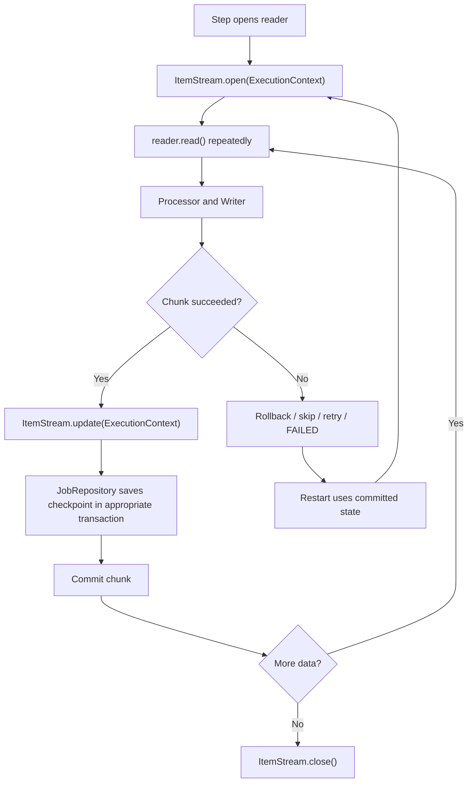

# Not Saving Reader State in Spring Batch

A subtle bug when developing with Spring Batch is that **the job runs fine the first time, but after a failure it reads from the beginning, reads duplicates, or skips data**. In many cases, the root cause is not in `ItemWriter`, but in **the reader not saving or restoring its read state**. The application may have configured chunks, transactions, and `JobRepository` properly, yet a custom reader only implements `ItemReader`, an `ItemStream` is hidden behind a delegate, or a `saveState(false)` setting accidentally drops the checkpoint.

This lesson belongs to **Spring Batch Core Processing → Common Pitfalls**, focusing on **"Not saving reader state"**: symptoms, mechanisms, root causes, fixes, and how to test restart with real data. Java examples use the Spring Batch 5.x and Spring Boot 3.x model. The `ItemStream` and `ExecutionContext` principles remain useful in other versions; verify builder APIs and serializers for the version in use.

> **Core takeaway:** Safe restart requires **the reader saving checkpoints properly**, **the right JobInstance being restarted**, **a data source with stable ordering/versioning**, and **the writer tolerating replay of an uncommitted chunk**. Turning on `saveState(true)` only solves part of the problem.

## 1. Understanding the Failure Scenario

Suppose a job reads 10,000 transactions from a file and writes them to a database with `chunkSize=100`:

```text
First run:
  Chunk 1–30  → 3,000 items committed
  Chunk 31    → writer error, transaction rolled back
  JobExecution #101 → FAILED

Restart same JobInstance:
  Expected: reader resumes after checkpoint of 3,000 items
  Actual: reader starts over from item 1
```

Consequences vary depending on the writer:

- If the writer has a unique constraint, the job may fail again (`FAILED`) due to duplicate keys on already committed items.
- If the writer inserts records without a deduplication key, the same transaction may be recorded twice.
- If the writer sends emails or calls payment APIs, side effects may be re-emitted.
- If a developer "skips 3,000 records" using manual logic not tied to the checkpoint, a change in the source can cause missing data.
- If the reader resumes from an uncommitted position instead of the last checkpoint, items from the failed chunk may be **lost**.

Key point: A `FAILED` job **does not roll back all previously committed chunks**. Therefore, the reader's state must stay consistent with the writer's committed state.

## 2. What Is Reader State?

**Reader state** is the minimal data a reader needs in order to know where to resume reading after an execution is interrupted. It is not the entire dataset, not credentials, and usually not the entire reader object.

| Reader type | State that may be needed | Condition for proper recovery |
|---|---|---|
| File reader | Line/record number or logical position | File content/version has not changed |
| JDBC cursor reader | Row position already read | Stable query and result ordering |
| JDBC paging reader | Page/index and sort-key state | Unique sort key, consistent source |
| JPA paging reader | Page/item position | Consistent entity/query snapshot and ordering |
| API reader | Page token or record key/checkpoint | API has valid snapshot/cursor and stable pagination |
| Queue reader | Offset/sequence/acknowledgment | Matching broker semantics and commit mechanism |
| Custom list reader | Index of the next element | List does not change between runs |

Not every value resembling a "cursor token" can be stored freely: if that token grants access like a bearer credential, separate authentication from `ExecutionContext` and design a non-sensitive checkpoint.

### At Which Level Is State Saved?

Spring Batch has two kinds of `ExecutionContext`:

- **`StepExecution.getExecutionContext()`:** where `ItemStream` readers/writers usually store step checkpoints.
- **`JobExecution.getExecutionContext()`:** where job-level state/values are stored, potentially shared across steps via an appropriate mechanism.

Normally, readers store positions in the **step execution context**. Spring Batch manages persisting this data in `JobRepository`, typically via the `BATCH_STEP_EXECUTION_CONTEXT` table. Putting state into a plain `Map` field on a bean without using the `ItemStream` lifecycle **does not count** as checkpointing.

## 3. Spring Batch's Checkpoint Mechanism

A chunk-oriented step reads items and commits at chunk boundaries:



The diagram depicts the **basic processing path**; callback details, retry/skip, and transaction ordering can be more complex. The essentials are:

1. **`open(context)`**: the reader restores its position from the saved context, or starts from the default position on a fresh run.
2. **`read()`**: fetches the next item and can update the position **in the reader's memory**.
3. **`update(context)`**: places the reader's current checkpoint into the context when the framework prepares to persist state.
4. **Persist to JobRepository**: metadata is persisted according to the step/transaction lifecycle.
5. **`close()`**: releases files, cursors, connections, or other resources.

Do not assume Spring Batch writes to the database **after every `read()`**. In a chunk-oriented step, checkpoints normally align with **update/commit boundaries**, so an uncommitted chunk can be re-read on restart. That is the intended behavior to avoid losing items.

### 3.1. Distinguishing In-Memory Position from Checkpointed Position

For example:

```text
chunkSize = 3

After chunk 1 commits:
  inMemoryIndex = 3
  persistedIndex = 3

During chunk 2:
  read items 4, 5, 6
  inMemoryIndex = 6
  writer fails → rollback

Execution FAILED:
  persistedIndex remains 3 (with proper checkpointing)

Restart:
  reader re-reads items 4, 5, 6
```

If code manually persists index 6 to a separate database **outside the chunk transaction**, a writer error can leave the state "ahead" of committed data. On restart, the reader skips items 4–6, causing **data loss**. Conversely, if nothing is saved, the reader may start over from item 1.

## 4. Common Implementation Mistakes

| Mistake | Symptom | Consequence |
|---|---|---|
| Only implementing `ItemReader` | Reader has no `open/update/close` | Framework has no checkpoint to persist |
| Forgetting to call `ExecutionContext.put...` in `update` | Context is empty after chunk | Restarts from default position |
| `open` does not read the old key | DB has state, yet reader still starts at 0 | State is saved but never used |
| Setting `saveState(false)` | Built-in reader does not persist state | Restart cannot restore position |
| Not setting a stable `name` on the reader | State key error or inconsistency | Hard/impossible to restore the right context |
| Delegate `ItemStream` reader is hidden | `open/update/close` not invoked by framework | Inner reader does not save state |
| Wrong step scope usage | State shared or reused outside lifecycle | Wrong reader position on new execution |
| Adding identifying `run.id` on every retry | Creates a new JobInstance | No checkpoint from the old instance |
| Changing source or read ordering | Checkpoint exists but is no longer valid | Duplicates or skipped items |
| Saving secrets/tokens alongside state | Batch metadata contains credentials | Security risk and expired tokens |
| Sharing stateful reader across threads | Race conditions or inconsistent checkpoints | Duplicate/missing reads; hard to restart |
| Non-idempotent writer | Replayed chunk creates duplicate side effects | Target data corrupted even with valid reader state |

In practice, a job can suffer from **multiple mistakes at once**. For example, the reader implements `ItemStreamReader` properly, but the step uses a wrapper that does not forward `update(...)`; at the same time, the scheduler generates a new identifying parameter so restart becomes a different instance. Fixing only one bug may not be enough.

## 5. Anti-Pattern 1: Reader Only Keeps an Index in RAM

The following code works fine on the first run, but provides no checkpoint to Spring Batch:

```java
import java.util.List;
import org.springframework.batch.item.ItemReader;

public final class UnsafeListReader implements ItemReader<Integer> {

    private final List<Integer> items;
    private int nextIndex;

    public UnsafeListReader(List<Integer> items) {
        this.items = items;
    }

    @Override
    public Integer read() {
        if (nextIndex >= items.size()) {
            return null;
        }
        return items.get(nextIndex++);
    }
}
```

`nextIndex` lives only inside the Java object. If the JVM dies, the object disappears. If restart creates a new bean, `nextIndex=0`; if an old singleton is accidentally reused, the position might still hold the previous execution's value. **Neither is a durable restart mechanism**.

Similarly, using `AtomicInteger`, `static int`, or `ThreadLocal` to remember offsets **does not replace** checkpoints in `JobRepository`. Those mechanisms only manage runtime state and introduce risks when multiple executions/threads participate.

## 6. The Right Way: Custom `ItemStreamReader`

A custom reader must support the `open/update/close` lifecycle. The following example reads an **immutable snapshot** of IDs, tracks the index of the next item, and persists it in `ExecutionContext`:

```java
import java.util.List;
import org.springframework.batch.item.ExecutionContext;
import org.springframework.batch.item.ItemStreamReader;

public final class CheckpointingListReader<T>
        implements ItemStreamReader<T> {

    private final List<T> snapshot;
    private final String stateKey;
    private int nextIndex;

    public CheckpointingListReader(String readerName, List<T> snapshot) {
        this.snapshot = List.copyOf(snapshot);
        this.stateKey = readerName + ".nextIndex";
    }

    @Override
    public void open(ExecutionContext context) {
        nextIndex = context.getInt(stateKey, 0);
        if (nextIndex < 0 || nextIndex > snapshot.size()) {
            throw new IllegalStateException(
                    "Invalid reader checkpoint: " + nextIndex);
        }
    }

    @Override
    public T read() {
        if (nextIndex >= snapshot.size()) {
            return null;
        }
        return snapshot.get(nextIndex++);
    }

    @Override
    public void update(ExecutionContext context) {
        context.putInt(stateKey, nextIndex);
    }

    @Override
    public void close() {
        // No file/DB resources to release.
    }
}
```

### 6.1. Meaning of Each Part

- **Stable `stateKey`:** the same reader across step/restart uses the same key name. If the key name changes across application versions, new code may fail to find old checkpoints.
- **`open(...)` reads the checkpoint:** if the context has no key yet, start at index 0; if present, continue from the previously saved index.
- **`read()` only updates in-memory state:** do not manually call the repository or write checkpoints to the DB on every item.
- **`update(...)` writes state:** Spring Batch invokes it in the lifecycle to checkpoint at the right boundary.
- **`close()` does not retain a global index:** the next run restores from context, not from an old bean.

**Prerequisite:** `snapshot` must contain **the exact same list in the exact same order** on both the initial run and the restart. If on the first run the list was `[A,B,C,D]` and on restart it changes to `[X,A,B,C,D]`, checkpoint index 2 will no longer represent the same data boundary.

For production deployment, use a fixed snapshot ID/business key and query data by a stable key. For very large sources, do not copy the entire dataset into the heap like this list example; use a JDBC/file/API reader with appropriate checkpointing instead.

### 6.2. Context Keys Should Avoid Collisions

A step with multiple `ItemStream`s shares the same `StepExecutionContext`. If two streams both use a generic key like `position`, their states can overwrite each other:

```java
// Easy to collide with another stream:
context.putInt("position", index);

// Better scoped:
context.putInt("ordersReader.nextIndex", index);
```

Name keys using a stable reader name and state meaning. Do not vary names using a random UUID or per-execution timestamp, because restart needs to look up that exact key.

## 7. Built-in Readers: Using `saveState(true)` and `name(...)`

Spring Batch provides readers that support `ItemStream` and built-in checkpointing, such as `FlatFileItemReader`, `JdbcCursorItemReader`, and `JdbcPagingItemReader`. Many reader builders support `name(...)` and `saveState(true/false)`.

### 7.1. FlatFileItemReader

```java
import org.springframework.batch.item.file.FlatFileItemReader;
import org.springframework.batch.item.file.builder.FlatFileItemReaderBuilder;
import org.springframework.core.io.Resource;

@Bean
FlatFileItemReader<PaymentRecord> paymentsReader(Resource sourceCsv) {
    return new FlatFileItemReaderBuilder<PaymentRecord>()
            .name("paymentsReader")
            .resource(sourceCsv)
            .encoding("UTF-8")
            .linesToSkip(1)
            .delimited()
            .names("id", "amount")
            .fieldSetMapper(fields -> new PaymentRecord(
                    fields.readLong("id"),
                    fields.readBigDecimal("amount")))
            .saveState(true)
            .build();
}
```

`PaymentRecord` is a domain type with `id` and `amount` fields; the snippet assumes the corresponding record/class is declared in the application. Give it a stable `name("paymentsReader")` so the reader uses consistent state keys. On restart, it must read **the exact same file version**. If the file is overwritten or records are reordered, the saved line count may no longer match.

Some projects set `saveState(false)` when testing single-pass file reads. If that configuration leaks into a production job that requires restart, the reader can start over from the beginning without saving position. Verify intent before disabling state saving.

### 7.2. JdbcCursorItemReader

```java
import javax.sql.DataSource;
import org.springframework.batch.item.database.JdbcCursorItemReader;
import org.springframework.batch.item.database.builder.JdbcCursorItemReaderBuilder;

@Bean
JdbcCursorItemReader<PaymentRecord> jdbcCursorPayments(
        DataSource dataSource) {
    return new JdbcCursorItemReaderBuilder<PaymentRecord>()
            .name("jdbcCursorPayments")
            .dataSource(dataSource)
            .sql("""
                    SELECT id, amount
                    FROM payments_snapshot
                    WHERE batch_id = 42
                    ORDER BY id
                    """)
            .rowMapper((rs, rowNum) -> new PaymentRecord(
                    rs.getLong("id"),
                    rs.getBigDecimal("amount")))
            .fetchSize(500)
            .saveState(true)
            .build();
}
```

A cursor reader can restore its saved position, but **does not keep the physical database cursor open across a JVM restart**. It re-opens the query and repositions based on state. If source data or query ordering changes, a position-based checkpoint does not guarantee recovering the exact same record.

Do not mistake `fetchSize(500)` for reading and committing 500 items: fetch size is a JDBC driver hint, while the step's chunk size defines processing/transaction boundaries.

### 7.3. JdbcPagingItemReader

```java
import java.util.Map;
import javax.sql.DataSource;
import org.springframework.batch.item.database.JdbcPagingItemReader;
import org.springframework.batch.item.database.Order;
import org.springframework.batch.item.database.builder.JdbcPagingItemReaderBuilder;

@Bean
JdbcPagingItemReader<PaymentRecord> jdbcPagingPayments(
        DataSource dataSource) {
    return new JdbcPagingItemReaderBuilder<PaymentRecord>()
            .name("jdbcPagingPayments")
            .dataSource(dataSource)
            .selectClause("SELECT id, amount")
            .fromClause("FROM payments_snapshot")
            .whereClause("WHERE batch_id = 42")
            .sortKeys(Map.of("id", Order.ASCENDING))
            .rowMapper((rs, rowNum) -> new PaymentRecord(
                    rs.getLong("id"),
                    rs.getBigDecimal("amount")))
            .pageSize(200)
            .saveState(true)
            .build();
}
```

Paging requires a **unique and stable sort key**. If you only `ORDER BY created_at` while multiple rows share the same timestamp, page ordering can be non-deterministic. Add a unique secondary key such as `id` when the business requires multi-column sorting.

If the query condition is `WHERE status = 'NEW'` while the writer immediately updates `status='DONE'` on read rows, the dataset shrinks between pages. Even if state is saved successfully, restarts can still skip items. Use a snapshot/batch ID or key-based partitioning strategy.

### 7.4. State in JPA and Repository Readers

`JpaPagingItemReader`, `RepositoryItemReader`, and other readers can also support saving state. When configuring them, pay attention to:

- Reader name and enabling state saving if restart is needed.
- Logical page size and sort order.
- Never sharing a single stateful reader instance across multiple workers without a safe mechanism.
- With JPA, the persistence context and entity mapping can affect re-querying; source data must stay consistent.
- With repository paging, you need deterministic paging and sorting, without confusing count queries or indices with checkpoints.

Not every class named `ItemReader` implements `ItemStream`. Check the actual type of the reader in the version you are using; a reader implementing only `ItemReader` will not automatically have a checkpoint lifecycle.

## 8. Hidden Delegate Bug: Reader Saves State, But Step Never Calls It

A very common situation happens when wrapping a stateful reader inside a wrapper:

```java
// Wrapper only implements ItemReader → loses ItemStream lifecycle
public class MappingReader implements ItemReader<Order> {

    private final ItemStreamReader<Order> delegate;

    public MappingReader(ItemStreamReader<Order> delegate) {
        this.delegate = delegate;
    }

    @Override
    public Order read() throws Exception {
        return delegate.read();
    }
}
```

The step only sees `MappingReader` as an `ItemReader`. If the delegate is not registered as an `ItemStream`, the framework may never invoke `open/update/close` on it. Result: the file/cursor fails to open, checkpoints are never updated, or state is lost.

### 8.1. Option 1: Wrapper Implements ItemStreamReader Itself

```java
import org.springframework.batch.item.ExecutionContext;
import org.springframework.batch.item.ItemStreamReader;

public final class DelegatingOrderReader
        implements ItemStreamReader<Order> {

    private final ItemStreamReader<Order> delegate;

    public DelegatingOrderReader(ItemStreamReader<Order> delegate) {
        this.delegate = delegate;
    }

    @Override
    public Order read() throws Exception {
        return delegate.read();
    }

    @Override
    public void open(ExecutionContext context) {
        delegate.open(context);
    }

    @Override
    public void update(ExecutionContext context) {
        delegate.update(context);
    }

    @Override
    public void close() {
        delegate.close();
    }
}
```

When the wrapper is the step's direct reader, Spring Batch recognizes it as an `ItemStream` and calls its lifecycle methods. The wrapper forwards everything to the delegate.

If the wrapper has its **own state** in addition to the delegate, it must also restore/save that state under non-colliding keys. If the delegate reads from multiple sources, manage identity and context per source.

### 8.2. Option 2: Register the Stream Delegate with the Step

If you cannot change the wrapper to implement `ItemStream`, you can register the delegate separately via `stream(...)`:

```java
@Bean
Step importStep(
        JobRepository jobRepository,
        PlatformTransactionManager transactionManager,
        ItemReader<Order> wrapperReader,
        ItemStreamReader<Order> delegateReader,
        ItemWriter<Order> writer) {

    return new StepBuilder("importStep", jobRepository)
            .<Order, Order>chunk(100, transactionManager)
            .reader(wrapperReader)
            .writer(writer)
            .stream(delegateReader)
            .build();
}
```

Here, make sure the `delegateReader` passed to `stream(...)` **is the exact same instance that `wrapperReader` uses**. If Spring creates two independent reader beans, the step may checkpoint one object while reading from another. Avoid registering the same stream twice through multiple paths and causing duplicate callbacks.

With `CompositeItemReader` or a custom reader having multiple delegates, explicitly verify **who owns the `open/update/close` lifecycle** and which child readers are registered with the step. Do not assume all nested components are auto-discovered by the framework.

## 9. Bean Scope and Reader Name Affect Checkpoints

Readers whose state varies per execution are normally well suited for `@StepScope`, especially when reading job parameters:

```java
import org.springframework.batch.core.configuration.annotation.StepScope;
import org.springframework.beans.factory.annotation.Value;
import org.springframework.core.io.FileSystemResource;

@Bean
@StepScope
FlatFileItemReader<PaymentRecord> scopedPaymentsReader(
        @Value("#{jobParameters['inputFile']}") String path) {

    return new FlatFileItemReaderBuilder<PaymentRecord>()
            .name("scopedPaymentsReader")
            .resource(new FileSystemResource(path))
            .delimited()
            .names("id", "amount")
            .fieldSetMapper(fields -> new PaymentRecord(
                    fields.readLong("id"),
                    fields.readBigDecimal("amount")))
            .saveState(true)
            .build();
}
```

`@StepScope` binds reader creation to the step execution lifecycle, preventing accidental state sharing across runs and enabling late binding of job parameters. However, scope **does not replace `ItemStream`**: a scoped reader that does not implement stream still has no automatic checkpointing.

### 9.1. Which Names Should Stay Stable?

Components to watch:

| Component | Why it matters |
|---|---|
| Job name | Participates in JobInstance identity |
| Identifying JobParameters | Determines which instance restarts |
| Step name | Tied to StepExecution history and step restart |
| Reader/item-stream name | Acts as the checkpoint key prefix for many built-in readers |
| Custom context keys | Determines whether `open` finds persisted state |
| Resource/snapshot/version | Ensures identical input data across restarts |

If you rename a reader from `paymentsReader` to `paymentReaderV2` while a job instance is `FAILED`, new code may look up a non-existent context key and start at position 0. That is a **checkpoint compatibility issue across deployments**, requiring a state migration plan or controlled reprocessing.

Do not use timestamps/random strings as stream names on each launch. Context key names do not need to be globally unique across the entire system, but must remain stably meaningful **within the step execution** and not collide with other streams.

## 10. Restart the Right JobInstance, Not a New Instance

Saving reader state properly still will not help if the scheduler generates **different identifying parameters** on every retry.

```java
// Example of stable parameters used to restart the same instance.
JobParameters parameters = new JobParametersBuilder()
        .addString("businessDate", "2026-11-15")
        .addString("snapshotId", "payments-v3")
        .toJobParameters();
```

If the first attempt fails with these parameters, the next attempt must reuse the same **job name and identifying parameters** so Spring Batch treats it as a restart of the old instance. Calling `JobLauncher.run(job, parameters)` in the appropriate case can create a new execution for that instance, subject to framework restart checks.

Conversely:

```java
// If run.id is an identifying parameter and changes every time,
// this is a NEW JobInstance rather than restarting old state.
JobParameters other = new JobParametersBuilder()
        .addString("businessDate", "2026-11-15")
        .addString("snapshotId", "payments-v3")
        .addLong("run.id", System.currentTimeMillis())
        .toJobParameters();
```

Creating a new instance can be the right business decision when you want to rebuild everything, but you must handle old output data and idempotency; do not call that "restarting from checkpoint".

### When a Job Is Not Restartable

Spring Batch can refuse restart if the job is configured with `preventRestart()`, the last execution is in an ineligible state (such as `COMPLETED`/`ABANDONED`), or metadata is unreliable. That is a separate issue from the reader not saving state. **Do not delete metadata just to force a re-run**: doing so destroys history and risks duplicating committed data.

## 11. Multithreading, Partitioning, and `saveState(false)`

Some examples use `saveState(false)` when sharing a reader across multiple threads to avoid unsafe state updates. This is an **intentional trade-off**, not a universal fix for every bug:

- When multiple threads read from **the same stateful reader instance**, the order of `read()` calls and chunk commits can diverge.
- A single `nextIndex` checkpoint cannot fully represent parallel chunks that are in flight and committing out of order.
- A synchronized wrapper can protect read calls from race conditions, yet **does not guarantee accurate restart** if checkpoints are out of sync with thread commits.
- Disabling state saving leaves the reader without a checkpoint; on failure you must rely on another **idempotency, deduplication, or reprocessing** strategy.

For parallelism combined with reliable restarts, **partitioning by ID range or business key** is usually easier to reason about:

```text
Partition P1: id 1–1000      → Reader P1 + dedicated StepExecutionContext
Partition P2: id 1001–2000   → Reader P2 + dedicated StepExecutionContext
Partition P3: id 2001–3000   → Reader P3 + dedicated StepExecutionContext
```

Each partition uses an independent reader and its own checkpoint, the data source must be stable, and the writer needs to be idempotent. Do not assume `@StepScope` alone replaces concurrency/partition design. If a job genuinely does not need record-level restart, you can disable state by design, but document the failure consequences clearly.

## 12. Valid Checkpoints Can Still Produce Duplicates or Missing Data

One of the biggest misconceptions is that **having state in the database** means **restart is always right**. In reality, a checkpoint only makes sense within a stable data contract.

### 12.1. File Modified After Failure

```text
Run 1 (file version A):
  lines: A, B, C, D, E
  checkpoint nextIndex = 3

Before restart, file is updated (version B):
  lines: X, A, B, C, D, E

Restart with index 3:
  reads from C → item C may be reprocessed, X may be skipped
```

Therefore, jobs should bind to a **fixed file path and version/checksum**, or copy inputs into a staging snapshot before processing.

### 12.2. Paging Over a Mutating Table

For example, a reader uses `WHERE status='NEW' ORDER BY id`, while the writer updates status to `DONE`. Each paged query sees a different set of `NEW` rows. Position/page-based checkpoints do not protect against a shifting source.

Possible solutions include:

1. Lock in the ID list or snapshot at the start.
2. Use an immutable batch key, version, or watermark to bound the dataset.
3. Choose a unique, immutable sort key with an appropriate index.
4. Transition source state via a purposefully designed transaction strategy.
5. Ensure the writer has unique keys/upsert or retry-compatible idempotency.

### 12.3. Commit Failures and Side Effects Outside the Transaction

Suppose the writer calls an external API successfully, but the chunk transaction rolls back due to a local error. The reader checkpoint may correctly re-read the chunk; however, the API may receive the same request again. Merely saving state **does not make external systems transactional**.

Use an idempotency key/correlation ID, check downstream state before retrying, or apply the outbox pattern appropriately. The verification rule is **final output has no missing or duplicate items after restart**, not merely "the reader opened at the right index".

## 13. Inspecting Metadata When Suspecting Reader State Is Not Saved

When a job becomes `FAILED` after committing several chunks, collect:

1. Job name, identifying parameters, JobInstance ID, and JobExecution ID.
2. StepExecution ID, step status, `READ_COUNT`, `WRITE_COUNT`, `COMMIT_COUNT`, `ROLLBACK_COUNT`.
3. Contents of **StepExecutionContext** after the failed run.
4. Reader class, whether it implements `ItemStream`, reader name, and `saveState` configuration.
5. Whether the step registered the corresponding stream/delegate.
6. `open/update/close` callback logs (without printing secrets or the entire context).
7. Actual source/target data state and restart history.

### 13.1. Querying StepExecution

```sql
SELECT
    STEP_EXECUTION_ID,
    JOB_EXECUTION_ID,
    STEP_NAME,
    STATUS,
    READ_COUNT,
    WRITE_COUNT,
    COMMIT_COUNT,
    ROLLBACK_COUNT,
    LAST_UPDATED
FROM BATCH_STEP_EXECUTION
WHERE JOB_EXECUTION_ID = :executionId
ORDER BY STEP_EXECUTION_ID;
```

### 13.2. Querying Persisted Context

```sql
SELECT
    STEP_EXECUTION_ID,
    SHORT_CONTEXT,
    SERIALIZED_CONTEXT
FROM BATCH_STEP_EXECUTION_CONTEXT
WHERE STEP_EXECUTION_ID = :stepExecutionId;
```

Table/column names may vary by prefix/schema or version. `SHORT_CONTEXT` may contain only part of the data; the remainder may reside in `SERIALIZED_CONTEXT` depending on the configured `ExecutionContextSerializer`. **Do not assume the context is empty just because one column looks short or contains unreadable text**.

Do not edit metadata columns directly during investigation. If a checkpoint is corrupted, decide whether to recover/migrate state or reprocess, along with assessing already committed data.

### 13.3. Reading via `JobExplorer`

```java
import org.springframework.batch.core.JobExecution;
import org.springframework.batch.core.StepExecution;
import org.springframework.batch.core.explore.JobExplorer;
import org.springframework.batch.item.ExecutionContext;

public void printReaderState(
        JobExplorer explorer, long executionId) {
    JobExecution execution = explorer.getJobExecution(executionId);
    if (execution == null) {
        throw new IllegalArgumentException("Unknown JobExecution");
    }

    for (StepExecution step : execution.getStepExecutions()) {
        ExecutionContext context = step.getExecutionContext();
        Integer index = context.containsKey("ordersReader.nextIndex")
                ? context.getInt("ordersReader.nextIndex")
                : null;

        System.out.printf(
                "step=%s stepExecution=%s status=%s "
                + "commits=%d checkpoint=%s%n",
                step.getStepName(),
                step.getId(),
                step.getStatus(),
                step.getCommitCount(),
                index);
    }
}
```

This snippet logs only **one permitted checkpoint key**. Avoid logging the entire `ExecutionContext` in production: it may hold sensitive data from other components. If the reader uses a different key, substitute the exact key name defined in the implementation.

If `JobExplorer` does not eagerly load full context in a specific setup, use the repository/explorer's context-loading API for your version or read-only queries—do not infer from an incomplete object.

## 14. Unit Test Proving the Reader Saves and Restores Checkpoints

The custom reader in section 6 can be verified with a pure Java test without a database. The goal is to prove:

- `open` starts at index 0 if the context has no state yet.
- `update` records the count of items read.
- Creating a new reader and calling `open` with the same context resumes reading.
- State does not jump ahead to uncheckpointed items.

```java
import static org.junit.jupiter.api.Assertions.assertEquals;
import static org.junit.jupiter.api.Assertions.assertNull;

import java.util.List;
import org.junit.jupiter.api.Test;
import org.springframework.batch.item.ExecutionContext;

class CheckpointingListReaderTest {

    @Test
    void restartsFromSavedIndex() {
        ExecutionContext context = new ExecutionContext();
        List<String> snapshot =
                List.of("A", "B", "C", "D", "E");

        CheckpointingListReader<String> first =
                new CheckpointingListReader<>(
                        "ordersReader", snapshot);

        first.open(context);
        assertEquals("A", first.read());
        assertEquals("B", first.read());
        first.update(context); // Simulate checkpoint at chunk boundary.
        first.close();

        assertEquals(2, context.getInt("ordersReader.nextIndex"));

        CheckpointingListReader<String> restarted =
                new CheckpointingListReader<>(
                        "ordersReader", snapshot);

        restarted.open(context);
        assertEquals("C", restarted.read());
        assertEquals("D", restarted.read());
        assertEquals("E", restarted.read());
        assertNull(restarted.read());
        restarted.close();
    }

    @Test
    void uncheckpointedReadsAreReplayed() {
        ExecutionContext context = new ExecutionContext();
        List<Integer> snapshot = List.of(1, 2, 3, 4, 5, 6);

        CheckpointingListReader<Integer> first =
                new CheckpointingListReader<>(
                        "numbersReader", snapshot);

        first.open(context);
        assertEquals(1, first.read());
        assertEquals(2, first.read());
        first.update(context); // Simulate chunk 1 checkpointed.

        assertEquals(3, first.read());
        assertEquals(4, first.read());
        // Simulate chunk 2 FAILED: do NOT call update/commit.
        first.close();

        CheckpointingListReader<Integer> restarted =
                new CheckpointingListReader<>(
                        "numbersReader", snapshot);

        restarted.open(context);
        assertEquals(3, restarted.read()); // Replay uncommitted items.
        restarted.close();
    }
}
```

These two tests check reader logic and context contents **in memory**; they **do not prove that `JobRepository` persisted state within the chunk transaction**. To verify that behavior, you need an integration test running a real step/job.

## 15. Integration Test: Failure After Commit Then Restart

A strong test must inject a controlled failure, run the job through Spring Batch infrastructure, and observe **committed data**.

### 15.1. Recommended Test Setup

Prepare:

- H2 or a test database with the Spring Batch metadata schema.
- A job with a step of chunk size 2.
- A stateful reader (custom reader or FlatFile/JDBC reader) with a fixed name and `saveState(true)` as appropriate.
- A JDBC writer writing to a table with a unique key, e.g., `processed_id`.
- A processor/writer configured to fail once on item 5.
- A fixed identifying parameter for the JobInstance, e.g., `caseId=reader-restart-001`.

Scenario:

```text
Input snapshot: [1, 2, 3, 4, 5, 6]
chunkSize: 2

Run #1:
  chunk [1,2] → commit
  chunk [3,4] → commit
  chunk [5,6] → failure, rollback
  BatchStatus = FAILED
  checkpoint at committed position: 4
  DB output: [1,2,3,4]

Run #2: restart SAME JobInstance
  reader.open(context) resumes after item 4
  chunk [5,6] → commit
  BatchStatus = COMPLETED
  DB output: [1,2,3,4,5,6] with no duplicates
```

### 15.2. Illustrative Step Configuration

Example core beans:

```java
import java.util.List;

import org.springframework.batch.core.Job;
import org.springframework.batch.core.Step;
import org.springframework.batch.core.job.builder.JobBuilder;
import org.springframework.batch.core.repository.JobRepository;
import org.springframework.batch.core.step.builder.StepBuilder;
import org.springframework.batch.item.ItemStreamReader;
import org.springframework.batch.item.ItemWriter;
import org.springframework.context.annotation.Bean;
import org.springframework.transaction.PlatformTransactionManager;

@Bean
@StepScope
ItemStreamReader<Integer> restartableReader() {
    return new CheckpointingListReader<>(
            "numbersReader", List.of(1, 2, 3, 4, 5, 6));
}

@Bean
Step restartStep(
        JobRepository repository,
        PlatformTransactionManager transactionManager,
        ItemStreamReader<Integer> restartableReader,
        ItemWriter<Integer> databaseWriter) {

    return new StepBuilder("restartStep", repository)
            .<Integer, Integer>chunk(2, transactionManager)
            .reader(restartableReader)
            .writer(databaseWriter)
            .build();
}

@Bean
Job restartDemoJob(JobRepository repository, Step restartStep) {
    return new JobBuilder("restartDemoJob", repository)
            .start(restartStep)
            .build();
}
```

`databaseWriter` here is a test writer configured to write to a table with a unique key and fail per the scenario. The test must ensure the writer and `transactionManager` share **the same business datasource**, rather than replacing the writer with a mock. For writers with their own state, inspect the corresponding `ItemStream`.

### 15.3. JUnit Integration Test Verifying Results and Instance

The code below is an **integration test skeleton**, assuming the test application declares `restartDemoJob`, `databaseWriter`, datasource, metadata schema, target table, and a `failOnceControl` bean to inject an error on the first run.

```java
import static org.junit.jupiter.api.Assertions.*;

import org.junit.jupiter.api.Test;
import org.springframework.batch.core.BatchStatus;
import org.springframework.batch.core.Job;
import org.springframework.batch.core.JobExecution;
import org.springframework.batch.core.JobParameters;
import org.springframework.batch.core.JobParametersBuilder;
import org.springframework.batch.core.launch.JobLauncher;
import org.springframework.beans.factory.annotation.Autowired;
import org.springframework.beans.factory.annotation.Qualifier;
import org.springframework.boot.test.context.SpringBootTest;
import org.springframework.jdbc.core.JdbcTemplate;

@SpringBootTest(properties = {
        "spring.batch.job.enabled=false",
        "spring.batch.jdbc.initialize-schema=always"
})
class ReaderStateRestartIntegrationTest {

    @Autowired JobLauncher jobLauncher;
    @Autowired JdbcTemplate jdbcTemplate;
    @Autowired FailOnceControl failOnceControl;

    @Autowired
    @Qualifier("restartDemoJob")
    Job job;

    @Test
    void restartResumesAfterLastCommittedChunk() throws Exception {
        JobParameters parameters = new JobParametersBuilder()
                .addString("caseId", java.util.UUID.randomUUID().toString())
                .toJobParameters();

        failOnceControl.enableForItem(5);

        JobExecution first = jobLauncher.run(job, parameters);
        assertEquals(BatchStatus.FAILED, first.getStatus());
        assertEquals(4, countOutputRows());

        failOnceControl.disable();
        JobExecution second = jobLauncher.run(job, parameters);

        assertEquals(BatchStatus.COMPLETED, second.getStatus());
        assertEquals(
                first.getJobInstance().getInstanceId(),
                second.getJobInstance().getInstanceId());
        assertNotEquals(first.getId(), second.getId());
        assertEquals(6, countOutputRows());

        Integer distinct = jdbcTemplate.queryForObject(
                "SELECT COUNT(DISTINCT processed_id) FROM processed_item",
                Integer.class);
        assertEquals(6, distinct);
    }

    private int countOutputRows() {
        return jdbcTemplate.queryForObject(
                "SELECT COUNT(*) FROM processed_item",
                Integer.class);
    }
}
```

Undeclared classes/controls in the test skeleton must be implemented in the fixture; this is not a standalone Java file to copy verbatim and run directly. What matters in the test is that **`JobLauncher` is invoked twice with the same identifying parameters**, there are two `JobExecution`s for the same `JobInstance`, and the final data is accurate after replaying a failed chunk.

If `JobLauncher` is configured asynchronously, wait for a terminal status before asserting. Do not wrap the whole test in Spring Test's `@Transactional` when testing real job commits/rollbacks; the test transaction can hide data or conflict with `JobRepository`.

### 15.4. Inspecting Persisted Context Between Two Runs

After the first `FAILED` run, you can use `JobExplorer`:

```java
JobExecution persisted = jobExplorer.getJobExecution(first.getId());
StepExecution step = persisted.getStepExecutions()
        .iterator().next();
ExecutionContext state = step.getExecutionContext();

assertEquals(4, state.getInt("numbersReader.nextIndex"));
```

The state expectation above applies to the **described fixture scenario**, where the first two chunks committed and the failing chunk did not persist a checkpoint. With a different skip/retry/transaction model, expectations must match the actual contract. To avoid coupling to implementation details, check both the **final output and processed item IDs**, not just one number in context.

## 16. When Can You Intentionally Not Save Reader State?

`saveState(false)` is not always a bug. There are problems designed as **at-least-once** or having another deduplication mechanism:

- A job always reprocesses the entire snapshot, and the writer upserts by business key.
- A queue consumer manages offsets/acks on the broker or via another mechanism rather than relying on `StepExecutionContext`.
- A multi-threaded step has a reader that cannot safely checkpoint and the entire dataset can be replayed under a clear policy.
- A reader only loads small reference data and is intentionally re-read from the beginning.
- A one-shot task that forbids restart, with a failure strategy of creating a new `JobInstance`.

Even when intentionally disabling state saving, you must answer:

1. If the process dies at 80% through the data, where does the next run start?
2. Will already written records be reprocessed?
3. Is the writer idempotent with a unique business key?
4. Is there a way to detect missing/duplicate data via counts/checksums?
5. Can non-transactional resources (APIs/files/messages) tolerate replay?
6. Does the cost of reprocessing everything meet SLAs?

**Intentionally disabling checkpointing is an architectural choice**, not a default fallback to evade misunderstood configuration or race-condition errors.

## 17. Runbook for Reader State Incidents

When a job restarts from the beginning or skips data:

### Step 1 — Prevent Duplicate Impact

If the writer is not idempotent, pause auto-retries and downstream consumers for that data period. Do not keep re-running just to "see if it works".

### Step 2 — Identify the Right JobInstance

Collect job name, identifying parameters, instance ID, and old/new execution IDs. If the instance ID changed, first check whether the scheduler added an identifying `run.id` or altered parameters.

### Step 3 — Read Metadata and Checkpoints

Check `StepExecutionContext` of the `FAILED` execution, commit/rollback counters, reader keys, and actually persisted state. Do not rely only on log lines like `"reader position=..."` because that may be an uncommitted in-memory position.

### Step 4 — Check Code and Wiring

Check whether the reader implements `ItemStream`, whether `open/update/close` are invoked, whether `saveState` is enabled, whether `name` is stable, whether delegates are properly registered, and whether bean scope shares state improperly.

### Step 5 — Check the Data Source

Compare file checksums/object versions, SQL `WHERE`/`ORDER BY`, indexes, snapshot IDs, and source mutation history. If input mutated, reading from the context position may no longer be valid.

### Step 6 — Choose a Recovery Path

If the checkpoint is valid and the source is stable, fix wiring/configuration and restart the same `JobInstance`. If the context has no state or the source is no longer compatible, decide to **reprocess a new instance/version** and reconcile committed data rather than manually guessing and editing context indices.

### Step 7 — Verify the Outcome

After running, check terminal `JobExecution`, row counts/unique IDs, total amounts/checksums, skip/retry/rollback counts, and external side effects. Document the root cause and add a reproduction test to prevent recurrence.

## 18. Pre-Production Checklist

| Question | Action if unmet |
|---|---|
| Does the reader need to restart from a checkpoint? | Define the contract before choosing class/config |
| Does the reader implement `ItemStream`? | Use a restartable built-in or implement `open/update/close` |
| Does `open` read saved state? | Restore keys and validate state bounds |
| Does `update` save state properly? | Write checkpoints under stable keys |
| Does the reader have `saveState(true)` if needed? | Remove accidental `saveState(false)` |
| Do stream/step names stay stable across deploys? | Have a state compatibility/migration strategy |
| Is a delegate `ItemStream` managed by the step? | Forward lifecycle or register `.stream(delegate)` |
| Are identifying parameters unchanged on restart? | Do not add a new run ID for retries |
| Does input have a stable snapshot/ordering? | Lock version/batch key and unique sort key |
| Is the reader shared across multiple threads? | Design partitioning/dedicated readers or a replay policy |
| Is the writer idempotent when chunks replay? | Unique keys, upserts, dedup/API idempotency |
| Was failure tested after several committed chunks? | Integration test with `JobRepository` and a real DB |
| Is final output verified for missing/duplicate items? | Query business keys, counts, and checksums |
| Does context avoid storing credentials? | Store only non-sensitive checkpoints |

## 19. Misconceptions to Avoid

**"JobRepository is working, so reader state is definitely saved."** False. The repository only persists what the framework/components place into `ExecutionContext` during the proper lifecycle.

**"Having a `nextIndex` field on the reader is enough."** False. In-RAM fields vanish on crash and may be wrongly reused if bean scope is incorrect.

**"State is saved after every `read()`."** False under default behavior. In a chunk step, checkpoints usually align with update/commit boundaries so failed chunks can be re-read.

**"`saveState(false)` guarantees the job never reads duplicates."** False. Disabling state saving usually increases the risk of reading from the beginning unless another external coordinator handles it.

**"With a checkpoint saved, changing the source is still safe."** False. Offsets/indices are only meaningful within a compatible dataset, ordering, and version.

**"Restart means calling run with a new `run.id`."** False. New identifying parameters create a new `JobInstance`; old checkpoints do not apply automatically.

**"The writer does not need attention when fixing the reader."** False. The last uncommitted chunk will be re-read by design; the writer or external sink needs idempotency for safe replay.

## 20. Conclusion

The **not saving reader state** pitfall often starts with a small detail: forgetting to implement `ItemStreamReader`, not writing position in `update(...)`, not reading the checkpoint in `open(...)`, setting `saveState(false)`, renaming keys, or failing to register a delegate's `ItemStream`. Yet the impact only surfaces after a failure, once chunks have committed and restart cannot resume at the right spot.

The solution is to design checkpoints as part of **the job's recovery contract**: store accurate positions in `StepExecutionContext`, use immutable sources/stable ordering, restart the same `JobInstance`, protect writers against replay, and verify with integration tests that **fail after several committed chunks**. Only when all of these work together can Spring Batch resume work predictably instead of silently re-reading or skipping records.
