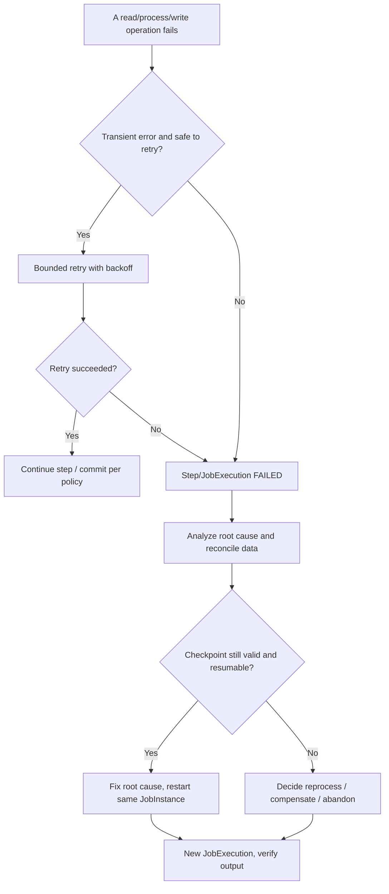

# Choosing Retry vs. Restart in Spring Batch

When a batch job fails, the first question is usually: **"Should we retry, or do we need to restart the job?"** The two actions sound similar because both attempt to redo work, yet in Spring Batch they differ in **scope, timing, transactions, and safety preconditions**. Choosing the wrong one can cause infinite retries on bad data, restart a job that is still running, lose checkpoints, or re-send payments that were already processed.

**Retry** is typically a mechanism to *re-attempt a failing recoverable operation* right inside an active step execution. **Restart** means *creating a new `JobExecution` for the same `JobInstance`* after the previous execution ended in a restartable state. Both require managing state, commit boundaries, and side effects when data is processed repeatedly.

This lesson belongs to **Spring Batch Core Processing → Design Decisions**. It covers state models, a decision matrix, Spring Batch 5.x / Spring Boot 3.x examples, idempotency design, monitoring, and testing. The code snippets are foundational examples; business classes such as `PaymentRow` and `LedgerRow` should be declared per your application.

## 1. The Big Picture: Where Do Retry and Restart Act?

Suppose `dailyPaymentJob` has a chunk-oriented processing step:

```text
JobInstance: dailyPaymentJob(businessDate=2026-11-15)

JobExecution #101  STARTED
  StepExecution importPaymentsStep
    Chunk 1: 100 rows → COMMIT
    Chunk 2: writer hits deadlock
      Next retry attempt within the same StepExecution
      └─ If it succeeds → COMMIT, job continues
      └─ If retries exhausted → FAILED, execution #101 ends

JobExecution #102  STARTED (restart existing instance)
  importPaymentsStep restores state from valid checkpoint
  → processes remaining work
```

Key characteristics:

- Chunk/item-level retries occur **within the same `JobExecution`**; a new execution is not created just because a read/write failed and was retried.
- When retries exhaust their limit or a non-retryable error occurs, the step/job transitions to `FAILED`.
- Restart creates a **new `JobExecution`** while **keeping the same `JobInstance`** and identifying parameters so the framework can restore step state.
- Chunks committed in the prior execution **remain in the database**; restart does not mean "re-running a single job-wide transaction."



In practice, there are also **skip** (bypassing a failing item per policy) and **stop** (requesting a controlled halt). Those are distinct choices, not synonyms for retry or restart.

## 2. Concepts That Must Not Be Confused

| Term | Meaning | Typical Boundary |
|---|---|---|
| **Retry** | Re-attempting a read, process, write, or call on a classified error | Inside a running step |
| **Backoff** | Waiting between retries so the failing dependency has a chance to recover | Inside the retry policy |
| **Skip** | Bypassing a defective item per business rules | Inside a fault-tolerant step |
| **Rollback** | Undoing changes in an uncommitted transaction | Chunk transaction |
| **Restart** | Re-running a `FAILED`/`STOPPED` `JobInstance` via a new execution when eligible | `JobInstance` lifecycle |
| **Reprocess / new instance** | Intentionally reprocessing with new identifying parameters/version | New `JobInstance` |
| **Stop** | Requesting a running execution to halt cooperatively | Current execution |
| **Abandon** | Marking an execution/instance as abandoned by operational decision | Prevents restarting the same instance |

### 2.1. JobInstance vs. JobExecution

A `JobInstance` is identified by **Job name + identifying `JobParameters`**. Example:

```java
JobParameters parameters = new JobParametersBuilder()
        .addString("businessDate", "2026-11-15")
        .addString("snapshotId", "payments-v3")
        .toJobParameters();
```

If the first `JobExecution` of this instance fails and is restarted, the new execution ID differs from the old one while the instance ID stays the same. `JobRepository` records the history of each attempt, each `StepExecution`'s status, and `ExecutionContext` for checkpoints.

If you change `snapshotId` or add a new identifying `run.id` on the next run, Spring Batch treats it as a **different `JobInstance`**. That may be an intentional reprocess, but it is **not a checkpoint restart of the previous instance**.

### 2.2. Retry Does Not Mean Job-Wide Rollback

A step with chunk size 100 may commit 20 chunks before hitting an error on chunk 21. Retrying a writer error in chunk 21 does not undo the 2,000 already-committed items. If the job eventually turns `FAILED` and is restarted, data from those 20 prior chunks remains persisted.

In a fault-tolerant step, a retry can trigger a rollback and **re-read, re-process, or re-write** part of a chunk depending on where the failure occurred and framework policy. Therefore, distinguish **invocation counts** of reader/processor/writer from **actual committed item counts**.

## 3. Decision Criteria: Which Errors Should Be Retried?

Retry is best suited when an error is likely to disappear **without changing code or data**, and repeating the operation causes no incorrect side effects.

| Error / Symptom | Immediate Retry Suitability | How to Decide |
|---|---|---|
| Database deadlock, transient lock contention | **Usually suitable** | Bounded retry with backoff; investigate lock contention |
| Brief network glitch, connection reset before request sent | **Possible** | Verify whether the request was processed |
| HTTP 503 or 429 | **Conditional** | Honor `Retry-After`, quotas, backoff, and idempotency |
| SQL timeout due to overloaded source | **Conditional** | Avoid synchronized retries amplifying load |
| Expired OAuth access token | **Can refresh then retry** | Refresh via token provider; do not replay stale token |
| Permanently malformed CSV data | **Do not retry immediately** | Fix source or skip per policy |
| Unique constraint violation from duplicate write | **Do not blind-retry** | Check business key/idempotency and root cause |
| Mapping/code bug, `NullPointerException` | **No** | Fix code or data |
| Missing schema/column or unapplied migration | **No** | Fix environment, then restart |
| API timeout after server may have committed | **Dangerous to blind-retry** | Reconcile or use idempotency keys first |
| JVM/pod killed, OOM, power loss | **No process left to retry in-place** | Verify process & metadata, consider restart |
| `JobExecution` already `FAILED` | **No internal retry active anymore** | Reconcile and decide on restart |

**Never retry all `Exception`s.** A blanket rule like `.retry(Exception.class)` hides misconfigurations, permanent data errors, and bugs. Policies should rely on explicit exception lists or classifiers built with clear knowledge of each dependency.

### 3.1. Classifying Transient, Permanent, and Ambiguous Errors

**Transient error:** may resolve on its own shortly—deadlocks, brief connection drops, or a momentary server 503. Retry within sensible bounds.

**Permanent error:** will never succeed by repeating the exact same operation—bad data formats, failed validation rules, constraint violations on valid conflicts, or code bugs. Retrying only adds load and delays alerting.

**Ambiguous outcome:** you do not know whether the side effect took place—for instance, a payment API received and committed the request, but the client timed out reading the response. This requires **idempotency / server-side status lookup**; never conclude a retry is safe simply because the exception is network-related.

In a given system, the same HTTP 409 or SQL duplicate key might mean "already processed" or "conflicting invalid data." Classification must follow the **business contract**, not status codes alone.

## 4. Retry Mechanics Inside a Fault-Tolerant Step

Spring Batch lets a chunk step declare retries via `faultTolerant()`, specifying exceptions and allowed attempts:

```java
import org.springframework.batch.core.Step;
import org.springframework.batch.core.repository.JobRepository;
import org.springframework.batch.core.step.builder.StepBuilder;
import org.springframework.batch.item.ItemProcessor;
import org.springframework.batch.item.ItemReader;
import org.springframework.batch.item.ItemWriter;
import org.springframework.dao.CannotAcquireLockException;
import org.springframework.retry.backoff.ExponentialBackOffPolicy;
import org.springframework.transaction.PlatformTransactionManager;

@Bean
ExponentialBackOffPolicy databaseBackOffPolicy() {
    ExponentialBackOffPolicy policy = new ExponentialBackOffPolicy();
    policy.setInitialInterval(200L);
    policy.setMultiplier(2.0);
    policy.setMaxInterval(2_000L);
    return policy;
}

@Bean
Step importPaymentsStep(
        JobRepository jobRepository,
        PlatformTransactionManager transactionManager,
        ItemReader<PaymentRow> paymentReader,
        ItemProcessor<PaymentRow, LedgerRow> paymentProcessor,
        ItemWriter<LedgerRow> ledgerWriter,
        ExponentialBackOffPolicy databaseBackOffPolicy) {

    return new StepBuilder("importPaymentsStep", jobRepository)
            .<PaymentRow, LedgerRow>chunk(100, transactionManager)
            .reader(paymentReader)
            .processor(paymentProcessor)
            .writer(ledgerWriter)
            .faultTolerant()
            .retry(CannotAcquireLockException.class)
            .retryLimit(3)
            .backOffPolicy(databaseBackOffPolicy)
            .build();
}
```

This snippet illustrates Spring Batch 5.x configuration using `CannotAcquireLockException` for lock contention. `PaymentRow` and `LedgerRow` are assumed domain types; reader/writer and `@Bean` methods belong in the corresponding Spring configuration class.

**Understand what the configuration means:**

1. `faultTolerant()` enables retry/skip support in chunk processing.
2. `retry(CannotAcquireLockException.class)` restricts retries to the declared exception; other exceptions are not retried by default.
3. `retryLimit(3)` sets the retry cap per the builder/version contract; when exact invocation counts matter, test attempt counts on your exact version.
4. `backOffPolicy(...)` adds increasing delays between attempts, avoiding hammering a struggling dependency.
5. If retries exhaust and errors persist, the step fails and `JobExecution` ends `FAILED`; only then is the **restart** policy evaluated.

**Do not mistake backoff for a job-wide timeout.** A retry policy can consume substantial time when many consecutive items fail, and you must account for transaction, API, scheduler, and SLA timeouts. Base retry limits on the entire pipeline's time budget.

### 4.1. Choosing Backoff

For example, with initial interval 200 ms, multiplier 2, and max 2 seconds, wait intervals grow roughly 200 ms, 400 ms, 800 ms, ... up to the cap. This is an illustration; actual waits depend on the retry policy and failure count.

When many workers hit 503 simultaneously and all retry on the exact same cadence, they slam the service together. For external dependencies, **exponential backoff with jitter** helps avoid synchronized retry storms. Choose a jitter-capable policy in your library version or use a supported mechanism; never put `Thread.sleep(...)` inside a processor to fake backoff.

### 4.2. Retry by Exception, Not by Guesswork

Some applications retry `TransientDataAccessException` instead of a single subclass:

```java
.faultTolerant()
.retry(org.springframework.dao.TransientDataAccessException.class)
.retryLimit(3)
```

This illustrates broadening the **allowed failure group**, not a blanket recommendation. Some exceptions under this hierarchy can persist due to bad config, missing indexes, or recurring deadlocks; pair them with caps, backoff, and alerting.

If you need nuanced rules by response code, operation type, or upstream outcome, use a `RetryPolicy`/classifier compatible with Spring Retry as integrated by Spring Batch. Verify retry behavior across **each phase (read/process/write)** rather than assuming every exception shares identical rollback semantics.

## 5. How Retries Differ Across Read, Process, and Write

| Phase | Common Failures | What to Inspect |
|---|---|---|
| `ItemReader.read()` | DB timeout, file/HTTP read error | Reader state, source stability, which items were already read |
| `ItemProcessor.process()` | External 503, transient calculation error | Does processor have side effects; is re-invocation safe? |
| `ItemWriter.write(chunk)` | JDBC deadlock, API timeout, broker throttling | Chunk can roll back/replay; did the sink already commit? |

### 5.1. Retrying on Reader Errors

If a reader fails transiently due to database or network issues, retrying can recover without aborting the job. However, ensure the reader **does not advance an unrecoverable position** before throwing. Custom file/API readers must clearly define when offsets increment, when `ExecutionContext` updates, and how re-reads behave.

For example, an API reader increments its offset **before** the request succeeds and then times out: holding the wrong offset skips an item. Design readers to return items and advance logical positions atomically; persist checkpoints only through the proper lifecycle hooks.

### 5.2. Retrying on Processor Errors

An ideal processor is a **pure transformation**: takes an item, computes, returns a result, without sending emails or mutating external systems. Re-invoking it on the same item is then low-risk.

If a processor calls a REST API with side effects, chunk retries/rollbacks can re-send the request. In that case, use an idempotency key or move the side effect to a writer/outbox rather than assuming "the processor runs only once."

### 5.3. Retrying on Writer Errors

A JDBC writer can be rolled back by the transaction manager if it shares the same datasource and transaction. However, when a failure happens after a request has been sent to an external system, **local database rollback does not erase that request**.

Example:

```text
Writer sends batch containing P1, P2, P3 to API.
Server committed P1, P2, P3.
Response times out.
Writer throws exception.

If retry resends the same batch and server does not deduplicate:
  P1, P2, P3 may be processed a second time.
```

Before enabling retries on an API writer, ask whether downstream supports **per-item or per-batch idempotency keys**, how partial success is reported, whether status can be queried after timeouts, and what rate/payload limits apply.

## 6. Rollback and Checkpointing: Why Retries Can Reprocess

Consider a step with chunk size 3:

```text
Chunk 1: items 1,2,3 → commit
  persisted reader checkpoint = position after item 3

Chunk 2: items 4,5,6
  writer fails → transaction rollback
  retry/recovery reprocesses partial or full chunk

If retry budget exhausted:
  JobExecution → FAILED
  previously committed chunks remain

Restart:
  reader restores from committed checkpoint
  items 4,5,6 may be read again
```

**Do not equate retry with "repeating a single method call unrelated to transactions."** Spring Batch coordinates retries with rollbacks, replays, buffering, and checkpoints in fault-tolerant chunk processing. Depending on the phase and configuration, exact retry counts and replay behavior can differ from intuition. Distinguish:

- **Attempt count:** number of tries for an operation, including rolled-back ones.
- **`readCount`/`writeCount` in `StepExecution`:** Batch-semantic counters, not raw Java method invocation counts.
- **`commitCount`/`rollbackCount`:** transaction signals, not directly equal to retry counts.
- **Committed target data:** the ultimate ground truth to reconcile.

Never mechanically add `writeCount + rollbackCount` to infer real API request volume. Under retries, a chunk may run multiple times, each carrying multiple items.

### 6.1. The Transaction Manager Must Match the Resource

If a writer uses `JdbcTemplate` against datasource A while the step uses the transaction manager for datasource B, chunk rollbacks **do not necessarily** protect writes to A. Know your transaction boundaries and propagation when designing retries.

Across multiple datasources, JPA, queues, or external APIs, identify which parts can roll back and which require idempotency/compensation. Never label a sequence of API + JDBC calls an "atomic transaction" simply because a method has `@Transactional`.

## 7. Job Restart: Operating at the JobInstance Level

If a `JobExecution` ends `FAILED` or `STOPPED` and the job is restartable, Spring Batch can create a new execution for **the same `JobInstance`**. `JobRepository` and `ExecutionContext` determine which steps need to run and allow readers/writers to resume from checkpoints.

```text
JobInstance #42 (businessDate=2026-11-15)

JobExecution #101: FAILED
  loadStep:      COMPLETED
  publishStep:   FAILED

After remediation:

JobExecution #107: COMPLETED (restart JobInstance #42)
  loadStep:      typically skipped if flow/config allows
  publishStep:   resumes per checkpoint and restart policy
```

A `COMPLETED` step is normally skipped on restart; `allowStartIfComplete(true)` can force it to re-run. If a job has `preventRestart()`, or is `COMPLETED`/`ABANDONED`, or has invalid metadata, restarts will be rejected.

### 7.1. Using `JobOperator.restart(...)`

Operational service example for Spring Batch 5.x:

```java
import org.springframework.batch.core.BatchStatus;
import org.springframework.batch.core.JobExecution;
import org.springframework.batch.core.explore.JobExplorer;
import org.springframework.batch.core.launch.JobOperator;
import org.springframework.batch.core.repository.JobRepository;
import org.springframework.stereotype.Service;

@Service
public class BatchRecoveryService {

    private final JobExplorer jobExplorer;
    private final JobRepository jobRepository;
    private final JobOperator jobOperator;

    public BatchRecoveryService(
            JobExplorer jobExplorer,
            JobRepository jobRepository,
            JobOperator jobOperator) {
        this.jobExplorer = jobExplorer;
        this.jobRepository = jobRepository;
        this.jobOperator = jobOperator;
    }

    public Long restartEligibleExecution(long failedExecutionId)
            throws Exception {

        JobExecution old = jobExplorer.getJobExecution(failedExecutionId);
        if (old == null) {
            throw new IllegalArgumentException(
                    "Unknown JobExecution: " + failedExecutionId);
        }

        // Prevent restarting an old execution if the instance already
        // has a newer execution (possibly running or already finished).
        JobExecution latest = jobRepository.getLastJobExecution(
                old.getJobInstance().getJobName(),
                old.getJobParameters());

        if (latest == null
                || !latest.getId().equals(old.getId())) {
            throw new IllegalStateException(
                    "Not the latest execution of this JobInstance");
        }

        BatchStatus status = old.getStatus();
        if (status != BatchStatus.FAILED
                && status != BatchStatus.STOPPED) {
            throw new IllegalStateException(
                    "Restart not allowed from status " + status);
        }

        // This step must run ONLY AFTER reconciling data and
        // confirming checkpoints, source, and side effects are safe.
        return jobOperator.restart(failedExecutionId);
    }
}
```

In Spring Batch 5.x, `JobOperator.restart(long)` typically returns the new execution ID (`Long`). The API throws exceptions if the job is not restartable, the job definition is unregistered, the instance is already completed, or another execution is running.

**Service-level status checks do not eliminate race conditions.** Two operators can read status almost simultaneously. Use job-instance ownership/locking and still rely on `JobRepository` for final launch guards. Never expose restart endpoints without authentication, RBAC, and auditing.

### 7.2. Restarting via `JobLauncher`

For a registered job with identical identifying parameters, `JobLauncher.run(job, parameters)` also launches a new execution for a `FAILED`/`STOPPED` instance when allowed:

```java
JobParameters parameters = new JobParametersBuilder()
        .addString("businessDate", "2026-11-15")
        .addString("snapshotId", "payments-v3")
        .toJobParameters();

JobExecution next = jobLauncher.run(dailyPaymentJob, parameters);
```

Never add a random identifying `run.id` just to dodge "already running" or "already complete" exceptions. Doing so creates a new instance, **loses checkpoint semantics**, and risks duplicate processing.

If the launcher runs asynchronously, a successful submission returns `STARTING`/`STARTED`. The orchestrator must track the new execution to a terminal status before declaring recovery complete.

## 8. Classifying Status Before Deciding to Restart

| Latest Execution `BatchStatus` | Auto-Restart Immediately? | Appropriate Action |
|---|---|---|
| `FAILED` | **Conditional** | Analyze error, reconcile output/checkpoint, fix root cause, then restart |
| `STOPPED` | **Conditional** | Verify stop completed cleanly and source remains valid |
| `STARTED` | **No** | Verify whether process is alive or metadata is stuck |
| `STARTING` / `STOPPING` | **No** | Wait or handle transitional state |
| `UNKNOWN` | **No** | Inspect repository, transactions, and data |
| `COMPLETED` | **No** | If reprocessing is needed, design a new instance/version |
| `ABANDONED` | **No** | Instance is permanently closed by operational decision |

In particular, a sudden JVM crash can leave metadata in `STARTED` even though the process is gone. Spring Batch cannot automatically infer physical process liveness from the repository. **Do not repeatedly call restart and do not blindly `UPDATE` all `STARTED` rows to `FAILED`.** Check schedulers, workers across all nodes, committed chunks, and metadata recovery procedures appropriate for your version.

## 9. When to Retry vs. When to Restart? Decision Matrix

| Scenario | Initial Choice | When to Pivot? |
|---|---|---|
| JDBC deadlock in writer, single transaction error | Bounded **retry** + backoff | If deadlocks repeat heavily, fail job; fix lock/query, then **restart** |
| Temporary API 503, idempotent request | **Retry** with backoff/quota | If outage drags on, halt hot retries, alert, and **restart after service recovers** |
| API timeout without idempotency | **Do not blind-retry** | Reconcile with server, compensate, then proceed |
| CSV has one bad row allowed by policy | **Skip** within limit | If quality threshold breaches, fail job and fix source |
| Entire CSV file format is wrong | **Do not retry** | Fix input; evaluate snapshot/checkpoint, then restart or reprocess |
| Mapping code bug | **Do not retry** | Deploy fix; verify state compatibility, then restart |
| Database offline for 30 minutes | **Do not loop retries** | Pause/alert; after recovery, restart instance if eligible |
| Pod OOM mid-job | In-process retry **no longer exists** | Fix memory/concurrency, recover metadata, and restart |
| Job `FAILED`, checkpoint valid | **Restart** after investigation | If source/checkpoint changed, reprocess under new version |
| Job `COMPLETED` with wrong data | Not normal retry/restart | Data quality incident: reconcile, fix, and launch new instance/version |
| Job `ABANDONED` | Do not auto-restart | Operational decision for reprocessing/compensation |

### 9.1. Choosing at Three Levels

**Operation level:** A query or API call hits a transient error and is safe to repeat → retry inside the step.

**JobExecution level:** Step cannot proceed immediately, or retries no longer help → let the execution terminate clearly with failure, fix conditions, and restart the same `JobInstance` if checkpoints are valid.

**Business/pipeline level:** Source data changed, output must be rebuilt, or side effects are ambiguous → decide to reprocess/compensate with a new version/batch key and downstream gate; do not pretend it is merely a technical retry.

## 10. Designing a Retry Budget

An effective retry policy has **caps and stop criteria**.

Suppose an HTTP request times out after 5 seconds, attempting up to 4 calls with backoffs of 1, 2, and 4 seconds. Approximate worst-case duration:

```text
4 attempts × 5s timeout + (1 + 2 + 4)s backoff
= ~27s per operation
```

Numbers are illustrative; real totals depend on connect/read timeouts, attempt latencies, framework behavior, and jitter. If each chunk has 100 items and the processor calls an API per item, an overly broad policy can stretch a job to hours even if each item only gets a few attempts.

Policies should define:

1. **Retryable exception/status allowlist:** only genuinely recoverable failures.
2. **Attempt cap:** finite, possibly tailored per operation type.
3. **Backoff intervals:** avoid hammering an impaired dependency.
4. **Per-attempt timeout:** explicit on JDBC, HTTP, and messaging clients.
5. **Total time budget:** within SLA and scheduler/lock hold windows.
6. **Early-exit conditions:** non-retryable errors, invalid data, open circuit breaker, exhausted quota.
7. **Observability:** log attempt count, exception class, latency, and exhaustion reason.

### 10.1. Nested Retries Multiply Call Volume

Suppose the same API is retried at the **HTTP client**, **processor**, and **Spring Batch step** layers:

```text
HTTP client: max 3 attempts
Processor service: max 3 attempts
Spring Batch step: max 3 attempts

Worst-case total HTTP calls can reach:
3 × 3 × 3 = 27 calls for a single unit of work
```

This illustrates worst-case nested retry multiplication when every layer exhausts its cap, not Spring Batch's default behavior. Design **one primary retry owner** per operation, or partition retries cleanly by error type/layer within a total budget. Avoid retry storms overwhelming the very dependency struggling to recover.

### 10.2. Excessive Retrying Can Make Restarts Harder

An execution stuck `STARTED` for hours due to relentless retrying makes no forward progress while pinning connections, threads, and deployments. For prolonged outages, **controlled fail-fast** is often better, letting schedulers/operations wait for recovery and then restart.

This trade-off depends on SLAs, expected recovery time, checkpointing support, restart overhead, and downstream impact.

## 11. Idempotency Is Foundational for Both Retry and Restart

"Can be called again" differs from "safe to call again." An operation is replay-safe when repeating it never produces an invalid business effect.

### 11.1. JDBC Writer

For a ledger table, enforce a unique business key:

```sql
CREATE TABLE ledger_entry (
    business_date DATE NOT NULL,
    payment_id VARCHAR(64) NOT NULL,
    amount DECIMAL(18, 2) NOT NULL,
    PRIMARY KEY (business_date, payment_id)
);
```

A unique constraint detects duplicates, though it **does not automatically turn a duplicate `INSERT` into a success**. Per contract, the writer can use a database upsert or verify matching values on existing records. Never blindly ignore every duplicate key, as that can mask conflicting values.

### 11.2. API Writer

If an API supports idempotency keys, derive a stable key from the **business operation**, not a random value per retry:

```text
Idempotency-Key: payment:2026-11-15:P-001

Attempt 1 → server commits successfully, response times out
Attempt 2 → same key; server returns saved result
```

This behavior only holds if **the receiving API genuinely implements idempotency** with clear semantics, TTL, and key scope. Never assume every API honors the header or retains idempotency records indefinitely.

### 11.3. Files and Object Storage

Writing directly to final output files and crashing mid-job can leave partial artifacts. Prevent consumers from reading incomplete outputs during retries/restarts by:

- Writing to a dedicated staging path/version.
- Publishing the output/manifest only after the job completes and reconciles.
- Using checksums, counts, and unique artifact versions.
- Planning cleanup or overwrite handling for abandoned staging files.

Remember that filesystems, object storage, and databases have separate commit boundaries; JDBC rollbacks do not automatically undo written files.

### 11.4. Readers Must Also Be Restartable

If a custom reader only implements `ItemReader` with an in-memory index and no checkpointing, restarts may re-read from the start. If a reader queries `WHERE status='NEW'` while the writer updates status and mutates the source set, position checkpoints can skip records.

Readers need:

- `ItemStream.open/update/close` or built-in readers with `saveState(true)` where appropriate.
- Stable stream/state keys.
- Immutable snapshots/partitions or unique sort keys during the job's lifecycle.
- Clean replay of uncommitted items on restart.

In multi-threaded jobs, a shared mutable singleton reader across workers will not produce consistent checkpoints. Key-range partitioning with independent readers is usually easier to reason about.

## 12. Retry and Skip: Two Non-Interchangeable Decisions

Retry answers: **"Is there reason to believe the same operation will succeed if tried again?"**

Skip answers: **"Do business rules permit omitting this defective item from the result?"**

Example in an order import system:

| Error | Retry? | Skip? | Why |
|---|---|---|---|
| Address verification API 503 | Possibly | Usually no | Data isn't verified yet; service is temporarily down |
| CSV row with bad region code, policy allows quarantine | No | Bounded | Permanent data error; business permits isolating it |
| Unable to calculate tax | Not automatically | Usually no | Never emit orders missing financial figures |
| DB deadlock in writer | Yes | No | Infrastructure glitch; the item itself is valid |

Illustrative skip configuration:

```java
.faultTolerant()
.skip(InvalidSourceRecordException.class)
.skipLimit(10)
```

`InvalidSourceRecordException` is an application-defined business exception. When combining retry and skip, understand **framework ordering and limits**: an exception may be retried up to its limit before being evaluated by the skip policy, depending on phase and config. Never enable broad skips just to force `COMPLETED` while silently dropping important records.

Monitor `readSkipCount`, `processSkipCount`, `writeSkipCount`, `filterCount`, and output data quality; acceptable skip thresholds must have business sign-off.

## 13. Real-World Scenario: Deadlock Followed by Restart

The `dailySettlementJob` pipeline processes one million transactions with chunk size 200.

**Scenario A — Retryable error:**

```text
00:00 JobExecution #301 STARTED
00:03 chunk 540 writer deadlock
00:03 fault-tolerant step retries with backoff
00:03 next attempt succeeds, chunk commits
00:15 JobExecution #301 COMPLETED
```

No restart is needed here because the `JobExecution` still finished. Dashboards should record that **retries occurred**, without equating them with job failure.

**Scenario B — Repeated error, retries exhausted:**

```text
00:00 JobExecution #401 STARTED
00:03 chunk 540 writer deadlocks repeatedly
00:04 retry policy exhausted → Step FAILED, JobExecution #401 FAILED
00:07 DBA resolves lock contention / SQL
00:10 reconcile committed chunks and checkpoint
00:12 restart existing JobInstance → JobExecution #408 STARTED
00:22 JobExecution #408 COMPLETED
```

The right action in B is **not retrying infinitely while locks remain blocked**. Once resolved, restart the same `JobInstance` to leverage committed chunks and checkpoints.

**Scenario C — Unknown whether server processed request:**

```text
01:10 Writer calls payment API for P-889
01:10 Server records payment
01:10 Client times out → chunk rolls back locally
01:11 JobExecution FAILED
```

In C, both immediate retry and immediate restart risk sending a duplicate payment. You must **query P-889 on the server or rely on an idempotency contract**, compensating if necessary before proceeding.

## 14. Job-Level Retry Orchestration and Scheduling

In-step Spring Batch retry does not replace orchestration once a job is `FAILED`. A scheduler may schedule a restart after an outage, but distinguish:

- **In-step operation retry:** fault-tolerant builder / Spring Retry acting while `JobExecution` is still running.
- **Post-failure retry orchestration:** scheduler waits, then triggers **restart** to create a new `JobExecution` for the same `JobInstance`, not "resuming the old thread."
- **Full scheduled rerun:** using new identifying parameters creates a **different `JobInstance`**, requiring duplicate-handling contracts.

Example daily schedule: Job A imports and Job B publishes. If A is `FAILED`, B must stay blocked. Only after A restarts and reaches `COMPLETED` with valid data readiness should the orchestrator trigger B. Never schedule B via cron ("A at 01:00, B at 01:10") and treat it as a guaranteed dependency.

### 14.1. Retry/Restart Ownership

Designate one clear decision owner for restarts:

1. Central scheduler/operator manages `JobInstance`-level restarts.
2. `JobRepository` enforces execution preconditions and metadata.
3. Application owner defines which exceptions retry inside a step.
4. Data owner decides when reprocessing/compensation is authorized.

If the application self-restarts in `afterJob` while the scheduler also retries, concurrent launch attempts collide. `JobRepository` guards state transitions, but never rely on its exceptions as the **primary coordination mechanism** for the whole pipeline.

## 15. Observing Retries and Restarts via Metadata and Metrics

Spring Batch exposes counters such as `readCount`, `writeCount`, `readSkipCount`, `writeSkipCount`, `commitCount`, and `rollbackCount` on `StepExecution`. They aid investigations but **are not universal retry counters for all dependencies**.

| Signal | Meaning | Note |
|---|---|---|
| Per-operation retry attempt count | How many retries occurred | Needs dedicated listener/instrumentation |
| Backoff time | Wait time between retries | Separate wait time from active execution |
| Step `rollbackCount` | Recorded transaction rollbacks | Not identical to API call counts |
| `JobExecution` count per instance | History of starts/restarts | Identifies recurring incidents |
| Job/Step status | Lifecycle state | `FAILED` differs from `COMPLETED` with retries |
| Read/write/skip counts | Framework-recorded volume | Not raw method call counts under replay |
| DB/HTTP errors, lock waits, 429/503 | Dependency health | Shows whether the fault persists |
| Output row count/checksum | Committed business outcome | Required to verify recovery |

### 15.1. Querying Execution History for a JobInstance

Read-only SQL example:

```sql
SELECT
    ji.JOB_NAME,
    ji.JOB_INSTANCE_ID,
    je.JOB_EXECUTION_ID,
    je.STATUS,
    je.EXIT_CODE,
    je.START_TIME,
    je.END_TIME,
    je.LAST_UPDATED
FROM BATCH_JOB_INSTANCE ji
JOIN BATCH_JOB_EXECUTION je
  ON je.JOB_INSTANCE_ID = ji.JOB_INSTANCE_ID
WHERE ji.JOB_INSTANCE_ID = :jobInstanceId
ORDER BY je.JOB_EXECUTION_ID;
```

This reveals an instance's history such as `FAILED → FAILED → COMPLETED` across two restarts. However, this query **does not reveal internal chunk retry counts**; pair it with retry metrics/logs.

### 15.2. Logging by Business Key and Execution ID

Helpful structured log:

```text
job=dailySettlementJob
businessDate=2026-11-15
jobInstanceId=42
jobExecutionId=107
step=publishStep
operation=jdbcBatchWrite
exceptionClass=CannotAcquireLockException
retryAttempt=2
backoffMs=400
```

Never log passwords, tokens, raw connection URLs with credentials, or full sensitive payloads. Use `jobExecutionId` in logs/traces for drill-down; avoid putting per-execution IDs into high-cardinality Prometheus tags.

## 16. Testing Retry and Restart Decisions

The core of testing is verifying two distinct contracts:

1. **Retry within the same `JobExecution`:** a transient error occurs and recovers; no new execution is created and output is accurate.
2. **Restart after a `FAILED` `JobExecution`:** a new execution runs for the same instance, checkpoints/step states are honored, and output has zero omissions or duplicates.

### 16.1. Testing Retry with a Fake Writer

Example fake writer failing with a lock exception on the first call and succeeding afterward:

```java
import java.util.concurrent.atomic.AtomicInteger;

import org.springframework.batch.item.Chunk;
import org.springframework.batch.item.ItemWriter;
import org.springframework.dao.CannotAcquireLockException;

public final class FailOnceWriter<T> implements ItemWriter<T> {
    private final AtomicInteger attempts = new AtomicInteger();
    private final ItemWriter<T> delegate;

    public FailOnceWriter(ItemWriter<T> delegate) {
        this.delegate = delegate;
    }

    @Override
    public void write(Chunk<? extends T> items) throws Exception {
        if (attempts.incrementAndGet() == 1) {
            throw new CannotAcquireLockException(
                    "Synthetic transient DB lock");
        }
        delegate.write(items);
    }

    public int attempts() {
        return attempts.get();
    }
}
```

With a step configured to retry `CannotAcquireLockException`, a test can launch the job with a few items and verify:

- `JobExecution.getStatus() == BatchStatus.COMPLETED`.
- The writer was attempted more than once (do not try to infer exact attempts from `writeCount`).
- Only one `JobExecution` was created for that run.
- Target database holds the exact business IDs with zero duplicates.

Create this fake writer **per test/job execution** or reset `attempts` explicitly between tests so state does not leak across tests. If the delegate is a JDBC writer, check it shares the datasource/transaction manager; if it is a mock, the test only proves retry control flow, not real rollback behavior.

### 16.2. Testing Retry Limit Exhaustion

Create a fake dependency that always throws the retryable exception, configure a small retry limit, and verify:

1. `JobExecution` finishes `FAILED` (or per configured exit policy).
2. No infinite retry loop occurs.
3. Previously committed chunks remain persisted.
4. The failing chunk is not treated as committed.
5. The orchestrator blocks downstream jobs while upstream remains failed.

If the fake writer throws before sending SQL, this test does not simulate **partial external side effects**. Test API timeout-after-commit separately using a mock server and idempotency keys.

### 16.3. Testing Restart After Committed Chunks

An integration test with a real test database and stateful job can exercise:

```text
Input snapshot: [1,2,3,4,5,6]
chunkSize: 2

Run #1:
  chunk [1,2] → commit
  chunk [3,4] → commit
  chunk [5,6] → non-retryable failure / retries exhausted
  JobExecution #1 = FAILED
  DB output = [1,2,3,4]

Run #2 same identifying parameters:
  reader resumes from committed checkpoint
  chunk [5,6] → commit
  JobExecution #2 = COMPLETED
  DB output = [1,2,3,4,5,6], no duplicates
```

Tests should use `@SpringBatchTest`, `JobLauncherTestUtils` or `JobLauncher`, `JobExplorer`, and a real test database. With multiple `Job` beans, specify the target `Job` explicitly on the test utility. Wrapping the whole test in Spring Test's `@Transactional` can distort commit/rollback verification or conflict with `JobRepository` transactions, so avoid it when verifying chunk commits.

### 16.4. Testing Against Unsafe Retries and Restarts

| Scenario | Expectation |
|---|---|
| Processor throws permanent business exception | No infinite retry; job fails or skips per policy |
| API 503 with idempotent request | Bounded retries keeping the exact same idempotency key |
| API timeout after server committed | Retry/restart creates zero duplicate side effects |
| `JobExecution` is `STARTED` | No competing restart execution is launched |
| `JobInstance` is `COMPLETED` | Cannot restart same instance as if failed |
| `JobInstance` is `ABANDONED` | No automatic restart |
| Identifying params changed | Recognized as a **new instance**, not a restart |
| Reader source ordering changed | Runbook blocks unsafe restart |
| Completed step has `allowStartIfComplete(true)` | Verify intended re-execution semantics |
| Nested in-step retry + scheduler retry | Total attempts bounded and within SLA |

## 17. Practical Operator Runbook

When a "batch failed" alert fires:

### Step 1 — Identify the Execution

Collect `jobName`, identifying parameters, `jobInstanceId`, `jobExecutionId`, status, and the failing step. Confirm which scheduler request maps to which execution; never confuse scheduler run IDs with Batch IDs.

### Step 2 — Check If the Job Is Still Alive

If metadata shows `STARTED`, check processes/workers across all nodes and the scheduler. Never trigger a restart while the job is actually still running. If the process is dead and metadata is stuck, follow version- and infra-appropriate recovery procedures—never run ad-hoc SQL status updates.

### Step 3 — Find the Root-Cause Error

Inspect the exception class, root cause, SQL/HTTP codes, retry attempts, lock/wait timestamps, and deployment version. Classify as transient, permanent, or ambiguous; never assume the final rollback wrapper exception is the sole root cause.

### Step 4 — Reconcile Committed Work

Count business IDs, monetary totals/checksums, published files/objects, processed API calls, and downstream messages. Never rely solely on `writeCount` to infer external side effects.

### Step 5 — Decide the Action

- If job is still running on transient errors within retry bounds: **monitor retries**, do not restart in parallel.
- If job is `FAILED`, root cause is resolved, and checkpoints are safe: **restart the same `JobInstance`**.
- If input changed or state cannot be reused: **reprocess with a new version** and handle prior partial outputs.
- If side effects are ambiguous: **pause and reconcile** before retrying.
- If the instance was abandoned: never force-restart an `ABANDONED` instance.

### Step 6 — Verify the Outcome

After issuing restart, record the new execution ID and wait for terminal status and quality gates. Confirm output matches the target period with zero omissions or duplicates; release downstream only after readiness markers/reconciliation pass.

### Step 7 — Close the Incident with Evidence

Document the root exception, retry/restart/reprocess decision, relevant IDs, before/after counts, dependency status, and preventive actions. An incident is not closed simply because a restart command succeeded.

## 18. Common Design Mistakes

| Mistake | Consequence | Better Design |
|---|---|---|
| Retrying every `Exception` | Masks code/data permanent defects | Explicit exception allowlist/classifier |
| Retrying 503s with zero backoff | Retry storm, prolongs outage | Bounded backoff, jitter, quota-aware |
| Retrying at three layers unmanaged | Request volume multiplies sharply | Single primary owner / total attempt budget |
| Restarting immediately on transient error while running | Concurrent runs, `JobRepository` conflicts | Wait for terminal execution status |
| Adding a fresh `run.id` on every "restart" | Creates new instances, loses checkpoints | Preserve identifying parameters on restart |
| Setting `saveState(false)` without replay policy | Restarts from scratch, duplicates writes | Stateful/partitioned reader or idempotent reprocess |
| Assuming writer retry rolls back HTTP calls | Duplicates external side effects | Idempotency keys, outbox, or reconciliation |
| Using unique constraints then ignoring all duplicates | Masks conflicting values | Check values/versions on duplicates |
| Checking only `COMPLETED` | May hide unacceptable skips | Data quality gates, checksums, expected counts |
| Swapping input then restarting at old offset | Skips or duplicates records | Immutable snapshot/version or reprocess |
| Manually editing `STARTED → FAILED` in DB | Worker may still be alive; state conflicts | Controlled recovery procedures |
| Not logging attempts or backoff | Cannot diagnose slow jobs | Instrument retries, rollbacks, latency, execution history |
| Increasing `retryLimit` during heavy DB deadlocks | Holds locks/threads longer, worsens contention | Fix queries/indexes/concurrency; consider fail fast |

## 19. Decision-Making Exercise

A `publishInvoicesJob` runs for day D with 4 steps:

1. `loadStep` reads a 50,000-invoice snapshot into staging.
2. `validateStep` checks totals and field rules.
3. `chargeStep` sends payment requests over an API.
4. `markReadyStep` publishes a manifest for downstream.

Scenarios:

**A.** `loadStep` hits a single JDBC deadlock; after 300 ms the query succeeds. Given an appropriate exception and safe rollback, use **bounded retry** inside the step.

**B.** `validateStep` finds an invoice missing a mandatory tax ID. Retrying will not fix the data; fail or skip per policy, fix the source, and decide **restart or reprocess** based on checkpoints/snapshots.

**C.** `chargeStep` times out after reaching the API, leaving payment status unknown. Perform **reconciliation/idempotency checks**—never blind-retry or blind-restart.

**D.** `markReadyStep` fails due to temporary storage outage; job ends `FAILED`. Once storage recovers, if prior steps completed with valid output, **restart the same `JobInstance`** so only the required step executes per restart semantics.

**E.** The snapshot file was overwritten by a new version before restart. Reusing reader offsets can misalign data; issue a **new snapshot/version**, plan cleanup of prior outputs, and test for zero omissions/duplicates.

Try building a policy table for each step listing: retryable errors, retry limit, backoff, idempotency key, checkpoint key, escalation triggers, and reconciliation query. A solid decision never stops at "retry 3 times"—it defines **what state data and job enter after the final failed attempt**.

## 20. Design and Implementation Checklist

| Question | Sign of Readiness |
|---|---|
| Are transient/permanent/ambiguous errors classified? | Explicit exception/HTTP/SQL policies |
| Are retries bounded with backoff? | Budget aligned with operation and SLA |
| Are nested retry layers prevented? | Total attempts and single owner defined |
| Does the reader save state properly? | `ItemStream`/`ExecutionContext` and stable source |
| Does `JobInstance` use proper identifying parameters? | Restarts preserve keys/versions |
| Is the writer replay-safe? | JDBC unique/upsert or API idempotency |
| Are out-of-transaction side effects reconciled? | Request IDs, manifests, outboxes, or reconciliation |
| Does rollback use the matching transaction manager? | Consistent datasource and manager |
| Who restarts after retries exhaust? | Scheduler/operator with clear owner and audit |
| Are `STARTED`/`UNKNOWN`/`ABANDONED` blocked? | No blind restarts over active/abandoned metadata |
| Is fault injection tested? | Tested retry success, exhaustion, restart, timeout-after-commit |
| Are both attempts and executions monitored? | Retry metrics and `JobRepository` history |
| Is there a post-completion quality gate? | Counts, checksums, skips, and downstream readiness |

## 21. Conclusion

**Choose retry when an error is likely to resolve quickly on its own, the operation is safe to repeat, and it fits within your attempt/backoff budget. Choose restart when a `JobExecution` has ended in an eligible terminal state, the root cause is fixed, and checkpoints plus committed data are safe to resume the existing `JobInstance`.** If external side effects are uncertain, source data changed, or metadata is untrustworthy, **automatically choose neither** until reconciliation and a reprocess/compensation decision are complete.

Spring Batch provides fault-tolerant in-step retries and `JobInstance`-level restarts, yet final correctness still hinges on **transaction boundaries, reader state, writer idempotency, stable source data, and controlled orchestration**. A strong design recovers smoothly from transient blips and stops decisively when safety cannot be guaranteed—never trading data integrity for a green `COMPLETED` badge.
