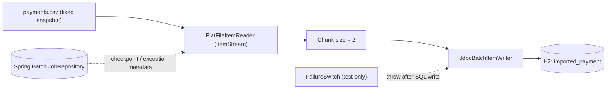
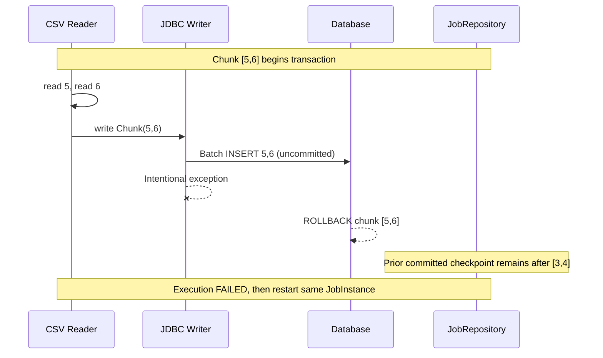
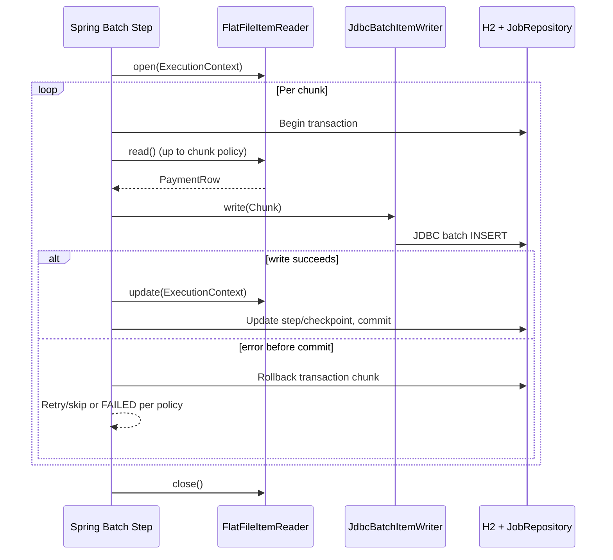

# Adding Chunk Transactions and Checkpoints — Spring Batch Practice Project

In a batch job processing tens of thousands of transactions, the requirement is not merely "can read and can write." A job may fail after processing 60% of the data; on re-run, the system must **preserve what was already committed, avoid treating the failed chunk as successful, and resume from the appropriate checkpoint**. That is the goal of the **adding chunk transactions and checkpoints** practice project.

We build a small Spring Boot 3.x / Spring Batch 5.x application: reading 6 payments from CSV, writing to H2 with `JdbcBatchItemWriter`, committing every 2 items, intentionally injecting a failure **after SQL has been sent but before the chunk commits**, and then restarting **the same `JobInstance`**. The integration test must prove that only the 4 rows from the first two chunks exist after the failure, and after restarting all 6 rows are written exactly once.

This model applies to files, databases, APIs, or queues, though **the level of transactional guarantee depends on the resource**: JDBC writes using the same datasource/transaction manager can roll back with the chunk; an HTTP request or an already published file typically does not roll back automatically with a JDBC transaction.

## 1. Expected Outcomes

After this lesson, you will be able to:

1. Create a chunk-oriented step with `.chunk(2, transactionManager)`.
2. Wire a stateful reader using `ItemStream` / `ExecutionContext`.
3. Use a JDBC writer that actually writes within the chunk transaction.
4. Inject an intentional failure in the third chunk, distinguishing writes **that were invoked** from data **that was committed**.
5. Restart with the **same job name + identifying `JobParameters`** and observe a new `JobExecution` on the old `JobInstance`.
6. Inspect results in the database, Spring Batch metadata, and `StepExecution` counters.
7. Distinguish a checkpoint restart from creating a new `JobInstance`; explain risks of disabling `saveState`, changing the source, or triggering side effects outside the transaction.

Expected scenario:

| Run | Chunk [1,2] | Chunk [3,4] | Chunk [5,6] | BatchStatus | Committed Rows |
|---|---|---|---|---|---:|
| Execution #1 | Commit | Commit | Attempt write then **rollback** | `FAILED` | 4 |
| Execution #2, restart | Not re-written | Not re-written | Commit | `COMPLETED` | 6 |

Execution IDs in the table are illustrative; `JobRepository` generates the actual IDs at runtime. The test also verifies that **all six IDs are distinct**, avoiding a false pass with 6 rows where one payment is missing and another is duplicated.

## 2. Architecture and Transaction Boundaries



Overall, there are two data groups inside the same H2 datasource for this example:

- **Business table** `imported_payment`: actual data from CSV, with a unique key `(business_date, source_id)`.
- **Spring Batch metadata tables** `BATCH_JOB_INSTANCE`, `BATCH_JOB_EXECUTION`, `BATCH_STEP_EXECUTION`, and `*_EXECUTION_CONTEXT` tables: status, history, and checkpoints.

We use `JdbcTransactionManager` / the JDBC transaction manager configured by Spring Boot for the datasource. When the writer uses the same datasource and participates in the chunk transaction, an exception occurring before commit **rolls back the `INSERT`s of that specific chunk**.



**Note on checkpoints:** `ItemStream.update(ExecutionContext)` and metadata updates are coordinated with the chunk transaction; the reader only persists progress at appropriate framework checkpoints. The in-memory read position may advance ahead of the committed position when the writer fails. On restart, the reader must use **persisted state**, not the last offset merely printed in logs after failure.

## 3. Sample Project Structure

```text
chunk-checkpoint-lab/
├── build.gradle
├── settings.gradle
└── src/
    ├── main/
    │   ├── java/com/example/batchlab/
    │   │   ├── ChunkCheckpointLabApplication.java
    │   │   ├── PaymentRow.java
    │   │   ├── FailureSwitch.java
    │   │   └── PaymentImportConfig.java
    │   └── resources/
    │       ├── application.yml
    │       ├── schema.sql
    │       └── payments.csv
    └── test/
        └── java/com/example/batchlab/
            └── ChunkCheckpointIntegrationTest.java
```

This is a **self-contained project structure for learning**. The article presents the contents of the files in the following sections. No external service or production database is needed to run the integration test.

### 3.1. Gradle and Java

File `settings.gradle`:

```groovy
rootProject.name = 'chunk-checkpoint-lab'
```

File `build.gradle`:

```groovy
plugins {
    id 'java'
    id 'org.springframework.boot' version '3.3.5'
    id 'io.spring.dependency-management' version '1.1.6'
}

group = 'com.example'
version = '0.0.1-SNAPSHOT'

java {
    toolchain {
        languageVersion = JavaLanguageVersion.of(17)
    }
}

repositories {
    mavenCentral()
}

dependencies {
    implementation 'org.springframework.boot:spring-boot-starter-batch'
    runtimeOnly 'com.h2database:h2'

    testImplementation 'org.springframework.boot:spring-boot-starter-test'
    testImplementation 'org.springframework.batch:spring-batch-test'
}

tasks.named('test') {
    useJUnitPlatform()
}
```

Plugin versions are **illustrative milestones from the Spring Boot 3.x ecosystem**, not claims of being the latest. When creating a real project, pick an organization-supported set of Spring Boot, Spring Batch, and Java versions so the Spring Boot BOM manages compatible dependencies. You can create the project with Spring Initializr and add the corresponding files.

### 3.2. Datasource and Metadata Configuration

File `src/main/resources/application.yml`:

```yaml
spring:
  datasource:
    url: "jdbc:h2:mem:chunkcheckpoint;DB_CLOSE_DELAY=-1"
    driver-class-name: org.h2.Driver
    username: sa
    password: ""

  batch:
    job:
      enabled: false
    jdbc:
      initialize-schema: always

  sql:
    init:
      mode: always

demo:
  run-on-startup: false
  business-date: "2026-11-15"
  input-file: "payments.csv"
```

In this lab:

- `spring.batch.job.enabled=false` disables automatic job launching when the application context is created. Our test or `ApplicationRunner` will invoke `JobLauncher` explicitly.
- `spring.batch.jdbc.initialize-schema=always` initializes the Spring Batch metadata schema in the H2 database for learning purposes.
- `spring.sql.init.mode=always` runs `schema.sql` to create the business table.
- `jdbc:h2:mem` lives only for the lifetime of the database/process. **Do not use in-memory H2 to demonstrate restarts after completely shutting down the JVM**: when the process exits, both metadata and data are lost. The integration test in this lesson runs two executions **within the same application context**, so it can reliably demonstrate restarts and transactions.

For production or restart exercises **across a new process**, use a persistent datasource (PostgreSQL/MySQL/file-based H2 for labs) and **create the metadata schema once via migrations**, instead of re-running default table creation scripts on every startup.

### 3.3. Creating a Business Table with a Duplicate-Prevention Key

File `src/main/resources/schema.sql`:

```sql
CREATE TABLE IF NOT EXISTS imported_payment (
    business_date DATE NOT NULL,
    source_id BIGINT NOT NULL,
    amount DECIMAL(18, 2) NOT NULL,
    PRIMARY KEY (business_date, source_id)
);
```

The `(business_date, source_id)` primary key allows processing multiple data periods in the same table and detects duplicate writes of the same payment within a period. In this lab we use a **plain `INSERT`**: if the reader has a wrong checkpoint and re-writes an already committed row, the unique constraint helps the test detect it. In production requiring at-least-once and replay, you may choose upsert, but you must check values/versions rather than treating every duplicate as a valid result.

### 3.4. Fixed CSV Data

File `src/main/resources/payments.csv`:

```csv
id,amount
1,10.00
2,20.00
3,30.00
4,40.00
5,50.00
6,60.00
```

The file has 6 records and one header line. The reader skips the header and supplies each `PaymentRow` in ascending ID order. Do not edit the file between the failed run and the restart in this practice project: **line-based offsets are only safe when source content and order remain unchanged**.

## 4. Defining Data Types

File `PaymentRow.java`:

```java
package com.example.batchlab;

import java.math.BigDecimal;

public record PaymentRow(long id, BigDecimal amount) {
}
```

With Java 17, `record` reduces boilerplate for simple models. `BigDecimal` is better suited for monetary handling than `double`. We keep the source code as free of stateful variables as possible to clearly observe Spring Batch's transaction and checkpoint mechanisms.

## 5. FailureSwitch: Injecting an Intentional Failure to Observe Rollback

File `FailureSwitch.java`:

```java
package com.example.batchlab;

import java.util.concurrent.atomic.AtomicBoolean;

public final class FailureSwitch {

    private final AtomicBoolean armed = new AtomicBoolean(false);

    public void armOnce() {
        armed.set(true);
    }

    public boolean consumeFailure() {
        return armed.compareAndSet(true, false);
    }
}
```

`FailureSwitch` is a **test seam** allowing a single failure to be armed within the same JVM:

1. The test calls `armOnce()` before the first execution.
2. The writer writes SQL for the chunk containing `id=5` and then calls `consumeFailure()`.
3. On the first run, the method returns `true` and the writer throws an exception before commit.
4. The flag has been consumed; the subsequent restart can succeed.

Design note: this flag is **not a checkpoint** and **does not need to be persisted in `JobRepository`**. It exists solely to test repeatable failures inside one test process. In real applications, failures must come from real systems/logic, and an in-memory singleton flag must never be used to manage distributed recovery.

## 6. Configuring the Reader, Writer, Step, and Job

File `PaymentImportConfig.java`:

```java
package com.example.batchlab;

import java.sql.Date;
import java.time.LocalDate;

import javax.sql.DataSource;

import org.springframework.batch.core.Job;
import org.springframework.batch.core.Step;
import org.springframework.batch.core.configuration.annotation.StepScope;
import org.springframework.batch.core.job.builder.JobBuilder;
import org.springframework.batch.core.repository.JobRepository;
import org.springframework.batch.core.step.builder.StepBuilder;
import org.springframework.batch.item.ItemWriter;
import org.springframework.batch.item.database.JdbcBatchItemWriter;
import org.springframework.batch.item.database.builder.JdbcBatchItemWriterBuilder;
import org.springframework.batch.item.file.FlatFileItemReader;
import org.springframework.batch.item.file.builder.FlatFileItemReaderBuilder;
import org.springframework.beans.factory.annotation.Qualifier;
import org.springframework.beans.factory.annotation.Value;
import org.springframework.context.annotation.Bean;
import org.springframework.context.annotation.Configuration;
import org.springframework.core.io.ClassPathResource;
import org.springframework.jdbc.core.namedparam.MapSqlParameterSource;
import org.springframework.transaction.PlatformTransactionManager;

@Configuration
public class PaymentImportConfig {

    @Bean
    public FailureSwitch failureSwitch() {
        return new FailureSwitch();
    }

    // Stateful reader with a stable name.
    // @StepScope supports reading inputFile from JobParameters when the step runs.
    @Bean
    @StepScope
    public FlatFileItemReader<PaymentRow> paymentCsvReader(
            @Value("#{jobParameters['inputFile']}")
            String inputFile) {

        return new FlatFileItemReaderBuilder<PaymentRow>()
                .name("paymentCsvReader")
                .resource(new ClassPathResource(inputFile))
                .encoding("UTF-8")
                .linesToSkip(1)
                .delimited()
                .names("id", "amount")
                .fieldSetMapper(fields -> new PaymentRow(
                        fields.readLong("id"),
                        fields.readBigDecimal("amount")))
                .saveState(true)
                .build();
    }

    // Writer shares the same DataSource as the transaction manager.
    @Bean
    @StepScope
    public JdbcBatchItemWriter<PaymentRow> paymentJdbcWriter(
            DataSource dataSource,
            @Value("#{jobParameters['businessDate']}")
            String businessDate) {

        Date date = Date.valueOf(LocalDate.parse(businessDate));

        return new JdbcBatchItemWriterBuilder<PaymentRow>()
                .dataSource(dataSource)
                .sql("""
                        INSERT INTO imported_payment (
                            business_date, source_id, amount
                        ) VALUES (
                            :businessDate, :id, :amount
                        )
                        """)
                .itemSqlParameterSourceProvider(row ->
                        new MapSqlParameterSource()
                                .addValue("businessDate", date)
                                .addValue("id", row.id())
                                .addValue("amount", row.amount()))
                .build();
    }

    // Writer simulates a failure: SQL already executed inside the transaction,
    // but throws an exception before the chunk commits.
    @Bean
    public ItemWriter<PaymentRow> faultInjectingWriter(
            @Qualifier("paymentJdbcWriter")
            ItemWriter<PaymentRow> delegate,
            FailureSwitch failureSwitch) {

        return chunk -> {
            delegate.write(chunk);

            boolean containsIdFive = chunk.getItems().stream()
                    .anyMatch(row -> row.id() == 5L);

            if (containsIdFive && failureSwitch.consumeFailure()) {
                throw new IllegalStateException(
                        "Simulated failure after JDBC write, before commit");
            }
        };
    }

    @Bean
    public Step importPaymentsStep(
            JobRepository jobRepository,
            PlatformTransactionManager transactionManager,
            FlatFileItemReader<PaymentRow> paymentCsvReader,
            @Qualifier("faultInjectingWriter")
            ItemWriter<PaymentRow> writer) {

        return new StepBuilder("importPaymentsStep", jobRepository)
                .<PaymentRow, PaymentRow>chunk(2, transactionManager)
                .reader(paymentCsvReader)
                .writer(writer)
                .build();
    }

    @Bean
    public Job importPaymentsJob(
            JobRepository jobRepository,
            Step importPaymentsStep) {

        return new JobBuilder("importPaymentsJob", jobRepository)
                .start(importPaymentsStep)
                .build();
    }
}
```

### 6.1. Why Use `FlatFileItemReader`?

`FlatFileItemReader` supports `ItemStream`: it reads record by record and stores the information needed to resume after a restart. The builder configures:

- `name("paymentCsvReader")`: a stable name used as a prefix for keys in the context.
- `saveState(true)`: enables persisting reading state.
- `linesToSkip(1)`: skips the CSV header.
- `@StepScope`: binds the bean to each step execution, allowing `inputFile` to be read from `JobParameters` and avoiding sharing reader state across incompatible lifecycles.

Typically when using a stateful built-in reader, set a **consistent reader name across restarts**. If the name or `ExecutionContext` keys change between deployments, old state may no longer be found.

### 6.2. Why Does the Writer Not Commit on Its Own?

`JdbcBatchItemWriter` sends SQL batches over a connection participating in the transaction managed by the step. The writer **does not call a separate commit after every item**. In the example:

```text
Chunk [1,2]:
  begin transaction → JDBC batch INSERT → checkpoint/update → COMMIT

Chunk [3,4]:
  begin transaction → JDBC batch INSERT → checkpoint/update → COMMIT

Chunk [5,6]:
  begin transaction → JDBC batch INSERT → throw exception → ROLLBACK
```

The exception inside `faultInjectingWriter` happens after the delegate executes `write(chunk)` yet still **before the transaction commits**. Thus rows 5 and 6 are not committed if the JDBC writer and transaction manager share the **same datasource and transaction boundary**.

If the writer calls a REST API or writes to a **different** database not participating in the same transaction, the same exception may not undo side effects in that system. In that case, idempotency or compensation must be added.

### 6.3. Why Is `chunk(2, transactionManager)` Central?

`chunk(2, ...)` defines a commit interval of 2: the reader fetches items and the writer receives groups of two items under the lab's simple conditions. The transaction manager controls commit/rollback for each chunk.

Not every job always commits strictly once per two written rows: skips, filters, retries, rollbacks, or EOF can make read counts differ from write counts and involve auxiliary transactions. In this clean-data example with no filtering, retries, or skips, the behavior is easier to observe.

If you change the chunk size to 3, the two chunks become `[1,2,3]` and `[4,5,6]`. An exception after writing the chunk containing ID 5 rolls back all of `[4,5,6]`, leaving only the first **3** rows committed after the failed run. This is a quick exercise to see how **the rollback scope depends on chunk size**.

## 7. ApplicationRunner for Normal Execution

File `ChunkCheckpointLabApplication.java`:

```java
package com.example.batchlab;

import org.springframework.batch.core.BatchStatus;
import org.springframework.batch.core.Job;
import org.springframework.batch.core.JobExecution;
import org.springframework.batch.core.JobParameters;
import org.springframework.batch.core.JobParametersBuilder;
import org.springframework.batch.core.launch.JobLauncher;
import org.springframework.beans.factory.annotation.Qualifier;
import org.springframework.beans.factory.annotation.Value;
import org.springframework.boot.ApplicationRunner;
import org.springframework.boot.SpringApplication;
import org.springframework.boot.autoconfigure.SpringBootApplication;
import org.springframework.boot.autoconfigure.condition.ConditionalOnProperty;
import org.springframework.context.annotation.Bean;

@SpringBootApplication
public class ChunkCheckpointLabApplication {

    public static void main(String[] args) {
        SpringApplication.run(ChunkCheckpointLabApplication.class, args);
    }

    @Bean
    @ConditionalOnProperty(
            name = "demo.run-on-startup",
            havingValue = "true")
    ApplicationRunner launchDemoJob(
            JobLauncher jobLauncher,
            @Qualifier("importPaymentsJob") Job job,
            @Value("${demo.business-date:2026-11-15}")
            String businessDate,
            @Value("${demo.input-file:payments.csv}")
            String inputFile) {

        return args -> {
            JobParameters parameters = new JobParametersBuilder()
                    .addString("businessDate", businessDate)
                    .addString("inputFile", inputFile)
                    .toJobParameters();

            JobExecution execution = jobLauncher.run(job, parameters);

            System.out.printf(
                    "JobExecution=%s status=%s instance=%s%n",
                    execution.getId(),
                    execution.getStatus(),
                    execution.getJobInstance().getInstanceId());

            if (execution.getStatus() != BatchStatus.COMPLETED) {
                throw new IllegalStateException(
                        "Import job ended with " + execution.getStatus());
            }
        };
    }
}
```

Under the default `demo.run-on-startup=false` configuration, this bean **is not created**, so the test calls `JobLauncher` explicitly per the scenario. To run the demo without fault injection, invoke:

```bash
./gradlew bootRun --args='--demo.run-on-startup=true --demo.business-date=2026-11-15 --demo.input-file=payments.csv'
```

On Windows you can use `gradlew.bat`; if the project was generated via Initializr, the Gradle wrapper is already included. With in-memory H2, this application processes the file and prints status in **one process**. To observe a failure and then restart across two separate processes, you need a persistent database and an appropriate fault-injection/operational mechanism beyond an in-RAM test flag.

## 8. Integration Test: Proving Rollback and Restart on the Same JobInstance

This is the most important part of the project. The test **does not mock the JDBC writer**; it runs the real job on H2, triggers a failure, and queries the table to inspect committed data.

File `ChunkCheckpointIntegrationTest.java`:

```java
package com.example.batchlab;

import static org.junit.jupiter.api.Assertions.assertEquals;
import static org.junit.jupiter.api.Assertions.assertNotEquals;
import static org.junit.jupiter.api.Assertions.assertNotNull;
import static org.junit.jupiter.api.Assertions.assertTrue;

import java.math.BigDecimal;
import java.sql.Date;
import java.time.LocalDate;
import java.util.List;

import org.junit.jupiter.api.Test;
import org.springframework.batch.core.BatchStatus;
import org.springframework.batch.core.Job;
import org.springframework.batch.core.JobExecution;
import org.springframework.batch.core.JobParameters;
import org.springframework.batch.core.JobParametersBuilder;
import org.springframework.batch.core.StepExecution;
import org.springframework.batch.core.explore.JobExplorer;
import org.springframework.batch.core.launch.JobLauncher;
import org.springframework.batch.test.context.SpringBatchTest;
import org.springframework.beans.factory.annotation.Autowired;
import org.springframework.beans.factory.annotation.Qualifier;
import org.springframework.boot.test.context.SpringBootTest;
import org.springframework.jdbc.core.JdbcTemplate;

@SpringBatchTest
@SpringBootTest(properties = {
        "spring.batch.job.enabled=false",
        "demo.run-on-startup=false"
})
class ChunkCheckpointIntegrationTest {

    @Autowired
    JobLauncher jobLauncher;

    @Autowired
    @Qualifier("importPaymentsJob")
    Job importPaymentsJob;

    @Autowired
    FailureSwitch failureSwitch;

    @Autowired
    JdbcTemplate jdbcTemplate;

    @Autowired
    JobExplorer jobExplorer;

    @Test
    void rollsBackFailedChunkAndResumesFromSavedCheckpoint()
            throws Exception {

        LocalDate day = LocalDate.of(2026, 11, 15);

        // Both calls use the EXACT same identifying parameters.
        JobParameters parameters = new JobParametersBuilder()
                .addString("businessDate", day.toString())
                .addString("inputFile", "payments.csv")
                .toJobParameters();

        // Run 1: writer throws when the chunk containing ID 5 has sent SQL
        // but the transaction has not yet committed.
        failureSwitch.armOnce();
        JobExecution first = jobLauncher.run(
                importPaymentsJob, parameters);

        assertEquals(BatchStatus.FAILED, first.getStatus());
        assertEquals(4, countRows(day));
        assertEquals(List.of(1L, 2L, 3L, 4L), loadIds(day));

        JobExecution persistedFirst =
                jobExplorer.getJobExecution(first.getId());
        assertNotNull(persistedFirst);

        StepExecution step = persistedFirst.getStepExecutions()
                .iterator().next();

        // Built-in FlatFileItemReader saves its own state keys.
        assertTrue(step.getExecutionContext()
                .containsKey("paymentCsvReader.read.count"));

        // Run 2: flag has been consumed; restart the SAME JobInstance.
        JobExecution second = jobLauncher.run(
                importPaymentsJob, parameters);

        assertEquals(BatchStatus.COMPLETED, second.getStatus());
        assertNotEquals(first.getId(), second.getId());
        assertEquals(
                first.getJobInstance().getInstanceId(),
                second.getJobInstance().getInstanceId());

        assertEquals(6, countRows(day));
        assertEquals(
                List.of(1L, 2L, 3L, 4L, 5L, 6L),
                loadIds(day));

        BigDecimal total = jdbcTemplate.queryForObject(
                """
                    SELECT SUM(amount)
                    FROM imported_payment
                    WHERE business_date = ?
                    """,
                BigDecimal.class,
                Date.valueOf(day));

        assertNotNull(total);
        assertEquals(0, total.compareTo(new BigDecimal("210.00")));
    }

    private int countRows(LocalDate day) {
        Integer result = jdbcTemplate.queryForObject(
                "SELECT COUNT(*) FROM imported_payment WHERE business_date = ?",
                Integer.class,
                Date.valueOf(day));
        return result == null ? 0 : result;
    }

    private List<Long> loadIds(LocalDate day) {
        return jdbcTemplate.queryForList(
                """
                    SELECT source_id
                    FROM imported_payment
                    WHERE business_date = ?
                    ORDER BY source_id
                    """,
                Long.class,
                Date.valueOf(day));
    }
}
```

### 8.1. What Does the Test Verify?

| Assertion | Meaning |
|---|---|
| `first.getStatus() == FAILED` | The exception actually caused the first execution to fail |
| `countRows(day) == 4` | The first two chunks committed; chunk `[5,6]` rolled back |
| `loadIds(day) == [1,2,3,4]` | Not merely counting any four arbitrary rows |
| Context has reader keys | The reader supplied checkpoints to `ExecutionContext` |
| `second.getId() != first.getId()` | Restart creates a **new `JobExecution`** |
| `JobInstance` ID unchanged | This is a **restart**, not starting a new instance |
| `second.getStatus() == COMPLETED` | The new execution finished |
| 6 distinct IDs + total amount 210.00 | No missing/duplicate records; final data is accurate |

Do not assert only `COMPLETED` while ignoring the database. A job can complete at the framework level yet have a buggy writer or fail to read expected data. Conversely, do not merely count 6 rows: a result missing ID 5 while duplicating ID 4 in a schema without a unique key can still yield the same count.

### 8.2. Why Not Wrap the Test in `@Transactional`?

If the entire test method is wrapped by Spring Test in an outer transaction, unintended interactions with Spring Batch's and `JobRepository`'s transactions may occur. Test data may be rolled back by another transaction, distorting chunk commit/rollback verification.

In this example, the test **does not use `@Transactional`**. Chunk transactions are managed by `StepBuilder.chunk(2, transactionManager)` and Spring Batch. `JdbcTemplate` queries after execution finishes observe **committed** rows.

### 8.3. Conditions for Stable Test Runs

- Use a dedicated test database; do not run two tests concurrently using the same business date and same table without isolating context/datasets.
- Do not set a random identifying `run.id` **between the two calls in the same test**; you may generate a case ID to isolate a test only if **you keep that same ID** across both executions.
- Use a synchronous `JobLauncher` for this experiment; if configured with an async executor, wait for terminal status before asserting.
- Do not use an API writer or external system in this JDBC transaction test; external APIs are not rolled back by a local transaction.
- Do not enable automatic retry for the fault-injection `IllegalStateException`; otherwise, the failing step could be retried and succeed in the first execution, defeating the restart test.

## 9. Accurately Interpreting the Chunk Lifecycle

Spring Batch has key callbacks and state mechanisms:

- Reader `open(ExecutionContext)`: opens the resource and restores position if a checkpoint exists.
- `read()`: supplies an item, advancing the reader's internal position.
- Processor (if present): transforms or filters the item.
- Writer `write(Chunk<? extends T>)`: performs the write for the chunk.
- Reader/Writer `update(ExecutionContext)`: places state needing checkpointing into the context at framework-managed lifecycle points.
- `JobRepository` updates metadata in the appropriate transaction; the chunk commits or rolls back.
- `close()`: closes the reader/stream after the step finishes.



Simplified diagram for chunk-oriented processing; exact callbacks and end-of-stream or skip/retry handling may differ. Crucially, **do not manually persist reader offsets after each `read()` in an external transaction**: if you update position to 6 and then the writer rolls back chunk `[5,6]`, restarting from 6 would skip two uncommitted payments.

### 9.1. ExecutionContext Is Not Mere Temporary Memory

`ExecutionContext` is a key/value map managed by Spring Batch for checkpointing/restarting. With built-in `FlatFileItemReader`, when state is enabled, the reader uses a name-prefixed key (such as `paymentCsvReader.read.count`) to track how many records have been read. The framework persists the context at appropriate boundaries via metadata.

**Do not use the context to store passwords, bearer tokens, API keys, or sensitive business data.** It is serialized into `JobRepository`, can appear in backups/logs/debug output, and is not a secrets vault.

### 9.2. Different Meanings of "Processed"

| Metric | Meaning | Is Target Data Committed? |
|---|---|---|
| Reader returned item | Read from source successfully | **Not yet** |
| Processor ran | Data computed/transformed | **Not yet** |
| Writer received chunk | Invoked `write(...)` | **Not necessarily** |
| JDBC executed `INSERT` | Statement ran inside transaction | **Not yet**, until commit |
| Chunk commit succeeded | Transaction confirmed | **Yes**, for resources participating in the transaction |
| Checkpoint persisted | Durable restart position exists | Must align with commit boundary |
| Job `COMPLETED` | Framework finished execution | Should still have a quality gate where needed |

In the test, the failure is placed **after the JDBC batch `INSERT` and before commit** specifically to illustrate the difference between "SQL executed" and "data committed."

## 10. Inspecting Spring Batch Metadata with SQL

To inspect outside the integration test, you can read metadata tables. The SQL below is a **read-only query** for the Batch 5 schema with the default prefix:

```sql
SELECT
    ji.JOB_INSTANCE_ID,
    ji.JOB_NAME,
    je.JOB_EXECUTION_ID,
    je.STATUS,
    je.EXIT_CODE,
    je.START_TIME,
    je.END_TIME
FROM BATCH_JOB_INSTANCE ji
JOIN BATCH_JOB_EXECUTION je
  ON je.JOB_INSTANCE_ID = ji.JOB_INSTANCE_ID
WHERE ji.JOB_NAME = 'importPaymentsJob'
ORDER BY je.JOB_EXECUTION_ID;
```

A `JobInstance` can have multiple `JobExecution`s:

```text
JOB_INSTANCE_ID | JOB_EXECUTION_ID | STATUS
--------------- | ---------------- | ---------
              1 |                1 | FAILED
              1 |                2 | COMPLETED
```

Step details:

```sql
SELECT
    STEP_EXECUTION_ID,
    JOB_EXECUTION_ID,
    STEP_NAME,
    STATUS,
    READ_COUNT,
    WRITE_COUNT,
    COMMIT_COUNT,
    ROLLBACK_COUNT,
    EXIT_CODE
FROM BATCH_STEP_EXECUTION
WHERE JOB_EXECUTION_ID = :executionId;
```

The reader checkpoint resides in the step context:

```sql
SELECT
    STEP_EXECUTION_ID,
    SHORT_CONTEXT,
    SERIALIZED_CONTEXT
FROM BATCH_STEP_EXECUTION_CONTEXT
WHERE STEP_EXECUTION_ID = :stepExecutionId;
```

Values in the context may be serialized/encoded depending on `ExecutionContextSerializer`, so do not treat short text in `SHORT_CONTEXT` as the entire state. Use `JobExplorer` and the Spring Batch API to query when you want to avoid depending on SQL schema details.

### 10.1. Inspecting JobExecution and StepExecution in Java

```java
JobExecution current = jobExplorer.getJobExecution(executionId);
if (current != null) {
    System.out.printf("jobExecution=%s status=%s instance=%s%n",
            current.getId(),
            current.getStatus(),
            current.getJobInstance().getInstanceId());

    for (StepExecution step : current.getStepExecutions()) {
        System.out.printf(
                "step=%s read=%d write=%d commits=%d rollbacks=%d%n",
                step.getStepName(),
                step.getReadCount(),
                step.getWriteCount(),
                step.getCommitCount(),
                step.getRollbackCount());
    }
}
```

This is an illustrative snippet inside a service/test that has `JobExplorer` injected and knows `executionId`. Counters belong to each `StepExecution`, **not summed across all restarts**. Do not infer actual API request counts from `writeCount`, because retries/rollbacks can invoke the writer multiple times for the same item.

## 11. Extension Experiments

### Experiment A — Increase Chunk Size from 2 to 3

In `PaymentImportConfig`, replace:

```java
.chunk(2, transactionManager)
```

with:

```java
.chunk(3, transactionManager)
```

First-run expectation:

```text
Chunk [1,2,3] → COMMIT
Chunk [4,5,6] → INSERT then fail → ROLLBACK
Committed rows after FAILED: 3
Restart: re-reads uncommitted portion, completes 6 rows
```

**Note:** This is a new experiment requiring a clean database/test context. Never change chunk size between two executions of the **same `JobInstance` awaiting restart** in a production system without evaluating checkpoint and output compatibility.

### Experiment B — Place Failure Before and After Delegate

Try placing the exception-throwing statement **before** `delegate.write(chunk)`, and compare with placing it **after** the delegate. If it fails before, no `INSERT` statements for the failing chunk are sent; if it fails after, SQL executes yet still rolls back with the transaction.

Both scenarios can leave the same number of committed rows, but logs/JDBC instrumentation show different I/O operations. This underscores that **final committed data** is the proof of rollback, whereas "writer was called" does not prove commit.

### Experiment C — Intentionally Disable Reader State

Try `.saveState(false)` on the reader and re-run the scenario. If the restart begins reading from the top, writer `INSERT`s may hit unique constraints on already-committed rows. **Do not treat a duplicate error here as a reason to drop the constraint**; it helps expose faulty checkpoint design.

When trying this, use a dedicated database/test context to avoid affecting the main lesson's results. If a job intentionally uses a stateless reader, you need an idempotent replay, reprocessing, and reconciliation strategy from scratch rather than relying on Spring Batch checkpoints.

### Experiment D — Add a Filtering Processor

Add a processor that skips rows with an amount below a threshold:

```java
ItemProcessor<PaymentRow, PaymentRow> processor =
        row -> row.amount().compareTo(new BigDecimal("25.00")) < 0
                ? null
                : row;
```

When the processor returns `null`, the item is **filtered**, not failed, and is not written by the writer. Then `readCount` and `writeCount` differ, and the last chunk may contain fewer outputs than inputs. Choose new business rules and expected counts before updating the integration test.

### Experiment E — Writer Sends to an External API

Suppose the writer makes an HTTP POST before writing to the database. If the HTTP POST succeeds yet the JDBC transaction rolls back, the API **will not automatically roll back**. You need:

- A stable idempotency key per business operation.
- Capability to query the status of timed-out requests.
- The outbox pattern or post-commit publishing mechanism where appropriate.
- Compensation/reconciliation if an un-rollbackable side effect was already emitted.

Do not generalize "JDBC `INSERT` can roll back" into "every writer can roll back." This is a key limitation of chunk transaction design.

## 12. When Using a Custom Reader, Implement ItemStream Yourself

`FlatFileItemReader` already supports state. If you replace it with a custom reader, merely implementing `ItemReader` with an in-RAM `index` variable is **not enough** for restarts.

Example of a simple custom reader persisting an index:

```java
import java.util.List;

import org.springframework.batch.item.ExecutionContext;
import org.springframework.batch.item.ItemStreamReader;

public final class CheckpointingListReader<T>
        implements ItemStreamReader<T> {

    private static final String KEY = "demoListReader.nextIndex";

    private final List<T> snapshot;
    private int nextIndex;

    public CheckpointingListReader(List<T> snapshot) {
        this.snapshot = List.copyOf(snapshot);
    }

    @Override
    public void open(ExecutionContext context) {
        nextIndex = context.getInt(KEY, 0);
    }

    @Override
    public T read() {
        if (nextIndex >= snapshot.size()) {
            return null;
        }
        return snapshot.get(nextIndex++);
    }

    @Override
    public void update(ExecutionContext context) {
        context.putInt(KEY, nextIndex);
    }

    @Override
    public void close() {
    }
}
```

This reader persists the **index of the next item**. When Spring Batch calls `update(...)` and the transaction commits, state is saved through the framework. On restart, `open(...)` reads back the index and resumes.

This example is for an **immutable, small** list; never load millions of items into RAM. If the list changes order on restart, the index no longer corresponds to the same record. For large datasets, use an appropriate file/cursor/paging reader and a stable snapshot.

### Wrappers and Delegates Must Also Forward Lifecycle Calls

Suppose you add a wrapper to log a reader, yet the wrapper only implements `ItemReader<T>`:

```java
public final class LoggingReader<T> implements ItemReader<T> {
    private final ItemStreamReader<T> delegate;

    public LoggingReader(ItemStreamReader<T> delegate) {
        this.delegate = delegate;
    }

    @Override
    public T read() throws Exception {
        return delegate.read();
    }
}
```

If the step only sees the wrapper as an `ItemReader` and the delegate is not registered as a stream, the framework may **fail to call the delegate's `open/update/close`**, losing checkpoints. There are two solutions:

1. Have the wrapper implement `ItemStreamReader` and forward `open/update/close`.
2. Register the delegate as a separate stream with `StepBuilder.stream(delegate)`, ensuring it is the **exact same instance** the wrapper uses.

Do not register the same stream twice to avoid invoking lifecycle callbacks twice.

## 13. Common Mistakes When Transactions and Checkpoints Misalign

| Symptom | Possible Cause | Where to Check |
|---|---|---|
| Job `FAILED` yet DB contains the entire failing chunk | Writer does not share transaction manager/datasource; commits separately | Inspect connection, `PlatformTransactionManager`, propagation |
| After restart, reads from item 1 again | `saveState(false)`, `ItemStream` unregistered, or new instance | Inspect `StepExecutionContext` and identifying parameters |
| Restart skips uncommitted items | Checkpoint persisted outside transaction or state advances ahead of commit | Inspect `update(...)`, transaction, and metadata persistence |
| Restart hits duplicate key on committed items | Reader replayed from start, non-idempotent writer | Fix checkpoint, keep unique keys, reconcile |
| Metadata lacks `read.count` key | Reader does not save state or name changed | Check `name(...)`, `saveState(...)`, and lifecycle |
| Job refuses restart due to `already complete` | Instance already `COMPLETED` | Do not force restart; use a new version/instance for rebuilds |
| Job refuses restart due to `already running` | Execution still running or metadata stuck `STARTED` | Verify real processes before recovery |
| Input file changed between executions | Index valid yet different data sits at that position | Pin checksum/version/snapshot |
| Larger chunk size increases lock duration | Transaction holds more rows/locks | Measure throughput, DB wait, and rollback cost |
| Tests pass yet restart in a new JVM fails | In-memory H2 loses metadata/data on process exit | Use a persistent database and migrations |
| API-calling writer duplicates after rollback | External side effect outside JDBC transaction | Idempotency/outbox/compensation |
| Test uses `@Transactional` around `JobLauncher` | Test transaction masks chunk commit/rollback | Separate test transaction from chunk transaction |

## 14. Safely Persisting Checkpoints When Source Data Changes

A stateful reader **cannot guarantee accurate final results on its own** if the source changes. For example, a file reader saving position after line 4:

```text
File during Execution #1:
  [1,2,3,4,5,6]
  checkpoint=4

File modified before Execution #2:
  [99,1,2,3,4,5,6]

Restart from position 4 of new file:
  may re-read item 4, miss 99, or misalign order
```

Similarly, JDBC paging with `WHERE status='NEW'` can see a shifting dataset if another step updates statuses to `DONE` while reading.

For production data, you should:

- Pass **`snapshotId`**, **`businessDate`**, or **`dataVersion`** as appropriate identifying parameters.
- Use **immutable** files/objects throughout a `JobInstance`'s lifecycle.
- For database paging, use a unique/immutable sort key with supporting indexes, avoiding source mutations that alter the result set.
- If data must be rebuilt, create a new version/`JobInstance` per business decision and handle old output; do not call switching versions "restarting an old checkpoint."
- Ensure the writer has business keys/idempotency to tolerate replay of an uncommitted chunk.

**Do not put passwords/tokens into `ExecutionContext`** to keep sessions alive: tokens can expire and get copied into metadata and backups. Checkpoints should hold only non-sensitive state; retrieve credentials from a secure runtime provider.

## 15. Large or Small Chunk Size?

Chunk size is a trade-off between performance and how much work must roll back on failure:

| Chunk size | Potential Advantages | Potential Costs |
|---|---|---|
| 1 | Small commit boundaries, easy to observe | Many transactions, write overhead |
| 10–100 | Easy balance for many workloads | Still need to measure DB/API throughput |
| 500–2000 | Can reduce commits/batch operations | Long transactions, many rows replayed on error |
| Very large | Can leverage bulk writers | Higher memory/locks/timeouts/rollback cost |

There is no universal optimal chunk size for every system. This example chose **2 solely for illustration**. In production, benchmark on real data, observing throughput, p95 chunk duration, DB lock waits, memory, retries/rollbacks, and post-restart accuracy.

Remember that JDBC reader `fetchSize`, paging reader `pageSize`, and `chunkSize` are three distinct parameters. Increasing fetch size does not slow or speed up transaction commits by a fixed rule; measure each part.

## 16. From Lab to Production

This practice project uses small data and a single process, yet long-term deployment requires extending the design in the following areas.

### 16.1. Persistent Database and Metadata

Use a reliable database for `JobRepository` with backups, access controls, and schema migrations. If the business datasource differs from the metadata datasource, **explicitly specify the transaction manager** for the step and understand that metadata and business data commits may not be atomic across two different databases. Never assume `@Transactional` covers both.

### 16.2. Scheduler and Concurrent Launches

When multiple nodes or schedulers have automatic retries, identical identifying parameters must be coordinated to prevent two processes from racing on one `JobInstance`. `JobRepository` supports status checks, yet pipeline-wide ownership/locking is needed when multiple jobs or downstream side effects exist.

### 16.3. Production Readers and Writers

Use `JdbcCursorItemReader`, `JdbcPagingItemReader`, `JpaPagingItemReader`, `FlatFileItemReader`, or source-appropriate reader APIs. Ensure `ItemStream` is properly managed and do not share a stateful reader across threads without a thread-safety and restart strategy. Writers need unique keys/upserts or contractual idempotency, especially with APIs and messages.

### 16.4. Recovery and Observability

Log by `jobName`, `jobInstanceId`, `jobExecutionId`, `stepName`, business key, and error. Combine `readCount/writeCount/commitCount/rollbackCount`, per-chunk duration, and committed data for investigation. When metadata stays `STARTED` after a JVM crash, verify no real worker remains before recovering status; never manually `UPDATE` metadata tables directly to force a restart.

### 16.5. Quality Gates

A `COMPLETED` job is insufficient in critical pipelines. Before downstream consumes output, compare expected IDs, distinct IDs, checksums/total amounts, acceptable skips, and `dataVersion`. Use a `READY` status/manifest once data is completely published.

## 17. Self-Assessment Exercises

1. If chunk size is 3 and an error occurs after the writer processes item 5 but before commit, how many rows will be in the table after the first execution? Why?
2. Why does `JobExecution #2` have a different ID yet belong to the **same `JobInstance`**? What role do identifying parameters play?
3. If `paymentCsvReader.saveState(false)`, what can happen on restart when the writer uses `INSERT` with a primary key?
4. Why does seeing a log "INSERT item 5 succeeded" not prove item 5 committed?
5. If `payments.csv` is edited between the first run and restart, is a line-number checkpoint still reliable?
6. What changes if `faultInjectingWriter` calls a REST API instead of a JDBC writer participating in the transaction?
7. Why must the test compare the **set of `source_id`s** and total amount rather than only `BatchStatus.COMPLETED`?
8. Can in-memory H2 be used to restart **in a new JVM**? What needs to change in the design?

Hint: A complete answer must explain **transaction boundaries**, **persisted checkpoints**, **`JobInstance` identity**, and target **idempotency**.

## 18. Practice Project Completion Checklist

| Item | Acceptance Criterion |
|---|---|
| Has `JobRepository` | Metadata schema created and `JobExecution` recorded |
| Has stateful `FlatFileItemReader` | Stable `name`, `saveState(true)`, unchanged file |
| Has transactional JDBC writer | Writer and manager share the same datasource |
| Chunk size set explicitly | `chunk(2, transactionManager)` |
| Failure injected at exact point | After delegate SQL write, before chunk commit |
| First run fails | `BatchStatus.FAILED` |
| First two chunks commit | DB contains exact IDs 1–4 |
| Failing chunk rolls back | DB has no IDs 5–6 after first execution |
| Reader has checkpoint | State persisted in `StepExecutionContext` |
| Restarts right instance | `JobInstance` ID unchanged, `JobExecution` ID changes |
| Complete post-restart result | DB has exact IDs 1–6, total 210.00 |
| Does not assume external I/O rolls back | Has idempotency/compensation where needed |
| No in-memory H2 for cross-process restarts | Production uses persistent metadata and business DBs |

## 19. Summary

**Chunk transactions** divide work into small units with explicit commit/rollback boundaries. **Checkpoints** let readers/writers restore state from successfully saved portions so a new `JobExecution` resumes an old `JobInstance` instead of reprocessing everything from scratch.

In this project, failure is injected **after the JDBC writer sends `INSERT`s for the third chunk yet before commit**. Thanks to the transaction manager and `FlatFileItemReader` checkpoints, the first two chunks remain, the failing chunk rolls back, and the restart resumes the remainder. Compelling proof consists of **accurate metadata + accurate committed data + preserved `JobInstance`**, not merely a log line reporting success.

When moving from lab to production, always consider source order/snapshots, `JobInstance` ownership, checkpoint compatibility across code versions, retryability, off-transaction side effects, and idempotency. Those are the prerequisites for chunk processing to truly **recover safely**, rather than merely **be re-runnable**.
