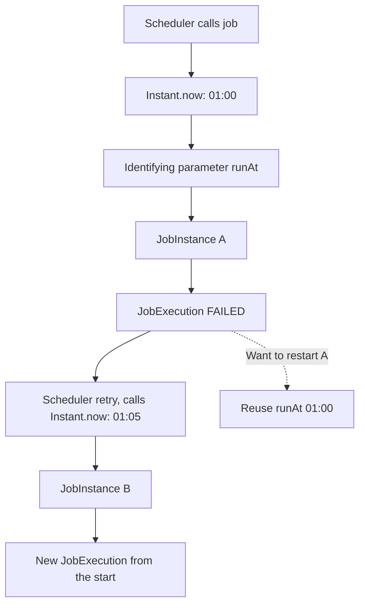

# Is the Current Time Stable as a Parameter?

In Spring Batch, using the current time as a JobParameter is technically valid, but it is not always stable in terms of job identity and restartability. The outcome depends on two things: **when the time is generated** and **whether that parameter is marked identifying**.

If every launch calls now() and puts the result into an identifying parameter, each call usually creates a new JobInstance. When the previous execution fails, the next attempt may be treated as a different logical piece of work and will not continue from the old metadata. Conversely, if a point in time is generated once, stored, and passed unchanged on restart, it can be a stable parameter.

It is important to distinguish the run time from the range of data to process. A batch should usually be identified by a business date, a batch ID, or a fixed time window. The time at which the launch was requested should only be audit information if it does not change the data the job processes.

## 1. What role do JobParameters play in a job's identity?

Spring Batch distinguishes JobInstance from JobExecution:

- A **JobInstance** represents a logical run, identified by the job name and the identifying JobParameters.
- A **JobExecution** represents one specific execution of that instance. An instance can have multiple executions, for example the first execution fails and a later execution restarts successfully.

Therefore, the same job name and the same set of identifying parameters point to the same JobInstance. Non-identifying parameters are stored with the execution to add information, but do not take part in creating the instance identity.

For example, the following two calls produce the same logical identity if businessDate is identifying and requestedAt is non-identifying:

| Parameter | First call | Second call | Identifying? |
|---|---|---|---|
| businessDate | 2026-11-15 | 2026-11-15 | Yes |
| requestedAt | 2026-11-15T01:00:00Z | 2026-11-15T01:04:00Z | No |

In this case, requestedAt changes but does not create a new JobInstance. However, if the code uses requestedAt to select data or change business results, changing it on restart can make the same instance process a different dataset. Therefore, every parameter that affects the content of the work must be kept fixed throughout the instance's lifecycle.

## 2. What happens if every launch passes the current time?

Consider this code:

```java
JobParameters parameters = new JobParametersBuilder()
        .addString("runAt", Instant.now().toString(), true)
        .toJobParameters();

jobLauncher.run(invoiceImportJob, parameters);
```

Instant.now() produces a new value on every call. The runAt parameter is marked true, i.e. identifying. If the application reruns this code after the job fails, the timestamp value will almost certainly be different. Spring Batch treats that as a different JobInstance.

For example:

| Launch | runAt value | Result |
|---|---|---|
| First time | 2026-11-15T01:00:00Z | Creates instance A |
| Retry after failure | 2026-11-15T01:05:00Z | Creates instance B |
| Restart exactly instance A | Reuse 2026-11-15T01:00:00Z | Continues instance A if eligible |

Instance A may still be in the FAILED state while instance B starts processing from the beginning. This can easily produce two processing streams for the same data batch.

### Identity diagram when the timestamp changes



The problem is not the time data type. The problem is that each retry creates a new identifying value, which changes the logical identity.

## 3. When can the current time be an identifying parameter?

A timestamp can be an identifying parameter if each run represents a snapshot or an independent request, and the timestamp is generated once and stored durably so every retry/restart of that request reuses the exact value.

For example:

- A user requests a snapshot report at a specific point in time.
- A process needs to handle data arriving before a fixed cutoff.
- An export has its own version code or data cutoff mark.
- A batch is identified by a time window, such as from 10:00 to 11:00 UTC.

In these cases, the time is no longer "the current hour on each run". It is part of an input contract that has been fixed. If the cutoff changes, the content of the data to process also changes, so creating a new JobInstance may be the correct behavior.

Example of creating a time window at the orchestration layer:

```java
Instant windowStart = Instant.parse("2026-11-15T01:00:00Z");
Instant windowEnd = Instant.parse("2026-11-15T02:00:00Z");

JobParameters parameters = new JobParametersBuilder()
        .addString("windowStart", windowStart.toString(), true)
        .addString("windowEnd", windowEnd.toString(), true)
        .toJobParameters();

jobLauncher.run(invoiceImportJob, parameters);
```

The scheduler or orchestration system needs to store these two values with the batch request. On retry, it resends the same windowStart and windowEnd, without recomputing the window from the current clock.

## 4. Choose parameters by business meaning

Before putting a timestamp into JobParameters, determine what the job needs to distinguish.

| Job goal | Parameter to use | Suggested identification |
|---|---|---|
| Process once per business date | businessDate | Identifying |
| Process one hour or one data range | windowStart, windowEnd | Identifying |
| Import a specific file | fileId, checksum, or an immutable file name | Identifying |
| Process an independent export request | requestId or snapshotId | Identifying |
| Record when the request was sent | requestedAt | Usually non-identifying |
| Record when the application started processing | startedAt or execution metadata | Usually does not need to be passed in |
| Note the caller or the requester | requestedBy, source | Usually non-identifying |

A useful principle: **if changing the parameter value means the job must process a different dataset or business result, that parameter should usually take part in the instance identity**. If the value only serves logging, audit, or request correlation, it usually does not need to be identifying.

Not every timestamp should be identifying. Nor should every timestamp be non-identifying. The decision is based on the meaning of the timestamp in the data contract.

## 5. Use the business date instead of the launch time

For batches that run daily, businessDate is usually more stable and easier to understand than a timestamp precise to the millisecond.

For example, a job that aggregates the transactions of a business date:

```java
LocalDate businessDate = LocalDate.of(2026, 11, 15);

JobParameters parameters = new JobParametersBuilder()
        .addString("businessDate", businessDate.toString(), true)
        .toJobParameters();
```

When the job fails, restart with exactly that business date. If the schedule is delayed from 00:05 to 00:20, businessDate is still the date to process; the job identity does not change just because of when the scheduler actually fires.

### The time zone is part of the business rule

The business date does not necessarily coincide with the UTC date or the server's date. A system may close the day according to the time zone of the market, a branch, or a business contract.

Choose an explicit ZoneId. Do not rely on the server's default time zone because local, container, and production environments may differ.

Example of computing the time range of a day in the business time zone:

```java
ZoneId businessZone = ZoneId.of("Asia/Ho_Chi_Minh");
LocalDate businessDate = LocalDate.of(2026, 11, 15);

Instant windowStart = businessDate
        .atStartOfDay(businessZone)
        .toInstant();

Instant windowEnd = businessDate.plusDays(1)
        .atStartOfDay(businessZone)
        .toInstant();
```

When you need to process a local date, compute the start of the day and the start of the next day in the same ZoneId, and then convert to Instant. Do not assume a local day is always exactly 24 hours long: time zones with daylight saving time changes have days longer or shorter than 24 hours.

In the example, Asia/Ho_Chi_Minh is just an illustrative time zone. Replace it with the time zone prescribed for your system's business.

## 6. Use a fixed time window for incremental batches

Incremental batches usually read records that arise within a range. You should define the range in half-open form:

```sql
WHERE created_at >= :windowStart
  AND created_at <  :windowEnd
```

The range [windowStart, windowEnd) means:

- A record exactly at windowStart is included.
- A record exactly at windowEnd belongs to the next window.
- Two adjacent windows do not overlap at the boundary.

For example, the windows 10:00–11:00 and 11:00–12:00 do not process a record exactly at 11:00 twice.

### Putting the window into JobParameters

```java
JobParameters parameters = new JobParametersBuilder()
        .addString("windowStart", windowStart.toString(), true)
        .addString("windowEnd", windowEnd.toString(), true)
        .addString("requestedAt", Instant.now(clock).toString(), false)
        .toJobParameters();
```

Here, windowStart and windowEnd determine the dataset so they are identifying. requestedAt only records when the request was created so it does not take part in the identity. If you must restart, you should still keep the entire business input of the window unchanged.

The reader or query service takes these two values from the job parameters:

```java
@Bean
@StepScope
JdbcCursorItemReader<Invoice> invoiceReader(
        DataSource dataSource,
        @Value("#{jobParameters['windowStart']}") String startValue,
        @Value("#{jobParameters['windowEnd']}") String endValue) {

    Instant start = Instant.parse(startValue);
    Instant end = Instant.parse(endValue);

    return new JdbcCursorItemReaderBuilder<Invoice>()
            .name("invoiceReader")
            .dataSource(dataSource)
            .sql("""
                    SELECT invoice_id, customer_id, amount
                    FROM invoice
                    WHERE created_at >= ?
                      AND created_at < ?
                    ORDER BY created_at, invoice_id
                    """)
            .preparedStatementSetter(statement -> {
                statement.setTimestamp(1, Timestamp.from(start));
                statement.setTimestamp(2, Timestamp.from(end));
            })
            .rowMapper((resultSet, rowNum) -> new Invoice(
                    resultSet.getString("invoice_id"),
                    resultSet.getString("customer_id"),
                    resultSet.getBigDecimal("amount")))
            .saveState(true)
            .build();
}
```

This is an example illustrating how to pass a fixed range into a reader. The timestamp mapping type must suit the database, the JDBC driver, and the actual column type. With a database that stores TIMESTAMP WITHOUT TIME ZONE, you must define the timezone convention clearly at the application layer; with a time-zone-aware column, check how the driver converts values.

The read order must be stable. ORDER BY created_at, invoice_id uses an additional secondary key to distinguish records with the same timestamp. If the source data can change while the job runs, consider snapshot isolation, staging, or a watermark fixed at the start of the job. Fixing the two parameters alone is not enough to guarantee that a mutable data source returns the same result on restart.

## 7. Do not scatter now() calls during processing

Another design mistake is for each chunk or each item to take the current time to decide the data:

```java
// Avoid: the cutoff changes with the time of each processing call.
Instant cutoff = Instant.now();
return repository.findCreatedBefore(cutoff);
```

If the job lasts 30 minutes, the first and last items can be processed with two different cutoffs. On restart, the cutoff changes again. This means the dataset is no longer determined by a single input contract.

Instead, fix the cutoff once at the start of the run and pass it into the job:

```java
Instant cutoff = Instant.now(clock);

JobParameters parameters = new JobParametersBuilder()
        .addString("cutoff", cutoff.toString(), true)
        .toJobParameters();
```

The steps use the same cutoff from JobParameters. On restart, the system reuses the value stored in the original request.

If the cutoff only serves to record the execution time and does not affect data, it can be non-identifying or you can use the existing metadata time fields such as create/start/end time. There is no need to put every point in time into parameters.

## 8. Use Clock to produce controllable time

Calling Instant.now() or LocalDate.now() directly in many places makes code depend on the system clock, hard to test, and prone to producing different values between calls.

Java provides java.time.Clock to separate the time source from the logic:

```java
@Configuration
public class TimeConfiguration {

    @Bean
    Clock batchClock() {
        return Clock.systemUTC();
    }
}
```

When creating parameters, inject the Clock:

```java
public JobParameters createParameters(
        Clock batchClock,
        Instant windowStart,
        Instant windowEnd) {

    Instant requestedAt = Instant.now(batchClock);

    return new JobParametersBuilder()
            .addString("windowStart", windowStart.toString(), true)
            .addString("windowEnd", windowEnd.toString(), true)
            .addString("requestedAt", requestedAt.toString(), false)
            .toJobParameters();
}
```

Clock.systemUTC() provides the system clock in UTC. If the business needs a local date, use batchClock.withZone(businessZone) when computing LocalDate.

### Testing with a fixed time

You can replace the system clock with a fixed clock in a unit test:

```java
Clock fixedClock = Clock.fixed(
        Instant.parse("2026-11-15T01:00:00Z"),
        ZoneOffset.UTC);

Instant requestedAt = Instant.now(fixedClock);
assertEquals(
        Instant.parse("2026-11-15T01:00:00Z"),
        requestedAt);
```

The test does not need to wait for the real clock and can accurately check the business date, cutoff, or window produced. This is also a way to check that two parameter creations for the same request use the same fixed time value.

## 9. Which times should be identifying and which non-identifying?

Practical rules:

| Time | Example | Recommendation |
|---|---|---|
| Business date | 2026-11-15 | Identifying if an instance processes one date |
| Data range | windowStart, windowEnd | Identifying if the range determines the data |
| Snapshot cutoff | asOf | Identifying if changing the cutoff changes the result |
| Time the request was received | requestedAt | Non-identifying if only for audit |
| Time the application started running | START_TIME in metadata | Usually does not need its own parameter |
| Completion time | END_TIME in metadata | Usually does not need its own parameter |
| Time each record is processed | processedAt | Consider the semantics; do not arbitrarily take now() on each retry |

A non-identifying parameter is still stored in the execution's metadata. "Non-identifying" does not mean not stored; it only means that value does not take part in identifying the JobInstance.

If a non-identifying parameter is used to decide data, changing the value between executions of the same instance can make one instance carry two business meanings. Therefore, do not use the non-identifying flag as a way to avoid creating a new instance when the parameter actually changes the result.

## 10. Is a timestamp a good unique run code?

A timestamp can distinguish multiple runs, but it is not always a reliable unique key:

- Two requests can arrive within the same timestamp resolution the application stores.
- Multiple machines can have skewed clocks.
- A timestamp can be rounded or normalized differently between systems.
- The same retried request can receive a new timestamp if the parameters are recreated.

If you need to identify an independent request, a unique requestId or batchId is usually clearer. Generate the ID once where the request is received, store it durably, and reuse it on retry.

Example:

```java
String batchId = request.batchId(); // ID already stored at the orchestration layer

JobParameters parameters = new JobParametersBuilder()
        .addString("batchId", batchId, true)
        .addString("requestedAt", request.requestedAt().toString(), false)
        .toJobParameters();
```

If a request can be resent, the orchestration system needs to keep the same batchId for the same logical request. If a new UUID is generated every time a message is redelivered, the problem of creating a new instance still appears even without using a timestamp.

## 11. How do retry, restart, and reprocess differ?

These three behaviors are often confused when designing timestamp parameters.

### Retry at the orchestration layer

A scheduler or message consumer tries to resend the same request because it has not received an acknowledgment. That request should carry the same business key, batchId, or data window. Do not create a new identifying timestamp for each redelivery.

### Restart a failed JobExecution

A restart continues the same JobInstance. The identifying parameters must match the original instance. Use the restart functionality supported by Spring Batch or reuse the exact set of identifying parameters in the way the launch is configured.

### Reprocess a completed batch

Reprocess is a new business request to process the data again. It needs to be distinguished deliberately, for example with reprocessVersion, reprocessRequestId, or a new batch ID. You must determine whether the writer will skip, update, or create a new data version.

A decision table:

| Situation | Identifying parameters |
|---|---|
| Restart a failed job | Keep unchanged |
| Scheduler redelivers the same request | Keep the same business key/window/batch ID |
| Process the next business date | Change businessDate |
| Process the next hourly window | Change windowStart and windowEnd |
| Intentional reprocess | Create a new ID/version per business rules |

Do not use a new timestamp to simulate a reprocess if there is no corresponding data policy. Creating a new instance does not by itself make the writer safe against duplicate writes.

## 12. Combining JobParameters with idempotency

Keeping identifying parameters stable helps Spring Batch recognize the right instance, but does not by itself guarantee business data is not written twice.

For example, a writer calls an HTTP service. The service has received the request and created a transaction, but the application loses the connection before receiving the response. On restart, the writer may resend the request. The metadata cannot know for sure whether the external service has already performed the transaction.

Commonly used measures:

- Use batchId or sourceRecordId as the idempotency key in the target system.
- Place a unique constraint on the business key.
- Use upsert or conditional insert.
- Write data to staging and then merge by a stable key.
- Use a transactional outbox to publish events after committing business data.

Job identity answers "which logical batch is this"; idempotency answers "if an operation is resent, does the system create a duplicate result". The two mechanisms complement each other.

## 13. Common mistakes when using time as a parameter

### Calling Instant.now() on every retry

If the timestamp is identifying, the retry creates a new instance. Store the business window or batch ID as soon as the request is received and reuse it.

### Using LocalDateTime without a time zone

LocalDateTime only represents a calendar date and time, and does not identify a single point in time globally. For cross-system data, prefer Instant or a local date-time paired with an explicit ZoneId.

### Using the machine's default time zone

Local and production machines can have different time zones. Configure the business time zone explicitly and convert to Instant when storing data boundaries.

### Recomputing the cutoff in each step

Steps can read different datasets if each step calls now() at a different time. Fix the cutoff once and pass it through JobParameters or ExecutionContext according to the scope of use.

### Putting an audit time into the job identity

A requestedAt precise to the millisecond usually turns every launch into a new instance even if the business data is the same. If you only need audit, keep it non-identifying or rely on the time in the metadata.

### Using a timestamp as a unique key without normalizing its precision

One system may store milliseconds while another stores microseconds or rounds down to seconds. Normalize the format and precision at the integration boundary; use a separate ID when uniqueness is needed.

### Treating the same time window as the same data snapshot

Fixed parameters do not freeze the source data. If records can arrive late or be edited, a restart can read different results. You need a snapshot, staging, a watermark, or rules for handling late-arriving data.

## 14. Implementation pattern: a restartable daily job

The example below combines a business time zone, a Clock, a business date, and a half-open window. The business date is fixed once, after which every restart reuses exactly the same businessDate, windowStart, and windowEnd.

```java
@Configuration
public class BatchTimeConfiguration {

    @Bean
    Clock batchClock() {
        return Clock.systemUTC();
    }

    @Bean
    ZoneId businessZone() {
        return ZoneId.of("Asia/Ho_Chi_Minh");
    }
}
```

A service that creates parameters for one processing run:

```java
@Service
public class DailyBatchParametersFactory {

    private final Clock clock;
    private final ZoneId businessZone;

    public DailyBatchParametersFactory(
            Clock clock,
            ZoneId businessZone) {
        this.clock = clock;
        this.businessZone = businessZone;
    }

    public JobParameters forBusinessDate(LocalDate businessDate) {
        Instant start = businessDate
                .atStartOfDay(businessZone)
                .toInstant();
        Instant end = businessDate.plusDays(1)
                .atStartOfDay(businessZone)
                .toInstant();

        return new JobParametersBuilder()
                .addString("businessDate", businessDate.toString(), true)
                .addString("windowStart", start.toString(), true)
                .addString("windowEnd", end.toString(), true)
                .addString(
                        "requestedAt",
                        Instant.now(clock).toString(),
                        false)
                .toJobParameters();
    }
}
```

The scheduler should determine businessDate from the business calendar and pass that date into the factory. If the scheduler retries the same schedule run, it must keep the chosen date instead of calling LocalDate.now() at a different time and creating a new date.

In a production application, you can store the batch request in an orchestration table before launching:

| batch_id | business_date | window_start | window_end | status |
|---|---|---|---|---|
| daily-20261115 | 2026-11-15 | 2026-11-14T17:00:00Z | 2026-11-15T17:00:00Z | PENDING |

The orchestration table holds the stable input and the request state at the application level. The JobRepository continues to hold Spring Batch's execution metadata. The two have different purposes and can be linked by batchId.

## 15. Decision checklist before using time as a JobParameter

Before adding a timestamp, answer:

1. Does the timestamp represent the request time, the run time, or a data boundary?
2. If rerun after a failure, is that value preserved?
3. If the value changes, does the job need to be treated as a different JobInstance?
4. Does the parameter affect the dataset or the business result?
5. Have the time zone and timestamp precision been defined?
6. If the scheduler sends the same request twice, does it reuse the same business key or batch ID?
7. Is the writer idempotent if an item is processed again?
8. Can the source data change while the job runs or between two restarts?

If the timestamp only records the launch time, consider the existing time metadata or a non-identifying parameter. If the timestamp determines a snapshot/cutoff, fix the value once and use it as an identifying input. If you need a unique ID for a request, use a durable request ID or batch ID.

## 16. Practical conclusion

The current time can be used as a JobParameter, but a fresh now() call on every launch is not stable for restart when that parameter is identifying. Spring Batch uses identifying parameters to identify the JobInstance; if just one value changes, the run can become a different instance.

For scheduled batches, prefer a business date or a fixed data window. For snapshots, fix the cutoff once. For audit, use a non-identifying time or execution metadata. Use a Clock and an explicit time zone to produce controllable time, and keep the business input unchanged on restart.

Remember that job identity and idempotency are two separate problems. A stable parameter helps the framework continue the right instance; an idempotent writer and a reproducible data source help make business results safe on retry or restart.
