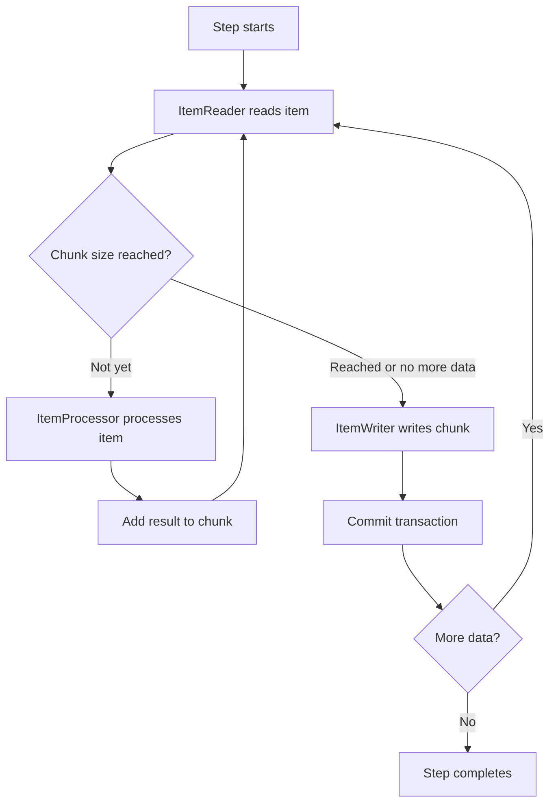
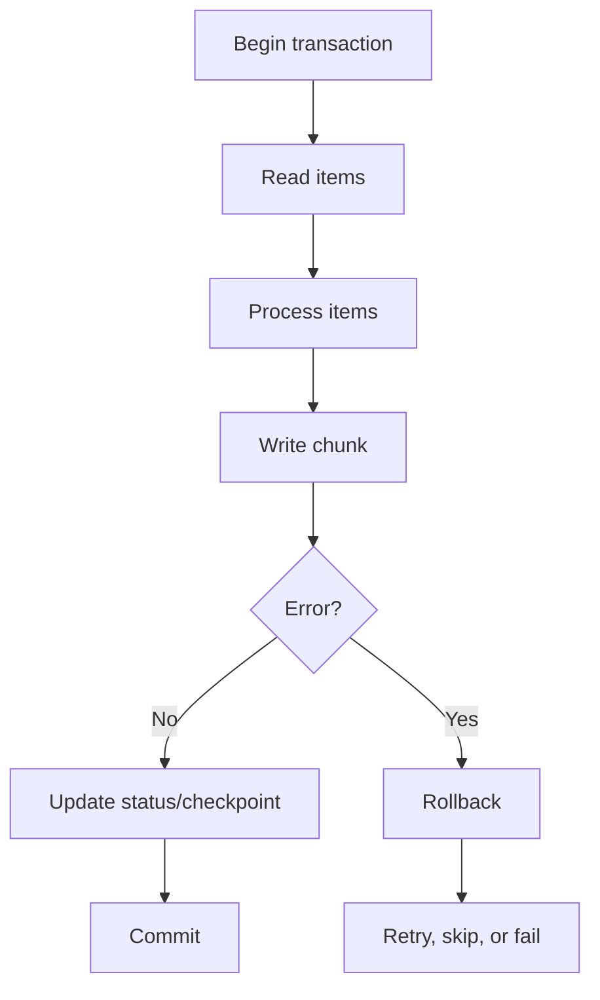

# What is chunk-oriented processing?

Chunk-oriented processing is a model in Spring Batch for processing data in small groups (chunks). Instead of reading all the data into memory and then processing and writing it in one go, the step reads a number of items, processes each item, writes the results of that group, and commits the transaction. After a chunk completes, the step continues with the next chunk until there is no more data.

This model suits jobs that import data, transform data, reconcile records, run periodic calculations, and export reports with many records. It helps control memory, define transaction boundaries, track progress, and support recovery when part of the work fails.

## 1. Why process in chunks?

Suppose an application needs to import 2 million transactions from a CSV file into a database. If it reads all 2 million lines into a list, the application can consume a lot of memory. If it writes each line in its own transaction, the number of commits is very large and the transaction overhead can reduce throughput. If it writes all 2 million lines in a single transaction, the transaction can run too long, hold locks for a long time, and be hard to recover when an error occurs.

Chunk-oriented processing divides the work into groups of a configurable size. For example, with a chunk size of 500, the step processes 500 items in one unit of transaction, then commits and moves on to the next group.

The main benefits:

- **Memory control:** only the group of items being processed needs to be held, instead of the entire input data.
- **Lower commit cost:** write many items in one transaction instead of committing after each item.
- **Limited rollback scope:** when a chunk fails, that chunk's transaction can be rolled back.
- **Progress tracking:** Spring Batch records metadata about the number of items read, written, filtered, and skipped, as well as the step status.
- **Restart support:** a reader that can save state can store a checkpoint so the step continues from an appropriate position after the job is interrupted.

A chunk does not mean reading a complete file into an array. It is a unit of processing that is repeated throughout the lifecycle of the step.

## 2. The read – process – write flow

A chunk-oriented step usually consists of three components:

- **`ItemReader`:** reads an item from a data source, such as a CSV line, a database record, or a message.
- **`ItemProcessor`:** optional; validates, filters, transforms, or enriches the item.
- **`ItemWriter`:** receives the output items of the chunk and writes them to a destination, such as a database, a file, or another system.

The general processing flow:



The diagram simplifies how the framework orchestrates the work. In practice, the reader may finish before the chunk size is reached; the processor may filter items; and errors can lead to rollback, retry, or skip depending on the configuration.

### ItemReader

`ItemReader<T>` reads data one item at a time. Each call to `read()` usually returns one item, or `null` when there is no more data.

For example, a reader can read the lines in a file one by one:

```java
public class OrderReader implements ItemReader<Order> {

    private final Iterator<Order> orders;

    public OrderReader(List<Order> orders) {
        this.orders = orders.iterator();
    }

    @Override
    public Order read() {
        return orders.hasNext() ? orders.next() : null;
    }
}
```

This is an illustrative example of a simple reader. With large data, you should usually use a reader that supports paging, cursors, or streaming to avoid loading all the data into a list before the job starts.

### ItemProcessor

`ItemProcessor<I, O>` receives an input item and returns an output item. It is commonly used to validate, normalize, calculate, or convert data types.

```java
public class OrderProcessor implements ItemProcessor<Order, ProcessedOrder> {

    @Override
    public ProcessedOrder process(Order order) {
        if (order.isCancelled()) {
            return null; // Filter out cancelled orders
        }

        return new ProcessedOrder(
                order.getId(),
                order.getAmount().multiply(new BigDecimal("1.08"))
        );
    }
}
```

The processor can return `null` to filter an item. The item has been read but is not passed to the writer. This is a business decision, not an exception, and it is not counted as a skipped item.

The processor can also throw an exception. If the step is configured to be fault-tolerant, some exceptions can be retried or skipped; otherwise, the error can cause the step to fail.

### ItemWriter

`ItemWriter<O>` receives a group of output items and writes them. A single writer call can handle many items at once, for example a batch insert into a database.

In Spring Batch 5, the `write` signature uses `Chunk<? extends T>`. Older versions have a writer API that takes `List<? extends T>`, so you need to use the correct signature for the project's version.

The writer should perform writes in batches when the target system supports it, and it must clearly define which transaction manages the write operation. If the writer calls an API or writes to a system that does not participate in the same transaction, a database rollback does not automatically undo that side effect.

## 3. Chunk size and commit interval

Chunk size is the number of items read to form a chunk before the writer writes the results and the transaction commits. In Spring Batch configuration, this value is usually called the *commit interval*.

For example, with a chunk size of 100:

1. The reader reads up to 100 items for the current chunk.
2. The processor handles each item, and can transform or filter it.
3. The writer writes the chunk's output items.
4. If processing succeeds, the transaction commits.
5. The step continues with the next chunk.

Suppose there are 1,050 input items and no errors or filters:

| Chunk | Input items | Result |
|---|---:|---|
| Chunk 1 | 100 | Write and commit |
| Chunk 2 | 100 | Write and commit |
| Chunk 3 | 100 | Write and commit |
| ... | ... | ... |
| Chunk 10 | 100 | Write and commit |
| Chunk 11 | 50 | Write and commit the remainder |

The last chunk can be smaller than the chunk size when the reader runs out of data. In the example above, the step processes 10 full chunks and a final chunk of 50 items.

Chunk size is the number of input items in the chunk, and it is not necessarily equal to the number of items the writer writes. If the processor filters 10 items in a chunk of 100 items, the writer receives at most the remaining 90 items, not counting items skipped because of errors.

### What does chunk size affect?

| Chunk size | Advantages | Trade-offs |
|---|---|---|
| Small, for example 10 | Short transactions, fewer items to reprocess in a failed chunk, easy memory control | More commits, higher transaction overhead and more writer calls |
| Medium, for example 100–500 | Balances commit cost, memory, and recoverability in many workloads | Needs real measurements to choose a suitable value |
| Large, for example 5,000 | Can reduce the number of commits and make good use of batch writes | Longer transactions, more memory use, and rollback can be expensive |

There is no single optimal chunk size for every job. Consider:

- The average size of each item and the temporary data in the processor.
- The read speed of the source and the write speed of the destination.
- The commit cost and the database's batch insert/update capability.
- Lock holding time and the level of data contention.
- Tolerance for rollback, retry, and restart.
- The maximum time a transaction is allowed to run.

Start with a moderate value, measure processing time, memory usage, the number of commits/rollbacks, and database load, then adjust based on real data.

## 4. The transaction boundary of a chunk

In a standard chunk-oriented step, Spring Batch uses a transaction manager to manage a unit of processing. The transaction usually begins before the chunk is processed and is committed after the writer completes successfully along with the related status updates.



When a transaction commits successfully, the data written in that transaction becomes durable according to the mechanism of the resource participating in the transaction. When a transaction rolls back, the changes belonging to that transaction are undone.

The transaction boundary depends on the `PlatformTransactionManager` and the enlisted resources. If the reader or writer operates on multiple systems with different transaction managers, you should not assume that all resources will commit or roll back atomically together. Coordinating multiple systems requires a dedicated design, such as an outbox, idempotency, or a reconciliation process.

### What happens when a chunk fails?

Suppose a chunk has 100 items. The reader and processor have finished, and the writer starts writing but hits an error midway. If the error makes the transaction fail and is not successfully skipped/retried, the chunk's transaction is rolled back for the operations participating in that transaction.

Previous chunks that have already committed are kept. When the job is restarted, Spring Batch can continue from an appropriate checkpoint if the reader supports saving and restoring state. The chunk that failed may have to be read and processed again.

This creates an important benefit: an error in the current chunk does not necessarily wipe out all the work already completed. However, external side effects may have already occurred and must be handled with an idempotent design.

## 5. Example chunk-oriented step configuration

In Spring Batch 5, you can build a chunk-based step with `StepBuilder` and pass in the `JobRepository` and `PlatformTransactionManager`:

```java
@Configuration
public class ImportJobConfiguration {

    @Bean
    public Step importOrdersStep(
            JobRepository jobRepository,
            PlatformTransactionManager transactionManager,
            ItemReader<Order> orderReader,
            ItemProcessor<Order, ProcessedOrder> orderProcessor,
            ItemWriter<ProcessedOrder> orderWriter) {

        return new StepBuilder("importOrdersStep", jobRepository)
                .<Order, ProcessedOrder>chunk(500, transactionManager)
                .reader(orderReader)
                .processor(orderProcessor)
                .writer(orderWriter)
                .build();
    }
}
```

In the example:

- `Order` is the item type the reader returns.
- `ProcessedOrder` is the item type the processor produces and the writer receives.
- `chunk(500, transactionManager)` sets the commit interval to 500 items and specifies the transaction manager for the chunk.
- `.reader(...)`, `.processor(...)`, and `.writer(...)` attach the processing components to the step.
- `JobRepository` stores the metadata of the step and job executions.

If you do not need to transform the data, you can skip the processor and configure the reader/writer accordingly. If the step performs only a single operation such as calling a stored procedure or cleaning up a directory, a `Tasklet` can express the intent more clearly.

Older versions of Spring Batch may use a different configuration API, for example `StepBuilderFactory` or a writer declaration that takes a `List`. Follow the API of the version in use.

## 6. End-of-input and the last chunk

`ItemReader` signals that there is no more data by returning `null`. If the reader returns `null` when the current chunk has not reached its size, Spring Batch still processes the items already read in the last chunk and then ends the step.

For example, the chunk size is 100 but only 35 items remain:

- The reader reads 35 items.
- The next read returns `null`.
- The processor handles the 35 available items.
- The writer writes the remaining output items.
- The transaction commits if processing succeeds.
- The step ends because there is no more data.

There is no need to pad with dummy items to reach the chunk size. A last chunk smaller than configured is normal behavior.

If the reader returns `null` too early because of a logic error, the step can finish successfully while the data has not been fully processed. Therefore, you need to define the reader's termination condition clearly, especially when using cursors, paging, or reading from an API.

## 7. Filter, skip, and retry in chunk processing

Chunk-oriented processing can be combined with Spring Batch's error-handling policies.

### Filter

The processor returns `null` to exclude an item from the output. The item has been read but the writer does not receive it. For example, a job imports only paid orders, so the processor filters out pending orders.

### Skip

If the reader, processor, or writer throws an exception, the application can configure the exception types that are allowed to be skipped and limit the number of skips. A skipped item is not written as a successful item. The counters `readSkipCount`, `processSkipCount`, and `writeSkipCount` show which phase the error occurred in.

### Retry

Retry suits transient errors that can disappear after a while, for example database lock errors or service timeouts. Spring Batch can retry the operation according to a configured policy. If the retry succeeds, the item can continue to be processed; if the attempts are exhausted, the error can cause the step to fail, or the item is skipped if the policy allows.

A high-level example of a fault-tolerant configuration:

```java
return new StepBuilder("importOrdersStep", jobRepository)
        .<Order, ProcessedOrder>chunk(500, transactionManager)
        .reader(orderReader)
        .processor(orderProcessor)
        .writer(orderWriter)
        .faultTolerant()
        .skip(InvalidOrderException.class)
        .skipLimit(100)
        .retry(DeadlockLoserDataAccessException.class)
        .retryLimit(3)
        .build();
```

This is an illustrative policy example: skip acceptable business data errors and retry deadlock errors that are likely to be transient. In a real application, you need to confirm the exception classes against the technology stack and the Spring Batch version, and avoid skipping infrastructure errors that could corrupt data.

## 8. Restart and checkpoint

Spring Batch stores execution metadata in the `JobRepository`. With a reader that supports saving state, the framework can store the necessary information in the `ExecutionContext` at commit boundaries. When the job is interrupted and restarted, the reader can restore the processed position and continue from the checkpoint.

For example, a file has 10,000 lines and the chunk size is 500. After 8 chunks have committed, the server stops. If the reader can save state and the job is restarted with the same `JobInstance`, the next run can continue from the position after the 4,000 committed items instead of reprocessing the entire file.

Restartability depends on:

- Whether the reader supports saving and restoring state.
- The `ExecutionContext` being persisted durably in the `JobRepository`.
- The job being configured to allow restart and using the correct identifying parameters.
- Whether the data source is stable between runs; for example, the input file's content is not changed after the checkpoint was created.
- Whether the writer and side effects can be safely re-run.

A custom-written reader may need to implement `ItemStream` to open, update, and close resources as well as save checkpoints. Not every reader automatically restores its read position.

Restart also does not mean exactly-once across all systems. If the writer calls a partner API, an email that has been sent, or a file exported outside the transaction, these may not be rolled back. Use an idempotency key, a unique constraint, an outbox, or a reconciliation mechanism to avoid duplicate side effects when a chunk is re-run.

## 9. How do chunk-oriented processing and Tasklet differ?

In Spring Batch, both chunk-oriented steps and tasklet steps are executed as a step. The difference lies in how the work is modeled.

| Criterion | Chunk-oriented | Tasklet |
|---|---|---|
| Purpose | Process many items in groups | Perform a specific task |
| Components | Reader, optional processor, writer | A `Tasklet` with an execution method |
| Commit boundary | Usually after each chunk | According to the transaction of the tasklet invocation and how the tasklet is configured |
| Examples | Import a million customers, transform transactions | Delete temporary files, call a stored procedure, prepare a directory |
| Item counters | Directly meaningful for the item pipeline | Usually no standard read/write counters if the tasklet does not manage items |

Choose chunk when the data can be represented as independent items or processed in groups. Choose tasklet when the work is a single operation or a short procedure that does not need a reader-processor-writer pipeline.

## 10. Monitoring the metrics of a chunk-oriented step

Spring Batch records metrics in `StepExecution`. Commonly used metrics include:

| Metric | Meaning |
|---|---|
| `readCount` | Number of items the reader returned successfully |
| `writeCount` | Number of items the writer wrote successfully according to step metadata |
| `filterCount` | Number of items the processor filtered by returning `null` |
| `readSkipCount` | Number of read errors skipped |
| `processSkipCount` | Number of processing errors skipped |
| `writeSkipCount` | Number of write errors skipped |
| `commitCount` | Number of commits recorded |
| `rollbackCount` | Number of rollbacks recorded |

These metrics help distinguish whether a step is slow because of reading the source, CPU processing, writing the destination, or rollback/retry. For example, if `readCount` rises quickly but `writeCount` is low, it may be due to many filters or skips. A high `rollbackCount` can indicate that transactions hit deadlocks, timeouts, or writer errors.

Do not infer everything from a single counter. Look at the step status, exit status, exceptions, processing time, and the load on the source/destination together.

## 11. Improving performance and points to watch

### Choose a suitable reader

With large data, avoid readers that load all the data into memory. Use cursor or paging readers for databases, flat-file readers for large files, and streaming readers suited to other data sources. With paging, you need a stable sort order and consistent paging conditions to avoid missing or duplicate reads when the source data changes.

### Use batch writes

If the database supports batch insert/update, the writer should take advantage of it to reduce the number of round-trips. However, a batch write must preserve the correct transaction boundary and clearly handle the case where one record in the batch causes an error.

### Avoid overly heavy processing inside the transaction

Do not keep a transaction open for a long time waiting on a slow API or performing tasks outside the database. If you need to call a remote service, consider timeouts, an outbox, or splitting into separate steps to limit the transaction time.

### Measure before increasing chunk size

A large chunk can increase throughput thanks to fewer commits, but it also increases memory and rollback time. A small chunk reduces the scope of each transaction but increases overhead. Measure on representative data and an environment close to production.

### Consider concurrency

Chunk-oriented processing can be combined with partitioning or other parallel mechanisms. However, many workers writing to the same table can cause contention, deadlocks, or reduced throughput. You need to split the data by non-overlapping keys or partitions, control the number of workers, and ensure the reader/writer are safe for the chosen execution approach.

## 12. A real-world example: importing orders from CSV

A system receives an `orders.csv` file containing 250,000 orders. The job needs to check status, normalize currency, filter out cancelled orders, and write valid data to the database.

Step design:

1. `FlatFileItemReader` reads each line and maps it to `OrderInput`.
2. `OrderProcessor` validates the data, converts it to `OrderRecord`, and returns `null` for cancelled orders.
3. `JdbcBatchItemWriter` writes the chunk's `OrderRecord`s to the target table.
4. The initial chunk size is set to 500 to measure performance.
5. The skip policy allows skipping some identified format or business errors; database connection errors are handled by retry or by failing the step.
6. `JobRepository` stores metadata and checkpoints to support monitoring and restart.

If there are no filters or skips, 250,000 items produce 500 chunks with a chunk size of 500. If there are 12,000 cancelled orders, the writer receives at most 238,000 items, equivalent to 476 full chunks if the items are evenly distributed and there are no errors; the actual number of chunks depends on how the reader forms groups and the number of output items per chunk.

Suppose the job has committed 300 chunks and then the server stops. The committed chunks are kept in the database. After the cause is fixed, the job can be restarted with the same identifying parameters. A reader that supports checkpoints will continue from an appropriate position. If a chunk called a partner API before it rolled back, the application needs an idempotency mechanism to avoid sending duplicate requests when the chunk is re-run.

## 13. When should you use chunk-oriented processing?

Chunk-oriented processing is suitable when:

- The input data can be read sequentially or page by page into items.
- Each item needs to be validated, transformed, or enriched before being written.
- You need to process thousands or millions of records while still controlling memory.
- You want to write in batches and commit in groups to balance throughput with transaction safety.
- You need read/write/filter/skip metrics and the ability to restart from a checkpoint.

It may not be the simplest choice when:

- The work is just a short operation with no set of items; a tasklet is more suitable.
- You need to process each event continuously with very low latency; a streaming or message-driven system may be more suitable.
- The data and computation need to be distributed at a scale beyond the capability of a single batch application; a dedicated distributed processing platform may be needed.

Choosing the chunk size and processing model should be based on the characteristics of the data, the source/destination systems, and operational requirements.

## 14. Principles to remember

- Chunk-oriented processing divides a step into groups of items; each group is read, processed, written, and committed within one transaction boundary.
- `ItemReader` reads items; the optional `ItemProcessor` transforms or filters; `ItemWriter` writes the group of results.
- The reader returns `null` when there is no more data; the last chunk can be smaller than the chunk size.
- Chunk size is usually the commit interval, i.e. the number of input items in a chunk before commit.
- The number of items the writer writes can be less than the number the reader reads because the processor filters or errors are skipped.
- A transaction rollback only undoes the operations participating in that transaction; external APIs, emails, or files may need their own idempotency.
- `JobRepository` and `ExecutionContext` support storing metadata/checkpoints; restartability depends on the reader and configuration.
- A large chunk size reduces the number of commits but can increase memory, transaction time, and rollback scope.
- Use chunk for an item pipeline; use tasklet for a specific task that does not need reader-processor-writer.
- Measure read/write/filter/skip, commit/rollback, and processing time to tune performance.

Chunk-oriented processing helps Spring Batch break large data into manageable units. When combined with a suitable reader, a processor with clear rules, a writer that writes in batches, and a properly designed transaction/checkpoint, a job can achieve good throughput while remaining monitorable and recoverable in a controlled way.
