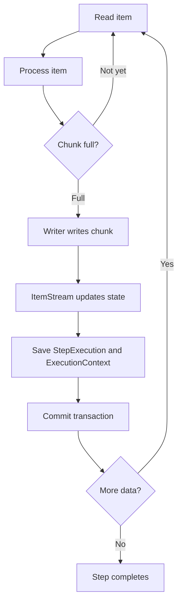
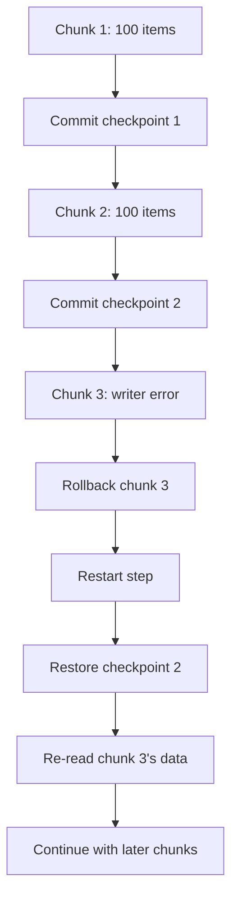

# Checkpoint after each chunk

In Spring Batch, chunk-oriented processing divides data into groups of items. Each group is read, processed, and written in one transaction. When the chunk completes and the transaction commits, Spring Batch saves the execution state so that a restart can continue from the nearest checkpoint.

A checkpoint is a confirmed progress marker of a step. It usually includes how far the reader has processed or some other small state needed to restore reading. Spring Batch stores this state in the `ExecutionContext` of the `StepExecution`, along with the step's metadata in the `JobRepository`.

For example, a step reading 10,000 lines from a file with a chunk size of 100 processes the data through many chunks. After each chunk is committed, the reader can save the position it has read. If the process stops after the 37th chunk commits, a restart can begin from the data following that checkpoint instead of re-reading from the start of the file.

A checkpoint makes a job effectively restartable, but it does not by itself guarantee that every external effect happens exactly once. If a writer sends an HTTP request or publishes a message and then the database transaction rolls back, a re-run can repeat that side effect. Therefore, a checkpoint needs to be combined with an appropriate transaction, a reader that can restore state, and an idempotent writer.

## 1. How do chunks and checkpoints relate to each other?

In a chunk-oriented step, Spring Batch performs a processing cycle per group:

1. The reader reads the items.
2. The processor transforms or filters each item if configured.
3. The writer writes the items in the chunk.
4. The `ItemStream` components update their state into the `ExecutionContext`.
5. Spring Batch updates the `StepExecution` metadata and saves the execution context.
6. The chunk's transaction commits.

A general diagram:



With the configuration:

```java
@Bean
Step importOrdersStep(
        JobRepository jobRepository,
        PlatformTransactionManager transactionManager,
        ItemReader<OrderInput> reader,
        ItemProcessor<OrderInput, Order> processor,
        ItemWriter<Order> writer) {

    return new StepBuilder("importOrdersStep", jobRepository)
            .<OrderInput, Order>chunk(100, transactionManager)
            .reader(reader)
            .processor(processor)
            .writer(writer)
            .build();
}
```

`chunk(100, transactionManager)` sets the commit interval to 100 items. When the reader supplies 100 items, Spring Batch processes and writes that group in the chunk's transaction. After the chunk commits, the step has a new checkpoint.

A chunk does not necessarily contain exactly 100 items that the writer writes. The processor can return `null` to filter an item; the skip policy can also skip some failing items. The commit interval controls the number of items read in a chunk according to the step's processing mechanism, while the number of items the writer actually receives can be lower.

## 2. Where is a checkpoint stored?

A step's restart state is stored in the `ExecutionContext` belonging to the `StepExecution`:

```java
ExecutionContext context = stepExecution.getExecutionContext();
context.putLong("orders.lastProcessedId", 8450L);
```

With a common JDBC configuration, Spring Batch stores the step execution context in the metadata table `BATCH_STEP_EXECUTION_CONTEXT`. Other step metadata, such as `readCount`, `writeCount`, `commitCount`, `rollbackCount`, `skipCount`, `BatchStatus`, and `ExitStatus`, is managed in the `StepExecution` and stored in the corresponding metadata tables.

A checkpoint usually holds small values such as:

- The number of items the reader has confirmed at the checkpoint.
- The offset or line number of the file that has been read.
- The last key in a paged query with a stable order.
- The next page to process.
- Custom state that a tasklet or reader needs to continue.

Do not store all the items read or business results in the `ExecutionContext`. The context is for state that needs to be restored; business data should still live in tables or data stores managed by the application.

The Step ExecutionContext differs from the Job ExecutionContext. The Step context is for the checkpoint of a specific step. The Job context is used to share a few small values between steps in the same `JobExecution`; it does not replace each step's own checkpoint.

## 3. How does ItemStream update the checkpoint?

Spring Batch uses the `ItemStream` interface so that readers and writers participate in the checkpoint lifecycle. This interface defines three methods:

| Method | Role |
|---|---|
| `open(ExecutionContext)` | Initialize the stream and read the saved state to restore the position |
| `update(ExecutionContext)` | Write the current internal state into the context at a checkpoint |
| `close()` | Close the stream and release resources |

`ItemStreamReader` and `ItemStreamWriter` combine this contract with the item reading or writing function. In a chunk-oriented step, Spring Batch calls `update()` when preparing to save the chunk's checkpoint. Standard readers such as `FlatFileItemReader` manage the necessary state themselves, as long as state saving is enabled and the reader is registered correctly with the step.

An example `FlatFileItemReader` configuration:

```java
@Bean
@StepScope
FlatFileItemReader<OrderInput> orderReader(
        @Value("#{jobParameters['inputFile']}") Resource inputFile) {

    return new FlatFileItemReaderBuilder<OrderInput>()
            .name("orderReader")
            .resource(inputFile)
            .delimited()
            .names("orderId", "customerId", "amount")
            .targetType(OrderInput.class)
            .saveState(true)
            .build();
}
```

The reader name must be stable so that its state keys are recognized across runs. `.saveState(true)` lets the reader save the position needed to restart; this is also the common default behavior of this reader, but declaring it explicitly expresses the intent.

If a custom reader or writer does not implement `ItemStream`, or does not save state, Spring Batch cannot infer the position to restore on its own. For a delegate stream wrapped in another component, you need to register the delegate with the step when the builder does not recognize it automatically. In Spring Batch, the builder provides the `.stream(...)` method to register an additional `ItemStream`.

## 4. When is a checkpoint saved?

A checkpoint is created at the chunk's commit boundary, not after each `read()` call and not after each item the processor handles.

In a normal chunk, the writer is called before the stream updates the checkpoint state. Spring Batch then updates the execution context and the step metadata while completing the chunk. With a normal configuration, the metadata updates and the chunk's business data writes are coordinated within the step's transaction. When the transaction commits successfully, that checkpoint becomes the durable state for restart.

This has a practical implication: the value called a checkpoint must represent progress confirmed at a transaction boundary. If you only update an in-memory variable when the reader reads an item, that variable is not yet a durable checkpoint. It becomes state usable after a restart only when `ItemStream.update()` puts it into the context and Spring Batch saves the context successfully.

The detailed order of metadata updates can depend on the version and the repository/transaction manager configuration. What must be guaranteed in a real runtime environment is that the business write and the metadata checkpoint have a consistent transaction boundary. When the business data and metadata use the same database with the same transaction manager, they can usually commit or roll back together. If they are in different resources or transaction managers, you must not assume end-to-end atomicity by default.

## 5. What happens when a chunk succeeds or fails?

Suppose a step reads an orders file with a chunk size of 100.

### The chunk commits successfully

The reader has read 100 items, the processor processed them, and the writer wrote successfully. Spring Batch updates the context, the step metadata, and commits the transaction. The new checkpoint corresponds to the portion of data just confirmed.

If the job fails in a later chunk, a restart can use the latest committed checkpoint and continue from the next group of data.

### An error before the chunk commits

If the writer throws an exception or the transaction is rolled back before the chunk commits, the changes belonging to that transaction are undone. The current chunk's checkpoint metadata is also not committed if it participates in the same transaction. On restart, the reader restores the previous checkpoint and the items of the uncommitted chunk can be read, processed, and written again.

Therefore, some items may be processed again. This is normal behavior of the checkpoint-based restart mechanism. The writer needs to be safe to re-run, especially if the write operation can create side effects outside the current transaction.

### An error after the chunk commits

If a chunk has committed and a step or chunk afterward fails, the data and the checkpoint of the committed chunk are still retained. On restart, Spring Batch can continue from the latest checkpoint instead of rewriting all the earlier data.

An example diagram:



The example above assumes the reader supports restart and that the business write and the metadata checkpoint are coordinated correctly. If the writer calls an external system or uses a resource outside the transaction, the side effect may have already occurred even though the database chunk rolled back; handle it separately with idempotency or reconciliation.

## 6. How does the commit interval affect checkpoints?

The commit interval defines the number of items gathered into a chunk before commit. It also determines how often checkpoints are created in a chunk step.

| Commit interval | Advantages | Trade-offs |
|---|---|---|
| Small, for example 10 | Frequent checkpoints; small rollback scope; few items to re-read after an incident | More transactions and metadata updates; overhead can be high |
| Medium, for example 100 | Balances commit frequency and transaction cost in many cases | Needs measurement against the actual data size and processing time |
| Large, for example 1,000 | Fewer commits; can increase throughput when the system suits it | Longer transactions; more memory use; rollback can affect more items |

There is no optimal commit interval for every job. Consider:

- The size and complexity of each item.
- The time the reader, processor, and writer take to handle an item.
- The transaction timeout and lock limits of the database.
- The memory needed to hold the items in a chunk.
- The cost of commits and saving metadata.
- How frequently errors occur and how much rework is acceptable.
- The impact of retry or skip within a chunk.

For example, a chunk size of 1 creates one transaction per item, so the checkpoint can be updated very frequently but the transaction overhead is large. A chunk size of 10,000 reduces the number of commits but can hold many items in memory and make transactions run long. You need to measure throughput, commit time, lock waits, and restartability using data close to reality.

## 7. Example of a custom reader that saves a checkpoint by key

With database data, you can save the last processed key so that the next time you query records with a larger key. This approach is usually more stable than saving a line sequence number if the dataset can change.

The example below illustrates the idea for a reader ordered by `order_id`:

```java
public class OrderCursorReader implements ItemStreamReader<OrderInput> {

    private static final String LAST_ID_KEY = "orderCursorReader.lastId";

    private final OrderDao orderDao;
    private long lastId;

    public OrderCursorReader(OrderDao orderDao) {
        this.orderDao = orderDao;
    }

    @Override
    public void open(ExecutionContext context) {
        lastId = context.getLong(LAST_ID_KEY, 0L);
    }

    @Override
    public OrderInput read() {
        OrderInput next = orderDao.findNextAfter(lastId);
        if (next != null) {
            lastId = next.orderId();
        }
        return next;
    }

    @Override
    public void update(ExecutionContext context) {
        context.putLong(LAST_ID_KEY, lastId);
    }

    @Override
    public void close() {
        // Close resources if the reader is holding open resources.
    }
}
```

The DAO needs to query in a stable order, for example `WHERE order_id > :lastId ORDER BY order_id`. The reader must ensure `update()` saves only the progress confirmed at the chunk's checkpoint. This is a simplified example of how to implement `ItemStreamReader`; a production reader must also handle rollback, retry, paging, data changing while running, and opening/closing resources.

If you use a standard Spring Batch reader, you should usually take advantage of the checkpoint mechanism already implemented instead of writing your own reader. Create a custom reader only when there is a specific query or data source requirement.

## 8. Conditions for reliable restart from a checkpoint

A checkpoint is only useful if the next run can interpret the saved state by the same rules. The important conditions include:

### The reader can save and restore state

The reader needs to implement `ItemStream` or have an equivalent checkpoint mechanism. For a standard reader, check the `saveState` configuration. If state saving is turned off, the reader may not be able to restore its position after a restart.

### Stable source data

If the reader saves line position 500 but the source file is changed or replaced between two runs, line 500 may no longer represent the same data. For files, use files that are immutable per batch, check the name or checksum, and keep the file for as long as a restart may be needed. For databases, use a stable sort order and a clearly defined data range.

### Consistent JobParameters

A restart needs to use the same `JobInstance`, that is, the same job name and the same identifying `JobParameters`. If you add a random timestamp or change an identifying parameter, the application may create a new instance instead of continuing the old one.

### Stable reader name and context keys

Standard readers usually use the bean name or configuration name to create keys in the `ExecutionContext`. Changing the reader name or the key name between versions can cause the old state to no longer be found. When deploying a new version while there are jobs that need to restart, keep compatibility or have a plan to handle in-flight executions.

### A durable JobRepository

If the metadata exists only in memory, the checkpoint state can be lost when the JVM stops. For jobs that need to restart across application restarts, use a durable repository, usually a JDBC repository with the metadata schema initialized correctly.

### The writer is safe when a chunk is re-run

A checkpoint tells you which part has been committed. An uncommitted chunk can be executed again. The writer should use an appropriate transaction, a unique key, an upsert with clear rules, or an idempotency key to avoid creating duplicate data.

## 9. A checkpoint does not mean exactly-once

A checkpoint helps Spring Batch continue from a saved state, but it does not by itself create an exactly-once guarantee for every participating system.

Consider a scenario where the writer performs two actions:

1. Send a payment request to a partner API.
2. Write the sent status into the database.

The partner API may have processed the request but the application timed out before receiving the response. The database transaction rolls back and the checkpoint does not advance. On restart, the same item is processed again and the payment request may be sent once more.

Ways to reduce the risk:

- Send a stable idempotency key to the partner API so a repeated request does not create a new transaction.
- Write an outbox in the same transaction as the business data and then publish messages from the outbox.
- Use a unique constraint or a business key to prevent duplicate writes in the database.
- Store the integration state and the external transaction code for reconciliation after a timeout.
- Separate side effects that cannot be rolled back into their own phase with a clear retry and recovery process.

If the business data and the Spring Batch metadata are in the same database with the same transaction manager, the chunk write and the checkpoint can be committed atomically. If you use multiple databases or external systems, you need an appropriate distributed consistency strategy; do not assume that rolling back one transaction will undo every effect.

## 10. Skip, retry, and checkpoints

Retry and skip affect how a chunk is completed:

- **Retry:** when an error is considered transient, Spring Batch can retry the operation according to the policy. If the chunk finally succeeds and commits, the checkpoint advances after that chunk.
- **Skip:** when an error is of a type that is allowed to be skipped and is within the limit, the step can continue processing other items. When the chunk commits, the reader state can advance past the skipped item and the skip counter is updated.
- **Exceeding the limit:** if an error exceeds the retry/skip limit or is an error that is not allowed to be processed further, the chunk can fail and the transaction rolls back. A restart uses the previously committed checkpoint.

Do not configure skip too broadly just so the job always completes. If you skip data, you need to store the failing records in a place that can be traced and have a reprocessing process. The counters `readCount`, `writeCount`, `filterCount`, `readSkipCount`, and `processSkipCount`/`writeSkipCount` are metadata that support monitoring; they do not replace a list of business errors.

## 11. Checkpoints in a tasklet step

A tasklet step does not use a chunk-based reader/processor/writer, but it can still save state in the Step ExecutionContext. A tasklet can return `RepeatStatus.CONTINUABLE` to be called again, and update the context for each round of work.

For example, a tasklet that processes small partitions one by one:

```java
Tasklet processPartitions = (contribution, chunkContext) -> {
    ExecutionContext context =
            contribution.getStepExecution().getExecutionContext();

    int nextPartition = context.getInt("nextPartition", 0);
    if (nextPartition >= partitionCount()) {
        return RepeatStatus.FINISHED;
    }

    processPartition(nextPartition);
    context.putInt("nextPartition", nextPartition + 1);

    return nextPartition + 1 >= partitionCount()
            ? RepeatStatus.FINISHED
            : RepeatStatus.CONTINUABLE;
};
```

In a tasklet, each iteration is managed within the tasklet step's transaction. The context needs to be updated to indicate the portion of work that has completed and been committed. As with a chunk step, if the effects of `processPartition()` lie outside the current transaction, you must design separate idempotency and recovery.

## 12. Checkpoints in multi-threaded steps and partitioning

With a multi-threaded step, many threads can read or process items concurrently. In that case, saving a single position variable does not necessarily reflect the progress of all threads accurately. The reader must be safe for concurrent access or be synchronized properly; the checkpoint also needs to fit how the work is divided.

With partitioning, each partition usually has its own `StepExecution` and its own Step ExecutionContext. Each worker saves a checkpoint for that partition's data range. This makes each partition's restart state more independent, as long as the data partitioning is stable and each worker owns only its own range.

Do not assume the checkpoint of a multi-threaded step is equivalent to the checkpoint of a sequential reader. You need to check the thread-safety and restart capability of the reader, writer, task executor, and the specific data partitioning approach. For jobs that need reliable restart, test failures while many chunks/partitions are running.

## 13. Testing checkpoints and restart

A restart test needs to confirm that the data and the metadata both reflect the checkpoint correctly. You can organize a scenario as follows:

1. Create input with many times more items than the commit interval.
2. Let the job run through a number of chunks and confirm they have committed.
3. Deliberately make the writer or processor fail in the next chunk.
4. Confirm the failed chunk leaves no changes belonging to the rolled-back transaction.
5. Launch the same job again with the same identifying `JobParameters`.
6. Confirm the reader continues from the saved checkpoint and the earlier committed chunks are not unintentionally written again.
7. Confirm the total business record count, unique keys, and reconciliation results are accurate.
8. If there is an external API or message broker, confirm idempotency protects against repeated side effects.

Spring Batch provides test utilities such as `JobLauncherTestUtils` and `JobRepositoryTestUtils` in the corresponding test module. Use a durable `JobRepository` and a transaction manager whose behavior is close to the real environment when testing restart. A mock `JobRepository` or a stateless reader is usually not enough to prove that the checkpoint works correctly.

The fields to observe in tests and operations include `commitCount`, `rollbackCount`, `readCount`, `writeCount`, the number of skipped items, the `JobExecution`/`StepExecution` status, and the keys in the execution context. Do not check only that the final status is `COMPLETED`; cross-check the actual business results.

## Conclusion

The checkpoint after each chunk is the progress-saving marker of a chunk-oriented step. Spring Batch updates the reader/writer state through `ItemStream`, saves the Step ExecutionContext and execution metadata in the `JobRepository`, and then commits the chunk's transaction. On restart, the reader can restore the saved state and continue from the chunk that has not yet been confirmed.

Choose the commit interval based on performance and an acceptable rollback scope, use a reader that can save state, keep the data source stable, restart with the same identifying parameters, and design an idempotent writer. When the metadata and the business data share an appropriate transaction, the checkpoint helps keep them consistent at the chunk boundary; for external side effects or multiple resources, you need to add an outbox, idempotency keys, and reconciliation. That way, the checkpoint becomes a reliable basis for restart rather than just a position number in memory.
