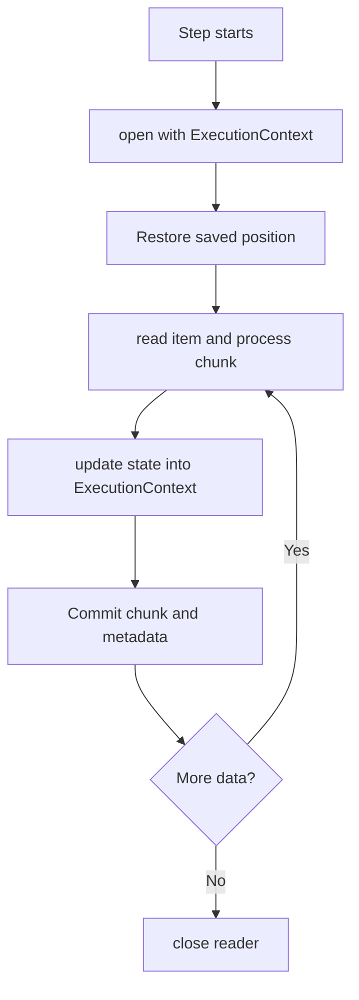

# Reader State and Current Item

In Spring Batch, an `ItemReader` is typically called many times to fetch items one by one from a data source. For a job that processes many chunks, the reader needs to know how far it has read so that it can resume at the correct position when the step is restarted. It also needs to manage the item currently being fed into the pipeline for processing, especially when there are errors, retries, or skips.

The concept of **reader state** describes the internal state a reader needs to continue reading the correct data. The **current item** is the item the reader has just returned or the item currently being processed in the pipeline. The two concepts are related but not identical: the current in-memory position can advance as items are read, whereas a durable checkpoint is saved only at the step's state update points.

## 1. ItemReader Reads Items in Order

`ItemReader<T>` is the basic interface for reading data. The `read()` method returns an item or `null` when there is no more data.

```java
public interface ItemReader<T> {
    T read() throws Exception;
}
```

In chunk-oriented processing, Spring Batch calls `read()` many times to build a chunk. Each item the reader returns is passed to the processor (if any), and then the output items are gathered for the writer to write.

For example, a reader that reads orders in order:

```text
read() -> Order 101
read() -> Order 102
read() -> Order 103
read() -> Order 104
read() -> null (no more data)
```

The `null` value is the end signal. It is not an item and is not passed to the processor or writer. If the reader returns `null` too early because of a logic error, the step may end even though the source still has data; therefore the end condition must be clearly defined.

## 2. What Does Current Item Mean?

At any given moment in the pipeline, the current item can refer to different stages:

- **The item the reader just returned:** the value returned by the most recent `read()` call.
- **The item being processed by the processor:** the current input item of the `ItemProcessor`.
- **The output item waiting for the writer:** the result the processor has created and that is sitting in the chunk.
- **The item the writer is writing:** an element in the chunk being sent to the target system.

These concepts do not necessarily refer to the same object. A processor can convert an `OrderInput` into a `ProcessedOrder`; the input and output items have different types. A processor can also return `null` to filter an item, meaning the item was read but there is no corresponding output item.

The key point when discussing reader state is **the next position to read**. After the reader returns an item, its internal pointer has usually already advanced to the next position. For example, if the reader has returned the first 100 items, the count state can indicate that 100 items have been read and the next read will start from the 101st item.

Therefore, `currentItemCount` or a similar checkpoint is usually the number of items consumed, not the sequence number of the item sitting in the processor. For a reader that reads a file with headers, comments, skipped lines, or a paginated source, this index also does not necessarily match the physical line number or the record's primary key.

## 3. Why Does the Reader Need to Save State?

A job can run for hours and read millions of records. If the server stops after many chunks have been processed, starting to read again from the beginning can be time-consuming and cause unwanted side effects.

Reader state helps Spring Batch know where to resume on restart. The state can contain:

- The number of items read or the current position in the file.
- The number of pages read and the last sort key of the previous page.
- An offset, cursor position, or the data source's own checkpoint.
- The information needed to reopen the resource, for example the file name and the read position.

Not every reader needs to save state. A reader that reads a very small fixed list, or a source that can be re-read from the beginning without impact, may not need a checkpoint. But for large jobs, reader state is usually an important condition for an efficient restart with correct data.

## 4. ItemStream and the Reader State Lifecycle

To support saving and restoring state, Spring Batch provides the `ItemStream` interface. A reader that supports this lifecycle typically implements `ItemStreamReader<T>`, combining item reading with stream management.

Key methods:

| Method | When and purpose |
|---|---|
| `open(ExecutionContext)` | Opens the resource and restores previously saved state when the step starts or restarts |
| `read()` | Reads and returns the next item |
| `update(ExecutionContext)` | Writes the current state into the `ExecutionContext` so the checkpoint is saved along with the step metadata |
| `close()` | Closes the resource when the step ends or when the reader needs to be released |

General lifecycle:



`ExecutionContext` is a key/value storage area that Spring Batch attaches to an execution. For a reader, the checkpoint is usually stored in the `StepExecution` context so that the state belongs to the correct step run. When the step is restarted, the saved context is passed back to `open()`.

In a chunk-oriented step, the framework calls `ItemStream.update()` at the chunk's state update boundary. As a result, the checkpoint can be saved together with the step's metadata. Whether the checkpoint and the business data are committed atomically also depends on the transaction manager and the resources participating in the transaction.

## 5. ExecutionContext Is Where the Checkpoint Is Stored

`ExecutionContext` provides a way to store the values needed to continue the work. A reader can write an integer, a string, or a supported data type into the context.

For example, a reader can save the number of items read:

```java
private static final String CURRENT_INDEX = "orderReader.currentIndex";

public void update(ExecutionContext executionContext) {
    executionContext.putInt(CURRENT_INDEX, currentIndex);
}
```

When the reader is opened, the saved value is restored:

```java
public void open(ExecutionContext executionContext) {
    if (executionContext.containsKey(CURRENT_INDEX)) {
        currentIndex = executionContext.getInt(CURRENT_INDEX);
    } else {
        currentIndex = 0;
    }
}
```

In this example, `currentIndex` should represent the next position to read. If 100 items have been returned and the saved checkpoint is `100`, the next open starts from index 100 (the 101st item if the list is numbered from 1).

Key names should have their own namespace, for example the reader name plus the state field, to avoid two readers overwriting the same key in one `ExecutionContext`. For prebuilt readers that have a `name` property, give it a stable name that is unique within the step so the framework generates appropriate state keys.

Do not store a whole large data set in the `ExecutionContext`. Store only the small amount of information needed to restore the read position or state. Business content should still reside in the data source or an appropriate storage system.

## 6. Custom ItemStreamReader Example

The following example illustrates a reader that reads a stable list and saves the next position. This is a simple example for understanding the lifecycle; a real reader needs to consider transaction rollback, retry, the stability of the source, and resource management.

```java
import java.util.List;

import org.springframework.batch.item.ExecutionContext;
import org.springframework.batch.item.ItemStreamException;
import org.springframework.batch.item.ItemStreamReader;

public class OrderListReader implements ItemStreamReader<Order> {

    private static final String CURRENT_INDEX = "orderListReader.currentIndex";

    private final List<Order> orders;
    private int currentIndex;

    public OrderListReader(List<Order> orders) {
        this.orders = List.copyOf(orders);
    }

    @Override
    public void open(ExecutionContext executionContext) throws ItemStreamException {
        currentIndex = executionContext.containsKey(CURRENT_INDEX)
                ? executionContext.getInt(CURRENT_INDEX)
                : 0;

        if (currentIndex < 0 || currentIndex > orders.size()) {
            throw new ItemStreamException("Invalid saved reader position");
        }
    }

    @Override
    public Order read() {
        if (currentIndex >= orders.size()) {
            return null;
        }

        return orders.get(currentIndex++);
    }

    @Override
    public void update(ExecutionContext executionContext) throws ItemStreamException {
        executionContext.putInt(CURRENT_INDEX, currentIndex);
    }

    @Override
    public void close() throws ItemStreamException {
        // There are no external resources to close in this example.
    }
}
```

In this reader:

1. `open()` restores the saved index or starts from 0 if it is the first run.
2. `read()` returns the item at the current index and then increments the index to point to the next item.
3. `update()` writes the index into the `ExecutionContext` at the checkpoint.
4. `close()` releases resources; this example holds no file handle or connection, so no additional action is needed.

The list must keep the same order and content between runs. If the list is rebuilt with a different order, the same index may point to a different item and the job may miss or reprocess data.

This is not a complete production implementation for every rollback case. The in-memory pointer may have already advanced when a chunk fails; retry/rollback behavior in the step needs to be designed together with the reader. For real data sources, prefer the prebuilt Spring Batch readers or implement state management appropriate to the semantics of transactions and retry.

## 7. Prebuilt Readers and How They Save State

Many Spring Batch readers already implement `ItemStream` and manage checkpoints on their own. How state is saved depends on the type of source.

### AbstractItemCountingItemStreamItemReader

Some readers extend `AbstractItemCountingItemStreamItemReader`. This base class manages the number of items read and saves `currentItemCount` into the `ExecutionContext` when `saveState` is enabled.

Common properties:

- `name`: the reader name used to generate the state key; give it a stable and unique name.
- `saveState`: enables/disables saving state for restart.
- `currentItemCount`: the number of items the reader has successfully returned and the basis for determining the next position.
- `maxItemCount`: the limit on the number of items the reader is allowed to read.

On restart, the reader restores the count and moves to the corresponding position according to the specific reader's implementation. `currentItemCount` is the number of items read, not necessarily the number of physical lines in the file or the record's ID.

### FlatFileItemReader

`FlatFileItemReader` reads lines from a file one by one and usually saves read position information so that it can reopen the file at the appropriate point. It can handle headers, comments, skipped lines, and mapping lines to objects.

On restart, the input file must be exactly the file used before and its content must be stable. If the file is replaced, has lines inserted, or is reordered while the job is interrupted, the saved position may point to different data.

### JdbcCursorItemReader

`JdbcCursorItemReader` reads data through a database cursor. The reader needs to reopen the query and restore the read position according to the implementation's mechanism. The query must have a stable order; without an appropriate `ORDER BY`, the order of records may change between two cursor openings.

For large data sets, the cursor also holds database resources while reading. Consider the timeout, the connection lifetime, and the driver's limits.

### JdbcPagingItemReader

`JdbcPagingItemReader` reads data page by page. It saves the last processed sort key information so that a restart can continue from the appropriate position.

The sort key must be stable and preferably unique. If the sort key is not unique, records at the boundary between two pages may be repeated or missed. The query conditions and the source data must also remain stable throughout the job run.

## 8. saveState and Restartability

For many prebuilt readers, `saveState` is enabled by default. When `saveState` is disabled, the reader does not save its checkpoint into the `ExecutionContext`; after the job is interrupted, the reader may not know where to continue.

Configuration example:

```java
FlatFileItemReader<Order> reader = new FlatFileItemReader<>();
reader.setName("ordersFileReader");
reader.setSaveState(true);
```

Disable state saving only when there is a clear reason, for example when the reader is used in an execution mode that does not support restart or the application deliberately accepts re-reading from the beginning. If the job requires an exact restart, keep `saveState` and confirm that the reader supports restoring the position.

Besides `saveState`, restart also depends on:

- The `JobRepository` storing durable metadata and `ExecutionContext`.
- The job being relaunched with the same identifying `JobParameters` to continue the same `JobInstance`.
- The step being allowed to restart and the previous execution having an appropriate status.
- The reader reopening the same data source with the same interpretation of the position.
- The writer and side effects being able to handle safely a chunk that must be rerun.

## 9. When Is the Checkpoint Saved?

In a chunk-oriented step, the reader may read many items ahead and hold them in the chunk before the writer writes. The checkpoint is updated at the commit boundary, not after each `read()` call.

The general flow of a chunk:

1. The chunk's transaction begins.
2. The reader reads items and the in-memory pointer advances.
3. The processor processes items; the results are gathered into the chunk.
4. The writer writes the results.
5. The `ItemStream`s update state into the `ExecutionContext`.
6. Spring Batch updates the execution metadata.
7. The transaction commits.

If the transaction commits successfully, the updated checkpoint can be used on restart. If the process stops before the commit, the durable checkpoint is usually still the checkpoint of the previous chunk, so the uncommitted chunk may be read and processed again.

For the checkpoint and the data written in the chunk to be strongly consistent, the metadata repository and the business data usually need to participate in the same transaction manager or have an appropriate coordination mechanism. If they are on resources that do not share a transaction, a situation may arise where the data has been committed but the checkpoint has not been saved, or vice versa. In that case, idempotency and recovery need to be clearly designed.

## 10. Current Item with Errors, Retry, and Skip

When the reader or processor encounters an error, the current item can be retried or skipped according to the fault-tolerant configuration.

- **Read error:** the reader throws an exception before returning an item. If the exception is skipped, the reader needs to be able to move past the faulty record so that the next read does not loop forever at the same position.
- **Processing error:** the item has been returned by the reader but the processor throws an exception. If retried, the processor may be called again with that item. If skipped, the item does not go to the writer.
- **Write error:** the writer receives a chunk but cannot write one or more items. The framework may roll back the chunk and carry out a strategy to identify the faulty item according to the configuration.

In retry and rollback situations, the framework may keep or re-read items depending on how the step is configured. Do not assume that each item has `read`, `process`, or `write` called exactly once. A listener may receive callbacks multiple times when there is a retry.

If you need to record faulty items, use an appropriate listener such as `ItemReadListener`, `ItemProcessListener`, `ItemWriteListener`, or `SkipListener`. Log only identifiers and necessary information; avoid writing an entire sensitive payload to the log.

Example of a read listener:

```java
public class OrderReadListener implements ItemReadListener<Order> {

    @Override
    public void beforeRead() {
        // Called before a read.
    }

    @Override
    public void afterRead(Order item) {
        log.debug("Read order id={}", item.getId());
    }

    @Override
    public void onReadError(Exception ex) {
        log.warn("Reader failed", ex);
    }
}
```

`afterRead` receives the item the reader just returned. It is useful for observing the current item, but this callback is not a checkpoint and does not save the reader position by itself. Saving state remains the responsibility of `ItemStream` and `ExecutionContext`.

## 11. The Data Source Must Be Stable Between Restarts

A checkpoint is meaningful only when the saved position continues to point to the same data. If the source changes while the job is stopped, restoring by offset or item count can lead to discrepancies.

For example, the reader saved its position after 10,000 lines of a file. Before the restart, another process inserts 20 lines at the beginning of the file. Line position 10,001 no longer points to the next record that the job has not yet processed.

To mitigate the problem:

- Use an immutable input file or create a copy/snapshot for each run.
- Save the source's name, version, or checksum if you need to confirm the correct input on restart.
- For database paging, use a stable `ORDER BY` and a unique sort key.
- Determine a snapshot or data range at the time the job starts if the source data may continue to change.
- Avoid deleting or modifying records in the read range while the job may still restart.

For database sources, keyset pagination based on a stable ascending key is usually easier to restart than relying on an offset when data is added/deleted between pages. However, you still need to clearly define the business snapshot and how to handle records updated while the job is running.

## 12. Reader State in Step Scope and Multiple Threads

A reader with state usually holds a pointer or resources in memory. If the same reader instance is shared among multiple job executions, the state of one execution can affect another. Therefore, a stateful reader should usually be created per step execution scope, for example by using `@StepScope` when late binding from job parameters is needed.

General example:

```java
@Bean
@StepScope
public FlatFileItemReader<Order> orderReader(
        @Value("#{jobParameters['inputFile']}") String inputFile) {

    FlatFileItemReader<Order> reader = new FlatFileItemReader<>();
    reader.setName("orderFileReader");
    reader.setResource(new FileSystemResource(inputFile));
    reader.setSaveState(true);
    // Configure the LineMapper and other read rules.
    return reader;
}
```

The example uses `@StepScope` to create the reader per step execution and to get the file path from a job parameter. You need to configure a `LineMapper` before using it in a real application.

With a multi-threaded step, multiple threads may call `read()` on the same reader. A stateful reader is not thread-safe by default. Increasing concurrency can make the read order and checkpoint updates hard to determine. You can consider:

- Using a reader designed to be thread-safe or an appropriate synchronized wrapper.
- Using partitioning so that each partition has its own reader and `ExecutionContext`.
- Splitting the data source into non-overlapping ranges, for example by ID or tenant.
- Ensuring the sort key and checkpoint of each partition are stable.

Partitioning usually helps manage state more clearly because each partition processes a portion of the data and has its own metadata. However, you need to avoid having partitions write the same business record twice.

## 13. Delegating Readers and Registering ItemStream

A reader can wrap or delegate reading to another reader. For example, a composite reader can choose a delegate reader based on a condition, or a wrapper can add filtering logic before returning an item.

If the delegate also implements `ItemStream`, it must receive the `open`, `update`, and `close` callbacks in order to save state. Spring Batch can automatically register streams declared directly on the step, but for wrapped components or delegates that the framework does not detect, you need to register the stream explicitly through the appropriate step configuration, for example the `.stream(delegate)` method.

If you forget to register the delegate stream, the outer reader may still run normally on the first run, but the delegate's state is not saved or restored. On restart, the reader may start from the beginning or continue from the wrong position.

## 14. Monitoring Reader State in Operations

When a job is restarted or reads incomplete data, check the following information:

- The job name, identifying parameters, and execution ID to identify the correct run.
- The step execution and the saved `ExecutionContext`.
- The reader name and the state keys the reader uses.
- `readCount`, `writeCount`, the skip count, and the step status.
- Whether the input file or source query is the same as in the previous run.
- Whether the reader has `saveState` enabled and is registered as an `ItemStream`.
- Whether any wrapper/delegate has not been registered as a stream.
- Whether multiple threads or partitions are accessing the data source at the same time.

Do not manually edit the `ExecutionContext` in a production repository just to change the read position unless you understand the impact on already committed data. An inappropriate checkpoint can cause the job to miss records or write duplicates.

## 15. Principles to Remember

- `ItemReader.read()` returns the next item or `null` when there is no more data.
- The current item is the item just read or currently passing through the pipeline; reader state usually describes the next position to read.
- `ItemStream` provides the `open`, `update`, and `close` lifecycle to restore and save state.
- The step's `ExecutionContext` stores the durable checkpoint; do not use it to store a large data set.
- The checkpoint is updated at the chunk/commit boundary, not after each `read()` call.
- After a crash before commit, the uncommitted chunk may be read and processed again from the previous checkpoint.
- `saveState` must be enabled and the reader must support restoring if you want to restart from the saved position.
- The data source, sort order, and identifying parameters must be stable between restarts.
- A stateful reader needs an appropriate instance scope and must be designed for concurrency if the step runs on multiple threads.
- Listeners help observe the current item but do not replace the checkpoint mechanism of `ItemStream`.
- A delegate reader that implements `ItemStream` must be registered so that the state callbacks are invoked.

Understanding reader state and the current item helps explain why Spring Batch can continue a step from a checkpoint, why an item may be read or processed again after a rollback, and why a stable data source together with a reader that can save state is an important condition for a safe restart.
