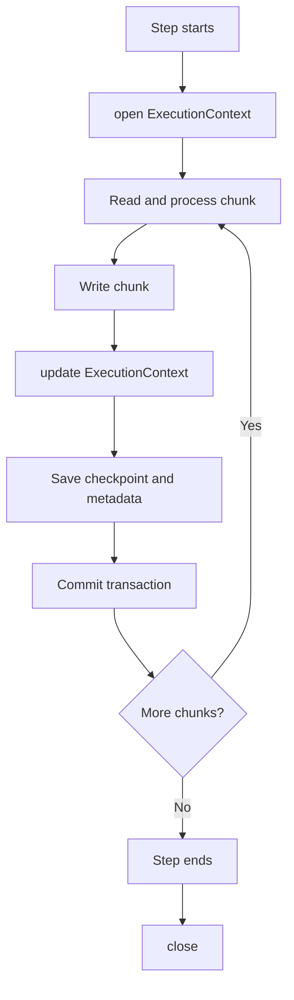

# open, update, and close in ItemStream

In Spring Batch, `ItemStream` is a lifecycle contract for components that need to initialize resources, save state, and release resources while a step runs. Readers and writers typically implement this contract to support checkpoints and restart.

`ItemStream` defines three methods:

- `open(ExecutionContext)`: initializes the stream and restores saved state when the step starts.
- `update(ExecutionContext)`: writes the stream's current state into the execution context at a checkpoint.
- `close()`: closes the stream and releases resources when the step ends.

Spring Batch calls these three methods according to the step lifecycle. The application does not need to call them itself in a controller or on each item read/write. By understanding the timing and responsibility of each method correctly, we can build readers/writers that can restart and avoid leaking file handles, cursors, or connections.

## 1. What Is ItemStream?

`ItemStream` is the foundational interface that lets a component participate in the lifecycle managed by Spring Batch. In Spring Batch, the commonly encountered interfaces that extend it are:

- `ItemStreamReader<T>`: combines `ItemReader<T>` with `ItemStream`.
- `ItemStreamWriter<T>`: combines `ItemWriter<T>` with `ItemStream`.

A shortened declaration of the contract:

```java
public interface ItemStream {
    void open(ExecutionContext executionContext) throws ItemStreamException;
    void update(ExecutionContext executionContext) throws ItemStreamException;
    void close() throws ItemStreamException;
}
```

`ExecutionContext` is a key-value area managed by Spring Batch to store state that needs to be restored. A reader can use the context to store the file position, the line number, the current page, or the last processed key at a checkpoint. A writer can use the context to store the state needed to continue writing if the writer's design requires it.

`ItemStream` is not a standalone mechanism for running items. `ItemReader` is responsible for providing items, `ItemWriter` is responsible for writing items, and `ItemStream` adds the lifecycle and the ability to save/restore state for the components that need it.

## 2. The open, update, and close Lifecycle

In a step that has a reader or writer implementing `ItemStream`, Spring Batch manages the callbacks according to the execution lifecycle. You can picture it as follows:



The diagram describes the normal lifecycle of a chunk-oriented step. `open()` is called when the step starts; `update()` is called at checkpoint points before the chunk's transaction completes; `close()` is called when the step lifecycle ends to release resources. If the step has multiple streams, Spring Batch manages all the streams registered with the step.

### 2.1. open(ExecutionContext)

`open()` is called when the step starts. The method receives the step's `ExecutionContext`, which may contain state saved from a previous run.

Two common cases:

- **First run:** the context does not yet have the stream's state keys. The component initializes the initial state, for example a file position of 0 or the first page.
- **Restart:** the context contains the most recent committed checkpoint. The component reads that value to restore the position and continue reading or writing from the appropriate state.

For example, a file-reading reader needs to open the file and restore the line position. A database-reading reader can restore the last saved key to query the following records.

`open()` should validate the context data and the input resources. If the file does not exist, the format is wrong, or the state is incompatible, the method should throw `ItemStreamException` or an appropriate exception so the step fails clearly. Do not silently ignore a corrupted checkpoint because that could cause the job to re-read from the beginning or miss data.

### 2.2. update(ExecutionContext)

`update()` is called at a checkpoint so that the component writes its current state into the `ExecutionContext`. In a chunk-oriented step, this callback is usually called before the chunk's transaction commits. Spring Batch then saves the execution context along with the step metadata in the `JobRepository` according to the configured transaction mechanism.

For example, a reader can write the number of lines read up to the checkpoint:

```java
@Override
public void update(ExecutionContext context) {
    context.putLong("orderReader.currentLine", currentLine);
}
```

The `putLong()` call updates the context being managed in memory. It does not open a new transaction by itself or immediately write to the database. Spring Batch is responsible for saving the context while updating the step metadata.

`update()` needs to write exactly the state that needs to be restored. The value should represent progress confirmed at the checkpoint, not an arbitrary variable that has changed since the most recent commit. For a custom reader, you need to carefully design the behavior on rollback/retry within the same run, because the in-memory pointer may have advanced while the chunk has not been committed.

### 2.3. close()

`close()` is called when the step ends so that the component releases resources. For example:

- Close a `BufferedReader`, `InputStream`, or file handle.
- Close a cursor or result set opened by the reader.
- Release temporary resources the writer is holding.
- Clear runtime state that is no longer needed after the step ends.

`close()` is not the main place to save the checkpoint. Saving state for restart is the responsibility of `update()`. `close()` also should not perform important data-writing business logic that the application must guarantee is committed, because this method is called while the step is ending and does not replace the chunk's transaction.

Implement `close()` so that it is safe when a resource has not been fully opened or has already been released. If the component manages multiple resources, it needs to close all the necessary resources even when one close operation fails.

## 3. Example of a Standard Reader Managing ItemStream Itself

Spring Batch's standard readers usually already implement `ItemStream`, so the application does not need to write the three callbacks itself. Example with `FlatFileItemReader`:

```java
@Bean
@StepScope
FlatFileItemReader<OrderInput> orderReader(
        @Value("#{jobParameters['inputFile']}") Resource inputFile) {

    return new FlatFileItemReaderBuilder<OrderInput>()
            .name("orderReader")
            .resource(inputFile)
            .delimited()
            .names("orderId", "customerId", "amount")
            .targetType(OrderInput.class)
            .saveState(true)
            .build();
}
```

This reader manages the file and the read state through the `ItemStream` lifecycle:

- When the step starts, `open()` opens the file and restores the saved position if this is a restart.
- At a checkpoint, `update()` writes the read state into the `ExecutionContext`.
- When the step ends, `close()` closes the file and releases resources.

The reader name in `.name("orderReader")` should be stable between runs so that the reader's state keys can be found on restart. `.saveState(true)` enables state saving; this is the default configuration of many standard readers, but stating it explicitly expresses the intent.

With a standard reader, use the built-in lifecycle mechanism instead of opening the file yourself in a controller or writing the reader position into a metadata table yourself.

## 4. Example of Implementing ItemStream Yourself

When you need a component with its own state, you can implement `ItemStream` directly. The following example illustrates an object that manages the next page to process:

```java
public class PageCheckpoint implements ItemStream {

    private static final String NEXT_PAGE_KEY = "pageCheckpoint.nextPage";

    private int nextPage;

    @Override
    public void open(ExecutionContext context) {
        nextPage = context.getInt(NEXT_PAGE_KEY, 0);
    }

    public int getNextPage() {
        return nextPage;
    }

    public void markPageCompleted() {
        nextPage++;
    }

    @Override
    public void update(ExecutionContext context) {
        context.putInt(NEXT_PAGE_KEY, nextPage);
    }

    @Override
    public void close() {
        // Release resources if the component holds open resources.
    }
}
```

`open()` gets the page from the context; if there is no key yet, the starting page is 0. The step's processing logic can take `getNextPage()` and call `markPageCompleted()` after finishing a page. `update()` puts the next page into the context at a checkpoint.

This is an example of lifecycle and state, not a complete reader. In a real application, you must ensure `markPageCompleted()` reflects only work confirmed at the transaction boundary. If a page is processed but the transaction rolls back, the in-memory state needs to be restored or the processing operation must be idempotent so that data is not missed on retry.

If the `PageCheckpoint` object is used in a step, register it as a stream so that Spring Batch calls the callbacks. Merely creating a bean that implements `ItemStream` is not enough if the step does not know about that bean.

## 5. How Does Spring Batch Call the Lifecycle in a Chunk Step?

In chunk-oriented processing, the reader and writer are attached to the step. If they implement `ItemStream`, Spring Batch manages their lifecycle. A processing cycle usually follows this sequence:

1. The step starts and gets the saved execution context.
2. Spring Batch calls `open()` on the registered streams.
3. The reader provides items; the processor processes items; the writer writes the chunk.
4. Before committing the chunk, Spring Batch calls `update()` so that the streams update the checkpoint into the context.
5. Spring Batch saves the metadata and execution context according to the transaction mechanism.
6. The transaction commits.
7. Repeat with the next chunk.
8. When the step ends, Spring Batch calls `close()` to close the streams.

The detailed order between metadata operations and the transaction may depend on the repository/transaction manager configuration. What matters is that `update()` is used to prepare the checkpoint state before the commit, while durable saving is performed by Spring Batch. Do not call `update()` yourself inside `ItemReader.read()` or `ItemWriter.write()`.

## 6. Registering ItemStream with the Step

When a reader or writer implements `ItemStream` and is attached directly to the step's standard builder, Spring Batch usually recognizes it automatically and manages the lifecycle.

Example:

```java
@Bean
Step importOrdersStep(
        JobRepository jobRepository,
        PlatformTransactionManager transactionManager,
        ItemStreamReader<OrderInput> reader,
        ItemProcessor<OrderInput, Order> processor,
        ItemWriter<Order> writer) {

    return new StepBuilder("importOrdersStep", jobRepository)
            .<OrderInput, Order>chunk(100, transactionManager)
            .reader(reader)
            .processor(processor)
            .writer(writer)
            .build();
}
```

In the example, `reader` is declared as an `ItemStreamReader`, so its lifecycle is managed by the step. If the writer also implements `ItemStreamWriter`, the writer also takes part in the corresponding lifecycle.

### 6.1. When the Stream Is Wrapped in a Delegate

An easily overlooked case is when the outer reader/writer implements only `ItemReader` or `ItemWriter`, while the inner delegate is the one that implements `ItemStream`. If the wrapper does not forward the lifecycle, Spring Batch cannot automatically detect the inner delegate.

In that case, register the delegate with `.stream(...)`:

```java
@Bean
Step importOrdersStep(
        JobRepository jobRepository,
        PlatformTransactionManager transactionManager,
        ItemReader<OrderInput> delegatingReader,
        ItemStream delegateReader,
        ItemWriter<Order> writer) {

    return new StepBuilder("importOrdersStep", jobRepository)
            .<OrderInput, Order>chunk(100, transactionManager)
            .reader(delegatingReader)
            .writer(writer)
            .stream(delegateReader)
            .build();
}
```

`.stream(delegateReader)` registers the stream so that Spring Batch calls `open()`, `update()`, and `close()`. If the wrapper already implements `ItemStream` and fully forwards all three callbacks to the delegate, you may not need to register the delegate separately; avoid duplicate registration that causes callbacks to be invoked twice.

## 7. The Relationship Between ItemStream and ExecutionContext

`ItemStream` provides the callbacks, while `ExecutionContext` is where the key-value state is held. The two components work together:

| Component | Responsibility |
|---|---|
| `ItemStream.open()` | Reads saved state from the context and initializes the stream |
| `ItemStream.update()` | Writes runtime state into the context at a checkpoint |
| `ExecutionContext` | Holds the key-values that need to be restored |
| `JobRepository` | Stores metadata and the execution context according to the repository configuration |
| `ItemStream.close()` | Releases the stream's resources |

The Step ExecutionContext belongs to a `StepExecution` and is suitable for storing the step's own checkpoint. The Job ExecutionContext belongs to a `JobExecution` and is suitable for small pieces of data that need to be shared between steps. Readers/writers usually use the Step ExecutionContext to store their own internal state.

Do not store large objects, connections, open streams, Spring beans, or unnecessary sensitive data in the context. The values to be stored must be compatible with the application's `ExecutionContextSerializer` and stable when the job restarts after a new version is deployed.

## 8. Handling Rollback and Restart

The checkpoint is saved at the chunk's commit boundary. If the chunk commits successfully, the saved context can help the reader continue from the next portion of data on restart. If the chunk rolls back, the new checkpoint is not confirmed; the restart will use the previously committed checkpoint.

Example of a step reading a file in chunks of 100 items:

- Chunk 1 commits: the reader position is saved after 100 items.
- Chunk 2 commits: the reader position is saved after 200 items.
- Chunk 3 encounters an error before commit: the transaction rolls back; the most recent checkpoint is still after chunk 2.
- Restart: `open()` receives the context from the checkpoint after chunk 2 and the reader continues from the appropriate portion of data.

This assumes the reader supports restart, the source data has not been changed in a way that shifts positions, and the metadata and the business write are coordinated correctly in the transaction. If the writer sends an HTTP request or publishes a message outside the transaction, the side effect may already have happened even though the chunk rolled back. On restart, the item may be processed again; you need an idempotency key, a unique constraint, an outbox/inbox, or reconciliation to prevent duplicate effects.

A custom reader also needs to think about rollback within the same run, not just restart after the JVM restarts. If the reader has advanced its in-memory pointer but the chunk rolls back, the reader must have a way to support replaying items or restoring the pointer from the checkpoint. This is why you should prefer Spring Batch's standard readers when they meet the requirements.

## 9. Notes on Implementing Each Callback

### For open()

- Read the checkpoint value from the `ExecutionContext` with a sensible default for the first run.
- Open the file, cursor, or necessary resource after validating the parameters and state.
- Keep the stream name and context keys stable across restarts.
- Report an error clearly if the saved state is incompatible or the input resource cannot be opened.
- Do not perform all of the heavy business work in `open()`; this method is for initializing and restoring the stream.

### For update()

- Write only the small values needed to continue processing.
- Write state that reflects the progress at the checkpoint, not arbitrary in-memory state.
- Use namespaced keys to avoid collisions with other streams.
- Do not open a transaction yourself or write directly into the `BATCH_*` tables.
- Do not assume a single `put()` means the data has been committed to the repository.

### For close()

- Close the resources that were opened, such as files, cursors, and streams.
- Release resources even when the step fails.
- Make the close operation safe if the resource was not fully initialized.
- Do not use `close()` as the final checkpoint mechanism or as a place to perform business side effects that need to be committed.

## 10. Common Mistakes

**Not implementing ItemStream for a reader that needs to restart.** The reader may run within a single execution but be unable to restore the position when the job restarts. Use a standard reader that supports state or implement the lifecycle correctly.

**Forgetting to register the delegate stream.** A wrapper that does not implement `ItemStream` can hide a delegate that needs to save state. Use `.stream(delegate)` or forward the lifecycle fully.

**Using close() to save state.** `close()` is for releasing resources, not for per-chunk checkpoints. Save state in `update()`.

**Calling update() after each item.** The chunk step's checkpoint is managed at the chunk boundary. Calling update yourself in `read()` or `write()` easily creates inconsistent state and breaks the lifecycle.

**Saving the position that has been read instead of the position that has been confirmed.** If the chunk has not been committed, the in-memory position may have advanced further than the durable checkpoint. A custom reader needs to handle rollback and replay correctly.

**Using keys or reader names that change between versions.** The reader may not find the old state on restart. Keep keys and names stable or have a plan for converting the context.

**Not closing resources.** Leaked file handles or cursors can exhaust system resources. Put the release in `close()` and make sure the method is safe.

**Assuming ItemStream guarantees exactly-once.** The lifecycle supports checkpoints and restart; it does not by itself prevent side effects outside the transaction from being repeated. The writer still needs to be idempotent and have a recovery strategy.

## 11. Testing the ItemStream Lifecycle

You should test all three callbacks in the first-run, successful-run, failure, and restart scenarios:

1. **First run:** `open()` receives a context without the key and initializes the default state.
2. **After a chunk commit:** `update()` puts the current position or state into the context and the repository saves the checkpoint.
3. **Restart:** `open()` receives the saved value back and continues at the correct position.
4. **Chunk rollback:** the durable state is still the most recent commit checkpoint; uncommitted items may be processed again.
5. **Step failure:** `close()` still releases the resources that were opened.
6. **Delegate:** confirm the stream is registered and callbacks are neither missed nor called twice.
7. **Changing data source:** check that the job reacts correctly if the file or data set is no longer compatible with the checkpoint.

You can write a unit test directly for the class implementing `ItemStream` using a fresh `ExecutionContext`, then call `update()` to save state and create a new context from the saved values to test `open()`. However, this unit test only checks the callback logic. To prove that Spring Batch really calls the lifecycle and saves the checkpoint correctly, you need an integration test with a step, a `JobRepository`, and a real transaction manager, or a test configuration close to production.

## Conclusion

`open()`, `update()`, and `close()` are the three callbacks that define the lifecycle of an `ItemStream`. `open()` initializes and restores state; `update()` puts the state needed for restart into the `ExecutionContext` at a checkpoint; `close()` releases resources when the step ends. Spring Batch coordinates these callbacks when the stream is registered with the step and saves the context through the `JobRepository`.

When using standard readers/writers, let the framework manage the lifecycle. For delegates or custom streams, make sure they are registered correctly, save state at the checkpoint, and handle rollback/restart safely. Clearly distinguishing the responsibility of each callback helps the job restore the correct progress, close resources at the right time, and maintain data consistency across runs.
