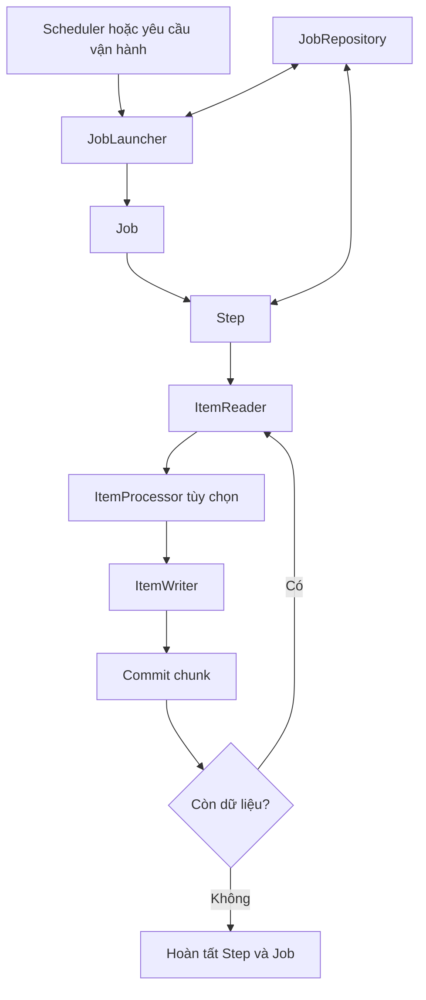

# Spring Batch giải quyết bài toán xử lý dữ liệu nào?

Spring Batch được xây dựng để giải quyết **bài toán xử lý dữ liệu theo lô (batch processing)**: ứng dụng cần đọc một tập dữ liệu hữu hạn, thường có số lượng lớn, thực hiện một chuỗi bước xử lý trên tập dữ liệu đó rồi ghi kết quả vào hệ thống đích. Công việc thường chạy nền theo lịch, theo yêu cầu vận hành hoặc sau khi một nguồn dữ liệu mới xuất hiện; nó không cần trả kết quả ngay trong thời gian người dùng chờ một request.

Ví dụ, vào cuối ngày một hệ thống thương mại điện tử cần đọc hàng triệu đơn hàng, kiểm tra dữ liệu, tính tổng doanh thu theo cửa hàng, cập nhật bảng thống kê và tạo tệp gửi cho hệ thống kế toán. Đây là một công việc batch điển hình. Spring Batch cung cấp cấu trúc và các cơ chế vận hành để thực hiện công việc đó có kiểm soát, có thể theo dõi và có khả năng phục hồi khi gặp lỗi.

## 1. Khi nào một bài toán là batch processing?

Một bài toán thường phù hợp với batch processing khi có các đặc điểm sau:

- **Dữ liệu được xử lý theo tập hoặc theo khoảng thời gian.** Chẳng hạn xử lý tất cả giao dịch của ngày hôm qua, các hồ sơ vừa được nhập từ một tệp hoặc những bản ghi chưa được tổng hợp.
- **Khối lượng dữ liệu đủ lớn để cần quản lý tài nguyên.** Công việc có thể xử lý từ hàng nghìn đến hàng triệu bản ghi. Đọc toàn bộ dữ liệu vào bộ nhớ rồi mới xử lý có thể gây tốn RAM, chậm hoặc làm ứng dụng hết bộ nhớ.
- **Có một quy trình xử lý rõ ràng.** Dữ liệu thường phải được đọc, kiểm tra, chuyển đổi, làm giàu, tính toán và ghi vào một hoặc nhiều nơi.
- **Không cần phản hồi ngay cho từng người dùng.** Công việc có thể chạy nền, chạy vào thời điểm ít tải hoặc được kích hoạt khi hệ thống nhận được dữ liệu đầu vào.
- **Cần kiểm soát tiến độ và xử lý lỗi.** Khi một công việc kéo dài hàng giờ bị gián đoạn, đội vận hành cần biết nó đã chạy đến đâu và có thể tiếp tục từ phần phù hợp thay vì luôn bắt đầu lại từ đầu.

Batch không nhất thiết có nghĩa là chỉ chạy vào ban đêm hoặc chỉ xử lý hàng triệu dòng. Điểm cốt lõi là xử lý một tập công việc hữu hạn theo một quy trình được quản lý, thay vì xử lý một sự kiện đơn lẻ ngay khi nó đến.

## 2. Những bài toán thực tế Spring Batch thường giải quyết

| Nhóm bài toán | Dữ liệu đầu vào | Công việc cần thực hiện | Kết quả thường gặp |
|---|---|---|---|
| Nhập dữ liệu (import) | CSV, XML, JSON, dữ liệu từ API hoặc cơ sở dữ liệu | Đọc, kiểm tra định dạng, xác thực, chuẩn hóa và loại bỏ bản ghi không hợp lệ | Dữ liệu sạch được lưu vào cơ sở dữ liệu |
| ETL (Extract, Transform, Load) | Dữ liệu từ nhiều nguồn | Trích xuất, chuyển đổi cấu trúc hoặc quy tắc nghiệp vụ, rồi nạp vào kho dữ liệu | Bảng dữ liệu phân tích hoặc data warehouse |
| Đối soát (reconciliation) | Giao dịch từ hai hệ thống | Ghép cặp, so sánh số tiền/trạng thái, phát hiện bản ghi thiếu hoặc sai lệch | Báo cáo chênh lệch và danh sách cần xử lý |
| Tính toán định kỳ | Đơn hàng, giao dịch, số dư hoặc dữ liệu sử dụng dịch vụ | Tổng hợp, tính phí, tính lãi, tính lương hoặc cập nhật số liệu theo kỳ | Bảng tổng hợp, hóa đơn hoặc kết quả tính toán |
| Tạo báo cáo và tệp trao đổi | Dữ liệu nghiệp vụ trong hệ thống | Lọc, nhóm, tổng hợp và định dạng dữ liệu | CSV, XML, báo cáo hoặc tệp gửi đối tác |
| Di chuyển và lưu trữ dữ liệu | Bảng cũ, tệp lịch sử hoặc dữ liệu hết thời hạn lưu nóng | Chuyển đổi, chuyển sang hệ thống mới, lưu trữ hoặc xóa theo chính sách | Dữ liệu đã di chuyển hoặc được lưu trữ |

Các công việc này thường có cùng một hình dạng: một tập dữ liệu đầu vào, một hoặc nhiều bước xử lý, một đích ghi kết quả và yêu cầu vận hành đáng tin cậy.

## 3. Vì sao không chỉ viết một vòng lặp Java?

Với một tác vụ nhỏ, một vòng lặp đọc danh sách rồi xử lý từng phần tử có thể hoàn toàn đủ dùng. Khó khăn xuất hiện khi tác vụ trở thành một quy trình chạy lâu, xử lý nhiều dữ liệu và phải được vận hành lặp đi lặp lại.

Giả sử một job cần xử lý 5 triệu giao dịch. Nếu ứng dụng tải toàn bộ 5 triệu bản ghi vào một `List`, lượng bộ nhớ cần thiết có thể rất lớn. Nếu ứng dụng ghi từng bản ghi ngay lập tức mà không có ranh giới giao dịch hợp lý, số lần commit tăng lên và hiệu năng có thể giảm. Nếu tiến trình dừng sau khi đã xử lý 3 triệu bản ghi, một vòng lặp đơn giản không tự biết phải tiếp tục ở đâu. Nếu một vài bản ghi bị lỗi dữ liệu, việc dừng toàn bộ job có thể khiến các bản ghi hợp lệ còn lại không được xử lý.

Trong thực tế, một job batch thường cần giải quyết đồng thời nhiều vấn đề:

### Quản lý bộ nhớ và thông lượng

Thay vì tải toàn bộ dữ liệu vào bộ nhớ, ứng dụng có thể đọc và xử lý theo từng phần. Cách này giữ lượng dữ liệu đang nằm trong bộ nhớ ở mức có thể kiểm soát, đồng thời cho phép điều chỉnh kích thước mỗi phần để cân bằng giữa chi phí giao dịch, bộ nhớ và tốc độ xử lý.

### Giao dịch và điểm lưu tiến độ

Khi xử lý một nhóm bản ghi, ứng dụng cần xác định lúc nào nhóm đó được commit. Nếu một chunk thất bại, các thao tác nằm trong giao dịch tương ứng có thể được rollback. Sau khi chunk thành công, framework có thể lưu trạng thái thực thi để job có cơ sở tiếp tục khi được khởi chạy lại.

Khả năng restart phụ thuộc vào việc `JobRepository` được lưu bền vững và các thành phần đọc/ghi có hỗ trợ lưu, khôi phục trạng thái phù hợp. Không nên hiểu rằng mọi thao tác bên ngoài cơ sở dữ liệu đều tự động được hoàn tác hoặc tiếp tục chính xác.

### Xử lý lỗi có chính sách

Không phải lỗi nào cũng cần làm dừng toàn bộ công việc. Ví dụ, một dòng CSV sai định dạng có thể được bỏ qua hoặc đưa vào danh sách lỗi, trong khi lỗi mất kết nối cơ sở dữ liệu có thể cần thử lại. Spring Batch cung cấp các cơ chế như `skip` và `retry` để mô tả chính sách cho những tình huống này.

### Theo dõi và kiểm toán

Với job chạy lâu, người vận hành cần biết job nào đã được khởi chạy, tham số của lần chạy, trạng thái thành công hay thất bại, step nào gặp lỗi và số lượng bản ghi đã đọc hoặc ghi. Spring Batch lưu metadata thực thi trong `JobRepository`, giúp ứng dụng và công cụ giám sát truy xuất thông tin vận hành.

### Tổ chức quy trình và mở rộng

Một job có thể gồm nhiều step nối tiếp nhau, có nhánh điều kiện hoặc có các step xử lý song song. Khi dữ liệu đủ lớn, Spring Batch có các cơ chế như partitioning và remote chunking để chia công việc. Việc tăng mức song song vẫn cần được thiết kế theo giới hạn của cơ sở dữ liệu, hệ thống đích và tài nguyên máy chủ.

## 4. Spring Batch tổ chức một job như thế nào?

Trong Spring Batch, công việc batch thường được mô hình hóa bằng các khái niệm `Job`, `Step` và các thành phần xử lý dữ liệu.

- **Job** đại diện cho toàn bộ công việc, chẳng hạn `dailySettlementJob` hoặc `customerImportJob`.
- **Step** là một giai đoạn trong job. Một job có thể có một step hoặc nhiều step chạy theo thứ tự và điều kiện được cấu hình.
- **ItemReader** đọc từng item từ nguồn dữ liệu.
- **ItemProcessor** (nếu cần) kiểm tra, biến đổi hoặc làm giàu từng item.
- **ItemWriter** ghi các item đã xử lý tới đích.
- **JobRepository** lưu metadata của job và step, bao gồm trạng thái thực thi và thông tin cần thiết cho việc theo dõi hoặc restart.
- **JobLauncher** là thành phần dùng để khởi chạy job với các tham số xác định.

Luồng xử lý khái quát:

Sơ đồ mô tả một step xử lý theo chunk. Một job thực tế có thể có nhiều step, và mỗi step có thể dùng cách thực thi khác nhau.

### Chunk-oriented processing

Đây là mô hình phổ biến khi xử lý nhiều item cùng một kiểu. Thay vì đọc toàn bộ dữ liệu rồi ghi một lần, Spring Batch đọc một số lượng item đã cấu hình, xử lý từng item, chuyển nhóm kết quả cho writer và commit theo ranh giới chunk.

Ví dụ, với chunk size là 500:

1. `ItemReader` đọc tối đa 500 đơn hàng.
2. `ItemProcessor` kiểm tra và tính toán cho từng đơn hàng.
3. `ItemWriter` ghi nhóm kết quả.
4. Giao dịch của chunk được commit nếu các thao tác trong chunk thành công.
5. Step tiếp tục với nhóm item tiếp theo cho đến khi hết dữ liệu.

Nếu processor trả về `null` cho một item, item đó được lọc khỏi đầu ra của processor và không được chuyển cho writer. Nếu một lỗi xảy ra, hành vi rollback, retry hoặc skip phụ thuộc vào loại lỗi và chính sách được cấu hình.

Chunk size là một tham số cần cân nhắc. Chunk quá nhỏ có thể làm tăng số lần commit và chi phí xử lý; chunk quá lớn có thể tăng bộ nhớ sử dụng và phạm vi dữ liệu phải xử lý lại khi một chunk thất bại. Giá trị phù hợp phụ thuộc vào kích thước bản ghi, tốc độ nguồn/đích và đặc tính giao dịch.

### Tasklet

Không phải step nào cũng cần đọc và xử lý từng item. Với một thao tác có tính chất một lần cho mỗi step, chẳng hạn gọi stored procedure, tạo thư mục, dọn tệp tạm hoặc thực hiện một lệnh quản trị, có thể dùng mô hình `Tasklet`. Vì vậy, Spring Batch hỗ trợ cả pipeline xử lý item và các bước thực hiện một tác vụ cụ thể.

## 5. Ví dụ: xử lý đơn hàng cuối ngày

Một hệ thống thương mại điện tử cần tạo số liệu doanh thu cuối ngày từ dữ liệu đơn hàng. Nguồn có thể chứa vài triệu đơn hàng, trong đó có đơn bị hủy, đơn thiếu thông tin hoặc đơn đã được xử lý ở lần chạy trước.

Job có thể được chia thành các step như sau:

| Step | Công việc | Kết quả |
|---|---|---|
| `readOrdersStep` | Đọc đơn hàng thuộc ngày cần tổng hợp | Các đơn hàng đầu vào theo từng chunk |
| `validateOrdersStep` | Kiểm tra trạng thái, mã cửa hàng, tiền tệ và dữ liệu bắt buộc | Bản ghi hợp lệ; bản ghi lỗi được ghi nhận theo chính sách |
| `aggregateSalesStep` | Tính tổng doanh thu theo cửa hàng và loại tiền tệ | Các dòng tổng hợp |
| `writeReportStep` | Ghi kết quả vào bảng báo cáo hoặc tạo tệp xuất | Báo cáo doanh thu của ngày đó |

Job có thể nhận tham số như ngày nghiệp vụ và mã nguồn dữ liệu. Những tham số này giúp xác định phạm vi dữ liệu cần xử lý và phân biệt các lần chạy có ý nghĩa khác nhau.

Giả sử job đã commit thành công 320 chunk rồi máy chủ bị dừng. Khi job được khởi chạy lại với cùng định danh job và tham số phù hợp, metadata trong `JobRepository` cùng trạng thái của reader/step có thể giúp Spring Batch tiếp tục theo cơ chế restart đã cấu hình. Các chunk đã commit không cần bị xử lý lại theo cách thông thường của một reader có checkpoint.

Tuy nhiên, cần thiết kế cẩn thận nếu job gửi email, gọi API đối tác hoặc ghi vào một hệ thống không tham gia cùng giao dịch. Một request đã gửi ra ngoài có thể không được rollback khi chunk thất bại. Vì vậy, thao tác ghi nên có tính idempotent khi có thể: chạy lại cùng một dữ liệu không tạo ra kết quả trùng hoặc làm sai trạng thái. Có thể dùng khóa nghiệp vụ duy nhất, bảng outbox, trạng thái xử lý hoặc cơ chế đối soát để kiểm soát tác dụng phụ.

## 6. Phân biệt Spring Batch với các công nghệ gần kề

| Công nghệ hoặc cách làm | Mục tiêu chính | Khi nào phù hợp |
|---|---|---|
| Xử lý đồng bộ trong REST API | Xử lý một yêu cầu và trả phản hồi ngay | Tác vụ ngắn, người gọi cần kết quả tức thời |
| Message streaming, ví dụ Kafka Streams | Xử lý sự kiện liên tục khi sự kiện đến | Cần phản ứng độ trễ thấp với luồng sự kiện không ngừng |
| Scheduler hoặc cron | Xác định thời điểm kích hoạt công việc | Cần chạy theo lịch hoặc theo chu kỳ |
| Spring Batch | Mô hình hóa và thực thi job xử lý dữ liệu theo lô | Cần pipeline có trạng thái, giao dịch, retry/skip, restart và theo dõi |
| Vòng lặp Java tự viết | Xử lý logic đơn giản trong chương trình | Tập dữ liệu nhỏ, ít yêu cầu về vận hành và phục hồi |

Scheduler và Spring Batch thường được dùng cùng nhau. Scheduler quyết định **khi nào** job bắt đầu; Spring Batch quản lý **job thực hiện những bước nào và trạng thái thực thi ra sao**. Nguồn kích hoạt có thể là cron, Spring scheduling, Quartz, Kubernetes CronJob hoặc một hệ thống điều phối khác.

Batch processing và streaming cũng có thể cùng tồn tại trong một kiến trúc. Ví dụ, hệ thống có thể dùng Kafka để tiếp nhận sự kiện đơn hàng gần thời gian thực, sau đó chạy Spring Batch mỗi đêm để đối soát và tạo báo cáo tổng hợp.

## 7. Spring Batch không tự giải quyết mọi vấn đề dữ liệu

Spring Batch cung cấp khung thực thi và các cơ chế vận hành cho batch job. Ứng dụng vẫn phải quyết định quy tắc nghiệp vụ, cách chọn dữ liệu, tính đúng đắn của phép biến đổi và cách xử lý tác dụng phụ.

- **Không phải nền tảng streaming độ trễ thấp.** Nếu cần xử lý liên tục từng sự kiện ngay khi nó đến, nền tảng streaming hoặc message-driven processing có thể phù hợp hơn.
- **Không tự quyết định lịch chạy.** Cần một scheduler hoặc hệ thống điều phối để kích hoạt job vào đúng thời điểm.
- **Không bảo đảm exactly-once cho mọi hệ thống bên ngoài.** Giao dịch của cơ sở dữ liệu không tự động bao trùm email, HTTP API, tệp trên máy chủ khác hoặc dịch vụ độc lập.
- **Không thay thế công cụ tính toán phân tán chuyên dụng trong mọi trường hợp.** Partitioning và remote chunking hỗ trợ mở rộng xử lý, nhưng các workload phân tích cực lớn có thể phù hợp hơn với nền tảng như Spark hoặc dịch vụ xử lý dữ liệu chuyên biệt.
- **Không tự sửa dữ liệu nghiệp vụ sai.** Nhóm phát triển phải xác định bản ghi nào được retry, bản ghi nào được skip, bản ghi nào cần cách ly để điều tra và điều kiện nào khiến cả job phải thất bại.

Do đó, Spring Batch giải quyết phần tổ chức, thực thi và quản lý vòng đời của công việc batch. Thiết kế dữ liệu, quy tắc nghiệp vụ, tính idempotent và chiến lược vận hành vẫn là trách nhiệm của ứng dụng.

## 8. Khi nào nên chọn Spring Batch?

Spring Batch là lựa chọn đáng cân nhắc khi công việc có nhiều đặc điểm sau:

- Xử lý một tập dữ liệu hữu hạn với số lượng đáng kể hoặc quy trình gồm nhiều bước.
- Chạy nền, chạy định kỳ hoặc được kích hoạt bởi một sự kiện vận hành.
- Cần chia dữ liệu thành các chunk để quản lý bộ nhớ và ranh giới giao dịch.
- Cần theo dõi lịch sử chạy, tham số, trạng thái và số lượng bản ghi đã xử lý.
- Cần retry lỗi tạm thời, skip một số bản ghi không hợp lệ hoặc restart sau gián đoạn.
- Cần tổ chức nhiều step, điều kiện chuyển step hoặc xử lý song song có kiểm soát.

Với một tác vụ nhỏ, chạy một lần và không có yêu cầu restart, retry hay theo dõi phức tạp, một chương trình Java đơn giản có thể dễ hiểu và đủ dùng hơn. Với xử lý sự kiện liên tục cần độ trễ thấp, nên xem xét kiến trúc streaming hoặc message-driven. Việc chọn công nghệ nên dựa trên đặc điểm của workload và yêu cầu vận hành.

## 9. Các khái niệm cần nhớ khi bắt đầu

| Khái niệm | Ý nghĩa |
|---|---|
| `Job` | Định nghĩa một công việc batch gồm một hoặc nhiều step |
| `JobInstance` | Một định danh logic của job, được xác định bởi job và các identifying `JobParameters` |
| `JobExecution` | Một lần thực thi cụ thể của một `JobInstance`; một instance có thể có nhiều execution khi được chạy lại sau thất bại |
| `Step` | Một giai đoạn thực thi trong job |
| `StepExecution` | Thông tin thực thi của một step trong một lần chạy job |
| `ItemReader` | Đọc item từ nguồn dữ liệu |
| `ItemProcessor` | Tùy chọn: kiểm tra, lọc hoặc chuyển đổi item |
| `ItemWriter` | Ghi nhóm item đã xử lý |
| `JobRepository` | Lưu metadata thực thi và trạng thái cần thiết cho theo dõi/restart |
| `JobParameters` | Tham số của lần chạy, ví dụ ngày nghiệp vụ hoặc tên tệp đầu vào |
| Chunk | Nhóm item được đọc, xử lý, ghi và commit theo một ranh giới giao dịch |
| Tasklet | Cách xây dựng step thực hiện một tác vụ cụ thể thay vì pipeline item theo chunk |

Một điểm quan trọng là `JobInstance` và `JobExecution` không đồng nghĩa. Ví dụ, job `dailySettlementJob` với tham số ngày nghiệp vụ `2026-11-14` đại diện cho một instance. Lần chạy đầu tiên tạo một execution. Nếu lần chạy đó thất bại và được restart, lần thực thi tiếp theo tạo execution mới cho cùng instance, với điều kiện tham số và cấu hình nhận diện job được giữ phù hợp.

## 10. Cách suy nghĩ khi thiết kế một batch job

Trước khi cấu hình Spring Batch, hãy mô tả rõ đầu vào, đầu ra và quy tắc vận hành của công việc:

1. **Xác định phạm vi dữ liệu.** Job xử lý theo ngày, theo tệp, theo khoảng ID hay theo một trạng thái nghiệp vụ? Làm thế nào để xác định dữ liệu thuộc lần chạy này?
2. **Chia quy trình thành các step.** Tách các giai đoạn có mục đích rõ ràng như nhập, xác thực, chuyển đổi, tổng hợp và xuất dữ liệu.
3. **Chọn mô hình xử lý.** Dùng chunk khi cần xử lý nhiều item theo nhóm; dùng tasklet cho một thao tác có tính chất tác vụ.
4. **Đặt ranh giới giao dịch.** Xác định những thao tác nào cần cùng commit và chọn chunk size dựa trên dữ liệu, tài nguyên và hệ thống đích.
5. **Định nghĩa chính sách lỗi.** Lỗi tạm thời nào được retry? Dữ liệu sai nào được skip hoặc cách ly? Trường hợp nào phải dừng job?
6. **Thiết kế khả năng chạy lại.** Xác định identifying parameters, cách lưu checkpoint và cách tránh ghi trùng khi job được restart hoặc chạy lại.
7. **Theo dõi kết quả vận hành.** Ghi nhận số item đọc, xử lý, bỏ qua và ghi thành công; theo dõi thời gian chạy và cảnh báo khi job thất bại hoặc chạy quá lâu.
8. **Kiểm soát mức song song.** Chỉ tăng số luồng hoặc partition khi nguồn dữ liệu, đích ghi và cơ sở dữ liệu có đủ khả năng chịu tải.

Khi các yêu cầu này trở nên quan trọng, Spring Batch giúp chuyển một đoạn mã xử lý dữ liệu thành một job có cấu trúc, có trạng thái và có thể vận hành lặp lại.

## Kết luận

Spring Batch giải quyết bài toán **xử lý dữ liệu theo lô với quy mô và yêu cầu vận hành đáng kể**. Framework giúp ứng dụng tổ chức công việc thành job và step, đọc/xử lý/ghi dữ liệu theo chunk, quản lý giao dịch, áp dụng chính sách retry/skip, lưu metadata và hỗ trợ restart. Những khả năng này đặc biệt hữu ích cho import, ETL, đối soát, tính toán định kỳ, tạo báo cáo và di chuyển dữ liệu. Khi bài toán cần phản hồi tức thời cho từng request hoặc xử lý sự kiện liên tục với độ trễ thấp, cần cân nhắc mô hình khác hoặc kết hợp nhiều công nghệ.
