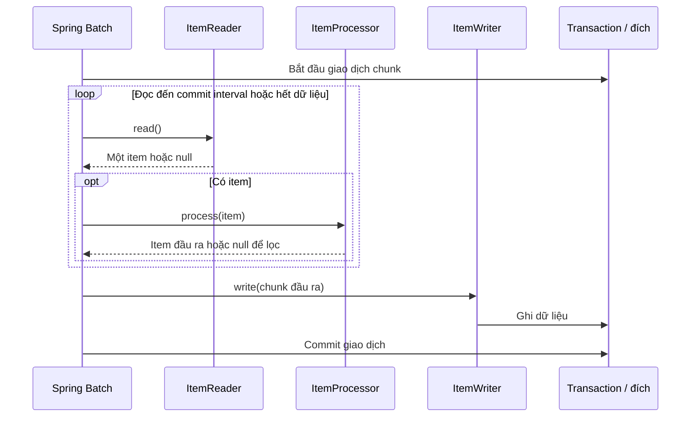

# Dữ liệu đầu vào, xử lý và đầu ra trong Spring Batch

Một job Spring Batch thường lấy dữ liệu từ một nguồn, chuyển đổi hoặc kiểm tra từng bản ghi, rồi ghi kết quả sang một đích khác. Spring Batch tổ chức luồng công việc này bằng ba thành phần chính: **ItemReader**, **ItemProcessor** và **ItemWriter**. Khi kết hợp chúng trong một step theo kiểu chunk, framework còn quản lý giao dịch, checkpoint và khả năng khởi động lại.

Bài học này giải thích vai trò của từng thành phần, cách dữ liệu đi qua một step, cách cấu hình một luồng xử lý thực tế và những điểm cần lưu ý khi dữ liệu lỗi hoặc job phải chạy lại.

## 1. Luồng xử lý cơ bản

Trong một step xử lý theo chunk, dữ liệu đi qua luồng sau:


- **ItemReader** đọc một bản ghi từ nguồn và chuyển nó thành một đối tượng Java.
- **ItemProcessor** tùy chọn kiểm tra, lọc hoặc biến đổi đối tượng đó.
- **ItemWriter** nhận một nhóm các đối tượng đã xử lý và ghi chúng ra đích.

Một step có thể bỏ qua processor nếu không cần xử lý trung gian. Reader và writer là hai thành phần cần thiết để một chunk-oriented step thực hiện việc đọc và ghi.

Ví dụ, một job nhập đơn hàng có thể đọc các dòng CSV, chuyển chúng thành đối tượng đơn hàng đã chuẩn hóa, loại bỏ đơn đã hủy và ghi các đơn hợp lệ vào cơ sở dữ liệu.

### Các kiểu dữ liệu ở từng chặng

Reader và processor không bắt buộc phải dùng cùng một kiểu dữ liệu. Processor có thể chuyển từ kiểu đầu vào sang kiểu đầu ra khác:

```text
CSV row
  -> RawOrder
  -> NormalizedOrder
  -> database row
```

Việc tách kiểu dữ liệu giúp mỗi thành phần có ranh giới rõ ràng. Đối tượng đầu vào phản ánh cấu trúc nguồn; đối tượng đầu ra phản ánh cấu trúc mà hệ thống đích cần.

## 2. Đọc dữ liệu bằng ItemReader

### Vai trò và hợp đồng

```java
public interface ItemReader<T> {
    T read() throws Exception;
}
```

Mỗi lần framework gọi `read()`, reader trả về tối đa một item:

- Trả về một đối tượng khi đọc được bản ghi tiếp theo.
- Trả về `null` khi nguồn đã hết dữ liệu. Đây là tín hiệu kết thúc đầu vào.
- Ném exception nếu không thể đọc hoặc chuyển đổi bản ghi.

Không dùng `null` để biểu diễn một bản ghi hợp lệ. Spring Batch hiểu giá trị này là hết dữ liệu.

Reader chịu trách nhiệm lấy dữ liệu và ánh xạ dữ liệu nguồn thành kiểu Java phù hợp. Các quy tắc nghiệp vụ như đơn hàng có được chấp nhận hay không thường nên đặt trong processor, thay vì trộn vào logic đọc.

### Các nguồn dữ liệu thường gặp

| Nguồn | Reader thường dùng | Trường hợp phù hợp |
|---|---|---|
| File phân tách bằng dấu phẩy hoặc tab | `FlatFileItemReader` | Nhập dữ liệu CSV, TSV hoặc file văn bản có cấu trúc |
| File có định dạng cố định | `FlatFileItemReader` kết hợp tokenizer phù hợp | Mỗi trường nằm ở vị trí ký tự xác định |
| Cơ sở dữ liệu qua JDBC | `JdbcCursorItemReader` | Đọc tuần tự kết quả truy vấn bằng cursor |
| Cơ sở dữ liệu theo trang | `JdbcPagingItemReader` | Đọc tập dữ liệu lớn theo từng trang |
| JPA | `JpaPagingItemReader` | Đọc entity theo trang bằng JPA |

Chọn reader dựa trên đặc điểm của nguồn và cách dữ liệu được phân trang hoặc duyệt. Với truy vấn phân trang, nên có thứ tự ổn định, thường dựa trên khóa duy nhất, để tránh bỏ sót hoặc đọc lặp bản ghi khi dữ liệu thay đổi giữa các trang.

### Ánh xạ dữ liệu đầu vào

Khi đọc file, reader cần biết cách tách dòng thành các trường và chuyển từng trường sang kiểu Java. Ví dụ, một dòng CSV có thể chứa mã đơn hàng, mã khách hàng, số tiền và trạng thái. Reader chuyển dòng đó thành đối tượng `RawOrder`.

Cần xác định rõ các chi tiết của định dạng nguồn:

- Encoding của file, chẳng hạn UTF-8.
- Dòng tiêu đề có cần bỏ qua hay không.
- Dấu phân cách, ký tự bao chuỗi và quy tắc escape.
- Định dạng ngày, số thập phân và giá trị rỗng.
- Cách xử lý dòng thiếu trường hoặc sai định dạng.

Nếu nguồn thay đổi cấu trúc, việc ánh xạ có thể thất bại. Hãy xử lý trường hợp đó một cách có chủ đích, thay vì âm thầm gán giá trị mặc định làm sai ý nghĩa dữ liệu.

### Ví dụ reader đọc CSV

```java
public record RawOrder(
    long orderId,
    String customerId,
    BigDecimal amount,
    String status
) {}

@Bean
FlatFileItemReader<RawOrder> orderReader() {
    return new FlatFileItemReaderBuilder<RawOrder>()
        .name("orderReader")
        .resource(new ClassPathResource("input/orders.csv"))
        .encoding(StandardCharsets.UTF_8.name())
        .linesToSkip(1)
        .delimited()
        .names("orderId", "customerId", "amount", "status")
        .fieldSetMapper(fields -> new RawOrder(
            fields.readLong("orderId"),
            fields.readString("customerId"),
            fields.readBigDecimal("amount"),
            fields.readString("status")
        ))
        .build();
}
```

Trong ví dụ, `linesToSkip(1)` bỏ qua dòng tiêu đề. `names(...)` khai báo tên các cột theo thứ tự trong file. `fieldSetMapper(...)` chuyển các giá trị đã tách thành một `RawOrder`.

`ClassPathResource` phù hợp khi file nằm trong classpath của ứng dụng. Với file do người dùng tải lên hoặc file nằm ngoài ứng dụng, có thể dùng resource phù hợp với vị trí lưu trữ, chẳng hạn `FileSystemResource`.

## 3. Xử lý dữ liệu bằng ItemProcessor

### Vai trò và hợp đồng

```java
public interface ItemProcessor<I, O> {
    O process(I item) throws Exception;
}
```

Processor nhận một item kiểu `I` và trả về một item kiểu `O`. Hai kiểu này có thể giống hoặc khác nhau.

Các công việc phù hợp với processor gồm:

- Chuẩn hóa dữ liệu, chẳng hạn loại bỏ khoảng trắng ở mã khách hàng.
- Chuyển đổi kiểu hoặc định dạng.
- Kiểm tra quy tắc nghiệp vụ.
- Tính toán giá trị dẫn xuất.
- Lọc các bản ghi không cần ghi ra đích.
- Kết hợp thông tin đã có trong item để tạo đối tượng đầu ra.

Processor có thể trả về `null` để **lọc bỏ item**. Item đó được xem là đã đọc nhưng không được chuyển sang writer. Đây là hành vi lọc có chủ đích, khác với việc reader trả về `null`, vốn báo hiệu nguồn đã hết dữ liệu.

Nếu processor ném exception, step sẽ xử lý exception theo cấu hình lỗi của step. Nếu không có chính sách skip hoặc retry phù hợp, step thường thất bại.

### Ví dụ processor chuẩn hóa đơn hàng

```java
public record NormalizedOrder(
    long orderId,
    String customerId,
    BigDecimal amount
) {}

@Bean
ItemProcessor<RawOrder, NormalizedOrder> orderProcessor() {
    return raw -> {
        // Đơn đã hủy không cần ghi vào bảng kết quả.
        if ("CANCELLED".equalsIgnoreCase(raw.status())) {
            return null;
        }

        if (raw.amount() == null || raw.amount().signum() <= 0) {
            throw new IllegalArgumentException(
                "Số tiền không hợp lệ cho đơn " + raw.orderId()
            );
        }

        return new NormalizedOrder(
            raw.orderId(),
            raw.customerId().trim(),
            raw.amount().setScale(2, RoundingMode.HALF_UP)
        );
    };
}
```

Trong ví dụ:

1. Đơn có trạng thái `CANCELLED` được lọc bằng cách trả về `null`.
2. Số tiền không hợp lệ làm phát sinh exception.
3. Đơn hợp lệ được chuẩn hóa thành `NormalizedOrder` trước khi ghi.

Trong hệ thống thực tế, cần phân biệt rõ dữ liệu bị loại theo nghiệp vụ với dữ liệu sai. Một đơn bị hủy có thể là trường hợp hợp lệ để bỏ qua; một số tiền âm có thể là lỗi dữ liệu cần ghi nhận hoặc chuyển sang luồng xử lý lỗi.

### Giữ processor dễ dự đoán

Processor thường dễ vận hành hơn khi xử lý cùng một input luôn tạo ra cùng một output và không tự tạo tác động bên ngoài. Hạn chế gửi email, gọi API có side effect hoặc ghi sang hệ thống khác ngay trong processor. Khi một chunk bị rollback hoặc được retry, processor có thể được gọi lại cho cùng một item.

Nếu cần tra cứu dữ liệu bổ sung, hãy kiểm soát timeout, lỗi tạm thời và chi phí của lời gọi đó. Với tác vụ cần cập nhật hệ thống bên ngoài, nên thiết kế bước ghi riêng và cân nhắc cơ chế idempotency.

## 4. Ghi dữ liệu bằng ItemWriter

### Vai trò và hợp đồng

Trong Spring Batch 5, hợp đồng writer có dạng:

```java
public interface ItemWriter<T> {
    void write(Chunk<? extends T> chunk) throws Exception;
}
```

Writer nhận một `Chunk` chứa các item đầu ra của lần xử lý hiện tại và ghi chúng vào đích. Khác với reader đọc từng item, writer làm việc theo nhóm để có thể tận dụng ghi hàng loạt.

Các writer thường gặp:

| Đích | Writer thường dùng | Công dụng |
|---|---|---|
| Cơ sở dữ liệu qua JDBC | `JdbcBatchItemWriter` | Thực thi insert hoặc update theo batch |
| File văn bản | `FlatFileItemWriter` | Ghi dữ liệu thành các dòng |
| JPA | `JpaItemWriter` | Lưu entity qua EntityManager |
| Nhiều writer | `CompositeItemWriter` | Chuyển cùng chunk đến nhiều writer |
| Writer có điều kiện | `ClassifierCompositeItemWriter` | Chọn writer theo đặc điểm của item |

Writer chịu trách nhiệm chuyển các item đã xử lý thành định dạng mà đích yêu cầu. Ví dụ, `NormalizedOrder` có thể được ánh xạ thành các tham số SQL để ghi vào bảng `processed_order`.

### Ví dụ writer ghi JDBC theo batch

```java
@Bean
JdbcBatchItemWriter<NormalizedOrder> orderWriter(DataSource dataSource) {
    return new JdbcBatchItemWriterBuilder<NormalizedOrder>()
        .dataSource(dataSource)
        .sql("""
            INSERT INTO processed_order
                (order_id, customer_id, amount)
            VALUES
                (:orderId, :customerId, :amount)
            """)
        .itemSqlParameterSourceProvider(order ->
            new MapSqlParameterSource()
                .addValue("orderId", order.orderId())
                .addValue("customerId", order.customerId())
                .addValue("amount", order.amount())
        )
        .build();
}
```

Writer dùng `MapSqlParameterSource` để ánh xạ thuộc tính của từng `NormalizedOrder` vào tham số có tên trong câu SQL. JDBC batch writer gom các thao tác ghi của chunk để giảm chi phí gọi cơ sở dữ liệu.

Bảng đích cần có các cột tương ứng và kiểu dữ liệu phù hợp. Nếu `order_id` là khóa duy nhất, việc nhập lại cùng một đơn có thể gây lỗi trùng khóa. Hãy quyết định rõ nghiệp vụ cần insert, update, upsert hay bỏ qua bản ghi đã tồn tại.

### Ghi ra file hoặc nhiều đích

`FlatFileItemWriter` phù hợp khi đầu ra là file. Cần xác định encoding, tên file, cách ghi tiêu đề, cách định dạng từng dòng và hành vi khi file đã tồn tại. Khi job có thể chạy lại, cần hiểu rõ file được ghi nối tiếp, ghi mới hay khôi phục theo checkpoint.

Nếu một chunk cần được ghi đến nhiều đích, có thể dùng composite writer. Tuy nhiên, việc gọi nhiều writer không tự động bảo đảm tất cả đích cùng commit hoặc cùng rollback. Một giao dịch cơ sở dữ liệu không thể mặc nhiên hoàn tác thao tác đã gửi đến một API hoặc hệ thống lưu trữ bên ngoài.

## 5. Chunk-oriented processing kết nối ba thành phần

### Chunk là gì?

Chunk là một nhóm item được đọc, xử lý và ghi như một đơn vị công việc. Khi cấu hình:

```java
.<RawOrder, NormalizedOrder>chunk(100, transactionManager)
```

giá trị `100` là commit interval: framework đọc và xử lý tối đa 100 item đầu vào cho một chunk trước khi ghi kết quả và hoàn tất giao dịch của chunk đó. Chunk cuối cùng có thể nhỏ hơn 100 nếu nguồn đã hết dữ liệu.

Nếu processor lọc một số item bằng cách trả về `null`, số item writer nhận được có thể ít hơn số item reader đã đọc. Ví dụ, reader đọc 100 đơn nhưng processor lọc 8 đơn đã hủy thì writer chỉ nhận các đơn còn lại.

### Trình tự của một chunk



Ở mức khái niệm, một chunk đi qua các giai đoạn sau:

1. Spring Batch bắt đầu xử lý chunk trong phạm vi giao dịch của step.
2. Framework gọi reader nhiều lần để lấy các item đầu vào.
3. Mỗi item được chuyển qua processor nếu step có cấu hình processor.
4. Các item đầu ra được gom thành chunk.
5. Writer ghi chunk đầu ra.
6. Khi các thao tác của chunk thành công, giao dịch được commit và trạng thái checkpoint được cập nhật.

Nếu reader báo hết dữ liệu, framework hoàn tất chunk cuối cùng rồi kết thúc step. Nếu việc ghi hoặc xử lý thất bại, giao dịch hiện tại có thể rollback. Các chunk đã commit trước đó vẫn được giữ lại.

### Vì sao commit interval quan trọng?

Commit interval ảnh hưởng đến hiệu năng, bộ nhớ và phạm vi rollback:

- Chunk nhỏ tạo nhiều giao dịch hơn, thường làm tăng chi phí commit nhưng giới hạn số item phải xử lý lại khi lỗi.
- Chunk lớn có thể tăng hiệu suất ghi theo batch, nhưng giữ nhiều item trong bộ nhớ hơn và làm phạm vi rollback lớn hơn.
- Giá trị phù hợp phụ thuộc vào thời gian xử lý mỗi item, tốc độ nguồn, khả năng ghi của đích và giới hạn giao dịch.

Không có một giá trị tối ưu cho mọi job. Có thể bắt đầu với một giá trị vừa phải, đo thời gian chạy và mức sử dụng bộ nhớ, sau đó điều chỉnh dựa trên dữ liệu thực tế.

## 6. Ghép reader, processor và writer trong một step

Ví dụ sau kết nối ba bean ở trên thành một step và một job. Cấu hình sử dụng API của Spring Batch 5, với `JobRepository` và `PlatformTransactionManager` được cung cấp bởi cấu hình ứng dụng.

```java
@Bean
Step importOrdersStep(
        JobRepository jobRepository,
        PlatformTransactionManager transactionManager,
        FlatFileItemReader<RawOrder> orderReader,
        ItemProcessor<RawOrder, NormalizedOrder> orderProcessor,
        JdbcBatchItemWriter<NormalizedOrder> orderWriter) {

    return new StepBuilder("importOrdersStep", jobRepository)
        .<RawOrder, NormalizedOrder>chunk(100, transactionManager)
        .reader(orderReader)
        .processor(orderProcessor)
        .writer(orderWriter)
        .build();
}

@Bean
Job importOrdersJob(
        JobRepository jobRepository,
        Step importOrdersStep) {

    return new JobBuilder("importOrdersJob", jobRepository)
        .start(importOrdersStep)
        .build();
}
```

Khai báo kiểu ở `<RawOrder, NormalizedOrder>` cho Spring Batch biết kiểu item đầu vào và đầu ra của step. Reader tạo `RawOrder`; processor chuyển thành `NormalizedOrder`; writer nhận chunk các `NormalizedOrder`.

Tên step và job cần ổn định giữa các lần triển khai nếu muốn Spring Batch nhận diện đúng metadata và trạng thái thực thi. Khi chạy job, `JobRepository` lưu thông tin về job instance, job execution, step execution và execution context.

Ví dụ lược bỏ phần import và cấu hình hạ tầng như datasource, transaction manager, schema metadata của Spring Batch. Các bean này cần được cung cấp trong ứng dụng để job có thể chạy.

## 7. Giao dịch và xử lý lỗi

### Điều gì xảy ra khi một chunk thất bại?

Giả sử chunk đang xử lý các đơn từ 101 đến 200. Writer ghi dữ liệu nhưng gặp lỗi trước khi giao dịch commit. Nếu writer tham gia cùng giao dịch được quản lý bởi transaction manager của step, các thay đổi trong giao dịch hiện tại sẽ được rollback. Khi tiếp tục hoặc khởi động lại, framework có thể phải đọc và xử lý lại các item thuộc chunk chưa commit.

Các chunk trước đó đã commit vẫn được giữ nguyên. Vì vậy, một job có thể đã xử lý thành công nhiều chunk trước khi thất bại ở một chunk sau.

Cơ chế rollback chỉ áp dụng cho tài nguyên tham gia giao dịch tương ứng. Ví dụ, thao tác insert JDBC dùng cùng transaction manager có thể được rollback; một lời gọi HTTP đã thành công thì không tự biến mất khi giao dịch cơ sở dữ liệu rollback.

### Phân biệt skip và retry

Hai cơ chế này giải quyết hai loại tình huống khác nhau:

- **Skip** dùng cho item có lỗi đã được xác định là không thể xử lý hoặc không cần thử lại, nhưng job vẫn có thể tiếp tục với các item khác.
- **Retry** dùng cho lỗi tạm thời có khả năng thành công nếu thử lại, chẳng hạn một số lỗi truy cập dữ liệu nhất thời.

Ví dụ cấu hình:

```java
return new StepBuilder("importOrdersStep", jobRepository)
    .<RawOrder, NormalizedOrder>chunk(100, transactionManager)
    .reader(orderReader)
    .processor(orderProcessor)
    .writer(orderWriter)
    .faultTolerant()
    .skip(FlatFileParseException.class)
    .skipLimit(20)
    .retry(TransientDataAccessException.class)
    .retryLimit(3)
    .build();
```

Trong cấu hình này, lỗi phân tích dòng file thuộc loại đã chỉ định có thể được skip trong giới hạn cho phép. Lỗi truy cập dữ liệu tạm thời có thể được retry theo giới hạn cấu hình. Khi vượt giới hạn hoặc gặp lỗi không được chính sách cho phép, step sẽ thất bại.

Chỉ nên skip các loại exception đã hiểu rõ và có quy trình ghi nhận phù hợp. Nếu bỏ qua dữ liệu lỗi mà không lưu thông tin về bản ghi, nguyên nhân và vị trí nguồn, việc đối soát sau này sẽ khó khăn. Không nên retry lỗi dữ liệu cố định như mã đơn hàng sai định dạng hoặc số tiền không hợp lệ; thử lại thường không làm dữ liệu đó trở nên hợp lệ.

## 8. Checkpoint và khả năng khởi động lại

Một job xử lý hàng triệu bản ghi có thể mất nhiều giờ. Nếu job dừng giữa chừng, Spring Batch cần biết đã xử lý đến đâu để có thể tiếp tục.

### ItemStream và ExecutionContext

Nhiều reader và writer của Spring Batch hỗ trợ giao diện `ItemStream`, với các phương thức vòng đời:

- `open(ExecutionContext)`: mở tài nguyên và khôi phục trạng thái đã lưu nếu có.
- `update(ExecutionContext)`: ghi trạng thái hiện tại vào execution context tại checkpoint.
- `close()`: đóng tài nguyên sau khi step hoàn tất hoặc kết thúc.

`ExecutionContext` là nơi lưu trạng thái cần thiết để tiếp tục công việc. Ví dụ, một reader đọc file có thể lưu vị trí dòng đã xử lý; khi job khởi động lại, reader dùng vị trí này để tiếp tục từ checkpoint phù hợp. Spring Batch lưu metadata và execution context thông qua `JobRepository`.

Khi tự viết reader hoặc writer cần khôi phục trạng thái, có thể triển khai `ItemStreamReader` hoặc `ItemStreamWriter` cùng với giao diện đọc hoặc ghi tương ứng. Trạng thái cần được lưu nhất quán và chỉ phản ánh phần công việc đã được commit.

### Đặt tên reader ổn định

Với reader được tạo bằng builder, hãy đặt tên ổn định, ví dụ `.name("orderReader")`. Tên này giúp định danh trạng thái của reader trong execution context. Nếu đổi tên tùy tiện giữa các lần chạy, framework có thể không tìm thấy checkpoint cũ theo khóa mà reader trước đó đã sử dụng.

Nếu cần khả năng restart, không nên tắt lưu trạng thái của reader một cách tùy tiện. Một reader không lưu checkpoint có thể phải đọc lại từ đầu hoặc không thể khôi phục đúng vị trí sau khi job thất bại.

### JobParameters và lần chạy lại

Spring Batch dùng tên job và các identifying JobParameters để xác định một job instance. Khi một execution thất bại, có thể khởi động lại cùng job instance với cùng identifying parameters để tiếp tục theo metadata đã lưu. Một job instance đã hoàn thành không thể được chạy lại như một lần thực thi mới chỉ bằng cách dùng lại nguyên bộ identifying parameters; cần tạo instance mới bằng tham số nhận diện phù hợp.

Điều này đặc biệt quan trọng với job nhập file theo ngày hoặc theo lô. Hãy chọn tham số nhận diện phản ánh đúng đơn vị dữ liệu, chẳng hạn mã lô hoặc ngày xử lý, để mỗi lô có vòng đời rõ ràng.

### Thiết kế writer an toàn khi chạy lại

Checkpoint giúp Spring Batch biết chunk nào đã commit, nhưng không thể tự bảo đảm mọi hệ thống đích đều không có dữ liệu trùng. Đặc biệt với đích nằm ngoài giao dịch cơ sở dữ liệu, một lần gửi có thể đã thành công dù ứng dụng chưa kịp ghi nhận trạng thái hoàn tất.

Một số cách giảm rủi ro:

- Dùng khóa nghiệp vụ hoặc khóa duy nhất để nhận diện bản ghi.
- Thiết kế thao tác ghi theo hướng idempotent, ví dụ upsert theo khóa phù hợp.
- Lưu mã lô hoặc mã sự kiện đã xử lý để phát hiện lần gửi lặp.
- Tách thao tác gửi ra ngoài giao dịch và dùng cơ chế outbox hoặc xác nhận của hệ thống đích khi cần độ tin cậy cao.

Idempotency cần phù hợp với nghiệp vụ. Không phải lúc nào cũng nên ghi đè dữ liệu đã tồn tại; đôi khi bản ghi trùng phải được báo lỗi để điều tra.

## 9. Chọn kích thước chunk và tối ưu hiệu năng

Khi tối ưu một job, hãy xem xét toàn bộ đường đi của dữ liệu thay vì chỉ tăng commit interval.

**Ở reader:**

- Đọc theo luồng hoặc theo trang để tránh tải toàn bộ dữ liệu vào bộ nhớ.
- Với JDBC, cân nhắc fetch size và kích thước trang phù hợp.
- Dùng truy vấn có thứ tự ổn định khi phân trang.
- Chỉ chọn các cột cần thiết nếu nguồn là cơ sở dữ liệu.
- Đóng tài nguyên đúng vòng đời để tránh rò rỉ cursor hoặc file handle.

**Ở processor:**

- Tránh tính toán lặp lại hoặc truy vấn cơ sở dữ liệu cho từng item nếu có thể gom hoặc cache an toàn.
- Giới hạn thời gian chờ khi gọi dịch vụ ngoài.
- Giữ xử lý có thể lặp lại an toàn khi chunk bị retry.
- Không giữ danh sách dữ liệu lớn trong biến dùng chung giữa nhiều item.

**Ở writer:**

- Ưu tiên ghi batch khi đích hỗ trợ.
- Dùng câu SQL và index phù hợp với thao tác ghi.
- Theo dõi thời gian ghi, số bản ghi mỗi chunk và lỗi từ hệ thống đích.
- Đánh giá riêng hành vi commit, rollback và ghi lại khi chạy lại.

Nếu reader chậm, tăng chunk size không nhất thiết cải thiện đáng kể. Nếu writer là nút thắt, batch insert hoặc tối ưu câu SQL có thể mang lại hiệu quả rõ hơn. Hãy đo thời gian ở từng thành phần để tìm đúng điểm nghẽn.

## 10. Các lỗi thiết kế thường gặp

### Dùng null sai mục đích

- Reader trả về `null` nghĩa là hết dữ liệu. Nếu dùng nó để biểu diễn một bản ghi lỗi, job có thể dừng đọc sớm.
- Processor trả về `null` nghĩa là lọc item hiện tại. Không nên dùng cách này để che giấu lỗi dữ liệu cần xử lý.

### Đưa nghiệp vụ vào reader

Reader nên tập trung đọc và ánh xạ dữ liệu nguồn. Nếu reader vừa đọc file, vừa kiểm tra trạng thái đơn hàng, vừa quyết định cập nhật cơ sở dữ liệu, các trách nhiệm bị trộn lẫn và khó kiểm thử. Đặt quy tắc nghiệp vụ trong processor hoặc thành phần chuyên trách sẽ giúp luồng xử lý dễ hiểu hơn.

### Ghi từng item thay vì theo batch

Một writer tự thực hiện một giao dịch hoặc một lần gọi mạng cho từng item có thể tạo chi phí lớn. Khi đích hỗ trợ, hãy tận dụng writer theo chunk và batch API.

### Giả định mọi thao tác đều rollback được

Rollback cơ sở dữ liệu không hoàn tác email đã gửi, request HTTP đã xử lý hoặc file đã được hệ thống khác đọc. Hãy xác định ranh giới giao dịch của từng đích và thiết kế thao tác ghi có thể lặp lại an toàn.

### Dùng reader không có trạng thái restart phù hợp

Reader tùy chỉnh chỉ giữ vị trí đọc trong biến bộ nhớ sẽ mất vị trí khi tiến trình dừng. Nếu cần restart, hãy lưu và khôi phục trạng thái thông qua `ExecutionContext`.

### Tăng chunk size mà không đo lường

Chunk quá lớn có thể làm tăng bộ nhớ, thời gian rollback và lượng công việc phải xử lý lại. Hãy thử với dữ liệu đại diện, đo thông lượng và mức sử dụng tài nguyên rồi mới chọn cấu hình.

## 11. Cách kiểm thử luồng đọc, xử lý và ghi

Nên kiểm thử từng thành phần và cả step:

- **Reader:** xác nhận ánh xạ đúng cột, encoding, header, giá trị rỗng và tín hiệu hết dữ liệu.
- **Processor:** kiểm tra dữ liệu hợp lệ, dữ liệu cần chuẩn hóa, trường hợp bị lọc và trường hợp ném exception.
- **Writer:** xác nhận dữ liệu được ghi đúng, xử lý khóa trùng như mong đợi và rollback khi giao dịch thất bại.
- **Step:** kiểm tra số item đọc, số item lọc, số item ghi, skip/retry và trạng thái hoàn tất.
- **Restart:** cho step thất bại sau một số chunk, sau đó chạy lại và xác nhận các chunk đã commit không bị ghi trùng, chunk chưa commit được xử lý lại đúng cách.

Dữ liệu kiểm thử nên có cả trường hợp bình thường và trường hợp biên, chẳng hạn file chỉ có header, dòng thiếu cột, số tiền bằng không, đơn đã hủy và mã đơn hàng bị trùng. Với job có đầu vào lớn, nên kiểm tra thêm hành vi khi reader đạt cuối nguồn và khi writer gặp lỗi giữa một chunk.

## 12. Ghi nhớ khi xây dựng một step

Một luồng Spring Batch dễ vận hành thường có các đặc điểm sau:

- Reader chỉ đọc và ánh xạ dữ liệu nguồn thành item.
- Processor chứa logic chuẩn hóa, lọc và kiểm tra nghiệp vụ.
- Writer ghi một chunk đầu ra theo cách phù hợp với đích.
- Commit interval được chọn dựa trên đo lường về hiệu năng và tài nguyên.
- Skip và retry chỉ áp dụng cho loại lỗi đã được phân loại rõ.
- Reader và writer lưu trạng thái cần thiết nếu job phải restart.
- Các thao tác ghi có side effect bên ngoài được thiết kế để xử lý an toàn khi thử lại.

Khi tách rõ ba trách nhiệm này và hiểu ranh giới giao dịch của chunk, bạn có thể xây dựng các job nhập, chuyển đổi và xuất dữ liệu có khả năng mở rộng, theo dõi và khởi động lại tốt hơn.

