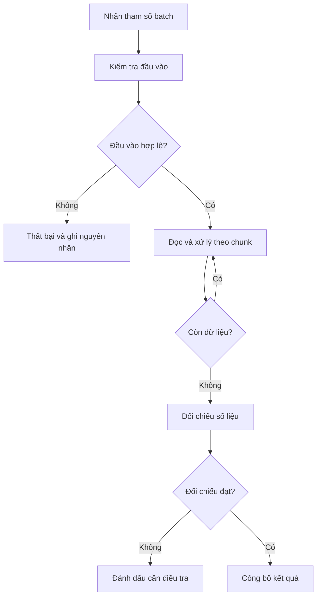

# Đặc điểm của một batch job đáng tin cậy

Một batch job đáng tin cậy là job có thể xử lý một khối lượng dữ liệu xác định hoặc một luồng dữ liệu theo lịch, tạo ra kết quả đúng, và giữ được trạng thái nhất quán ngay cả khi gặp lỗi. Job cần có hành vi rõ ràng khi chạy lại, khi một bản ghi không hợp lệ, khi hệ thống phụ thuộc tạm thời không sẵn sàng, hoặc khi tiến trình bị dừng giữa chừng.

Trong Spring Batch, độ tin cậy không đến từ một annotation hay một cấu hình đơn lẻ. Nó là kết quả của cách thiết kế `Job`, `Step`, reader, processor, writer, transaction, cơ chế restart, cùng với vận hành và giám sát. Một job chạy thành công một lần chưa chắc đã đáng tin cậy; job đáng tin cậy phải tiếp tục cho kết quả đúng qua nhiều lần chạy và trong những tình huống lỗi có thể dự đoán.

## 1. Kết quả có thể xác định và kiểm chứng

Trước khi triển khai, cần định nghĩa rõ đầu vào, đầu ra và điều kiện hoàn thành của job. Ví dụ, một job đối soát giao dịch có thể nhận tập giao dịch của một ngày, kiểm tra từng giao dịch, ghi kết quả đối soát và đánh dấu những giao dịch đã được xử lý.

Các câu hỏi cần trả lời gồm:

- Phạm vi dữ liệu của lần chạy được xác định bằng thời điểm, mã lô, ngày nghiệp vụ hay một tiêu chí khác?
- Một bản ghi được coi là xử lý thành công khi nào?
- Những bản ghi không hợp lệ sẽ bị từ chối, bỏ qua hay làm cả step thất bại?
- Khi job chạy lại, kết quả mong muốn là tiếp tục phần còn lại hay tạo lại cùng một kết quả?
- Làm thế nào để đối chiếu số bản ghi đọc, xử lý, ghi, bỏ qua và lỗi?

Một job tốt không dựa vào giả định mơ hồ như “đọc hết dữ liệu hiện có”. Nếu tập dữ liệu thay đổi trong lúc job đang chạy, lần chạy có thể xử lý phạm vi khác nhau tùy thời điểm. Với các nghiệp vụ theo kỳ, nên chốt phạm vi bằng một tham số như `businessDate`, `batchId`, hoặc mốc thời gian đã được xác định trước khi bắt đầu.

Ví dụ, job nhận `businessDate=2026-11-14` nên chỉ xử lý dữ liệu thuộc ngày nghiệp vụ đó, kể cả khi job được khởi chạy lại vào ngày hôm sau. Tham số này cũng cần được lưu trong `JobParameters` để phân biệt các instance của job.

## 2. Có khả năng restart an toàn

Một batch job có thể bị dừng vì mất điện, hết thời gian chạy, lỗi kết nối, tiến trình bị kill hoặc lỗi ứng dụng. Restartability là khả năng khởi chạy lại một job đã thất bại và tiếp tục xử lý một cách có kiểm soát.

Spring Batch lưu metadata thực thi trong `JobRepository`, bao gồm trạng thái job, step, execution context và các thông tin cần thiết cho việc restart. Khi cấu hình đúng, framework có thể khôi phục trạng thái của step và reader để tiếp tục từ vị trí phù hợp.

Để restart có ý nghĩa:

1. Dùng `JobRepository` được cấu hình với kho metadata có tính bền vững trong môi trường chạy thật. Không dựa vào metadata chỉ tồn tại trong bộ nhớ nếu cần restart sau khi tiến trình hoặc máy chủ dừng.
2. Cấp `JobParameters` ổn định cho cùng một lần xử lý nghiệp vụ. Các tham số định danh dữ liệu nên được giữ nguyên khi restart.
3. Dùng reader có thể lưu và khôi phục trạng thái khi cần tiếp tục từ vị trí đã đọc. Kiểm tra hành vi restart cụ thể của reader đang sử dụng.
4. Tránh thay đổi logic hoặc cấu trúc dữ liệu giữa lần chạy đầu và lần restart theo cách làm trạng thái đã lưu không còn tương thích.
5. Đảm bảo thao tác ghi có thể chạy lại an toàn, vì checkpoint và tác động bên ngoài không phải lúc nào cũng được commit cùng một transaction.

Ví dụ cấu hình một step theo chunk:

```java
@Bean
Step importOrders(
        JobRepository jobRepository,
        PlatformTransactionManager transactionManager,
        ItemReader<OrderInput> reader,
        ItemProcessor<OrderInput, Order> processor,
        ItemWriter<Order> writer) {

    return new StepBuilder("importOrders", jobRepository)
            .<OrderInput, Order>chunk(100, transactionManager)
            .reader(reader)
            .processor(processor)
            .writer(writer)
            .build();
}
```

Với step này, Spring Batch xử lý các item theo nhóm 100 item trong mỗi chunk transaction. Khi chunk commit, framework cập nhật trạng thái thực thi tương ứng. Nếu chunk chưa commit và transaction được rollback, phần công việc trong chunk đó có thể được thực hiện lại. Điều này không tự động hoàn tác những tác động đã xảy ra ở hệ thống bên ngoài transaction hiện tại.

`JobParameters` cũng ảnh hưởng đến định danh job instance. Với cùng tên job và cùng bộ tham số định danh, Spring Batch xem đó là cùng một `JobInstance`; một lần chạy mới thường tạo `JobExecution` khác cho instance đó. Nếu thêm tham số thay đổi mỗi lần chạy, chẳng hạn timestamp ngẫu nhiên, có thể vô tình tạo instance mới và làm mất ý nghĩa restart. Chỉ đánh dấu tham số là identifying khi nó thực sự phân biệt một lần xử lý nghiệp vụ.

## 3. Có tính idempotent và xử lý được việc chạy lặp

Idempotency là thuộc tính khiến việc thực hiện cùng một yêu cầu nhiều lần tạo ra kết quả tương đương với việc thực hiện một lần. Đây là đặc điểm quan trọng vì batch job thường phải retry, restart hoặc được vận hành viên chạy lại.

Ví dụ, thao tác “cộng thêm 100 vào số dư” không idempotent: chạy hai lần sẽ cộng 200. Trong khi đó, thao tác “đặt số dư của tài khoản thành giá trị đã tính cho batch X” có thể idempotent nếu được thiết kế với khóa và điều kiện cập nhật phù hợp.

Một số cách xây dựng tính idempotent:

- Dùng khóa nghiệp vụ hoặc khóa duy nhất để nhận diện bản ghi đã xử lý, ví dụ `(batch_id, source_record_id)`.
- Dùng upsert hoặc câu lệnh ghi có điều kiện để một bản ghi của cùng batch không bị tạo trùng.
- Lưu trạng thái xử lý và kết quả theo mã nguồn ổn định, thay vì chỉ dựa trên thứ tự đọc.
- Với thao tác cộng dồn, lưu ledger hoặc mã giao dịch duy nhất để ngăn việc áp dụng cùng một tác động nhiều lần.
- Khi gọi API bên ngoài, gửi idempotency key nếu dịch vụ hỗ trợ và lưu lại kết quả cần thiết để đối chiếu.

Ví dụ SQL minh họa việc bảo đảm mỗi bản ghi nguồn chỉ được ghi một lần cho một batch:

```sql
CREATE TABLE imported_order (
    batch_id          VARCHAR(64) NOT NULL,
    source_order_id   VARCHAR(64) NOT NULL,
    customer_id       VARCHAR(64) NOT NULL,
    amount            DECIMAL(18, 2) NOT NULL,
    PRIMARY KEY (batch_id, source_order_id)
);
```

Khóa chính ngăn hai bản ghi có cùng `batch_id` và `source_order_id` cùng tồn tại. Ứng dụng vẫn cần xác định cách xử lý khi gặp xung đột: bỏ qua bản ghi đã nhập, cập nhật theo quy tắc nghiệp vụ, hay báo lỗi dữ liệu. Ràng buộc cơ sở dữ liệu là lớp bảo vệ cuối cùng, không thay thế việc thiết kế quy trình chạy lại.

## 4. Transaction và checkpoint có ranh giới rõ ràng

Trong chunk-oriented processing, Spring Batch đọc item, chuyển item qua processor và ghi một nhóm item trong ranh giới transaction của chunk. Khi writer hoàn tất và transaction commit, chunk được xác nhận. Nếu một lỗi làm transaction rollback, các thay đổi thuộc transaction đó được hoàn tác.

Kích thước chunk là quyết định thiết kế quan trọng:

| Kích thước chunk | Ưu điểm | Đánh đổi |
|---|---|---|
| Nhỏ | Transaction ngắn, rollback ít dữ liệu, checkpoint thường xuyên | Nhiều lần commit và overhead cao hơn |
| Lớn | Giảm số lần commit, có thể tăng throughput | Transaction dài, dùng nhiều bộ nhớ hơn, rollback có phạm vi lớn hơn |

Không có một con số tối ưu cho mọi job. Hãy chọn dựa trên kích thước bản ghi, thời gian xử lý, giới hạn transaction của cơ sở dữ liệu, khả năng chịu tải và yêu cầu restart. Đo hiệu năng bằng dữ liệu gần với thực tế thay vì chọn chunk size chỉ theo cảm tính.

Một ranh giới transaction trong cơ sở dữ liệu không bao phủ tự động mọi hệ thống mà job gọi đến. Chẳng hạn, writer ghi một dòng vào database rồi gửi email hoặc gọi HTTP API. Nếu email đã gửi nhưng transaction database rollback, lần chạy lại có thể gửi email lần nữa. Tương tự, nếu API đã nhận yêu cầu nhưng client timeout trước khi nhận phản hồi, ứng dụng không thể kết luận chắc chắn rằng phía server chưa thực hiện thao tác.

Với tác động bên ngoài, hãy cân nhắc một trong các cách sau:

- Ghi một bản ghi outbox trong cùng transaction với thay đổi nghiệp vụ, rồi dùng tiến trình riêng gửi thông điệp từ outbox.
- Dùng idempotency key ở dịch vụ nhận để yêu cầu lặp không tạo tác động lặp.
- Lưu trạng thái gửi và kết quả phản hồi, đồng thời thiết kế trạng thái trung gian để có thể đối soát sau sự cố.
- Tách thao tác không thể rollback thành step riêng và quy định rõ cách phục hồi khi step đó thất bại.

Khi thiết kế transaction, cần kiểm tra writer có thực sự tham gia cùng `PlatformTransactionManager` hay không. Nếu dùng nhiều tài nguyên hoặc nhiều transaction manager, phải xác định rõ ranh giới nhất quán và chiến lược phục hồi.

## 5. Phân biệt lỗi tạm thời và lỗi dữ liệu

Không phải lỗi nào cũng nên xử lý giống nhau. Một job đáng tin cậy phân loại lỗi theo nguyên nhân và có chính sách phù hợp.

**Lỗi tạm thời** có thể biến mất nếu thử lại, ví dụ timeout ngắn, deadlock, giới hạn tốc độ từ API hoặc dịch vụ phụ thuộc tạm thời không sẵn sàng. Retry có giới hạn có thể giúp job hoàn thành mà không cần can thiệp thủ công.

**Lỗi dữ liệu hoặc lỗi nghiệp vụ** thường không biến mất khi chạy lại, ví dụ mã khách hàng không tồn tại, định dạng ngày sai, hoặc số tiền âm trong nghiệp vụ không cho phép. Những lỗi này thường cần được từ chối, đưa vào vùng lưu dữ liệu lỗi hoặc làm step thất bại tùy theo yêu cầu nghiệp vụ.

Spring Batch hỗ trợ cấu hình retry và skip trên step. Ví dụ sau minh họa một chính sách retry có giới hạn và skip một loại lỗi dữ liệu được xác định trước:

```java
return new StepBuilder("processPayments", jobRepository)
        .<PaymentInput, Payment>chunk(100, transactionManager)
        .reader(reader)
        .processor(processor)
        .writer(writer)
        .faultTolerant()
        .retry(TransientDataAccessException.class)
        .retryLimit(3)
        .skip(InvalidPaymentException.class)
        .skipLimit(20)
        .build();
```

Trong ví dụ, step có thể thử lại lỗi truy cập dữ liệu tạm thời tối đa theo giới hạn đã cấu hình và cho phép bỏ qua một số lượng item có `InvalidPaymentException` trong giới hạn. Cần xác minh loại exception thực tế được ném ra từ reader, processor hoặc writer. Cấu hình skip quá rộng, chẳng hạn bỏ qua mọi `Exception`, có thể che giấu lỗi lập trình hoặc lỗi hạ tầng và khiến job báo hoàn thành dù dữ liệu bị mất.

Một chính sách lỗi nên quy định:

- Loại lỗi nào được retry, số lần tối đa và khoảng nghỉ giữa các lần thử.
- Loại lỗi nào được skip và giới hạn skip cho phép.
- Item bị skip được ghi lại ở đâu, kèm mã nguồn và nguyên nhân nào.
- Khi vượt giới hạn, job hoặc step sẽ thất bại ra sao và ai chịu trách nhiệm xử lý.
- Retry có thể lặp lại side effect nào, và side effect đó đã idempotent hay chưa.

Đối với lỗi tạm thời, backoff có thể tránh việc retry dồn dập làm quá tải hệ thống phụ thuộc. Với lỗi không thể phục hồi, fail-fast thường giúp phát hiện vấn đề sớm và tránh tạo ra kết quả thiếu mà không ai nhận ra.

## 6. Có khả năng kiểm tra dữ liệu và bảo vệ tính toàn vẹn

Job đáng tin cậy phải kiểm tra dữ liệu ở đúng lớp. Reader chịu trách nhiệm đọc đúng phạm vi và diễn giải dữ liệu nguồn. Processor áp dụng quy tắc chuyển đổi và nghiệp vụ. Writer chịu trách nhiệm ghi kết quả theo quy tắc nhất quán.

Các kiểm tra thường gặp gồm:

- Kiểm tra trường bắt buộc, kiểu dữ liệu, định dạng và miền giá trị.
- Kiểm tra quan hệ tham chiếu, ví dụ khách hàng hoặc sản phẩm phải tồn tại.
- Kiểm tra trùng lặp theo khóa nghiệp vụ.
- Kiểm tra tổng số tiền, số lượng hoặc checksum khi nguồn cung cấp thông tin đối chiếu.
- Kiểm tra số bản ghi đầu vào và đầu ra có nằm trong ngưỡng hợp lý.
- Kiểm tra tính nhất quán giữa các phần dữ liệu liên quan trước khi công bố kết quả.

Không nên âm thầm sửa dữ liệu nguồn nếu quy tắc nghiệp vụ chưa cho phép. Nếu chuẩn hóa dữ liệu, hãy làm rõ giá trị gốc, giá trị sau chuẩn hóa và quy tắc đã áp dụng để có thể truy vết.

Với file đầu vào, có thể thực hiện bước kiểm tra cấu trúc và metadata trước khi xử lý toàn bộ file: tên file, ngày nghiệp vụ, encoding, header, số cột, checksum hoặc định dạng. Nếu file không thuộc batch dự kiến, dừng sớm để tránh nhập nhầm dữ liệu.

## 7. Có log, metric và khả năng truy vết

Một job có thể chạy nhiều giờ và xử lý hàng triệu bản ghi. Khi có sự cố, thông tin “job failed” là chưa đủ. Người vận hành cần biết job nào, lần chạy nào, step nào, phạm vi dữ liệu nào và item nào gặp vấn đề.

Nên ghi nhận tối thiểu:

- Tên job, tên step, `JobInstance`/`JobExecution` và các tham số nghiệp vụ cần thiết.
- Thời điểm bắt đầu, kết thúc, thời lượng và trạng thái thực thi.
- Số item đọc, xử lý, ghi, filter, skip và retry.
- Số lượng hoặc tỷ lệ lỗi theo nhóm nguyên nhân.
- Mã batch, ngày nghiệp vụ, tên file nguồn hoặc khoảng khóa dữ liệu đã xử lý.
- Thông tin lỗi đủ để điều tra, nhưng không làm lộ mật khẩu, token, dữ liệu cá nhân hoặc thông tin nhạy cảm.

Spring Batch cung cấp metadata về job và step execution trong `JobRepository`. Có thể dùng listener như `JobExecutionListener`, `StepExecutionListener` hoặc các listener xử lý item để bổ sung log và metric theo nhu cầu. Nên dùng mã tương quan ổn định để liên kết log của job với log từ dịch vụ hoặc hệ thống khác.

Ví dụ listener ghi nhận thời gian thực thi:

```java
@Component
public class BatchJobListener implements JobExecutionListener {

    private static final Logger log =
            LoggerFactory.getLogger(BatchJobListener.class);

    @Override
    public void beforeJob(JobExecution jobExecution) {
        log.info("Job {} started; executionId={}",
                jobExecution.getJobInstance().getJobName(),
                jobExecution.getId());
    }

    @Override
    public void afterJob(JobExecution jobExecution) {
        log.info("Job {} finished; executionId={}, status={}, exitStatus={}",
                jobExecution.getJobInstance().getJobName(),
                jobExecution.getId(),
                jobExecution.getStatus(),
                jobExecution.getExitStatus().getExitCode());
    }
}
```

Đây là ví dụ ghi log trạng thái ở mức job. Trong ứng dụng thực tế, cần đăng ký listener với job và bổ sung metric theo step hoặc theo loại dữ liệu. Tránh ghi toàn bộ nội dung item vào log nếu item có dữ liệu nhạy cảm hoặc khối lượng lớn.

Metric hữu ích có thể bao gồm throughput (item/giây), thời gian trung bình mỗi chunk, thời lượng từng step, tỷ lệ skip, số lần retry và độ trễ từ lúc dữ liệu được tạo đến lúc xử lý xong. Cảnh báo nên dựa trên điều kiện có ý nghĩa vận hành, chẳng hạn job quá thời gian dự kiến, số lỗi vượt ngưỡng hoặc không có batch mới trong khoảng thời gian cần thiết.

## 8. Có thể vận hành và điều phối an toàn

Một batch job đáng tin cậy cần quy tắc rõ ràng khi chạy theo lịch, chạy thủ công, chạy đồng thời hoặc bị yêu cầu dừng.

**Ngăn chạy trùng ngoài ý muốn.** Spring Batch quản lý định danh job instance dựa trên tên job và identifying parameters, nhưng ứng dụng vẫn cần chính sách điều phối phù hợp. Ví dụ, hai lần khởi chạy cùng batch có thể tranh chấp dữ liệu hoặc gọi dịch vụ ngoài hai lần. Có thể dùng unique constraint, khóa nghiệp vụ, cơ chế scheduler hoặc distributed lock tùy kiến trúc. Distributed lock cần có thời hạn và cơ chế xử lý khi worker chết để tránh khóa bị giữ vô hạn.

**Giới hạn tài nguyên.** Đặt giới hạn hợp lý cho kích thước chunk, số luồng, kết nối database, thời gian chờ và số lần retry. Tăng concurrency có thể cải thiện throughput nhưng cũng tăng áp lực lên database và dịch vụ phụ thuộc. Cần xác định cách phân vùng dữ liệu để các worker không ghi đè hoặc xử lý trùng cùng một phạm vi.

**Dừng có kiểm soát.** Job dài nên có cách phản ứng với yêu cầu dừng, timeout và shutdown của ứng dụng. Khi dừng, cần biết chunk hiện tại được commit hay rollback, trạng thái job được lưu thế nào và lần chạy sau sẽ tiếp tục từ đâu.

**Có runbook.** Tài liệu vận hành nên chỉ ra cách tìm execution bị lỗi, cách xác định nguyên nhân, điều kiện được phép restart, cách xử lý dữ liệu lỗi và cách đối chiếu kết quả trước khi chạy lại. Không nên yêu cầu vận hành viên tự sửa metadata hoặc xóa dữ liệu để “làm cho job chạy tiếp” nếu chưa có quy trình được kiểm soát.

## 9. Có thể kiểm thử các tình huống thành công và thất bại

Kiểm thử một batch job không chỉ xác nhận rằng một tập input nhỏ tạo ra output mong đợi. Cần kiểm tra cả các tình huống có thể xảy ra khi chạy thật.

Các nhóm kiểm thử hữu ích:

1. **Kiểm thử nghiệp vụ:** dữ liệu hợp lệ, dữ liệu biên, dữ liệu thiếu trường, dữ liệu trùng và dữ liệu sai định dạng.
2. **Kiểm thử transaction:** writer thất bại giữa chunk, xác nhận các thay đổi trong transaction được rollback đúng.
3. **Kiểm thử restart:** làm job thất bại sau một số chunk, sau đó restart với cùng identifying parameters và xác nhận kết quả cuối không thiếu hoặc trùng.
4. **Kiểm thử retry/skip:** mô phỏng lỗi tạm thời, lỗi dữ liệu và trường hợp vượt retry/skip limit.
5. **Kiểm thử idempotency:** chạy lại cùng batch và xác nhận không nhân đôi tác động nghiệp vụ.
6. **Kiểm thử tích hợp:** xác nhận reader, writer, transaction manager, `JobRepository` và các hệ thống ngoài phối hợp đúng.
7. **Kiểm thử tải:** dùng khối lượng và phân bố dữ liệu gần với thực tế để đo thời gian, bộ nhớ, kết nối và throughput.

Spring Batch cung cấp các tiện ích kiểm thử như `JobLauncherTestUtils` và `JobRepositoryTestUtils` trong module test tương ứng. Chúng giúp khởi chạy job trong kiểm thử và quản lý metadata test. Nên dùng cơ sở dữ liệu test có hành vi transaction gần với môi trường thật khi kiểm tra restart hoặc concurrency; một mock đơn giản thường không thể chứng minh các đặc tính này.

Ví dụ ở mức ý tưởng về kiểm thử kết quả job:

```java
@SpringBatchTest
@SpringJUnitConfig(BatchTestConfiguration.class)
class ImportOrdersJobTest {

    @Autowired
    private JobLauncherTestUtils jobLauncherTestUtils;

    @Test
    void importsOrdersForBusinessDate() throws Exception {
        JobParameters parameters = new JobParametersBuilder()
                .addString("businessDate", "2026-11-14")
                .toJobParameters();

        JobExecution execution =
                jobLauncherTestUtils.launchJob(parameters);

        assertEquals(BatchStatus.COMPLETED, execution.getStatus());
        // Bổ sung assertion trên dữ liệu đã ghi và số item theo nghiệp vụ.
    }
}
```

Đoạn mã minh họa cách khởi chạy job với tham số nghiệp vụ. Cấu hình kiểm thử cần cung cấp job phù hợp cho `JobLauncherTestUtils`, cùng các dependency và dữ liệu test. Assertion trạng thái `COMPLETED` là cần thiết nhưng chưa đủ: kiểm thử nên xác nhận dữ liệu đầu ra, số lượng item, tính duy nhất và các side effect quan trọng.

## 10. Chọn cấu trúc step phù hợp với yêu cầu

Spring Batch hỗ trợ nhiều kiểu step. Chunk-oriented step phù hợp khi xử lý từng item hoặc nhóm item qua reader, processor và writer. Tasklet phù hợp với một tác vụ hữu hạn như chuẩn bị thư mục, xác minh file, gọi một stored procedure hoặc dọn dữ liệu theo quy tắc rõ ràng.

Một job có thể kết hợp các step để tạo thành quy trình nhiều giai đoạn:



Việc chia step nên phản ánh các ranh giới nghiệp vụ và phục hồi. Nếu bước kiểm tra đầu vào thất bại, không nên bắt đầu nhập dữ liệu. Nếu bước đối chiếu thất bại sau khi dữ liệu đã được ghi, cần quy định rõ kết quả đã ghi có được coi là tạm thời hay phải được bù trừ. Một sơ đồ step rõ ràng giúp người phát triển và vận hành hiểu được job đang ở giai đoạn nào sau sự cố.

## 11. Checklist thiết kế trước khi đưa job vào vận hành

Trước khi phát hành một batch job, nhóm phát triển nên có câu trả lời cụ thể cho các điểm sau:

| Khía cạnh | Câu hỏi cần trả lời |
|---|---|
| Phạm vi dữ liệu | Job xử lý chính xác batch, ngày nghiệp vụ hoặc khoảng dữ liệu nào? |
| Kết quả | Điều kiện hoàn thành và số liệu đối chiếu là gì? |
| Restart | Metadata có bền vững không, và job restart với cùng tham số như thế nào? |
| Idempotency | Chạy lại có tạo bản ghi, thanh toán, thông điệp hoặc side effect trùng không? |
| Transaction | Chunk commit/rollback bao phủ những tài nguyên nào? |
| Retry và skip | Lỗi nào được retry, lỗi nào được skip, và giới hạn là bao nhiêu? |
| Dữ liệu lỗi | Item lỗi được lưu, truy vết và xử lý lại ra sao? |
| Quan sát | Có log, metric, cảnh báo và mã tương quan đủ để điều tra không? |
| Điều phối | Làm sao ngăn chạy trùng và kiểm soát chạy đồng thời? |
| Kiểm thử | Đã kiểm tra restart, rollback, retry, skip và chạy lặp chưa? |
| Vận hành | Có runbook để restart, đối soát và xử lý sự cố không? |

Không phải job nào cũng cần mọi cơ chế ở mức phức tạp như nhau. Một job tạo báo cáo tạm thời có rủi ro khác với job ghi nhận thanh toán hoặc cập nhật số dư. Mức bảo vệ cần tương xứng với tác động nghiệp vụ, khả năng khôi phục và yêu cầu kiểm toán.

## Kết luận

Một batch job đáng tin cậy có đầu vào và kết quả được xác định rõ, restart được, chịu được việc chạy lặp, kiểm soát transaction, phân loại lỗi hợp lý và cung cấp đủ thông tin để vận hành. Spring Batch cung cấp nền tảng cho metadata, chunk processing, transaction, retry, skip và listener; ứng dụng vẫn phải thiết kế idempotency, ranh giới tác động bên ngoài, kiểm tra dữ liệu và quy trình phục hồi theo nghiệp vụ cụ thể.

Hãy đánh giá job qua các tình huống thực tế: tiến trình dừng giữa chunk, database tạm thời mất kết nối, một item sai dữ liệu, writer timeout sau khi hệ thống ngoài đã nhận yêu cầu, hoặc cùng batch được khởi chạy hai lần. Nếu mỗi tình huống đều có hành vi dự kiến, có thể truy vết và có cách phục hồi an toàn, job mới có nền tảng vững chắc để chạy trong môi trường production.
