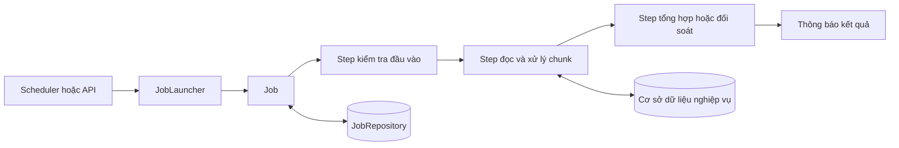
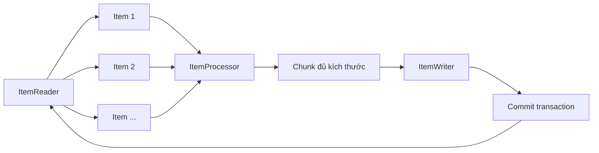

# Lộ trình từ job đơn giản đến pipeline production

Spring Batch giúp xây dựng các tác vụ xử lý dữ liệu theo lô: đọc hàng nghìn hoặc hàng triệu bản ghi, biến đổi dữ liệu, ghi kết quả, theo dõi tiến độ và tiếp tục chạy sau khi gặp lỗi. Một job có thể bắt đầu bằng vài dòng `Tasklet`, sau đó phát triển thành pipeline đọc–xử lý–ghi theo từng chunk, rồi bổ sung khả năng restart, xử lý lỗi, kiểm soát dữ liệu trùng, quan sát vận hành và mở rộng tải.

Lộ trình trong bài đi theo đúng thứ tự đó. Mỗi giai đoạn giải quyết một vấn đề thực tế và tạo nền tảng cho giai đoạn tiếp theo. Các ví dụ dùng API theo phong cách Spring Batch 5.x và Spring Boot 3.x; nếu dự án dùng phiên bản khác, hãy đối chiếu API và cấu hình tương ứng của phiên bản đang chạy.

## 1. Nhìn tổng thể một pipeline Spring Batch

Một pipeline production thường có dạng:



Các thành phần chính:

| Thành phần | Vai trò |
|---|---|
| `Job` | Đại diện cho một quy trình batch hoàn chỉnh, gồm một hoặc nhiều step |
| `Step` | Một giai đoạn công việc có thể chạy độc lập, theo thứ tự hoặc theo nhánh |
| `JobLauncher` | Khởi chạy job với một bộ tham số |
| `JobRepository` | Lưu metadata về job, step, trạng thái chạy và execution context |
| `ItemReader` | Đọc từng item từ file, database, queue hoặc nguồn khác |
| `ItemProcessor` | Kiểm tra, lọc hoặc chuyển đổi item |
| `ItemWriter` | Ghi một nhóm item ra đích |
| `JobParameters` | Xác định dữ liệu đầu vào và danh tính của một lần chạy logic |
| `ExecutionContext` | Lưu trạng thái cần thiết để tiếp tục một job hoặc step |

Một job có thể gồm nhiều step. Trong mỗi step, ta thường chọn một trong hai kiểu:

- **Tasklet**: thực hiện một công việc hữu hạn như kiểm tra file, gọi thủ tục lưu trữ hoặc dọn dữ liệu cũ.
- **Chunk-oriented processing**: đọc, xử lý và ghi dữ liệu theo từng nhóm có kích thước cấu hình được.

Không cần ép mọi công việc vào chunk. Tasklet phù hợp với thao tác có tính chất một lần cho mỗi step; chunk phù hợp với luồng dữ liệu có nhiều item và cần commit theo lô.

## 2. Giai đoạn 1 — Tạo job nhỏ nhất bằng Tasklet

Bắt đầu với một job có một step và một hành động đơn giản. Mục tiêu là hiểu cấu trúc `Job` → `Step`, cách Spring Batch lưu trạng thái chạy và cách kết thúc một step.

Ví dụ dưới đây tạo job ghi nhận một thao tác khởi tạo:

```java
@Configuration
public class FirstJobConfig {

    @Bean
    Job firstJob(JobRepository jobRepository, Step firstStep) {
        return new JobBuilder("firstJob", jobRepository)
                .start(firstStep)
                .build();
    }

    @Bean
    Step firstStep(
            JobRepository jobRepository,
            PlatformTransactionManager transactionManager) {

        return new StepBuilder("firstStep", jobRepository)
                .tasklet((contribution, chunkContext) -> {
                    System.out.println("Batch job started");
                    return RepeatStatus.FINISHED;
                }, transactionManager)
                .build();
    }
}
```

`JobBuilder` nhận tên job và `JobRepository`. `StepBuilder` nhận tên step và cùng repository đó. Tasklet trả về:

- `RepeatStatus.FINISHED` khi công việc đã hoàn tất.
- `RepeatStatus.CONTINUABLE` khi step cần được gọi lại để tiếp tục xử lý.

Tasklet được chạy trong transaction do transaction manager của step quản lý. Với một thao tác chỉ chạy một lần, `FINISHED` là kết quả thường gặp.

Ở giai đoạn này, hãy xác nhận được các điểm sau:

1. Ứng dụng khởi tạo được job và step.
2. Job có tên ổn định, không đổi theo từng lần deploy.
3. Một lần chạy tạo ra bản ghi execution trong metadata repository.
4. Lỗi trong Tasklet khiến execution phản ánh trạng thái thất bại.

Tasklet không tự tạo ra khả năng tiếp tục giữa chừng cho một tác vụ dài. Nếu công việc có nhiều bản ghi, cần lưu tiến độ rõ ràng hoặc chuyển sang chunk processing.

## 3. Giai đoạn 2 — Chuyển sang xử lý theo chunk

Khi cần xử lý nhiều bản ghi, Spring Batch cung cấp mô hình:



Giả sử chunk size là `500`, step đọc tối đa 500 item, chuyển đổi chúng, gọi writer và commit transaction. Sau đó step tiếp tục với chunk kế tiếp. Chunk cuối có thể nhỏ hơn 500.

Khai báo step tổng quát:

```java
@Bean
Step processStep(
        JobRepository jobRepository,
        PlatformTransactionManager transactionManager,
        ItemReader<InputRecord> reader,
        ItemProcessor<InputRecord, OutputRecord> processor,
        ItemWriter<OutputRecord> writer) {

    return new StepBuilder("processStep", jobRepository)
            .<InputRecord, OutputRecord>chunk(500, transactionManager)
            .reader(reader)
            .processor(processor)
            .writer(writer)
            .build();
}
```

Ba kiểu dữ liệu có thể khác nhau:

- `InputRecord`: kiểu dữ liệu reader trả về.
- `OutputRecord`: kiểu dữ liệu processor tạo ra và writer nhận vào.

Reader trả về `null` khi hết dữ liệu. Processor có thể trả về `null` để lọc bỏ một item. Writer nhận toàn bộ item đã qua processor trong chunk hiện tại.

### Transaction và chunk size

Chunk size là một quyết định về hiệu năng và độ lớn của transaction:

- Chunk nhỏ giảm lượng công việc phải rollback khi lỗi, nhưng tăng số lần commit và overhead.
- Chunk lớn giảm số lần commit, nhưng transaction lâu hơn, giữ tài nguyên lâu hơn và có thể cần nhiều bộ nhớ.
- Một chunk chỉ commit thành công khi phần ghi và transaction tương ứng hoàn tất.

Không có con số tối ưu cho mọi hệ thống. Hãy bắt đầu với một giá trị vừa phải, đo thời gian đọc, xử lý, ghi và thời gian commit, rồi điều chỉnh bằng dữ liệu thực tế. Với thao tác ghi database, cũng cần xem xét batch size của JDBC và giới hạn connection pool.

## 4. Giai đoạn 3 — Xây dựng pipeline nhập file thực tế

Một bài toán nhập hóa đơn từ CSV là ví dụ tốt để ghép các thành phần:

1. Nhận đường dẫn file và ngày nghiệp vụ qua job parameters.
2. Reader đọc từng dòng CSV thành `Invoice`.
3. Processor kiểm tra dữ liệu và chuyển thành `ProcessedInvoice`.
4. Writer ghi kết quả vào database.

### 4.1. Khai báo model

```java
import java.math.BigDecimal;

public record Invoice(
        String invoiceId,
        String customerId,
        BigDecimal amount) {
}

public record ProcessedInvoice(
        String invoiceId,
        String customerId,
        BigDecimal amount) {
}
```

Trong ví dụ, hai record có cấu trúc giống nhau để tập trung vào luồng xử lý. Ở ứng dụng thật, processor thường chuẩn hóa mã, kiểm tra quy tắc nghiệp vụ, tra cứu dữ liệu tham chiếu hoặc tạo một model đích khác.

### 4.2. Đọc CSV

```java
@Bean
@StepScope
FlatFileItemReader<Invoice> invoiceReader(
        @Value("#{jobParameters['inputFile']}") String inputFile) {

    return new FlatFileItemReaderBuilder<Invoice>()
            .name("invoiceReader")
            .resource(new FileSystemResource(inputFile))
            .linesToSkip(1)
            .delimited()
            .names("invoiceId", "customerId", "amount")
            .fieldSetMapper(fields -> new Invoice(
                    fields.readString("invoiceId"),
                    fields.readString("customerId"),
                    fields.readBigDecimal("amount")))
            .saveState(true)
            .build();
}
```

`@StepScope` cho phép reader được tạo khi step bắt đầu, lúc đó job parameters đã có giá trị. Biểu thức `@Value` lấy `inputFile` từ parameters. `saveState(true)` cho phép reader lưu vị trí đọc vào execution context để hỗ trợ restart.

Tên reader phải ổn định giữa các lần chạy và các lần restart. Nếu đổi tên reader hoặc thay đổi định dạng đầu vào giữa lúc một execution đang dang dở, trạng thái đã lưu có thể không còn phù hợp.

Định dạng CSV thực tế cần được quy định rõ: encoding, header, dấu phân cách, quy tắc quote, định dạng số thập phân, múi giờ và cách biểu diễn giá trị rỗng. Nếu file có thể chứa dấu phẩy trong trường được quote, hãy dùng tokenizer hỗ trợ CSV thay vì tự tách dòng bằng `String.split(",")`.

### 4.3. Xử lý nghiệp vụ

```java
@Bean
ItemProcessor<Invoice, ProcessedInvoice> invoiceProcessor() {
    return invoice -> {
        if (invoice.invoiceId() == null || invoice.invoiceId().isBlank()) {
            throw new IllegalArgumentException("Missing invoice id");
        }

        if (invoice.amount() == null || invoice.amount().signum() <= 0) {
            throw new IllegalArgumentException("Invalid invoice amount");
        }

        return new ProcessedInvoice(
                invoice.invoiceId().trim(),
                invoice.customerId().trim(),
                invoice.amount());
    };
}
```

Processor nên tập trung vào quy tắc biến đổi của một item. Tránh đặt các thao tác có side effect như gửi email, gọi API thanh toán hoặc cập nhật nhiều hệ thống bên ngoài vào đây. Processor có thể được gọi lại khi chunk retry, nên một side effect bên trong processor dễ bị thực hiện nhiều lần.

Nếu `customerId` có thể null, cần kiểm tra trước khi gọi `trim()`. Ví dụ trên giả định trường đó đã được xác thực hoặc bắt buộc theo hợp đồng đầu vào.

### 4.4. Ghi database

Ví dụ dùng `JdbcBatchItemWriter` và named parameter:

```java
@Bean
JdbcBatchItemWriter<ProcessedInvoice> invoiceWriter(DataSource dataSource) {
    return new JdbcBatchItemWriterBuilder<ProcessedInvoice>()
            .dataSource(dataSource)
            .sql("""
                    INSERT INTO processed_invoice
                        (invoice_id, customer_id, amount)
                    VALUES
                        (:invoiceId, :customerId, :amount)
                    """)
            .itemSqlParameterSourceProvider(item ->
                    new MapSqlParameterSource()
                            .addValue("invoiceId", item.invoiceId())
                            .addValue("customerId", item.customerId())
                            .addValue("amount", item.amount()))
            .build();
}
```

Bảng đích cần có schema và constraint phù hợp, ví dụ `invoice_id` là khóa duy nhất. SQL `INSERT` minh họa cách ánh xạ item; khi triển khai restart hoặc chạy lại dữ liệu, cần chọn chính sách ghi lặp phù hợp với database: upsert, insert-if-absent, staging table rồi merge, hoặc phát hiện bản ghi đã xử lý. Cú pháp upsert khác nhau giữa PostgreSQL, MySQL, SQL Server và Oracle.

### 4.5. Ghép reader, processor, writer vào step và job

```java
@Bean
Step importInvoicesStep(
        JobRepository jobRepository,
        PlatformTransactionManager transactionManager,
        FlatFileItemReader<Invoice> invoiceReader,
        ItemProcessor<Invoice, ProcessedInvoice> invoiceProcessor,
        JdbcBatchItemWriter<ProcessedInvoice> invoiceWriter) {

    return new StepBuilder("importInvoicesStep", jobRepository)
            .<Invoice, ProcessedInvoice>chunk(500, transactionManager)
            .reader(invoiceReader)
            .processor(invoiceProcessor)
            .writer(invoiceWriter)
            .build();
}

@Bean
Job invoiceImportJob(
        JobRepository jobRepository,
        Step importInvoicesStep) {

    return new JobBuilder("invoiceImportJob", jobRepository)
            .start(importInvoicesStep)
            .build();
}
```

Đây là một job chunk tối giản. Khi mở rộng, có thể thêm step kiểm tra file ở đầu, step đối soát số lượng ở cuối và các listener để ghi nhận kết quả. Mỗi step nên có một trách nhiệm rõ ràng để có thể quan sát, kiểm thử và restart độc lập.

## 5. Giai đoạn 4 — Dùng JobParameters đúng cách

Job parameters truyền dữ liệu cần thiết cho một lần chạy. Chúng cũng quyết định danh tính của `JobInstance` nếu được đánh dấu là identifying.

Ví dụ khởi chạy:

```java
JobParameters parameters = new JobParametersBuilder()
        .addString("inputFile", inputFilePath, true)
        .addString("businessDate", businessDate.toString(), true)
        .addString("requestId", requestId, false)
        .toJobParameters();

jobLauncher.run(invoiceImportJob, parameters);
```

Tham số `true` đánh dấu parameter là identifying; `false` là non-identifying. Với ví dụ này, file và ngày nghiệp vụ tạo nên danh tính logic của lần nhập. `requestId` chỉ bổ sung thông tin truy vết.

Phân biệt ba khái niệm:

| Khái niệm | Ý nghĩa |
|---|---|
| `JobInstance` | Một lần chạy logic, được xác định bởi tên job và identifying parameters |
| `JobExecution` | Một lần thực thi cụ thể của JobInstance |
| `StepExecution` | Một lần thực thi cụ thể của một step |

Một `JobInstance` có thể có nhiều `JobExecution`, chẳng hạn lần đầu thất bại và lần sau được restart. Nếu job đã hoàn tất với cùng identifying parameters, Spring Batch thường từ chối chạy lại cùng instance vì nó đã hoàn thành. Muốn xử lý một đợt nghiệp vụ mới, hãy cung cấp identifying parameter mới có ý nghĩa, ví dụ ngày nghiệp vụ hoặc mã lô mới.

Không thêm một timestamp ngẫu nhiên vào identifying parameters chỉ để né lỗi “already complete” nếu mục tiêu là restart. Làm vậy sẽ tạo `JobInstance` mới và khiến Spring Batch xem đó là một lần chạy logic khác.

Nếu ứng dụng cần tự điều khiển thời điểm launch thay vì để Spring Boot tự chạy các job bean khi khởi động, có thể cấu hình:

```properties
spring.batch.job.enabled=false
```

Hãy kiểm tra hành vi auto-run của phiên bản Spring Boot đang dùng và chọn một cơ chế launch nhất quán: scheduler, API điều phối, command line hoặc một service chuyên khởi chạy batch.

## 6. Giai đoạn 5 — Thiết kế restart và tính idempotent

Restart là một trong những lý do quan trọng để dùng Spring Batch. Khi một job thất bại giữa chừng, hệ thống có thể tiếp tục từ trạng thái đã lưu thay vì luôn đọc lại toàn bộ dữ liệu. Tuy nhiên, restart an toàn phụ thuộc vào reader, writer và side effect của ứng dụng.

### 6.1. Spring Batch lưu những gì?

`JobRepository` lưu metadata về job và step executions. `ExecutionContext` lưu trạng thái cần thiết để tiếp tục, ví dụ vị trí reader đã đọc hoặc một giá trị điều khiển do ứng dụng đặt vào context.

Với chunk processing, trạng thái được cập nhật cùng ranh giới commit của step. Khi restart, Spring Batch dùng metadata và execution context để khôi phục tiến độ. Reader phải hỗ trợ lưu trạng thái và có tên ổn định; nguồn dữ liệu cũng cần giữ nguyên hoặc có thể tái tạo chính xác.

Ví dụ, nếu reader đang đọc file:

- Giữ file đầu vào bất biến trong suốt vòng đời job.
- Lưu file ở vị trí ổn định, có quyền truy cập giống nhau giữa các lần chạy.
- Không ghi đè file cùng đường dẫn bằng nội dung mới.
- Ghi nhận checksum hoặc mã lô để xác nhận file restart vẫn là file ban đầu.

Nếu nguồn dữ liệu là một câu query database, cần có thứ tự đọc xác định. Dùng `ORDER BY` trên khóa ổn định; nếu dữ liệu có thể thay đổi trong lúc job chạy, hãy xác định snapshot hoặc watermark phù hợp.

### 6.2. Restart không tự đảm bảo exactly-once cho mọi side effect

Transaction database có thể rollback phần ghi trong transaction hiện tại. Nhưng transaction đó không tự rollback được một email đã gửi, một HTTP request đã được hệ thống khác chấp nhận hoặc một file đã được upload sang nơi khác.

Vì vậy, cần thiết kế writer và side effect theo hướng idempotent: cùng một item được xử lý lại không làm phát sinh kết quả nghiệp vụ sai hoặc nhân đôi.

Các cách thường dùng:

- Đặt unique constraint trên khóa nghiệp vụ của bản ghi đã xử lý.
- Dùng upsert hoặc câu lệnh ghi có điều kiện theo khóa idempotency.
- Lưu `batch_id` và khóa nguồn để đối chiếu item đã được ghi.
- Ghi vào staging table trước, kiểm tra đủ dữ liệu rồi merge vào bảng đích.
- Dùng transactional outbox để lưu yêu cầu phát sự kiện cùng transaction nghiệp vụ; một worker riêng gửi sự kiện và phía nhận vẫn kiểm tra idempotency key.

Một mô hình dữ liệu hữu ích là lưu `source_record_id`, `batch_id`, `processed_at` và trạng thái xử lý. Khi có lỗi, đội vận hành có thể xác định item nào đã commit, item nào bị loại và item nào cần xử lý lại.

### 6.3. Phân biệt restart với chạy lại từ đầu

- **Restart**: tiếp tục cùng `JobInstance` sau một execution chưa hoàn tất, dùng lại identifying parameters.
- **Run mới**: tạo `JobInstance` khác bằng identifying parameters mới.
- **Reprocess**: chủ động xử lý lại dữ liệu đã từng hoàn tất; cần có quy tắc nghiệp vụ và cơ chế idempotency hoặc versioning rõ ràng.

Đừng xóa metadata job executions để “làm cho job chạy lại” trong môi trường production. Việc đó có thể phá mất dấu vết vận hành và khả năng restart. Hãy thiết kế thao tác reprocess thành một quy trình được kiểm soát.

## 7. Giai đoạn 6 — Xử lý lỗi có phân loại

Một pipeline production cần phân biệt lỗi dữ liệu, lỗi tạm thời và lỗi hệ thống. Chính sách xử lý phải dựa trên nguyên nhân của lỗi.

| Loại lỗi | Ví dụ | Cách xử lý thường dùng |
|---|---|---|
| Dữ liệu không hợp lệ | Số tiền âm, thiếu mã hóa đơn | Skip có giới hạn, lưu bản ghi lỗi để điều tra |
| Lỗi tạm thời | Database deadlock, dịch vụ phụ trợ timeout | Retry có giới hạn và backoff phù hợp |
| Lỗi cấu hình | Sai tên bảng, thiếu credential | Fail sớm, sửa cấu hình rồi restart |
| Lỗi hạ tầng kéo dài | Database mất kết nối | Dừng hoặc fail job, cảnh báo vận hành |
| Lỗi logic | Null ngoài dự kiến, lỗi mapping | Fail để sửa code; không skip đại trà |

Ví dụ thêm skip và retry cho step:

```java
return new StepBuilder("importInvoicesStep", jobRepository)
        .<Invoice, ProcessedInvoice>chunk(500, transactionManager)
        .reader(invoiceReader)
        .processor(invoiceProcessor)
        .writer(invoiceWriter)
        .faultTolerant()
        .skip(FlatFileParseException.class)
        .skipLimit(100)
        .retry(TransientDataAccessException.class)
        .retryLimit(3)
        .build();
```

Đây là ví dụ minh họa; cần chọn exception cụ thể theo reader, database driver và nghiệp vụ thực tế. Không nên skip `Exception.class` hoặc retry mọi lỗi. Lỗi cấu hình và lỗi lập trình sẽ không tự hết sau vài lần thử.

Một số nguyên tắc:

- Đặt `skipLimit` để một file hỏng hàng loạt không âm thầm tạo ra kết quả thiếu dữ liệu.
- Chỉ retry lỗi có khả năng tự hồi phục, chẳng hạn lỗi tạm thời ở tầng truy cập dữ liệu.
- Giới hạn số lần retry; cân nhắc backoff để tránh dồn tải vào dịch vụ đang quá tải.
- Dùng `SkipListener` để ghi lại item lỗi, nguyên nhân và thông tin định danh của batch.
- Theo dõi số lượng read, process, write, filter và skip; chênh lệch bất thường cần được giải thích.
- Quy định rõ job được phép hoàn thành với một số bản ghi bị skip hay phải fail nếu có bất kỳ dữ liệu lỗi nào.

Skip và retry ảnh hưởng đến transaction. Khi một item lỗi trong chunk, framework có thể rollback chunk rồi thử lại hoặc bỏ qua item theo cấu hình. Vì vậy, processor và writer cần an toàn khi được gọi lại, và side effect bên ngoài cần được tách ra hoặc bảo vệ bằng idempotency.

## 8. Giai đoạn 7 — Tổ chức nhiều step thành workflow

Khi job có nhiều bước nghiệp vụ, hãy biểu diễn luồng công việc rõ ràng:

```java
@Bean
Job dailyImportJob(
        JobRepository jobRepository,
        Step validateFileStep,
        Step importDataStep,
        Step reconcileStep) {

    return new JobBuilder("dailyImportJob", jobRepository)
            .start(validateFileStep)
            .next(importDataStep)
            .next(reconcileStep)
            .build();
}
```

Một workflow nhập dữ liệu thường có thể chia như sau:

1. **Validate input**: kiểm tra file tồn tại, đúng định dạng, đúng ngày nghiệp vụ và chưa được xử lý.
2. **Load staging**: đọc file và ghi dữ liệu thô vào staging table.
3. **Validate business rules**: kiểm tra quan hệ tham chiếu, tổng tiền, mã khách hàng và các quy tắc nghiệp vụ.
4. **Publish data**: merge dữ liệu hợp lệ vào bảng nghiệp vụ hoặc phát sự kiện.
5. **Reconcile**: đối chiếu số dòng nguồn, số dòng hợp lệ, số dòng bị loại và số dòng đã ghi.
6. **Notify**: phát kết quả vận hành sau khi dữ liệu đã được commit.

Nếu step sau phụ thuộc step trước, dùng `.next(...)`. Khi cần rẽ nhánh theo kết quả, có thể dùng flow transitions với `on(...)`, `to(...)`, `from(...)`, `end()` hoặc `fail()`. Hãy xác định rõ exit status nào biểu thị thành công nghiệp vụ, cảnh báo hoặc thất bại.

Không nên gom toàn bộ workflow vào một Tasklet lớn. Tách step giúp thấy được tiến độ, thời gian và lỗi theo từng giai đoạn, đồng thời cho phép restart từ step phù hợp.

## 9. Giai đoạn 8 — Mở rộng hiệu năng và xử lý song song

Trước khi tăng concurrency, hãy đo xem thời gian nằm ở đâu: đọc file, query database, xử lý CPU, ghi database hay gọi dịch vụ bên ngoài. Tối ưu điểm nghẽn trước khi thêm thread.

### 9.1. Partitioning

Partitioning chia dữ liệu thành các phần độc lập và chạy mỗi phần trong một worker step. Ví dụ, có thể chia theo khoảng `customer_id`, ngày, vùng dữ liệu hoặc hash partition. Mỗi partition có execution context riêng.

Partitioning phù hợp khi:

- Dữ liệu có thể chia thành các tập không chồng lấn.
- Mỗi partition có thể xử lý độc lập.
- Có thể giới hạn số worker để bảo vệ database và hệ thống phụ trợ.
- Cần theo dõi trạng thái và retry theo từng partition.

Điểm quan trọng là ranh giới partition phải ổn định và không bỏ sót hoặc xử lý trùng bản ghi. Khi phân chia theo khoảng khóa, hãy xác định rõ điều kiện đầu/cuối, kiểu dữ liệu và cách xử lý bản ghi mới xuất hiện trong lúc job chạy.

### 9.2. Multi-threaded step

Multi-threaded step có thể tăng thông lượng khi phần xử lý có thể chạy đồng thời. Tuy nhiên, reader, processor và writer phải an toàn với concurrency theo cách chúng được dùng. Một reader giữ con trỏ nội bộ hoặc một writer dùng trạng thái mutable có thể không thread-safe.

Trong một số cấu hình, xử lý ở thread phụ có transaction context khác với thread điều phối. Đừng giả định mọi thao tác trong một step đa luồng đều dùng chung một transaction. Kiểm tra tài liệu của phiên bản Spring Batch và transaction manager đang dùng.

### 9.3. Remote chunking

Remote chunking phù hợp khi cần tách nơi đọc dữ liệu và nơi xử lý chunk sang các process hoặc máy khác nhau. Manager đọc và gửi chunk qua middleware; worker xử lý và ghi kết quả. Mô hình này cần cân nhắc message delivery, retry, thứ tự, back pressure và idempotency ở phía worker.

### 9.4. Chọn cách mở rộng

| Cách tiếp cận | Phù hợp khi | Điều cần kiểm soát |
|---|---|---|
| Tăng chunk size | Overhead commit lớn, mỗi item nhẹ | Bộ nhớ, thời gian transaction, rollback |
| Partitioning | Có khóa hoặc miền dữ liệu chia độc lập | Không chồng lấn, phân bổ tải, restart từng partition |
| Multi-threaded step | Component thread-safe và xử lý có thể song song | Shared state, transaction, thứ tự |
| Remote chunking | Cần scale worker trên nhiều process hoặc máy | Messaging, delivery semantics, idempotency |

Đừng tăng số thread vượt quá năng lực connection pool hoặc database. Ví dụ, 32 worker cùng ghi vào một bảng có index nóng có thể chậm hơn 4 worker vì tranh chấp khóa và I/O.

## 10. Giai đoạn 9 — Đưa job vào môi trường production

Một job chạy được trên máy phát triển mới chỉ là điểm bắt đầu. Production cần cấu hình, bảo mật, điều phối, quan sát và quy trình phục hồi.

### 10.1. Metadata repository và database schema

`JobRepository` lưu metadata Spring Batch, thường trong các bảng có tiền tố `BATCH_`, ví dụ:

- `BATCH_JOB_INSTANCE`
- `BATCH_JOB_EXECUTION`
- `BATCH_STEP_EXECUTION`
- `BATCH_JOB_EXECUTION_PARAMS`
- `BATCH_JOB_EXECUTION_CONTEXT`
- `BATCH_STEP_EXECUTION_CONTEXT`

Metadata này khác dữ liệu nghiệp vụ mà job đang xử lý. Có thể dùng chung database hoặc tách riêng tùy tải và yêu cầu vận hành, nhưng phải bảo đảm transaction và kết nối được cấu hình đúng.

Trong môi trường local, Spring Boot có thể tự khởi tạo schema cho database phù hợp. Ví dụ:

```properties
spring.batch.jdbc.initialize-schema=always
```

Trong production, nên quản lý schema bằng migration có kiểm soát và đặt cấu hình khởi tạo tự động theo chính sách triển khai. Không phụ thuộc vào việc mỗi lần ứng dụng khởi động sẽ tự tạo hoặc sửa bảng metadata.

### 10.2. Cấu hình môi trường

Đưa các giá trị thay đổi theo môi trường ra cấu hình hoặc secret store:

- JDBC URL, username và password.
- Đường dẫn input/output hoặc bucket/object storage.
- Chunk size, retry limit và skip limit.
- Thời gian chờ, số worker và giới hạn concurrency.
- Ngày nghiệp vụ, timezone và lịch chạy.

Không commit password, token hoặc credential vào source control. Dùng secret manager hoặc cơ chế quản lý secret của nền tảng triển khai.

### 10.3. Điều phối và chống chạy trùng

Scheduler có thể là cron, Kubernetes CronJob, nền tảng điều phối dữ liệu hoặc scheduler nội bộ. Scheduler chịu trách nhiệm xác định thời điểm chạy; Spring Batch chịu trách nhiệm quản lý execution và tiến độ của job.

Production cần quy định:

- Một business date có được chạy đồng thời nhiều instance hay không.
- Nếu scheduler gửi cùng yêu cầu hai lần, hệ thống phản hồi thế nào.
- Ai có quyền restart, stop hoặc reprocess một batch.
- Job xử lý file đến muộn, file thiếu hoặc file sai ngày ra sao.
- Điều gì xảy ra nếu ứng dụng bị dừng trong lúc chunk đang chạy.

Có thể dùng identifying parameters và unique constraint nghiệp vụ để ngăn chạy trùng. Nếu cần khóa điều phối ở mức hệ thống, hãy dùng cơ chế lock có thời hạn và xử lý được tình huống worker chết mà không giải phóng lock.

### 10.4. Quan sát và cảnh báo

Log nên có các trường giúp liên kết sự kiện:

- `jobName`, `jobExecutionId`, `stepName`.
- `businessDate`, `batchId`, `partitionId` nếu có.
- Số item đọc, ghi, lọc và skip.
- Thời gian bắt đầu, kết thúc và thời lượng.
- Exit status, exception type và mã lỗi nghiệp vụ.

Theo dõi các metric như số job đang chạy, tỷ lệ thành công, thời gian chạy, tốc độ xử lý item, số item bị skip và số lần retry. Tạo cảnh báo cho job quá thời gian dự kiến, job thất bại, đầu vào không đến đúng hạn hoặc tỷ lệ dữ liệu lỗi vượt ngưỡng.

Log không nên ghi toàn bộ dữ liệu nhạy cảm của từng item. Dùng mã định danh để tra cứu bản ghi trong hệ thống có kiểm soát quyền truy cập.

### 10.5. Stop, restart và vận hành

Đội vận hành cần một runbook ngắn, trả lời được:

1. Làm sao tìm `JobExecution` của một batch?
2. Làm sao phân biệt job đang chạy, đã hoàn tất, thất bại hoặc bị dừng?
3. Khi nào có thể restart cùng parameters?
4. Khi nào phải tạo batch mới hoặc reprocess?
5. Làm sao tìm các bản ghi bị skip và nguyên nhân?
6. Làm sao xác nhận kết quả cuối cùng bằng đối soát?

Khi cần dừng job, ưu tiên cơ chế stop của Spring Batch và cho phép chunk hiện tại kết thúc theo chính sách đã thiết kế. Dừng process đột ngột có thể khiến execution được ghi nhận là đang chạy cho đến khi được xử lý phục hồi, tùy hạ tầng và phiên bản.

Metadata cần có chính sách lưu giữ và dọn dẹp. Không xóa execution đang hoạt động hoặc metadata còn cần cho restart, kiểm toán và điều tra sự cố.

## 11. Kiểm thử pipeline theo từng lớp

Kiểm thử nên xác nhận hành vi nghiệp vụ và các ranh giới quan trọng:

| Lớp kiểm thử | Nội dung |
|---|---|
| Unit test processor | Dữ liệu hợp lệ, dữ liệu sai, quy tắc chuyển đổi và trường hợp bị filter |
| Reader test | Header, encoding, quote, dòng lỗi, file rỗng và thứ tự đọc |
| Writer test | Ánh xạ cột, constraint, upsert hoặc chính sách ghi trùng |
| Step integration test | Số item read/write/skip, transaction và trạng thái step |
| Job integration test | Thứ tự step, job parameters, flow và exit status |
| Restart test | Job thất bại sau một số chunk rồi restart cùng parameters |
| Operational test | Hai yêu cầu launch trùng, stop, timeout và giới hạn concurrency |

Spring Batch cung cấp các tiện ích kiểm thử như `@SpringBatchTest` và `JobLauncherTestUtils` trong các cấu hình phù hợp. Dùng database kiểm thử có schema metadata và schema nghiệp vụ tương ứng để kiểm tra transaction và restart thực tế.

Một bài kiểm thử restart có giá trị nên mô phỏng lỗi sau khi một hoặc nhiều chunk đã commit, rồi chạy lại cùng job parameters và xác nhận:

- Item đã commit không bị nhân đôi.
- Item chưa commit được xử lý tiếp.
- Tổng số bản ghi cuối cùng khớp với kỳ vọng.
- Metadata phản ánh execution đầu thất bại và execution tiếp theo hoàn tất.

## 12. Lộ trình triển khai theo từng mốc

Có thể dùng các mốc sau để phát triển một job từ bản thử nghiệm thành pipeline production:

| Mốc | Kết quả cần có | Điều kiện chuyển tiếp |
|---|---|---|
| 1. Job tối thiểu | Một job, một Tasklet, metadata được lưu | Hiểu lifecycle job và step |
| 2. Chunk processing | Reader, processor, writer và chunk transaction | Xử lý được tập dữ liệu mẫu |
| 3. Input thật | Job parameters, reader theo file hoặc database | Đầu vào có hợp đồng và kiểm tra được |
| 4. Restart | Execution context, reader lưu trạng thái | Có thể tiếp tục sau lỗi mô phỏng |
| 5. Error policy | Skip, retry, listener và error report | Lỗi dữ liệu được phân loại, có giới hạn |
| 6. Workflow | Nhiều step và đối soát | Có thể truy vết kết quả từng giai đoạn |
| 7. Idempotency | Unique key, upsert hoặc staging/merge | Restart và reprocess không tạo dữ liệu sai |
| 8. Scale | Đo tải, partition hoặc concurrency phù hợp | Đạt mục tiêu thời gian mà không quá tải phụ thuộc |
| 9. Production | Config, secrets, scheduler, alert và runbook | Có thể triển khai và vận hành có kiểm soát |

Không nhất thiết phải triển khai partitioning hoặc remote chunking cho mọi job. Một job chạy vài phút mỗi đêm có thể chỉ cần chunk processing tuần tự, restart an toàn và cảnh báo rõ ràng. Chọn mức độ phức tạp dựa trên khối lượng dữ liệu, SLA, chi phí vận hành và khả năng phục hồi.

## 13. Những lỗi thiết kế thường gặp

**Dùng identifying parameter ngẫu nhiên cho mọi lần launch.** Điều này tạo JobInstance mới liên tục và làm mất ý nghĩa restart. Chỉ dùng identifying parameters đại diện cho lô nghiệp vụ.

**Dùng một Tasklet khổng lồ để xử lý hàng triệu dòng.** Tiến độ khó quan sát và khó tiếp tục chính xác. Chuyển sang chunk khi công việc là xử lý nhiều item.

**Giả định rollback database sẽ hoàn tác API hoặc email.** Side effect bên ngoài transaction cần idempotency, outbox hoặc bước phát hành riêng.

**Bỏ qua mọi exception để job luôn xanh.** Job có thể hoàn tất nhưng dữ liệu thiếu nghiêm trọng. Phân loại lỗi, giới hạn skip và đối soát kết quả.

**Tăng chunk size hoặc thread mà không đo.** Transaction dài, connection pool cạn hoặc database contention có thể làm hiệu năng xấu đi. Đo throughput và tài nguyên trước khi điều chỉnh.

**Thay đổi file đầu vào giữa lúc restart.** Reader có thể tiếp tục từ vị trí cũ trên một nội dung khác. Giữ input bất biến và định danh file bằng checksum hoặc batch id.

**Không đối soát kết quả.** Trạng thái `COMPLETED` cho biết flow kỹ thuật hoàn tất; nó không tự chứng minh rằng mọi bản ghi nghiệp vụ đều đúng. So sánh số lượng và tổng kiểm soát giữa nguồn, staging, dữ liệu hợp lệ, dữ liệu bị loại và bảng đích.

## 14. Kết luận thực hành

Một pipeline Spring Batch đáng tin cậy được xây dựng từng lớp: bắt đầu bằng job/step đơn giản, dùng chunk cho tập dữ liệu lớn, truyền đầu vào bằng job parameters, lưu metadata để restart, phân loại lỗi, bảo vệ side effect bằng idempotency, rồi mới mở rộng concurrency và hoàn thiện vận hành.

Khi thiết kế một job mới, hãy trả lời trước bốn câu hỏi: dữ liệu đầu vào được định danh thế nào, ranh giới commit nằm ở đâu, nếu chạy lại thì điều gì ngăn dữ liệu bị nhân đôi, và người vận hành sẽ xác định kết quả đúng bằng cách nào. Nếu bốn câu trả lời này rõ ràng, các lựa chọn về reader, writer, chunk size, step và scheduler sẽ dễ quyết định hơn nhiều.
