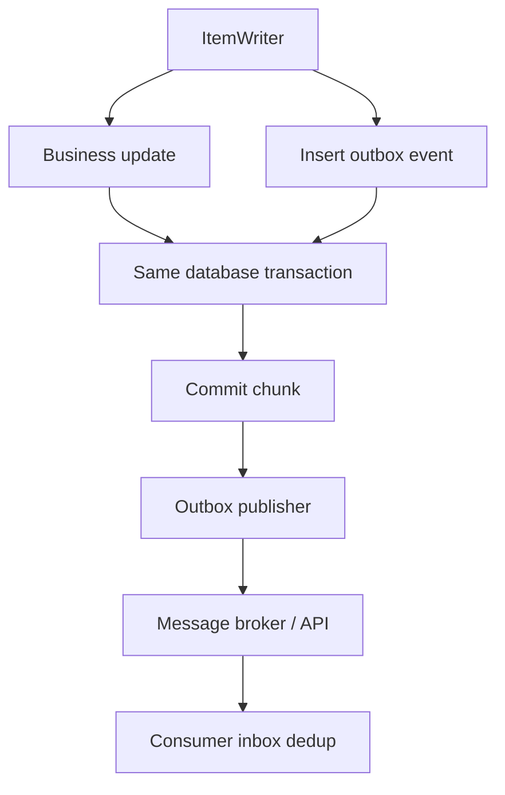

# Writer idempotency khi retry

Trong Spring Batch, một `ItemWriter` có thể được gọi lại khi chunk gặp lỗi, transaction rollback hoặc job được restart. Điều này đặc biệt quan trọng khi writer ghi dữ liệu nghiệp vụ hoặc gọi hệ thống bên ngoài. Nếu cùng một item được ghi nhiều lần mà mỗi lần đều tạo thêm một tác động mới, retry có thể tạo bản ghi trùng, cộng tiền nhiều lần, gửi thông điệp lặp hoặc thực hiện một giao dịch ngoài nhiều lần.

Idempotency là thuộc tính giúp một thao tác có thể được thực hiện lặp lại mà kết quả nghiệp vụ vẫn tương đương với việc thực hiện một lần. Với writer, thiết kế idempotent giúp Spring Batch có thể retry hoặc restart mà không làm nhân đôi tác động đã được xác nhận.

Một writer idempotent không nhất thiết phải bỏ qua mọi lần ghi trùng. Nó có thể cập nhật cùng một bản ghi về cùng một trạng thái, ghi một ledger entry có khóa duy nhất hoặc yêu cầu dịch vụ ngoài trả lại kết quả đã xử lý cho cùng idempotency key. Điều quan trọng là khóa nhận diện thao tác phải ổn định và hệ thống nhận phải xử lý việc lặp một cách nguyên tử.

## 1. Vì sao writer có thể được gọi lại?

Trong chunk-oriented processing, Spring Batch đọc item, gọi processor nếu có, rồi chuyển một nhóm item cho writer. Writer ghi nhóm đó trong transaction của chunk. Nếu chunk commit thành công, checkpoint được lưu. Nếu một lỗi khiến transaction rollback, chunk chưa được xác nhận và có thể phải chạy lại.

Các tình huống phổ biến:

- Writer ném exception khi đang ghi chunk.
- Database deadlock hoặc lỗi kết nối tạm thời khiến transaction rollback.
- Chính sách retry yêu cầu thử lại thao tác thất bại.
- Tiến trình bị dừng trước khi chunk commit và job được restart.
- Client gọi lại cùng job hoặc cùng yêu cầu nghiệp vụ sau timeout.
- Hai worker hoặc hai job instance vô tình xử lý cùng một phạm vi dữ liệu.

Ví dụ, một chunk chứa 100 khoản thanh toán. Writer gửi từng khoản đến API đối tác. Sau khi gửi thành công 60 khoản, request thứ 61 timeout. Nếu writer ném exception và chunk rollback, Spring Batch có thể thử lại chunk. 60 khoản đầu có thể được gửi lần nữa dù đối tác đã xử lý chúng.

Sơ đồ khái quát:

```mermaid
flowchart TD
    A[Spring Batch gọi write(chunk)] --> B[Writer thực hiện tác động]
    B --> C{Tất cả tác động thành công?}
    C -- Có --> D[Lưu checkpoint và commit]
    C -- Không --> E[Exception / rollback]
    E --> F{Được retry?}
    F -- Có --> G[Gọi lại writer hoặc xử lý lại chunk]
    G --> B
    F -- Không --> H[Step thất bại hoặc xử lý skip]
```

Vì vậy, không nên giả định `write()` chỉ được gọi đúng một lần cho mỗi item. Hợp đồng của writer cần chịu được việc một chunk hoặc một phần tác động được thử lại theo cấu hình thực thi.

## 2. Idempotency nghĩa là gì trong writer?

Một thao tác có tính idempotent khi lặp lại cùng yêu cầu không tạo thêm tác động nghiệp vụ ngoài kết quả mong muốn. Có thể diễn đạt đơn giản:

```text
apply(request, apply(request, state)) == apply(request, state)
```

Ví dụ:

| Thao tác | Tính chất khi chạy lặp |
|---|---|
| `INSERT` một bản ghi mới không có khóa chống trùng | Không idempotent; có thể tạo nhiều bản ghi |
| `UPDATE order SET status = 'PROCESSED' WHERE order_id = ?` | Thường idempotent nếu cùng trạng thái đích và không có side effect phụ |
| `UPDATE account SET balance = balance + 100 WHERE id = ?` | Không idempotent; chạy hai lần cộng thêm 200 |
| Upsert theo khóa nghiệp vụ với cùng dữ liệu đầu vào | Có thể idempotent nếu quy tắc cập nhật xác định |
| Gọi API thanh toán với idempotency key ổn định | Idempotent nếu phía nhận lưu và xử lý key đúng cách |
| Phát event mới với ID ngẫu nhiên mỗi lần retry | Không idempotent; mỗi lần có thể tạo một event khác |

Idempotency không đồng nghĩa với “không ghi gì nếu bản ghi đã tồn tại”. Một thao tác cập nhật trạng thái có thể được lặp lại và vẫn cho kết quả giống nhau. Ngược lại, một thao tác `INSERT` có thể được thiết kế idempotent nếu có khóa duy nhất và quy tắc xử lý xung đột phù hợp.

## 3. Tách biệt retry, rollback và idempotency

Ba khái niệm này liên quan nhưng không thay thế nhau:

- **Retry** là chính sách thử lại một thao tác hoặc một phần công việc khi gặp lỗi được xem là có thể phục hồi.
- **Rollback** là cơ chế hoàn tác các thay đổi nằm trong transaction chưa commit.
- **Idempotency** là đặc tính của thao tác khi cùng yêu cầu được thực hiện nhiều lần.

Nếu writer chỉ ghi vào cùng database và mọi câu lệnh ghi tham gia cùng transaction manager của step, rollback có thể hoàn tác các thay đổi của lần thử trước. Khi đó, lần gọi lại writer không nhất thiết tạo dữ liệu trùng trong database. Tuy nhiên, nếu writer ghi qua một resource khác transaction hoặc gọi dịch vụ bên ngoài, rollback của database không hoàn tác được side effect đó.

Ngay cả khi dùng transaction database, unique key và upsert vẫn có giá trị bảo vệ trước các lần chạy trùng, retry ở tầng client, job bị khởi chạy đồng thời hoặc dữ liệu đã được nhập từ một quy trình khác. Transaction giúp giữ tính nguyên tử trong phạm vi resource được quản lý; idempotency bảo vệ thao tác khi yêu cầu được gửi lặp.

## 4. Dùng khóa nghiệp vụ và unique constraint

Một cách phổ biến để làm writer idempotent là xác định khóa đại diện cho một tác động nghiệp vụ. Ví dụ, một dòng đơn hàng từ file nguồn có thể được nhận diện bởi cặp `(batch_id, source_order_id)`.

```sql
CREATE TABLE imported_order (
    id                BIGINT GENERATED ALWAYS AS IDENTITY PRIMARY KEY,
    batch_id          VARCHAR(80) NOT NULL,
    source_order_id   VARCHAR(80) NOT NULL,
    customer_id       VARCHAR(80) NOT NULL,
    amount            DECIMAL(18, 2) NOT NULL,
    payload_hash      VARCHAR(128) NOT NULL,
    CONSTRAINT uq_imported_order_source
        UNIQUE (batch_id, source_order_id)
);
```

Unique constraint được database thực thi, vì vậy nó bảo vệ cả trường hợp hai thread hoặc hai job cùng kiểm tra rồi cùng ghi một khóa. Chỉ kiểm tra `SELECT` trước khi `INSERT` là chưa đủ: hai transaction có thể cùng thấy chưa có bản ghi và cùng insert. Ràng buộc duy nhất hoặc thao tác upsert nguyên tử mới là lớp bảo vệ cuối cùng.

Với PostgreSQL, có thể dùng `ON CONFLICT` để xử lý bản ghi đã tồn tại. Ví dụ sau minh họa chính sách nhập dữ liệu bất biến: cùng một khóa nguồn chỉ được tạo một lần.

```sql
INSERT INTO imported_order (
    batch_id,
    source_order_id,
    customer_id,
    amount,
    payload_hash
)
VALUES (?, ?, ?, ?, ?)
ON CONFLICT (batch_id, source_order_id) DO NOTHING;
```

Khi cùng item được gửi lại, database không tạo thêm dòng. Tuy nhiên, `DO NOTHING` không tự chứng minh payload mới giống payload đã lưu. Nếu cùng khóa nhưng `amount`, `customer_id` hoặc nội dung nguồn khác trước, ứng dụng cần phát hiện xung đột dữ liệu thay vì âm thầm coi đó là retry hợp lệ. Có thể lưu hash payload, đọc lại bản ghi hiện tại và so sánh, hoặc dùng câu lệnh/trigger phù hợp để từ chối cùng khóa với nội dung khác.

Nếu nghiệp vụ cho phép cập nhật một bản ghi về giá trị đích, có thể dùng upsert:

```sql
INSERT INTO order_status (
    order_id,
    status,
    source_version
)
VALUES (?, ?, ?)
ON CONFLICT (order_id) DO UPDATE
SET status = EXCLUDED.status,
    source_version = EXCLUDED.source_version
WHERE order_status.source_version <= EXCLUDED.source_version;
```

Ví dụ này minh họa cập nhật theo giá trị đích thay vì cộng dồn. Điều kiện version giúp một sự kiện cũ không ghi đè trạng thái từ sự kiện mới hơn. Cú pháp `ON CONFLICT` ở đây là của PostgreSQL; database khác có thể dùng `MERGE`, `UPSERT` hoặc cơ chế tương đương.

Không phải mọi bảng đều nên dùng `DO NOTHING` hoặc upsert. Quy tắc xung đột phải phản ánh nghiệp vụ: bản ghi trùng có thể là retry hợp lệ, dữ liệu nguồn bị thay đổi, hoặc một lỗi cần điều tra.

## 5. Viết ItemWriter idempotent với JdbcTemplate

Ví dụ sau dùng Spring Batch 5, `ItemWriter` nhận `Chunk` và ghi dữ liệu bằng câu lệnh PostgreSQL có unique key:

```java
@Bean
ItemWriter<ImportedOrder> importedOrderWriter(JdbcTemplate jdbcTemplate) {
    return chunk -> jdbcTemplate.batchUpdate(
            """
            INSERT INTO imported_order (
                batch_id, source_order_id, customer_id, amount, payload_hash
            ) VALUES (?, ?, ?, ?, ?)
            ON CONFLICT (batch_id, source_order_id) DO NOTHING
            """,
            chunk.getItems(),
            chunk.size(),
            (ps, order) -> {
                ps.setString(1, order.batchId());
                ps.setString(2, order.sourceOrderId());
                ps.setString(3, order.customerId());
                ps.setBigDecimal(4, order.amount());
                ps.setString(5, order.payloadHash());
            });
}
```

Khi writer nhận lại cùng item, unique constraint ngăn tạo thêm dòng. Để phát hiện cùng khóa nhưng payload khác, có thể bổ sung một bước đối chiếu hash theo batch bằng truy vấn theo tập khóa; nếu hash không khớp, ném exception nghiệp vụ để dừng và điều tra.

Writer cần dùng cùng transaction manager của step nếu muốn các câu lệnh JDBC tham gia transaction chunk. `JdbcTemplate` phải lấy connection từ transaction hiện tại (thông thường qua `DataSource` được cấu hình với transaction manager tương ứng). Nếu writer dùng một datasource hoặc transaction manager khác, rollback của step có thể không hoàn tác các câu lệnh ghi đó.

Với hệ quản trị cơ sở dữ liệu khác, thay cú pháp PostgreSQL bằng cơ chế upsert tương ứng và kiểm tra hành vi khi xung đột. Không nên dựa vào mã trả về của batch update một cách mơ hồ để suy luận bản ghi nào đã được insert; hãy thiết kế cách đối chiếu kết quả rõ ràng.

## 6. Tránh các phép cập nhật cộng dồn không idempotent

Một lỗi thường gặp là dùng phép cộng hoặc tăng bộ đếm trực tiếp trong writer:

```sql
UPDATE account
SET balance = balance + ?
WHERE account_id = ?;
```

Nếu writer chạy lại cùng item, số dư bị cộng thêm lần nữa. Có một số cách thay thế:

**Ghi ledger theo mã giao dịch duy nhất.** Mỗi khoản biến động được ghi thành một dòng có `transaction_id` duy nhất. Ràng buộc unique ngăn cùng giao dịch được ghi hai lần. Số dư có thể được tính từ ledger hoặc cập nhật projection khi bảo đảm ledger entry chỉ được áp dụng một lần.

**Đặt giá trị đích thay vì áp dụng delta.** Nếu nguồn cung cấp phiên bản hoặc snapshot đầy đủ, có thể đặt trạng thái bằng giá trị mong muốn, kèm điều kiện version để không ghi đè dữ liệu mới hơn.

**Ghi nhận lần áp dụng sự kiện.** Dùng bảng processed event với khóa duy nhất như `(consumer_name, event_id)` để xác nhận một event chỉ được áp dụng một lần trong phạm vi consumer.

Ví dụ bảng ledger:

```sql
CREATE TABLE account_transaction (
    transaction_id   VARCHAR(100) PRIMARY KEY,
    account_id       VARCHAR(80) NOT NULL,
    amount_delta     DECIMAL(18, 2) NOT NULL,
    created_at       TIMESTAMP NOT NULL
);
```

Writer ghi `transaction_id` ổn định cho item nguồn. Nếu item được retry, insert cùng ID sẽ gặp unique constraint thay vì tạo thêm một biến động. Ứng dụng cần quy định rõ khi gặp duplicate: xác nhận nội dung khớp và coi là đã áp dụng, hay báo xung đột nếu payload khác.

## 7. Idempotency key khi gọi API bên ngoài

Transaction database không thể tự rollback một HTTP request đã được hệ thống khác xử lý. Đây là trường hợp idempotency key đặc biệt quan trọng.

Giả sử writer gọi API đối tác để tạo thanh toán. API xử lý yêu cầu thành công nhưng phản hồi bị mất trên đường truyền. Ứng dụng chỉ thấy timeout và không biết chắc đối tác đã thực hiện hay chưa. Nếu retry bằng một request mới không có khóa ổn định, đối tác có thể tạo thanh toán thứ hai.

Thay vào đó, tạo idempotency key từ định danh nghiệp vụ ổn định:

```java
String idempotencyKey =
        payment.batchId() + ":" + payment.sourcePaymentId();

paymentGateway.createPayment(payment, idempotencyKey);
```

Key phải giống nhau qua các lần retry, restart và redelivery của cùng một yêu cầu. Không dùng UUID mới cho mỗi lần gọi, vì như vậy mỗi retry sẽ được phía nhận xem là thao tác mới.

Để cơ chế này có hiệu lực, dịch vụ nhận cần:

1. Nhận idempotency key cùng request.
2. Lưu key và kết quả xử lý trong một thao tác có tính nguyên tử với side effect nghiệp vụ.
3. Nếu key đã tồn tại với cùng payload, trả lại kết quả trước đó thay vì thực hiện lại side effect.
4. Nếu key đã tồn tại nhưng payload khác, từ chối request hoặc báo xung đột.
5. Giữ key đủ lâu để bao phủ thời gian retry, restart và redelivery có thể xảy ra.

Chỉ gửi header tên `Idempotency-Key` không tự tạo ra tính idempotent nếu dịch vụ nhận không triển khai cơ chế lưu và tra cứu key. Cần kiểm tra hợp đồng API của đối tác.

## 8. Dùng transactional outbox cho message hoặc side effect

Nếu writer cần cập nhật dữ liệu nghiệp vụ và phát một sự kiện, gửi message trực tiếp trong transaction chunk có thể tạo ra trạng thái không nhất quán:

- Message được gửi thành công nhưng transaction database rollback: hệ thống nhận thấy sự kiện cho thay đổi chưa được commit.
- Transaction database commit nhưng gửi message thất bại: dữ liệu đã đổi nhưng sự kiện không được phát.

Transactional outbox giải quyết việc phối hợp này bằng cách ghi dữ liệu nghiệp vụ và một bản ghi outbox trong cùng transaction. Một publisher riêng đọc outbox và gửi message sau đó.



Ví dụ bảng outbox:

```sql
CREATE TABLE outbox_event (
    event_id       VARCHAR(120) PRIMARY KEY,
    aggregate_id   VARCHAR(100) NOT NULL,
    event_type     VARCHAR(100) NOT NULL,
    payload        TEXT NOT NULL,
    created_at     TIMESTAMP NOT NULL,
    published_at   TIMESTAMP
);
```

Writer có thể insert event với `event_id` được tạo ổn định từ mã batch và mã item nguồn. Nếu chunk rollback, cả thay đổi nghiệp vụ và outbox record cùng rollback. Nếu chunk commit, publisher sẽ thấy event cần gửi.

Publisher vẫn có thể gửi message thành công rồi gặp lỗi trước khi đánh dấu `published_at`. Khi khởi động lại, publisher có thể gửi lại event đó. Vì vậy consumer cũng cần deduplicate bằng inbox table có unique key, ví dụ `(consumer_name, event_id)`. Outbox/inbox giúp tạo luồng giao nhận có thể retry; nó không loại bỏ nhu cầu idempotency ở consumer.

## 9. Retry policy phải phù hợp với loại lỗi

Idempotency cho phép thử lại an toàn hơn, nhưng không có nghĩa nên retry mọi exception. Cần phân biệt lỗi tạm thời với lỗi không thể tự hết:

- **Có thể retry:** deadlock, lỗi kết nối tạm thời, timeout dịch vụ phụ thuộc, HTTP 429 hoặc một số lỗi 5xx tùy hợp đồng dịch vụ.
- **Thường không retry:** dữ liệu sai định dạng, vi phạm quy tắc nghiệp vụ, thiếu trường bắt buộc, tài khoản không tồn tại hoặc lỗi lập trình.

Ví dụ cấu hình retry giới hạn trong step:

```java
@Bean
Step writeOrdersStep(
        JobRepository jobRepository,
        PlatformTransactionManager transactionManager,
        ItemReader<Order> reader,
        ItemWriter<Order> writer) {

    return new StepBuilder("writeOrdersStep", jobRepository)
            .<Order, Order>chunk(100, transactionManager)
            .reader(reader)
            .writer(writer)
            .faultTolerant()
            .retry(TransientDataAccessException.class)
            .retryLimit(3)
            .skip(InvalidOrderException.class)
            .skipLimit(20)
            .build();
}
```

Ví dụ này cho phép thử lại lỗi truy cập dữ liệu tạm thời trong giới hạn và skip một loại lỗi nghiệp vụ cụ thể trong giới hạn riêng. Trong production, có thể cấu hình backoff để tránh retry dồn dập. Cần kiểm tra exception thực tế mà writer ném ra và hành vi retry của phiên bản Spring Batch đang dùng.

Khi writer được retry, hãy giả định cùng chunk hoặc cùng tác động có thể được gửi lại. Không dựa vào biến trong bộ nhớ kiểu `alreadySent = true` để chống trùng, vì biến đó có thể mất khi restart hoặc không được chia sẻ giữa các worker. Dùng khóa bền vững trong database hoặc idempotency key được phía nhận hỗ trợ.

## 10. Idempotency ở nhiều cấp độ

Một hệ thống batch có thể cần bảo vệ ở nhiều lớp:

| Cấp độ | Cơ chế | Tác dụng |
|---|---|---|
| Job request | `requestId` hoặc identifying `JobParameters` ổn định | Hạn chế tạo nhiều job instance cho cùng yêu cầu |
| Item nguồn | Khóa nghiệp vụ như `(batch_id, source_id)` | Nhận diện cùng một item qua retry/restart |
| Database write | Unique constraint, upsert hoặc ledger | Ngăn tạo bản ghi/tác động database trùng |
| API ngoài | Idempotency key được dịch vụ nhận lưu bền vững | Ngăn side effect ngoài bị thực hiện hai lần |
| Event/message | Outbox, event ID và consumer inbox | Chống phát/áp dụng message lặp |
| Đối soát | Báo cáo số lượng, tổng tiền và trạng thái theo khóa | Phát hiện chênh lệch còn sót sau sự cố |

`JobRepository` quản lý định danh job instance theo tên job và identifying parameters. Điều đó không tự bảo vệ bảng nghiệp vụ nếu cùng dữ liệu được khởi chạy qua một job khác, tham số khác hoặc một hệ thống khác. Khóa nghiệp vụ phải được thực thi tại nơi lưu dữ liệu có thẩm quyền.

## 11. Những lỗi thiết kế thường gặp

**Chỉ kiểm tra tồn tại rồi mới insert.** Hai transaction đồng thời có thể cùng thấy chưa có dòng và cùng insert. Dùng unique constraint và câu lệnh insert/upsert nguyên tử.

**Dùng khóa ngẫu nhiên cho mỗi lần retry.** Mỗi lần gửi sẽ trở thành một thao tác mới. Tạo key từ định danh nghiệp vụ ổn định và giữ nguyên qua retry/restart.

**Dùng phép cộng dồn trong writer mà không có ledger.** Cùng item chạy hai lần làm số dư hoặc bộ đếm tăng hai lần. Ghi giao dịch theo ID duy nhất hoặc đặt giá trị đích có version.

**Cho rằng rollback database sẽ hoàn tác API hoặc message.** Transaction thông thường chỉ quản lý resource tham gia transaction đó. Dùng idempotency key, outbox/inbox và đối soát cho side effect bên ngoài.

**Dùng `DO NOTHING` và bỏ qua payload không khớp.** Cùng khóa nhưng dữ liệu khác có thể là lỗi nguồn hoặc xung đột nghiệp vụ. So sánh hash/nội dung và báo lỗi khi không khớp.

**Retry mọi exception.** Retry lỗi dữ liệu không sửa được chỉ làm tăng thời gian chạy và tải hệ thống. Chỉ retry lỗi tạm thời, giới hạn số lần và dùng backoff.

**Dùng biến trong bộ nhớ để ghi nhớ item đã xử lý.** Biến có thể mất khi JVM restart, không chia sẻ giữa instance và không nguyên tử với transaction. Dùng trạng thái bền vững.

**Coi `JobExecution` là bằng chứng duy nhất về kết quả nghiệp vụ.** Job có thể thất bại sau khi một số chunk đã commit. Hãy kiểm tra dữ liệu nghiệp vụ và trạng thái side effect theo khóa item.

## 12. Kiểm thử idempotency của writer

Kiểm thử writer cần xác nhận cùng yêu cầu được gửi nhiều lần không làm thay đổi kết quả nghiệp vụ ngoài mong muốn.

Các tình huống quan trọng:

1. **Ghi một lần:** xác nhận item tạo đúng bản ghi hoặc side effect mong đợi.
2. **Ghi cùng chunk hai lần:** xác nhận không tạo bản ghi trùng và trạng thái cuối giống lần đầu.
3. **Rollback rồi retry:** làm writer thất bại sau một số thao tác, rollback transaction rồi chạy lại chunk; kiểm tra dữ liệu cuối chính xác.
4. **Timeout không rõ kết quả:** mô phỏng API đã xử lý request nhưng client không nhận được response; gửi lại cùng idempotency key và xác nhận dịch vụ trả kết quả cũ.
5. **Cùng key, payload khác:** xác nhận hệ thống báo xung đột thay vì âm thầm ghi đè hoặc bỏ qua.
6. **Hai worker đồng thời:** cho hai transaction ghi cùng khóa để kiểm tra unique constraint và xử lý xung đột.
7. **Restart job:** khởi chạy lại cùng identifying `JobParameters` và xác nhận chunk đã commit không tạo thêm tác động.
8. **Outbox redelivery:** publisher gửi event rồi lỗi trước khi đánh dấu đã gửi; consumer nhận lại event và chỉ áp dụng một lần.
9. **Đối soát:** so sánh số item nguồn, số item được chấp nhận, số item bị từ chối và tổng giá trị nghiệp vụ.

Nên dùng database test có transaction và unique constraint thật khi kiểm tra writer. Mock repository có thể kiểm tra lời gọi phương thức nhưng không chứng minh tính nguyên tử của unique key hoặc rollback. Với API ngoài, dùng fake server có khả năng mô phỏng timeout sau khi đã ghi nhận request.

Ngoài assertion về trạng thái `JobExecution`, hãy kiểm tra số dòng, khóa nghiệp vụ, payload hash, ledger entry, outbox event và kết quả từ dịch vụ nhận. Một job báo `COMPLETED` nhưng tạo giao dịch trùng vẫn là lỗi nghiệp vụ.

## 13. Checklist thiết kế writer có thể retry an toàn

Trước khi đưa writer vào production, cần xác định:

| Nội dung | Câu hỏi cần trả lời |
|---|---|
| Khóa item | Khóa nghiệp vụ ổn định nào nhận diện cùng item qua các lần chạy? |
| Payload | Cùng khóa nhưng payload khác được xử lý thế nào? |
| Database | Có unique constraint hoặc upsert nguyên tử không? |
| Transaction | Writer dùng transaction manager nào; rollback bao phủ resource nào? |
| Side effect | Có gọi API, gửi email hoặc phát message không? |
| Idempotency key | Key có ổn định qua retry, restart và redelivery không? |
| Retry policy | Loại exception nào được retry, giới hạn và backoff ra sao? |
| Skip policy | Item bị skip được ghi nhận và xử lý lại thế nào? |
| Concurrency | Hai job hoặc worker cùng ghi một item có an toàn không? |
| Đối soát | Có thể phát hiện và xử lý chênh lệch sau timeout không? |
| Kiểm thử | Đã thử chạy lặp, rollback, timeout không rõ kết quả và chạy đồng thời chưa? |

Không có một mẫu writer idempotent dùng chung cho mọi nghiệp vụ. Writer nhập dữ liệu tham chiếu, writer cập nhật số dư, writer phát message và writer gọi API thanh toán có các quy tắc khác nhau. Hãy chọn khóa và hành vi xung đột dựa trên ý nghĩa nghiệp vụ của thao tác.

## Kết luận

Writer idempotency là điều kiện quan trọng để retry và restart an toàn trong Spring Batch. Một chunk có thể được thực hiện lại khi transaction rollback hoặc job tiếp tục từ checkpoint trước đó. Writer cần nhận diện cùng một tác động bằng khóa nghiệp vụ ổn định và bảo đảm việc lặp không tạo thêm bản ghi, thay đổi hoặc side effect ngoài mong muốn.

Với database, dùng unique constraint, upsert có quy tắc, ledger hoặc cập nhật theo giá trị đích. Với API bên ngoài, dùng idempotency key được dịch vụ nhận lưu và xử lý nguyên tử. Với message, cân nhắc transactional outbox và consumer inbox. Kết hợp các cơ chế đó với retry giới hạn, transaction đúng phạm vi và kiểm thử chạy lặp sẽ giúp batch job phục hồi sau lỗi mà vẫn giữ kết quả nghiệp vụ nhất quán.
