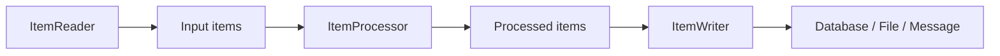

# Writer không được sửa input sau khi nhận

Trong Spring Batch, `ItemWriter` nhận một nhóm item đã được `ItemReader` đọc và `ItemProcessor` xử lý. Nhiệm vụ của writer là ghi nhóm item đó ra đích, chẳng hạn database, file hoặc message broker. Khi nhận item, writer nên xem dữ liệu đầu vào là **chỉ đọc**: không thay đổi giá trị của object, các object lồng bên trong hoặc cấu trúc chunk.

Quy tắc này giúp pipeline giữ được tính nhất quán khi Spring Batch retry, rollback, skip hoặc thực hiện lại một phần chunk. Một transaction có thể rollback dữ liệu trong database, nhưng không tự khôi phục trạng thái object Java trong bộ nhớ. Nếu writer sửa object rồi ném exception, lần thử tiếp theo có thể nhận dữ liệu đã bị thay đổi.

Bài này giải thích ranh giới trách nhiệm của writer, tác hại của việc mutate item, các trường hợp dễ bị bỏ sót như object lồng nhau và entity JPA, cùng những cách thiết kế writer an toàn.

## 1. Writer nhận gì và phải làm gì?

Trong Spring Batch 5, interface `ItemWriter<T>` có phương thức:

```java
@FunctionalInterface
public interface ItemWriter<T> {
    void write(Chunk<? extends T> chunk) throws Exception;
}
```

`Chunk` chứa các item đã được đọc và xử lý trong step. Ở các phiên bản Spring Batch cũ hơn, API writer có thể nhận `List<? extends T>`; ý nghĩa trách nhiệm vẫn tương tự.

Luồng chunk processing:



Writer chịu trách nhiệm ghi các item đã nhận. Nó có thể:

- Chuyển item thành câu lệnh SQL hoặc bản ghi file.
- Gửi một nhóm message theo cơ chế được cấu hình.
- Ghi dữ liệu vào repository hoặc staging table.
- Ném exception khi không thể ghi để transaction hoặc step xử lý lỗi theo cấu hình.

Writer không nên âm thầm thay đổi item để biểu diễn trạng thái ghi, bổ sung dữ liệu nghiệp vụ hoặc đánh dấu item đã được xuất. Những biến đổi thuộc về processor hoặc một bước nghiệp vụ riêng.

### Không sửa cả chunk lẫn item

Có hai lớp dữ liệu cần bảo toàn:

1. **Cấu trúc chunk**: thứ tự, số lượng và các phần tử trong nhóm.
2. **Nội dung item**: giá trị các field và toàn bộ object mutable được tham chiếu từ item.

Không gọi `chunk.clear()`, `chunk.remove(...)`, thêm item khác hoặc sắp xếp lại chunk tại writer. Cũng không gọi setter trên item hoặc sửa list con, map con, object địa chỉ, dòng chi tiết… mà item đang tham chiếu.

API không tự biến toàn bộ object graph thành immutable. Việc `Chunk` có thể cung cấp các thao tác trên collection không có nghĩa writer được quyền dùng chúng để thay đổi dữ liệu xử lý.

## 2. Vì sao writer không nên sửa input?

### 2.1. Rollback không hoàn tác thay đổi trong bộ nhớ Java

Giả sử writer nhận ba đơn hàng, thay đổi trạng thái của từng đơn hàng rồi ghi database. Đơn hàng thứ ba gây lỗi:

```java
public class UnsafeOrderWriter implements ItemWriter<Order> {

    private final OrderRepository repository;

    public UnsafeOrderWriter(OrderRepository repository) {
        this.repository = repository;
    }

    @Override
    public void write(Chunk<? extends Order> chunk) {
        for (Order order : chunk) {
            order.setStatus("EXPORTED");
            repository.save(order);
        }
    }
}
```

Nếu transaction rollback, các thay đổi database trong transaction đó có thể được hoàn tác. Nhưng `order.setStatus("EXPORTED")` đã thay đổi object Java. Transaction manager không lưu một bản sao object để khôi phục field về giá trị cũ.

Vì thế, sau rollback:

- Database có thể vẫn giữ trạng thái trước transaction.
- Object đang nằm trong chunk có thể vẫn mang trạng thái `EXPORTED`.
- Listener, retry callback hoặc đoạn code tiếp theo có thể quan sát trạng thái đã bị sửa.
- Lần ghi tiếp theo có thể tạo kết quả khác lần đầu.

Đây là hai loại state khác nhau: transaction quản lý tài nguyên transactional; nó không phải cơ chế snapshot/restore heap của JVM.

### 2.2. Retry có thể chạy lại trên object đã bị thay đổi

Khi bật retry cho lỗi tạm thời, writer có thể được gọi lại theo cơ chế retry của step. Tùy loại lỗi và cấu hình, Spring Batch có thể thực hiện lại thao tác ghi hoặc xử lý lại chunk/item. Nếu writer sửa input trước khi lỗi xảy ra, lần gọi sau có nguy cơ nhìn thấy giá trị đã sửa.

Ví dụ:

1. Item ban đầu có `status = NEW`.
2. Writer đổi thành `EXPORTED`.
3. Database timeout trước khi transaction commit.
4. Transaction rollback, nhưng object Java vẫn có `status = EXPORTED`.
5. Retry gọi writer lại và code dựa trên trạng thái hiện tại để chọn câu lệnh hoặc nhánh xử lý.

Kết quả có thể khác với lần đầu, dù đầu vào nghiệp vụ của chunk không hề thay đổi.

Không phải mọi retry strategy đều giữ nguyên cùng một object reference trong mọi trường hợp. Tuy nhiên, writer không nên phụ thuộc vào giả định framework sẽ luôn tạo object mới hoặc chạy lại processor để khôi phục input. Thiết kế đúng là writer không mutate dữ liệu được giao.

### 2.3. Skip và xử lý từng item có thể quan sát mutation

Trong fault-tolerant step, framework có thể phân tích một chunk lỗi để xác định item nào gây lỗi, rồi áp dụng skip policy. Writer có thể được gọi với những nhóm item hoặc item được thử lại theo cơ chế nội bộ.

Nếu writer sửa item trước khi ném exception, dữ liệu được dùng trong các lần thử tiếp theo có thể không còn giống dữ liệu processor đã tạo. Điều này khiến việc điều tra skip khó hơn và có thể làm kết quả phụ thuộc thứ tự thử.

### 2.4. Listener và logging thấy dữ liệu sai lệch

Các listener, audit logger hoặc metric collector có thể đọc item trước hoặc sau writer. Nếu writer thay đổi object, cùng một item có thể được ghi log với hai giá trị khác nhau ở hai thời điểm. Log khi đó không còn phản ánh rõ dữ liệu processor đã tạo và dữ liệu thực sự được gửi đến writer.

Giữ input không đổi giúp việc trace item từ reader qua processor đến writer dễ hiểu hơn.

## 3. Ví dụ sai: cập nhật object được writer nhận

Giả sử model mutable:

```java
public class Invoice {

    private final String invoiceId;
    private BigDecimal amount;
    private String status;

    public Invoice(
            String invoiceId,
            BigDecimal amount,
            String status) {
        this.invoiceId = invoiceId;
        this.amount = amount;
        this.status = status;
    }

    public String getInvoiceId() {
        return invoiceId;
    }

    public BigDecimal getAmount() {
        return amount;
    }

    public String getStatus() {
        return status;
    }

    public void setAmount(BigDecimal amount) {
        this.amount = amount;
    }

    public void setStatus(String status) {
        this.status = status;
    }
}
```

Writer sau đây thay đổi trạng thái input:

```java
public class UnsafeInvoiceWriter implements ItemWriter<Invoice> {

    private final InvoiceRepository repository;

    public UnsafeInvoiceWriter(InvoiceRepository repository) {
        this.repository = repository;
    }

    @Override
    public void write(Chunk<? extends Invoice> chunk) {
        for (Invoice invoice : chunk) {
            invoice.setStatus("IMPORTED");
            repository.save(invoice);
        }
    }
}
```

Vấn đề không phải câu `save` tự thân. Vấn đề là writer vừa nhận một object thuộc luồng xử lý, vừa thay đổi object đó để chuẩn bị ghi. Nếu cần lưu một trạng thái đích, hãy tạo một write model/entity riêng hoặc thực hiện phép biến đổi trước writer.

## 4. Phân chia trách nhiệm: Processor biến đổi, Writer ghi dữ liệu

Một cách tổ chức dễ kiểm soát là:

- Reader tạo input model.
- Processor xác thực và tạo output model.
- Writer chỉ chuyển output model thành thao tác ghi.

Ví dụ dùng record bất biến:

```java
public record InvoiceInput(
        String invoiceId,
        BigDecimal amount) {
}

public record InvoiceToPersist(
        String invoiceId,
        BigDecimal normalizedAmount,
        String targetStatus) {
}
```

Processor tạo một object output mới:

```java
@Bean
ItemProcessor<InvoiceInput, InvoiceToPersist> invoiceProcessor() {
    return input -> {
        if (input.amount() == null || input.amount().signum() <= 0) {
            throw new IllegalArgumentException("Invalid invoice amount");
        }

        return new InvoiceToPersist(
                input.invoiceId().trim(),
                input.amount().setScale(2, RoundingMode.HALF_UP),
                "READY");
    };
}
```

Writer đọc các accessor và ghi dữ liệu:

```java
@Bean
JdbcBatchItemWriter<InvoiceToPersist> invoiceWriter(DataSource dataSource) {
    return new JdbcBatchItemWriterBuilder<InvoiceToPersist>()
            .dataSource(dataSource)
            .sql("""
                    INSERT INTO invoice_import
                        (invoice_id, amount, status)
                    VALUES
                        (:invoiceId, :amount, :targetStatus)
                    """)
            .itemSqlParameterSourceProvider(item ->
                    new MapSqlParameterSource()
                            .addValue("invoiceId", item.invoiceId())
                            .addValue("amount", item.normalizedAmount())
                            .addValue("targetStatus", item.targetStatus()))
            .build();
}
```

Writer không cần thay đổi `InvoiceToPersist`; nó chỉ ánh xạ giá trị sang tham số SQL. Việc chuẩn hóa amount và xác định status đã được thực hiện ở processor.

## 5. Tạo bản sao nếu cần một representation riêng để ghi

Đôi khi writer cần chuyển input thành một entity hoặc command phù hợp với hệ thống đích. Hãy tạo object mới thay vì sửa input:

```java
public record CustomerInput(
        String customerId,
        String fullName,
        String email) {
}

public class CustomerEntity {

    private String customerId;
    private String fullName;
    private String email;
    private String importStatus;

    public static CustomerEntity from(CustomerInput input) {
        CustomerEntity entity = new CustomerEntity();
        entity.customerId = input.customerId();
        entity.fullName = input.fullName();
        entity.email = input.email();
        entity.importStatus = "RECEIVED";
        return entity;
    }
}
```

Writer:

```java
public class CustomerWriter implements ItemWriter<CustomerInput> {

    private final CustomerRepository repository;

    public CustomerWriter(CustomerRepository repository) {
        this.repository = repository;
    }

    @Override
    public void write(Chunk<? extends CustomerInput> chunk) {
        List<CustomerEntity> entities = chunk.getItems().stream()
                .map(CustomerEntity::from)
                .toList();

        repository.saveAll(entities);
    }
}
```

Mỗi entity được tạo riêng để phục vụ persistence. Các item `CustomerInput` nhận từ processor vẫn giữ nguyên giá trị.

Nếu việc tạo `CustomerEntity` chứa quy tắc nghiệp vụ phức tạp, hãy cân nhắc chuyển mapping đó vào processor hoặc một mapper riêng. Writer nên tập trung vào persistence, tránh biến thành nơi chứa toàn bộ logic chuyển đổi.

### Copy nông và copy sâu

Một bản sao mới của object ngoài cùng chưa chắc tách biệt hoàn toàn. Ví dụ:

```java
public class OrderInput {
    private String orderId;
    private List<OrderLine> lines;
}
```

Nếu chỉ làm:

```java
OrderWriteModel copy = new OrderWriteModel(
        input.getOrderId(),
        input.getLines());
```

thì hai object vẫn tham chiếu cùng một list `lines` và cùng các `OrderLine`. Nếu writer gọi `copy.getLines().get(0).setQuantity(...)`, input ban đầu cũng bị thay đổi.

Khi object có cấu trúc lồng nhau, cần:

- Dùng immutable collection và immutable element.
- Tạo bản sao sâu cho các object mutable cần tách biệt.
- Hoặc ánh xạ thành một representation mới chỉ chứa các scalar/value object cần ghi.

Không phải lúc nào cũng cần copy toàn bộ graph. Chỉ cần bảo đảm writer không có đường dẫn nào để sửa trạng thái của input hoặc object mutable được input chia sẻ.

## 6. Ưu tiên immutable input và output model

Java `record` phù hợp với DTO chỉ mang dữ liệu:

```java
public record PaymentLine(
        String paymentId,
        BigDecimal amount,
        Instant createdAt) {
}
```

Record không cho phép gán lại component sau khi tạo, nên writer không thể gọi setter để đổi amount hoặc createdAt. Điều này làm cho hợp đồng chỉ đọc rõ ràng hơn.

Tuy nhiên, record chỉ bất biến nông. Nếu component là một `List`, `Map` hoặc object mutable, người gọi vẫn có thể sửa nội dung bên trong. Có thể bảo vệ collection bằng defensive copy:

```java
public record OrderSnapshot(
        String orderId,
        List<OrderLineSnapshot> lines) {

    public OrderSnapshot {
        lines = List.copyOf(lines);
    }
}

public record OrderLineSnapshot(
        String productCode,
        int quantity) {
}
```

`List.copyOf` tạo một list không thể sửa qua reference được trả về và từ chối phần tử null. Vì `OrderLineSnapshot` cũng là record chỉ chứa giá trị bất biến, cấu trúc này an toàn hơn cho việc chia sẻ giữa các thành phần.

Nếu list chứa mutable element, `List.copyOf` không tự copy từng element. Khi đó cần copy sâu hoặc chuyển element thành value object bất biến.

## 7. Những kiểu mutation dễ bị bỏ sót

Không chỉ setter mới làm thay đổi input. Hãy để ý các thao tác sau:

| Thao tác | Ví dụ | Tác động |
|---|---|---|
| Gán field | `item.setStatus(...)` | Thay đổi object gốc |
| Sửa collection | `item.getLines().clear()` | Thay đổi cấu trúc dữ liệu chia sẻ |
| Sửa phần tử con | `item.getAddress().setCity(...)` | Thay đổi object lồng nhau |
| Sắp xếp tại chỗ | `chunk.getItems().sort(...)` | Đổi thứ tự item trong chunk |
| Xóa hoặc thêm item | `chunk.remove(...)`, `chunk.add(...)` | Thay đổi tập item framework đang xử lý |
| Sửa map | `item.getAttributes().put(...)` | Thay đổi metadata trong input |
| Chuẩn hóa chuỗi tại chỗ | Ghi kết quả vào field mutable | Làm thay đổi dữ liệu nguồn |
| Thay đổi entity state | `entity.setProcessed(true)` | Có thể kích hoạt persistence dirty checking |

Một số thư viện có API trông như getter nhưng trả về collection mutable. Đừng mặc định rằng dữ liệu lấy qua getter là chỉ đọc.

## 8. Đặc biệt cẩn thận với JPA entity

Khi item là JPA entity đang được quản lý bởi persistence context, thay đổi field có thể được JPA phát hiện qua dirty checking và ghi xuống database khi transaction flush. Điều này có thể xảy ra dù writer không gọi `repository.save()` cho entity đó.

Ví dụ:

```java
public class UnsafeJpaWriter implements ItemWriter<InvoiceEntity> {

    @Override
    public void write(Chunk<? extends InvoiceEntity> chunk) {
        for (InvoiceEntity invoice : chunk) {
            invoice.setExported(true);
        }
    }
}
```

Nếu các entity còn managed trong persistence context của transaction hiện tại, thay đổi `exported` có thể được flush xuống database. Writer đã vô tình thực hiện một cập nhật nghiệp vụ ngoài ý định “ghi output”.

Không phải mọi reader đều trả về managed entity. Ví dụ, reader có thể mở/đóng persistence context hoặc trả về object detached. Nhưng không nên dựa vào trạng thái managed/detached để biện minh cho mutation.

Các cách an toàn hơn:

- Đọc thành DTO/projection bất biến nếu chỉ cần dữ liệu để xuất.
- Tạo entity đích mới từ input.
- Dùng câu lệnh update có tham số mà không sửa input object.
- Nếu cần cập nhật trạng thái nguồn, thực hiện trong step hoặc service nghiệp vụ riêng, với transaction và idempotency được thiết kế rõ ràng.

### Lưu ý về EntityManager.merge()

`EntityManager.merge(entity)` trả về một managed instance; object được truyền vào không nhất thiết trở thành managed instance đó. Nếu writer cần làm việc với entity sau merge, hãy dùng giá trị trả về. Không dựa vào việc JPA sẽ cập nhật input object với generated ID hoặc version theo cách giống nhau giữa các provider.

Với mục tiêu ghi dữ liệu, nên tạo entity persistence từ input model và để writer quản lý lifecycle của entity đích. Tránh thay đổi object input chỉ để đọc lại ID/version sau khi ghi.

## 9. Writer không nên dùng input object làm nơi lưu trạng thái xử lý

Một anti-pattern là thêm các cờ vào item để writer hoặc listener biết đã ghi đến đâu:

```java
// Anti-pattern
for (Order order : chunk) {
    if (!order.isWritten()) {
        targetRepository.save(order);
        order.setWritten(true);
    }
}
```

Cờ `written` thuộc trạng thái điều phối hoặc kết quả persistence, không phải nội dung input. Nó có thể bị mất khi process restart, không đồng bộ với transaction và tạo hành vi khó đoán khi retry.

Nếu cần lưu trạng thái đã xử lý, hãy dùng cơ chế phù hợp:

- Metadata và execution context của Spring Batch cho trạng thái phục vụ restart.
- Bảng batch control hoặc staging có batch ID và record ID.
- Unique constraint hoặc idempotency key để ngăn ghi trùng.
- Bảng kết quả riêng để lưu trạng thái nghiệp vụ.

Không dùng mutable flag trong item như một thay thế cho transaction hoặc metadata repository.

## 10. Side effect trong writer và ranh giới transaction

Writer thường là nơi thực hiện side effect ghi dữ liệu, nhưng side effect phải được thiết kế theo ranh giới transaction.

Với JDBC writer cùng transaction manager, lệnh ghi database có thể rollback cùng chunk. Nhưng thay đổi object trong bộ nhớ không rollback; gửi email, gọi HTTP hoặc upload file cũng không tự được database rollback.

Nếu writer cần phát sự kiện sau khi lưu dữ liệu:

- Ưu tiên ghi một outbox record trong cùng transaction với dữ liệu nghiệp vụ.
- Một thành phần riêng gửi outbox message và đánh dấu trạng thái gửi.
- Dùng idempotency key ở phía nhận để xử lý message giao lại.

Nếu writer phải gọi external API trực tiếp, hãy dùng request ID ổn định và cơ chế idempotency do dịch vụ đích hỗ trợ. Không thay đổi input object để ghi nhận rằng API đã được gọi.

## 11. Ví dụ writer chỉ đọc item và ghi theo batch

Một JDBC writer có thể đọc giá trị từ mỗi item để tạo parameter source:

```java
@Bean
JdbcBatchItemWriter<PaymentLine> paymentWriter(DataSource dataSource) {
    return new JdbcBatchItemWriterBuilder<PaymentLine>()
            .dataSource(dataSource)
            .sql("""
                    INSERT INTO payment_export
                        (payment_id, amount, created_at)
                    VALUES
                        (:paymentId, :amount, :createdAt)
                    """)
            .itemSqlParameterSourceProvider(item ->
                    new MapSqlParameterSource()
                            .addValue("paymentId", item.paymentId())
                            .addValue("amount", item.amount())
                            .addValue("createdAt", Timestamp.from(item.createdAt())))
            .assertUpdates(true)
            .build();
}
```

Writer dùng accessor để đọc dữ liệu. Nó không sửa `PaymentLine`, không gán lại field và không thay đổi chunk.

Nếu muốn thêm một trường `exportedAt`, hãy xác định đó là dữ liệu nghiệp vụ hay audit:

- Nếu processor có đủ thông tin để tạo giá trị, có thể tạo một output record mới chứa `exportedAt`.
- Nếu đó là thời gian ghi database, có thể dùng default/generated column hoặc SQL expression ở database.
- Nếu đó là trạng thái của quy trình, lưu trong bảng control/outbox phù hợp.

Không thêm field vào input chỉ để writer thay đổi tại chỗ.

## 12. Làm gì nếu writer cần chuẩn hóa hoặc bổ sung dữ liệu?

Nếu writer cần thay đổi nội dung trước khi ghi, trước tiên hãy xác định thay đổi đó thuộc lớp nào.

| Nhu cầu | Nơi phù hợp |
|---|---|
| Trim, chuẩn hóa mã, tính giá trị nghiệp vụ | `ItemProcessor` |
| Validate dữ liệu và từ chối item | `ItemProcessor` hoặc validation step |
| Chuyển input model sang persistence model | Mapper/processor hoặc hàm mapping thuần |
| Tạo timestamp nghiệp vụ cố định cho cả batch | JobParameters hoặc dữ liệu cấu hình của job |
| Thêm thời gian ghi do database quản lý | Database default/generated value |
| Ghi trạng thái batch đã xử lý | Job metadata hoặc batch control table |
| Ghi log/metric | Listener hoặc instrumentation |
| Chuyển đổi thành câu lệnh SQL | Writer, nhưng chỉ đọc item |

Processor có thể trả về một object mới:

```java
@Bean
ItemProcessor<PaymentLine, PaymentExportRow> exportProcessor() {
    return payment -> new PaymentExportRow(
            payment.paymentId(),
            payment.amount(),
            payment.createdAt(),
            "READY");
}
```

Sau đó writer ghi `PaymentExportRow`. Input `PaymentLine` vẫn nguyên trạng, output model thể hiện rõ dữ liệu được chuẩn bị cho đích.

## 13. Kiểm thử writer không mutate input

Một unit test có thể chụp trạng thái ban đầu của input, gọi writer, rồi xác nhận input vẫn giữ nguyên.

Ví dụ với record bất biến:

```java
@Test
void writerDoesNotChangeInputItems() throws Exception {
    PaymentLine first = new PaymentLine(
            "P-100",
            new BigDecimal("25.00"),
            Instant.parse("2026-11-15T01:00:00Z"));

    PaymentLine second = new PaymentLine(
            "P-101",
            new BigDecimal("40.00"),
            Instant.parse("2026-11-15T01:01:00Z"));

    List<PaymentLine> original = List.of(first, second);
    Chunk<PaymentLine> chunk = new Chunk<>(original);

    writer.write(chunk);

    assertEquals(original, chunk.getItems());
    assertEquals("P-100", first.paymentId());
    assertEquals(new BigDecimal("25.00"), first.amount());
}
```

Nếu input là mutable class, hãy lưu snapshot các field và cả collection/object lồng nhau trước khi gọi writer, rồi so sánh sau khi gọi.

### Kiểm thử cả đường lỗi

Mutation thường chỉ lộ ra khi writer ném exception giữa chừng. Vì vậy, thêm một test với writer có thể thất bại sau khi xử lý một số item:

1. Tạo chunk có nhiều item mutable.
2. Lưu snapshot trạng thái ban đầu.
3. Cấu hình repository/database giả lập để writer thất bại ở item giữa.
4. Gọi writer và xác nhận exception được truyền ra.
5. Kiểm tra mọi input object vẫn giống snapshot ban đầu.

Integration test cho step có thể mô phỏng retry/rollback và xác nhận cả database lẫn object được dùng trong test có trạng thái mong đợi. Kiểm thử này giúp phát hiện side effect trong bộ nhớ mà chỉ kiểm tra database transaction sẽ bỏ sót.

## 14. Lưu ý khi dùng writer đa luồng hoặc partition

Khi step xử lý song song, nhiều thread có thể làm việc với item hoặc object được chia sẻ tùy kiến trúc reader, processor và partitioner. Nếu writer thay đổi object mutable, rủi ro race condition tăng lên:

- Thread A đọc trạng thái trong lúc thread B sửa field.
- Một listener quan sát object ở trạng thái trung gian.
- Hai chunk cùng tham chiếu một object dùng chung do cache hoặc reader tùy chỉnh.
- Retry trên một worker nhìn thấy dữ liệu đã bị worker khác thay đổi.

Không mutate input là một cách giảm shared-state coupling. Nếu cần dữ liệu mutable nội bộ để tối ưu ghi, hãy tạo bản sao riêng cho mỗi lần gọi writer và không chia sẻ bản sao đó ra ngoài.

Ngoài ra, writer và dependency của nó vẫn phải đáp ứng yêu cầu thread safety nếu được gọi đồng thời. Giữ item immutable không tự làm cho connection, buffer hoặc client bên trong writer trở nên thread-safe.

## 15. Những lỗi thường gặp

**Đổi trạng thái item sau khi save.** Database rollback không khôi phục field Java. Tạo persistence model riêng hoặc lưu trạng thái qua bảng control.

**Sắp xếp chunk trong writer.** Việc này thay đổi cấu trúc nhóm framework đang xử lý và có thể làm thứ tự retry/skip khó hiểu. Nếu cần thứ tự, sắp xếp trong processor hoặc thiết kế query/reader với thứ tự ổn định.

**Copy object ngoài cùng nhưng chia sẻ collection con.** Đây chỉ là shallow copy. Dùng immutable value object hoặc copy sâu những phần mutable.

**Dựa vào JPA dirty checking.** Sửa entity managed trong writer có thể làm thay đổi dữ liệu nguồn ngoài ý định. Tạo entity đích hoặc dùng DTO.

**Đánh dấu item đã ghi bằng boolean mutable.** Cờ trong object không thay thế được metadata, transaction hoặc idempotency.

**Gọi external API rồi sửa input để tránh gửi lại.** Nếu process chết trước khi commit hoặc xác nhận, cờ đó không bảo đảm được trạng thái. Dùng idempotency key và outbox.

**Cho rằng rollback sẽ khôi phục toàn bộ trạng thái.** Rollback database không hoàn tác heap, file, email hoặc hệ thống bên ngoài.

## 16. Checklist thiết kế writer chỉ đọc

Trước khi hoàn tất một writer, hãy xác nhận:

- Writer chỉ đọc giá trị từ item và không gọi setter.
- Writer không sửa list, map hoặc object lồng nhau mà item tham chiếu.
- Writer không thêm, xóa hoặc sắp xếp lại item trong chunk.
- Mọi chuyển đổi dữ liệu đã được thực hiện ở processor hoặc mapper bằng output object riêng.
- Persistence entity được tạo riêng nếu cần lifecycle hoặc trạng thái mutable.
- JPA managed entity không bị sửa ngoài ý định.
- Retry và rollback không phụ thuộc vào việc framework tạo lại object.
- External side effect có idempotency hoặc outbox phù hợp.
- Writer có thể được gọi lại mà không thay đổi ý nghĩa input.
- Unit/integration test xác nhận input không đổi cả khi ghi thành công và khi lỗi.

## 17. Kết luận thực hành

Writer nên xem item và chunk được giao là dữ liệu chỉ đọc. Nó chịu trách nhiệm ghi những gì processor đã chuẩn bị, không thay đổi object để đánh dấu trạng thái, chuẩn hóa field hoặc ghi nhận kết quả. Thay đổi trong heap Java không được transaction database hoàn tác; vì thế mutation có thể làm retry, skip, listener và log quan sát những dữ liệu khác nhau.

Hãy dùng immutable input/output model khi có thể. Nếu cần representation riêng cho database hoặc hệ thống đích, tạo object mới hoặc map sang persistence model. Đưa quy tắc biến đổi vào processor, trạng thái vận hành vào metadata/control table và side effect bên ngoài vào cơ chế idempotent/outbox. Khi writer chỉ đọc item, mỗi lần thử ghi có cùng đầu vào và pipeline dễ phục hồi hơn.
