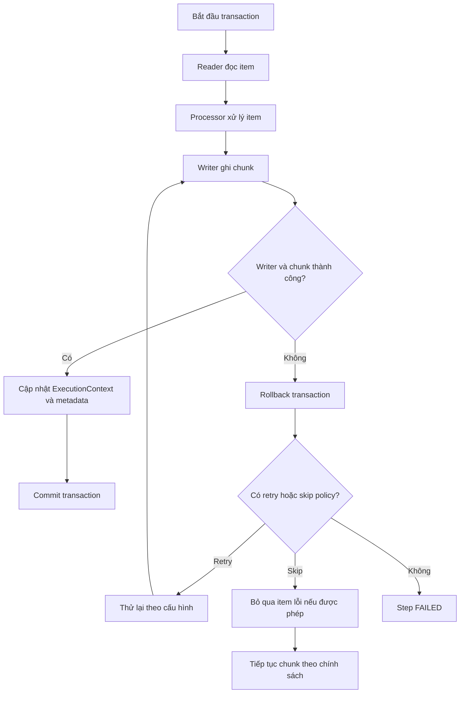

# Writer lỗi và rollback

Trong Spring Batch, `ItemWriter` nhận các item đã được đọc và xử lý trong một chunk rồi ghi chúng tới hệ thống đích. Khi writer gặp lỗi, framework cần quyết định chunk hiện tại có được commit hay phải rollback, có nên thử lại thao tác ghi, có thể bỏ qua item gây lỗi hay phải kết thúc step. Cách xử lý này ảnh hưởng trực tiếp đến tính đúng đắn của dữ liệu, khả năng restart và hiệu năng của batch job.

Với chunk-oriented processing thông thường, các thao tác đọc, xử lý, ghi và cập nhật checkpoint nằm trong một ranh giới transaction do `PlatformTransactionManager` quản lý. Nếu writer ném exception khiến chunk thất bại, Spring Batch thường rollback transaction của chunk. Các chunk đã commit trước đó vẫn được giữ; chunk hiện tại có thể được retry, được xử lý theo skip policy hoặc làm step thất bại.

Điều cần hiểu rõ là rollback chỉ hoàn tác những thao tác thuộc transaction tham gia. Nếu writer đã gửi HTTP request, gửi email hoặc ghi vào hệ thống không tham gia transaction, database rollback không tự động thu hồi tác dụng phụ đó.

## 1. ItemWriter ghi theo chunk

Trong chunk-oriented step, reader đọc các item, processor tùy chọn chuyển đổi hoặc lọc item, sau đó writer nhận nhóm kết quả để ghi.

Ví dụ, một step nhập đơn hàng có thể xử lý 500 item mỗi chunk:

1. `ItemReader` đọc các đơn hàng.
2. `ItemProcessor` kiểm tra và chuyển đổi từng đơn hàng.
3. `ItemWriter` ghi nhóm đơn hàng hợp lệ vào database.
4. Transaction commit nếu toàn bộ chunk hoàn tất thành công.
5. Step tiếp tục với chunk tiếp theo.

Trong Spring Batch 5, interface writer có dạng:

```java
public interface ItemWriter<T> {
    void write(Chunk<? extends T> chunk) throws Exception;
}
```

Một lần gọi `write()` có thể ghi nhiều item. Các phiên bản Spring Batch cũ có chữ ký nhận `List<? extends T>`, vì vậy cần dùng API tương ứng với phiên bản dự án.

Writer nên ném exception khi không thể ghi dữ liệu đúng cách. Nếu writer bắt exception rồi chỉ ghi log và trả về bình thường, Spring Batch có thể coi chunk là thành công và commit các thao tác còn lại. Điều đó có thể khiến dữ liệu bị thiếu mà job vẫn báo `COMPLETED`.

## 2. Transaction boundary của chunk

Trong mô hình chunk tiêu chuẩn, Spring Batch dùng transaction manager để quản lý một đơn vị xử lý. Luồng khái quát:



Transaction thường bao quanh việc đọc và ghi chunk, cùng những cập nhật trạng thái cần thiết. Với writer dùng JDBC và cùng `DataSource`/transaction manager, các lệnh ghi thuộc transaction đó có thể được rollback khi một lệnh thất bại.

Ví dụ, writer ghi 100 đơn hàng. Nếu lệnh ghi thứ 70 làm phát sinh lỗi và database transaction bị rollback, các lệnh ghi trước đó trong cùng transaction cũng được hoàn tác. Kết quả là chunk hiện tại không để lại một phần dữ liệu đã commit trong database đó. Các chunk trước đã commit không bị rollback chỉ vì chunk sau thất bại.

Điều kiện quan trọng là writer thực sự dùng cùng transaction resource. Nếu writer mở connection độc lập, dùng transaction manager khác hoặc ghi sang dịch vụ bên ngoài, transaction của step có thể không kiểm soát được thao tác đó.

## 3. Writer lỗi thì Spring Batch làm gì?

Khi `ItemWriter.write()` ném exception, framework xem chunk hiện tại là thất bại. Với cấu hình mặc định của chunk processing, transaction thường được rollback và exception được đưa qua cơ chế xử lý lỗi của step.

Các khả năng chính:

- **Retry:** thử lại thao tác khi lỗi được phân loại là tạm thời và còn lượt retry.
- **Skip:** bỏ qua item gây lỗi nếu exception được cho phép skip và skip limit chưa bị vượt quá.
- **Fail:** kết thúc step với trạng thái thất bại khi lỗi không được xử lý, không được phép skip hoặc đã vượt giới hạn.

Ví dụ lỗi có thể gặp ở writer:

| Loại lỗi | Ví dụ | Hướng xử lý thường cân nhắc |
|---|---|---|
| Lỗi tạm thời của database | Deadlock, lock timeout | Retry có giới hạn và backoff |
| Dữ liệu vi phạm ràng buộc | Duplicate key, giá trị không hợp lệ | Xác định đây là dữ liệu cần skip, cần upsert hay là lỗi nghiệp vụ phải fail |
| Lỗi kết nối | Mất kết nối database hoặc timeout | Retry có giới hạn; nếu kéo dài thì fail và cảnh báo |
| Lỗi schema/cấu hình | Thiếu cột, sai kiểu dữ liệu, quyền ghi bị thu hồi | Thường fail để sửa cấu hình hoặc triển khai |
| Lỗi hệ thống ngoài | API đích trả lỗi hoặc không phản hồi | Retry nếu có thể xác định an toàn; cần idempotency cho request |

Không nên xem mọi lỗi ghi là lỗi có thể bỏ qua. Ví dụ, mất kết nối database không phải một bản ghi lỗi riêng lẻ; skip nó có thể làm mất dữ liệu mà không giải quyết nguyên nhân hạ tầng.

## 4. Rollback và dữ liệu đã ghi một phần

Một writer có thể thực hiện nhiều thao tác trong một lần gọi. Nếu thao tác thứ ba thất bại sau khi hai thao tác đầu đã chạy, kết quả phụ thuộc vào transaction mà writer sử dụng.

### Khi tất cả thao tác tham gia cùng transaction

Nếu writer ghi nhiều bản ghi qua cùng transaction JDBC và một thao tác phát sinh lỗi, rollback có thể hoàn tác toàn bộ thay đổi của chunk. Đây là tình huống Spring Batch phối hợp tốt với transaction manager.

### Khi writer ghi ngoài transaction

Nếu writer ghi tệp, gọi REST API hoặc gửi message tới hệ thống độc lập, các thao tác trước lỗi có thể đã có hiệu lực. Rollback database không thể xóa email đã gửi hoặc thu hồi request mà đối tác đã xử lý.

Ví dụ:

1. Writer gửi request tạo hóa đơn cho đối tác.
2. Đối tác tạo hóa đơn thành công.
3. Kết nối bị timeout trước khi writer nhận được phản hồi.
4. Writer ném exception; transaction database rollback.
5. Chunk được retry và request tạo hóa đơn được gửi lại.

Đối tác có thể tạo hai hóa đơn nếu API không hỗ trợ idempotency. Vì vậy, writer tích hợp hệ thống ngoài phải có chiến lược bảo vệ tác dụng phụ, không thể chỉ dựa vào rollback của Spring Batch.

## 5. Retry khi writer gặp lỗi tạm thời

Retry phù hợp khi cùng một thao tác có khả năng thành công nếu thử lại, chẳng hạn deadlock hoặc lỗi khóa tạm thời. Spring Batch có thể rollback chunk rồi thực hiện lại theo retry policy đã cấu hình.

Ví dụ cấu hình retry cho lỗi truy cập dữ liệu tạm thời:

```java
return new StepBuilder("writeOrdersStep", jobRepository)
        .<Order, OrderRecord>chunk(500, transactionManager)
        .reader(orderReader)
        .processor(orderProcessor)
        .writer(orderWriter)
        .faultTolerant()
        .retry(TransientDataAccessException.class)
        .retryLimit(3)
        .build();
```

Ví dụ này cho phép thử lại những exception thuộc `TransientDataAccessException` tối đa theo retry limit đã cấu hình. Cần xác định exception thực tế do driver/database phát ra có nằm trong nhóm được chọn hay không. Không nên retry mọi exception một cách rộng rãi, vì lỗi dữ liệu hoặc cấu hình thường không tự biến mất sau vài lần thử.

### Retry có thể gọi writer nhiều lần

Khi chunk được retry, writer có thể được gọi lại với cùng item hoặc cùng nhóm item. Vì vậy:

- Writer dùng JDBC nên tham gia transaction để lần ghi trước bị rollback trước khi thử lại.
- Writer gọi API ngoài nên gửi idempotency key hoặc dùng một mã nghiệp vụ duy nhất.
- Không đặt thao tác không thể lặp an toàn trong writer nếu retry có thể gọi lại thao tác đó.
- Giới hạn số lần thử và cấu hình backoff để tránh tạo tải liên tục lên hệ thống đang gặp sự cố.

Retry count phản ánh số lần thử lại theo policy; nó không đồng nghĩa với số item bị skip. Nếu retry thành công, item không bị bỏ qua chỉ vì đã từng gặp exception.

## 6. Skip khi writer không ghi được một item

Skip dùng khi một item có lỗi đã được xác định là có thể bỏ qua và job vẫn có thể tiếp tục đúng nghiệp vụ. Ví dụ, một bản ghi có khóa trùng mà quy tắc nhập quy định phải ghi vào danh sách từ chối, hoặc một item vi phạm điều kiện nghiệp vụ đã được định nghĩa là không cần xử lý.

Ví dụ cấu hình:

```java
return new StepBuilder("writeOrdersStep", jobRepository)
        .<Order, OrderRecord>chunk(500, transactionManager)
        .reader(orderReader)
        .processor(orderProcessor)
        .writer(orderWriter)
        .faultTolerant()
        .skip(DuplicateKeyException.class)
        .skipLimit(50)
        .build();
```

Ví dụ này cho phép skip `DuplicateKeyException` tối đa theo giới hạn cấu hình. Trước khi áp dụng, cần xác định duplicate key có thật sự là trường hợp nghiệp vụ được bỏ qua hay không. Nếu dữ liệu phải được cập nhật, có thể cần upsert; nếu duplicate là dấu hiệu chạy trùng nguy hiểm, skip có thể che giấu lỗi thiết kế.

### Vì sao lỗi ghi cần xử lý đặc biệt?

Writer thường nhận cả chunk. Khi một lần ghi nhóm thất bại, framework không phải lúc nào cũng biết ngay item nào gây lỗi. Với fault-tolerant step và cấu hình skip phù hợp, Spring Batch có thể rollback chunk rồi thực hiện quá trình cô lập item lỗi bằng cách thử ghi lại các phần nhỏ hơn, có thể đến từng item.

Quá trình này có thể khiến writer được gọi nhiều lần. Những item ghi thành công trong lần thử ban đầu phải được rollback nếu chúng thuộc cùng transaction trước khi framework thử lại để tìm item lỗi. Nếu writer có tác dụng phụ bên ngoài transaction, việc gọi lại có thể tạo bản ghi hoặc request trùng.

Vì vậy, writer cần có khả năng lặp an toàn hoặc chỉ thực hiện thao tác được transaction bảo vệ. Không nên triển khai writer gửi email trực tiếp cho từng item rồi dựa vào write skip để xử lý lỗi.

## 7. Skip limit và chính sách exception

Skip policy cần phân loại exception dựa trên ý nghĩa dữ liệu và khả năng tiếp tục của job. Skip limit xác định tổng số item được phép bỏ qua trong step; các lỗi skip ở giai đoạn đọc, xử lý và ghi cùng đóng góp vào giới hạn đó.

Khi số lần skip vượt giới hạn, step sẽ thất bại. Lỗi không được phân loại là skippable cũng có thể làm step thất bại ngay cả khi skip count còn thấp.

Một chính sách nên trả lời:

- Exception nào đại diện cho dữ liệu không hợp lệ và có thể bỏ qua?
- Exception nào là lỗi tạm thời cần retry?
- Exception nào là lỗi hạ tầng hoặc cấu hình phải dừng job?
- Item bị skip có cần ghi vào bảng lỗi hoặc tệp từ chối không?
- Khi số item bị skip vượt ngưỡng, ai nhận cảnh báo và xử lý thế nào?

Không nên đặt skip limit quá cao chỉ để job luôn kết thúc `COMPLETED`. Một job hoàn tất nhưng bỏ qua hàng nghìn item có thể tạo báo cáo hoặc số liệu nghiệp vụ sai.

## 8. noRollback và khi nào cần thận trọng

Spring Batch cho phép khai báo một số exception không cần rollback trong fault-tolerant step thông qua cấu hình `noRollback`. Cơ chế này dành cho những loại exception mà ứng dụng xác định không làm hỏng trạng thái ghi của chunk.

Ví dụ khái quát:

```java
.faultTolerant()
.noRollback(NonCriticalValidationNoticeException.class)
```

Không nên dùng `noRollback` như cách né lỗi writer. Nếu writer đã ghi một phần dữ liệu rồi ném exception, không rollback có thể khiến chunk được commit với trạng thái không nhất quán. Chỉ cấu hình exception không rollback khi đã hiểu rõ thời điểm exception phát sinh, thao tác nào đã hoàn tất và vì sao việc giữ transaction là an toàn.

Đối với lỗi ghi dữ liệu, rollback thường là lựa chọn mặc định phù hợp hơn. Nếu một trường hợp không phải lỗi ghi mà chỉ là thông báo nghiệp vụ, hãy cân nhắc xử lý nó trong processor hoặc mô hình hóa bằng kết quả nghiệp vụ rõ ràng.

## 9. Writer cần tuân thủ transaction và idempotency

Một writer an toàn cần trả lời hai câu hỏi:

1. Nếu chunk thất bại, những thay đổi đã thực hiện có được rollback không?
2. Nếu cùng item được ghi lại, kết quả có bị nhân đôi hoặc sai lệch không?

Với writer JDBC, nên dùng cùng `DataSource` và transaction manager của step để các lệnh ghi tham gia transaction chunk. Tránh tự mở connection độc lập hoặc tự commit bên trong writer, vì điều đó phá vỡ ranh giới transaction do Spring Batch quản lý.

Với hệ thống ngoài database, có thể dùng các kỹ thuật:

- **Idempotency key:** mỗi yêu cầu ghi có một khóa duy nhất; hệ thống đích trả lại kết quả cũ nếu nhận lại cùng khóa.
- **Unique business key:** dùng ràng buộc duy nhất để ngăn tạo bản ghi trùng.
- **Upsert:** cập nhật hoặc tạo mới theo khóa nghiệp vụ với quy tắc xác định.
- **Transactional outbox:** ghi dữ liệu nghiệp vụ và thông điệp cần gửi vào cùng transaction database, sau đó một tiến trình riêng gửi thông điệp.
- **Reconciliation:** đối soát trạng thái khi timeout khiến ứng dụng không biết hệ thống đích đã thực hiện request hay chưa.

Idempotency không thay thế transaction; nó bổ sung khả năng chạy lại an toàn khi transaction không thể bao trùm mọi tài nguyên.

## 10. Listener để quan sát lỗi writer và item bị skip

Spring Batch cung cấp các listener để quan sát quá trình ghi và xử lý lỗi.

| Listener | Callback hữu ích | Mục đích |
|---|---|---|
| `ItemWriteListener` | `beforeWrite`, `afterWrite`, `onWriteError` | Quan sát lần gọi writer và lỗi ghi |
| `SkipListener` | `onSkipInWrite` | Ghi nhận item thực sự bị skip ở giai đoạn ghi |
| `StepExecutionListener` | `beforeStep`, `afterStep` | Theo dõi trạng thái và số liệu tổng hợp của step |

Ví dụ:

```java
public class OrderWriteListener implements ItemWriteListener<OrderRecord> {

    @Override
    public void beforeWrite(Chunk<? extends OrderRecord> items) {
        log.debug("About to write {} orders", items.size());
    }

    @Override
    public void afterWrite(Chunk<? extends OrderRecord> items) {
        log.debug("Wrote {} orders", items.size());
    }

    @Override
    public void onWriteError(Exception exception,
                             Chunk<? extends OrderRecord> items) {
        log.warn("Writer failed for a chunk of {} orders", items.size(), exception);
    }
}
```

`onWriteError` có thể được gọi nhiều lần khi chunk được retry hoặc writer được gọi lại để xác định item lỗi. Vì vậy, callback này phù hợp để quan sát và ghi log, không nên dùng nó để gửi thông báo không idempotent hoặc thực hiện tác dụng phụ nghiệp vụ.

Ví dụ ghi nhận item bị skip:

```java
public class OrderSkipListener implements SkipListener<Order, OrderRecord> {

    @Override
    public void onSkipInRead(Throwable throwable) {
        log.warn("Could not read an order", throwable);
    }

    @Override
    public void onSkipInProcess(Order item, Throwable throwable) {
        log.warn("Could not process order id={}", item.getId(), throwable);
    }

    @Override
    public void onSkipInWrite(OrderRecord item, Throwable throwable) {
        log.warn("Could not write order id={}", item.getId(), throwable);
    }
}
```

Listener giúp lưu thông tin để điều tra, nhưng cần tránh ghi dữ liệu cá nhân hoặc payload nhạy cảm. Nếu phải ghi item lỗi vào một bảng audit, cần xác định transaction và cách xử lý khi chính thao tác audit cũng thất bại.

## 11. StepExecution và các bộ đếm sau lỗi ghi

`StepExecution` lưu số liệu của lần chạy step. Khi điều tra writer lỗi, nên xem đồng thời:

- `writeCount`: số item được ghi thành công theo metadata step.
- `writeSkipCount`: số item bị skip do lỗi ở giai đoạn ghi.
- `skipCount`: tổng skip ở cả read, process và write.
- `commitCount`: số lần commit được ghi nhận.
- `rollbackCount`: số lần rollback được ghi nhận.
- `BatchStatus` và `ExitStatus`: kết quả thực thi của step.

Ví dụ, một step có `readCount=10.000`, `writeCount=9.970` và `writeSkipCount=30` có thể cho thấy 30 item không ghi được và đã được skip, nếu các bộ đếm khác không có filter hoặc skip ở giai đoạn khác. Cần xem cả `filterCount`, `readSkipCount` và `processSkipCount` trước khi kết luận số item chênh lệch.

Log có thể cho thấy writer được gọi nhiều lần do retry hoặc scan skip. Không nên cộng số lượng từ mỗi log invocation để suy ra số item đã commit. Hãy dùng metadata cuối cùng của `StepExecution`, đối chiếu transaction và dữ liệu thực tế trong hệ thống đích.

## 12. Phân biệt rollback với restart

Rollback và restart giải quyết hai thời điểm khác nhau:

- **Rollback** xảy ra trong một lần thực thi khi transaction của chunk thất bại. Nó hoàn tác các thao tác thuộc transaction đó.
- **Restart** là khởi chạy lại một job/step execution đã thất bại hoặc dừng, sử dụng metadata và checkpoint đã lưu để tiếp tục công việc.

Một chunk rollback không nhất thiết làm toàn bộ job thất bại. Nếu retry hoặc skip xử lý được lỗi, step có thể tiếp tục. Nếu step thất bại, người vận hành có thể restart job sau khi khắc phục nguyên nhân, nếu job và reader hỗ trợ restart.

Các chunk đã commit trước đó thường không cần xử lý lại khi reader khôi phục checkpoint đúng. Chunk chưa commit có thể được đọc và ghi lại. Do đó, writer phải an toàn khi một chunk được thực hiện lại.

## 13. Ví dụ thực tế: ghi đơn hàng vào database

Một job nhập 100.000 đơn hàng. Writer dùng JDBC batch insert theo chunk 500. Trong chunk thứ 20, một đơn hàng có `order_id` đã tồn tại và database trả `DuplicateKeyException`.

Nhóm phát triển cần quyết định ý nghĩa của duplicate:

### Duplicate là dữ liệu không hợp lệ

Nếu hợp đồng nghiệp vụ quy định đơn hàng đã tồn tại phải bị từ chối, có thể cấu hình exception tương ứng là skippable, đặt skip limit hợp lý và dùng `SkipListener` ghi mã đơn hàng vào danh sách lỗi. Khi writer skip, framework có thể rollback và cô lập item gây lỗi theo cơ chế fault-tolerant.

### Duplicate là yêu cầu nhập lại hợp lệ

Nếu nhập lại cùng đơn hàng phải cập nhật dữ liệu hiện có, writer nên dùng câu lệnh upsert hoặc logic cập nhật theo khóa nghiệp vụ. Bắt duplicate rồi skip sẽ làm mất thay đổi cần thiết.

### Duplicate cho thấy job bị chạy trùng

Nếu duplicate phản ánh hai job cùng xử lý một tập dữ liệu, cần xem lại identifying `JobParameters`, cơ chế launch đồng thời và khóa nghiệp vụ. Tăng skip limit không giải quyết được nguyên nhân chạy trùng.

Sau khi writer lỗi, transaction chunk hiện tại được rollback nếu database writer tham gia transaction. Các chunk đã commit trước đó vẫn còn. Nếu lỗi được skip và step tiếp tục, job có thể hoàn tất với số liệu skip tương ứng; nếu không, step kết thúc `FAILED` và có thể được restart sau khi sửa nguyên nhân.

## 14. Các lỗi thiết kế writer thường gặp

| Lỗi thiết kế | Hậu quả | Cách xử lý |
|---|---|---|
| Bắt exception rồi chỉ log | Framework tưởng writer thành công và commit chunk | Ném lại exception hoặc chuyển thành exception phù hợp |
| Tự commit trong writer | Transaction chunk không thể rollback đầy đủ | Để transaction manager của step quản lý commit |
| Mở connection độc lập | Lệnh ghi có thể không tham gia transaction chunk | Dùng transaction-bound resource phù hợp |
| Gửi API ngoài không có idempotency | Retry có thể tạo tác dụng phụ trùng | Dùng idempotency key, outbox hoặc đối soát |
| Skip mọi exception | Che giấu lỗi hạ tầng và làm thiếu dữ liệu | Chỉ skip exception có ý nghĩa nghiệp vụ rõ ràng |
| Retry vô hạn | Job kéo dài và làm hệ thống lỗi chịu tải thêm | Giới hạn retry, dùng backoff và cảnh báo |
| Gửi email trong `onWriteError` | Callback lặp có thể gửi nhiều email | Dùng listener cho quan sát; gửi thông báo qua cơ chế idempotent |
| Writer không chịu được gọi lại | Dữ liệu trùng khi retry hoặc scan skip | Thiết kế writer idempotent hoặc transaction-aware |

## 15. Quy trình điều tra khi writer rollback

Khi một step thất bại do writer, có thể lần lượt xác định:

1. **Xác định execution:** lấy job name, identifying parameters, execution ID và step name.
2. **Đọc exception gốc:** phân biệt lỗi dữ liệu, lỗi khóa, timeout, kết nối, schema hay quyền truy cập.
3. **Kiểm tra transaction manager:** xác nhận writer dùng đúng datasource và transaction của step.
4. **Xem chunk bị ảnh hưởng:** xác định số item, khóa nghiệp vụ và các lệnh ghi trong chunk.
5. **Đối chiếu dữ liệu đích:** kiểm tra thao tác nào đã commit, thao tác nào bị rollback và có tác dụng phụ ngoài transaction hay không.
6. **Kiểm tra retry/skip policy:** xem exception có được retry hoặc skip, giới hạn đã đạt chưa và listener ghi nhận gì.
7. **Đánh giá khả năng chạy lại:** xác nhận writer có idempotent và reader có checkpoint đúng trước khi restart.
8. **Khắc phục nguyên nhân:** sửa dữ liệu, khôi phục database hoặc điều chỉnh cấu hình rồi mới restart theo đúng identifying parameters.

Không nên sửa thủ công trạng thái execution hoặc tăng skip limit khi chưa xác định dữ liệu thực tế đã được ghi tới đâu. Metadata, log và dữ liệu đích cần được đối chiếu cùng nhau.

## 16. Những nguyên tắc cần nhớ

- Writer nhận một chunk; một lần gọi có thể ghi nhiều item.
- Writer nên ném exception khi không thể ghi đúng, để Spring Batch áp dụng transaction và error policy.
- Với writer tham gia transaction của step, lỗi ghi thường làm rollback toàn bộ chunk hiện tại.
- Các chunk đã commit trước đó vẫn được giữ; chunk chưa commit có thể được retry hoặc xử lý lại.
- Retry phù hợp với lỗi tạm thời; skip chỉ dành cho exception có thể bỏ qua theo quy tắc nghiệp vụ.
- Khi skip lỗi ghi, framework có thể gọi writer nhiều lần để xác định item lỗi; writer cần an toàn khi được gọi lại.
- `noRollback` chỉ phù hợp với exception được chứng minh là không làm hỏng trạng thái chunk; không dùng để che lỗi writer.
- Rollback chỉ tác động đến resource tham gia transaction; API, email và hệ thống ngoài cần idempotency hoặc cơ chế phối hợp riêng.
- Dùng `ItemWriteListener` để quan sát lần ghi và `SkipListener` để ghi nhận item thực sự bị skip.
- Đọc `writeCount`, `writeSkipCount`, commit/rollback count, trạng thái step và dữ liệu đích cùng nhau khi điều tra.

Hiểu writer lỗi và rollback giúp thiết kế batch job có khả năng phục hồi mà vẫn giữ dữ liệu nhất quán. Khi writer tham gia đúng transaction, chính sách retry/skip phản ánh đúng nghiệp vụ và tác dụng phụ bên ngoài được bảo vệ bằng idempotency, Spring Batch có thể tiếp tục xử lý sau lỗi mà không làm mất hoặc nhân đôi dữ liệu ngoài ý muốn.
