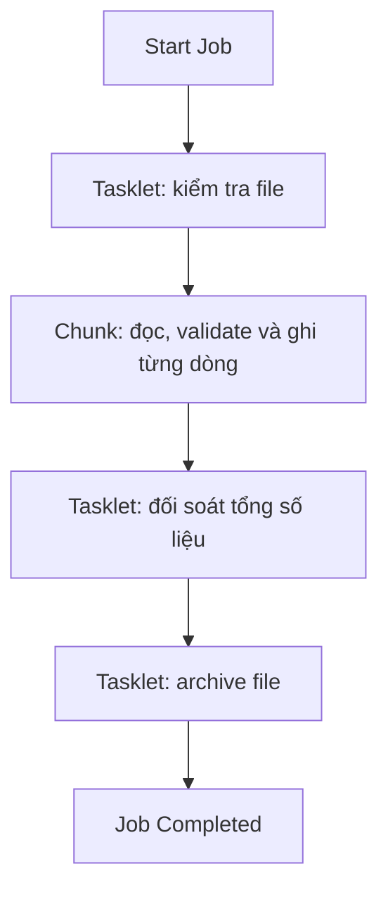

# Khi tasklet đơn giản hơn chunk

Trong Spring Batch, một step có thể được xây dựng theo kiểu chunk-oriented processing hoặc tasklet. Chunk phù hợp khi cần đọc, xử lý và ghi một tập item theo từng nhóm. Tasklet phù hợp khi step thực hiện một tác vụ rõ ràng, hữu hạn và không cần pipeline xử lý từng item.

Ví dụ, kiểm tra file đầu vào, tạo thư mục làm việc, gọi stored procedure, dọn dữ liệu cũ hoặc chuyển một file đã xử lý sang thư mục lưu trữ thường có thể biểu diễn bằng một tasklet. Những tác vụ này có một hành động chính và điều kiện hoàn thành dễ xác định; việc tạo reader, processor và writer có thể làm cấu hình dài hơn mà không đem lại lợi ích đáng kể.

Tasklet không phải lựa chọn thay thế chunk cho mọi loại công việc. Nếu step phải xử lý hàng nghìn hoặc hàng triệu bản ghi, cần checkpoint theo item, retry/skip theo bản ghi hoặc thống kê số item đọc/ghi, chunk-oriented processing thường phù hợp hơn. Tiêu chí quan trọng là bản chất của công việc, không chỉ số dòng code.

## 1. Tasklet và chunk giải quyết hai kiểu công việc khác nhau

Chunk-oriented processing chia input thành các nhóm item. Trong mỗi chunk, Spring Batch gọi reader để đọc item, processor để chuyển đổi hoặc lọc item, rồi writer để ghi kết quả. Chunk được quản lý trong transaction và checkpoint được cập nhật sau khi chunk hoàn tất.

Tasklet là một đơn vị công việc được thực thi trong `TaskletStep`. Spring Batch gọi phương thức `execute()` của tasklet. Tasklet trả về `RepeatStatus.FINISHED` khi công việc hoàn tất hoặc `RepeatStatus.CONTINUABLE` nếu cần được gọi thêm lần nữa.

So sánh tổng quát:

| Tiêu chí | Tasklet | Chunk-oriented |
|---|---|---|
| Mô hình | Một tác vụ hoặc một vòng lặp tác vụ do ứng dụng điều khiển | Reader → Processor → Writer |
| Đơn vị xử lý | Một lần gọi `execute()`; có thể lặp bằng `CONTINUABLE` | Một nhóm item theo commit interval |
| Phù hợp | Tác vụ hữu hạn, thao tác tổng thể hoặc lệnh xử lý theo lô ở cấp database | Xử lý từng bản ghi, cần chuyển đổi và ghi theo item |
| Checkpoint | Ứng dụng tự lưu trạng thái nếu cần tiếp tục giữa các lượt | Spring Batch phối hợp checkpoint với `ItemStream` và execution context |
| Bộ đếm item | Không có bộ đếm read/write theo pipeline item như chunk | Có các bộ đếm read, write, filter, skip và commit ở cấp step |
| Retry/skip | Không có mô hình retry/skip theo từng item của chunk | Có cấu hình fault tolerance theo item/chunk |
| Transaction | Thường một transaction cho mỗi lần gọi `execute()` | Một transaction cho mỗi chunk |

Tasklet thường đơn giản hơn khi công việc có một hành động chính và không cần mô hình hóa từng item. Chunk đơn giản hơn về mặt vận hành khi công việc thực sự là xử lý từng item, vì framework đã cung cấp reader, processor, writer, checkpoint và chính sách lỗi.

## 2. Khi nào tasklet là lựa chọn tự nhiên?

Tasklet thường phù hợp với các trường hợp sau.

### 2.1. Kiểm tra điều kiện đầu vào

Trước khi nhập dữ liệu, job có thể cần kiểm tra file có tồn tại, đọc được, đúng định dạng hoặc thuộc đúng ngày nghiệp vụ. Step này chỉ xác minh một số điều kiện rồi hoàn tất hoặc ném lỗi. Không cần đọc toàn bộ file qua reader nếu mục tiêu chỉ là kiểm tra metadata hoặc header.

### 2.2. Gọi một stored procedure hoặc câu lệnh SQL theo tập dữ liệu

Nếu database có thể thực hiện một phép tổng hợp, xóa dữ liệu hết hạn hoặc cập nhật trạng thái theo một câu lệnh set-based, tasklet có thể gọi stored procedure hoặc `JdbcTemplate` một lần. Database xử lý tập dữ liệu ở bên trong, còn step chỉ cần quản lý transaction và kết quả của thao tác.

### 2.3. Tạo, chuẩn bị hoặc dọn tài nguyên

Ví dụ tạo thư mục, chuẩn bị bảng staging, xóa file tạm cũ, kiểm tra dung lượng hoặc tạo marker cho một batch. Đây thường là các thao tác cấp quy trình, không phải biến đổi từng item.

### 2.4. Di chuyển hoặc lưu trữ file

Sau khi một step nhập file hoàn tất, step khác có thể chuyển file sang thư mục archive hoặc đổi tên để đánh dấu đã xử lý. Đây là một tác vụ file ở cấp tổng thể nên tasklet thường tự nhiên hơn chunk.

### 2.5. Gọi một dịch vụ cho một tác vụ tổng thể

Một step có thể gọi dịch vụ để yêu cầu tạo báo cáo, đồng bộ cấu hình hoặc đóng một batch nghiệp vụ. Nếu thao tác chỉ cần một request và có điều kiện hoàn thành rõ, tasklet có thể phù hợp. Cần thiết kế timeout, retry, idempotency và cách xử lý khi hệ thống ngoài đã thực hiện nhưng phản hồi bị mất.

## 3. Ví dụ tasklet kiểm tra file đầu vào

Ví dụ sau dùng tasklet để kiểm tra file trước khi step nhập dữ liệu chạy. Step kiểm tra file không cần đọc từng dòng; nó chỉ xác nhận file tồn tại và có thể đọc.

```java
@Bean
@StepScope
Tasklet validateInputFile(
        @Value("#{jobParameters['inputFile']}") String inputFile) {

    return (contribution, chunkContext) -> {
        Path path = Path.of(inputFile);

        if (!Files.isRegularFile(path) || !Files.isReadable(path)) {
            throw new IllegalStateException(
                    "Input file is missing or unreadable: " + inputFile);
        }

        return RepeatStatus.FINISHED;
    };
}

@Bean
Step validateInputStep(
        JobRepository jobRepository,
        PlatformTransactionManager transactionManager,
        Tasklet validateInputFile) {

    return new StepBuilder("validateInputStep", jobRepository)
            .tasklet(validateInputFile, transactionManager)
            .build();
}
```

Tasklet thực hiện một lần kiểm tra rồi trả `FINISHED`. Nếu file không hợp lệ, exception làm step thất bại và job không nên đi tiếp sang step nhập dữ liệu theo flow mặc định.

Đây là ví dụ Spring Batch 5+. Các import như `Path`, `Files`, `Tasklet`, `RepeatStatus`, `JobRepository`, `PlatformTransactionManager` và annotation Spring cần được khai báo trong ứng dụng. Việc kiểm tra file hệ thống không nằm trong transaction database; transaction manager không thể rollback một thao tác filesystem.

## 4. Ví dụ tasklet gọi stored procedure hoặc SQL

Giả sử database có stored procedure tổng hợp dữ liệu cho một ngày nghiệp vụ. Tasklet chỉ cần gọi procedure và hoàn tất:

```java
@Bean
@StepScope
Tasklet refreshDailySummary(
        JdbcTemplate jdbcTemplate,
        @Value("#{jobParameters['businessDate']}") String businessDate) {

    return (contribution, chunkContext) -> {
        jdbcTemplate.update(
                "call refresh_daily_summary(?)",
                Date.valueOf(businessDate));

        return RepeatStatus.FINISHED;
    };
}

@Bean
Step refreshDailySummaryStep(
        JobRepository jobRepository,
        PlatformTransactionManager transactionManager,
        Tasklet refreshDailySummary) {

    return new StepBuilder("refreshDailySummaryStep", jobRepository)
            .tasklet(refreshDailySummary, transactionManager)
            .build();
}
```

Cú pháp gọi stored procedure phụ thuộc hệ quản trị cơ sở dữ liệu. Ví dụ trên minh họa cấu trúc, cần điều chỉnh SQL và kiểu ngày theo database đang sử dụng.

Nếu procedure thực hiện một thao tác set-based trên hàng triệu dòng, tasklet có thể là lựa chọn gọn vì Spring Batch không cần chuyển từng dòng qua JVM. Tuy nhiên, cần xem xét thời gian chạy, transaction timeout, lock, log tiến độ và khả năng phục hồi của chính procedure. Một procedure dài trong một transaction lớn có thể giữ lock lâu và khó tiếp tục giữa chừng.

## 5. Tasklet so với chunk khi xử lý nhiều bản ghi

Giả sử cần nhập 500.000 giao dịch từ file CSV vào database.

Với chunk, có thể đọc từng giao dịch, kiểm tra định dạng, chuẩn hóa, ghi theo nhóm 500 item và lưu checkpoint sau mỗi chunk. Nếu lỗi xảy ra ở chunk thứ 200, job có thể restart từ checkpoint gần nhất; chính sách skip có thể xử lý riêng các dòng lỗi.

Nếu dùng một tasklet để tự viết vòng lặp đọc toàn bộ file, tự gom dữ liệu, tự commit, tự lưu vị trí và tự quản lý retry/skip, ứng dụng phải tự xây dựng nhiều cơ chế mà chunk đã cung cấp. Khi đó tasklet không còn đơn giản.

| Yêu cầu | Lựa chọn thường phù hợp |
|---|---|
| Kiểm tra file có tồn tại và đúng header | Tasklet |
| Xóa dữ liệu staging theo batch bằng một câu SQL | Tasklet |
| Gọi stored procedure tổng hợp dữ liệu | Tasklet |
| Đọc file và kiểm tra từng dòng | Chunk |
| Chuyển đổi từng item sang mô hình khác | Chunk |
| Ghi từng bản ghi và cần checkpoint định kỳ | Chunk |
| Retry hoặc skip theo loại lỗi của từng item | Chunk |
| Di chuyển một file đã hoàn tất sang archive | Tasklet |

Không có ngưỡng số lượng bản ghi cố định để quyết định. Một stored procedure có thể xử lý hàng triệu dòng trong một tasklet nếu database xử lý tốt và yêu cầu phục hồi phù hợp. Ngược lại, một file chỉ có vài trăm dòng vẫn nên dùng chunk nếu từng dòng cần validation, skip, retry và theo dõi riêng.

## 6. Tasklet có thể chạy nhiều lần

Tasklet không bắt buộc chỉ được gọi một lần. Phương thức `execute()` trả về `RepeatStatus` để cho biết có tiếp tục lặp hay không:

- `RepeatStatus.FINISHED`: tasklet đã hoàn tất; step có thể kết thúc.
- `RepeatStatus.CONTINUABLE`: tasklet cần được gọi tiếp.

Ví dụ, một tasklet xử lý từng trang dữ liệu:

```java
@Bean
Step processPagesStep(
        JobRepository jobRepository,
        PlatformTransactionManager transactionManager,
        PageService pageService) {

    Tasklet tasklet = (contribution, chunkContext) -> {
        ExecutionContext context =
                contribution.getStepExecution().getExecutionContext();

        int nextPage = context.getInt("nextPage", 0);
        if (nextPage >= pageService.pageCount()) {
            return RepeatStatus.FINISHED;
        }

        pageService.processPage(nextPage);
        context.putInt("nextPage", nextPage + 1);

        return nextPage + 1 >= pageService.pageCount()
                ? RepeatStatus.FINISHED
                : RepeatStatus.CONTINUABLE;
    };

    return new StepBuilder("processPagesStep", jobRepository)
            .tasklet(tasklet, transactionManager)
            .build();
}
```

Trong `TaskletStep`, mỗi lần gọi `execute()` được thực hiện trong transaction riêng. Khi tasklet trả `CONTINUABLE`, framework có thể gọi lại ở lượt tiếp theo. Step ExecutionContext được cập nhật và lưu theo cơ chế thực thi của step, cho phép tasklet khôi phục trạng thái ở lần restart.

Ví dụ trên chỉ phù hợp khi số trang và thứ tự dữ liệu ổn định trong suốt lần chạy. `pageService.processPage()` cũng cần có hành vi idempotent hoặc tham gia cùng transaction được quản lý. Nếu nó tạo side effect bên ngoài transaction, cần khóa nghiệp vụ hoặc cơ chế chống lặp. Với việc xử lý item theo trang có nhiều logic, chunk-oriented step hoặc partitioning có thể phù hợp hơn.

## 7. Transaction của tasklet

`TaskletStep` dùng `PlatformTransactionManager` được truyền vào `.tasklet(tasklet, transactionManager)`. Theo cách thực thi thông thường, mỗi lần gọi `execute()` chạy trong transaction riêng:

- Nếu tasklet hoàn tất và transaction commit, các thay đổi trong resource tham gia transaction được xác nhận.
- Nếu tasklet ném exception, transaction hiện tại rollback theo khả năng của transaction manager và step thường chuyển sang trạng thái thất bại.
- Nếu tasklet trả `CONTINUABLE`, lượt thực thi hiện tại hoàn tất theo transaction rồi framework có thể gọi lượt tiếp theo.

Điều này khác với chunk step ở đơn vị transaction. Chunk step commit theo nhóm item; tasklet step commit theo mỗi lần gọi `execute()`. Nếu tasklet chỉ chạy một lần và thực hiện một thao tác database, toàn bộ thao tác đó có thể nằm trong một transaction. Nếu tasklet lặp nhiều lần, mỗi lượt có ranh giới transaction riêng.

Không phải mọi side effect đều thuộc transaction. Ghi file, gọi HTTP API, gửi email hoặc publish message thường không tự rollback cùng transaction database. Ví dụ tasklet chuyển file rồi gặp lỗi database: file có thể đã được di chuyển dù transaction database rollback. Cần thiết kế thao tác có thể lặp, dùng file tạm và rename nguyên tử khi phù hợp, hoặc lưu trạng thái trung gian để phục hồi.

## 8. Restart và idempotency của tasklet

Nếu tasklet thất bại, khi restart job, step thất bại thường được thực thi lại. Nếu tasklet đã thực hiện một phần công việc ngoài transaction rồi mới ném exception, lần chạy lại có thể lặp lại phần tác động đó.

Ví dụ tasklet gửi yêu cầu tạo báo cáo đến dịch vụ bên ngoài. Dịch vụ đã tạo báo cáo nhưng response timeout. Tasklet thất bại; khi restart, nó gửi lại yêu cầu. Nếu không có idempotency key, dịch vụ có thể tạo hai báo cáo.

Một số cách thiết kế:

- Dùng `JobParameters` ổn định như `businessDate` hoặc `batchId` để nhận diện cùng công việc.
- Dùng idempotency key ở dịch vụ ngoài nếu API hỗ trợ.
- Kiểm tra trạng thái hiện tại trước khi thực hiện thao tác có thể lặp, đồng thời bảo vệ kiểm tra/ghi bằng unique key hoặc lock phù hợp.
- Lưu checkpoint tùy chỉnh vào Step ExecutionContext nếu tasklet có nhiều lượt xử lý.
- Với file, dùng tên đích xác định, kiểm tra trạng thái file và thiết kế thao tác move/archive có thể khôi phục.
- Với message, cân nhắc transactional outbox thay vì gửi trực tiếp trong transaction database.

`ExecutionContext` không tự làm cho tasklet idempotent. Nó chỉ lưu trạng thái mà ứng dụng đưa vào context và Spring Batch lưu theo lifecycle của step. Tính đúng đắn khi chạy lại vẫn phụ thuộc vào transaction, khóa nghiệp vụ và cách xử lý side effect.

## 9. Khi nào tasklet không còn đơn giản?

Tasklet thường không phải lựa chọn tốt nếu bên trong nó bắt đầu có các đặc điểm sau:

- Vòng lặp xử lý từng item với nhiều quy tắc chuyển đổi.
- Cần ghi nhận số lượng item đọc, ghi, filter và skip.
- Cần retry hoặc skip một số item mà vẫn tiếp tục với các item khác.
- Cần checkpoint định kỳ theo item để tránh làm lại quá nhiều dữ liệu.
- Cần reader/writer chuẩn của Spring Batch như file reader, JDBC cursor reader hoặc paging reader.
- Cần phân vùng dữ liệu hoặc xử lý song song theo item/partition.
- Cần theo dõi item lỗi riêng biệt và đưa vào quy trình xử lý lại.

Nếu tasklet tự triển khai một vòng lặp phức tạp với logic đọc, xử lý, ghi, checkpoint, retry và skip, hãy cân nhắc chuyển sang chunk-oriented processing. Chunk cung cấp sẵn mô hình xử lý item và các hook cần thiết.

Ngược lại, nếu step chỉ cần gọi một câu SQL, xác minh một file hoặc thực hiện một thao tác hữu hạn, việc tạo reader/processor/writer chỉ để sử dụng chunk có thể làm cấu hình phức tạp không cần thiết.

## 10. Kết hợp tasklet và chunk trong cùng một job

Một job thực tế thường kết hợp cả hai loại step. Ví dụ quy trình nhập file:



Trong quy trình này:

- Tasklet đầu tiên kiểm tra file và metadata đầu vào.
- Chunk step đọc từng dòng, chuyển đổi và ghi dữ liệu theo nhóm, tận dụng checkpoint và chính sách lỗi theo item.
- Tasklet đối soát số lượng và tổng giá trị sau khi nhập.
- Tasklet cuối chuyển file sang thư mục archive hoặc ghi marker hoàn tất.

Kết hợp này thể hiện ranh giới nghiệp vụ rõ ràng. Nếu chunk step thất bại, các tasklet phía sau chưa được chạy theo flow tuần tự mặc định. Khi restart, Spring Batch dựa vào metadata của từng step để tiếp tục theo quy tắc restart; dữ liệu đã commit ở chunk trước vẫn tồn tại.

Ví dụ cấu hình job:

```java
@Bean
Job importFileJob(
        JobRepository jobRepository,
        Step validateFileStep,
        Step importRowsStep,
        Step reconcileStep,
        Step archiveFileStep) {

    return new JobBuilder("importFileJob", jobRepository)
            .start(validateFileStep)
            .next(importRowsStep)
            .next(reconcileStep)
            .next(archiveFileStep)
            .build();
}
```

## 11. Các lỗi thiết kế thường gặp

**Dùng tasklet để tự đọc hàng triệu dòng.** Nếu tasklet tự quản lý vòng lặp và ghi từng bản ghi, nó phải tự xử lý checkpoint, retry, skip và thống kê. Dùng chunk khi nghiệp vụ là xử lý từng item.

**Dùng chunk cho một thao tác tổng thể duy nhất.** Nếu step chỉ gọi stored procedure hoặc kiểm tra một file, reader/processor/writer có thể làm cấu hình dài hơn mà không đem lại lợi ích. Tasklet thường phù hợp hơn.

**Cho rằng `FINISHED` đồng nghĩa với nghiệp vụ thành công.** `FINISHED` chỉ báo tasklet không cần lặp thêm. Nếu thao tác nghiệp vụ thất bại, tasklet cần ném exception hoặc đặt kết quả/exit status theo quy tắc đã thiết kế.

**Dùng `CONTINUABLE` nhưng không có điều kiện dừng.** Tasklet có thể lặp vô hạn nếu trạng thái không tiến lên hoặc điều kiện hoàn tất sai. Hãy xác định giới hạn, tiến độ và cách thoát.

**Coi toàn bộ job là một transaction.** Tasklet transaction thường bao phủ một lần gọi `execute()`; chunk transaction bao phủ một chunk. Nhiều step không tự động nằm trong một transaction duy nhất.

**Cho rằng rollback database hoàn tác file hoặc API.** Tác động ngoài transaction cần idempotency, trạng thái trung gian hoặc cơ chế phục hồi riêng.

**Không thiết kế restart cho tasklet.** Tasklet thất bại có thể chạy lại từ đầu. Nếu thao tác không thể lặp an toàn, hãy lưu trạng thái hoặc chia quy trình thành các bước có thể phục hồi.

## 12. Kiểm thử tasklet

Kiểm thử nên xác nhận hành vi của tasklet và ranh giới transaction:

1. **Trường hợp thành công:** tasklet thực hiện đúng tác vụ và trả `RepeatStatus.FINISHED`.
2. **Đầu vào không hợp lệ:** tasklet ném exception phù hợp và step thất bại theo mong đợi.
3. **Transaction rollback:** gây lỗi sau khi có thay đổi database và xác nhận thay đổi trong transaction được rollback.
4. **Restart:** làm tasklet thất bại rồi chạy lại cùng identifying `JobParameters`; xác nhận không tạo side effect trùng.
5. **Tasklet lặp:** kiểm tra `CONTINUABLE` dẫn đến số lượt mong muốn và cuối cùng trả `FINISHED`.
6. **Checkpoint tùy chỉnh:** xác nhận trạng thái trong Step ExecutionContext được lưu và khôi phục giữa các lượt/restart.
7. **Tài nguyên ngoài transaction:** mô phỏng lỗi khi di chuyển file hoặc gọi API để xác nhận quy trình phục hồi.
8. **Tích hợp job:** xác nhận step tiếp theo chỉ chạy sau khi tasklet hoàn tất theo flow.

Có thể dùng `JobLauncherTestUtils` trong module test của Spring Batch để khởi chạy job và kiểm tra `JobExecution`/`StepExecution`. Ngoài trạng thái framework, cần kiểm tra kết quả thực tế: file đã ở đúng vị trí chưa, stored procedure tạo dữ liệu gì, bản ghi staging có đúng không và tác động ngoài có bị lặp không.

## 13. Cách ra quyết định

Trước khi chọn kiểu step, hãy mô tả công việc bằng một câu:

- Nếu câu mô tả là “đọc từng bản ghi, kiểm tra/chuyển đổi và ghi từng bản ghi”, chunk thường là lựa chọn tự nhiên.
- Nếu câu mô tả là “thực hiện một tác vụ có phạm vi rõ ràng rồi hoàn tất”, tasklet thường đơn giản hơn.
- Nếu câu mô tả là “thực hiện nhiều lượt có checkpoint riêng”, tasklet có thể làm được nhưng phải tự quản lý trạng thái; hãy so sánh với chunk hoặc partitioning trước khi quyết định.

| Câu hỏi thiết kế | Nếu câu trả lời là có... |
|---|---|
| Có cần reader, processor và writer cho từng item? | Ưu tiên chunk |
| Có cần retry/skip theo item? | Ưu tiên chunk |
| Có cần checkpoint định kỳ theo item? | Ưu tiên chunk |
| Chỉ cần một thao tác SQL hoặc stored procedure? | Cân nhắc tasklet |
| Chỉ cần kiểm tra, chuẩn bị hoặc archive một file? | Cân nhắc tasklet |
| Cần lặp một số lượt hữu hạn và lưu trạng thái tùy chỉnh? | Tasklet có thể phù hợp nếu logic vẫn đơn giản |
| Tasklet đang chứa một pipeline item tự viết phức tạp? | Tách sang chunk |

Không chọn tasklet chỉ vì ít dòng code hơn ở ví dụ đầu tiên. Hãy tính cả chi phí tự xây dựng checkpoint, retry, skip, log tiến độ và phục hồi khi công việc lớn dần.

## Kết luận

Tasklet đơn giản hơn chunk khi step thực hiện một tác vụ hữu hạn, có mục tiêu và điều kiện hoàn thành rõ ràng, không cần pipeline reader/processor/writer cho từng item. Kiểm tra file, chuẩn bị tài nguyên, gọi stored procedure, dọn dữ liệu hoặc archive file là những ví dụ điển hình.

Chunk phù hợp hơn khi xử lý từng item, cần checkpoint định kỳ, retry/skip theo bản ghi và thống kê quá trình đọc/ghi. Một job có thể kết hợp tasklet và chunk để phản ánh đúng các giai đoạn nghiệp vụ. Khi dùng tasklet, hãy hiểu transaction theo từng lần gọi `execute()`, thiết kế `FINISHED`/`CONTINUABLE` đúng cách và bảo đảm thao tác có thể restart hoặc idempotent khi gặp lỗi.
