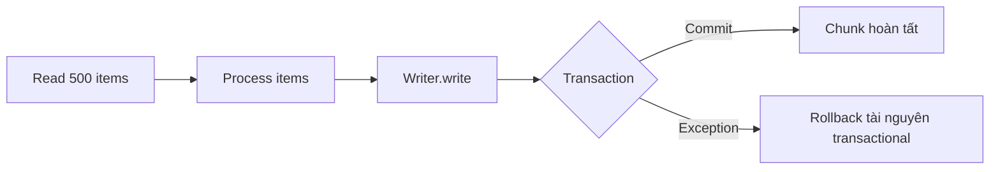
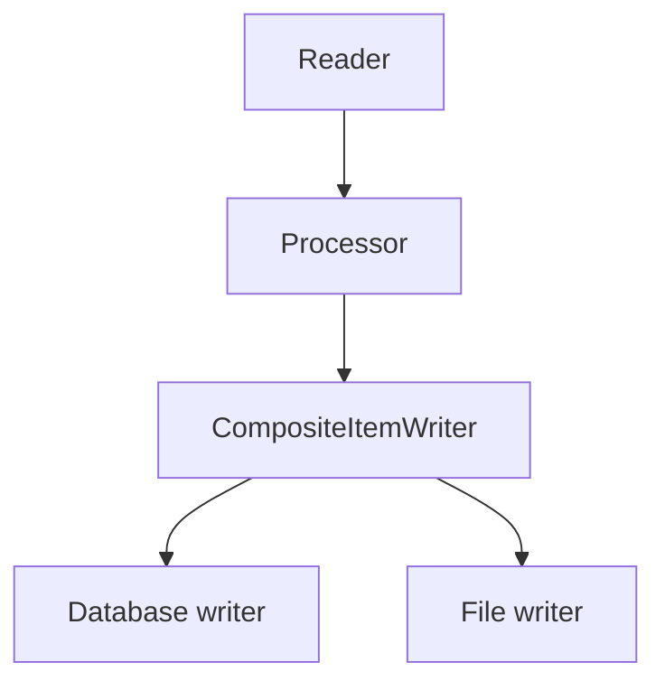
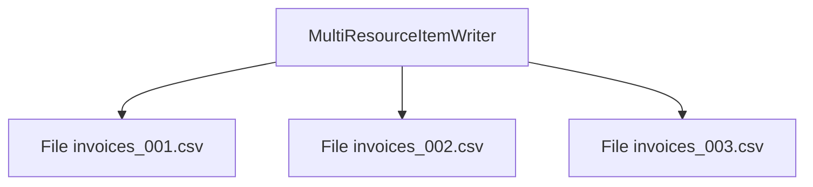
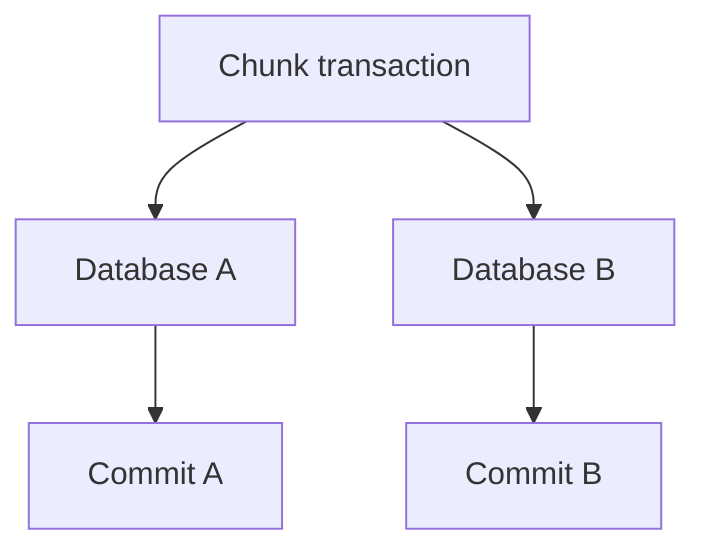
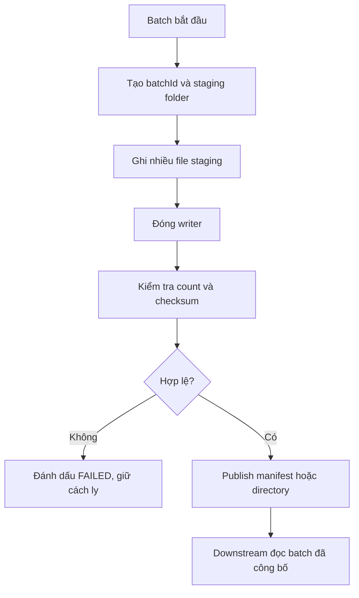
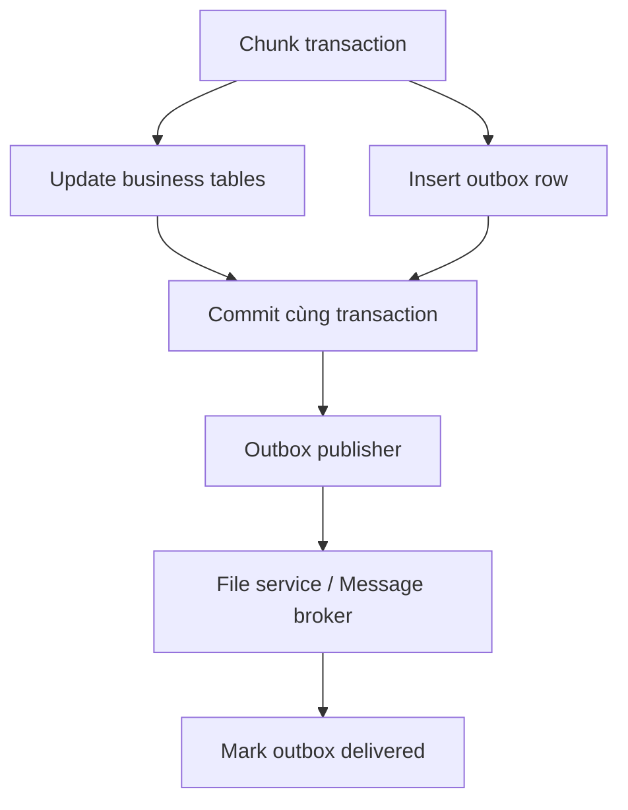

# Writer nhiều resource và giới hạn atomicity

Một batch job thường phải ghi kết quả ra nhiều nơi: database nghiệp vụ, một hoặc nhiều file CSV, object storage, message broker hoặc API của hệ thống khác. Spring Batch hỗ trợ ghép nhiều writer và ghi ra nhiều file, nhưng điều đó không có nghĩa mọi đích ghi sẽ cùng commit hoặc rollback như một transaction duy nhất.

**Atomicity chỉ được bảo đảm trong phạm vi các tài nguyên thực sự tham gia cùng transaction manager và cùng transaction.** Nếu một chunk vừa cập nhật database vừa ghi file hoặc gọi API bên ngoài, lỗi ở giữa có thể để lại kết quả một phần. Transaction rollback database không tự xóa file đã tạo, thu hồi message đã gửi hay hoàn tác request mà dịch vụ khác đã xử lý.

Bài này trình bày cách Spring Batch ghi nhiều resource, vai trò của `MultiResourceItemWriter` và `CompositeItemWriter`, giới hạn của transaction theo chunk, các tình huống lỗi một phần và những mẫu thiết kế để công bố kết quả an toàn trong production.

## 1. Hiểu atomicity trong một chunk step

Chunk-oriented step đọc, xử lý và ghi item theo từng nhóm. Với chunk size là 500, Spring Batch thường thực hiện một transaction cho một chunk:



Ở mức đơn giản:

1. Reader đọc item.
2. Processor biến đổi hoặc lọc item.
3. Writer thực hiện thao tác ghi.
4. Nếu xử lý chunk thành công, transaction manager commit.
5. Nếu có lỗi trước commit, transaction được rollback theo khả năng của các tài nguyên tham gia transaction.

Khi tất cả thao tác ghi chỉ dùng một database và cùng transaction manager, các lệnh SQL trong chunk có thể commit hoặc rollback cùng nhau. Ví dụ, hai bảng `invoice` và `invoice_audit` trong cùng database có thể được cập nhật nguyên tử trong một transaction.

Nhưng nếu chunk ghi sang nhiều loại resource, phạm vi atomicity phụ thuộc vào cách các resource được quản lý:

| Resource | Có thể rollback cùng local DB transaction? |
|---|---|
| Nhiều bảng trong cùng database/transaction | Có |
| Nhiều repository dùng cùng transaction manager và cùng transactional resource | Có, nếu cùng tham gia transaction |
| Database thứ hai với datasource/transaction manager khác | Không tự động |
| File trên filesystem | Không phải transactional resource của JDBC |
| HTTP API | Không |
| Email hoặc dịch vụ bên ngoài | Không |
| Message broker | Chỉ khi có transaction integration phù hợp; không tự động đồng bộ với DB |

Một transaction manager chỉ điều khiển các tài nguyên mà nó quản lý. Việc gọi hai writer liên tiếp trong cùng phương thức write() không biến hai hệ thống thành một transaction nguyên tử.

## 2. Nhiều writer trong cùng một step

Spring Batch có `CompositeItemWriter` để gửi cùng một chunk tới nhiều writer delegate. Ví dụ, mỗi item vừa được ghi vào database vừa được ghi thành file:



Ví dụ cấu hình:

```java
@Bean
CompositeItemWriter<InvoiceLine> invoiceCompositeWriter(
        ItemWriter<InvoiceLine> databaseWriter,
        ItemWriter<InvoiceLine> fileWriter) {

    return new CompositeItemWriterBuilder<InvoiceLine>()
            .delegates(List.of(databaseWriter, fileWriter))
            .build();
}
```

Composite writer gọi các delegate theo thứ tự được khai báo. Trong ví dụ, database writer được gọi trước, file writer được gọi sau. `CompositeItemWriter` giúp tổ chức lời gọi; nó không cung cấp một transaction phân tán để làm cho tất cả delegate commit cùng nhau.

### Nếu delegate thứ hai thất bại thì sao?

Giả sử database writer đã thực hiện câu lệnh SQL thành công, sau đó file writer ném exception:

1. `CompositeItemWriter` đã gọi database writer.
2. File writer bắt đầu ghi và gặp lỗi.
3. Exception được truyền ra khỏi writer.
4. Spring Batch rollback chunk transaction.
5. Thay đổi database có thể được rollback nếu database writer tham gia đúng transaction đó.
6. Bất kỳ side effect file đã thực sự ghi ra filesystem có thể vẫn còn.

Kết quả có thể là database không có dữ liệu chunk đó nhưng file đã chứa một phần hoặc toàn bộ dữ liệu. Nếu đảo thứ tự delegate, rủi ro có thể đảo lại: file được ghi trước, database thất bại sau.

Không có thứ tự gọi writer nào giải quyết được bài toán atomicity giữa hai loại resource không cùng transaction. Đổi thứ tự chỉ thay đổi loại kết quả một phần có thể còn lại khi lỗi.

## 3. MultiResourceItemWriter: chia output thành nhiều file

`MultiResourceItemWriter` là một writer delegate chuyên ghi dữ liệu ra nhiều resource. Nó thường dùng cùng `FlatFileItemWriter` để tạo các file theo giới hạn số item trên mỗi file.

Ví dụ, một lần export có 250.000 dòng và giới hạn 100.000 item/file sẽ tạo nhiều file:



Mỗi file có thể chứa một phần dữ liệu. Writer chuyển sang resource kế tiếp khi đạt giới hạn item được cấu hình.

### Cấu hình ví dụ

Delegate `FlatFileItemWriter` định nghĩa cách ghi từng item:

```java
@Bean
FlatFileItemWriter<InvoiceLine> invoiceFileDelegate() {
    return new FlatFileItemWriterBuilder<InvoiceLine>()
            .name("invoiceFileDelegate")
            .headerCallback(writer ->
                    writer.write("invoiceId,customerId,amount"))
            .delimited()
            .names("invoiceId", "customerId", "amount")
            .build();
}
```

`MultiResourceItemWriter` quản lý resource hiện tại và số item đã ghi:

```java
@Bean
MultiResourceItemWriter<InvoiceLine> invoiceMultiFileWriter(
        FlatFileItemWriter<InvoiceLine> invoiceFileDelegate) {

    return new MultiResourceItemWriterBuilder<InvoiceLine>()
            .name("invoiceMultiFileWriter")
            .resource(new FileSystemResource("output/invoices"))
            .delegate(invoiceFileDelegate)
            .itemCountLimitPerResource(100_000)
            .resourceSuffixCreator(index ->
                    String.format("_%03d.csv", index))
            .build();
}
```

Với base resource `output/invoices` và suffix creator ở trên, các file được đặt tên theo dạng `invoices_001.csv`, `invoices_002.csv`... Cần kiểm tra convention index của phiên bản đang dùng khi tích hợp với downstream consumer.

Một số điểm cần chú ý:

- Delegate phải hỗ trợ resource-aware writer contract để nhận resource mới.
- Tên writer phải ổn định để execution context được khôi phục đúng.
- Suffix creator phải tạo tên file ổn định giữa các lần restart.
- Input và thứ tự đọc cần ổn định nếu muốn restart tiếp tục đúng file và vị trí.
- Thư mục output và quyền ghi phải tồn tại/phù hợp với môi trường chạy.
- Giới hạn item/file là giới hạn số item, không phải giới hạn dung lượng byte.

### MultiResourceItemWriter không phải transaction đa file

`MultiResourceItemWriter` giúp phân chia và quản lý nhiều file, nhưng không tạo một transaction nguyên tử bao trùm tất cả file. Một job có thể ghi xong file thứ nhất, ghi một phần file thứ hai rồi gặp lỗi.

Ngay cả khi delegate `FlatFileItemWriter` có transactional buffering theo cấu hình mặc định, cơ chế đó vẫn không biến filesystem thành một resource XA cùng commit với database. Lỗi I/O, process crash hoặc lỗi khi publish nhiều file vẫn cần được xử lý bằng chiến lược phục hồi riêng.

Không giả định “chunk rollback” sẽ xóa file đã tạo hoặc đưa tất cả file về trạng thái trước chunk.

## 4. Transactional buffering của file writer có ý nghĩa gì?

Một số writer của Spring Batch, như `FlatFileItemWriter`, có thể phối hợp việc ghi buffer với transaction synchronization. Khi transaction đang hoạt động, dữ liệu được buffer để flush theo ranh giới transaction. Thuộc tính `transactional` của flat file writer điều khiển hành vi buffering này; cần giữ cấu hình phù hợp với phiên bản và mục tiêu triển khai.

Điều này hữu ích để giảm trường hợp ghi file trước rồi database rollback ngay trong một lỗi thông thường của chunk. Tuy nhiên, cần hiểu giới hạn:

- Filesystem không tham gia JDBC transaction theo cách một bảng database tham gia.
- Flush ra file có thể gặp lỗi I/O hoặc process bị dừng giữa chừng.
- Một lần flush có thể tạo ra dữ liệu vật lý trước khi một resource khác hoàn tất.
- Một nhóm nhiều file không có thao tác commit nguyên tử mặc định.
- File đã được downstream đọc hoặc copy đi thì không thể rollback bằng transaction manager của step.

Vì vậy, transactional buffering là một cơ chế phối hợp hữu ích cho writer, không phải lời hứa ACID đa resource. Nếu yêu cầu nghiệp vụ cần công bố đồng bộ DB và file, hãy dùng staging/publish protocol hoặc một kiến trúc điều phối có khả năng phục hồi.

## 5. Nhiều database cũng có giới hạn atomicity

Nếu một chunk ghi hai database khác nhau:



Với hai local transaction manager độc lập, không có bảo đảm cả hai commit hoặc cả hai rollback như một đơn vị. Có thể xảy ra:

- Database A commit thành công.
- Database B gặp lỗi trước commit.
- Job báo lỗi, nhưng dữ liệu ở A vẫn tồn tại.

Để có distributed atomic commit thực sự, hệ thống cần một giao thức như XA/two-phase commit và các resource phải hỗ trợ enlistment phù hợp. Điều này kéo theo coordinator, cấu hình datasource/driver, timeout, recovery log và vận hành phức tạp. Filesystem và HTTP API thông thường không trở thành XA participant chỉ vì được gọi từ cùng một step.

Trước khi chọn distributed transaction, hãy cân nhắc liệu nghiệp vụ có thể chấp nhận eventual consistency, outbox, staging và reconciliation hay không. Những mẫu này thường dễ vận hành hơn khi các resource không hỗ trợ chung một transaction manager.

## 6. Failure scenario: ghi database và file trong cùng chunk

Giả sử chunk chứa 1.000 hóa đơn, `CompositeItemWriter` gọi database writer trước rồi file writer:

| Thời điểm | Database | File |
|---|---|---|
| Bắt đầu chunk | Chưa ghi | Chưa ghi |
| Database writer hoàn tất | Có 1.000 thay đổi trong transaction | Chưa ghi |
| File writer ghi được 600 dòng | Có 1.000 thay đổi chưa commit | Có thể có 600 dòng vật lý hoặc dữ liệu đang buffer |
| Disk full | Writer ném exception | Ghi file không hoàn tất |
| Chunk rollback | Database rollback nếu cùng transaction | Filesystem không tự rollback như DB |

Sau sự cố, file có thể bị thiếu, chứa một phần hoặc có trạng thái tùy cơ chế buffer và thời điểm lỗi. Nếu retry, writer có thể tạo thêm dữ liệu hoặc nối tiếp file cũ nếu cấu hình append/restart cho phép.

Các câu hỏi cần trả lời trong thiết kế:

- File có được xem là output chính thức trước khi toàn bộ batch hoàn tất không?
- Downstream consumer có thể nhìn thấy file đang được ghi không?
- Retry có ghi đè file cũ, append hay tạo file mới?
- Làm sao phát hiện file chỉ được ghi một phần?
- Làm sao đối chiếu số dòng file với số bản ghi database?
- Ai dọn dẹp hoặc cách ly file staging khi job thất bại?

Nếu không có câu trả lời rõ ràng, không nên cho downstream consumer đọc trực tiếp file đang được writer tạo.

## 7. Mẫu an toàn: ghi vào staging rồi publish

Một cách thực tế là chia quá trình thành hai giai đoạn: **tạo output trong vùng staging**, sau đó **công bố output đã hoàn chỉnh**.



Quy trình:

1. Tạo một `batchId` ổn định, ví dụ `invoice-20261115-001`.
2. Ghi file vào thư mục riêng như `staging/invoice-20261115-001/`.
3. Không để consumer quét hoặc đọc thư mục staging.
4. Đóng writer để flush và hoàn tất file.
5. Kiểm tra số file, số dòng, checksum, schema và tổng kiểm soát nghiệp vụ.
6. Ghi manifest mô tả batch và danh sách file.
7. Công bố batch bằng cách tạo commit marker hoặc chuyển thư mục sang vùng published.
8. Consumer chỉ xử lý batch có manifest/marker hợp lệ.

Manifest có thể chứa:

```json
{
  "batchId": "invoice-20261115-001",
  "businessDate": "2026-11-15",
  "status": "PUBLISHED",
  "files": [
    {
      "name": "invoices_001.csv",
      "records": 100000,
      "sha256": "..."
    },
    {
      "name": "invoices_002.csv",
      "records": 25000,
      "sha256": "..."
    }
  ],
  "totalRecords": 125000
}
```

Đây là ví dụ cấu trúc; giá trị checksum phải được tính từ file thực tế. Manifest nên được ghi ra file tạm rồi rename thành tên chính thức khi hoàn chỉnh. Nếu dùng rename để công bố, cần kiểm tra filesystem có hỗ trợ atomic rename trong cùng filesystem và target path chưa tồn tại. Rename từng file riêng lẻ không làm cả nhóm file trở thành một transaction.

### Vì sao manifest hữu ích?

Consumer có một tín hiệu rõ ràng để biết batch đã hoàn tất. Nếu job chết khi đang ghi file, không có manifest nên consumer bỏ qua thư mục đó. Nếu manifest tồn tại và checksum hợp lệ, consumer có thể bắt đầu xử lý.

Manifest là commit marker ở tầng ứng dụng; nó không tự đồng bộ transaction với database. Nếu database cũng lưu trạng thái `PUBLISHED`, cần thiết kế cách phục hồi khi một bên cập nhật thành công còn bên kia thất bại.

## 8. Kết hợp staging với database transaction

Nếu cần ghi database và file, hãy định nghĩa nguồn sự thật và thứ tự công bố. Ví dụ một workflow có thể:

1. Ghi dữ liệu nghiệp vụ và một batch control record trong cùng DB transaction.
2. Ghi output file vào staging bằng batch ID đó.
3. Xác minh số lượng và checksum.
4. Ghi trạng thái output `READY_TO_PUBLISH` vào database.
5. Publish file/manifest.
6. Cập nhật trạng thái `PUBLISHED`.
7. Nếu publish thất bại, một recovery job tìm batch `READY_TO_PUBLISH` để thử lại.

Vì DB update và filesystem publish không nguyên tử, trạng thái điều phối cần cho phép nhận diện và phục hồi các khoảng giữa các bước. Ví dụ:

| Trạng thái | Ý nghĩa | Hành động phục hồi |
|---|---|---|
| `STARTED` | Batch đã được tạo | Kiểm tra execution và staging |
| `WRITING` | Đang tạo file | Restart hoặc cách ly file dở |
| `VALIDATING` | Đang đối soát | Chạy lại kiểm tra |
| `READY_TO_PUBLISH` | Output hợp lệ, chưa công bố | Thử publish lại |
| `PUBLISHED` | Consumer có thể đọc | Không publish lại; xử lý theo idempotency |
| `FAILED` | Có lỗi cần điều tra | Giữ artifact và nguyên nhân |

Không xóa staging ngay khi job thất bại. Giữ lại đủ thông tin để điều tra, hoặc dọn theo retention policy sau khi trạng thái batch đã được xác định.

## 9. Transactional outbox cho sự kiện và tác vụ publish

Nếu một transaction database cần tạo dữ liệu và yêu cầu phát sự kiện hoặc tạo file, transactional outbox là một lựa chọn hữu ích:



Trong cùng một local database transaction, job ghi dữ liệu nghiệp vụ và một outbox record. Nếu transaction rollback, cả hai thay đổi đều rollback. Nếu commit, publisher riêng có thể đọc outbox và thực hiện side effect sau đó.

Publisher vẫn có thể gửi lặp nếu process chết sau khi hệ thống đích nhận message nhưng trước khi outbox được đánh dấu delivered. Vì vậy:

- Mỗi outbox record cần ID ổn định.
- Hệ thống đích nên hỗ trợ idempotency key hoặc consumer deduplication.
- Trạng thái gửi phải có retry/backoff và thông tin lỗi.
- Không đánh dấu delivered trước khi nhận được xác nhận phù hợp từ hệ thống đích.

Outbox làm cho việc ghi yêu cầu phát hành nhất quán với database; nó không biến dịch vụ đích thành một phần của transaction ban đầu.

## 10. Idempotency khi restart hoặc publish lại

Khi có nhiều resource, job phải giả định một bước có thể được thực hiện lại. Hãy định nghĩa khóa idempotency ở cấp batch và cấp item:

- `batchId`: định danh lô output.
- `sourceRecordId`: định danh bản ghi nguồn.
- `fileName`: tên file ổn định trong một batch.
- `contentChecksum`: xác nhận nội dung file.
- `publicationId`: định danh yêu cầu công bố.

Ví dụ quy tắc:

- Ghi lại file staging vào cùng batch directory chỉ khi có thể ghi đè an toàn hoặc dọn file cũ trước khi bắt đầu lại.
- Không append vào file cũ nếu không biết chính xác offset đã commit.
- Chỉ tạo manifest sau khi mọi file đã đóng và kiểm tra xong.
- Consumer lưu `batchId` đã xử lý để tránh nhập cùng batch nhiều lần.
- Database dùng unique constraint trên `batchId` và `sourceRecordId` khi phù hợp.

Idempotency ở writer giúp xử lý lại một thao tác mà không tạo kết quả trùng. Restart metadata của Spring Batch giúp biết execution và step đã đi đến đâu. Hai cơ chế cần phối hợp.

## 11. Restart với MultiResourceItemWriter

`MultiResourceItemWriter` là một `ItemStreamWriter` và có thể lưu state cần thiết vào `ExecutionContext`. Với cấu hình restart đúng, nó có thể khôi phục resource hiện tại và số lượng item đã ghi để tiếp tục.

Để khả năng restart đáng tin cậy:

- Giữ writer name ổn định.
- Giữ base resource và suffix naming ổn định.
- Bảo đảm file input không thay đổi và thứ tự đọc có thể tái lập.
- Không xóa hoặc đổi tên file đang cần cho restart.
- Giữ metadata schema và execution context tương thích với phiên bản ứng dụng.
- Xác định rõ file được mở lại theo append/restart behavior nào của delegate.

Không coi việc writer lưu state là bảo đảm toàn bộ tập file đã được publish nguyên tử. Metadata có thể cho biết writer đã đi đến resource/index nào; nó không tự xác nhận consumer chưa đọc file dở hoặc một hệ thống ngoài chưa nhận dữ liệu.

Nếu job tạo output cho batch đã thất bại, có thể an toàn hơn khi ghi vào staging directory gắn với execution/batch ID và chỉ publish sau khi validation hoàn tất. Khi restart, dùng chính sách rõ ràng để tiếp tục hoặc tạo lại staging artifacts.

## 12. Xử lý file dở và recovery

Một quy trình recovery nên xác định được:

1. File nào thuộc batch nào?
2. File đã đóng hoàn chỉnh chưa?
3. Số dòng thực tế và checksum có khớp manifest dự kiến không?
4. File đã được công bố chưa?
5. Consumer đã xử lý file hoặc batch chưa?
6. Có thể restart, tạo lại file hay cần reprocess?

Một số trạng thái artifact hữu ích:

| Artifact state | Ý nghĩa |
|---|---|
| `WRITING` | Writer đang tạo file |
| `CLOSED` | Writer đã đóng file |
| `VALIDATED` | Count/checksum/schema đã đạt |
| `PUBLISHED` | Consumer được phép đọc |
| `CONSUMED` | Downstream xác nhận xử lý |
| `QUARANTINED` | File lỗi được cách ly để điều tra |

Không suy ra file hoàn chỉnh chỉ từ việc file tồn tại. Process có thể chết sau khi tạo file nhưng trước khi ghi xong. Cũng không suy ra file chưa được consumer xử lý chỉ vì job execution báo lỗi; downstream có thể đã đọc trước khi lỗi được ghi nhận.

## 13. Kiểm soát thứ tự delegate trong CompositeItemWriter

Thứ tự delegate quyết định thứ tự gọi, nhưng không quyết định tính nguyên tử:

```java
CompositeItemWriter<InvoiceLine> writer =
        new CompositeItemWriterBuilder<InvoiceLine>()
                .delegates(List.of(
                        databaseWriter,
                        fileWriter))
                .build();
```

Nếu database là nguồn sự thật và file chỉ là bản export, có thể chọn ghi database trước rồi tạo file staging. Nếu file là đầu vào cần được xác nhận trước khi import, có thể validate và đóng file trước, rồi mới chạy step import database. Hãy chọn thứ tự theo hướng giảm rủi ro và làm cho recovery rõ ràng.

Một lựa chọn khác là tách hai trách nhiệm thành hai step:

```java
@Bean
Job invoiceExportJob(
        JobRepository jobRepository,
        Step writeDatabaseStep,
        Step exportFilesStep,
        Step publishFilesStep) {

    return new JobBuilder("invoiceExportJob", jobRepository)
            .start(writeDatabaseStep)
            .next(exportFilesStep)
            .next(publishFilesStep)
            .build();
}
```

Tách step giúp quan sát trạng thái và restart theo giai đoạn dễ hơn. Nhưng các step vẫn là các transaction riêng; nếu step thứ ba thất bại, kết quả của hai step trước có thể đã commit. Cần idempotency và recovery ở cấp workflow.

## 14. Những lựa chọn kiến trúc theo nhu cầu

| Nhu cầu | Cách tiếp cận phù hợp |
|---|---|
| Ghi nhiều bảng trong cùng database | Một transaction manager và cùng chunk transaction |
| Chia output thành nhiều file theo số dòng | `MultiResourceItemWriter` |
| Gửi cùng item tới vài writer | `CompositeItemWriter`, có kế hoạch xử lý partial success |
| Database và file phải được consumer nhìn thấy sau khi hoàn tất | Staging + validation + manifest/publish marker |
| Database và message cần nhất quán ở thời điểm tạo yêu cầu | Transactional outbox |
| Hai database cần atomic commit nghiêm ngặt | Đánh giá XA/two-phase commit và chi phí vận hành |
| Hệ thống ngoài không hỗ trợ transaction chung | Eventual consistency, idempotency, retry và reconciliation |

Không chọn distributed transaction chỉ vì một job có hai writer. Hãy bắt đầu từ yêu cầu thực sự: consumer có chấp nhận nhìn thấy dữ liệu trễ một chút không, có thể phát hiện và xử lý partial success không, và hậu quả nghiệp vụ của trạng thái một phần là gì.

## 15. Quan sát, đối soát và cảnh báo

Khi ghi nhiều resource, log của job cần liên kết được mọi artifact:

- Job name, job execution ID và step name.
- Batch ID và business date.
- Base resource, danh sách file và suffix/index.
- Số item đã đọc và ghi.
- Số dòng của từng file.
- Checksum hoặc object version.
- Trạng thái publish và thời điểm publish.
- Exception, retry count và trạng thái recovery.

Đối soát số lượng:

```text
sourceCount        = 125000
processedCount     = 125000
databaseCount      = 125000
fileRecordCount    = 125000
rejectedCount      = 0
publishedFileCount = 2
reconciliation     = PASSED
```

Đây là số liệu minh họa. Trong thực tế, cần định nghĩa rõ header có được tính là dòng không, record bị filter/skip được tính vào tổng nào và file có trailer/control total hay không.

Nên cảnh báo khi:

- Database commit thành công nhưng file publish thất bại.
- Có staging directory quá hạn chưa được publish.
- Manifest thiếu file hoặc checksum không khớp.
- Consumer nhận cùng batch nhiều lần.
- Số lượng database và file không khớp.
- Job thất bại sau khi một hoặc nhiều resource đã có side effect.

## 16. Kiểm thử lỗi giữa các resource

Test thành công thông thường không đủ để xác nhận atomicity. Hãy kiểm thử các điểm lỗi có thể tạo partial output:

| Kịch bản | Điều cần xác nhận |
|---|---|
| Database writer lỗi | DB rollback theo transaction |
| File writer lỗi sau DB writer | DB rollback nếu cùng transaction; artifact file được xử lý theo staging policy |
| Lỗi giữa file thứ hai | File dở không được publish |
| Process dừng sau khi ghi file, trước manifest | Consumer bỏ qua batch chưa có commit marker |
| Publish thành công nhưng update DB status lỗi | Recovery nhận diện và hoàn tất trạng thái mà không publish trùng |
| Consumer nhận message hai lần | Idempotency key ngăn xử lý lặp |
| Restart cùng JobInstance | Writer khôi phục state và không tạo output trùng |
| Hai job cùng publish một batch | Lock hoặc unique key ngăn công bố xung đột |

Test nên chạy với database/filesystem hoặc broker test phù hợp để kiểm tra đúng loại resource. Mock từng writer chỉ xác nhận thứ tự lời gọi; nó không chứng minh transaction hoặc filesystem rollback.

## 17. Những lỗi thiết kế thường gặp

**Cho rằng CompositeItemWriter làm các delegate atomic.** Composite chỉ điều phối lời gọi. Mỗi delegate phải tham gia transaction hoặc có cơ chế phục hồi riêng.

**Cho rằng chunk rollback xóa file đã ghi.** Rollback JDBC không tự hoàn tác filesystem. Dùng staging, file tạm và publish marker.

**Để consumer đọc file khi writer đang ghi.** Consumer có thể đọc output chưa hoàn chỉnh. Chỉ công bố sau khi close và validate.

**Ghi trực tiếp vào tên file chính thức.** Retry hoặc process crash có thể để lại file dở dưới tên mà downstream xem là hoàn chỉnh. Ghi vào vùng staging riêng.

**Append lại file mà không biết offset.** Có thể tạo dòng trùng hoặc thiếu. Xác định restart state, truncate/recreate hoặc dùng file segment có ID ổn định.

**Đánh dấu batch published trước khi file hoàn tất.** Consumer có thể đọc thiếu dữ liệu. Publish marker phải được tạo sau khi kiểm tra toàn bộ artifact.

**Dùng hai local transaction manager và kỳ vọng commit đồng thời.** Hai transaction độc lập không có atomicity chung nếu không có distributed transaction protocol.

**Không đối soát sau khi publish.** Job completed không tự chứng minh file và database có cùng số lượng hoặc cùng nội dung.

## 18. Quy trình thiết kế writer nhiều resource

Trước khi triển khai, hãy trả lời các câu hỏi theo thứ tự:

1. Những resource nào được ghi và resource nào là nguồn sự thật?
2. Resource nào tham gia cùng transaction manager?
3. Nếu writer thứ hai thất bại sau khi writer thứ nhất thành công, trạng thái nào còn lại?
4. Consumer có thể nhìn thấy dữ liệu trước khi batch hoàn tất không?
5. Có staging directory, temporary object hoặc outbox để giữ output chưa công bố không?
6. Batch/file được định danh bằng ID ổn định nào?
7. Restart và reprocess sẽ ghi đè, append hay tạo artifact phiên bản mới?
8. Làm sao xác nhận toàn bộ output đã hoàn tất và nhất quán?
9. Ai hoặc job nào sẽ phục hồi các trạng thái partial success?

Nếu yêu cầu là “mọi resource cùng commit hoặc không resource nào thay đổi”, cần chứng minh các resource thực sự tham gia cùng một distributed transaction có recovery. Nếu không, hãy thiết kế theo hướng staging, publish, idempotency và reconciliation.

## 19. Kết luận thực hành

Spring Batch có thể gửi một chunk tới nhiều writer và chia output thành nhiều file, nhưng khả năng ghi nhiều resource không đồng nghĩa với atomic commit xuyên resource. `CompositeItemWriter` điều phối các delegate; `MultiResourceItemWriter` quản lý việc chuyển file. Cả hai đều cần một chiến lược rõ ràng cho lỗi một phần và restart.

Với nhiều bảng trong cùng database, chunk transaction có thể cung cấp atomicity thông thường. Với database kết hợp file, message hoặc API, hãy coi mỗi resource có ranh giới commit riêng. Dùng staging, kiểm tra count/checksum, manifest hoặc outbox để công bố kết quả sau khi hoàn tất; thêm idempotency và reconciliation để phục hồi khi một bước thất bại.

Một pipeline production đáng tin cậy không giả định mọi resource sẽ cùng thành công. Nó xác định trước trạng thái có thể còn lại sau mỗi lỗi, biết cách nhận diện output chưa hoàn chỉnh và có thể tiếp tục hoặc bù trừ mà không tạo dữ liệu trùng.
