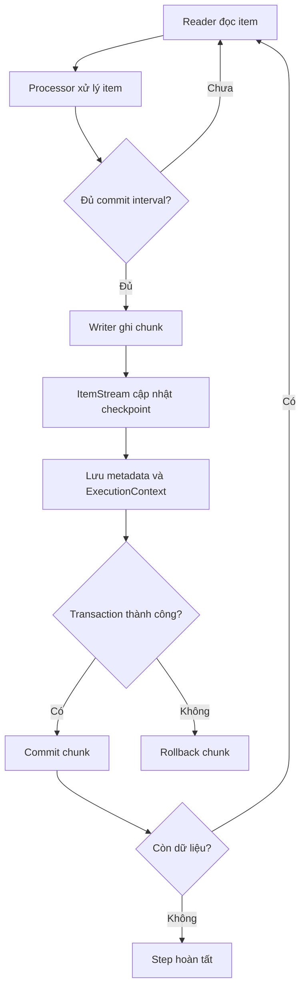

# Kiểm thử commit và rollback

Trong Spring Batch, transaction quyết định thời điểm dữ liệu được xác nhận và phạm vi thay đổi có thể được hoàn tác khi xử lý gặp lỗi. Với chunk-oriented step, mỗi chunk thường chạy trong một transaction: reader đọc item, processor xử lý, writer ghi dữ liệu, Spring Batch cập nhật checkpoint rồi transaction commit. Nếu một lỗi làm transaction rollback trước khi commit, những thay đổi thuộc transaction đó phải được hoàn tác.

Kiểm thử commit và rollback cần chứng minh hành vi này bằng dữ liệu thực tế. Một job kết thúc với `COMPLETED` chưa đủ để chứng minh transaction đúng; tương tự, một job `FAILED` không có nghĩa mọi dữ liệu đã ghi trước đó đều được rollback. Cần kiểm tra ranh giới chunk, dữ liệu trong database, metadata của step và cách job restart sau lỗi.

## 1. Cần kiểm thử điều gì?

Một bộ kiểm thử transaction cho batch job thường cần trả lời các câu hỏi:

- Khi chunk hoàn tất, dữ liệu được writer ghi có được commit và nhìn thấy từ transaction khác không?
- Nếu reader, processor hoặc writer ném exception trước commit, thay đổi của chunk đó có rollback không?
- Những chunk đã commit trước đó có còn tồn tại khi chunk sau thất bại không?
- `StepExecution` có ghi nhận trạng thái và số lần rollback phù hợp không?
- Khi restart, reader có khôi phục checkpoint đã commit gần nhất và xử lý lại phần chưa commit không?
- Writer có tạo dữ liệu trùng hoặc side effect lặp khi chunk được chạy lại không?
- Các resource ngoài transaction database, như file, HTTP API hoặc message broker, có được phục hồi theo thiết kế không?

Các câu hỏi này giúp phân biệt ba khái niệm thường bị nhầm lẫn:

| Khái niệm | Ý nghĩa |
|---|---|
| Commit | Xác nhận thay đổi trong transaction; các transaction khác có thể nhìn thấy dữ liệu theo isolation level |
| Rollback | Hủy thay đổi chưa commit trong transaction hiện tại |
| Restart | Tạo execution mới cho cùng job instance đã thất bại/dừng và tiếp tục theo metadata, checkpoint và chính sách restart |

Restart không phải rollback toàn bộ job. Các chunk đã commit trước khi job thất bại thường vẫn được giữ lại.

## 2. Ranh giới transaction trong chunk-oriented step

Một chunk-oriented step thường có chu trình như sau:



Ví dụ step có `chunk(100, transactionManager)` sẽ gom tối đa 100 item cho một chunk trước khi ghi và commit. Khi writer thành công và transaction commit, dữ liệu của chunk cùng checkpoint liên quan được xác nhận theo cấu hình transaction/repository.

Nếu writer ném exception trước commit, Spring Batch rollback transaction hiện tại. Các thay đổi database được thực hiện trong cùng transaction sẽ bị hoàn tác. Reader có thể đã đọc qua các item trong bộ nhớ, nhưng checkpoint bền vững vẫn là checkpoint gần nhất đã commit. Khi restart, reader có khả năng lưu trạng thái có thể đọc lại phần dữ liệu của chunk chưa commit.

Với tasklet step, transaction thường được tạo cho mỗi lần gọi `Tasklet.execute()`. Nếu tasklet trả `CONTINUABLE`, framework có thể gọi lại trong một transaction khác. Vì vậy, khi kiểm thử tasklet, hãy xác định chính xác mỗi lần gọi là một đơn vị transaction.

## 3. Dùng database thật trong kiểm thử transaction

Mock `ItemWriter`, `JdbcTemplate` hoặc repository có thể xác nhận phương thức được gọi, nhưng không chứng minh database thực sự rollback. Để kiểm tra commit/rollback, nên dùng một database test có transaction manager và hành vi constraint tương ứng với môi trường triển khai.

Các lựa chọn thường gặp:

- Dùng cùng loại database với production trong môi trường test riêng.
- Dùng Testcontainers để khởi chạy database cô lập theo phiên bản cần kiểm tra.
- Dùng database in-memory khi cú pháp SQL và hành vi transaction cần kiểm thử tương thích với nó.

Nếu production dùng PostgreSQL với `ON CONFLICT`, isolation level hoặc kiểu dữ liệu riêng, một database in-memory khác có thể không tái hiện đầy đủ hành vi. Khi đó, nên dùng PostgreSQL trong test integration.

Ví dụ bảng test đơn giản:

```sql
CREATE TABLE imported_row (
    row_id       BIGINT PRIMARY KEY,
    row_value    VARCHAR(100) NOT NULL
);
```

Test nên chuẩn bị dữ liệu đầu vào, xóa dữ liệu test trước khi chạy và xác nhận kết quả bằng truy vấn độc lập sau khi job kết thúc. Không chỉ kiểm tra số lần gọi writer; hãy đọc bảng để chứng minh transaction đã commit hoặc rollback đúng.

## 4. Kiểm thử commit khi job thành công

Trường hợp cơ bản nhất là khởi chạy một job thành công rồi xác nhận dữ liệu do writer ghi vẫn tồn tại sau khi execution kết thúc.

Ví dụ step:

```java
@Bean
Step importRowsStep(
        JobRepository jobRepository,
        PlatformTransactionManager transactionManager,
        ItemReader<ImportRow> reader,
        ItemWriter<ImportRow> writer) {

    return new StepBuilder("importRowsStep", jobRepository)
            .<ImportRow, ImportRow>chunk(2, transactionManager)
            .reader(reader)
            .writer(writer)
            .build();
}
```

Với chunk size 2 và 5 item đầu vào, step thông thường tạo các chunk có kích thước 2, 2 và 1 item. Sau khi job hoàn tất, có thể kiểm tra:

```java
assertEquals(BatchStatus.COMPLETED, execution.getStatus());
assertEquals(5, jdbcTemplate.queryForObject(
        "select count(*) from imported_row", Integer.class));
```

Ngoài số dòng, nên kiểm tra khóa và giá trị cụ thể để xác nhận writer ghi đúng nội dung. Nếu bảng đã có dữ liệu từ test khác, hãy lọc theo `batch_id` hoặc xóa dữ liệu test trước khi đếm.

Có thể đọc `StepExecution` để xem các số liệu vận hành:

```java
StepExecution stepExecution = execution.getStepExecutions()
        .stream()
        .filter(step -> step.getStepName().equals("importRowsStep"))
        .findFirst()
        .orElseThrow();

assertEquals(5, stepExecution.getReadCount());
assertEquals(5, stepExecution.getWriteCount());
assertTrue(stepExecution.getCommitCount() > 0);
```

Các bộ đếm giúp giải thích quá trình xử lý, nhưng dữ liệu trong database mới chứng minh kết quả ghi. Nếu processor filter item hoặc step skip item, `readCount` và `writeCount` có thể khác nhau theo đúng thiết kế.

## 5. Kiểm thử rollback khi writer thất bại

Một cách kiểm tra rollback trực tiếp là tạo writer ghi một số dòng trong chunk rồi ném exception. Nếu các câu lệnh ghi tham gia cùng transaction của step, toàn bộ thay đổi của chunk đó phải rollback.

Ví dụ writer dùng `JdbcTemplate`:

```java
@Bean
ItemWriter<ImportRow> failingWriter(
        JdbcTemplate jdbcTemplate,
        FailureSwitch failureSwitch) {

    return chunk -> {
        for (ImportRow row : chunk.getItems()) {
            jdbcTemplate.update(
                    "insert into imported_row(row_id, row_value) values (?, ?)",
                    row.id(), row.value());
        }

        if (failureSwitch.shouldFail(chunk.getItems())) {
            throw new IllegalStateException("Simulated writer failure");
        }
    };
}
```

`FailureSwitch` là một thành phần test có thể bật/tắt lỗi. Trong test, cấu hình nó làm writer thất bại ở chunk chứa một ID xác định. Writer đã thực hiện câu lệnh insert trước khi ném lỗi; transaction của chunk phải rollback tất cả các insert đó.

Các assertion cần có:

- Job hoặc step có trạng thái `FAILED` nếu exception không được retry/skip.
- Các dòng thuộc chunk lỗi không tồn tại trong database.
- Nếu chunk trước đó đã commit, các dòng của chunk trước vẫn tồn tại.
- `rollbackCount` của step phản ánh việc rollback đã xảy ra (nên kiểm tra điều kiện phù hợp thay vì phụ thuộc cứng vào số lần nếu có retry).

Không nên dùng một writer mock chỉ ném exception mà không thực hiện câu lệnh ghi. Cách đó kiểm tra luồng lỗi nhưng không chứng minh thay đổi database đã được rollback.

## 6. Ví dụ kiểm thử chunk trước commit và chunk bị rollback

Giả sử input có 5 item với ID 1 đến 5, commit interval là 2. Writer được cấu hình ghi các item rồi thất bại ở chunk chứa ID 3 và 4.

Lần chạy đầu dự kiến:

| Chunk | Item | Kết quả |
|---|---|---|
| 1 | 1, 2 | Commit thành công |
| 2 | 3, 4 | Writer ghi rồi ném exception; rollback |
| 3 | 5 | Không được thực thi do step đã thất bại |

Sau lần chạy đầu, database chỉ nên chứa ID 1 và 2. Điều này chứng minh chunk đầu đã commit và chunk thứ hai đã rollback.

Ví dụ cấu trúc test với `JobLauncherTestUtils`:

```java
@SpringBatchTest
@SpringJUnitConfig(BatchTestConfiguration.class)
class ChunkTransactionTest {

    @Autowired
    private JobLauncherTestUtils jobLauncherTestUtils;

    @Autowired
    private JdbcTemplate jdbcTemplate;

    @Autowired
    private FailureSwitch failureSwitch;

    @Test
    void commitsPreviousChunkAndRollsBackFailingChunk() throws Exception {
        failureSwitch.failChunkContaining(3L);

        JobParameters parameters = new JobParametersBuilder()
                .addString("batchId", "TX-TEST-001")
                .toJobParameters();

        JobExecution execution =
                jobLauncherTestUtils.launchJob(parameters);

        assertEquals(BatchStatus.FAILED, execution.getStatus());

        List<Long> ids = jdbcTemplate.queryForList(
                "select row_id from imported_row order by row_id",
                Long.class);

        assertEquals(List.of(1L, 2L), ids);
    }
}
```

Đây là khung test; `BatchTestConfiguration` cần cung cấp job, reader có khả năng restart, writer và `FailureSwitch`. Reader nên là reader có state, chẳng hạn `FlatFileItemReader` hoặc JDBC paging reader được cấu hình phù hợp. Một reader chỉ giữ index trong bộ nhớ như `ListItemReader` không đủ để chứng minh restart từ checkpoint sau khi tạo execution mới.

Test không nên được bọc trong một transaction test bên ngoài nếu mục tiêu là quan sát các commit của job. Nếu test method có `@Transactional`, transaction của test có thể ảnh hưởng đến cách quan sát dữ liệu hoặc khiến thay đổi chỉ được rollback khi test kết thúc. Nên dùng database test riêng, dọn dữ liệu rõ ràng và để transaction của step thực hiện commit/rollback thực tế.

## 7. Kiểm thử restart sau rollback

Sau khi xác nhận chunk lỗi đã rollback, có thể kiểm tra restart của cùng `JobInstance`:

1. Lần chạy đầu thất bại ở chunk thứ hai; chunk đầu đã commit.
2. Tắt `FailureSwitch` để writer không còn cố tình ném lỗi.
3. Gọi lại cùng job với đúng identifying `JobParameters`.
4. Spring Batch tạo `JobExecution` mới cho cùng `JobInstance` và restart step theo metadata đã lưu.
5. Reader khôi phục checkpoint sau chunk đầu; các item của chunk chưa commit được đọc lại.
6. Sau khi job hoàn tất, database chứa đủ 5 item, không có bản ghi trùng.

Phần tiếp theo của test có thể viết:

```java
failureSwitch.disable();

JobExecution restarted =
        jobLauncherTestUtils.launchJob(parameters);

assertEquals(BatchStatus.COMPLETED, restarted.getStatus());

Integer count = jdbcTemplate.queryForObject(
        "select count(*) from imported_row", Integer.class);
assertEquals(5, count);
```

Để test này có ý nghĩa, cần bảo đảm:

- Cùng tên job và cùng identifying parameters được dùng cho lần restart.
- JobRepository lưu metadata bền vững giữa hai lần `launchJob()`.
- Reader hỗ trợ `ItemStream` và khôi phục vị trí từ execution context.
- Nguồn dữ liệu và thứ tự đọc không thay đổi giữa hai lần chạy.
- Writer sử dụng transaction manager phù hợp và không tạo side effect ngoài transaction không được bảo vệ.

Nếu lần chạy đầu thất bại sau khi chunk đầu commit, dữ liệu của chunk đầu không nên bị ghi lại ngoài ý muốn. Unique key hoặc writer idempotent vẫn cần thiết nếu kiến trúc có thể nhận cùng item từ nhiều nguồn hoặc nhiều lần khởi chạy.

## 8. Kiểm thử transaction trong tasklet

Với tasklet thực hiện một thao tác database, có thể kiểm tra cả trường hợp commit và rollback trong một lần gọi `execute()`.

Ví dụ tasklet:

```java
@Bean
Tasklet updateBatchStatus(JdbcTemplate jdbcTemplate) {
    return (contribution, chunkContext) -> {
        jdbcTemplate.update(
                "update batch_control set status = ? where batch_id = ?",
                "PROCESSING", "BATCH-001");

        if (shouldFail()) {
            throw new IllegalStateException("Simulated tasklet failure");
        }

        return RepeatStatus.FINISHED;
    };
}
```

Nếu `shouldFail()` trả về true và câu lệnh update tham gia transaction của tasklet, thay đổi status phải rollback. Khi tasklet chạy thành công, thay đổi được commit khi lần gọi `execute()` hoàn tất.

Nếu tasklet trả `CONTINUABLE`, mỗi lần gọi có transaction riêng theo cách thực thi thông thường của `TaskletStep`. Do đó, nếu lượt đầu commit và lượt thứ hai thất bại, thay đổi đã commit ở lượt đầu vẫn còn. Test cần xác nhận đúng ranh giới mỗi lượt, không giả định toàn bộ vòng lặp tasklet là một transaction duy nhất.

## 9. Kiểm thử transaction manager và propagation

Một nguyên nhân phổ biến khiến test rollback thất bại là writer không tham gia transaction mà step quản lý.

Hãy kiểm tra:

- `JdbcTemplate` và `PlatformTransactionManager` của step có dùng cùng `DataSource` phù hợp không.
- JPA writer có dùng `EntityManager`/transaction manager được cấu hình cho step không.
- Writer có gọi một service được đánh dấu `@Transactional(propagation = REQUIRES_NEW)` hay không.
- Có datasource thứ hai hoặc transaction manager khác không.
- Có thao tác tự commit, dùng connection độc lập hoặc chạy async trong writer không.

Nếu một service được gọi từ writer mở transaction `REQUIRES_NEW`, transaction đó có thể commit độc lập. Rollback của transaction chunk bên ngoài không hoàn tác được thay đổi đã commit trong transaction mới. Đây có thể là hành vi có chủ ý, nhưng cần được kiểm thử và tài liệu hóa.

Tương tự, nếu writer gửi HTTP request, publish message trực tiếp hoặc ghi file, các tác động đó không nằm trong transaction JDBC thông thường. Test database rollback không thể chứng minh các side effect này được hoàn tác.

## 10. Kiểm thử với nhiều resource và side effect ngoài database

Một batch writer đôi khi vừa ghi database vừa gọi API hoặc gửi message. Không nên kiểm thử chỉ bằng cách kiểm tra bảng database.

Ví dụ writer gửi request tới dịch vụ thanh toán rồi cập nhật trạng thái database. Nếu API đã xử lý thanh toán nhưng database transaction rollback, lần retry có thể gửi thanh toán lần nữa.

Các cơ chế cần kiểm thử riêng:

- **Idempotency key:** gửi cùng key qua lần retry và xác nhận dịch vụ ngoài trả lại kết quả cũ.
- **Transactional outbox:** thay đổi nghiệp vụ và outbox record cùng commit hoặc rollback.
- **Consumer inbox/deduplication:** cùng event được giao lại nhưng chỉ được áp dụng một lần.
- **Compensation:** nếu nghiệp vụ dùng thao tác bù trừ, xác nhận thao tác bù được kích hoạt đúng khi bước sau thất bại.
- **Reconciliation:** sau timeout không rõ kết quả, hệ thống có thể truy vấn trạng thái giao dịch ngoài và đối chiếu.

Test có thể dùng fake HTTP server hoặc mock broker có khả năng mô phỏng các tình huống: server đã xử lý request nhưng client timeout, message đã publish nhưng publisher chưa đánh dấu hoàn tất, hoặc consumer nhận cùng event hai lần.

## 11. Retry và skip ảnh hưởng đến kiểm thử rollback

Khi step được cấu hình retry, writer có thể được gọi lại sau lỗi. Khi step được cấu hình skip, Spring Batch có thể rollback chunk rồi thực hiện lại các item cần thiết để xác định và bỏ qua item lỗi theo chính sách.

Vì vậy, test rollback cần tách rõ mục tiêu:

- **Kiểm thử rollback thuần:** không cấu hình retry/skip cho exception được mô phỏng; xác nhận chunk thất bại và thay đổi của chunk rollback.
- **Kiểm thử retry:** cấu hình lỗi tạm thời xảy ra một số lần rồi thành công; xác nhận writer được gọi lại và kết quả cuối không trùng.
- **Kiểm thử skip:** cấu hình một exception dữ liệu được skip; xác nhận item đó không được ghi, các item còn lại được ghi và bộ đếm skip phù hợp.
- **Kiểm thử vượt giới hạn:** lỗi vượt retry/skip limit; xác nhận step thất bại và trạng thái dữ liệu theo checkpoint gần nhất.

Không nên dùng cùng một test để khẳng định mọi hành vi. Một test rollback đơn giản nên tránh retry/skip để kết quả dễ diễn giải; các chính sách fault tolerance nên có test riêng.

## 12. Đọc metadata để hỗ trợ kiểm thử

`JobExecution` và `StepExecution` cung cấp metadata hữu ích để giải thích kết quả transaction:

| Trường | Ý nghĩa khi kiểm thử |
|---|---|
| `BatchStatus` | Trạng thái thực thi như `COMPLETED` hoặc `FAILED` |
| `ExitStatus` | Mã kết thúc của job/step, có thể có giá trị tùy chỉnh |
| `readCount` | Số item đã được reader đọc theo metadata step |
| `writeCount` | Số item writer đã ghi theo metadata step |
| `commitCount` | Số lần commit được ghi nhận cho step |
| `rollbackCount` | Số lần rollback được ghi nhận cho step |
| `filterCount` | Số item bị processor filter |
| `readSkipCount`, `processSkipCount`, `writeSkipCount` | Số item bị skip theo giai đoạn |

Các trường này giúp xác nhận framework đã đi qua nhánh xử lý dự kiến. Tuy nhiên, chúng không thay thế assertion trên database hoặc hệ thống ngoài. Ví dụ, `writeCount` không chứng minh một HTTP API đã xử lý thành công và cũng không chứng minh một bản ghi nghiệp vụ không bị ghi trùng.

## 13. Những lỗi thường gặp trong test commit/rollback

**Chỉ mock writer rồi kiểm tra exception.** Test chứng minh exception được truyền, nhưng không chứng minh transaction database rollback. Hãy dùng database thật trong integration test.

**Đặt `@Transactional` trên test method mà không hiểu tác động.** Transaction ngoài có thể làm thay đổi cách nhìn thấy dữ liệu và thời điểm rollback. Để kiểm tra commit thực tế của batch, thường nên để step quản lý transaction và dọn dữ liệu test riêng.

**Dùng reader không lưu trạng thái trong test restart.** Reader có thể đọc lại từ đầu, làm test restart sai mục tiêu. Dùng reader `ItemStream` có checkpoint.

**Chỉ kiểm tra job status.** `FAILED` không chứng minh chunk lỗi đã rollback; `COMPLETED` không chứng minh dữ liệu đúng. Kiểm tra nội dung database.

**Không kiểm tra chunk đã commit trước đó.** Rollback chỉ áp dụng cho transaction hiện tại. Test nên xác nhận dữ liệu của chunk trước vẫn tồn tại.

**Dùng transaction manager khác cho writer.** Writer có thể commit độc lập và không rollback cùng chunk. Kiểm tra datasource, transaction manager và propagation.

**Giả định HTTP/API/file rollback cùng database.** Side effect ngoài transaction cần test và cơ chế phục hồi riêng.

**Retry trong test rollback cơ bản.** Retry làm số lần writer và rollback thay đổi, khiến assertion khó diễn giải. Tách test rollback, retry và skip.

## 14. Tổ chức bộ test integration

Một bộ test có thể chia theo lớp:

1. **Writer test:** xác nhận câu lệnh ghi, unique constraint, upsert và hành vi khi dữ liệu không hợp lệ.
2. **Transaction test:** gọi writer trong transaction test hoặc step test và xác nhận commit/rollback bằng truy vấn database.
3. **Step test:** khởi chạy một step thật để kiểm tra reader, processor, writer, checkpoint và transaction manager phối hợp.
4. **Job restart test:** làm một step thất bại sau một số chunk đã commit, sau đó restart cùng `JobParameters`.
5. **External integration test:** mô phỏng timeout hoặc redelivery cho API/message và xác nhận idempotency/outbox.

Với Spring Batch, `@SpringBatchTest` cung cấp các tiện ích như `JobLauncherTestUtils` và `JobRepositoryTestUtils` trong module test tương ứng. Cấu hình test cần xác định job được khởi chạy, `JobRepository`, transaction manager, datasource và dữ liệu fixture. Nếu có nhiều job trong context, hãy cấu hình rõ job mục tiêu cho `JobLauncherTestUtils`.

Test integration nên chạy trên schema metadata và schema nghiệp vụ được tạo riêng. Có thể dùng migration/schema script của ứng dụng để tạo bảng, sau đó xóa hoặc rollback dữ liệu fixture theo cách không làm mất metadata cần cho restart test. Với restart test, không xóa `JobRepository` metadata giữa hai lần chạy.

## Kết luận

Kiểm thử commit và rollback trong Spring Batch cần xác nhận transaction ở đúng ranh giới xử lý. Với chunk-oriented step, chunk đã commit phải giữ dữ liệu; chunk thất bại trước commit phải rollback các thay đổi thuộc cùng transaction. Khi restart, reader khôi phục checkpoint gần nhất và phần chưa commit có thể được xử lý lại. Với tasklet, cần kiểm tra transaction theo từng lần gọi `execute()`.

Hãy dùng database test thật, fault injection trong writer/tasklet, kiểm tra dữ liệu sau mỗi lần chạy và đọc metadata `StepExecution` để giải thích kết quả. Đặc biệt, xác nhận writer dùng đúng transaction manager và tách riêng side effect ngoài database. Khi kiểm thử commit, rollback, retry, skip và restart thành các tình huống rõ ràng, nhóm phát triển có thể tin cậy hơn rằng batch job phục hồi sau lỗi mà vẫn giữ dữ liệu nhất quán.
