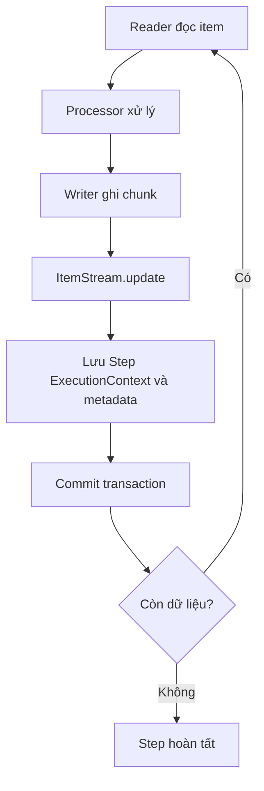
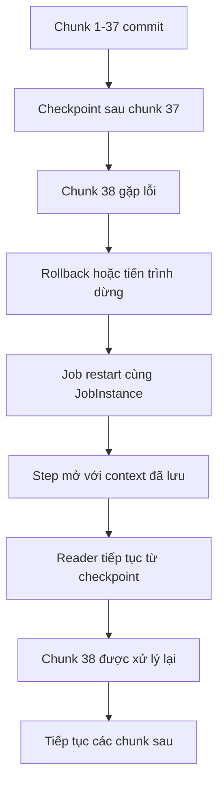

# ExecutionContext lưu trạng thái restart

Trong Spring Batch, `ExecutionContext` là vùng lưu trữ key-value dùng để giữ trạng thái cần thiết cho việc tiếp tục một job hoặc step sau khi bị gián đoạn. Reader có thể lưu vị trí đã đọc, tasklet có thể lưu phân đoạn tiếp theo cần xử lý, và một step có thể lưu một số giá trị nhỏ để step khác sử dụng.

Khi job cần restart, Spring Batch khôi phục execution context đã được lưu trong `JobRepository`. Nhờ đó, thành phần xử lý có thể biết trạng thái tại checkpoint gần nhất và tiếp tục từ vị trí phù hợp. `ExecutionContext` là một phần của cơ chế restart; nó không tự làm cho mọi thao tác trở nên idempotent và cũng không phải kho dữ liệu nghiệp vụ.

Spring Batch có hai execution context với phạm vi khác nhau:

- **Step ExecutionContext:** thuộc về một `StepExecution`, thường lưu checkpoint và trạng thái nội bộ của step.
- **Job ExecutionContext:** thuộc về một `JobExecution`, dùng cho dữ liệu nhỏ cần chia sẻ giữa các step trong cùng lần thực thi job.

Hiểu đúng phạm vi, thời điểm lưu và cách khôi phục hai context này giúp thiết kế reader, tasklet và flow có thể restart an toàn.

## 1. ExecutionContext là gì?

`ExecutionContext` là một cấu trúc key-value được Spring Batch quản lý. Thành phần xử lý có thể ghi giá trị vào context và đọc lại giá trị đó ở lần thực thi sau.

Ví dụ:

```java
ExecutionContext context = stepExecution.getExecutionContext();

context.putLong("orders.lastProcessedId", 8450L);
context.putString("input.fileName", "orders-2026-11-14.csv");

long lastProcessedId = context.getLong("orders.lastProcessedId", 0L);
String fileName = context.getString("input.fileName");
```

Trong ví dụ, context lưu khóa cuối cùng đã xử lý và tên file đầu vào. Khi step được restart, thành phần xử lý có thể đọc các giá trị đã lưu để khôi phục trạng thái.

Các đặc điểm quan trọng:

- Context được gắn với một execution cụ thể, không phải một map toàn cục của ứng dụng.
- Spring Batch lưu context thông qua `JobRepository` để có thể khôi phục sau khi tiến trình dừng.
- Giá trị được lưu theo checkpoint hoặc thời điểm cập nhật metadata tương ứng với phạm vi context.
- Các giá trị cần tương thích với cơ chế serialize được cấu hình cho repository.
- Context nên nhỏ gọn và chỉ chứa thông tin cần thiết để khôi phục hoặc điều phối xử lý.

`put()` và `remove()` thay đổi context đang được quản lý. Việc gọi `put()` không có nghĩa dữ liệu đã lập tức được ghi xuống database; Spring Batch lưu context trong vòng đời thực thi của job/step và theo ranh giới transaction tương ứng.

## 2. Hai phạm vi: Step ExecutionContext và Job ExecutionContext

Spring Batch duy trì hai context riêng:

| Tiêu chí | Step ExecutionContext | Job ExecutionContext |
|---|---|---|
| Lấy từ | `stepExecution.getExecutionContext()` | `jobExecution.getExecutionContext()` |
| Phạm vi | Một `StepExecution` | Một `JobExecution` |
| Mục đích chính | Checkpoint và trạng thái nội bộ của step | Chia sẻ một số giá trị giữa các step trong cùng job execution |
| Ví dụ | Offset file, trang tiếp theo, khóa cuối reader đã xác nhận | Đường dẫn artifact do step trước tạo, mã tham chiếu kết quả tổng hợp |
| Thời điểm lưu | Thường tại các điểm commit/checkpoint của step | Thường được cập nhật khi step hoàn tất hoặc qua cơ chế quản lý job context |

Step ExecutionContext phù hợp với trạng thái mà chỉ step hiện tại cần biết. Ví dụ, `importOrdersStep` lưu vị trí file hoặc khóa cuối cùng đã xử lý để reader tiếp tục đúng vị trí.

Job ExecutionContext phù hợp với một giá trị cần chuyển từ step này sang step khác. Ví dụ, `validateInputStep` xác định đường dẫn file đã được xác minh; `importOrdersStep` cần sử dụng đường dẫn đó. Giá trị có thể được promotion từ Step ExecutionContext lên Job ExecutionContext khi step đầu hoàn tất.

Không nên dùng Job ExecutionContext làm nơi chứa mọi trạng thái của tất cả step. Nếu một giá trị chỉ phục vụ checkpoint của reader, giữ nó trong Step ExecutionContext để tránh các step ghi đè hoặc phụ thuộc vào trạng thái không thuộc trách nhiệm của mình.

## 3. ExecutionContext được lưu ở đâu?

Với JDBC `JobRepository`, Spring Batch lưu metadata trong các bảng repository. Hai bảng thường gặp là:

| Bảng | Nội dung |
|---|---|
| `BATCH_STEP_EXECUTION_CONTEXT` | ExecutionContext của từng step execution |
| `BATCH_JOB_EXECUTION_CONTEXT` | ExecutionContext của từng job execution |

Các bảng này thuộc schema metadata do Spring Batch quản lý. Tên bảng và schema có thể thay đổi theo cấu hình prefix hoặc phiên bản. Ứng dụng nên dùng API `ExecutionContext`, `JobRepository`, `JobExplorer` và các thành phần Spring Batch thay vì tự ghi hoặc sửa trực tiếp dữ liệu trong các bảng `BATCH_*`.

`JobRepository` còn lưu `JobInstance`, `JobExecution`, `StepExecution`, tham số và các bộ đếm. Execution context được lưu cùng hệ thống metadata để Spring Batch có thể kết nối trạng thái restart với đúng lần thực thi.

Nếu ứng dụng dùng repository chỉ lưu trong bộ nhớ, context có thể mất khi JVM dừng. Với job cần restart sau khi ứng dụng khởi động lại, cần repository bền vững, thường là JDBC repository với schema metadata được cấu hình đúng.

## 4. ExecutionContext được lưu vào thời điểm nào?

Thời điểm lưu phụ thuộc vào phạm vi context và loại step.

### 4.1. Step ExecutionContext trong chunk step

Trong chunk-oriented processing, Spring Batch thường cập nhật Step ExecutionContext tại ranh giới checkpoint của chunk. Reader và writer triển khai `ItemStream` có thể ghi trạng thái nội bộ vào context thông qua `update(ExecutionContext)`.

Chu trình khái quát:



Khi chunk commit thành công, checkpoint tương ứng trở thành trạng thái bền vững. Nếu chunk rollback trước khi commit, checkpoint mới không được xác nhận trong transaction đó; lần restart sẽ dựa trên checkpoint đã commit gần nhất.

Không phải mọi reader đều tự lưu trạng thái. Reader cần hỗ trợ `ItemStream` và được đăng ký với step; một số reader còn có tùy chọn `saveState`. Nếu tắt lưu trạng thái hoặc dùng reader không có khả năng khôi phục, việc lưu context tùy chỉnh ở nơi khác không tự làm reader tiếp tục đúng vị trí.

### 4.2. Job ExecutionContext

Job ExecutionContext thường được cập nhật khi step hoàn tất, hoặc khi ứng dụng sử dụng các API phù hợp để quản lý job context. Một step có thể promotion các khóa được chọn từ Step ExecutionContext lên Job ExecutionContext. Step tiếp theo sau đó đọc các giá trị đã được chia sẻ.

Điều này có nghĩa Job ExecutionContext không phải nơi thay thế checkpoint theo từng chunk. Nếu cần lưu vị trí reader sau mỗi chunk, dùng Step ExecutionContext để trạng thái được lưu theo nhịp thực thi của step.

## 5. ExecutionContext hỗ trợ restart như thế nào?

Giả sử job nhập file có một step đọc 10.000 dòng, commit interval là 100. Sau khi 37 chunk đã commit, tiến trình bị dừng trong lúc xử lý chunk tiếp theo.

Trạng thái có thể được mô tả như sau:

| Giai đoạn | Trạng thái |
|---|---|
| Chunk 1 đến 37 | Đã commit; dữ liệu nghiệp vụ và checkpoint đã lưu |
| Chunk 38 | Chưa commit; có thể đã đọc/xử lý một phần nhưng transaction chưa xác nhận |
| Sau khi tiến trình dừng | Repository giữ checkpoint gần nhất sau chunk 37 |
| Khi restart | Reader mở lại với context đã lưu và tiếp tục từ vị trí phù hợp |

Sơ đồ:



Các chunk đã commit trước đó không tự động bị rollback khi job thất bại. ExecutionContext giúp khôi phục tiến độ của step, còn dữ liệu nghiệp vụ đã commit vẫn tồn tại theo transaction của nó.

Để restart hoạt động đúng, cần có các điều kiện:

- `JobRepository` lưu metadata bền vững.
- Reader/writer hoặc tasklet có khả năng lưu và khôi phục trạng thái cần thiết.
- Cùng `JobInstance` được restart với đúng identifying `JobParameters`.
- Dữ liệu nguồn và thứ tự đọc vẫn tương thích với checkpoint đã lưu.
- Writer an toàn khi phần công việc chưa commit được thực hiện lại.

## 6. JobParameters khác ExecutionContext như thế nào?

`JobParameters` và `ExecutionContext` đều có thể chứa giá trị được lưu trong metadata, nhưng vai trò khác nhau.

| Thành phần | Vai trò | Ví dụ |
|---|---|---|
| `JobParameters` | Đầu vào xác định phạm vi hoặc danh tính của lần xử lý nghiệp vụ | `businessDate`, `inputFile`, `batchId` |
| Step ExecutionContext | Trạng thái nội bộ cần khôi phục của một step | `reader.currentLine`, `orders.lastId` |
| Job ExecutionContext | Giá trị nhỏ cần chia sẻ giữa các step trong một lần thực thi | `validatedFilePath`, `summaryReference` |

`JobParameters` nên được xem là đầu vào của job. Ví dụ, `businessDate=2026-11-14` xác định ngày nghiệp vụ cần xử lý. Khi restart cùng lần xử lý đó, cần giữ nguyên identifying parameters để Spring Batch nhận diện cùng `JobInstance`.

ExecutionContext lưu tiến độ được tạo ra trong quá trình thực thi. Ví dụ, job bắt đầu với `businessDate=2026-11-14`, sau đó Step ExecutionContext lưu rằng reader đã xác nhận đến khóa `8450`. Ngày nghiệp vụ là đầu vào; khóa cuối là trạng thái tiến độ.

Không nên thêm timestamp ngẫu nhiên vào identifying `JobParameters` mỗi lần restart. Một bộ tham số định danh mới có thể tạo `JobInstance` mới, khiến ứng dụng khởi chạy một batch khác thay vì tiếp tục batch đang dang dở.

## 7. Ví dụ reader chuẩn lưu trạng thái restart

Các reader chuẩn của Spring Batch thường triển khai `ItemStream` và tự quản lý checkpoint. Ví dụ `FlatFileItemReader`:

```java
@Bean
@StepScope
FlatFileItemReader<OrderInput> orderReader(
        @Value("#{jobParameters['inputFile']}") Resource inputFile) {

    return new FlatFileItemReaderBuilder<OrderInput>()
            .name("orderReader")
            .resource(inputFile)
            .delimited()
            .names("orderId", "customerId", "amount")
            .targetType(OrderInput.class)
            .saveState(true)
            .build();
}
```

Reader có tên ổn định và lưu trạng thái. Spring Batch gọi lifecycle `open()`, `update()` và `close()` để reader có thể khôi phục vị trí đọc tại lần restart. Với reader chuẩn, thường không cần tự ghi số dòng vào context.

Nguồn file cần ổn định trong suốt thời gian job có thể restart. Nếu file bị thay thế hoặc nội dung thay đổi giữa hai lần chạy, vị trí dòng đã lưu có thể trỏ đến dữ liệu khác. Có thể lưu checksum, kích thước hoặc định danh file để xác minh rằng nguồn vẫn đúng batch.

## 8. Ví dụ reader tùy chỉnh sử dụng Step ExecutionContext

Nếu cần reader tùy chỉnh, có thể triển khai `ItemStreamReader` và lưu trạng thái cần khôi phục. Ví dụ dưới đây minh họa cách lưu khóa cuối cùng:

```java
public class OrderCursorReader implements ItemStreamReader<OrderInput> {

    private static final String LAST_ID_KEY = "orderCursorReader.lastId";

    private final OrderDao orderDao;
    private long lastId;

    public OrderCursorReader(OrderDao orderDao) {
        this.orderDao = orderDao;
    }

    @Override
    public void open(ExecutionContext context) {
        lastId = context.getLong(LAST_ID_KEY, 0L);
    }

    @Override
    public OrderInput read() {
        return orderDao.findNextAfter(lastId);
    }

    @Override
    public void update(ExecutionContext context) {
        context.putLong(LAST_ID_KEY, lastId);
    }

    @Override
    public void close() {
        // Giải phóng cursor hoặc tài nguyên nếu reader có giữ tài nguyên mở.
    }
}
```

Đây là khung minh họa về lifecycle. Trong triển khai hoàn chỉnh, reader phải cập nhật `lastId` khi trả item, đồng thời xử lý rollback/retry để giá trị được ghi trong `update()` phản ánh đúng tiến độ đã xác nhận tại checkpoint. Truy vấn DAO cần có thứ tự ổn định, ví dụ `WHERE id > :lastId ORDER BY id`, và phạm vi nguồn nên được xác định rõ.

Nếu chunk rollback, reader có thể đã tiến con trỏ trong bộ nhớ qua các item chưa commit. Cần bảo đảm reader có thể phát lại các item của chunk đó khi retry hoặc restart. Vì vậy, nên ưu tiên reader chuẩn đã triển khai checkpoint nếu phù hợp với nguồn dữ liệu.

## 9. Ví dụ tasklet lưu trạng thái tiến độ

Tasklet có thể dùng Step ExecutionContext để lưu tiến độ khi thực hiện một công việc thành nhiều lượt. Ví dụ, xử lý các partition theo thứ tự:

```java
@Bean
Step processPartitionsStep(
        JobRepository jobRepository,
        PlatformTransactionManager transactionManager,
        PartitionService partitionService) {

    Tasklet tasklet = (contribution, chunkContext) -> {
        ExecutionContext context =
                contribution.getStepExecution().getExecutionContext();

        int nextPartition = context.getInt("nextPartition", 0);
        if (nextPartition >= partitionService.partitionCount()) {
            return RepeatStatus.FINISHED;
        }

        partitionService.process(nextPartition);
        context.putInt("nextPartition", nextPartition + 1);

        return nextPartition + 1 >= partitionService.partitionCount()
                ? RepeatStatus.FINISHED
                : RepeatStatus.CONTINUABLE;
    };

    return new StepBuilder("processPartitionsStep", jobRepository)
            .tasklet(tasklet, transactionManager)
            .build();
}
```

Mỗi lần gọi `execute()` xử lý một partition rồi cập nhật khóa `nextPartition`. Khi tasklet trả `CONTINUABLE`, framework có thể gọi lượt tiếp theo. Nếu tiến trình dừng sau một lượt đã commit, lần restart có thể đọc checkpoint và tiếp tục từ partition tiếp theo.

Ví dụ chỉ phù hợp khi số lượng và thứ tự partition ổn định trong suốt lần chạy. `partitionService.process()` cần tham gia transaction phù hợp hoặc có tính idempotent. Nếu nó gọi API hoặc tạo side effect bên ngoài, context không thể tự hoàn tác side effect đó.

## 10. Chia sẻ dữ liệu giữa step bằng Job ExecutionContext

Giả sử `validateInputStep` xác minh file và ghi đường dẫn chuẩn hóa vào Step ExecutionContext. Step `importOrdersStep` cần đọc đường dẫn đó. Có thể dùng `ExecutionContextPromotionListener` để promotion khóa từ step context lên job context khi step đầu hoàn tất.

Khai báo listener:

```java
@Bean
ExecutionContextPromotionListener promoteValidatedFile() {
    ExecutionContextPromotionListener listener =
            new ExecutionContextPromotionListener();
    listener.setKeys(new String[] {"validatedInputFile"});
    return listener;
}
```

Ghi giá trị trong step đầu và đăng ký listener:

```java
@Bean
Step validateInputStep(
        JobRepository jobRepository,
        PlatformTransactionManager transactionManager,
        ExecutionContextPromotionListener promoteValidatedFile) {

    return new StepBuilder("validateInputStep", jobRepository)
            .tasklet((contribution, chunkContext) -> {
                String path = validateAndResolveInputFile();

                contribution.getStepExecution()
                        .getExecutionContext()
                        .putString("validatedInputFile", path);

                return RepeatStatus.FINISHED;
            }, transactionManager)
            .listener(promoteValidatedFile)
            .build();
}
```

Step tiếp theo có thể truy cập Job ExecutionContext qua `@StepScope`:

```java
@Bean
@StepScope
FlatFileItemReader<OrderInput> orderReader(
        @Value("#{jobExecutionContext['validatedInputFile']}") String filePath) {

    return new FlatFileItemReaderBuilder<OrderInput>()
            .name("orderReader")
            .resource(new FileSystemResource(filePath))
            .delimited()
            .names("orderId", "customerId", "amount")
            .targetType(OrderInput.class)
            .build();
}
```

`@StepScope` giúp bean được tạo trong phạm vi step, khi các giá trị runtime của job/step đã sẵn sàng. Nếu dữ liệu là tham số đầu vào ban đầu, có thể đọc trực tiếp từ `jobParameters`; không cần promotion một giá trị vốn đã là input của job.

## 11. Điều kiện để context có thể được khôi phục

Lưu một giá trị vào context chưa đủ để bảo đảm restart. Cần các điều kiện sau:

### Repository bền vững

`JobRepository` phải lưu metadata và context vào nơi có thể tồn tại qua lần dừng JVM. Với JDBC repository, cần khởi tạo schema metadata phù hợp và bảo vệ dữ liệu repository như dữ liệu hạ tầng quan trọng.

### Giá trị có thể serialize

Các giá trị trong context phải tương thích với serializer được cấu hình. Kiểu đơn giản như chuỗi, số, boolean và các kiểu được serializer hỗ trợ thường phù hợp. Nếu lưu object tùy chỉnh, cần bảo đảm object có thể serialize và tương thích khi ứng dụng được nâng cấp.

### Tên khóa ổn định

Dùng tên khóa có namespace như `orders.lastProcessedId` hoặc `file.currentLine`. Tránh khóa quá chung như `index` dễ xung đột với stream khác. Khi đổi tên khóa, cần xem xét các execution cũ còn phải restart.

### Nguồn dữ liệu ổn định

Nếu context lưu số dòng hoặc offset, file nguồn phải không bị thay đổi theo cách làm lệch vị trí. Nếu lưu khóa cuối, truy vấn cần thứ tự ổn định và có điều kiện phạm vi phù hợp. Với dữ liệu thay đổi liên tục, cần xác định snapshot, watermark hoặc phạm vi nghiệp vụ trước khi chạy.

### JobParameters giống nhau khi restart

Restart phải tiếp tục cùng `JobInstance`. Tên job và identifying parameters cần khớp với lần chạy ban đầu. Thay đổi tham số định danh có thể tạo instance mới, không sử dụng checkpoint cũ.

### Thành phần xử lý hỗ trợ restart

Reader hoặc tasklet phải thực sự đọc và sử dụng context. Một reader stateless không tự biết phải bắt đầu từ đâu chỉ vì một khóa được lưu ở context. Cần triển khai `ItemStream` hoặc cơ chế khôi phục phù hợp.

## 12. Những gì không nên lưu trong ExecutionContext

ExecutionContext được serialize và lưu trong metadata repository, vì vậy không nên dùng nó như bộ nhớ cache hoặc kho dữ liệu lớn.

Tránh lưu:

- Toàn bộ danh sách hàng nghìn/hàng triệu item.
- Object lớn hoặc payload file đầy đủ.
- `Connection`, `EntityManager`, `InputStream`, `ResultSet`, thread hoặc bean Spring đang chạy.
- Mật khẩu, access token, secret hoặc thông tin xác thực.
- Dữ liệu nghiệp vụ cần truy vấn, audit và lưu giữ lâu dài như hóa đơn hoặc lịch sử thanh toán.
- Object phụ thuộc mạnh vào phiên bản class nội bộ nếu job có thể restart sau khi deploy phiên bản mới.

Thay vào đó, hãy lưu một mã tham chiếu, khóa batch, offset hoặc đường dẫn artifact. Dữ liệu nghiệp vụ thực tế nên nằm trong database, object storage hoặc hệ thống có trách nhiệm lưu trữ phù hợp.

Ví dụ, thay vì đưa toàn bộ danh sách đơn hàng vào context, hãy ghi các đơn hàng vào bảng staging theo `batchId` rồi lưu `batchId` trong Job ExecutionContext. Step sau truy vấn bảng staging theo khóa đó.

## 13. ExecutionContext không tự bảo đảm exactly-once

ExecutionContext lưu checkpoint, nhưng không tự ngăn side effect bị lặp. Hãy xem writer gọi API thanh toán:

1. API đối tác xử lý thanh toán thành công.
2. Ứng dụng timeout trước khi nhận response.
3. Chunk rollback nên checkpoint không tiến lên.
4. Job restart và cùng item được xử lý lại.
5. Nếu không có idempotency key, đối tác có thể tạo giao dịch thứ hai.

Các cơ chế bảo vệ:

- Dùng idempotency key ổn định được tạo từ mã batch và mã giao dịch nguồn.
- Dùng unique constraint hoặc ledger để chống ghi trùng trong database.
- Dùng transactional outbox để ghi ý định phát message cùng transaction nghiệp vụ.
- Dùng inbox/deduplication ở consumer để xử lý message redelivery an toàn.
- Đối soát với hệ thống ngoài khi kết quả request không rõ ràng.

Checkpoint chỉ cho biết trạng thái mà Spring Batch đã lưu. Nó không thể chứng minh một HTTP request hoặc message đã được hệ thống khác xử lý hay chưa.

## 14. Restart và thay đổi phiên bản ứng dụng

ExecutionContext có thể tồn tại qua nhiều lần deploy. Vì vậy, cấu trúc dữ liệu được lưu cần tương thích với phiên bản ứng dụng dùng để restart.

Một số thay đổi có thể ảnh hưởng:

- Đổi tên reader hoặc tên khóa context.
- Đổi kiểu dữ liệu của một giá trị đã lưu.
- Thay đổi serializer hoặc cách serialize object tùy chỉnh.
- Thay đổi thứ tự đọc, cách phân trang hoặc cách xác định checkpoint.
- Thay đổi logic nghiệp vụ khiến trạng thái cũ không còn mang cùng ý nghĩa.

Nếu một job cũ còn ở trạng thái cần restart, triển khai phiên bản mới phải có kế hoạch xử lý. Có thể giữ tương thích khóa và kiểu dữ liệu cũ, hỗ trợ đọc cả định dạng cũ và mới trong một giai đoạn, hoặc quyết định rõ rằng execution cũ phải được hoàn tất bằng phiên bản cũ hay xử lý theo quy trình phục hồi riêng.

Không nên xóa metadata hoặc sửa trực tiếp bảng context để ép job chạy tiếp. Nếu context bị hỏng hoặc không tương thích, hãy xử lý theo quy trình vận hành đã kiểm soát và bảo toàn dữ liệu nghiệp vụ.

## 15. Context trong step đa luồng và partitioning

Trong step đa luồng hoặc partitioning, không nên giả định chỉ có một context chung cho tất cả worker.

Với partitioning, mỗi partition thường có một `StepExecution` riêng và Step ExecutionContext riêng. Mỗi worker có thể lưu checkpoint cho phạm vi dữ liệu của partition đó. Cần bảo đảm phân vùng ổn định, không giao nhau ngoài ý muốn và worker có thể khôi phục đúng phạm vi của mình.

Với step đa luồng, nhiều thread có thể truy cập cùng thành phần reader/processor/writer tùy cấu hình. Nếu reader dùng một biến vị trí mutable duy nhất, checkpoint có thể không đại diện chính xác cho tiến độ của các thread. Cần dùng thành phần thread-safe hoặc thiết kế đồng bộ/partitioning phù hợp và kiểm thử restart trong lúc có nhiều worker đang hoạt động.

Không dùng ExecutionContext như một cơ chế khóa phân tán hoặc bộ nhớ đồng bộ thread. Nó là trạng thái thực thi được lưu theo phạm vi job/step, không phải API điều phối đồng thời.

## 16. Kiểm thử ExecutionContext và restart

Kiểm thử restart nên chứng minh rằng context đã lưu được dùng để khôi phục tiến độ và kết quả nghiệp vụ cuối cùng không bị thiếu hoặc trùng.

Các tình huống nên kiểm tra:

1. **Lần chạy đầu:** context chưa có khóa; reader/tasklet bắt đầu từ trạng thái mặc định.
2. **Sau một checkpoint:** context chứa vị trí hoặc trạng thái đã được xác nhận.
3. **Lỗi trước checkpoint tiếp theo:** context bền vững vẫn phản ánh checkpoint commit gần nhất.
4. **Restart cùng JobParameters:** job tạo execution mới cho cùng instance và step khôi phục context cũ.
5. **Reader tiếp tục:** dữ liệu trước checkpoint không bị xử lý lại ngoài mong muốn; dữ liệu chưa commit được xử lý lại.
6. **Nguồn thay đổi:** job phát hiện file hoặc tập dữ liệu không còn phù hợp với checkpoint.
7. **Promotion:** giá trị cần dùng ở step sau xuất hiện trong Job ExecutionContext.
8. **Tương thích phiên bản:** context cũ được đọc đúng hoặc bị từ chối theo cách có thể điều tra.
9. **Side effect lặp:** writer/API/message vẫn an toàn khi một item được thực hiện lại.

Spring Batch cung cấp `JobLauncherTestUtils` và `JobRepositoryTestUtils` trong module test tương ứng để hỗ trợ khởi chạy job và quản lý metadata test. Với restart test, cần repository bền vững giữa hai lần chạy; không xóa metadata job giữa lần thất bại và lần restart.

Nên kiểm tra cả metadata lẫn dữ liệu nghiệp vụ. Trạng thái `COMPLETED` không đủ để chứng minh reader khôi phục đúng vị trí. Hãy kiểm tra số dòng, khóa nguồn, kết quả writer, dữ liệu trùng và các side effect quan trọng.

## 17. Những lỗi thường gặp

**Dùng Job ExecutionContext cho checkpoint reader.** Job context không được cập nhật theo từng chunk như Step ExecutionContext. Hãy lưu trạng thái reader trong context của step.

**Nhầm JobParameters với ExecutionContext.** Parameters là đầu vào định danh lần chạy; context là trạng thái phát sinh trong lúc thực thi. Giữ identifying parameters giống nhau khi restart.

**Cho rằng `put()` lập tức ghi xuống database.** `put()` chỉ cập nhật context đang được quản lý. Spring Batch lưu context tại các điểm lifecycle/transaction tương ứng.

**Lưu object lớn hoặc tài nguyên runtime.** Context phải được serialize và lưu metadata; chỉ lưu giá trị nhỏ cần thiết để khôi phục.

**Dùng reader không hỗ trợ state.** Một khóa trong context không tự làm reader tiếp tục đúng vị trí. Dùng `ItemStreamReader` hoặc cơ chế checkpoint phù hợp.

**Thay đổi file nguồn sau khi checkpoint.** Offset cũ có thể trỏ tới dữ liệu khác. Giữ input bất biến hoặc xác minh định danh/checksum trước restart.

**Thay đổi khóa context mà không tính tới execution cũ.** Reader có thể không đọc được checkpoint đã lưu. Giữ tương thích hoặc có kế hoạch xử lý execution dang dở.

**Cho rằng context ngăn side effect lặp.** API hoặc message bên ngoài có thể đã được xử lý trước khi chunk rollback. Dùng idempotency key, outbox/inbox và đối soát.

## Kết luận

`ExecutionContext` lưu trạng thái key-value cần thiết để Spring Batch khôi phục job hoặc step sau khi bị gián đoạn. Step ExecutionContext thường giữ checkpoint riêng của step, còn Job ExecutionContext chia sẻ một số giá trị nhỏ giữa các step trong cùng `JobExecution`. Trong chunk step, trạng thái reader được cập nhật tại checkpoint và lưu cùng metadata thông qua `JobRepository`.

Để restart đáng tin cậy, hãy dùng repository bền vững, reader/tasklet có khả năng lưu và khôi phục trạng thái, giữ nguyên identifying `JobParameters`, bảo đảm nguồn dữ liệu ổn định và chỉ lưu các giá trị nhỏ có thể serialize. ExecutionContext hỗ trợ tiếp tục từ checkpoint; tính idempotent của writer và cách xử lý side effect bên ngoài vẫn cần được thiết kế riêng để kết quả nghiệp vụ không bị lặp hoặc sai lệch.
