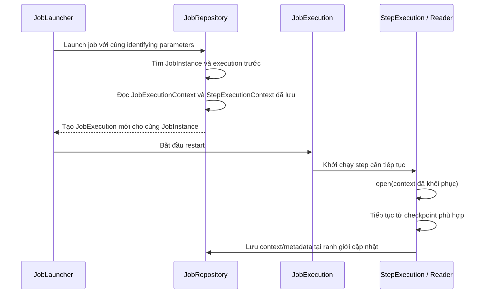

# Context khi job restart

Trong Spring Batch, một job có thể chạy trong thời gian dài và bị gián đoạn bởi lỗi ứng dụng, mất kết nối database, máy chủ khởi động lại hoặc thao tác dừng từ người vận hành. Khi khởi chạy lại một job đã thất bại hoặc đã dừng, framework cần biết công việc đã đi đến đâu để tiếp tục từ vị trí phù hợp. `ExecutionContext` là cơ chế lưu trạng thái quan trọng cho mục tiêu đó.

`ExecutionContext` là một vùng dữ liệu dạng key/value gắn với `JobExecution` hoặc `StepExecution`. Ứng dụng và các thành phần Spring Batch có thể lưu những thông tin cần thiết để khôi phục tiến trình, chẳng hạn vị trí đọc hiện tại, trang dữ liệu cuối cùng, mã batch đang xử lý hoặc kết quả trung gian cần chuyển giữa các step.

Khi restart, Spring Batch tạo một `JobExecution` mới cho cùng `JobInstance` và sử dụng metadata đã lưu từ execution trước để khôi phục context phù hợp. Vì vậy, restart không tiếp tục bằng cách giữ nguyên object Java trong bộ nhớ; nó dựa vào dữ liệu đã được lưu bền vững trong `JobRepository`.

## 1. ExecutionContext là gì?

`ExecutionContext` là một cấu trúc lưu trữ trạng thái có tên khóa và giá trị. Có thể xem nó như một map mà Spring Batch quản lý và lưu cùng metadata thực thi.

Ví dụ, một reader đọc tệp CSV có thể lưu số item đã đọc:

```java
ExecutionContext context = stepExecution.getExecutionContext();
context.putInt("ordersReader.currentItemCount", 1500);
```

Khi step được restart, reader lấy lại giá trị này để xác định vị trí cần tiếp tục.

ExecutionContext thường được dùng cho hai mục đích:

- **Checkpoint:** lưu trạng thái nội bộ của một step để tiếp tục sau gián đoạn, ví dụ số item đã đọc hoặc khóa cuối cùng của trang dữ liệu.
- **Chia sẻ dữ liệu giữa các step:** lưu kết quả hoặc thông tin điều phối ở phạm vi job để step sau có thể sử dụng, ví dụ tên tệp báo cáo được tạo ở step trước.

Không nên dùng context làm nơi lưu toàn bộ dữ liệu nghiệp vụ. Context phù hợp với trạng thái nhỏ, cần thiết cho việc khôi phục hoặc điều phối. Dữ liệu lớn nên nằm trong database, tệp hoặc kho lưu trữ chuyên dụng; context chỉ giữ ID, đường dẫn hoặc checkpoint để tìm lại dữ liệu đó.

## 2. Hai phạm vi: JobExecutionContext và StepExecutionContext

Spring Batch có hai `ExecutionContext` riêng:

- **Job ExecutionContext** gắn với một `JobExecution`, dùng cho trạng thái ở phạm vi toàn job và dữ liệu cần chia sẻ giữa các step.
- **Step ExecutionContext** gắn với một `StepExecution`, dùng cho trạng thái riêng của step, đặc biệt là checkpoint của reader hoặc writer.

| Phạm vi | Lấy từ | Dùng cho | Ví dụ |
|---|---|---|---|
| Job context | `jobExecution.getExecutionContext()` | Trạng thái cần dùng xuyên suốt các step của job execution | Đường dẫn file output, ID của batch đã tạo |
| Step context | `stepExecution.getExecutionContext()` | Trạng thái riêng của một step | Vị trí reader, số trang đã xử lý, khóa cuối cùng |

Mỗi step execution có context riêng. Điều này giúp hai step không ghi đè checkpoint của nhau. Job context là nơi phù hợp hơn nếu một step cần công bố một giá trị để step kế tiếp sử dụng.

Không nên nhầm `JobParameters` với `ExecutionContext`:

| Tiêu chí | JobParameters | ExecutionContext |
|---|---|---|
| Nguồn dữ liệu | Được truyền vào khi khởi chạy job | Được cập nhật trong quá trình thực thi |
| Mục đích | Mô tả đầu vào và định danh công việc | Lưu trạng thái/checkpoint phát sinh khi chạy |
| Thay đổi trong job | Không sửa bộ tham số của execution | Có thể cập nhật qua API context |
| Ví dụ | `businessDate`, `inputFile`, `tenantId` | `lastProcessedId`, `currentItemCount`, `outputFile` |
| Ảnh hưởng đến JobInstance | Identifying parameters xác định instance | Không tham gia định danh instance |

Nếu một giá trị là đầu vào do scheduler cung cấp, hãy dùng `JobParameters`. Nếu giá trị được tạo ra hoặc thay đổi trong khi job chạy và cần khôi phục, hãy cân nhắc `ExecutionContext`.

## 3. JobInstance và JobExecution khi restart

Để hiểu context được khôi phục ra sao, cần phân biệt ba khái niệm:

- `Job` là định nghĩa quy trình.
- `JobInstance` là một công việc nghiệp vụ cụ thể, được xác định bởi job name và identifying `JobParameters`.
- `JobExecution` là một lần thực thi cụ thể của instance đó.

Khi lần chạy đầu thất bại, Spring Batch giữ metadata và execution context của lần chạy đó. Khi restart cùng job với cùng identifying parameters, framework tạo một `JobExecution` mới thuộc cùng `JobInstance`, rồi khôi phục trạng thái từ execution trước theo quy tắc restart.

Ví dụ:

```text
Job: dailyOrderImportJob
Identifying parameter: businessDate=2026-11-15

JobInstance: dailyOrderImportJob / 2026-11-15
  JobExecution 101
    Step importOrdersStep
      Đã commit 30 chunk
      Step ExecutionContext: currentItemCount=15000
    JobExecution status: FAILED

  JobExecution 108 (restart cùng JobInstance)
    Khôi phục context đã lưu
    Reader tiếp tục từ checkpoint phù hợp
    JobExecution status: COMPLETED
```

ID của `JobExecution` mới khác execution cũ. Context được khôi phục từ metadata đã lưu, không phải vì framework giữ lại đối tượng context cũ trong heap.

Để restart đúng instance, cần truyền lại cùng identifying parameters. Nếu thay đổi `businessDate`, thêm timestamp identifying hoặc thay đổi một identifying parameter khác, ứng dụng có thể tạo `JobInstance` mới thay vì restart công việc trước.

Một instance đã `COMPLETED` thường không thể chạy lại như một lần restart với cùng identifying parameters. Nếu cần xử lý lại nghiệp vụ đã hoàn tất, cần thiết kế một lần reprocess có định danh rõ ràng.

## 4. Context được lưu ở đâu?

Trong cấu hình repository dùng database, Spring Batch lưu metadata của job và step trong các bảng repository. Execution context được lưu riêng cho job execution và step execution, thường qua các bảng:

- `BATCH_JOB_EXECUTION_CONTEXT` — context gắn với `JobExecution`.
- `BATCH_STEP_EXECUTION_CONTEXT` — context gắn với `StepExecution`.

Các bảng này thuộc schema metadata Spring Batch. `JobRepository` và các DAO liên quan đọc/ghi context trong vòng đời thực thi. Ứng dụng không nên tự sửa các hàng context bằng SQL thông thường, vì việc đó có thể làm metadata không nhất quán với trạng thái step và job.

Context được lưu bền vững theo serializer được cấu hình cho `JobRepository`. Giá trị đưa vào context phải có khả năng serialize/deserialize theo cơ chế đó. Với serializer dựa trên Java serialization, các giá trị cần đáp ứng yêu cầu `Serializable`; với serializer khác, phải tuân thủ các kiểu và quy tắc mà serializer hỗ trợ.

Nên ưu tiên các kiểu dữ liệu đơn giản và ổn định như `String`, số nguyên, boolean, ngày/thời điểm theo quy ước rõ ràng và các cấu trúc nhỏ được serializer hỗ trợ. Tránh lưu object phụ thuộc vào class nội bộ dễ thay đổi giữa các phiên bản triển khai.

## 5. Khi nào Spring Batch cập nhật ExecutionContext?

Context trong bộ nhớ không tự động trở thành checkpoint bền vững sau mỗi lần gọi `put`. Framework lưu context tại các điểm cập nhật metadata trong vòng đời job/step.

Với chunk-oriented step:

1. Step bắt đầu transaction của chunk.
2. Reader đọc item và cập nhật state nội bộ trong bộ nhớ.
3. Processor xử lý item.
4. Writer ghi dữ liệu.
5. Các thành phần `ItemStream` cập nhật state vào `ExecutionContext` thông qua `update()`.
6. Spring Batch cập nhật metadata của `StepExecution`.
7. Transaction commit.

Vì vậy, checkpoint thường gắn với ranh giới commit của chunk. Nếu tiến trình dừng trước khi chunk commit, context bền vững thường vẫn là checkpoint của chunk trước đó. Khi restart, chunk chưa commit có thể được đọc và xử lý lại.

Với tasklet step, context và metadata được cập nhật trong vòng đời transaction/lần thực thi tasklet theo cách `TaskletStep` quản lý. Không nên giả định mọi thay đổi context trong một biến Java đã được lưu ngay lập tức chỉ vì đã gọi `put`.

## 6. Reader dùng ItemStream để lưu checkpoint

Các reader cần hỗ trợ restart thường triển khai `ItemStream` hoặc interface mở rộng như `ItemStreamReader<T>`. Lifecycle chính gồm:

| Phương thức | Vai trò |
|---|---|
| `open(ExecutionContext)` | Mở tài nguyên và khôi phục trạng thái đã lưu |
| `read()` | Đọc item tiếp theo |
| `update(ExecutionContext)` | Ghi state hiện tại vào context trước khi framework lưu checkpoint |
| `close()` | Giải phóng tài nguyên |

Ví dụ custom reader lưu vị trí tiếp theo cần đọc:

```java
public class OrderReader implements ItemStreamReader<Order> {

    private static final String INDEX_KEY = "orderReader.currentIndex";

    private final List<Order> orders;
    private int currentIndex;

    public OrderReader(List<Order> orders) {
        this.orders = List.copyOf(orders);
    }

    @Override
    public void open(ExecutionContext context) {
        currentIndex = context.containsKey(INDEX_KEY)
                ? context.getInt(INDEX_KEY)
                : 0;
    }

    @Override
    public Order read() {
        if (currentIndex >= orders.size()) {
            return null;
        }
        return orders.get(currentIndex++);
    }

    @Override
    public void update(ExecutionContext context) {
        context.putInt(INDEX_KEY, currentIndex);
    }

    @Override
    public void close() {
        // Đóng resource nếu reader đang giữ file handle hoặc connection.
    }
}
```

Trong ví dụ, `currentIndex` là vị trí tiếp theo cần đọc. Nếu reader đã trả về 1.000 item và checkpoint được lưu là 1.000, lần mở lại bắt đầu từ index 1.000 (item thứ 1.001 nếu danh sách đánh số từ 1).

Đây là ví dụ tối giản. Một custom reader production cần xử lý cả nguồn dữ liệu thay đổi, rollback, retry, thứ tự đọc ổn định và tài nguyên cần đóng. Nếu reader có thể dùng reader dựng sẵn của Spring Batch, thường nên ưu tiên implementation đã quản lý checkpoint.

## 7. Ví dụ restart với FlatFileItemReader

`FlatFileItemReader` là reader dựng sẵn thường được dùng để đọc tệp CSV hoặc tệp văn bản. Khi được cấu hình lưu state, nó có thể lưu thông tin vị trí đọc để tiếp tục sau restart.

Ví dụ cấu hình:

```java
@Bean
@StepScope
public FlatFileItemReader<OrderInput> orderReader(
        @Value("#{jobParameters['inputFile']}") String inputFile) {

    FlatFileItemReader<OrderInput> reader = new FlatFileItemReader<>();
    reader.setName("orderFileReader");
    reader.setResource(new FileSystemResource(inputFile));
    reader.setLinesToSkip(1);
    reader.setSaveState(true);
    reader.setLineMapper(orderLineMapper());
    return reader;
}
```

`saveState=true` cho phép reader lưu state để restart. Tên reader cần ổn định và duy nhất trong step để key checkpoint không bị xung đột. `@StepScope` giúp tạo reader theo step execution và resolve job parameter tại thời điểm chạy.

Giả sử tệp có 20.000 dòng dữ liệu và chunk size là 500. Sau khi 12 chunk commit, reader có thể đã đọc 6.000 item. Nếu job thất bại, context của step lưu checkpoint tương ứng. Khi restart đúng instance, reader mở lại cùng tệp và tiếp tục từ vị trí phù hợp.

Điều kiện quan trọng: tệp đầu vào phải giữ nguyên nội dung và thứ tự giữa lần chạy đầu và lần restart. Nếu tệp bị thay, thêm dòng vào đầu hoặc sắp xếp lại, offset đã lưu có thể trỏ đến bản ghi khác. Có thể lưu thêm checksum hoặc version của file trong context để xác nhận đúng nguồn, hoặc sao chép file vào vùng input bất biến cho từng job instance.

## 8. Step context và Job context trong nhiều step

Một job có thể gồm nhiều step nối tiếp. Step đầu tạo ra một giá trị mà step sau cần sử dụng. Có hai lựa chọn:

- Lưu trực tiếp vào job execution context nếu đó là dữ liệu ở phạm vi job.
- Lưu trong step execution context rồi promote một số key sang job context khi step hoàn tất.

`ExecutionContextPromotionListener` hỗ trợ chuyển các key được chỉ định từ step context sang job context. Ví dụ, step tạo báo cáo ghi `reportFile` vào step context; sau khi step hoàn tất thành công, listener đưa key đó lên job context để step gửi email sử dụng.

```java
@Bean
public ExecutionContextPromotionListener promoteReportFile() {
    ExecutionContextPromotionListener listener =
            new ExecutionContextPromotionListener();
    listener.setKeys(new String[] {"reportFile"});
    listener.setStatuses(new String[] {"COMPLETED"});
    return listener;
}
```

Đăng ký listener vào step tạo báo cáo:

```java
@Bean
public Step createReportStep(
        JobRepository jobRepository,
        PlatformTransactionManager transactionManager,
        Tasklet createReportTasklet,
        ExecutionContextPromotionListener promoteReportFile) {

    return new StepBuilder("createReportStep", jobRepository)
            .tasklet(createReportTasklet, transactionManager)
            .listener(promoteReportFile)
            .build();
}
```

Step tiếp theo có thể đọc giá trị trong job context qua late binding:

```java
@Bean
@StepScope
public Tasklet sendReportTasklet(
        @Value("#{jobExecutionContext['reportFile']}") String reportFile) {
    return (contribution, chunkContext) -> {
        // Gửi hoặc xử lý file reportFile.
        return RepeatStatus.FINISHED;
    };
}
```

Promotion listener chỉ chuyển các key được cấu hình khi điều kiện status phù hợp. Không nên promote mọi giá trị trong step context; chỉ đưa những dữ liệu cần thiết cho step khác vào job context.

## 9. Đọc và ghi context trong tasklet

Tasklet có thể truy cập `StepExecution` thông qua `ChunkContext` và lưu trạng thái vào step context:

```java
public class PrepareReportTasklet implements Tasklet {

    @Override
    public RepeatStatus execute(
            StepContribution contribution,
            ChunkContext chunkContext) {

        StepExecution stepExecution = chunkContext
                .getStepContext()
                .getStepExecution();

        ExecutionContext context = stepExecution.getExecutionContext();
        context.putString("reportFile", "reports/daily-report.csv");
        context.putLong("exportedRows", 12500L);

        return RepeatStatus.FINISHED;
    }
}
```

Khi tasklet chạy trong `TaskletStep`, framework quản lý việc cập nhật metadata/context theo vòng đời step. Trong unit test gọi `execute()` trực tiếp, context chỉ là object đang nằm trong bộ nhớ của test; cần kiểm tra giá trị được đặt trực tiếp hoặc chạy integration test để xác nhận nó được lưu qua repository.

Để đọc job context từ tasklet:

```java
ExecutionContext jobContext = chunkContext
        .getStepContext()
        .getStepExecution()
        .getJobExecution()
        .getExecutionContext();

String reportFile = jobContext.getString("reportFile");
```

Nếu key chưa tồn tại, getter có thể trả về giá trị mặc định hoặc phát sinh lỗi tùy overload được dùng. Với dữ liệu bắt buộc, hãy kiểm tra key trước khi sử dụng và báo lỗi nghiệp vụ rõ ràng.

## 10. Context được khôi phục ra sao khi restart?

Khi một job execution thất bại hoặc dừng, `JobRepository` giữ metadata của execution, step execution và các execution context đã được lưu. Khi restart cùng `JobInstance`, Spring Batch tạo execution mới và khôi phục context từ execution trước theo cơ chế repository.

Luồng khái quát:



Step đã hoàn tất trong execution trước thường không được thực hiện lại khi restart job; Spring Batch tiếp tục theo flow và trạng thái step đã lưu. Step thất bại hoặc step đang được tiếp tục cần khôi phục context phù hợp. Chi tiết còn phụ thuộc flow, trạng thái step và cách cấu hình restart.

Không nên tự tạo một `JobExecution` mới với identifying parameters khác rồi mong framework tự lấy checkpoint của execution trước. Khi định danh instance thay đổi, đó là một công việc mới và context cũ không phải checkpoint của instance mới.

## 11. Checkpoint và rollback của chunk

Trong chunk-oriented step, checkpoint thường được lưu cùng transaction của chunk. Điều này giúp trạng thái reader và dữ liệu writer nhất quán khi cả hai tham gia cùng transaction manager/resource phù hợp.

Ví dụ, step đọc 10.000 đơn hàng với chunk size 500:

| Sự kiện | Trạng thái |
|---|---|
| 10 chunk đầu commit | 5.000 item đã được ghi và checkpoint đã cập nhật |
| Chunk thứ 11 đang xử lý | Reader đã đọc một phần item tiếp theo |
| Writer lỗi trước commit | Transaction chunk 11 rollback |
| JVM dừng | Checkpoint bền vững vẫn ở ranh giới commit trước đó |
| Restart | Reader khôi phục từ checkpoint sau 5.000 item |

Chunk chưa commit có thể được đọc và xử lý lại. Đây là hành vi mong đợi để tránh bỏ sót dữ liệu khi transaction chưa hoàn tất.

Nếu metadata repository và dữ liệu nghiệp vụ dùng cùng transaction manager và transaction resource phù hợp, cập nhật dữ liệu và checkpoint có thể commit/rollback cùng nhau. Nếu chúng dùng các datasource hoặc transaction manager độc lập, không nên giả định tính nguyên tử giữa hai bên. Có thể xảy ra trường hợp dữ liệu nghiệp vụ đã commit nhưng checkpoint chưa được lưu, dẫn tới item được xử lý lại; hoặc checkpoint được lưu nhưng dữ liệu đích chưa commit nếu thiết kế transaction sai.

Trong các trường hợp không có transaction phân tán, writer nên idempotent để việc xử lý lại không tạo dữ liệu trùng. Có thể dùng khóa nghiệp vụ duy nhất, upsert, outbox hoặc quy trình đối soát.

## 12. Reader không lưu state thì sao?

Không phải mọi reader đều tự động hỗ trợ restart. Nếu reader không triển khai `ItemStream`, hoặc reader dựng sẵn bị tắt `saveState`, Spring Batch không có checkpoint của reader để khôi phục vị trí.

Khi restart, reader có thể bắt đầu lại từ đầu. Điều này có thể chấp nhận nếu:

- Tập dữ liệu nhỏ và đọc lại không tốn kém.
- Reader có thể lọc bỏ dữ liệu đã xử lý dựa trên trạng thái bền vững ở nguồn.
- Writer idempotent và không tạo tác dụng phụ trùng.
- Nghiệp vụ chấp nhận xử lý lại dữ liệu.

Nếu cần tiếp tục chính xác từ vị trí đã lưu, reader cần triển khai `ItemStream` hoặc dùng reader dựng sẵn có hỗ trợ state. Với reader tự viết, cần quản lý `open`, `update`, `close` và lưu checkpoint có ý nghĩa rõ ràng.

Khi dùng wrapper hoặc delegate reader, cần bảo đảm stream bên trong được đăng ký với step để framework gọi lifecycle. Nếu reader ngoài không chuyển tiếp `open`, `update` và `close` tới delegate, checkpoint của delegate có thể không được lưu.

## 13. Các giá trị nên và không nên lưu trong context

| Nên lưu | Vì sao |
|---|---|
| `lastProcessedId` hoặc `currentItemCount` | Xác định vị trí tiếp tục |
| `lastPageKey` | Khôi phục keyset pagination |
| `reportFile` | Step sau cần biết đường dẫn output |
| `batchReferenceId` | Tra cứu dữ liệu hoặc tài nguyên đã tạo |
| `sourceVersion` hoặc checksum nhỏ | Xác nhận nguồn đầu vào không bị thay đổi |
| Cờ trạng thái nhỏ | Điều phối flow hoặc khôi phục trạng thái nghiệp vụ |

Không nên lưu:

- Toàn bộ danh sách hàng triệu item.
- Nội dung file lớn hoặc payload API đầy đủ.
- Connection, stream, file handle, thread hoặc object runtime không thể serialize.
- Spring bean, service hoặc đối tượng phụ thuộc vòng đời ứng dụng.
- Password, access token hoặc bí mật không cần thiết cho checkpoint.
- Object domain lớn có cấu trúc thay đổi thường xuyên giữa các phiên bản triển khai.

Thay vì lưu object lớn, hãy lưu khóa hoặc tham chiếu để truy xuất lại từ hệ thống bền vững. Không lưu thông tin xác thực vào context; metadata có thể được truy cập bởi công cụ vận hành hoặc người có quyền đọc repository.

## 14. Đặt tên key và quản lý schema context

Key trong context tồn tại qua các lần restart. Vì vậy, tên key nên ổn định, có namespace và mô tả rõ ý nghĩa.

Ví dụ tốt:

```java
private static final String LAST_ORDER_ID = "orderReader.lastOrderId";
private static final String SOURCE_VERSION = "orderReader.sourceVersion";
private static final String REPORT_FILE = "dailyReport.outputFile";
```

Tránh dùng các key quá chung như `index`, `count`, `value`, vì một step có nhiều reader hoặc listener có thể vô tình ghi đè nhau.

Khi thay đổi kiểu dữ liệu hoặc ý nghĩa của key trong một phiên bản ứng dụng mới, cần nghĩ đến các execution cũ vẫn có thể được restart. Ví dụ, phiên bản trước lưu `lastProcessedId` dưới dạng `Long`, phiên bản mới đổi sang `String`. Nếu converter hoặc code đọc context không còn tương thích, restart có thể thất bại.

Có thể dùng version key hoặc migration logic để chuyển đổi context cũ:

```java
int contextVersion = context.containsKey("orderReader.contextVersion")
        ? context.getInt("orderReader.contextVersion")
        : 1;

if (contextVersion == 1) {
    // Đọc và chuyển đổi cấu trúc checkpoint cũ nếu cần.
}

context.putInt("orderReader.contextVersion", 2);
```

Ví dụ chỉ minh họa ý tưởng quản lý phiên bản. Việc cập nhật version cần diễn ra tại thời điểm an toàn và chỉ sau khi dữ liệu context đã được chuyển đổi thành công.

## 15. JobExecutionContext không phải nơi thay thế JobParameters

Một số ứng dụng đưa mọi giá trị đầu vào vào context, nhưng cách này làm mờ ranh giới giữa tham số khởi chạy và trạng thái phát sinh trong job.

Ví dụ:

- `businessDate` được scheduler chọn trước khi job chạy: nên là `JobParameter`, thường là identifying nếu nó xác định kỳ nghiệp vụ.
- `inputFile` do launcher cung cấp: thường là `JobParameter`.
- `outputFile` được step tạo ra trong lúc chạy: phù hợp với job context hoặc step context tùy phạm vi sử dụng.
- `lastProcessedId` thay đổi theo tiến độ reader: phù hợp với step context.
- `requestedBy` do người vận hành cung cấp: thường là non-identifying job parameter hoặc thông tin audit tùy thiết kế.

Identifying parameters xác định `JobInstance`; context không làm thay đổi định danh đó. Để restart đúng instance, hãy giữ nguyên identifying parameters ngay cả khi context có thể được khôi phục từ lần chạy trước.

## 16. Restart an toàn cần nguồn dữ liệu ổn định và writer idempotent

Checkpoint chỉ có ý nghĩa khi vị trí đã lưu tiếp tục trỏ tới cùng dữ liệu. Nếu nguồn thay đổi giữa lần chạy đầu và restart, một offset có thể trỏ tới item khác.

Ví dụ, reader lưu `currentItemCount=5000` cho tệp CSV. Nếu một tiến trình khác chèn thêm 100 dòng ở đầu tệp trước khi restart, vị trí 5.001 không còn tương ứng với item tiếp theo mà job chưa xử lý.

Để giảm rủi ro:

- Dùng file bất biến cho mỗi `JobInstance`, hoặc tạo bản sao/snapshot đầu vào.
- Với database paging, dùng sort key ổn định và duy nhất.
- Xác định phạm vi dữ liệu tại thời điểm bắt đầu job.
- Lưu source version/checksum nếu cần xác nhận đúng input khi restart.
- Thiết kế writer idempotent để xử lý lại chunk chưa commit không tạo dữ liệu trùng.
- Với tác dụng phụ ngoài database, dùng idempotency key, outbox hoặc đối soát.

Restart là tiếp tục một quy trình dựa trên metadata; nó không tự bảo đảm exactly-once trên mọi hệ thống ngoài transaction.

## 17. Kiểm tra context bằng JobExplorer

Trong vận hành, `JobExplorer` có thể được dùng để đọc `JobInstance`, `JobExecution`, `StepExecution` và context đã lưu. Điều này hữu ích khi điều tra một job thất bại hoặc xác nhận checkpoint trước khi restart.

Ví dụ đọc job context từ một execution đã truy xuất:

```java
ExecutionContext jobContext = jobExecution.getExecutionContext();
String outputFile = jobContext.getString("dailyReport.outputFile", null);
```

Ví dụ đọc step context:

```java
ExecutionContext stepContext = stepExecution.getExecutionContext();
int currentItemCount = stepContext.getInt("orderReader.currentItemCount", 0);
```

Các đoạn mã trên giả định `jobExecution` và `stepExecution` đã được lấy từ repository/explorer. Khi hiển thị context trong dashboard hoặc log, nên chọn lọc key cần thiết thay vì dump toàn bộ context, vì context có thể chứa thông tin nội bộ hoặc dữ liệu không nên công khai.

`JobExplorer` là cơ chế đọc. Không nên lấy context, sửa object rồi kỳ vọng thay đổi đó tự được lưu. Việc ghi context nên diễn ra trong vòng đời thực thi được quản lý bởi `JobRepository` và transaction phù hợp.

## 18. Các lỗi thường gặp khi restart bằng ExecutionContext

| Tình huống | Nguyên nhân có thể gặp | Hướng xử lý |
|---|---|---|
| Reader đọc lại từ đầu | Reader không lưu state hoặc `saveState=false` | Bật state hoặc dùng reader hỗ trợ `ItemStream` |
| Reader bỏ sót hoặc đọc trùng item | Nguồn thay đổi, sort key không ổn định hoặc checkpoint sai | Dùng snapshot, sort key duy nhất và kiểm tra logic `update/open` |
| Restart không đọc được context cũ | Kiểu dữ liệu hoặc serializer thay đổi | Giữ tương thích serialization hoặc migration context có kiểm soát |
| Step sau không thấy key từ step trước | Giá trị chỉ nằm trong step context và chưa được promote | Dùng `ExecutionContextPromotionListener` hoặc lưu ở job context đúng phạm vi |
| Key bị ghi đè | Tên key chung hoặc nhiều reader dùng cùng key | Dùng namespace và tên reader ổn định |
| Context có dữ liệu cũ không còn hợp lệ | Nguồn hoặc schema đã thay đổi sau lần chạy trước | Lưu source version/checksum và kiểm tra trước restart |
| Dữ liệu đích bị ghi trùng | Chunk chưa commit được chạy lại hoặc tác dụng phụ ngoài transaction | Thiết kế writer idempotent, unique key hoặc outbox |
| Job tạo instance mới thay vì restart | Identifying parameters thay đổi | Dùng đúng job name và identifying parameters của instance cũ |
| Metadata không khớp dữ liệu nghiệp vụ | Repository và business datasource không cùng transaction | Thiết kế transaction coordination và idempotency phù hợp |

Không nên sửa thủ công các key context trong bảng metadata production để ép reader nhảy tới một vị trí mới nếu chưa đối chiếu dữ liệu đã commit. Một checkpoint sai có thể làm mất dữ liệu hoặc tạo bản ghi trùng.

## 19. Quy trình điều tra trước khi restart

Khi một job thất bại, có thể thực hiện các bước sau:

1. **Xác định đúng JobInstance:** kiểm tra job name và identifying parameters.
2. **Xác định execution cuối:** xem `JobExecution` gần nhất, trạng thái `FAILED` hoặc `STOPPED`, thời điểm lỗi và exception.
3. **Xem step execution:** xác định step thất bại, step đã hoàn tất và các bộ đếm item.
4. **Đọc checkpoint:** kiểm tra những key cần thiết trong job context và step context.
5. **Xác minh nguồn dữ liệu:** bảo đảm file, query, sort key hoặc snapshot không thay đổi.
6. **Đối chiếu dữ liệu đích:** xác định chunk cuối đã commit hay rollback và tác dụng phụ bên ngoài có thể đã xảy ra.
7. **Kiểm tra khả năng khôi phục:** reader có state, writer có idempotent và serializer còn tương thích không.
8. **Khắc phục nguyên nhân rồi restart:** dùng đúng identifying parameters và theo dõi execution mới.

Không nên restart chỉ vì thấy execution cũ mang trạng thái `FAILED`. Cần xác nhận nguyên nhân đã được khắc phục và trạng thái dữ liệu thực tế phù hợp với checkpoint.

## 20. Những nguyên tắc cần nhớ

- `ExecutionContext` là vùng key/value lưu trạng thái trong quá trình thực thi và hỗ trợ restart.
- `JobExecutionContext` dành cho trạng thái phạm vi job; `StepExecutionContext` dành cho trạng thái riêng của step và checkpoint.
- `JobParameters` mô tả đầu vào và identifying parameters xác định `JobInstance`; context lưu trạng thái phát sinh khi chạy.
- `JobExecution` mới được tạo khi restart cùng instance; Spring Batch khôi phục context từ metadata đã lưu, không giữ object trong bộ nhớ.
- Với chunk step, checkpoint thường được cập nhật tại ranh giới commit thông qua lifecycle `ItemStream.update()`.
- Chunk chưa commit có thể được đọc và xử lý lại sau restart; các chunk đã commit trước đó vẫn được giữ.
- Reader phải hỗ trợ lưu state, có nguồn ổn định và thứ tự đọc nhất quán để tiếp tục đúng vị trí.
- Dùng `ExecutionContextPromotionListener` khi cần đưa một số key từ step context lên job context cho step sau.
- Chỉ lưu dữ liệu nhỏ, có thể serialize và cần cho việc khôi phục; tránh lưu payload lớn, resource runtime hoặc bí mật.
- Giữ tên key, kiểu dữ liệu và serializer tương thích qua các lần triển khai nếu execution cũ vẫn có thể restart.
- Metadata context và dữ liệu nghiệp vụ cần có transaction phù hợp; nếu không thể nguyên tử, writer cần idempotent và có cơ chế đối soát.
- Dùng `JobExplorer` để đọc context khi điều tra; tránh sửa metadata trực tiếp trong database production.

`ExecutionContext` giúp Spring Batch ghi nhớ trạng thái cần thiết giữa các lần thực thi. Khi đặt đúng dữ liệu vào đúng phạm vi context, reader lưu checkpoint ổn định, nguồn đầu vào không thay đổi và writer có thể chạy lại an toàn, job có thể restart sau sự cố mà tiếp tục công việc có kiểm soát.
