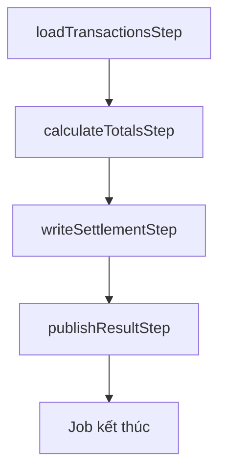
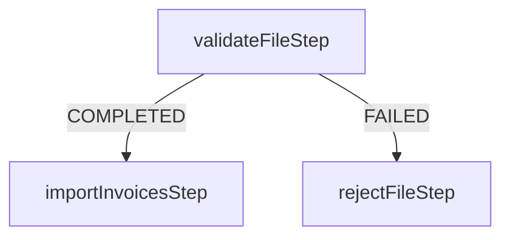
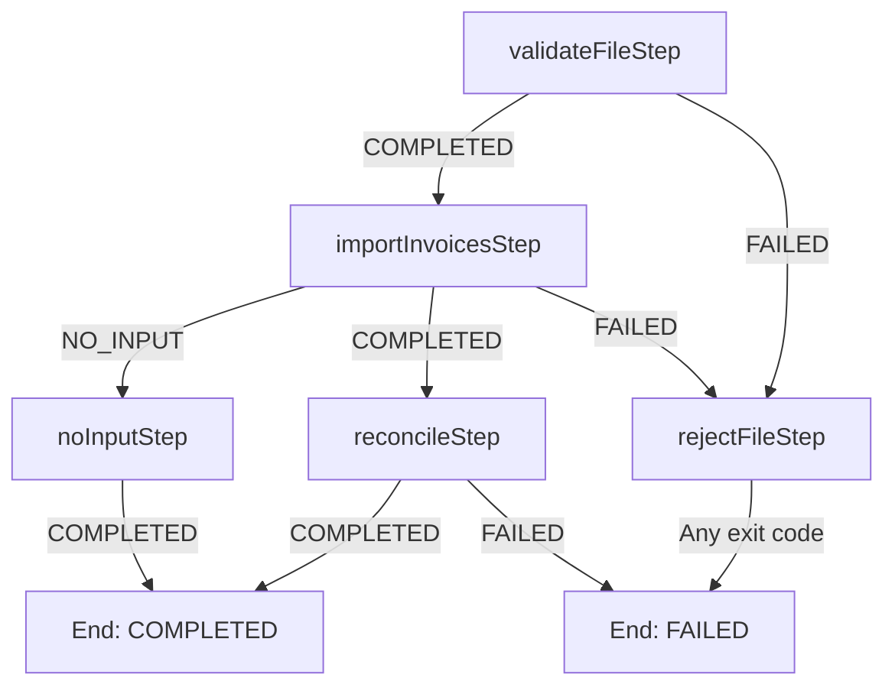

# Start, next và end

Trong Spring Batch, một job thường gồm nhiều step chạy theo một quy trình xác định. API builder cung cấp các phương thức như **start(...)**, **next(...)** và **end()** để mô tả điểm bắt đầu, bước tiếp theo và điểm kết thúc của flow.

Ba phương thức này xuất hiện trong hai kiểu khai báo thường gặp:

- **Job tuyến tính**: dùng start(step) rồi nối các step bằng next(step).
- **Flow có điều kiện**: dùng start(step), các transition on(...).to(...), from(...), rồi end() để hoàn tất định nghĩa flow/job.

Hiểu đúng vai trò của từng phương thức giúp tránh nhầm lẫn giữa thứ tự chạy step, điều kiện rẽ nhánh và trạng thái kết thúc của job. Đặc biệt, end() ở cuối builder và transition .on("...").end() có ý nghĩa khác nhau dù dùng cùng tên phương thức.

## 1. Job và Step trong một flow

Job là quy trình batch cấp cao. Step là một giai đoạn thực thi bên trong job. Ví dụ một job nhập hóa đơn có thể gồm:

1. Kiểm tra file đầu vào.
2. Đọc và nhập hóa đơn.
3. Đối soát số lượng và tổng tiền.
4. Ghi nhận kết quả hoặc thông báo.

Flow xác định step nào chạy đầu tiên, step nào tiếp theo và job sẽ làm gì khi một step trả về kết quả khác nhau.


Trong một job đơn giản, các step chạy tuần tự. Khi cần xử lý theo kết quả, flow có thể rẽ nhánh, ví dụ file hợp lệ thì import, file không hợp lệ thì chuyển sang nhánh lỗi.

## 2. start(): chọn điểm bắt đầu

start(...) khai báo trạng thái đầu tiên của job hoặc flow. Trong ví dụ cơ bản, tham số truyền vào là một Step bean:

```java
@Bean
Job invoiceImportJob(
        JobRepository jobRepository,
        Step validateFileStep,
        Step importInvoicesStep,
        Step reconcileStep) {

    return new JobBuilder("invoiceImportJob", jobRepository)
            .start(validateFileStep)
            .next(importInvoicesStep)
            .next(reconcileStep)
            .build();
}
```

Ở đây:

- invoiceImportJob là tên job.
- validateFileStep là step đầu tiên.
- importInvoicesStep chạy sau validate.
- reconcileStep chạy sau import.
- build() hoàn tất builder và tạo Job.

Một job có một điểm bắt đầu. Nếu quy trình cần nhiều nhánh đầu vào, hãy bắt đầu bằng một step kiểm tra hoặc một flow/decider rồi điều hướng sang nhánh tương ứng.

### Start bằng Flow

Ngoài Step, API builder cũng hỗ trợ bắt đầu từ một Flow đã định nghĩa. Cách này hữu ích khi muốn tái sử dụng một nhóm step như một khối logic:

```java
@Bean
Flow validationFlow(
        Step checkFileStep,
        Step checkBusinessDateStep) {

    return new FlowBuilder<SimpleFlow>("validationFlow")
            .start(checkFileStep)
            .next(checkBusinessDateStep)
            .build();
}

@Bean
Job invoiceImportJob(
        JobRepository jobRepository,
        Flow validationFlow,
        Step importInvoicesStep) {

    return new JobBuilder("invoiceImportJob", jobRepository)
            .start(validationFlow)
            .next(importInvoicesStep)
            .build();
}
```

Trong ví dụ, job bắt đầu bằng flow validation gồm hai step, sau đó mới chạy step import. Tách flow giúp gom một nhóm bước có ý nghĩa riêng và tái sử dụng trong nhiều job nếu cần.

## 3. next(): nối step tiếp theo

Trong job tuyến tính, next(step) khai báo step sẽ được chạy sau step hiện tại:

```java
return new JobBuilder("dailySettlementJob", jobRepository)
        .start(loadTransactionsStep)
        .next(calculateTotalsStep)
        .next(writeSettlementStep)
        .next(publishResultStep)
        .build();
```

Thứ tự thực hiện là:



next(...) trong kiểu khai báo tuyến tính có nghĩa là nối step tiếp theo trong quy trình. Nó không phải câu lệnh gọi step ngay tại thời điểm cấu hình; Spring Batch lưu định nghĩa flow và thực thi khi job được launch.

### Nếu một step thất bại thì next có chạy không?

Với job tuyến tính thông thường, nếu step kết thúc ở trạng thái thất bại, job dừng theo trạng thái đó và các step tiếp theo không tự động chạy. next(...) không có nghĩa “dù step trước thành công hay thất bại cũng chạy step kế tiếp”.

Nếu cần một nhánh xử lý lỗi, hãy định nghĩa transition có điều kiện bằng on(...).to(...). Ví dụ, lỗi import có thể chuyển sang step ghi nhận lỗi hoặc cách ly batch.

### next() không thay thế điều kiện rẽ nhánh

Nếu quy trình cần quyết định dựa trên ExitStatus, số bản ghi hoặc kết quả kiểm tra, hãy dùng flow transitions hoặc JobExecutionDecider. Không cố mã hóa mọi tình huống thành một chuỗi next(...) dài rồi đặt các điều kiện nghiệp vụ bên trong writer.

## 4. build() và end(): hoàn tất builder

Trong job tuyến tính đơn giản, có thể gọi build() sau chuỗi start(...).next(...):

```java
Job job = new JobBuilder("simpleJob", jobRepository)
        .start(step1)
        .next(step2)
        .build();
```

Khi khai báo flow có điều kiện, thường cần gọi end() để hoàn tất cấu hình flow trước khi build() tạo job:

```java
Job job = new JobBuilder("conditionalJob", jobRepository)
        .start(validateStep)
            .on("COMPLETED").to(importStep)
        .from(validateStep)
            .on("FAILED").to(rejectStep)
        .end()
        .build();
```

Ở đây, end() ở cuối chuỗi builder đóng phần định nghĩa flow và trả về builder cấp job để gọi build(). Nó không phải một step nghiệp vụ mới, cũng không tự tạo một nhánh xử lý lỗi.

Không cần thêm end() một cách máy móc vào mọi job tuyến tính. Hãy dùng dạng builder mà API của phiên bản Spring Batch đang dùng yêu cầu; với SimpleJobBuilder, build() thường là bước hoàn tất trực tiếp.

## 5. Flow transition: on() và to()

Khi một step có thể kết thúc với nhiều kết quả, flow có thể chọn step kế tiếp dựa trên ExitStatus.

Mẫu cơ bản:

```java
return new JobBuilder("invoiceImportJob", jobRepository)
        .start(validateFileStep)
            .on("COMPLETED").to(importInvoicesStep)
        .from(validateFileStep)
            .on("FAILED").to(rejectFileStep)
        .end()
        .build();
```

Các thành phần:

- start(validateFileStep): chọn step đầu tiên.
- on("COMPLETED"): chọn transition khi exit code của step khớp mẫu COMPLETED.
- to(importInvoicesStep): đi đến step đích.
- from(validateFileStep): khai báo thêm transition xuất phát từ step đã có.
- on("FAILED").to(rejectFileStep): nếu validate thất bại, chuyển sang nhánh reject.
- end().build(): hoàn tất flow và tạo job.

Sơ đồ:



Flow transition là cách mô tả rõ ràng hành vi theo kết quả. Các nhánh cần được thiết kế đầy đủ để không có trạng thái kết thúc nào bị bỏ quên.

## 6. on() khớp ExitStatus, không trực tiếp khớp BatchStatus

Đây là điểm quan trọng khi viết flow.

Spring Batch có hai khái niệm:

- BatchStatus: trạng thái vòng đời kỹ thuật như STARTED, COMPLETED, FAILED, STOPPED.
- ExitStatus: mã kết thúc của step/job, được dùng trong flow transitions và có thể được tùy chỉnh.

Trong transition .on("..."), mẫu được so khớp với exit code của ExitStatus. Nhiều trường hợp mặc định exit code có cùng tên với BatchStatus, nên dễ tưởng rằng on() đang kiểm tra BatchStatus. Nhưng khi ứng dụng đặt exit code riêng, sự khác biệt trở nên rõ ràng.

Ví dụ listener đặt exit status:

```java
public class InputCheckListener implements StepExecutionListener {

    @Override
    public ExitStatus afterStep(StepExecution stepExecution) {
        if (stepExecution.getReadCount() == 0) {
            return new ExitStatus("NO_INPUT");
        }
        return null;
    }
}
```

Flow có thể điều hướng theo mã đó:

```java
return new JobBuilder("invoiceImportJob", jobRepository)
        .start(importStep)
            .on("NO_INPUT").to(noInputStep)
        .from(importStep)
            .on("COMPLETED").to(reconcileStep)
        .from(importStep)
            .on("FAILED").fail()
        .end()
        .build();
```

Nếu reader không có item, listener có thể đặt exit code NO_INPUT; flow chuyển sang step noInputStep. Nếu step import hoàn tất theo mã COMPLETED, flow chuyển sang đối soát. Nếu step thất bại, flow kết thúc theo nhánh fail.

Ví dụ trên giả định readCount là tiêu chí nghiệp vụ phù hợp. Nếu processor lọc hết item, readCount vẫn lớn hơn 0; khi đó NO_INPUT không được phát ra. Hãy chọn điều kiện theo đúng ý nghĩa cần phân biệt.

## 7. Wildcard trong on()

Flow transition hỗ trợ mẫu khớp exit code, thường dùng:

| Pattern | Ý nghĩa |
|---|---|
| COMPLETED | Khớp chính xác exit code COMPLETED |
| FAILED | Khớp chính xác exit code FAILED |
| NO_INPUT | Khớp exit code tùy chỉnh NO_INPUT |
| * | Khớp mọi exit code |
| COMPLETED* | Khớp các exit code bắt đầu bằng COMPLETED, ví dụ COMPLETED_WITH_WARNINGS |

Ví dụ:

```java
return new JobBuilder("dailyImportJob", jobRepository)
        .start(importStep)
            .on("COMPLETED_WITH_WARNINGS").to(warningReportStep)
        .from(importStep)
            .on("COMPLETED").to(reconcileStep)
        .from(importStep)
            .on("FAILED").to(failureReportStep)
        .end()
        .build();
```

Nếu ứng dụng có nhiều exit code tùy chỉnh, hãy khai báo các pattern cụ thể trước và thêm wildcard * làm nhánh dự phòng khi phù hợp. Không dùng wildcard quá rộng nếu nó có thể đưa một lỗi nghiêm trọng sang nhánh thành công.

Một flow nên có transition cho mọi kết quả có thể xảy ra từ step. Nếu một exit code không có transition phù hợp, flow có thể không tìm được trạng thái tiếp theo và job có thể kết thúc với lỗi cấu hình flow.

## 8. end() trong transition có ý nghĩa gì?

Ngoài end() dùng để hoàn tất builder, flow DSL còn có terminal transition:

```java
return new JobBuilder("reportJob", jobRepository)
        .start(generateReportStep)
            .on("COMPLETED").end()
        .from(generateReportStep)
            .on("FAILED").fail()
        .end()
        .build();
```

Trong đoạn này có hai vị trí mang tên end():

1. .on("COMPLETED").end() là terminal transition: khi step trả exit code COMPLETED, flow kết thúc theo nhánh hoàn tất.
2. .end().build() ở cuối là thao tác hoàn tất định nghĩa flow/job builder.

Terminal transition end() biểu thị flow kết thúc thành công về mặt job flow. Nó không giống việc gọi build() và cũng không chạy thêm một step nào.

### Vì sao cần phân biệt?

Giả sử step có BatchStatus.COMPLETED nhưng ExitStatus tùy chỉnh là NO_INPUT. Nếu flow định nghĩa .on("NO_INPUT").end(), job có thể kết thúc với trạng thái hoàn tất dù không có dữ liệu. Đây là lựa chọn hợp lệ khi nghiệp vụ chấp nhận zero input.

Ngược lại, nếu zero input là lỗi, không nên điều hướng nhánh đó vào terminal end(). Hãy dùng .fail() hoặc chuyển sang một step xử lý lỗi phù hợp.

## 9. Phân biệt end(), fail() và stopAndRestart()

Flow DSL cung cấp các terminal transition với ý nghĩa khác nhau:

| Transition | Ý nghĩa flow | Trạng thái job thường nhận |
|---|---|---|
| end() | Kết thúc flow như một kết quả hoàn tất | COMPLETED |
| fail() | Kết thúc flow với kết quả thất bại | FAILED |
| stopAndRestart(step) | Dừng job và chỉ định điểm restart | STOPPED |

Ví dụ:

```java
return new JobBuilder("conditionalJob", jobRepository)
        .start(validateStep)
            .on("COMPLETED").to(importStep)
        .from(validateStep)
            .on("INVALID_INPUT").fail()
        .from(importStep)
            .on("COMPLETED").end()
        .from(importStep)
            .on("WAITING_FOR_APPROVAL").stopAndRestart(approvalStep)
        .from(importStep)
            .on("FAILED").fail()
        .end()
        .build();
```

Trong ví dụ:

- Validate thành công thì import.
- Input không hợp lệ thì job thất bại.
- Import hoàn tất thì job kết thúc thành công.
- Nếu cần chờ phê duyệt, job dừng và có thể restart tại step được chỉ định.
- Lỗi import kết thúc theo nhánh fail.

stopAndRestart không phải cách giữ một thread ngủ hoặc tự động chờ điều kiện. Nó kết thúc execution ở trạng thái dừng; một actor bên ngoài phải quyết định khi nào restart job.

## 10. Ví dụ hoàn chỉnh: validate, import và xử lý lỗi

Một job nhập file có thể định nghĩa flow như sau:

```java
@Bean
Job invoiceImportJob(
        JobRepository jobRepository,
        Step validateFileStep,
        Step importInvoicesStep,
        Step reconcileStep,
        Step rejectFileStep,
        Step noInputStep) {

    return new JobBuilder("invoiceImportJob", jobRepository)
            .start(validateFileStep)
                .on("COMPLETED").to(importInvoicesStep)
            .from(validateFileStep)
                .on("FAILED").to(rejectFileStep)
            .from(importInvoicesStep)
                .on("NO_INPUT").to(noInputStep)
            .from(importInvoicesStep)
                .on("COMPLETED").to(reconcileStep)
            .from(importInvoicesStep)
                .on("FAILED").to(rejectFileStep)
            .from(reconcileStep)
                .on("COMPLETED").end()
            .from(reconcileStep)
                .on("FAILED").fail()
            .from(rejectFileStep)
                .on("*").fail()
            .from(noInputStep)
                .on("COMPLETED").end()
            .end()
            .build();
}
```

Flow:



Ví dụ thể hiện ba loại kết quả khác nhau:

- Input hợp lệ và có dữ liệu: import, đối soát, kết thúc.
- Input hợp lệ nhưng không có dữ liệu: đi qua noInputStep, rồi kết thúc thành công theo chính sách.
- Input không hợp lệ hoặc import/reconcile thất bại: đi qua nhánh xử lý lỗi và kết thúc thất bại.

Để flow hoạt động đúng, các step/listener cần phát đúng exit code. Tên pattern trong on(...) phải khớp với ExitStatus thực tế.

## 11. Flow với JobExecutionDecider

Không phải mọi điều kiện đều phù hợp để đặt trong exit status của step. Nếu quyết định phụ thuộc dữ liệu runtime, một JobExecutionDecider có thể tạo FlowExecutionStatus để chọn nhánh.

Ví dụ, sau step import, quyết định có cần chạy đối soát hay không:

```java
public class ImportResultDecider implements JobExecutionDecider {

    @Override
    public FlowExecutionStatus decide(
            JobExecution jobExecution,
            StepExecution stepExecution) {

        if (stepExecution == null) {
            return new FlowExecutionStatus("UNKNOWN");
        }

        return stepExecution.getWriteCount() == 0
                ? new FlowExecutionStatus("NO_WRITES")
                : new FlowExecutionStatus("HAS_WRITES");
    }
}
```

Flow có thể dùng decider:

```java
return new JobBuilder("invoiceImportJob", jobRepository)
        .start(importStep)
        .next(importResultDecider)
            .on("HAS_WRITES").to(reconcileStep)
        .from(importResultDecider)
            .on("NO_WRITES").to(noOutputStep)
        .from(importResultDecider)
            .on("UNKNOWN").fail()
        .end()
        .build();
```

Decider trả về FlowExecutionStatus, và các pattern sau decider khớp với status đó. Không nhầm nó với ExitStatus của step. Hãy chọn dữ liệu quyết định đúng với nghiệp vụ: write count bằng 0 có thể do input rỗng, filter hết hoặc skip hết, nên nếu cần phân biệt các tình huống này phải kiểm tra thêm các bộ đếm.

## 12. Custom ExitStatus và quy tắc điều hướng

Một step có thể hoàn tất kỹ thuật nhưng cần mã kết quả nghiệp vụ riêng:

```java
public class ReconciliationListener implements StepExecutionListener {

    @Override
    public ExitStatus afterStep(StepExecution stepExecution) {
        long read = stepExecution.getReadCount();
        long written = stepExecution.getWriteCount();

        if (read != written) {
            return new ExitStatus("COMPLETED_WITH_DIFFERENCE");
        }
        return ExitStatus.COMPLETED;
    }
}
```

Flow có thể định nghĩa:

```java
return new JobBuilder("settlementJob", jobRepository)
        .start(reconcileStep)
            .on("COMPLETED").to(publishStep)
        .from(reconcileStep)
            .on("COMPLETED_WITH_DIFFERENCE").to(manualReviewStep)
        .from(reconcileStep)
            .on("FAILED").fail()
        .end()
        .build();
```

Hãy bảo đảm custom exit code có ý nghĩa nhất quán, được ghi log và được dashboard hiểu. Đừng dùng một exit code duy nhất cho nhiều tình huống khác nhau nếu các tình huống đó cần hành động vận hành khác nhau.

## 13. Thứ tự và độ ưu tiên của transition

Một flow có thể có nhiều transition từ cùng một step. Mẫu cụ thể nên được khai báo rõ ràng, và wildcard thường được dùng làm nhánh dự phòng.

Ví dụ:

```java
return new JobBuilder("job", jobRepository)
        .start(step1)
            .on("COMPLETED_WITH_WARNINGS").to(warningStep)
        .from(step1)
            .on("COMPLETED").to(successStep)
        .from(step1)
            .on("*").to(errorStep)
        .end()
        .build();
```

Đọc flow như một bảng quyết định: với mỗi exit code có thể phát ra, transition nào sẽ được chọn? Tránh các pattern chồng lấn khó hiểu và tránh wildcard thành công có thể nuốt lỗi.

Nếu thêm một custom exit code mới vào listener, cần xem lại các transition hiện có. Một thay đổi nhỏ trong mã kết thúc có thể làm flow đi vào nhánh khác.

## 14. Restart và ý nghĩa của điểm kết thúc

Flow không chỉ xác định thứ tự chạy lần đầu; nó còn ảnh hưởng cách Spring Batch khôi phục job sau khi execution thất bại hoặc dừng.

- Step đã hoàn thành trong một execution thường không chạy lại khi restart cùng JobInstance theo flow restart tiêu chuẩn.
- Step thất bại hoặc chưa chạy có thể được thực thi khi restart, tùy cấu hình và trạng thái.
- Một flow kết thúc bằng end() đánh dấu job hoàn tất; cùng identifying parameters thường không thể được launch lại như một job instance mới đã hoàn tất.
- Một flow kết thúc bằng fail() đánh dấu job thất bại; instance có thể đủ điều kiện restart nếu các điều kiện khác cho phép.
- stopAndRestart(...) kết thúc execution ở trạng thái dừng và lưu điểm restart theo định nghĩa flow.

Nếu một job kết thúc COMPLETED nhưng sau đó cần xử lý lại dữ liệu, hãy định nghĩa reprocess với identifying parameters/version mới và writer idempotent. Không chỉnh metadata hoặc thêm timestamp ngẫu nhiên chỉ để vượt qua trạng thái đã hoàn tất.

## 15. Những lỗi thường gặp khi dùng start, next và end

**Dùng next() khi cần rẽ nhánh.** next() tạo chuỗi tuyến tính. Dùng on(...).to(...) khi kết quả step quyết định đường đi.

**Nghĩ rằng next() chạy cả sau khi step thất bại.** Job tuyến tính thường dừng khi step thất bại. Muốn xử lý lỗi, hãy khai báo transition tương ứng.

**Nhầm on() với BatchStatus.** Transition khớp exit code của ExitStatus; custom exit code cần có pattern tương ứng.

**Không khai báo nhánh cho custom exit code.** Khi listener trả NO_INPUT nhưng flow chỉ có COMPLETED và FAILED, flow có thể không có transition phù hợp. Bổ sung nhánh rõ ràng.

**Dùng wildcard để đưa mọi lỗi về thành công.** on("*").end() có thể khiến các kết quả không mong đợi bị xem như flow hoàn tất. Chỉ dùng khi chính sách nghiệp vụ thực sự cho phép.

**Nhầm terminal end() với builder end().** .on("COMPLETED").end() là một transition kết thúc flow; .end().build() ở cuối đóng định nghĩa flow và tạo job.

**Dùng fail() khi chỉ muốn ghi cảnh báo.** fail() kết thúc flow với trạng thái thất bại. Nếu kết quả là hoàn tất có cảnh báo, hãy dùng custom exit code và nhánh phù hợp.

**Quên điểm restart khi stop.** Nếu dùng stopAndRestart, hãy chọn step restart rõ ràng và thiết kế điều kiện để actor bên ngoài restart đúng lúc.

## 16. Cách đọc một flow khi debug

Khi một job đi sai nhánh, lần theo các bước:

1. Xác định JobExecution và StepExecution liên quan.
2. Xem BatchStatus và ExitStatus của step ngay trước điểm rẽ nhánh.
3. Xác định listener hoặc decider nào đã tạo exit code/status.
4. Đối chiếu giá trị thực tế với pattern trong on(...).
5. Kiểm tra transition from(...) có trỏ đúng step hoặc decider không.
6. Kiểm tra terminal transition là end(), fail() hay stopAndRestart(...).
7. Xem job status cuối cùng và step nào đã hoặc chưa chạy.

Ví dụ, nếu importStep có BatchStatus.COMPLETED nhưng ExitStatus=NO_INPUT, transition on("COMPLETED") sẽ không khớp với NO_INPUT. Đây thường là nguyên nhân khiến flow không đi vào nhánh mà người viết mong đợi.

## 17. Kiểm thử flow

Kiểm thử job nên xác nhận cả trạng thái cuối và các step thực sự được chạy:

| Kịch bản | Kết quả mong đợi |
|---|---|
| Validate trả COMPLETED | Import step được chạy |
| Validate trả FAILED | Nhánh reject/fail được chạy theo flow |
| Import trả NO_INPUT | Nhánh no-input được chọn |
| Import trả COMPLETED | Reconcile step được chạy |
| Reconcile trả FAILED | Job kết thúc thất bại |
| Step trả custom exit code không có transition | Test phát hiện flow thiếu nhánh |
| Flow gọi terminal end() | Job kết thúc hoàn tất |
| Flow gọi terminal fail() | Job kết thúc thất bại |
| Flow gọi stopAndRestart(step) | Job dừng và có restart point theo cấu hình |

Có thể dùng JobLauncherTestUtils cùng Spring Batch test support để launch job và kiểm tra execution/step executions. Khi test flow có điều kiện, hãy cấu hình listener/decider để tạo từng exit code và xác nhận step downstream được chạy hoặc bị bỏ qua đúng như thiết kế.

## 18. Quy trình thiết kế flow trước khi viết builder

Trước khi viết start, next và end, hãy lập bảng các step và kết quả:

| Step | Exit code | Step tiếp theo hoặc terminal |
|---|---|---|
| validateFileStep | COMPLETED | importInvoicesStep |
| validateFileStep | FAILED | rejectFileStep |
| importInvoicesStep | NO_INPUT | noInputStep |
| importInvoicesStep | COMPLETED | reconcileStep |
| importInvoicesStep | FAILED | rejectFileStep |
| reconcileStep | COMPLETED | end |
| reconcileStep | FAILED | fail |

Sau đó mới chuyển bảng này thành DSL. Cách làm này giúp nhìn ra các exit code bị thiếu, các nhánh không có điểm kết thúc và các bước có thể chạy ngoài ý muốn.

Với quy trình chỉ có một đường đi, dùng start(...).next(...).next(...). Khi có điều kiện, dùng on(...).to(...) và from(...). Chỉ dùng decider khi điều kiện không thể biểu đạt gọn bằng exit status của step.

## 19. Kết luận thực hành

start() chọn điểm đầu của job/flow. next() nối step tiếp theo trong quy trình tuyến tính. Với flow có điều kiện, on(...).to(...) và from(...) mô tả các đường đi dựa trên exit code; end(), fail() và stopAndRestart(...) xác định cách một nhánh kết thúc.

Hãy phân biệt end() của terminal transition với end() dùng để hoàn tất flow builder trước build(). Đồng thời, nhớ rằng transition khớp ExitStatus, không đơn giản là kiểm tra BatchStatus. Khi các step phát custom exit code, flow phải có nhánh tương ứng.

Một flow tốt làm rõ mọi kết quả có thể xảy ra: bước nào chạy tiếp, lỗi được xử lý ở đâu, khi nào job được xem là hoàn tất, khi nào thất bại và nếu dừng thì restart từ đâu. Khi các quy tắc này được định nghĩa rõ, code builder chỉ còn là cách diễn đạt trực tiếp workflow nghiệp vụ.
