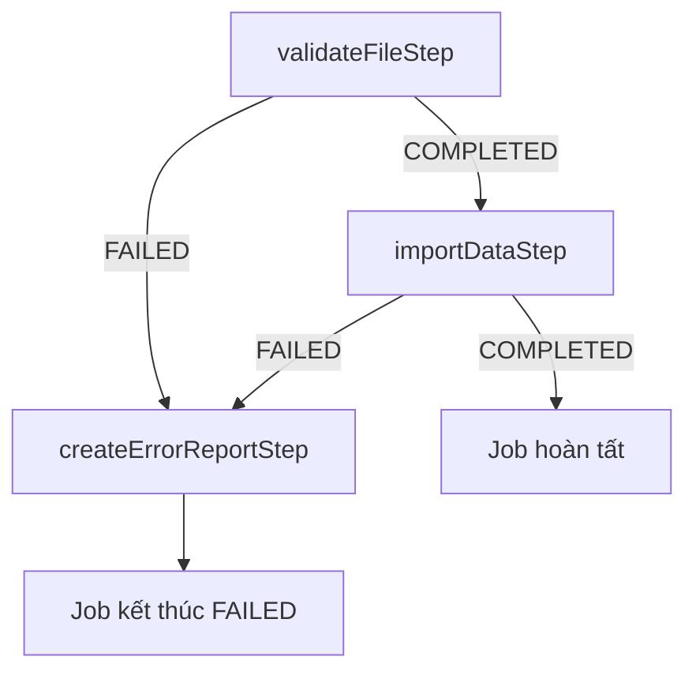

# Flow có điều kiện thất bại

Trong Spring Batch, một job thường gồm nhiều step và kết quả của step trước có thể quyết định step tiếp theo cần chạy. Ví dụ, sau khi kiểm tra tệp đầu vào, job có thể tiếp tục nhập dữ liệu nếu hợp lệ, chuyển sang step tạo báo cáo lỗi nếu dữ liệu không hợp lệ, hoặc dừng job nếu một lỗi nghiêm trọng xảy ra.

Để mô hình hóa những nhánh đó, Spring Batch cung cấp **conditional flow**. Flow dựa trên kết quả thực thi của step hoặc một quyết định nghiệp vụ để chọn transition tiếp theo. Khi xử lý nhánh thất bại, cần phân biệt `BatchStatus`, `ExitStatus` và trạng thái cuối cùng của job. Một step có thể thất bại nhưng flow vẫn chạy step xử lý lỗi; job cuối cùng có thể được đánh dấu `FAILED`, `COMPLETED` hoặc `STOPPED` tùy transition được cấu hình.

## 1. Conditional flow là gì?

Flow mô tả thứ tự các step và cách chuyển từ step này sang step khác. Với flow tuyến tính, step tiếp theo thường chạy sau khi step trước hoàn tất. Với flow có điều kiện, transition phụ thuộc kết quả step.

Ví dụ job nhập dữ liệu:

1. `validateFileStep` kiểm tra tệp đầu vào.
2. Nếu step trả kết quả thành công, job chạy `importDataStep`.
3. Nếu step thất bại, job chạy `createErrorReportStep` để ghi nhận nguyên nhân.
4. Sau bước xử lý lỗi, job kết thúc với trạng thái thất bại để scheduler hoặc hệ thống giám sát biết nghiệp vụ chưa thành công.

Sơ đồ khái quát:



Conditional flow giúp biểu diễn các nhánh nghiệp vụ rõ ràng trong cấu hình job, thay vì tự gọi step tiếp theo từ bên trong code của một step.

## 2. BatchStatus và ExitStatus khác nhau

Đây là hai khái niệm quan trọng nhất khi cấu hình transition.

- **`BatchStatus`** mô tả trạng thái vòng đời của một `JobExecution` hoặc `StepExecution`, ví dụ `STARTED`, `COMPLETED`, `FAILED`, `STOPPED`.
- **`ExitStatus`** mô tả mã kết quả của step hoặc job, gồm exit code và mô tả. Flow sử dụng exit code để chọn transition.

| Khái niệm | Câu hỏi được trả lời | Ví dụ |
|---|---|---|
| `BatchStatus` | Execution đang ở trạng thái nào? | `COMPLETED`, `FAILED`, `STOPPED` |
| `ExitStatus` | Step/job kết thúc với mã kết quả nào? | `COMPLETED`, `FAILED`, `NO_DATA`, `COMPLETED_WITH_WARNINGS` |
| `FlowExecutionStatus` | Flow hoặc decider muốn điều hướng theo trạng thái nào? | `COMPLETED`, `FAILED`, `VALID`, `INVALID` |

Trong trường hợp thông thường, exit code mặc định phản ánh kết quả thực thi, ví dụ step thành công có `ExitStatus.COMPLETED`, step lỗi có `ExitStatus.FAILED`. Tuy nhiên, ứng dụng có thể cung cấp exit code tùy chỉnh để biểu diễn kết quả nghiệp vụ chi tiết hơn.

Điểm cần nhớ: cấu hình `.on("FAILED")` khớp với exit code của step, không phải câu lệnh so sánh trực tiếp `BatchStatus` trong Java. Trong trường hợp mặc định, hai giá trị thường tương ứng, nhưng không nên xem chúng là cùng một loại dữ liệu.

## 3. Khai báo transition bằng on(), to() và from()

Với Java configuration, `JobBuilder` hỗ trợ xây dựng flow bằng các phương thức:

- `start(step)`: chỉ định step bắt đầu.
- `on(pattern)`: chọn transition dựa trên exit code pattern.
- `to(step)`: chuyển tới step tiếp theo.
- `from(step)`: khai báo một transition khác xuất phát từ step đã có.
- `end()`: kết thúc job với trạng thái hoàn tất theo transition.
- `fail()`: kết thúc job với trạng thái thất bại.
- `stopAndRestart(step)`: dừng job và chỉ định step để restart.

Ví dụ một step có hai nhánh:

```java
@Bean
public Job importJob(
        JobRepository jobRepository,
        Step validateFileStep,
        Step importDataStep,
        Step createErrorReportStep) {

    return new JobBuilder("importJob", jobRepository)
            .start(validateFileStep)
                .on("FAILED").to(createErrorReportStep)
            .from(validateFileStep)
                .on("*").to(importDataStep)
            .from(importDataStep)
                .on("FAILED").to(createErrorReportStep)
            .from(importDataStep)
                .on("*").end()
            .from(createErrorReportStep)
                .on("*").fail()
            .end()
            .build();
}
```

Luồng trên có ý nghĩa:

- Nếu validation thất bại, chạy `createErrorReportStep`.
- Nếu validation có exit code khác `FAILED`, tiếp tục nhập dữ liệu.
- Nếu import thất bại, chạy step tạo báo cáo lỗi.
- Nếu import thành công, kết thúc job.
- Sau khi tạo báo cáo lỗi, kết thúc job với trạng thái thất bại.

Trong ví dụ này, `on("*")` là nhánh dự phòng cho mọi exit code còn lại. Khi định nghĩa flow thực tế, nên dùng các pattern rõ ràng và tránh các transition chồng lấn khiến khó hiểu nhánh nào sẽ được chọn.

## 4. on("FAILED") không có nghĩa là bắt exception trực tiếp

Transition `.on("FAILED")` không nhận một đối tượng exception và cũng không so khớp tên class exception. Nó kiểm tra exit code của step sau khi step kết thúc.

Ví dụ, nếu writer ném `DataAccessException` và exception không được retry hoặc skip thành công, step thường kết thúc với `BatchStatus.FAILED` và exit code mặc định `FAILED`. Flow có thể định tuyến từ step đó tới `createErrorReportStep`.

Nếu exception được retry thành công hoặc được skip theo chính sách cho phép, step có thể kết thúc thành công. Khi đó transition `FAILED` không được chọn chỉ vì trong quá trình xử lý từng xuất hiện exception.

Vì vậy, cần phân biệt:

- **Exception phát sinh:** một thao tác gặp lỗi trong quá trình chạy.
- **Step thất bại:** lỗi không được xử lý thành công và step kết thúc ở trạng thái thất bại.
- **Transition thất bại:** flow nhận exit code phù hợp, thường là `FAILED`, rồi chuyển sang nhánh được cấu hình.

## 5. Vì sao cần xử lý nhánh thất bại?

Một job production thường cần làm nhiều việc sau khi một step thất bại:

- Ghi báo cáo lỗi hoặc danh sách bản ghi không hợp lệ.
- Lưu lại thông tin nguồn đầu vào và vị trí xảy ra lỗi.
- Gửi thông báo cho hệ thống giám sát hoặc người vận hành.
- Dọn tài nguyên tạm hoặc đóng trạng thái batch đang mở.
- Chạy bước bù trừ nếu nghiệp vụ yêu cầu.
- Kết thúc job với trạng thái phù hợp để scheduler quyết định retry hoặc cảnh báo.

Nếu chỉ để job dừng ngay khi một step thất bại, những bước hậu xử lý này có thể không được thực hiện. Conditional flow cho phép thiết kế một nhánh xử lý lỗi rõ ràng.

Tuy nhiên, không phải mọi việc đều nên đặt trong error step. Những tác vụ cleanup cần chạy bất kể thành công hay thất bại có thể được mô hình hóa bằng flow hoặc cơ chế listener phù hợp. Những tác vụ nghiệp vụ lớn, có retry riêng hoặc cần audit nên là step riêng để có trạng thái và metadata độc lập.

## 6. Phân biệt end(), fail() và stopAndRestart()

Ba transition terminal này có ý nghĩa khác nhau và ảnh hưởng đến trạng thái cuối của job.

| Transition | Ý nghĩa | Trạng thái job điển hình |
|---|---|---|
| `.end()` | Kết thúc flow như một job hoàn tất | `COMPLETED` |
| `.fail()` | Kết thúc flow với kết quả thất bại | `FAILED` |
| `.stopAndRestart(step)` | Dừng job và xác định step dùng khi restart | `STOPPED` |

### end()

`.end()` kết thúc job với trạng thái hoàn tất. Nó thường được dùng sau nhánh thành công hoặc nhánh nghiệp vụ mà ứng dụng chủ động xem là kết thúc bình thường.

Điểm cần thận trọng: nếu một step trước đó thất bại nhưng flow được cấu hình đi tới error step rồi transition cuối cùng gọi `.end()`, job có thể được đánh dấu `COMPLETED`. Điều đó có thể gây hiểu nhầm cho scheduler hoặc dashboard nếu nghiệp vụ thực tế vẫn thất bại.

### fail()

`.fail()` kết thúc job với trạng thái thất bại. Nó phù hợp khi flow đã thực hiện các bước hậu xử lý nhưng kết quả nghiệp vụ vẫn không thành công.

Ví dụ, validation thất bại, job tạo báo cáo lỗi thành công, sau đó transition từ error report step dùng `.fail()`. Báo cáo lỗi đã được tạo nhưng job vẫn kết thúc `FAILED`, giúp hệ thống điều phối nhận biết cần can thiệp.

### stopAndRestart(step)

`.stopAndRestart(step)` kết thúc job ở trạng thái dừng và ghi nhận step được chỉ định làm điểm restart theo flow. Cơ chế này phù hợp với quy trình cần chờ một điều kiện bên ngoài hoặc yêu cầu người vận hành xác nhận trước khi tiếp tục.

`STOPPED` khác `FAILED`: job được dừng theo chủ đích và có thể restart theo cấu hình; `FAILED` là job kết thúc do lỗi. Không nên dùng stop như cách thay thế cho việc mô hình hóa lỗi nghiệp vụ.

## 7. Một step thất bại nhưng job vẫn có thể chạy tiếp

Conditional flow cho phép job tiếp tục sau khi một step thất bại, miễn là có transition từ exit code đó tới một state khác.

Ví dụ:

```java
return new JobBuilder("settlementJob", jobRepository)
        .start(calculateStep)
            .on("FAILED").to(reconcileFailureStep)
        .from(calculateStep)
            .on("*").to(publishStep)
        .from(reconcileFailureStep)
            .on("*").fail()
        .from(publishStep)
            .on("*").end()
        .end()
        .build();
```

Nếu `calculateStep` thất bại, `reconcileFailureStep` vẫn có thể chạy để ghi nhận chênh lệch hoặc dọn dữ liệu. Sau đó job kết thúc `FAILED`. Trạng thái của step calculate vẫn phản ánh thất bại; việc flow tiếp tục không biến step đó thành thành công.

Nếu error step cũng thất bại, nhánh `.on("*").fail()` vẫn kết thúc job ở trạng thái thất bại. Trong ứng dụng thực tế, có thể cần thêm nhánh xử lý riêng cho lỗi của error step, nhưng kết quả cuối vẫn nên thể hiện đúng tình trạng nghiệp vụ.

## 8. Tạo ExitStatus tùy chỉnh để phân nhánh chi tiết

Đôi khi `COMPLETED` và `FAILED` chưa đủ để biểu diễn kết quả. Ví dụ, step kiểm tra tệp có thể hoàn tất về mặt kỹ thuật nhưng phát hiện một số dòng bị loại bỏ. Ứng dụng muốn chuyển sang step tạo báo cáo cảnh báo thay vì đi thẳng sang bước nhập dữ liệu.

Có thể trả exit code tùy chỉnh từ `StepExecutionListener.afterStep`:

```java
public class ValidationExitStatusListener implements StepExecutionListener {

    @Override
    public ExitStatus afterStep(StepExecution stepExecution) {
        if (stepExecution.getStatus() == BatchStatus.COMPLETED
                && stepExecution.getSkipCount() > 0) {
            return new ExitStatus("COMPLETED_WITH_WARNINGS");
        }
        return null;
    }
}
```

Sau đó flow có thể dùng exit code này:

```java
return new JobBuilder("validationJob", jobRepository)
        .start(validateStep)
            .on("COMPLETED_WITH_WARNINGS").to(warningReportStep)
        .from(validateStep)
            .on("COMPLETED").to(importStep)
        .from(validateStep)
            .on("FAILED").to(errorReportStep)
        .end()
        .build();
```

Đoạn mã minh họa cách tạo và dùng mã kết quả tùy chỉnh. Cần kiểm tra cách `ExitStatus` được kết hợp trong phiên bản dự án và bảo đảm listener không vô tình che mất trạng thái lỗi thật. Nếu step đã `FAILED`, không nên trả một mã thành công chỉ để flow đi tiếp.

`ExitStatus` tùy chỉnh phù hợp với kết quả nghiệp vụ như `NO_DATA`, `COMPLETED_WITH_WARNINGS`, `INVALID_INPUT` hoặc `PARTIAL_SUCCESS`. Nên đặt tên nhất quán và tránh dùng chuỗi tùy tiện khó theo dõi.

## 9. Dùng JobExecutionDecider khi điều kiện phức tạp

Khi quyết định không chỉ dựa trên exit code của step mà còn phụ thuộc dữ liệu runtime, có thể dùng `JobExecutionDecider`.

Ví dụ, sau step tổng hợp, job cần kiểm tra số bản ghi lỗi, ngưỡng chênh lệch hoặc cờ được lưu trong execution context để quyết định tiếp tục hay chạy nhánh cảnh báo.

Interface decider:

```java
public interface JobExecutionDecider {
    FlowExecutionStatus decide(
            JobExecution jobExecution,
            StepExecution stepExecution);
}
```

Triển khai ví dụ:

```java
@Component
public class ImportResultDecider implements JobExecutionDecider {

    @Override
    public FlowExecutionStatus decide(
            JobExecution jobExecution,
            StepExecution stepExecution) {

        if (stepExecution != null && stepExecution.getSkipCount() > 0) {
            return new FlowExecutionStatus("WITH_ERRORS");
        }

        return new FlowExecutionStatus("CLEAN");
    }
}
```

Đăng ký decider trong flow:

```java
return new JobBuilder("importJob", jobRepository)
        .start(importStep)
        .next(importResultDecider)
            .on("WITH_ERRORS").to(errorReportStep)
        .from(importResultDecider)
            .on("CLEAN").to(summaryStep)
        .from(errorReportStep)
            .on("*").fail()
        .from(summaryStep)
            .on("*").end()
        .end()
        .build();
```

Decider trả về `FlowExecutionStatus`, không phải `BatchStatus` hoặc `ExitStatus`. Chuỗi do decider trả về được dùng để so khớp với pattern trong `.on(...)`.

Nếu decider đứng sau một step thất bại, cần cấu hình transition từ step thất bại tới decider. Nếu không, flow có thể kết thúc ở nhánh mặc định hoặc không tìm được transition phù hợp trước khi decider được gọi.

## 10. Phân biệt lỗi kỹ thuật và kết quả nghiệp vụ

Một step có thể thất bại vì lỗi kỹ thuật hoặc vì điều kiện nghiệp vụ. Cách xử lý nên khác nhau.

| Tình huống | Ví dụ | Cách mô hình hóa thường gặp |
|---|---|---|
| Lỗi kỹ thuật không phục hồi được | Mất kết nối database, lỗi cấu hình | Step kết thúc `FAILED`; flow có thể chạy cleanup/notification rồi `.fail()` |
| Lỗi dữ liệu đầu vào | Tệp sai định dạng hoặc thiếu trường bắt buộc | Retry/skip nếu được phép; nếu không, chuyển sang error report step |
| Hoàn tất có cảnh báo | Có bản ghi bị skip nhưng phần còn lại xử lý được | `ExitStatus` tùy chỉnh hoặc decider để chạy warning report |
| Không có dữ liệu | Reader không có item | Exit code như `NO_DATA` hoặc decider chọn nhánh phù hợp |
| Cần chờ thao tác bên ngoài | Chờ phê duyệt hoặc file bổ sung | Có thể kết thúc `STOPPED` và restart tại step xác định |

Không nên biến mọi lỗi thành `COMPLETED_WITH_WARNINGS`. Nếu dữ liệu không được ghi hoặc một step bắt buộc không hoàn thành, job cần giữ trạng thái thất bại để hệ thống vận hành không nhầm lẫn.

## 11. Wildcard và thứ tự transition

Phương thức `.on(...)` nhận pattern dùng để so khớp exit code. Pattern thường gặp:

- `COMPLETED`: chỉ khớp exit code `COMPLETED`.
- `FAILED`: chỉ khớp exit code `FAILED`.
- `NO_DATA`: khớp mã kết quả tùy chỉnh đó.
- `*`: nhánh dự phòng cho mọi exit code.

Ví dụ:

```java
.start(validateStep)
    .on("FAILED").to(errorStep)
.from(validateStep)
    .on("*").to(importStep)
```

Ở đây, `FAILED` là nhánh xử lý lỗi cụ thể; `*` là fallback cho các kết quả còn lại.

Khi định nghĩa nhiều pattern, hãy tránh tạo các nhánh chồng lấn khó hiểu. Dùng exact exit code cho những trường hợp quan trọng và wildcard làm nhánh dự phòng. Nếu có pattern phức tạp hoặc nhiều transition từ cùng một state, cần xác nhận quy tắc matching của phiên bản Spring Batch đang dùng và viết integration test cho từng exit code.

Nếu một state không có transition phù hợp với exit code thực tế, flow có thể không xác định được bước tiếp theo và job sẽ thất bại khi điều phối. Vì vậy, cần bao phủ các kết quả có thể xảy ra, bao gồm cả mã tùy chỉnh do listener hoặc decider tạo ra.

## 12. Exception, retry và skip trước khi flow chọn nhánh

Conditional flow hoạt động sau khi step đã có kết quả. Trong khi step chạy, fault-tolerant configuration có thể retry hoặc skip một số exception.

Ví dụ:

```java
return new StepBuilder("importStep", jobRepository)
        .<Order, OrderRecord>chunk(500, transactionManager)
        .reader(reader)
        .processor(processor)
        .writer(writer)
        .faultTolerant()
        .retry(TransientDataAccessException.class)
        .retryLimit(3)
        .skip(InvalidOrderException.class)
        .skipLimit(100)
        .build();
```

Nếu lỗi database được retry thành công, step có thể tiếp tục và kết thúc `COMPLETED`; nhánh `FAILED` không được chọn chỉ vì từng có lỗi. Nếu một số `InvalidOrderException` được skip và step vẫn hoàn tất, có thể dùng `skipCount` để tạo exit code cảnh báo. Nếu retry hết giới hạn hoặc lỗi không được skip, step thường kết thúc `FAILED` và flow chuyển sang nhánh lỗi.

Vì vậy, flow nên phản ánh kết quả cuối cùng của step, còn retry/skip policy xử lý exception trong quá trình step thực thi.

## 13. Cleanup sau thất bại

Một nhánh lỗi thường cần cleanup tài nguyên hoặc ghi báo cáo. Có thể mô hình hóa cleanup thành step riêng:

```java
return new JobBuilder("fileImportJob", jobRepository)
        .start(importStep)
            .on("FAILED").to(cleanupStep)
        .from(importStep)
            .on("*").to(publishStep)
        .from(cleanupStep)
            .on("*").fail()
        .from(publishStep)
            .on("*").end()
        .end()
        .build();
```

Ví dụ này đảm bảo khi import thất bại, cleanup được chạy rồi job kết thúc `FAILED`. Nếu import thành công, publish được chạy rồi job kết thúc `COMPLETED`.

Cleanup step nên được thiết kế để có thể chạy an toàn nếu một phần công việc đã hoàn tất trước lỗi. Ví dụ, xóa tệp tạm nên kiểm tra tệp có tồn tại; đóng tài nguyên nên chịu được trường hợp tài nguyên đã được đóng; ghi báo cáo lỗi nên tránh tạo bản ghi trùng khi flow được restart.

Nếu cleanup thất bại, job vẫn nên kết thúc `FAILED`; cần ghi nhận cả lỗi gốc và lỗi cleanup để người vận hành hiểu đầy đủ sự cố. Không nên để lỗi cleanup che mất nguyên nhân ban đầu.

## 14. Flow có điều kiện và restart

Restart job sau khi thất bại cần giữ nguyên identifying parameters để tiếp tục cùng `JobInstance`. Spring Batch sử dụng trạng thái các step và metadata đã lưu để quyết định step nào cần thực thi lại.

Ví dụ:

1. `importStep` thất bại.
2. Flow chạy `cleanupStep` rồi kết thúc job `FAILED`.
3. Sau khi khắc phục lỗi nguồn dữ liệu, người vận hành restart cùng `JobInstance`.
4. Spring Batch xem trạng thái execution trước và restart theo flow đã cấu hình.

Việc step cleanup đã hoàn tất có thể ảnh hưởng đến cách flow được tiếp tục; các step đã hoàn tất thường không tự động chạy lại trong restart thông thường. Nếu cleanup phải chạy lại mỗi lần restart, cần thiết kế nó theo điều kiện hoặc một flow/step phù hợp thay vì giả định mọi step trong nhánh cũ đều được chạy lại.

Không nên thay identifying parameters chỉ để ép flow đi vào một nhánh khác. Thay đổi định danh có thể tạo instance mới và không dùng checkpoint của lần chạy trước.

## 15. Theo dõi trạng thái step và job sau conditional flow

Khi flow có nhánh lỗi, dashboard hoặc log cần hiển thị cả trạng thái từng step và trạng thái job cuối cùng.

Ví dụ một job có thể có kết quả:

| Step | BatchStatus | ExitStatus | Ý nghĩa |
|---|---|---|---|
| `validateStep` | `FAILED` | `FAILED` | Tệp đầu vào không hợp lệ |
| `errorReportStep` | `COMPLETED` | `COMPLETED` | Báo cáo lỗi đã được tạo |
| Job | `FAILED` | `FAILED` | Nghiệp vụ nhập dữ liệu chưa thành công |

Đây là kết quả hợp lý: step báo cáo lỗi thành công nhưng job vẫn thất bại vì mục tiêu chính không đạt.

Nếu flow kết thúc bằng `.end()` sau error step, job có thể được đánh dấu `COMPLETED`. Điều đó chỉ phù hợp khi nghiệp vụ định nghĩa việc xử lý lỗi là kết quả hoàn tất được chấp nhận. Nếu scheduler dùng job status để quyết định retry hoặc cảnh báo, cần chọn terminal transition cẩn thận.

## 16. Kiểm thử flow có điều kiện thất bại

Nên kiểm thử từng nhánh bằng Spring Batch Test hoặc `JobLauncherTestUtils`. Test cần xác nhận:

- Step nào được thực thi trong từng trường hợp.
- Step nào không được thực thi.
- `BatchStatus` và `ExitStatus` của từng step.
- `BatchStatus` và `ExitStatus` cuối cùng của job.
- Cleanup/error report có chạy khi step thất bại không.
- Restart có tiếp tục đúng instance và đúng step không.

Ví dụ test khung:

```java
@SpringBatchTest
@SpringJUnitConfig(BatchTestConfiguration.class)
class ImportJobFlowTest {

    @Autowired
    private JobLauncherTestUtils jobLauncherTestUtils;

    @Test
    void runsErrorReportAndFailsJobWhenImportStepFails() throws Exception {
        JobParameters parameters = new JobParametersBuilder()
                .addString("inputFile", "invalid-orders.csv", true)
                .toJobParameters();

        JobExecution execution = jobLauncherTestUtils.launchJob(parameters);

        assertEquals(BatchStatus.FAILED, execution.getStatus());

        Map<String, StepExecution> steps = execution.getStepExecutions()
                .stream()
                .collect(Collectors.toMap(
                        StepExecution::getStepName,
                        Function.identity()));

        assertEquals(BatchStatus.FAILED,
                steps.get("importStep").getStatus());
        assertEquals(BatchStatus.COMPLETED,
                steps.get("errorReportStep").getStatus());
    }
}
```

Đây là khung minh họa; `BatchTestConfiguration` phải cung cấp job, step và các thành phần test cần thiết. Nếu `validateStep` cũng có thể thất bại, nên có test riêng cho nhánh đó. Nếu flow có nhiều custom exit code, cần test từng mã.

Có thể dùng `JobRepositoryTestUtils` để dọn metadata giữa các test hoặc dùng identifying parameters khác nhau. Việc dọn metadata chỉ dành cho môi trường test, không áp dụng tùy tiện trên repository production.

## 17. Những lỗi cấu hình thường gặp

| Tình huống | Nguyên nhân | Cách xử lý |
|---|---|---|
| Step thất bại nhưng error step không chạy | Không có transition khớp `FAILED` hoặc step có exit code tùy chỉnh | Kiểm tra exit code thực tế và bổ sung transition |
| Job báo `COMPLETED` dù step nghiệp vụ thất bại | Nhánh lỗi kết thúc bằng `.end()` | Dùng `.fail()` nếu job phải phản ánh thất bại |
| Nhánh warning không được chọn | Listener/decider trả mã khác pattern trong `.on(...)` | Chuẩn hóa exit code và test giá trị chính xác |
| Job không tìm được transition | Thiếu fallback cho exit code có thể xảy ra | Bổ sung transition phù hợp, thường là wildcard cuối |
| Nhầm exception với exit code | Dùng tên class exception trong `.on(...)` | Xử lý exception ở step; flow match `ExitStatus` |
| Cleanup không chạy khi step fail | Flow kết thúc ngay hoặc thiếu transition từ nhánh lỗi | Định nghĩa error/cleanup step trong nhánh `FAILED` |
| Step bị chạy lại không như mong muốn khi restart | Hiểu sai trạng thái step đã hoàn tất hoặc thay đổi identifying parameters | Kiểm tra JobInstance, JobExecution và restart semantics |
| Decider không được gọi | Transition từ step trước không đi tới decider | Khai báo nhánh phù hợp từ step tới decider |
| Nhiều nhánh wildcard chồng lấn | Pattern quá rộng hoặc khó phân biệt | Dùng exit code cụ thể, wildcard làm fallback và kiểm thử |

## 18. Thiết kế flow thất bại dễ vận hành

Khi thiết kế flow, hãy trả lời rõ các câu hỏi:

1. Step nào là bước nghiệp vụ chính và điều kiện nào được xem là thành công?
2. Những exception nào được retry hoặc skip ngay trong step?
3. Exit code nào đại diện cho thành công, cảnh báo, không có dữ liệu và thất bại?
4. Khi thất bại, cần tạo báo cáo, cleanup, bù trừ hoặc gửi cảnh báo nào?
5. Sau xử lý lỗi, job phải kết thúc `FAILED`, `COMPLETED` hay `STOPPED`?
6. Step nào có thể restart và step nào đã hoàn tất sẽ được bỏ qua khi restart?
7. Những tác dụng phụ trong error flow có thể chạy lặp an toàn không?
8. Dashboard và scheduler cần đọc trạng thái nào để quyết định hành động tiếp theo?

Hãy giữ flow càng rõ càng tốt. Với một số ít nhánh, dùng `.on(...).to(...)` là đủ. Khi điều kiện dựa trên nhiều dữ liệu runtime hoặc cần phân tích trạng thái phức tạp, dùng `JobExecutionDecider`. Tránh đưa logic nghiệp vụ lớn vào chuỗi pattern khó hiểu.

## 19. Những nguyên tắc cần nhớ

- Conditional flow chọn transition dựa trên exit code của step hoặc trạng thái do decider trả về.
- `BatchStatus` mô tả vòng đời execution; `ExitStatus` cung cấp mã kết quả dùng trong `.on(...)`.
- `.on("FAILED")` khớp exit code `FAILED`, không trực tiếp so khớp class exception.
- Retry hoặc skip có thể giúp step hoàn tất dù từng phát sinh exception; flow nhìn kết quả cuối cùng của step.
- `.end()` kết thúc job như hoàn tất; `.fail()` kết thúc job thất bại; `.stopAndRestart(step)` dừng và chỉ định điểm restart.
- Một step thất bại vẫn có thể được theo sau bởi error/cleanup step nếu flow có transition phù hợp.
- Nếu nghiệp vụ vẫn thất bại sau khi tạo báo cáo lỗi, dùng `.fail()` để job status phản ánh đúng kết quả.
- Dùng `ExitStatus` tùy chỉnh hoặc `JobExecutionDecider` khi cần phân biệt warning, no-data hoặc kết quả nghiệp vụ khác.
- `FlowExecutionStatus` do decider trả về khác `BatchStatus` và `ExitStatus`.
- Bao phủ các exit code có thể xảy ra, tránh thiếu transition hoặc wildcard chồng lấn.
- Kiểm thử từng nhánh, step execution, job status, exit status và hành vi restart.
- Error step và cleanup cần idempotent vì có thể được thực thi lại trong các tình huống vận hành phù hợp.

Flow có điều kiện thất bại giúp job xử lý lỗi có tổ chức: step gặp sự cố có thể chuyển sang báo cáo hoặc cleanup, sau đó kết thúc với trạng thái phản ánh đúng kết quả nghiệp vụ. Khi phân biệt đúng `BatchStatus`, `ExitStatus` và `FlowExecutionStatus`, đồng thời kiểm thử mọi nhánh transition, Spring Batch job sẽ dễ theo dõi, restart và vận hành hơn.
