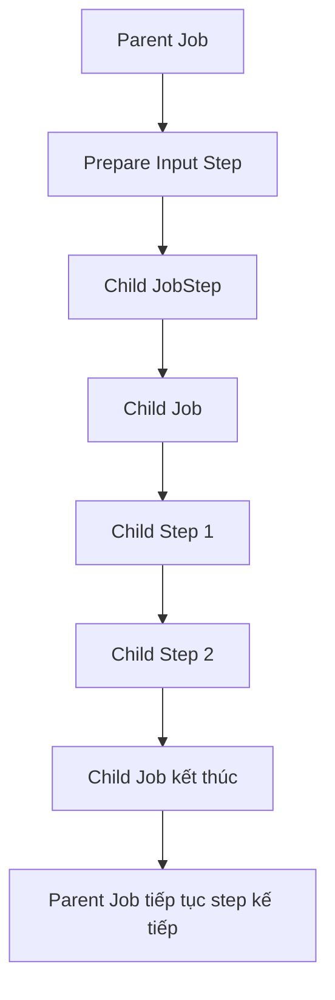

# JobParameters truyền vào job con

Trong Spring Batch, một job có thể được gọi như một step bên trong job khác thông qua `JobStep`. Cách tổ chức này cho phép job cha điều phối các quy trình con, tái sử dụng một job đã có và tách quy trình lớn thành những phần có trách nhiệm riêng.

Khi `JobStep` khởi chạy job con, nó cần một bộ `JobParameters` cho lần chạy của job con. `JobParametersExtractor` đảm nhiệm việc tạo bộ tham số đó từ ngữ cảnh thực thi của step cha. Extractor có thể lấy dữ liệu từ `JobParameters` ban đầu của job cha, `JobExecutionContext` hoặc `StepExecutionContext`, rồi ánh xạ thành tên và kiểu tham số mà job con yêu cầu.

Điểm quan trọng là job con có `JobInstance` và `JobExecution` riêng. Danh tính của job con được xác định bởi tên job con cùng các identifying `JobParameters` mà extractor trả về. Vì vậy, cần chọn tham số ổn định để restart cùng một công việc không vô tình tạo một job instance mới.

## 1. JobStep và quan hệ giữa job cha với job con

`JobStep` là một step có nhiệm vụ khởi chạy một `Job` khác. Job cha xem quy trình con như một bước trong flow của mình:



Ví dụ, job cha xử lý một batch bán hàng có thể gồm:

1. Kiểm tra file và xác định `batchId`.
2. Gọi job con nhập đơn hàng.
3. Gọi job con tính tổng hợp doanh thu.
4. Gọi job con xuất báo cáo.

Mỗi job con có thể được phát triển, kiểm thử và tái sử dụng độc lập. `JobStep` giữ vai trò điều phối và theo dõi kết quả của job con như một step của job cha.

Job cha và job con có metadata thực thi riêng trong `JobRepository`. `StepExecution` của `JobStep` thuộc job cha; `JobExecution` của quy trình con thuộc job con. Hai execution liên quan thông qua lần gọi job con, nhưng không phải cùng một execution.

## 2. JobParameters của job cha không phải JobParameters của job con

`JobParameters` là đầu vào bất biến của một lần chạy job. Khi job cha khởi chạy, nó nhận một bộ tham số, ví dụ:

```text
Parent JobParameters
  businessDate = 2026-11-14
  batchId      = SALES-2026-11-14
  requestedBy  = scheduler
```

Job con có thể cần tên tham số khác hoặc chỉ cần một phần dữ liệu:

```text
Child JobParameters
  businessDate = 2026-11-14
  importBatch  = SALES-2026-11-14
  inputFile    = /data/in/sales-2026-11-14.csv
```

`JobParametersExtractor` tạo bộ tham số cho child job. Điều này cho phép:

- Chỉ truyền những giá trị job con thực sự cần.
- Đổi tên tham số để phù hợp với hợp đồng của job con.
- Lấy giá trị phát sinh trong lúc job cha chạy, chẳng hạn đường dẫn file đã được xác minh.
- Đặt identifying hoặc non-identifying cho từng tham số của job con.
- Kết hợp tham số đầu vào với giá trị được lưu trong execution context.

Không nên giả định mọi tham số của job cha tự động được sao chép sang job con theo cách mong muốn. Hãy xác định rõ hợp đồng tham số của child job và cấu hình extractor tương ứng.

## 3. JobParametersExtractor nhận dữ liệu từ đâu?

`JobParametersExtractor` nhận `Job` con và `StepExecution` của `JobStep` trong job cha. Từ `StepExecution`, extractor có thể truy cập:

- `stepExecution.getJobExecution().getJobParameters()`: tham số đầu vào của job cha.
- `stepExecution.getJobExecution().getExecutionContext()`: Job ExecutionContext của job cha, thường chứa dữ liệu đã được chia sẻ giữa các step.
- `stepExecution.getExecutionContext()`: Step ExecutionContext của chính `JobStep` trong job cha.

Nếu một step trước đó tạo giá trị cần truyền cho job con, cách phổ biến là ghi giá trị vào Step ExecutionContext của step đó rồi dùng `ExecutionContextPromotionListener` đưa khóa cần thiết lên Job ExecutionContext. Khi `JobStep` chạy, extractor đọc giá trị đã promotion từ Job ExecutionContext.

Step ExecutionContext của step trước không tự động trở thành Step ExecutionContext của `JobStep`. Nếu cần chuyển dữ liệu giữa các step, hãy dùng Job ExecutionContext, lưu dữ liệu vào kho nghiệp vụ rồi truyền khóa tham chiếu, hoặc dùng một cơ chế truyền dữ liệu được thiết kế rõ ràng.

## 4. Khai báo JobParametersExtractor tùy chỉnh

Khi cần ánh xạ nhiều nguồn hoặc kiểm soát identifying flags, có thể triển khai `JobParametersExtractor` trực tiếp.

Ví dụ: job cha nhận `businessDate` và `batchId`. Step chuẩn bị file đã xác minh đường dẫn và lưu khóa `validatedInputFile` vào Job ExecutionContext. Job con cần `businessDate`, `importBatch` và `inputFile`.

```java
public class ImportChildParametersExtractor implements JobParametersExtractor {

    @Override
    public JobParameters getJobParameters(
            Job childJob,
            StepExecution parentStepExecution) {

        JobParameters parentParameters = parentStepExecution
                .getJobExecution()
                .getJobParameters();

        ExecutionContext parentContext = parentStepExecution
                .getJobExecution()
                .getExecutionContext();

        String businessDate = parentParameters.getString("businessDate");
        String batchId = parentParameters.getString("batchId");

        if (businessDate == null || batchId == null) {
            throw new IllegalArgumentException(
                    "Parent job must provide businessDate and batchId");
        }

        if (!parentContext.containsKey("validatedInputFile")) {
            throw new IllegalStateException(
                    "validatedInputFile is missing from parent JobExecutionContext");
        }

        String inputFile = parentContext.getString("validatedInputFile");

        JobParametersBuilder builder = new JobParametersBuilder()
                .addString("businessDate", businessDate, true)
                .addString("importBatch", batchId, true)
                .addString("inputFile", inputFile, true);

        String requestedBy = parentParameters.getString("requestedBy");
        if (requestedBy != null) {
            builder.addString("requestedBy", requestedBy, false);
        }

        return builder.toJobParameters();
    }
}
```

Trong ví dụ:

- `businessDate` và `batchId` lấy từ JobParameters của job cha.
- `inputFile` lấy từ Job ExecutionContext của job cha vì đây là giá trị được xác định trong quá trình chạy.
- `importBatch` là tên tham số mà job con sử dụng cho cùng giá trị batch ID.
- Các tham số định danh được đánh dấu `true`; `requestedBy` là thông tin bổ sung không tham gia định danh JobInstance của job con.

Extractor kiểm tra các giá trị bắt buộc trước khi tạo bộ tham số. Nếu thiếu dữ liệu, nó ném exception để `JobStep` thất bại rõ ràng, thay vì khởi chạy child job với bộ tham số thiếu hoặc sai.

## 5. Gắn extractor vào JobStep

Sau khi có child job và extractor, cấu hình `JobStep` trong job cha. Ví dụ theo API Spring Batch 5+:

```java
@Bean
Step importChildJobStep(
        JobRepository jobRepository,
        JobLauncher jobLauncher,
        Job importOrdersJob,
        ImportChildParametersExtractor parametersExtractor) {

    return new StepBuilder("importChildJobStep", jobRepository)
            .job(importOrdersJob)
            .launcher(jobLauncher)
            .parametersExtractor(parametersExtractor)
            .build();
}
```

`JobStep` thực hiện các việc chính:

1. Nhận `StepExecution` của step trong job cha.
2. Gọi `JobParametersExtractor` để tạo tham số cho child job.
3. Gọi `JobLauncher` để khởi chạy child job với bộ tham số vừa tạo.
4. Theo dõi kết quả thực thi child job và phản ánh kết quả đó vào lần thực thi của `JobStep` theo cơ chế của Spring Batch.

Job cha có thể tiếp tục sang step tiếp theo khi `JobStep` hoàn thành theo flow đã cấu hình. Nếu child job thất bại, `JobStep` thường thất bại và flow cha xử lý kết quả đó theo transition.

Job con vẫn là một `Job` bình thường. Nó có thể được chạy độc lập bằng `JobLauncher` với bộ tham số riêng, hoặc được gọi từ nhiều job cha khác nhau nếu hợp đồng tham số và định danh được thiết kế phù hợp.

## 6. Job con nhận JobParameters như thế nào?

Từ góc nhìn child job, các tham số do extractor trả về chính là `JobParameters` đầu vào bình thường. Các step của job con có thể đọc chúng bằng `@Value` và `@StepScope`.

Ví dụ reader trong child job:

```java
@Bean
@StepScope
FlatFileItemReader<OrderInput> childOrderReader(
        @Value("#{jobParameters['inputFile']}") Resource inputFile) {

    return new FlatFileItemReaderBuilder<OrderInput>()
            .name("childOrderReader")
            .resource(inputFile)
            .delimited()
            .names("orderId", "customerId", "amount")
            .targetType(OrderInput.class)
            .saveState(true)
            .build();
}
```

Một step khác trong child job có thể đọc `businessDate` hoặc `importBatch` theo cùng cách:

```java
@Bean
@StepScope
Tasklet createImportSummary(
        @Value("#{jobParameters['businessDate']}") String businessDate,
        @Value("#{jobParameters['importBatch']}") String batchId) {

    return (contribution, chunkContext) -> {
        summaryService.create(batchId, LocalDate.parse(businessDate));
        return RepeatStatus.FINISHED;
    };
}
```

`@StepScope` trì hoãn việc tạo bean cho đến khi step con bắt đầu, khi JobParameters của child job đã sẵn sàng. Không dùng `jobParameters` của job cha trong child job; child job chỉ nhìn thấy bộ tham số được truyền cho chính nó.

## 7. Dùng DefaultJobParametersExtractor khi ánh xạ đơn giản

Spring Batch cung cấp `DefaultJobParametersExtractor` để trích xuất các khóa được cấu hình từ execution context của step/job cha theo cơ chế của extractor chuẩn. Nó phù hợp khi dữ liệu đã được đặt vào context với các tên khóa ổn định và không cần logic chuyển đổi phức tạp.

Ví dụ cấu hình extractor chuẩn với các khóa đã được chuẩn bị trong execution context:

```java
@Bean
JobParametersExtractor childParametersExtractor() {
    DefaultJobParametersExtractor extractor =
            new DefaultJobParametersExtractor();

    extractor.setKeys(new String[] {
            "businessDate",
            "batchId",
            "validatedInputFile"
    });

    return extractor;
}
```

Khi dùng extractor chuẩn, cần xác nhận các khóa nằm đúng context mà phiên bản Spring Batch đang sử dụng đọc và tuân thủ quy ước kiểu dữ liệu của extractor. Nếu phải đổi tên khóa, kết hợp nhiều nguồn, đặt identifying flags khác nhau hoặc kiểm tra tham số bắt buộc, custom `JobParametersExtractor` thường dễ đọc và kiểm soát hơn.

Không nên sao chép một cấu hình `DefaultJobParametersExtractor` mà không kiểm tra nguồn dữ liệu của các khóa. Hãy đọc API của phiên bản Spring Batch trong dự án để xác định chính xác việc extractor lấy giá trị từ Step ExecutionContext, Job ExecutionContext hoặc cả hai.

## 8. Identifying và non-identifying parameters của job con

Job con có `JobInstance` riêng. Định danh của nó được tạo từ tên child job và các tham số được đánh dấu identifying. Đây là yếu tố rất quan trọng khi parent job restart.

Ví dụ:

```java
JobParameters childParameters = new JobParametersBuilder()
        .addString("batchId", "SALES-2026-11-14", true)
        .addString("businessDate", "2026-11-14", true)
        .addString("requestedBy", "scheduler", false)
        .toJobParameters();
```

Ở đây, `batchId` và `businessDate` xác định lần xử lý nghiệp vụ của child job. `requestedBy` chỉ là metadata bổ sung, không tạo một JobInstance mới khi thay đổi.

Khi chọn identifying parameters:

- Dùng mã batch, ngày nghiệp vụ, mã file hoặc định danh nguồn ổn định.
- Giữ nguyên các identifying values khi restart cùng công việc.
- Không thêm timestamp hiện tại hoặc UUID mới ở mỗi lần parent restart nếu mục tiêu là tiếp tục child job cũ.
- Không dùng `JobExecution` ID của parent làm khóa định danh nếu parent restart tạo execution ID mới và child cần tiếp tục cùng batch.
- Nếu hai job cha khác nhau có thể gọi cùng child job cho hai batch khác nhau, phải bảo đảm batch key phân biệt được hai công việc.

Nếu bộ tham số định danh thay đổi, Spring Batch có thể tạo `JobInstance` mới cho child job. Khi đó, child job có thể xử lý lại cùng dữ liệu nghiệp vụ từ đầu. Đây thường là nguyên nhân tạo dữ liệu trùng khi tham số truyền không ổn định.

## 9. Restart của job cha và job con

Job cha và job con có lịch sử thực thi riêng, nhưng restart của chúng có quan hệ với nhau.

Một tình huống phổ biến:

1. Parent job chạy `prepareInputStep` và lưu đường dẫn file đã xác minh vào Job ExecutionContext.
2. `JobStep` tạo child JobParameters và khởi chạy child job.
3. Child job xử lý một số chunk rồi thất bại.
4. Parent `JobStep` thất bại theo kết quả child job.
5. Parent job được restart với cùng identifying JobParameters.
6. Parent flow đi đến `JobStep` chưa hoàn thành; extractor tạo lại child JobParameters ổn định.
7. Child job được khởi chạy lại cùng JobInstance và có thể tiếp tục từ checkpoint đã lưu.

Điều này đòi hỏi child job dùng cùng identifying parameters, `JobRepository` lưu metadata bền vững và reader/writer của child job hỗ trợ restart an toàn.

Nếu child job đã hoàn thành nhưng parent step bị gián đoạn trước khi trạng thái hoàn thành của `JobStep` được ghi nhận, lần restart parent có thể thử khởi chạy lại child job với cùng parameters. Khi child JobInstance đã hoàn thành, Spring Batch có thể từ chối một lần chạy mới bằng `JobInstanceAlreadyCompleteException`. Đây là tình huống cần được tính đến trong thiết kế điều phối và quy trình phục hồi; không nên giải quyết bằng cách thêm timestamp ngẫu nhiên để tạo child instance mới vì có thể làm chạy lại toàn bộ nghiệp vụ.

Hãy xác định rõ chính sách:

- Nếu child job đã hoàn tất, parent có thể xác minh kết quả child execution đã hoàn tất rồi tiếp tục flow hay không?
- Nếu child job thất bại, có thể restart cùng child JobInstance hay cần quy trình phục hồi riêng?
- Nếu child job được chạy lại cho batch nghiệp vụ mới, khóa identifying nào phân biệt batch mới?
- Nếu child job có side effect ngoài transaction, writer đã idempotent chưa?

## 10. Không truyền dữ liệu lớn qua JobParameters

`JobParameters` phù hợp với giá trị định danh hoặc tham số điều khiển nhỏ như ngày nghiệp vụ, batch ID, đường dẫn file, mã partition hoặc chế độ chạy. Không nên truyền danh sách hàng nghìn item, nội dung file hoặc object lớn trong bộ tham số.

Thay vào đó:

- Lưu dữ liệu trong database staging hoặc object storage.
- Truyền `batchId`, `fileReference` hoặc URI đã được kiểm soát cho child job.
- Để child job đọc dữ liệu từ kho lưu trữ bằng tham chiếu đó.
- Lưu checkpoint riêng trong Step ExecutionContext của child job.

Không đưa password, access token hoặc secret vào JobParameters. Tham số có thể được lưu trong metadata repository và hiển thị qua API vận hành. Nếu child job cần xác thực với hệ thống ngoài, dùng secret management hoặc cơ chế credential phù hợp với môi trường chạy.

## 11. Truyền tham số và truyền trạng thái là hai việc khác nhau

`JobParameters` là đầu vào của child job; `ExecutionContext` là trạng thái phát sinh trong quá trình thực thi. Không nên dùng hai cơ chế thay thế nhau.

| Nhu cầu | Cách phù hợp |
|---|---|
| Truyền ngày nghiệp vụ từ parent sang child | JobParametersExtractor đọc parent JobParameters |
| Truyền mã batch đã xác định từ đầu | JobParameters |
| Truyền đường dẫn file đã được kiểm tra ở step trước | Promotion lên parent Job ExecutionContext rồi extractor lấy ra |
| Truyền checkpoint reader của child | Step ExecutionContext của child job |
| Chia sẻ một giá trị giữa các step trong child job | Child Job ExecutionContext |
| Truyền danh sách dữ liệu lớn | Database/object storage và khóa tham chiếu |

Không nên lưu checkpoint của child job vào JobParameters. Nếu checkpoint thay đổi sau mỗi chunk mà được coi là identifying parameter, mỗi checkpoint có thể tạo một JobInstance khác. Checkpoint thuộc ExecutionContext của child step.

## 12. Cấu hình flow cha có JobStep

Ví dụ job cha có step chuẩn bị dữ liệu, JobStep gọi job con và step tổng hợp kết quả:

```java
@Bean
Job parentSalesJob(
        JobRepository jobRepository,
        Step prepareInputStep,
        Step importChildJobStep,
        Step summarizeStep) {

    return new JobBuilder("parentSalesJob", jobRepository)
            .start(prepareInputStep)
            .next(importChildJobStep)
            .next(summarizeStep)
            .build();
}
```

Job cha điều phối các giai đoạn. Child job được cấu hình thành một bean `Job` riêng:

```java
@Bean
Job importOrdersJob(
        JobRepository jobRepository,
        Step readAndWriteOrdersStep,
        Step reconcileImportedOrdersStep) {

    return new JobBuilder("importOrdersJob", jobRepository)
            .start(readAndWriteOrdersStep)
            .next(reconcileImportedOrdersStep)
            .build();
}
```

Tên child job phải phân biệt với tên parent job và với các job khác trong cùng repository. Mỗi job có flow và metadata riêng.

## 13. JobStep và JobLauncher

`JobStep` sử dụng `JobLauncher` để khởi chạy child job. Với flow cha cần chờ child job hoàn tất rồi mới quyết định transition tiếp theo, launcher đồng bộ thường là lựa chọn dễ dự đoán: `JobStep` nhận kết quả thực thi cuối cùng của child job trong cùng luồng điều phối.

Nếu dùng launcher bất đồng bộ, cần hiểu rõ cách `JobStep` nhận trạng thái khi `run()` trả về trước khi child job kết thúc. Parent flow không nên tiếp tục như thể child job đã hoàn tất nếu nó vẫn đang chạy. Việc dùng async cần một thiết kế điều phối riêng, có cơ chế theo dõi child execution và đồng bộ kết quả.

Trong ứng dụng Spring Boot, hãy kiểm tra bean `JobLauncher` thực tế được inject vào `JobStep`. Không nên giả định launcher đang đồng bộ hoặc bất đồng bộ chỉ dựa vào cách gọi builder; hành vi phụ thuộc `TaskExecutor` được cấu hình.

## 14. Xử lý lỗi khi tạo hoặc truyền JobParameters

Extractor là ranh giới giữa ngữ cảnh job cha và hợp đồng tham số của job con. Cần xử lý lỗi rõ ràng:

- Thiếu tham số bắt buộc của parent: dừng trước khi khởi chạy child job.
- Thiếu khóa trong Job ExecutionContext: kiểm tra step chuẩn bị dữ liệu đã hoàn thành và promotion listener đã chạy.
- Sai kiểu dữ liệu hoặc định dạng: xác thực trước khi tạo JobParameters.
- Tham số identifying không ổn định: sửa quy tắc định danh để restart cùng batch dùng cùng bộ tham số.
- Trùng tham số nhưng child JobInstance đang chạy: không khởi chạy một execution trùng; xử lý theo trạng thái child hiện có.
- Child JobInstance đã hoàn thành: xác minh kết quả và xử lý `JobInstanceAlreadyCompleteException` theo chính sách điều phối.

Không nên bắt mọi exception từ extractor hoặc launcher rồi trả `COMPLETED` cho parent step. Nếu không thể tạo đúng tham số hoặc child job không thể chạy, parent cần thể hiện thất bại hoặc nhánh recovery có chủ đích.

## 15. Kiểm thử JobParameters truyền vào job con

Kiểm thử nên xác nhận không chỉ child job có chạy mà còn nhận đúng bộ tham số và định danh đúng JobInstance.

Các trường hợp cần kiểm tra:

1. **Ánh xạ cơ bản:** parent parameters được chuyển thành đúng tên và kiểu tham số child job.
2. **Giá trị trong context:** khóa đã promotion từ step trước được extractor đọc và truyền cho child job.
3. **Thiếu tham số bắt buộc:** extractor báo lỗi rõ và child job không được khởi chạy với dữ liệu thiếu.
4. **Identifying flags:** cùng batch tạo cùng child JobInstance; batch mới tạo instance khác.
5. **Non-identifying parameters:** thay đổi thông tin không định danh không tạo child JobInstance mới.
6. **Restart parent:** extractor tạo lại cùng identifying child parameters để child job có thể restart đúng instance.
7. **Child job thất bại:** parent JobStep phản ánh kết quả thất bại và flow cha đi theo nhánh phù hợp.
8. **Child job đã hoàn thành:** parent restart không vô tình tạo một child instance mới cho cùng batch.
9. **Side effect lặp:** child writer an toàn khi chunk được restart hoặc job con được gọi lại.

Ví dụ kiểm tra child execution sau khi chạy parent job:

```java
JobExecution parentExecution =
        jobLauncherTestUtils.launchJob(parentParameters);

assertEquals(BatchStatus.COMPLETED, parentExecution.getStatus());

JobInstance childInstance = jobExplorer.getJobInstances(
        "importOrdersJob", 0, 10)
        .stream()
        .filter(instance -> instance.getJobName().equals("importOrdersJob"))
        .findFirst()
        .orElseThrow();

List<JobExecution> childExecutions =
        jobExplorer.getJobExecutions(childInstance);
```

Đây là khung minh họa cách tra cứu child execution; trong test thực tế, nên xác định child instance bằng identifying parameters cụ thể hoặc lấy child execution ID được lưu/ghi nhận bởi cơ chế điều phối. Không nên chọn instance đầu tiên trong repository nếu test chạy nhiều batch khác nhau.

Có thể kiểm tra bộ tham số của child execution:

```java
JobParameters childParameters = childExecution.getJobParameters();

assertEquals("SALES-2026-11-14",
        childParameters.getString("importBatch"));
assertEquals("2026-11-14",
        childParameters.getString("businessDate"));
```

Đồng thời kiểm tra `JobInstance` ID để xác nhận hai lần parent restart dùng cùng identifying parameters đã tham chiếu đến cùng child instance. Với test restart, cần dùng `JobRepository` bền vững giữa các lần chạy và không xóa metadata child job trước khi kiểm tra.

## 16. Những lỗi thường gặp

**Cho rằng child job tự nhận toàn bộ tham số parent.** Hãy dùng `JobParametersExtractor` để xác định rõ những giá trị được truyền và tên tham số tương ứng.

**Đọc giá trị từ sai ExecutionContext.** `StepExecutionContext` của step trước không tự động xuất hiện trong context của `JobStep`. Promotion khóa cần thiết lên Job ExecutionContext hoặc lưu tham chiếu bên ngoài.

**Dùng JobParameters làm checkpoint.** Tham số đầu vào định danh công việc; checkpoint thay đổi trong quá trình chạy thuộc ExecutionContext của child step.

**Tạo identifying parameter mới mỗi lần restart.** Timestamp hoặc UUID mới có thể tạo child JobInstance mới và làm xử lý lại batch. Dùng mã nghiệp vụ ổn định.

**Đánh dấu mọi tham số là identifying.** Một giá trị như `requestedBy` thay đổi không nên tạo instance mới nếu nó không thay đổi phạm vi nghiệp vụ.

**Truyền dữ liệu lớn hoặc secret.** JobParameters được lưu trong metadata; chỉ truyền tham số nhỏ, có ý nghĩa và không nhạy cảm.

**Không xử lý child job đã chạy hoặc đã hoàn thành.** Khi parent restart, child job có thể đang chạy, thất bại hoặc đã hoàn tất. Cần xử lý trạng thái theo cùng bộ identifying parameters.

**Dùng launcher bất đồng bộ mà không đồng bộ flow cha.** Parent có thể không có kết quả cuối của child job tại thời điểm cần quyết định transition. Hãy chọn launcher và cơ chế điều phối phù hợp.

## Kết luận

`JobStep` dùng `JobParametersExtractor` để tạo bộ tham số cho job con từ ngữ cảnh thực thi của step cha. Extractor có thể kết hợp `JobParameters` đầu vào với Job ExecutionContext hoặc Step ExecutionContext, ánh xạ tên khóa và xác định tham số nào tham gia định danh child `JobInstance`.

Hãy truyền các giá trị nghiệp vụ ổn định như `batchId`, `businessDate` và tham chiếu file; promotion dữ liệu từ step trước lên Job ExecutionContext khi cần; giữ identifying parameters giống nhau khi restart; và để checkpoint của child job nằm trong ExecutionContext của chính child step. Khi hợp đồng tham số, trạng thái restart và cách xử lý child execution được thiết kế rõ ràng, job cha có thể điều phối job con một cách có thể dự đoán và an toàn.
