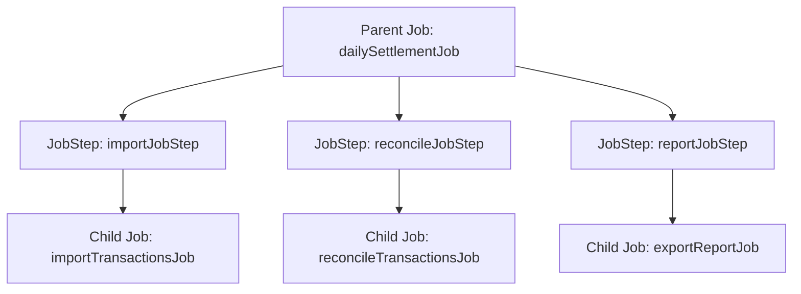
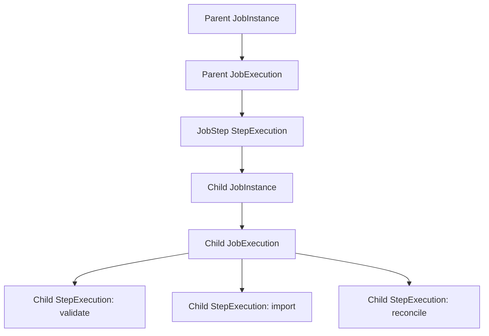
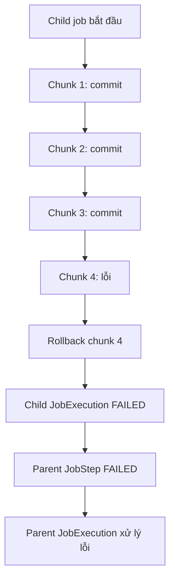

# Transaction boundary của JobStep

Trong Spring Batch, JobStep cho phép một job cha khởi chạy một job con như một step trong workflow. Cách tổ chức này giúp chia một quy trình lớn thành các job có trách nhiệm riêng, tái sử dụng job con và quản lý thứ tự thực thi ở cấp job cha.

Điểm cần hiểu rõ là **JobStep không biến toàn bộ job con thành một transaction duy nhất của job cha**. JobStep có StepExecution riêng trong job cha; khi được thực thi, nó gọi JobLauncher để khởi chạy một job khác với JobExecution riêng. Các transaction xử lý dữ liệu nghiệp vụ được tạo theo từng step của job con: chunk step thường có transaction theo chunk, còn tasklet step có ranh giới transaction theo lần thực thi tasklet/iteration được cấu hình.

Vì vậy, nếu job con đã commit ba chunk rồi thất bại ở chunk thứ tư, việc job cha đánh dấu JobStep thất bại không tự rollback ba chunk đã commit. Muốn restart an toàn, phải hiểu cả metadata của job cha lẫn job con, giữ ổn định identifying parameters của job con và thiết kế writer có khả năng xử lý lại an toàn.

## 1. JobStep là gì?

JobStep là một loại Step dùng để chạy một Job khác. Thay vì đặt tất cả xử lý vào một job lớn, ta có thể tạo job con cho một phần quy trình và gọi nó từ job cha.

Ví dụ, quy trình đối soát cuối ngày có thể được chia thành:

- Job cha điều phối toàn bộ quy trình.
- Job con nhập giao dịch.
- Job con tính tổng và đối soát.
- Job con xuất báo cáo.



Mỗi job con có tên job, parameters, JobInstance và JobExecution riêng. Job cha có JobExecution của chính nó và một StepExecution cho mỗi JobStep. Quan hệ này cho phép quan sát tiến độ điều phối ở cấp cha và chi tiết xử lý ở cấp con.

### Phân biệt JobStep với Step thông thường

| Thành phần | Vai trò |
|---|---|
| Chunk-oriented Step | Đọc, xử lý và ghi item theo chunk |
| Tasklet Step | Thực hiện một tác vụ hoặc vòng lặp tasklet |
| JobStep | Khởi chạy một Job khác như một step của job cha |
| Flow | Gom và điều hướng các step trong cùng một job |

JobStep không phải là cách gọi một phương thức Java thông thường. Nó tạo một lần thực thi job con thông qua JobLauncher, do đó job con có vòng đời và metadata riêng.

## 2. Hai cấp thực thi và hai cấp metadata

Khi JobStep chạy, Spring Batch quản lý hai lớp execution:

1. **Cấp cha**: parent JobExecution chứa StepExecution của JobStep.
2. **Cấp con**: child JobInstance và child JobExecution, bên trong có các StepExecution của job con.



Hai cấp này có ID khác nhau và trạng thái riêng. JobStep là một step trong job cha; child job không trở thành một step execution khác của parent job. Khi tra cứu metadata, cần dùng child JobExecution để xem chi tiết các step bên trong job con.

Thông thường, parent và child được cấu hình dùng cùng một JobRepository để metadata tập trung và dễ tra cứu. Dù cùng repository, parent execution và child execution vẫn là các bản ghi riêng biệt.

## 3. Cấu hình JobStep

Spring Batch cung cấp builder để cấu hình job con, launcher và cách tạo parameters cho job con.

Ví dụ với Spring Batch 5:

```java
@Bean
Step importTransactionsJobStep(
        JobRepository jobRepository,
        JobLauncher jobLauncher,
        Job importTransactionsJob,
        JobParametersExtractor childParametersExtractor) {

    return new StepBuilder("importTransactionsJobStep", jobRepository)
            .job(importTransactionsJob)
            .launcher(jobLauncher)
            .parametersExtractor(childParametersExtractor)
            .build();
}
```

Các thành phần:

- StepBuilder: tạo step thuộc parent job.
- job(importTransactionsJob): chọn job sẽ được khởi chạy.
- launcher(jobLauncher): cung cấp JobLauncher để chạy child job.
- parametersExtractor(...): xác định JobParameters truyền cho child job.
- build(): tạo JobStep.

Job cha có thể gọi JobStep như một step bình thường:

```java
@Bean
Job dailySettlementJob(
        JobRepository jobRepository,
        Step importTransactionsJobStep,
        Step reconcileJobStep,
        Step exportReportJobStep) {

    return new JobBuilder("dailySettlementJob", jobRepository)
            .start(importTransactionsJobStep)
            .next(reconcileJobStep)
            .next(exportReportJobStep)
            .build();
}
```

Ở đây, mỗi JobStep khởi chạy một child job. Các job con vẫn có thể được chạy độc lập bởi scheduler hoặc một job khác nếu thiết kế cho phép.

## 4. Job con có transaction boundary riêng

Điểm quan trọng nhất của JobStep là ranh giới transaction của dữ liệu nghiệp vụ nằm ở các step bên trong child job.

Giả sử child job có một chunk step với chunk size 100:

```java
@Bean
Step importInvoiceStep(
        JobRepository jobRepository,
        PlatformTransactionManager businessTransactionManager,
        ItemReader<Invoice> invoiceReader,
        ItemProcessor<Invoice, ImportedInvoice> invoiceProcessor,
        ItemWriter<ImportedInvoice> invoiceWriter) {

    return new StepBuilder("importInvoiceStep", jobRepository)
            .<Invoice, ImportedInvoice>chunk(
                    100,
                    businessTransactionManager)
            .reader(invoiceReader)
            .processor(invoiceProcessor)
            .writer(invoiceWriter)
            .build();
}
```

Trong ví dụ, mỗi chunk gồm tối đa 100 item và được xử lý trong transaction do businessTransactionManager quản lý. Nếu chunk thứ tư lỗi trước commit:

- Transaction của chunk thứ tư được rollback theo resource tham gia.
- Ba chunk trước đã commit vẫn còn trong database.
- Child job có thể kết thúc ở trạng thái FAILED.
- JobStep ở parent nhận kết quả không thành công và parent workflow thường dừng hoặc đi vào nhánh lỗi được cấu hình.



Parent JobStep không có một transaction bao ngoài để undo các commit của chunk 1, 2 và 3. Đây là hành vi mong đợi của batch processing: tiến độ đã commit được giữ lại để child job có thể restart.

## 5. JobStep không tạo một transaction bao trùm toàn bộ child job

Một hiểu nhầm phổ biến là vì child job được gọi từ một step, nên toàn bộ job con sẽ chạy bên trong transaction của step cha. Đây không phải cách Spring Batch tổ chức transaction.

Hãy phân biệt:

- Parent JobExecution quản lý vòng đời của job cha.
- Parent StepExecution ghi metadata cho JobStep.
- JobLauncher khởi chạy child JobExecution.
- Các child step dùng transaction manager và ranh giới transaction riêng của chúng.

Child job có thể có nhiều step, mỗi step có thể có nhiều chunk. Không có một transaction duy nhất bao quanh toàn bộ chuỗi đó.

Ngay cả khi parent và child dùng cùng database hoặc cùng transaction manager bean, không nên giả định mọi step con sẽ cùng commit hoặc rollback như một transaction. Các chunk transaction được mở/commit theo cấu hình của child step. Parent JobStep không biến chúng thành một đơn vị atomic duy nhất.

### Metadata transaction và business transaction

Spring Batch lưu metadata qua JobRepository. Dữ liệu nghiệp vụ thường được ghi qua transaction manager của child step. Hai nhóm thao tác có thể dùng cùng database hoặc datasource, nhưng mục tiêu và ranh giới của chúng khác nhau.

Metadata cho biết job/step đã bắt đầu, hoàn tất, thất bại và checkpoint ở đâu. Business transaction bảo vệ các thay đổi dữ liệu của chunk hoặc tasklet. Đừng dựa vào một bản ghi trạng thái của parent để suy ra mọi thay đổi nghiệp vụ của child đã được rollback.

## 6. JobStep và Tasklet Step có ranh giới khác nhau

Một Tasklet Step thực hiện tasklet trong hạ tầng step của chính nó. Với tasklet thông thường, transaction manager được cấu hình cho step quản lý transaction của lần thực thi tasklet; nếu tasklet lặp lại bằng RepeatStatus.CONTINUABLE, các lần lặp được xử lý theo transaction boundary của TaskletStep.

JobStep thì gọi một JobLauncher để chạy child job. Nó không tự gom các transaction của tất cả child step vào transaction của parent step.

| Câu hỏi | Tasklet Step | JobStep |
|---|---|---|
| Đơn vị được thực thi | Tasklet | Child Job |
| Có child JobExecution không? | Không | Có |
| Có các child StepExecution không? | Không | Có, trong job con |
| Transaction nghiệp vụ chính | Theo cấu hình TaskletStep | Theo transaction manager của từng child step |
| Có một transaction bao toàn bộ quy trình không? | Không mặc định | Không |

Nếu chỉ cần gọi một service Java để thực hiện một thao tác ngắn, Tasklet Step có thể phù hợp hơn. Nếu phần xử lý cần lifecycle job riêng, parameters riêng, restart riêng và metadata riêng, JobStep là lựa chọn phù hợp.

## 7. Child JobParameters được tạo như thế nào?

Job con có danh tính riêng. JobInstance của child job được xác định bằng tên child job và các identifying parameters được truyền vào child job.

Vì vậy, JobParametersExtractor là thành phần quan trọng. Nó chuyển thông tin từ StepExecution của parent JobStep thành JobParameters cho child job.

Không nên mặc định mọi parent parameters sẽ được chuyển sang child theo đúng cách ứng dụng mong muốn. Hãy cấu hình extractor để xác định rõ:

- Parameter nào child cần để chọn dữ liệu.
- Parameter nào phải là identifying.
- Parameter nào chỉ phục vụ audit/correlation.
- Giá trị nào được lấy từ parent job parameters hoặc execution context.

Ví dụ extractor tường minh:

```java
@Bean
JobParametersExtractor childParametersExtractor() {
    return (childJob, parentStepExecution) -> {
        JobParameters parentParameters =
                parentStepExecution.getJobParameters();

        String businessDate = Objects.requireNonNull(
                parentParameters.getString("businessDate"));
        String batchId = Objects.requireNonNull(
                parentParameters.getString("batchId"));

        return new JobParametersBuilder()
                .addString("businessDate", businessDate, true)
                .addString("batchId", batchId, true)
                .addString(
                        "parentExecutionId",
                        String.valueOf(
                                parentStepExecution.getJobExecutionId()),
                        false)
                .toJobParameters();
    };
}
```

Trong ví dụ:

- businessDate và batchId xác định lô nghiệp vụ của child job.
- parentExecutionId chỉ phục vụ truy vết, không tham gia danh tính child instance.
- Khi parent job restart, extractor tạo lại cùng identifying values nếu parent parameters không đổi.

Nếu parentExecutionId thay đổi khi parent có execution mới, nó vẫn không tạo child instance mới vì được đánh dấu non-identifying. Tuy nhiên, chỉ đưa parameter này vào nếu child thực sự cần correlation. Có thể dùng một parentBatchId ổn định hơn nếu muốn liên kết các execution của cùng yêu cầu logic.

### Dùng DefaultJobParametersExtractor

Spring Batch cũng cung cấp DefaultJobParametersExtractor để trích các giá trị từ execution context theo cấu hình key và tên parameter. Cách này hữu ích khi một step trước đã đặt dữ liệu cần thiết vào context.

Ví dụ cấu hình có thể chỉ rõ các key cần trích xuất:

```java
@Bean
JobParametersExtractor childParametersExtractor() {
    DefaultJobParametersExtractor extractor =
            new DefaultJobParametersExtractor();

    extractor.setKeys(new String[] {
            "businessDate",
            "batchId"
    });

    return extractor;
}
```

Hành vi ánh xạ cụ thể và các thuộc tính của extractor cần đối chiếu với phiên bản Spring Batch đang dùng. Nếu cần kiểm soát identifying flag, kiểu dữ liệu hoặc nguồn parameter một cách rõ ràng, custom JobParametersExtractor như ví dụ trước thường dễ đọc và dễ kiểm soát hơn.

## 8. Vì sao identifying parameters phải ổn định khi restart?

Giả sử child job importTransactionsJob chạy cho businessDate=2026-11-15 và batchId=daily-20261115.

Lần đầu:

- Parent JobStep khởi chạy child job với hai identifying parameters đó.
- Child job tạo JobInstance A.
- Child job commit một số chunk rồi thất bại.

Khi parent restart, extractor phải tạo lại đúng hai identifying values để child job nhận diện cùng JobInstance A và restart execution phù hợp.

Nếu extractor thêm Instant.now() làm identifying parameter mỗi lần, child job sẽ tạo instance B thay vì tiếp tục instance A. Dữ liệu đã commit ở A có thể bị xử lý lại từ đầu trong B.

| Lần gọi | businessDate | batchId | runAt identifying | Child instance |
|---|---|---|---|---|
| Lần đầu | 2026-11-15 | daily-20261115 | 01:00 | A |
| Parent restart | 2026-11-15 | daily-20261115 | 01:05 | B |
| Parent restart đúng | 2026-11-15 | daily-20261115 | Không có | A |

Hãy dùng business key ổn định như ngày nghiệp vụ, file ID, window start/end hoặc batch ID. Thời điểm gọi lại, parent execution ID hoặc correlation ID thường không nên là identifying nếu chúng không làm thay đổi tập dữ liệu child cần xử lý.

## 9. Child job thất bại thì parent JobStep ra sao?

Khi JobStep gọi child job, kết quả child execution được phản ánh vào kết quả của JobStep. Nếu child job kết thúc không thành công, JobStep thường kết thúc không thành công và parent job sẽ dừng hoặc điều hướng theo flow của parent.

Ví dụ parent job xử lý lỗi:

```java
@Bean
Job parentImportJob(
        JobRepository jobRepository,
        Step childImportJobStep,
        Step recordFailureStep,
        Step finalAuditStep) {

    return new JobBuilder("parentImportJob", jobRepository)
            .start(childImportJobStep)
                .on("COMPLETED").to(finalAuditStep)
            .from(childImportJobStep)
                .on("FAILED").to(recordFailureStep)
            .from(recordFailureStep)
                .on("*").fail()
            .end()
            .build();
}
```

Flow của parent điều hướng theo exit status của JobStep. Nếu child job thất bại, parent có thể ghi nhận lỗi hoặc chạy một bước xử lý riêng.

Điều này không xóa các chunk đã commit của child. Step xử lý lỗi trong parent chỉ là một phần của workflow; nó không phải rollback bù cho các commit đã hoàn tất.

## 10. Ví dụ transaction timeline khi child job lỗi

Giả sử parent job gọi child job nhập giao dịch. Child job có hai step:

- loadTransactionsStep: đọc file và ghi staging table theo chunk.
- postTransactionsStep: chuyển staging records sang bảng chính theo chunk.

Timeline:

| Thời điểm | Cấp thực thi | Sự kiện | Kết quả dữ liệu |
|---|---|---|---|
| T1 | Parent | Parent JobExecution bắt đầu | Parent metadata được tạo |
| T2 | Parent | JobStep bắt đầu | Parent StepExecution được tạo/cập nhật |
| T3 | Child | Child JobExecution bắt đầu | Child metadata được tạo |
| T4 | Child step 1 | Chunk 1 commit | Staging có chunk 1 |
| T5 | Child step 1 | Chunk 2 commit | Staging có chunk 1 và 2 |
| T6 | Child step 1 | Step hoàn tất | Staging giữ dữ liệu đã commit |
| T7 | Child step 2 | Chunk 1 commit | Bảng chính có chunk 1 |
| T8 | Child step 2 | Chunk 2 lỗi | Chunk 2 rollback |
| T9 | Child | Child JobExecution FAILED | Chunk 1 ở bảng chính vẫn tồn tại |
| T10 | Parent | JobStep FAILED | Parent không rollback các commit của child |

Nếu job con được thiết kế restartable, lần chạy tiếp theo có thể tiếp tục step 2 từ checkpoint phù hợp. Writer phải bảo đảm chunk đã commit không bị ghi trùng khi restart.

## 11. Restart parent job và child job

Restart của JobStep cần xem xét hai lớp trạng thái:

- Parent job có restart được không và parent JobStep đang ở trạng thái nào?
- Child job có execution nào, trạng thái gì và identifying parameters có khớp không?

Một số trường hợp:

### Child job thất bại

Nếu parent JobStep thất bại do child job thất bại, parent job có thể được restart theo chính sách. JobStep được thực thi lại và launcher khởi chạy child job với parameters tương ứng. Nếu child instance trước đó thất bại và đủ điều kiện restart, Spring Batch có thể tạo child JobExecution mới cho cùng child JobInstance.

### Child job đã hoàn tất

Nếu child job đã hoàn tất và parent JobStep cũng đã được ghi nhận hoàn tất, khi restart parent job, step đã hoàn tất thường được bỏ qua theo hành vi restart mặc định. Parent tiếp tục từ step chưa hoàn tất tiếp theo.

### Child hoàn tất nhưng parent chưa ghi nhận JobStep hoàn tất

Có một cửa sổ lỗi hiếm nhưng quan trọng: child job đã hoàn tất, nhưng process dừng trước khi parent JobStep ghi nhận kết quả hoàn tất. Khi parent restart, JobStep có thể thử launch child lại với cùng identifying parameters. Child repository có thể từ chối vì instance đã hoàn tất.

Trong tình huống này, cần đối chiếu child JobExecution và parent StepExecution trước khi can thiệp. Có thể cần một quy trình recovery nhận diện child đã hoàn tất và đồng bộ trạng thái parent theo cách được ứng dụng hỗ trợ. Không sửa trực tiếp trạng thái metadata để ép chạy tiếp.

### Parent job restart nhiều lần

Không tạo batch ID mới hoặc timestamp identifying mới chỉ vì parent được restart. Nếu child cần xử lý lại một lô nghiệp vụ đã hoàn tất, hãy tạo một yêu cầu reprocess có ID/version mới và writer có cơ chế idempotency.

## 12. Parent và child có thể dùng chung JobRepository không?

Thông thường, parent và child job được cấu hình dùng chung JobRepository để:

- Tra cứu cả parent và child executions tại một nơi.
- Dùng chung metadata schema và transaction infrastructure.
- Theo dõi quan hệ giữa parent StepExecution và child JobExecution qua ID/correlation parameters.
- Hỗ trợ restart và vận hành thống nhất.

Dùng chung repository không có nghĩa hai execution nhập thành một execution. Mỗi job vẫn có JobInstance, JobExecution và StepExecution riêng.

Nếu child job dùng repository khác, cần quản lý rõ metadata database của child, transaction manager, launcher và cách parent truy vấn kết quả. Việc tách repository có thể hợp lý trong kiến trúc nhiều hệ thống, nhưng làm cho tracing và recovery phức tạp hơn.

## 13. JobLauncher đồng bộ và bất đồng bộ

JobStep gọi child job thông qua JobLauncher. Với launcher chạy đồng bộ, lời gọi thường trả về sau khi child job hoàn tất, nên JobStep có thể dựa trên kết quả cuối của child execution để xác định kết quả step cha.

Nếu dùng launcher có task executor bất đồng bộ, lời gọi có thể trả về khi child job vẫn đang chạy. Khi đó parent JobStep không nên được giả định là tự động chờ child hoàn tất hoặc luôn có trạng thái cuối cùng ngay khi run() trả về.

Với JobStep cần quan sát kết quả child trước khi parent đi tiếp, hãy ưu tiên launcher đồng bộ hoặc thiết kế orchestration bất đồng bộ riêng:

- Parent ghi nhận child execution ID.
- Một thành phần điều phối theo dõi child execution.
- Parent chỉ tiếp tục khi nhận được trạng thái cuối phù hợp.
- Có timeout, retry, idempotency và xử lý child bị treo.

Không dùng async launcher trong JobStep mà không kiểm tra rõ hành vi của phiên bản và cấu hình đang triển khai. Một parent job kết thúc sớm trong khi child còn chạy có thể làm sai ý nghĩa workflow và gây khó khăn khi restart.

## 14. Transaction giữa child job và hệ thống bên ngoài

Nếu child job vừa ghi database vừa gọi HTTP API, gửi message hoặc tạo file, các side effect bên ngoài không tự rollback khi child chunk thất bại.

Ví dụ:

1. Child writer gửi giao dịch sang partner API.
2. Partner đã nhận và xử lý request.
3. Database transaction của chunk rollback vì lỗi ghi metadata hoặc một thao tác khác.
4. Khi restart, child job có thể gửi lại cùng giao dịch.

Để tránh side effect trùng:

- Dùng idempotency key ổn định theo batch ID và source record ID.
- Lưu yêu cầu phát message vào transactional outbox trong cùng DB transaction với dữ liệu nghiệp vụ.
- Dùng staging và publish protocol cho file.
- Có reconciliation để đối chiếu dữ liệu child đã commit với hệ thống đích.
- Lưu correlation ID để điều tra parent-child executions.

Parent JobStep chỉ điều phối job con; nó không cung cấp distributed transaction cho mọi dịch vụ mà child gọi.

## 15. JobStep và FlowStep: chọn đúng abstraction

Hai cách tổ chức có thể trông giống nhau nhưng ý nghĩa khác:

| Tiêu chí | JobStep | FlowStep |
|---|---|---|
| Đơn vị được gọi | Một Job riêng | Một Flow |
| Child JobInstance/JobExecution riêng | Có | Không tạo một job instance riêng chỉ vì flow được lồng |
| Parameters riêng cho child job | Có, qua JobParametersExtractor | Không có child job parameters riêng |
| Restart metadata | Có metadata của parent và child | Theo các step thuộc cùng job execution |
| Tái sử dụng một job độc lập | Phù hợp | Không phải mục tiêu chính |
| Chia nhỏ workflow nội bộ cùng job | Có thể, nhưng tạo job con | Phù hợp |

Nếu phần xử lý cần lifecycle, parameters, restart và metadata độc lập, dùng JobStep. Nếu chỉ muốn gom một nhóm step hoặc tái sử dụng một flow trong cùng job, hãy cân nhắc Flow/FlowStep.

## 16. Thiết kế child job để restart an toàn

Một child job được gọi từ JobStep nên đáp ứng các điều kiện:

- Có job name ổn định và identifying parameters thể hiện đúng lô nghiệp vụ.
- Reader hỗ trợ checkpoint hoặc có cơ chế resume rõ ràng.
- Input được chốt hoặc có version/checksum để restart không đọc nội dung khác.
- Writer idempotent hoặc có unique key để tránh ghi trùng.
- Mỗi child step dùng transaction manager đúng với resource nghiệp vụ.
- Các chunk đã commit có thể giữ lại khi chunk sau thất bại.
- Side effect bên ngoài có outbox hoặc idempotency key.
- Child execution có log và metric liên kết với parent execution.

Parent job nên truyền những parameters cần thiết và giữ chúng ổn định. Đừng để child tự gọi Instant.now() rồi tạo identifying parameter mới mỗi lần được parent khởi chạy.

## 17. Kiểm thử transaction boundary của JobStep

Kiểm thử nên xác nhận hành vi ở cả hai cấp execution:

| Kịch bản | Điều cần xác nhận |
|---|---|
| Child job hoàn tất | Parent JobStep hoàn tất và parent đi tiếp |
| Child job thất bại ở chunk đầu | Chunk rollback, child và parent step phản ánh lỗi |
| Child thất bại sau vài chunk commit | Chunk trước còn trong DB; chunk lỗi rollback |
| Restart parent với cùng child parameters | Child instance được nhận diện đúng |
| Extractor tạo identifying parameter mới ngoài ý muốn | Test phát hiện child instance bị đổi |
| Child đã hoàn tất, parent restart | Parent không xử lý trùng child work |
| Child đã hoàn tất nhưng parent metadata chưa cập nhật | Recovery path xử lý được tình huống |
| Async launcher | Parent-child status được điều phối rõ ràng |
| Child gọi external API | Retry không tạo side effect trùng |

Một integration test hữu ích là tạo child job đọc 250 item với chunk size 100, cố ý làm chunk thứ ba thất bại. Sau lần chạy đầu, kiểm tra 200 item của hai chunk đầu đã commit và chunk thứ ba chưa commit. Sau đó restart cùng child parameters và xác nhận job hoàn tất mà không tạo bản ghi trùng.

## 18. Những lỗi thường gặp

**Cho rằng JobStep bao transaction quanh child job.** JobStep khởi chạy child job riêng; transaction nghiệp vụ thuộc các child step.

**Cho rằng parent thất bại sẽ rollback child.** Các chunk child đã commit vẫn tồn tại. Cần restart hoặc compensation theo thiết kế.

**Truyền timestamp mới làm child identifying parameter.** Mỗi lần parent restart có thể tạo child JobInstance mới và xử lý lại dữ liệu từ đầu.

**Không hiểu hai cấp metadata.** Parent StepExecution và child JobExecution là các bản ghi khác nhau. Khi điều tra, phải truy vấn đúng cấp.

**Dùng async JobLauncher rồi giả định parent chờ.** Parent có thể không quan sát trạng thái cuối của child tại thời điểm mong muốn. Cần synchronous launch hoặc orchestration bất đồng bộ có theo dõi trạng thái.

**Coi child job hoàn tất là bảo đảm side effect bên ngoài hoàn tất nguyên tử.** HTTP, file và message có ranh giới riêng. Dùng outbox, staging và idempotency.

**Không xử lý cửa sổ child complete/parent update.** Có thể gặp tình huống child đã complete nhưng parent JobStep chưa được ghi nhận hoàn tất. Cần quy trình đối chiếu metadata và recovery.

**Dùng JobStep khi chỉ cần gom step.** Nếu không cần JobInstance/JobExecution riêng, một Flow có thể đơn giản hơn.

## 19. Quy trình thiết kế JobStep

Trước khi tạo JobStep, hãy trả lời:

1. Job con có thực sự cần lifecycle và metadata độc lập không?
2. Child job dùng JobRepository và JobLauncher nào?
3. Parameters nào được truyền từ parent sang child?
4. Identifying parameters có ổn định qua restart không?
5. Transaction manager nào được dùng bởi từng child step?
6. Nếu child thất bại sau vài chunk, dữ liệu nào đã commit?
7. Parent sẽ dừng, rẽ nhánh hay tiếp tục khi child trả từng exit status?
8. Restart parent có khởi chạy lại child đúng instance không?
9. Nếu child complete nhưng parent chưa ghi nhận, recovery sẽ xử lý thế nào?
10. Writer và external side effect có idempotent không?

Việc trả lời các câu hỏi này trước khi viết builder giúp tránh nhầm lẫn giữa điều phối workflow và transaction của dữ liệu.

## 20. Kết luận thực hành

JobStep là cầu nối để một job cha khởi chạy một job con. Nó tạo một StepExecution ở cấp cha và một JobExecution riêng ở cấp con. Các transaction xử lý nghiệp vụ được quản lý bên trong các step của child job: chunk step commit theo chunk, tasklet step theo cấu hình tasklet. Không có một transaction mặc định bao trùm toàn bộ child job và mọi thao tác của parent.

Khi child thất bại, các chunk đã commit vẫn còn; parent JobStep phản ánh kết quả child và parent workflow quyết định bước tiếp theo. Muốn restart an toàn, hãy giữ child identifying parameters ổn định, dùng reader có checkpoint, writer idempotent và theo dõi cả parent lẫn child metadata. Nếu child gọi hệ thống ngoài, bổ sung outbox, staging hoặc reconciliation vì transaction của JobStep không thể rollback các side effect đó.

Hiểu đúng transaction boundary của JobStep giúp chia job thành các module có thể tái sử dụng mà vẫn kiểm soát được dữ liệu đã commit, trạng thái lỗi và quá trình phục hồi.
