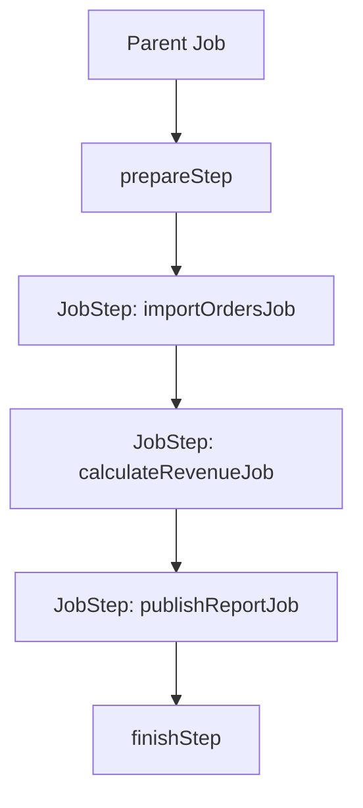
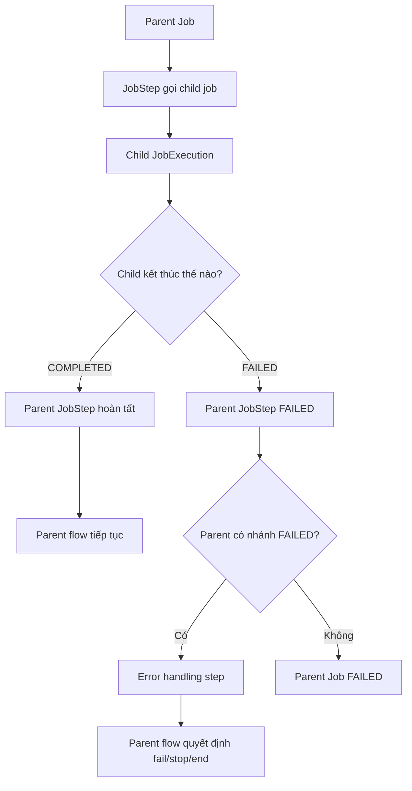
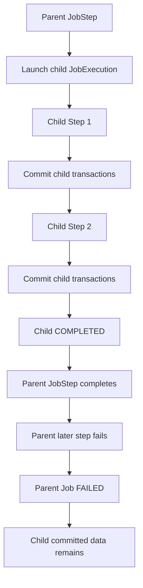

# Lỗi job con ảnh hưởng parent thế nào?

Spring Batch cho phép một job gọi một job khác như một step thông qua **`JobStep`**. Cách tổ chức này hữu ích khi một quy trình lớn cần tái sử dụng một job con, chia quy trình thành các phần độc lập hoặc gom nhiều workflow nhỏ dưới một job điều phối.

Khi job con chạy bên trong `JobStep`, Spring Batch tạo metadata thực thi riêng cho job con. Job cha có `JobExecution` và `StepExecution` của chính nó; job con có `JobInstance` và `JobExecution` riêng. Vì vậy, lỗi của job con được phản ánh vào step của job cha, rồi ảnh hưởng đến trạng thái và flow của job cha theo cách transition được cấu hình.

Điểm quan trọng là **job cha và job con có vòng đời thực thi riêng, nhưng kết quả job con có thể quyết định kết quả step cha**. Nếu job con thất bại, `JobStep` thường kết thúc thất bại và job cha có thể chạy nhánh xử lý lỗi hoặc kết thúc `FAILED`. Các transaction đã commit bên trong job con không tự động bị rollback chỉ vì job cha thất bại sau đó.

## 1. JobStep là gì?

`JobStep` là một loại step dùng để khởi chạy một job khác. Thay vì đưa tất cả logic vào một job duy nhất, job cha có thể điều phối các job con theo một quy trình lớn hơn.

Ví dụ, quy trình xử lý đơn hàng cuối ngày có thể gồm:

1. Job cha kiểm tra ngày nghiệp vụ và chuẩn bị dữ liệu.
2. `importOrdersJob` nhập đơn hàng.
3. `calculateRevenueJob` tính doanh thu.
4. `publishReportJob` xuất và công bố báo cáo.
5. Job cha tổng kết kết quả.

Mỗi job con có thể được phát triển, kiểm thử và vận hành như một job độc lập, sau đó được gọi từ parent thông qua một `JobStep`.



JobStep vẫn là một step trong flow của job cha. Job con được khởi chạy thông qua `JobLauncher`, với bộ `JobParameters` dành cho child job.

## 2. Parent và child có metadata riêng

Khi một job con được khởi chạy từ `JobStep`, có hai lớp metadata cần phân biệt:

| Thành phần | Thuộc về | Vai trò |
|---|---|---|
| Parent `JobExecution` | Job cha | Theo dõi một lần chạy của workflow điều phối |
| Parent `StepExecution` | `JobStep` trong job cha | Ghi nhận trạng thái của step khởi chạy job con |
| Child `JobInstance` | Job con | Xác định công việc nghiệp vụ của child theo identifying parameters |
| Child `JobExecution` | Job con | Theo dõi một lần thực thi cụ thể của child |
| Child `StepExecution` | Các step bên trong child | Theo dõi từng bước xử lý dữ liệu của child |

Ví dụ:

```text
Parent Job: endOfDayJob
  Parent JobExecution: 501
    StepExecution: importOrdersSubJobStep
      Child Job: importOrdersJob
        Child JobInstance: importOrdersJob / businessDate=2026-11-15
        Child JobExecution: 880
          StepExecution: readOrdersStep
          StepExecution: writeOrdersStep
```

Job con không phải là một step thông thường được gộp vào cùng `JobExecution` của parent. Nó có execution riêng trong `JobRepository`. Parent `JobStep` là điểm liên kết hai vòng đời đó.

Vì metadata tách biệt, khi điều tra lỗi cần tra cứu cả parent execution lẫn child execution. Trạng thái của parent `JobStep` cho biết kết quả điều phối; trạng thái các child step cho biết lỗi thực tế xảy ra ở giai đoạn nào bên trong job con.

## 3. JobStep khởi chạy child job như thế nào?

`JobStep` sử dụng một `JobLauncher` để gọi job con. Nó cũng cần biết những `JobParameters` nào sẽ được truyền cho child job. Việc chuyển tham số thường được thực hiện bởi `JobParametersExtractor`.

Các thành phần chính:

- **Child `Job`:** job được gọi từ parent.
- **`JobLauncher`:** khởi chạy child job.
- **`JobParametersExtractor`:** tạo bộ tham số cho child từ thông tin của parent step execution, parent job parameters hoặc execution context theo cách ứng dụng cấu hình.
- **`JobRepository`:** lưu metadata của parent và child; trong một ứng dụng Batch thông thường, cả hai cùng dùng repository dùng chung.

Ví dụ cấu hình theo Java API của Spring Batch 5:

```java
@Bean
public Step importOrdersSubJobStep(
        JobRepository jobRepository,
        JobLauncher jobLauncher,
        Job importOrdersJob,
        JobParametersExtractor childParametersExtractor) {

    return new JobStepBuilder(
            new StepBuilder("importOrdersSubJobStep", jobRepository))
            .job(importOrdersJob)
            .launcher(jobLauncher)
            .parametersExtractor(childParametersExtractor)
            .build();
}
```

Các phiên bản Spring Batch khác nhau có thể có API builder hoặc cách cấu hình repository/transaction manager khác nhau. Hãy dùng constructor và builder phù hợp với phiên bản của dự án.

## 4. Truyền JobParameters từ parent sang child

Job con cần bộ tham số xác định đúng phạm vi dữ liệu cần xử lý. Ví dụ parent chạy cho ngày nghiệp vụ `2026-11-15`, child nhập đơn hàng cũng cần nhận ngày đó.

Không nên dựa vào giả định rằng mọi tham số của parent luôn tự động được truyền theo cách mong muốn. Hãy cấu hình `JobParametersExtractor` rõ ràng và xác định tham số nào là identifying ở child.

Ví dụ custom extractor sao chép một số tham số nghiệp vụ:

```java
@Bean
public JobParametersExtractor childParametersExtractor() {
    return (job, parentStepExecution) -> {
        JobParameters parentParameters = parentStepExecution
                .getJobExecution()
                .getJobParameters();

        return new JobParametersBuilder()
                .addString(
                        "businessDate",
                        parentParameters.getString("businessDate"),
                        true)
                .addLong(
                        "tenantId",
                        parentParameters.getLong("tenantId"),
                        true)
                .addString("launchedBy", "endOfDayJob", false)
                .toJobParameters();
    };
}
```

Đoạn mã minh họa việc chuyển ngày nghiệp vụ và tenant ID sang child job. Trong ứng dụng thực tế, cần kiểm tra tham số bắt buộc trước khi tạo child parameters để tránh truyền giá trị `null` hoặc dữ liệu không hợp lệ.

Nếu tham số được tạo trong step trước, ví dụ đường dẫn tệp đã chuẩn bị, extractor có thể lấy giá trị đó từ `StepExecution` context hoặc `JobExecution` context tùy nơi lưu. Những tham số xác định cùng một công việc child cần có tên, kiểu và giá trị ổn định giữa các lần restart.

### Identifying parameters của child

Child job có `JobInstance` riêng. Định danh child được xác định bởi child job name và identifying `JobParameters` được truyền cho nó.

Ví dụ:

- `businessDate` và `tenantId` là identifying: cùng ngày và tenant sẽ trỏ tới cùng child instance.
- `launchedBy` là non-identifying: thay đổi nguồn yêu cầu không tạo instance nghiệp vụ mới.
- Nếu extractor thêm timestamp hoặc `run.id` identifying mỗi lần parent chạy lại, child có thể tạo instance mới và chạy lại toàn bộ công việc.

Hãy chọn tham số theo ý nghĩa nghiệp vụ. Không thêm timestamp identifying chỉ để tránh lỗi `JobInstanceAlreadyCompleteException`, vì điều đó có thể làm child job xử lý dữ liệu trùng.

## 5. Child job thành công ảnh hưởng parent thế nào?

Khi child job kết thúc thành công, `JobStep` hoàn tất phần khởi chạy child và parent flow có thể tiếp tục sang step kế tiếp.

Ví dụ:

```text
Parent JobExecution: STARTED
  Parent JobStep: importOrdersSubJobStep
    Child JobExecution: STARTED
    Child JobExecution: COMPLETED
  Parent JobStep: COMPLETED
Parent JobExecution tiếp tục step kế tiếp
```

Child job có thể trả `ExitStatus` tùy chỉnh như `COMPLETED_WITH_WARNINGS`. Kết quả exit status của child có thể được phản ánh vào kết quả của `JobStep`, tùy cách child kết thúc và phiên bản framework. Điều này cho phép parent flow phân nhánh theo kết quả của child, thay vì chỉ biết child chạy xong hay chưa.

Ví dụ, child nhập dữ liệu hoàn tất nhưng có một số bản ghi bị skip. Parent có thể chuyển sang step tạo báo cáo cảnh báo trước khi công bố dữ liệu.

Không nên chỉ xem parent `StepExecution` để biết số lượng bản ghi child đã đọc/ghi. Các bộ đếm item và trạng thái chi tiết thuộc các `StepExecution` bên trong child job. Parent `JobStep` chủ yếu đại diện cho kết quả gọi child job.

## 6. Child job thất bại ảnh hưởng parent thế nào?

Khi child job kết thúc với trạng thái thất bại, `JobStep` thường coi việc thực thi step là thất bại. Parent `StepExecution` của JobStep được đánh dấu `FAILED`, và parent flow có thể đi theo transition `FAILED`.

Luồng khái quát:



Ví dụ, child `importOrdersJob` thất bại ở `writeOrdersStep` do database không kết nối được:

1. Child `JobExecution` kết thúc `FAILED`.
2. `JobStep` trong parent nhận kết quả child không thành công.
3. Parent `StepExecution` của `importOrdersSubJobStep` kết thúc `FAILED`.
4. Nếu parent flow có transition `.on("FAILED").to(handleImportFailureStep)`, step xử lý lỗi được chạy.
5. Nếu không có nhánh xử lý phù hợp, parent job thường kết thúc `FAILED`.

Job con vẫn giữ metadata `FAILED` của chính nó. Parent không xóa hoặc biến child execution thành thành công chỉ vì đã chạy một error step.

## 7. Parent có thể xử lý lỗi child bằng conditional flow

Parent job có thể định nghĩa nhánh thành công và thất bại từ JobStep như với các step khác.

```java
@Bean
public Job endOfDayJob(
        JobRepository jobRepository,
        Step prepareStep,
        Step importOrdersSubJobStep,
        Step handleImportFailureStep,
        Step calculateRevenueSubJobStep,
        Step finishStep) {

    return new JobBuilder("endOfDayJob", jobRepository)
            .start(prepareStep)
            .next(importOrdersSubJobStep)
                .on("FAILED").to(handleImportFailureStep)
            .from(importOrdersSubJobStep)
                .on("*").to(calculateRevenueSubJobStep)
            .from(handleImportFailureStep)
                .on("*").fail()
            .from(calculateRevenueSubJobStep)
                .on("*").to(finishStep)
            .from(finishStep)
                .on("*").end()
            .end()
            .build();
}
```

Trong ví dụ:

- Nếu child import thất bại, parent chạy `handleImportFailureStep` rồi kết thúc job cha với `FAILED`.
- Nếu child import thành công, parent gọi job con tính doanh thu.
- Sau khi tính doanh thu, parent chạy bước hoàn tất.

`on("FAILED")` khớp với exit code của parent JobStep. Trong trường hợp child thất bại theo cách thông thường, parent JobStep thường có exit code `FAILED`. Nếu ứng dụng dùng exit code tùy chỉnh, cần kiểm tra giá trị thực tế và cấu hình transition tương ứng.

## 8. Phân biệt lỗi child với lỗi parent JobStep

Không phải mọi lỗi xuất hiện quanh JobStep đều là lỗi nghiệp vụ bên trong child.

| Loại lỗi | Ví dụ | Nơi cần điều tra |
|---|---|---|
| Lỗi bên trong child step | Reader parse lỗi, writer lỗi database | Child `JobExecution` và các child `StepExecution` |
| Child job không thể restart | Child instance không restartable hoặc trạng thái không cho phép | Child `JobInstance`, execution trước và cấu hình restart |
| Tham số child không hợp lệ | Thiếu `businessDate`, sai kiểu `tenantId` | `JobParametersExtractor` và child validator |
| Child instance đã hoàn tất | Cùng child parameters đã có execution `COMPLETED` | Child identifying parameters và lịch sử execution |
| Lỗi khởi chạy child | JobLauncher hoặc JobRepository gặp lỗi | Cấu hình launcher, repository và transaction |
| Lỗi điều phối parent | Không có transition phù hợp với exit code của JobStep | Parent flow và exit status của step |

Khi parent JobStep thất bại, hãy tìm child `JobExecution` tương ứng trước khi kết luận child đã xử lý lỗi dữ liệu. Một lỗi có thể xảy ra trước khi child job bắt đầu, ví dụ extractor tạo tham số không hợp lệ hoặc launcher không thể tạo execution.

## 9. JobStep và transaction boundary

JobStep tạo một ranh giới điều phối giữa parent và child. Tuy nhiên, transaction của parent step không biến toàn bộ child job thành một transaction duy nhất.

Các step bên trong child job có transaction riêng. Với chunk-oriented step, mỗi chunk có thể commit độc lập. Nếu child job xử lý 100 chunk và 80 chunk đầu đã commit, sau đó chunk 81 thất bại, dữ liệu của 80 chunk đã commit không tự động bị rollback chỉ vì parent JobStep thất bại.

Tương tự, nếu child job đã hoàn tất và parent job thất bại ở một step sau đó, dữ liệu child đã commit vẫn còn. Parent failure không phải lệnh rollback ngược toàn bộ child job.



Vì vậy, hãy thiết kế mỗi child job như một workflow có thể tồn tại độc lập về mặt dữ liệu. Nếu parent cần bù trừ khi một job con sau đó thất bại, hãy xây dựng step compensation rõ ràng thay vì trông chờ transaction rollback xuyên qua nhiều job.

## 10. Child job đã hoàn tất nhưng parent bị gián đoạn

Một tình huống vận hành cần chú ý là child job hoàn tất, nhưng parent chưa kịp ghi nhận `JobStep` đã hoàn tất do tiến trình bị dừng hoặc lỗi xảy ra ở thời điểm chuyển tiếp.

Khi parent được restart, `JobStep` có thể thử khởi chạy child với cùng child identifying parameters. Nếu child `JobInstance` đã `COMPLETED`, Spring Batch thường từ chối launch lại instance đó bằng `JobInstanceAlreadyCompleteException`.

Điều này không có nghĩa child cần được chạy lại từ đầu. Có thể child đã làm xong công việc và parent chỉ cần khôi phục trạng thái điều phối. Cần đối chiếu:

- Child `JobExecution` cuối cùng có `COMPLETED` hay không.
- Parent `StepExecution` của JobStep đang ở trạng thái nào.
- Child parameters được extractor tạo ra có giống lần chạy trước không.
- Parent bị gián đoạn trước hay sau khi child commit kết quả.

Để giảm rủi ro:

- Dùng child parameters ổn định, đại diện cho đúng một công việc nghiệp vụ.
- Thiết kế child job idempotent để việc gọi lại có kiểm soát không tạo dữ liệu trùng.
- Theo dõi và đối chiếu parent/child execution khi có lỗi ở thời điểm chuyển tiếp.
- Nếu cần một bước xác nhận kết quả child đã hoàn tất, có thể mô hình hóa việc kiểm tra metadata thành một bước điều phối rõ ràng.
- Không thêm `run.id` hoặc timestamp identifying mới một cách tùy tiện để né lỗi instance đã hoàn tất.

## 11. Restart khi child job thất bại

Nếu child job thất bại, việc restart parent có thể dẫn đến một lần gọi child mới. Khi extractor tạo cùng child identifying parameters, launcher nhắm tới cùng child `JobInstance`.

Nếu child job cho phép restart và execution trước ở trạng thái phù hợp như `FAILED` hoặc `STOPPED`, Spring Batch có thể tạo child `JobExecution` mới để tiếp tục child instance. Reader state và checkpoint bên trong child được khôi phục theo metadata của child.

Nếu child job không restartable, hoặc child instance ở trạng thái không cho phép restart, lần gọi từ parent có thể thất bại. Khi đó, parent JobStep cũng thất bại và parent flow cần xử lý theo cấu hình.

Parent restart và child restart là hai lớp riêng:

- Parent restart dùng identifying parameters của parent để tiếp tục cùng parent `JobInstance`.
- Child restart dùng identifying parameters do extractor tạo để tiếp tục cùng child `JobInstance`.
- Việc parent restart không tự bảo đảm child nhận đúng tham số nếu extractor tạo tham số mới hoặc thay đổi identifying flag.

## 12. Child job trả exit code tùy chỉnh

Child job có thể kết thúc `BatchStatus.COMPLETED` nhưng mang `ExitStatus` tùy chỉnh, ví dụ `COMPLETED_WITH_WARNINGS` hoặc `NO_DATA`. Parent có thể dùng kết quả đó để điều hướng flow.

Ví dụ, child import hoàn tất nhưng có một số bản ghi bị skip. Parent cần chạy báo cáo cảnh báo:

```java
return new JobBuilder("parentImportJob", jobRepository)
        .start(importChildJobStep)
            .on("COMPLETED_WITH_WARNINGS").to(warningReportStep)
        .from(importChildJobStep)
            .on("COMPLETED").to(publishStep)
        .from(importChildJobStep)
            .on("FAILED").to(failureReportStep)
        .from(warningReportStep)
            .on("*").to(publishStep)
        .from(failureReportStep)
            .on("*").fail()
        .from(publishStep)
            .on("*").end()
        .end()
        .build();
```

Đây là mẫu flow minh họa. Cần xác nhận exit code thực tế mà `JobStep` nhận từ child job trong phiên bản Spring Batch của dự án. Nếu child kết thúc thất bại, nhánh `FAILED` phải được xử lý đúng; không nên thay mã thất bại bằng mã thành công chỉ để chạy tiếp.

## 13. JobLauncher nên đồng bộ khi dùng JobStep

`JobStep` cần biết kết quả của child job để xác định parent step thành công hay thất bại. Vì vậy, cách khởi chạy thông thường nên chờ child job hoàn tất trước khi parent tiếp tục.

Nếu cấu hình launcher chạy bất đồng bộ, `run()` có thể trả về khi child mới ở trạng thái `STARTING` hoặc `STARTED`. Khi đó parent JobStep có thể không có kết quả cuối cùng của child để phản ánh đúng vào parent flow.

Với JobStep dùng như nested job orchestration, hãy sử dụng launcher đồng bộ hoặc bảo đảm cơ chế điều phối được thiết kế để chờ và thu thập kết quả child trước khi parent đi tiếp. Nếu muốn parent khởi chạy child rồi tiếp tục độc lập trong khi child vẫn chạy, đó là mô hình orchestration bất đồng bộ và thường cần một cơ chế theo dõi/điều phối riêng thay vì xem child như một step đồng bộ.

## 14. Dùng chung JobRepository trong parent và child

Trong một ứng dụng Spring Batch, parent và child thường nên dùng chung `JobRepository` để metadata được quản lý nhất quán và có thể tra cứu trong cùng hệ thống.

Lợi ích:

- Có thể tìm child execution từ lịch sử job và step liên quan.
- Cơ chế chống launch trùng dựa trên child identifying parameters hoạt động trên cùng repository.
- Trạng thái restart của child được lưu bền vững.
- Dashboard và công cụ vận hành có thể hiển thị cả parent lẫn child.

Nếu parent và child dùng hai repository độc lập, parent không có cùng góc nhìn metadata với child. Việc điều tra, restart và ngăn launch trùng sẽ phức tạp hơn; cùng một child có thể bị chạy ở hai repository mà không nhận biết nhau.

## 15. Parent JobStep không thay thế child step metrics

Khi job con xử lý 1 triệu bản ghi, các số liệu `readCount`, `writeCount`, `filterCount`, `skipCount` nằm ở các `StepExecution` bên trong child job.

Parent `StepExecution` đại diện cho việc khởi chạy child job. Không nên kỳ vọng `readCount` hoặc `writeCount` của parent JobStep tự động bằng tổng số item mà child xử lý.

Để tạo báo cáo tổng hợp:

1. Lấy parent `JobExecution` và `StepExecution` tương ứng.
2. Tìm child `JobExecution` theo child job name và identifying parameters hoặc theo tham chiếu execution được ứng dụng lưu.
3. Đọc các child `StepExecution` để tổng hợp item counts và trạng thái.
4. Gắn parent/child execution ID hoặc correlation ID vào log để truy vết.

Không nên chỉ dựa vào tên step hoặc thời gian gần nhau để ghép parent với child khi nhiều parent có thể chạy đồng thời. Hãy dùng định danh nghiệp vụ ổn định và metadata có thể truy xuất.

## 16. JobStep khác Flow và partitioning như thế nào?

Không phải mọi quy trình con đều cần một job riêng.

| Cơ chế | Mục tiêu | Khi phù hợp |
|---|---|---|
| Flow/subflow trong cùng job | Tổ chức các step thành nhóm logic và tái sử dụng flow | Các bước vẫn thuộc cùng một job execution |
| `JobStep` | Gọi một job độc lập như một step của parent | Cần tái sử dụng workflow có metadata/job parameters riêng |
| Partitioning | Chia dữ liệu thành các phần để xử lý song song | Một workload lớn có thể chia thành phạm vi dữ liệu độc lập |
| Multi-threaded step | Xử lý item/chunk song song trong một step theo cấu hình | Cần tăng concurrency trong một step và các thành phần an toàn luồng |
| Job được scheduler/API khởi chạy độc lập | Điều phối các job tách biệt | Job có lịch chạy, retry và vòng đời độc lập với parent |

`JobStep` phù hợp khi child job là một đơn vị workflow độc lập nhưng vẫn cần parent chờ kết quả để điều phối tiếp. Nếu chỉ cần gom các step trong cùng quy trình, flow thường đơn giản hơn. Nếu cần chia dữ liệu để tăng throughput, partitioning thường là lựa chọn phù hợp hơn.

## 17. Thiết kế child job để có thể tái sử dụng

Một child job được gọi từ nhiều parent nên có hợp đồng đầu vào và kết quả rõ ràng.

Hãy xác định:

- Các `JobParameters` bắt buộc và kiểu dữ liệu.
- Identifying parameters đại diện cho công việc nghiệp vụ.
- Exit code có thể trả về, ví dụ `COMPLETED`, `COMPLETED_WITH_WARNINGS`, `NO_DATA`.
- Trạng thái nào được xem là thất bại và có thể restart hay không.
- Các tác dụng phụ có idempotent không.
- Dữ liệu nào được ghi vào child execution context và có cần trả tham chiếu cho parent không.
- Child job có được phép chạy độc lập ngoài parent hay chỉ chạy qua JobStep.

Tránh để child phụ thuộc vào tên parent cụ thể hoặc đọc trực tiếp state nội bộ của parent. Nếu child cần dữ liệu từ parent, hãy truyền qua `JobParameters` hoặc một giao kèo dữ liệu bền vững được xác định rõ.

## 18. Xử lý lỗi và compensation giữa nhiều job

Giả sử parent gọi ba child job:

1. `reserveInventoryJob` giữ hàng.
2. `chargePaymentJob` thu tiền.
3. `createShipmentJob` tạo vận đơn.

Nếu child thứ ba thất bại sau khi hai child đầu đã hoàn tất, parent không thể rollback transaction của hai job trước. Đây là quy trình nhiều bước có tác dụng phụ độc lập.

Có thể cần thiết kế compensation:

- Hủy reservation nếu chưa tạo shipment.
- Hoàn tiền hoặc tạo giao dịch refund nếu payment đã được thu.
- Ghi nhận trạng thái quy trình để có thể tiếp tục hoặc bù trừ sau sự cố.
- Dùng idempotency key cho mỗi child operation để tránh thực hiện trùng khi restart.

Đây là mô hình gần với saga/orchestration. Spring Batch cung cấp flow và metadata để điều phối các bước, nhưng logic compensation và tính đúng đắn nghiệp vụ vẫn phải do ứng dụng thiết kế.

## 19. Kiểm thử parent-child job

Nên kiểm thử cả kết quả child và ảnh hưởng lên parent.

Các trường hợp quan trọng:

- Child thành công: parent JobStep hoàn tất và parent chạy step tiếp theo.
- Child thất bại: parent JobStep thất bại và parent đi đúng nhánh `FAILED`.
- Child trả exit code tùy chỉnh: parent flow chọn đúng nhánh warning hoặc no-data.
- Child nhận thiếu hoặc sai parameters: lỗi được phát hiện ở extractor/validator và parent xử lý đúng.
- Child instance đã hoàn tất: parent không vô tình tạo một child instance mới ngoài ý muốn.
- Child restartable sau `FAILED`: parent restart với cùng child parameters có thể tiếp tục child instance.
- Child hoàn tất nhưng parent bị gián đoạn: trạng thái hai bên được đối chiếu và parent có cách xử lý trường hợp child đã complete.
- Child có nhiều chunk: xác nhận dữ liệu đã commit không bị mất hoặc nhân đôi khi parent/child restart.

Ví dụ test khung với `JobLauncherTestUtils`:

```java
@SpringBatchTest
@SpringJUnitConfig(ParentJobTestConfiguration.class)
class ParentChildJobTest {

    @Autowired
    private JobLauncherTestUtils jobLauncherTestUtils;

    @Test
    void parentFailsWhenChildJobFails() throws Exception {
        JobParameters parameters = new JobParametersBuilder()
                .addString("businessDate", "2026-11-15", true)
                .addString("inputFile", "missing-orders.csv", false)
                .toJobParameters();

        JobExecution parentExecution =
                jobLauncherTestUtils.launchJob(parameters);

        assertEquals(BatchStatus.FAILED, parentExecution.getStatus());

        StepExecution parentJobStep = parentExecution.getStepExecutions()
                .stream()
                .filter(step -> "importOrdersSubJobStep".equals(step.getStepName()))
                .findFirst()
                .orElseThrow();

        assertEquals(BatchStatus.FAILED, parentJobStep.getStatus());
    }
}
```

Đây là khung minh họa; test configuration cần cung cấp parent job, child job, launcher, extractor, repository và nguồn dữ liệu test. Để kiểm tra child execution, có thể truy vấn `JobExplorer` hoặc `JobRepository` trong test theo child job name và child parameters.

Khi test nhiều lần, cần quản lý identifying parameters và metadata. Dùng `JobRepositoryTestUtils` để dọn repository test hoặc tạo bộ tham số riêng cho từng trường hợp. Không dọn metadata production để làm test pass.

## 20. Các lỗi thường gặp khi child ảnh hưởng parent

| Tình huống | Nguyên nhân có thể gặp | Hướng xử lý |
|---|---|---|
| Parent JobStep `FAILED` dù child step đã chạy phần lớn dữ liệu | Child có step thất bại sau một số chunk đã commit | Kiểm tra child `JobExecution`, step và checkpoint; restart sau khi sửa lỗi |
| Parent không chạy nhánh `FAILED` | Exit code của JobStep khác pattern mong đợi hoặc flow thiếu transition | Đọc `ExitStatus` thực tế của parent step và cấu hình đúng pattern |
| Child bị chạy thành instance mới khi parent restart | Extractor tạo identifying parameter mới | Giữ child identifying parameters ổn định |
| Parent restart gặp `JobInstanceAlreadyCompleteException` | Child đã hoàn tất nhưng JobStep bị gọi lại | Đối chiếu child execution và parent step; xử lý cửa sổ gián đoạn có kiểm soát |
| Child restart không được | Child không restartable hoặc execution ở trạng thái không phù hợp | Kiểm tra cấu hình child và metadata trước khi restart |
| Parent báo thành công dù child có cảnh báo | Exit code tùy chỉnh không được truyền/định tuyến như dự kiến | Kiểm tra exit status child và JobStep trên phiên bản đang dùng |
| Parent metrics không có số item child | Đang đọc bộ đếm của parent JobStep | Đọc `StepExecution` bên trong child job |
| Child chạy bất đồng bộ khiến parent đi tiếp sớm | Launcher không chờ child hoàn tất | Dùng launcher đồng bộ hoặc thiết kế orchestration async riêng |
| Parent thất bại nhưng dữ liệu child vẫn tồn tại | Transaction child đã commit độc lập | Dùng compensation hoặc quy trình phục hồi nghiệp vụ |
| Hai parent cùng khởi chạy cùng child instance | Child parameters giống nhau và launch đồng thời | Dùng chung repository, xác định hành vi launch trùng và kiểm soát concurrency |

## 21. Quy trình điều tra khi parent thất bại vì child

Khi parent JobStep thất bại, có thể lần lượt kiểm tra:

1. **Xác định parent execution:** job name, parent execution ID và identifying parameters.
2. **Xác định parent step:** tìm `StepExecution` của JobStep và đọc `BatchStatus`, `ExitStatus`, exception.
3. **Xác định child parameters:** kiểm tra extractor đã tạo đúng job name, identifying parameters và giá trị nghiệp vụ chưa.
4. **Tìm child execution:** tra cứu child job theo parameters và thời điểm launch tương ứng.
5. **Đọc child step executions:** xác định step nào lỗi, số chunk đã commit, skip count và checkpoint.
6. **Đối chiếu dữ liệu đích:** xác định phần dữ liệu child đã commit và tác dụng phụ ngoài transaction.
7. **Chọn hành động:** sửa lỗi rồi restart child/parent, xử lý child đã complete, hoặc chạy compensation nếu nghiệp vụ yêu cầu.
8. **Theo dõi execution mới:** xác nhận child và parent kết thúc với trạng thái, exit code và dữ liệu mong đợi.

Không nên chỉ xem trạng thái parent `FAILED` rồi khởi chạy lại với tham số mới. Làm như vậy có thể tạo child instance mới và xử lý trùng dữ liệu.

## 22. Những nguyên tắc cần nhớ

- `JobStep` gọi một child job thông qua `JobLauncher` và là một step trong parent flow.
- Parent và child có `JobExecution`, `JobInstance` và `StepExecution` riêng.
- Child parameters được tạo qua `JobParametersExtractor`; cần giữ identifying parameters ổn định giữa các lần restart.
- Child `FAILED` thường làm parent JobStep `FAILED`; parent conditional flow có thể chạy error/cleanup step hoặc kết thúc `FAILED`.
- Child exit code tùy chỉnh có thể được dùng để phân nhánh parent; cần kiểm tra kết quả thực tế theo phiên bản framework.
- Child step metrics nằm trong child `StepExecution`; parent JobStep không đại diện cho tổng số item child xử lý.
- Transaction của parent không rollback các chunk child đã commit; mỗi child step quản lý transaction riêng.
- Nếu child hoàn tất nhưng parent bị gián đoạn trước khi ghi nhận step hoàn tất, parent restart có thể gặp child instance đã complete; cần đối chiếu hai execution.
- Dùng launcher đồng bộ khi parent cần chờ kết quả child để điều phối flow.
- Parent và child thường nên dùng chung `JobRepository` để metadata, restart và chống launch trùng nhất quán.
- Thiết kế child idempotent và dùng compensation khi workflow nhiều job có tác dụng phụ không thể rollback chung.
- Kiểm thử cả parent status, child status, exit code, parameters, restart và dữ liệu đã commit.

Khi child job được gọi qua `JobStep`, lỗi của child trở thành kết quả của step cha và có thể điều khiển conditional flow của parent. Hiểu rõ metadata riêng, tham số nhận diện, transaction boundary và restart ở cả hai cấp giúp thiết kế workflow nhiều job có thể theo dõi và phục hồi mà không nhầm lẫn giữa trạng thái điều phối với dữ liệu nghiệp vụ đã commit.
