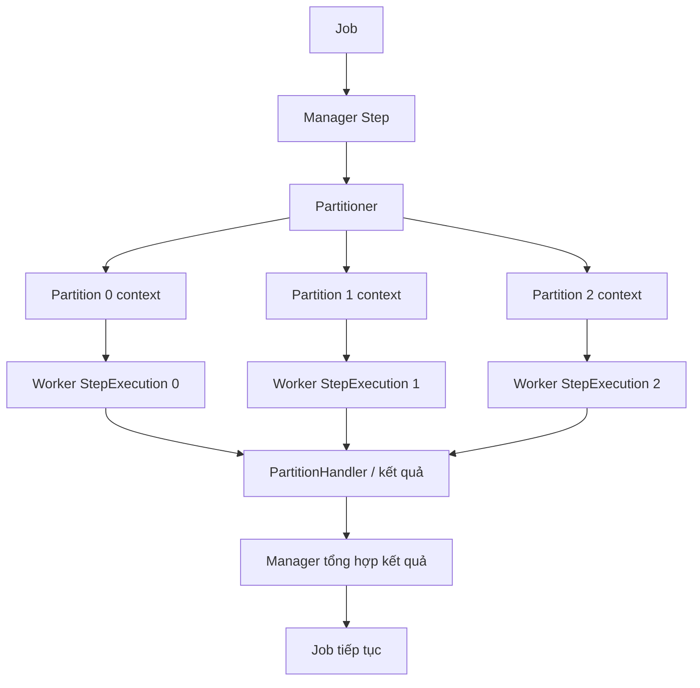

# Worker step xử lý partition

Trong Spring Batch, partitioning chia phạm vi dữ liệu của một step thành nhiều phần độc lập để nhiều worker step có thể xử lý đồng thời. Mỗi partition có một `StepExecution` và một `ExecutionContext` riêng. Worker step là step thực hiện công việc thực tế trên phạm vi dữ liệu được giao, chẳng hạn đọc các đơn hàng có ID trong một khoảng, xử lý chúng theo chunk rồi ghi kết quả.

Một step điều phối (manager step) tạo các partition và giao chúng cho cơ chế thực thi. Worker step mô tả cách xử lý một partition. Cùng một định nghĩa worker step có thể được chạy nhiều lần với các `StepExecution` khác nhau; mỗi lần nhận context riêng để biết partition đó phải xử lý dữ liệu nào.

Partitioning phù hợp khi dữ liệu có thể chia thành các phạm vi độc lập, chẳng hạn theo khoảng khóa, ngày nghiệp vụ, vùng địa lý hoặc nhóm khách hàng. Nó giúp tăng throughput mà vẫn giữ cách xử lý item theo chunk của Spring Batch. Để đạt hiệu quả và tính đúng đắn, các partition cần có phạm vi rõ ràng, tránh giao nhau ngoài ý muốn và có thể khôi phục khi một worker thất bại.

## 1. Manager step và worker step

Một job partitioned thường có hai vai trò:

- **Manager step:** điều phối partition. Nó gọi `Partitioner` để tạo danh sách partition, dùng `PartitionHandler` để thực thi chúng và theo dõi kết quả.
- **Worker step:** thực hiện công việc trên một partition. Worker thường là chunk-oriented step có reader, processor và writer, nhưng cũng có thể là tasklet step.

Sơ đồ tổng quát:



Manager step không đọc và ghi từng item thay cho worker. Nó phân chia công việc và điều phối các lần thực thi worker. Worker step mới là nơi thực hiện reader, processor, writer hoặc tasklet trên dữ liệu thuộc partition của nó.

## 2. Worker step được chạy nhiều lần với context riêng

Worker step thường được khai báo thành một bean `Step` duy nhất. Khi manager tạo ba partition, Spring Batch tạo các `StepExecution` riêng cho ba lần chạy worker. Các execution này dùng chung định nghĩa step nhưng có tên/định danh partition và context riêng.

Ví dụ:

| Worker execution | Step ExecutionContext |
|---|---|
| `importOrders:partition0` | `minId=1`, `maxIdExclusive=1001` |
| `importOrders:partition1` | `minId=1001`, `maxIdExclusive=2001` |
| `importOrders:partition2` | `minId=2001`, `maxIdExclusive=3001` |

Tên step thực tế được Spring Batch tạo từ tên worker step và tên partition theo cơ chế của partition handler/splitter. Điểm quan trọng là mỗi partition có một `StepExecution` riêng; không phải một worker dùng chung một `StepExecution` rồi thay đổi context liên tục.

Worker step đọc dữ liệu partition-specific qua `stepExecutionContext`. Ví dụ:

```java
@Bean
@StepScope
JpaPagingItemReader<Order> partitionOrderReader(
        EntityManagerFactory entityManagerFactory,
        @Value("#{stepExecutionContext['minId']}") Long minId,
        @Value("#{stepExecutionContext['maxIdExclusive']}") Long maxIdExclusive) {

    Map<String, Object> parameters = new HashMap<>();
    parameters.put("minId", minId);
    parameters.put("maxIdExclusive", maxIdExclusive);

    return new JpaPagingItemReaderBuilder<Order>()
            .name("partitionOrderReader")
            .entityManagerFactory(entityManagerFactory)
            .queryString("""
                    select o from Order o
                    where o.id >= :minId
                      and o.id < :maxIdExclusive
                    order by o.id
                    """)
            .parameterValues(parameters)
            .pageSize(500)
            .saveState(true)
            .build();
}
```

`@StepScope` rất quan trọng ở đây. Nó làm reader được tạo trong phạm vi từng `StepExecution`, khi các giá trị partition đã sẵn sàng. Mỗi worker nhận `minId` và `maxIdExclusive` riêng, nên truy vấn chỉ lấy dữ liệu thuộc partition tương ứng.

Không nên đọc các giá trị partition từ một field mutable trong singleton bean. Nếu nhiều worker dùng chung một instance reader và ghi đè `minId`/`maxId`, chúng có thể đọc nhầm phạm vi hoặc tranh chấp trạng thái.

## 3. Partitioner tạo dữ liệu cho worker

`Partitioner` là thành phần xác định cách chia dữ liệu. Phương thức `partition(int gridSize)` trả về một map:

- Key là tên partition, ví dụ `partition0`, `partition1`.
- Value là `ExecutionContext` chứa thông tin worker cần để xử lý partition đó.

Ví dụ partition theo khoảng ID, dùng cận dưới inclusive và cận trên exclusive:

```java
public class OrderRangePartitioner implements Partitioner {

    private final long lowerInclusive;
    private final long upperExclusive;

    public OrderRangePartitioner(long lowerInclusive, long upperExclusive) {
        if (upperExclusive < lowerInclusive) {
            throw new IllegalArgumentException("Invalid ID range");
        }
        this.lowerInclusive = lowerInclusive;
        this.upperExclusive = upperExclusive;
    }

    @Override
    public Map<String, ExecutionContext> partition(int gridSize) {
        if (gridSize < 1) {
            throw new IllegalArgumentException("gridSize must be positive");
        }

        long total = upperExclusive - lowerInclusive;
        int partitionCount = total == 0
                ? 1
                : (int) Math.min((long) gridSize, total);

        long baseSize = total / partitionCount;
        long remainder = total % partitionCount;
        long start = lowerInclusive;

        Map<String, ExecutionContext> partitions = new LinkedHashMap<>();

        for (int i = 0; i < partitionCount; i++) {
            long size = baseSize + (i < remainder ? 1 : 0);
            long end = start + size;

            ExecutionContext context = new ExecutionContext();
            context.putLong("minId", start);
            context.putLong("maxIdExclusive", end);

            partitions.put("partition" + i, context);
            start = end;
        }

        return partitions;
    }
}
```

Ví dụ này chia một khoảng ID liên tục thành các khoảng gần bằng nhau. Khi không có ID nào trong phạm vi, nó tạo một partition rỗng với `minId` bằng `maxIdExclusive`; truy vấn của worker sẽ không trả về item. Một ứng dụng cũng có thể chọn kiểm tra trường hợp không có dữ liệu ở manager và bỏ qua worker step theo flow riêng.

Trong ứng dụng thật, phạm vi đầu vào nên được xác định theo batch cụ thể và giữ ổn định trong suốt lần chạy. Nếu `upperExclusive - lowerInclusive` có thể vượt giới hạn số nguyên hoặc phạm vi ID có thể thay đổi, cần kiểm tra overflow và dùng cách phân vùng phù hợp với miền dữ liệu.

## 4. Cấu hình worker step

Worker step thường dùng chunk-oriented processing như một step bình thường. Nó không cần biết tổng số partition; nó chỉ đọc các giá trị riêng được cung cấp trong `ExecutionContext`.

```java
@Bean
Step importOrdersWorkerStep(
        JobRepository jobRepository,
        PlatformTransactionManager transactionManager,
        JpaPagingItemReader<Order> partitionOrderReader,
        ItemProcessor<Order, ImportedOrder> orderProcessor,
        ItemWriter<ImportedOrder> orderWriter) {

    return new StepBuilder("importOrdersWorkerStep", jobRepository)
            .<Order, ImportedOrder>chunk(500, transactionManager)
            .reader(partitionOrderReader)
            .processor(orderProcessor)
            .writer(orderWriter)
            .build();
}
```

Khi worker được chạy cho từng partition:

1. Spring Batch tạo `StepExecution` cho partition.
2. Worker step mở các stream đã đăng ký.
3. Reader nhận `minId` và `maxIdExclusive` từ Step ExecutionContext của partition.
4. Reader lấy item trong phạm vi đó, processor xử lý và writer ghi theo chunk.
5. Checkpoint của reader được cập nhật trong context của chính partition.
6. Worker kết thúc và báo trạng thái về manager.

Mỗi partition có transaction của chunk riêng. Nếu worker partition 1 đang commit một chunk, transaction đó độc lập với chunk đang chạy ở partition 2. Điều này cho phép xử lý song song, nhưng cũng có nghĩa lỗi ở một partition không tự động rollback các chunk đã commit của partition khác.

## 5. Cấu hình manager step với TaskExecutor

Với local partitioning, manager step có thể dùng `TaskExecutor` để chạy worker step trên nhiều thread trong cùng JVM.

Ví dụ executor có giới hạn bốn thread:

```java
@Bean
ThreadPoolTaskExecutor partitionTaskExecutor() {
    ThreadPoolTaskExecutor executor = new ThreadPoolTaskExecutor();
    executor.setCorePoolSize(4);
    executor.setMaxPoolSize(4);
    executor.setQueueCapacity(8);
    executor.setThreadNamePrefix("orders-partition-");
    executor.setWaitForTasksToCompleteOnShutdown(true);
    executor.setAwaitTerminationSeconds(60);
    return executor;
}
```

Khai báo manager step:

```java
@Bean
Step importOrdersManagerStep(
        JobRepository jobRepository,
        Step importOrdersWorkerStep,
        Partitioner orderPartitioner,
        ThreadPoolTaskExecutor partitionTaskExecutor) {

    return new StepBuilder("importOrdersManagerStep", jobRepository)
            .partitioner(
                    importOrdersWorkerStep.getName(),
                    orderPartitioner)
            .step(importOrdersWorkerStep)
            .gridSize(4)
            .taskExecutor(partitionTaskExecutor)
            .build();
}
```

`gridSize(4)` yêu cầu tạo khoảng bốn partition khi dữ liệu và `Partitioner` cho phép. `TaskExecutor` quyết định số worker có thể chạy đồng thời. Nếu có nhiều partition hơn số thread, một số partition sẽ chờ đến khi thread rảnh. Grid size không tự động bảo đảm số thread chạy đồng thời bằng grid size.

Trong cấu hình thực tế, cần cân đối số thread với database connection pool, CPU, bộ nhớ, giới hạn hệ thống ngoài và số job khác đang chạy. Nếu mỗi worker cần một connection database, pool phải có đủ connection cho worker và các request/step khác, tránh cạn connection.

## 6. Partitioner có thể lấy phạm vi theo JobParameters

Thông thường, phạm vi dữ liệu cần partition phụ thuộc vào `batchId`, ngày nghiệp vụ hoặc tham số đầu vào của job. Có thể tạo `Partitioner` theo step scope để đọc tham số runtime:

```java
@Bean
@StepScope
Partitioner orderPartitioner(
        OrderRangeService rangeService,
        @Value("#{jobParameters['batchId']}") String batchId) {

    IdRange range = rangeService.rangeForBatch(batchId);
    return new OrderRangePartitioner(
            range.lowerInclusive(),
            range.upperExclusive());
}
```

`OrderRangeService` là service của ứng dụng trả về phạm vi ID thuộc batch. `IdRange` có thể là record:

```java
public record IdRange(long lowerInclusive, long upperExclusive) {}
```

Do `Partitioner` được gọi khi manager step thực thi, bean step-scoped có thể nhận `JobParameters` của job. Mỗi partition context sau đó chứa cận dữ liệu cụ thể để worker dùng.

Nếu dữ liệu được xác định qua một snapshot hoặc bảng staging, nên dùng cùng `batchId` để truy vấn phạm vi. Không nên lấy min/max toàn bảng nếu job chỉ được phép xử lý một batch con.

## 7. Worker step và StepScope

Worker step thường dùng các bean `@StepScope` để nhận giá trị trong `ExecutionContext` của partition. Ví dụ:

```java
@Bean
@StepScope
ItemProcessor<Order, ImportedOrder> partitionOrderProcessor(
        @Value("#{stepExecutionContext['regionCode']}") String regionCode,
        OrderMapper mapper) {

    return order -> mapper.toImportedOrder(order, regionCode);
}
```

Trong ví dụ, mỗi `StepExecution` có thể nhận `regionCode` khác nhau. Bean step-scoped được khởi tạo trong phạm vi worker execution và đọc giá trị context tương ứng.

Các biểu thức thường dùng:

| Biểu thức | Nguồn |
|---|---|
| `#{stepExecutionContext['minId']}` | Step ExecutionContext của partition worker hiện tại |
| `#{jobExecutionContext['batchReference']}` | Job ExecutionContext dùng chung trong job execution |
| `#{jobParameters['batchId']}` | JobParameters của job đang chạy |

Worker step thường dùng Step ExecutionContext cho giá trị partition như range, region hoặc file segment. JobParameters và Job ExecutionContext phù hợp với dữ liệu chung cho toàn bộ partition.

## 8. Phân biệt worker step với manager step

| Đặc điểm | Manager step | Worker step |
|---|---|---|
| Vai trò | Chia và điều phối công việc | Thực hiện công việc trên một partition |
| Thành phần chính | `Partitioner`, `PartitionHandler`, worker `Step` | Reader, processor, writer hoặc tasklet |
| Execution | Một `StepExecution` điều phối | Nhiều `StepExecution`, thường một cho mỗi partition |
| Context | Trạng thái điều phối của manager | Context riêng chứa dữ liệu partition và checkpoint worker |
| Transaction | Quản lý thao tác điều phối theo cơ chế step | Mỗi worker có transaction riêng theo chunk hoặc tasklet invocation |
| Kết quả | Tổng hợp trạng thái các worker | Trạng thái xử lý của partition tương ứng |

Manager step không nên chứa logic xử lý từng đơn hàng. Worker step không nên tự tạo partition hoặc điều phối worker khác nếu không có một kiến trúc phân cấp được thiết kế rõ ràng.

## 9. Local partitioning và remote partitioning

Partitioning có thể thực thi trong cùng JVM hoặc phân phối worker sang tiến trình/máy khác.

### Local partitioning

Với local partitioning, manager và worker chạy trong cùng ứng dụng. `TaskExecutor` thường phân phối các worker step lên thread pool.

Ưu điểm:

- Cấu hình tương đối đơn giản.
- Không cần message broker để gửi yêu cầu worker.
- Dễ chia sẻ datasource, service và cấu hình ứng dụng.
- Phù hợp khi cần tận dụng nhiều core trên một instance.

Giới hạn:

- Worker cạnh tranh CPU, heap và connection pool với web/API và các job khác.
- Sự cố JVM có thể ảnh hưởng đồng thời đến manager và tất cả worker local.
- Không mở rộng worker độc lập sang nhiều máy chỉ bằng `ThreadPoolTaskExecutor`.

### Remote partitioning

Với remote partitioning, manager gửi yêu cầu thực thi partition tới worker ở tiến trình hoặc node khác thông qua một cơ chế truyền thông, thường là messaging. Worker nhận yêu cầu và chạy cùng định nghĩa worker step với context của partition.

Ưu điểm:

- Có thể mở rộng worker theo số node hoặc năng lực xử lý.
- Tách tài nguyên của manager và worker.
- Phù hợp với dữ liệu lớn hoặc yêu cầu phân phối xử lý qua nhiều máy.

Đổi lại, cần vận hành message broker hoặc kênh truyền thông, quản lý lỗi gửi/nhận, bảo đảm worker dùng đúng job/step configuration và chia sẻ được metadata repository phù hợp. Cũng cần thiết kế xử lý message giao lại và trạng thái worker mất kết nối.

Remote partitioning khác remote chunking. Trong remote partitioning, mỗi worker thực hiện toàn bộ worker step cho partition được giao. Trong remote chunking, manager thường đọc item và gửi chunk cho worker xử lý/ghi. Hai mô hình có ranh giới trách nhiệm và luồng dữ liệu khác nhau.

## 10. Checkpoint và restart của từng worker

Mỗi partition có `StepExecution` và Step ExecutionContext riêng. Khi worker xử lý chunk, reader/writer có thể cập nhật checkpoint trong context đó. Với JDBC `JobRepository`, metadata step execution và context được lưu trong các bảng repository do Spring Batch quản lý.

Ví dụ:

| Partition | Phạm vi | Checkpoint của worker |
|---|---|---|
| partition0 | ID 1–1000 | Reader đã commit đến ID 650 |
| partition1 | ID 1001–2000 | Reader đã commit đến ID 1800 |
| partition2 | ID 2001–3000 | Reader đã commit đến ID 2400 |

Nếu partition2 thất bại, checkpoint của partition0 và partition1 vẫn phản ánh tiến độ đã commit của chúng. Khi job được restart, Spring Batch dùng metadata của các worker execution để xác định partition đã hoàn tất và partition cần tiếp tục theo quy tắc restart.

Để restart ổn định:

- Giữ tên worker step và tên partition ổn định giữa các lần chạy.
- Tạo cùng phạm vi partition khi restart cùng JobInstance.
- Dùng reader hỗ trợ `ItemStream` và lưu state.
- Giữ dữ liệu nguồn ổn định hoặc dùng snapshot/watermark rõ ràng.
- Bảo đảm writer idempotent vì chunk chưa commit có thể được xử lý lại.
- Không xóa metadata execution còn cần cho restart.

Không nên tạo partition dựa trên thứ tự ngẫu nhiên hoặc dữ liệu thay đổi không kiểm soát. Nếu lần restart tạo tên partition hoặc phạm vi khác, metadata cũ có thể không còn khớp với công việc mới.

## 11. Phân chia dữ liệu không giao nhau và cân bằng tải

Worker step chỉ an toàn khi phạm vi dữ liệu được phân chia có chủ đích.

### Phạm vi không giao nhau

Với partition theo ID, dùng quy ước nhất quán như `[minId, maxIdExclusive)`. Ví dụ:

```text
partition0: [1, 1001)
partition1: [1001, 2001)
partition2: [2001, 3001)
```

Nhờ cận dưới inclusive và cận trên exclusive, ID 1001 chỉ thuộc partition1, không bị xử lý hai lần. Tránh dùng các khoảng inclusive ở cả hai đầu nếu không tính toán cẩn thận vì có thể tạo phần tử giao nhau.

### Cân bằng tải

Chia số lượng ID bằng nhau không bảo đảm thời gian xử lý bằng nhau. Nếu một số ID có nhiều dữ liệu liên quan hoặc xử lý đắt hơn, partition tương ứng có thể chạy lâu hơn.

Các cách phân chia khác:

- Theo ngày hoặc tháng nghiệp vụ.
- Theo vùng/tenant nếu tải tương đối đồng đều.
- Theo hash bucket của khóa nghiệp vụ.
- Theo danh sách partition được lưu sẵn trong bảng điều phối.
- Theo khoảng khóa được đo từ phân bố dữ liệu thực tế.

Hãy đo thời gian từng worker, số item đọc/ghi và số lỗi. Một partition quá lớn có thể trở thành nút thắt dù các worker khác đã hoàn thành.

### Dữ liệu thay đổi trong lúc chạy

Nếu phạm vi partition được xác định bằng min/max tại đầu job nhưng bản ghi mới tiếp tục được thêm vào, cần quy định bản ghi mới thuộc batch hiện tại hay batch sau. Có thể dùng batch ID, thời điểm cutoff, snapshot isolation hoặc bảng staging để giữ phạm vi ổn định.

## 12. Transaction và lỗi giữa các worker

Mỗi worker step xử lý chunk trong transaction riêng. Vì các worker có thể chạy đồng thời:

- Một worker có thể commit chunk trong khi worker khác đang rollback.
- Lỗi ở một partition không tự rollback các chunk đã commit của partition khác.
- Manager step tổng hợp kết quả worker và thường thất bại nếu một worker thất bại theo chính sách mặc định.
- Khi restart, các partition đã hoàn tất có thể được bỏ qua, còn partition chưa hoàn tất được xử lý lại theo metadata và restart policy.

Vì vậy, toàn bộ job partitioned không phải một transaction duy nhất. Nếu nghiệp vụ yêu cầu kết quả chỉ được công bố khi tất cả partition hoàn thành, hãy ghi dữ liệu vào staging theo `batchId`, sau đó dùng một step cuối để đối soát và công bố kết quả sau khi manager xác nhận mọi worker thành công.

Writer cũng cần idempotent. Nếu worker bị gián đoạn sau khi một hệ thống ngoài đã nhận yêu cầu nhưng trước khi checkpoint được commit, cùng item có thể được gửi lại khi restart. Dùng unique business key, idempotency key hoặc outbox/inbox cho side effect ngoài transaction.

## 13. Thread safety và tài nguyên dùng chung

Trong local partitioning, nhiều worker step có thể chạy đồng thời trong cùng JVM. Cần chú ý:

- Reader có state nên là bean `@StepScope` hoặc được tạo riêng cho từng `StepExecution`.
- Không chia sẻ một cursor, file handle hoặc mutable reader state giữa các worker.
- Processor nên stateless hoặc bảo đảm thread safety nếu có state dùng chung.
- Writer và repository phải xử lý được các transaction đồng thời.
- Database connection pool phải đủ cho số worker và traffic khác.
- Cache dùng chung cần thread-safe và có chính sách nhất quán phù hợp.
- Tài nguyên file cần có tên hoặc thư mục riêng theo partition để tránh ghi đè.

Nếu các worker ghi vào cùng một bảng, hãy bảo đảm khóa và phạm vi ghi không xung đột. Nếu worker cần tạo file kết quả riêng, đặt tên theo partition hoặc batch ID rồi dùng một step tổng hợp để ghép file sau khi tất cả worker hoàn tất.

## 14. Quan sát trạng thái worker step

Khi partitioning, chỉ nhìn trạng thái manager step là chưa đủ để điều tra lỗi. Cần xem từng worker `StepExecution`:

- Tên partition và ID của StepExecution.
- `BatchStatus` và `ExitStatus`.
- `readCount`, `writeCount`, `filterCount`, skip count.
- `commitCount`, `rollbackCount`.
- Thời điểm bắt đầu/kết thúc và thời lượng.
- Step ExecutionContext có phạm vi partition và checkpoint cần thiết.
- Exception của worker nếu thất bại.

`JobExplorer` có thể truy vấn các `StepExecution` của `JobExecution` để hiển thị trạng thái theo partition. Khi ghi log, nên đưa `jobExecutionId`, `stepExecutionId`, tên worker step, partition name và `batchId` vào MDC/correlation fields để liên kết log giữa manager và worker.

Không nên trả toàn bộ `ExecutionContext` cho API người dùng. Chỉ công khai các trường tiến độ đã được chọn, vì context có thể chứa đường dẫn nội bộ hoặc thông tin kỹ thuật.

## 15. Những lỗi thường gặp

**Nhầm manager step với worker step.** Manager chia và điều phối; worker xử lý dữ liệu. Đặt reader/writer của partition trong worker step.

**Dùng singleton reader với state mutable.** Nhiều worker có thể ghi đè vị trí hoặc phạm vi của nhau. Dùng `@StepScope` và context riêng.

**Không truyền range qua ExecutionContext.** Worker không biết phạm vi cần xử lý hoặc vô tình đọc toàn bộ dữ liệu. Đưa khóa partition vào context do `Partitioner` tạo.

**Các range bị giao nhau hoặc bỏ sót.** Quy ước inclusive/exclusive không nhất quán có thể làm item được xử lý hai lần hoặc không lần nào. Dùng quy tắc biên rõ ràng và kiểm thử biên.

**Tạo partition không ổn định khi restart.** Tên hoặc phạm vi partition thay đổi có thể khiến metadata cũ không còn khớp. Dùng partitioner deterministic theo batch và nguồn dữ liệu ổn định.

**Tăng grid size mà không tăng năng lực hệ thống.** Quá nhiều worker có thể làm cạn connection pool, CPU hoặc quota dịch vụ. Đo tải và giới hạn concurrency.

**Cho rằng tất cả worker cùng một transaction.** Mỗi worker có chunk transaction riêng. Một worker thất bại không rollback các chunk đã commit của worker khác.

**Không kiểm tra từng worker execution.** Manager step có thể chỉ báo lỗi tổng thể. Dùng `JobExplorer` và log theo partition để tìm worker lỗi.

**Dùng local TaskExecutor khi cần phân tán nhiều máy.** Thread pool trong JVM không tạo remote worker. Dùng remote partitioning với kênh truyền thông phù hợp khi cần mở rộng qua nhiều process/node.

## 16. Kiểm thử worker step và partitioning

Kiểm thử cần chứng minh cả logic worker lẫn cách manager phân phối phạm vi:

1. **Partitioner test:** xác nhận số partition, tên partition và context được tạo đúng.
2. **Kiểm tra biên:** xác nhận các range không giao nhau, không bỏ sót ID ở điểm đầu/cuối.
3. **Worker step test:** chạy worker với một `ExecutionContext` cụ thể và xác nhận chỉ dữ liệu trong partition được đọc/ghi.
4. **Multi-partition integration test:** chạy manager step với nhiều partition và xác nhận tổng kết quả bằng tập input dự kiến.
5. **Concurrency test:** xác nhận worker không chia sẻ mutable state sai cách và database chịu được số transaction đồng thời.
6. **Restart test:** làm một worker thất bại sau một số chunk, restart cùng JobParameters và xác nhận partition hoàn tất không bị chạy lại ngoài ý muốn, partition lỗi tiếp tục từ checkpoint.
7. **Failure test:** xác nhận manager phản ánh thất bại của worker và job không công bố kết quả chưa đầy đủ.
8. **Idempotency test:** xác nhận chunk của worker được xử lý lại không tạo dữ liệu hoặc side effect trùng.
9. **Load test:** đo thời gian từng partition, throughput, CPU, heap và connection pool.

Ví dụ kiểm tra các context được tạo bởi partitioner:

```java
@Test
void createsDisjointRanges() {
    OrderRangePartitioner partitioner =
            new OrderRangePartitioner(1L, 1001L);

    Map<String, ExecutionContext> partitions =
            partitioner.partition(4);

    assertEquals(4, partitions.size());
    assertEquals(1L,
            partitions.get("partition0").getLong("minId"));
    assertEquals(251L,
            partitions.get("partition0").getLong("maxIdExclusive"));
    assertEquals(251L,
            partitions.get("partition1").getLong("minId"));
    assertEquals(1001L,
            partitions.get("partition3").getLong("maxIdExclusive"));
}
```

Ví dụ giả định khoảng `[1, 1001)` có 1.000 ID và chia thành bốn partition bằng nhau. Ngoài kiểm tra một vài biên, test đầy đủ nên xác nhận hợp các khoảng bằng đúng phạm vi đầu vào và giao của mọi cặp khoảng là rỗng.

Với test tích hợp, dùng `JobLauncherTestUtils` hoặc khởi chạy manager step/job thực tế. Kiểm tra dữ liệu nghiệp vụ bằng batch ID, không chỉ kiểm tra `BatchStatus.COMPLETED`. Nếu cần kiểm tra restart, `JobRepository` phải giữ metadata giữa lần chạy đầu và lần restart.

## Kết luận

Worker step là step thực hiện công việc cho một partition cụ thể. Manager step dùng `Partitioner` tạo tên partition và `ExecutionContext` tương ứng, sau đó dùng `PartitionHandler` để phân phối các lần thực thi worker. Mỗi partition có `StepExecution` và Step ExecutionContext riêng, cho phép worker nhận đúng phạm vi dữ liệu, lưu checkpoint độc lập và được theo dõi riêng.

Hãy thiết kế worker step như một step có thể chạy độc lập trên phạm vi được giao: dùng `@StepScope` để đọc partition context, reader có checkpoint, writer idempotent và transaction theo chunk. Giữ partitioner deterministic, các phạm vi không giao nhau, concurrency phù hợp với tài nguyên và có kiểm thử restart/failure. Khi cần mở rộng qua nhiều máy, dùng remote partitioning với kênh truyền thông và cơ chế phục hồi phù hợp; local thread pool chỉ chạy worker trong cùng JVM.
