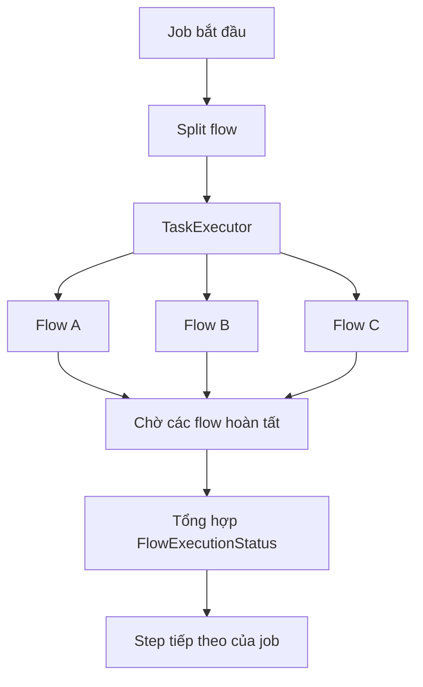

# Chạy nhiều flow song song trong một job

Spring Batch cho phép một job điều phối nhiều flow chạy đồng thời. Cách làm này phù hợp khi một quy trình có nhiều nhánh công việc độc lập, ví dụ nhập dữ liệu khách hàng và nhập dữ liệu sản phẩm có thể diễn ra cùng lúc, sau đó job mới tổng hợp kết quả chung.

Để chạy các flow song song, Spring Batch cung cấp cơ chế **split flow**. Một `TaskExecutor` được truyền vào `split(...)` để thực thi các flow trên những luồng khác nhau. Mỗi flow có thể chứa một hoặc nhiều step chạy tuần tự. Khi các nhánh hoàn tất, split flow tổng hợp kết quả và job tiếp tục theo flow được cấu hình.

Điểm quan trọng là các flow song song vẫn thuộc cùng một job execution. Mỗi step có `StepExecution` và transaction riêng, trong khi các nhánh có thể cùng truy cập tài nguyên, job parameters và job execution context. Vì vậy, cần thiết kế dữ liệu, tài nguyên và trạng thái sao cho các nhánh không tranh chấp hoặc ghi đè lẫn nhau.

## 1. Parallel flow là gì?

Một job tuyến tính thực hiện step theo thứ tự:

```text
prepareStep -> importCustomerStep -> importProductStep -> summaryStep
```

Nếu nhập khách hàng và nhập sản phẩm không phụ thuộc nhau, việc chạy tuần tự có thể làm tăng tổng thời gian job. Có thể tổ chức chúng thành hai flow chạy đồng thời:

```text
                   +-> customerFlow: readCustomers -> writeCustomers --+
prepareStep ------|                                                    |----> summaryStep
                   +-> productFlow: readProducts -> writeProducts ----+
```

`customerFlow` và `productFlow` chạy song song. Trong từng flow, các step vẫn chạy tuần tự theo thứ tự khai báo. `summaryStep` chỉ bắt đầu sau khi split flow hoàn tất cả hai nhánh.

Một flow là một chuỗi hoặc cấu trúc điều phối các step. Split flow là một flow đặc biệt dùng để thực thi nhiều flow con cùng lúc.

## 2. Khi nào nên chạy nhiều flow song song?

Parallel flow phù hợp khi các nhánh có thể tiến hành độc lập và có thể tổng hợp kết quả sau đó.

Ví dụ:

- Nhập dữ liệu khách hàng và sản phẩm từ hai nguồn khác nhau.
- Tính các nhóm chỉ số không phụ thuộc nhau trước khi tạo báo cáo tổng hợp.
- Tạo nhiều tệp đầu ra độc lập cho từng khu vực.
- Đồng bộ danh mục và dữ liệu tham chiếu khi hai quy trình không ghi đè cùng tài nguyên.
- Kiểm tra nhiều tập dữ liệu độc lập trước một bước publish chung.

Không nên chạy song song nếu flow B cần kết quả của flow A, nếu hai nhánh cập nhật cùng một dữ liệu không có cơ chế đồng bộ, hoặc nếu hệ thống đích không chịu được tải đồng thời. Trong trường hợp có phụ thuộc, hãy giữ thứ tự tuần tự hoặc chia flow tại đúng ranh giới độc lập.

## 3. Cấu trúc của split flow

Một split flow có ba thành phần chính:

- **Các flow con:** mỗi flow mô tả một nhánh công việc.
- **TaskExecutor:** quyết định các flow được thực thi trên luồng như thế nào.
- **Split state:** điều phối việc khởi chạy các nhánh, chờ chúng hoàn tất và tổng hợp kết quả.

Sơ đồ tổng quát:



Các flow con được submit cho executor. Khi các nhánh hoàn tất, split flow chờ kết quả và tổng hợp trạng thái. Nếu có nhánh thất bại, trạng thái của split flow thường phản ánh thất bại theo aggregator mặc định; job có thể đi vào nhánh xử lý lỗi hoặc kết thúc thất bại tùy transition.

Không có thứ tự hoàn thành cố định giữa các nhánh. Flow A có thể hoàn tất trước Flow B trong lần chạy này nhưng hoàn tất sau Flow B ở lần chạy khác.

## 4. Khai báo từng flow con

Mỗi flow con có thể chứa một hoặc nhiều step. Ví dụ, flow khách hàng đọc dữ liệu rồi chuẩn hóa; flow sản phẩm đọc dữ liệu rồi kiểm tra danh mục.

```java
@Bean
public Flow customerFlow(Step readCustomersStep,
                         Step writeCustomersStep) {
    return new FlowBuilder<SimpleFlow>("customerFlow")
            .start(readCustomersStep)
            .next(writeCustomersStep)
            .build();
}

@Bean
public Flow productFlow(Step readProductsStep,
                        Step validateProductsStep) {
    return new FlowBuilder<SimpleFlow>("productFlow")
            .start(readProductsStep)
            .next(validateProductsStep)
            .build();
}
```

Trong ví dụ:

- `customerFlow` gồm hai step chạy tuần tự.
- `productFlow` cũng gồm hai step chạy tuần tự.
- Hai flow độc lập và có thể được split để chạy đồng thời.

Nếu một flow có conditional transition riêng, có thể khai báo các nhánh bên trong flow đó. Split flow không yêu cầu mọi flow con chỉ gồm một step.

## 5. Cấu hình TaskExecutor cho parallel flow

`TaskExecutor` quyết định công việc được thực thi trên thread nào. Nếu dùng executor đồng bộ như `SyncTaskExecutor`, các flow được chạy trên luồng gọi và không có concurrency thực sự. Để chạy song song, cần dùng executor bất đồng bộ, ví dụ `ThreadPoolTaskExecutor`.

Ví dụ cấu hình thread pool có giới hạn:

```java
@Bean
public TaskExecutor batchFlowTaskExecutor() {
    ThreadPoolTaskExecutor executor = new ThreadPoolTaskExecutor();
    executor.setCorePoolSize(2);
    executor.setMaxPoolSize(2);
    executor.setQueueCapacity(2);
    executor.setThreadNamePrefix("batch-flow-");
    return executor;
}
```

Spring quản lý vòng đời bean `ThreadPoolTaskExecutor`, bao gồm khởi tạo và shutdown. Thread name prefix giúp log dễ phân biệt luồng của batch.

Với hai flow cần chạy đồng thời, pool có hai worker là điểm bắt đầu hợp lý để thử nghiệm. Nếu có nhiều flow hơn số worker, một số flow có thể phải chờ trong hàng đợi. Số thread không nên tăng vô hạn; cần giới hạn theo khả năng của database, connection pool, CPU, bộ nhớ và dịch vụ bên ngoài.

### Các thuộc tính cần quan tâm

| Thuộc tính | Ý nghĩa |
|---|---|
| `corePoolSize` | Số thread cơ bản của pool |
| `maxPoolSize` | Số thread tối đa được phép tạo |
| `queueCapacity` | Số task có thể chờ trong hàng đợi |
| `threadNamePrefix` | Tiền tố tên thread để quan sát log |
| Rejection policy | Cách xử lý khi pool và queue đều đã đầy |

Hãy chọn queue capacity và rejection policy có chủ đích. Hàng đợi không giới hạn có thể giữ nhiều task hơn dự kiến; queue quá nhỏ có thể từ chối task khi hệ thống quá tải. Không nên dùng thread pool không giới hạn trong job production mà không tính đến giới hạn tài nguyên.

## 6. Xây dựng split flow

Sau khi có các flow con và executor, dùng `FlowBuilder.split(...)` để kết hợp chúng:

```java
@Bean
public Flow parallelImportFlow(
        TaskExecutor batchFlowTaskExecutor,
        Flow customerFlow,
        Flow productFlow) {

    return new FlowBuilder<SimpleFlow>("parallelImportFlow")
            .split(batchFlowTaskExecutor)
            .add(customerFlow, productFlow)
            .build();
}
```

`split(batchFlowTaskExecutor)` cấu hình executor cho các flow con. `.add(...)` cung cấp danh sách flow được chạy song song.

Đây là cấu hình parallelism ở cấp flow. Mỗi flow con vẫn có thể chứa nhiều step và các step bên trong một flow được thực hiện theo flow definition.

## 7. Đặt step tổng hợp sau khi các flow hoàn tất

Job có thể bắt đầu bằng split flow rồi chạy một step tổng hợp:

```java
@Bean
public Job catalogImportJob(
        JobRepository jobRepository,
        Flow parallelImportFlow,
        Step summaryStep) {

    return new JobBuilder("catalogImportJob", jobRepository)
            .start(parallelImportFlow)
            .next(summaryStep)
            .end()
            .build();
}
```

`summaryStep` chỉ được điều phối sau khi split flow trả kết quả, nghĩa là các flow con đã hoàn tất theo cơ chế join của split. Đây là nơi phù hợp để đọc các kết quả đã được lưu bền vững, kiểm tra số liệu tổng hợp hoặc publish dữ liệu.

Không nên để `summaryStep` đọc một biến trong bộ nhớ mà các flow con đang cập nhật đồng thời. Hãy dùng dữ liệu đã commit trong database, tệp đầu ra riêng hoặc context đã được cập nhật theo một cơ chế an toàn sau khi các nhánh hoàn tất.

## 8. Ví dụ hoàn chỉnh: nhập khách hàng và sản phẩm song song

Giả sử job cần nhập dữ liệu khách hàng và sản phẩm từ hai tệp riêng. Hai nguồn độc lập và ghi vào hai bảng khác nhau. Sau khi cả hai hoàn tất, job tạo báo cáo tổng hợp.

```java
@Configuration
public class ParallelImportConfiguration {

    @Bean
    public TaskExecutor batchFlowTaskExecutor() {
        ThreadPoolTaskExecutor executor = new ThreadPoolTaskExecutor();
        executor.setCorePoolSize(2);
        executor.setMaxPoolSize(2);
        executor.setQueueCapacity(2);
        executor.setThreadNamePrefix("batch-flow-");
        return executor;
    }

    @Bean
    public Flow customerFlow(Step readCustomersStep,
                             Step writeCustomersStep) {
        return new FlowBuilder<SimpleFlow>("customerFlow")
                .start(readCustomersStep)
                .next(writeCustomersStep)
                .build();
    }

    @Bean
    public Flow productFlow(Step readProductsStep,
                            Step writeProductsStep) {
        return new FlowBuilder<SimpleFlow>("productFlow")
                .start(readProductsStep)
                .next(writeProductsStep)
                .build();
    }

    @Bean
    public Flow parallelImportFlow(
            TaskExecutor batchFlowTaskExecutor,
            Flow customerFlow,
            Flow productFlow) {
        return new FlowBuilder<SimpleFlow>("parallelImportFlow")
                .split(batchFlowTaskExecutor)
                .add(customerFlow, productFlow)
                .build();
    }

    @Bean
    public Job catalogImportJob(
            JobRepository jobRepository,
            Flow parallelImportFlow,
            Step summaryStep) {
        return new JobBuilder("catalogImportJob", jobRepository)
                .start(parallelImportFlow)
                .next(summaryStep)
                .end()
                .build();
    }
}
```

Trong ví dụ, hai flow có thể chạy đồng thời trên hai thread. Khi cả hai flow hoàn tất, job mới chạy `summaryStep`.

Nếu dữ liệu khách hàng và sản phẩm có quan hệ khóa ngoại, cần kiểm tra xem việc ghi đồng thời có vi phạm thứ tự phụ thuộc hay không. Ví dụ, nếu sản phẩm cần tham chiếu tới một bản ghi danh mục chỉ được tạo trong flow khách hàng, hai flow không độc lập và cần thiết kế lại thứ tự hoặc bước chuẩn bị dữ liệu.

## 9. Không có thứ tự toàn cục giữa các flow

Khi chạy song song, thứ tự giữa các flow không được bảo đảm. Với hai flow A và B:

```text
Flow A: A1 -> A2 -> A3
Flow B: B1 -> B2
```

Các quan hệ được bảo đảm là:

- A1 hoàn tất theo flow trước khi A2 được chạy.
- A2 hoàn tất theo flow trước khi A3 được chạy.
- B1 hoàn tất theo flow trước khi B2 được chạy.
- Split flow chờ các flow con hoàn tất trước khi job tiếp tục.

Các quan hệ không được bảo đảm:

- A1 phải chạy trước B1.
- A3 phải kết thúc trước B2.
- A và B phải hoàn tất theo một thứ tự cố định giữa các lần chạy.

Nếu một nhánh cần dữ liệu của nhánh khác, hãy đặt chúng cùng một flow tuần tự hoặc thêm bước phụ thuộc sau khi nhánh nguồn hoàn tất. Không dùng `Thread.sleep`, cờ mutable hoặc giả định về tốc độ để điều khiển thứ tự giữa các flow.

## 10. Transaction trong các flow song song

Mỗi step bên trong một flow có transaction riêng theo cấu hình của step. Với chunk-oriented step, từng chunk có transaction riêng. Hai flow chạy đồng thời có thể mở transaction độc lập cùng lúc.

Điều đó có nghĩa:

- Flow A commit thành công một chunk thì dữ liệu của chunk đó có thể đã bền vững.
- Flow B có thể vẫn đang xử lý hoặc có thể thất bại.
- Nếu Flow B thất bại, Spring Batch không tự rollback các transaction đã commit của Flow A.
- Job tổng thể có thể kết thúc `FAILED` dù một nhánh đã hoàn tất thành công.

Parallel flow không tạo ra một transaction phân tán bao trùm tất cả các nhánh. Nếu nghiệp vụ cần tất cả hoặc không nhánh nào được công bố, hãy cân nhắc ghi vào staging area, kiểm tra kết quả sau join rồi publish trong bước cuối. Nếu cần bù trừ, xây dựng compensation rõ ràng.

### Tranh chấp dữ liệu và deadlock

Hai flow có thể cùng cập nhật một bảng hoặc cùng khóa dữ liệu. Nếu chúng khóa các hàng theo thứ tự khác nhau, deadlock có thể xảy ra. Cần:

- Phân vùng dữ liệu để các nhánh ghi phạm vi không giao nhau.
- Dùng thứ tự truy cập khóa nhất quán.
- Giữ transaction ở kích thước phù hợp.
- Retry có giới hạn cho lỗi tạm thời như deadlock.
- Theo dõi lock wait và connection pool khi tăng số flow.

Không nên tăng số luồng chỉ dựa trên số CPU. Với job ghi database, giới hạn thường nằm ở connection pool, I/O, lock hoặc transaction log.

## 11. ExecutionContext và dữ liệu dùng chung

Mỗi `StepExecution` có `ExecutionContext` riêng. Đây là nơi phù hợp để reader hoặc step lưu checkpoint riêng của nó.

`JobExecution` có một job execution context dùng chung cho các step trong cùng execution. Khi nhiều flow chạy đồng thời, các nhánh có thể cùng truy cập job context. Nếu nhiều nhánh cùng cập nhật một key hoặc cùng sửa cấu trúc mutable, có thể xảy ra race condition hoặc ghi đè giá trị.

Nguyên tắc nên áp dụng:

- Mỗi flow ghi checkpoint vào step execution context của step đó.
- Tránh để các nhánh ghi cùng một key trong job execution context.
- Nếu cần chia sẻ kết quả, ghi vào vùng dữ liệu riêng theo flow hoặc step, rồi tổng hợp sau khi split hoàn tất.
- Dùng khóa/ID trong context thay vì lưu collection lớn.
- Không giả định thứ tự cập nhật job context giữa các thread.

Ví dụ, flow khách hàng ghi `customerImportCount` vào step context của nó; flow sản phẩm ghi `productImportCount` vào step context của nó. `summaryStep` sau join có thể đọc metadata của các step executions để tổng hợp. Cách này tránh hai flow cùng ghi một object tổng hợp mutable trong job context.

`JobParameters` là đầu vào chung của job và không nên bị thay đổi trong các flow. Nếu mỗi flow cần một phạm vi dữ liệu khác nhau, có thể dùng tham số chung kết hợp cấu hình riêng của step hoặc dữ liệu đã được chuẩn bị trước.

## 12. Thread safety của reader, processor và writer

Parallel flow làm cho các step ở các nhánh có thể chạy cùng lúc. Những bean singleton được inject vào nhiều step có thể được sử dụng đồng thời.

Các điểm cần kiểm tra:

- **Reader stateful:** một reader giữ cursor, file handle hoặc current index không nên được dùng chung giữa các step execution độc lập nếu không được thiết kế cho concurrency.
- **Processor:** processor có field mutable hoặc cache không thread-safe có thể bị truy cập đồng thời.
- **Writer:** writer dùng buffer, file output hoặc biến đếm dùng chung cần đồng bộ hoặc tách riêng theo nhánh.
- **Service singleton:** service dùng chung phải an toàn luồng, đặc biệt khi giữ state trong field.
- **Tài nguyên ngoài:** connection, client API và file handle phải có cách quản lý vòng đời phù hợp.

Với reader/writer stateful, nên tạo bean theo phạm vi step execution bằng `@StepScope` khi cần late binding và state riêng. Step scope tạo instance riêng cho từng step execution, nhưng không tự làm mọi collaborator bên trong trở nên thread-safe.

Không nên chia sẻ cùng một `FlatFileItemReader` hoặc cùng một writer ghi một tệp giữa hai flow nếu hai nhánh có thể đọc/ghi đồng thời. Hãy dùng tài nguyên riêng cho từng nhánh hoặc một cơ chế đồng bộ/ghi tập trung được thiết kế rõ ràng.

## 13. Giới hạn tài nguyên và kích thước thread pool

Số flow chạy song song cần được chọn theo năng lực của toàn bộ hệ thống.

Giả sử mỗi flow có thể mở một connection database và job có bốn flow. Nếu thread pool cho phép bốn flow cùng chạy, connection pool phải có đủ connection cho batch và vẫn dành tài nguyên cho các ứng dụng khác. Nếu connection pool chỉ có hai connection, hai flow còn lại có thể phải chờ hoặc gây nghẽn.

Khi chọn concurrency, hãy xem:

- Số flow thực tế và số step có thể hoạt động đồng thời.
- Số connection cần thiết cho mỗi step.
- Giới hạn connection pool và database.
- CPU và heap của JVM.
- Giới hạn rate, số request đồng thời và timeout của API ngoài.
- Băng thông đọc/ghi tệp hoặc object storage.
- Các job khác chạy đồng thời trên cùng hạ tầng.

Thread pool lớn hơn không bảo đảm throughput cao hơn. Khi database hoặc dịch vụ ngoài đã bão hòa, thêm thread chỉ làm tăng queue, lock wait và timeout.

Nên bắt đầu với số thread gần số flow cần chạy đồng thời, đo tải, rồi tăng từng bước nếu tài nguyên còn dư. Dùng executor có giới hạn để tránh tạo số thread không kiểm soát.

## 14. Xử lý lỗi trong một nhánh song song

Nếu một flow con thất bại, trạng thái của split flow thường được tổng hợp thành thất bại theo aggregator mặc định. Job có thể định nghĩa transition từ split flow sang một step xử lý lỗi.

Ví dụ khái quát:

```java
@Bean
public Job parallelImportJob(
        JobRepository jobRepository,
        Flow parallelImportFlow,
        Step failureSummaryStep,
        Step publishStep) {

    return new JobBuilder("parallelImportJob", jobRepository)
            .start(parallelImportFlow)
                .on("FAILED").to(failureSummaryStep)
            .from(parallelImportFlow)
                .on("*").to(publishStep)
            .from(failureSummaryStep)
                .on("*").fail()
            .from(publishStep)
                .on("*").end()
            .end()
            .build();
}
```

Đoạn cấu hình minh họa cách định tuyến dựa trên exit code của split flow. Nếu một nhánh thất bại, `failureSummaryStep` có thể tổng hợp trạng thái các nhánh, ghi báo cáo và sau đó job kết thúc `FAILED`.

Không nên giả định một nhánh thất bại sẽ lập tức hủy mọi nhánh còn lại. Các flow đã được submit có thể vẫn tiếp tục hoặc hoàn tất trước khi split trả kết quả. Vì vậy, những nhánh còn lại có thể đã commit dữ liệu khi job tổng thể thất bại.

Nếu muốn dừng sớm khi một nhánh lỗi, cần thiết kế cơ chế hủy/điều phối riêng và hiểu giới hạn của task executor cùng trạng thái các step đang chạy. Ngay cả khi hủy được một thread, thao tác bên ngoài hoặc transaction đã commit vẫn không tự động được hoàn tác.

## 15. Tổng hợp trạng thái các flow

Split flow nhận kết quả từ từng flow con và tổng hợp thành một `FlowExecutionStatus`. Với aggregator mặc định, trạng thái lỗi của một nhánh có thể làm trạng thái split flow trở thành `FAILED`, ngay cả khi các nhánh khác hoàn tất thành công.

Ví dụ:

| Flow | Kết quả | Ý nghĩa |
|---|---|---|
| `customerFlow` | `COMPLETED` | Nhập khách hàng thành công |
| `productFlow` | `FAILED` | Kiểm tra sản phẩm thất bại |
| Split flow | Thường là `FAILED` | Có nhánh không hoàn tất thành công |
| Job | Phụ thuộc transition | Có thể xử lý lỗi rồi kết thúc `FAILED` |

Nếu cần quy tắc tổng hợp khác, Spring Batch có cơ chế `FlowExecutionAggregator` để ứng dụng tùy biến cách tổng hợp trạng thái. Chỉ nên dùng aggregator tùy chỉnh khi có quy tắc nghiệp vụ rõ ràng. Không nên biến kết quả `FAILED` thành `COMPLETED` chỉ để job tiếp tục nếu dữ liệu của một nhánh bắt buộc chưa sẵn sàng.

Nếu mỗi nhánh có exit code tùy chỉnh như `COMPLETED_WITH_WARNINGS`, hãy xác định rõ cách split flow tổng hợp những mã đó và viết test cho các tổ hợp có thể xảy ra.

## 16. Restart khi parallel flow thất bại

Khi job có split flow và một nhánh thất bại, các step đã hoàn tất ở nhánh khác có thể đã lưu metadata `COMPLETED`. Khi restart cùng `JobInstance` với cùng identifying parameters, Spring Batch sử dụng metadata của từng step để quyết định phần nào cần chạy lại.

Ví dụ:

```text
customerFlow:
  readCustomersStep  -> COMPLETED
  writeCustomersStep -> COMPLETED

productFlow:
  readProductsStep   -> COMPLETED
  writeProductsStep  -> FAILED

Job -> FAILED
```

Khi restart, các step đã hoàn tất thường không chạy lại trong restart thông thường; step thất bại được tiếp tục theo khả năng restart và checkpoint của nó. Điều này giúp tránh lặp lại toàn bộ nhánh đã hoàn tất.

Để restart an toàn:

- Dùng cùng job name và identifying parameters để tiếp tục cùng `JobInstance`.
- Bảo đảm reader của step thất bại lưu state nếu cần tiếp tục từ checkpoint.
- Không thay đổi nguồn dữ liệu đầu vào giữa lần chạy đầu và restart nếu checkpoint dựa trên vị trí.
- Thiết kế writer idempotent vì chunk chưa commit có thể được xử lý lại.
- Kiểm tra các step đã hoàn tất có tác dụng phụ nào cần được xác nhận trước khi chạy các nhánh tiếp theo.

Nếu cấu hình `allowStartIfComplete(true)` cho một step, step đó có thể được chạy lại khi restart theo quy tắc cấu hình. Chỉ bật khi thao tác có thể chạy lại an toàn và có lý do nghiệp vụ rõ ràng.

## 17. Chia sẻ output giữa các flow

Hai flow song song thường cần tạo output riêng, sau đó một bước cuối kết hợp chúng.

Ví dụ:

- `customerFlow` tạo `customers-part.csv`.
- `productFlow` tạo `products-part.csv`.
- `summaryStep` đọc hai tệp và tạo báo cáo chung.

Mỗi flow nên ghi ra đường dẫn riêng. Không để hai writer cùng ghi vào một file mà không có cơ chế đồng bộ, vì nội dung có thể bị xen kẽ hoặc hỏng.

Nếu đường dẫn output được tạo động, có thể lưu trong step execution context của nhánh tương ứng, rồi đọc sau khi split hoàn tất thông qua metadata của các step execution. Nếu muốn đưa một key lên job context, hãy thực hiện sau khi các nhánh đã join hoặc dùng một bước tổng hợp; tránh nhiều thread cùng cập nhật job context.

Với output database, có thể ghi vào các bảng staging riêng hoặc dùng khóa phân vùng để tách dữ liệu. Step cuối chỉ publish sau khi xác nhận tất cả nhánh cần thiết hoàn tất.

## 18. Parallel flow khác multi-threaded step và partitioning

Spring Batch có nhiều cách chạy song song. Chọn đúng cơ chế giúp cấu hình đơn giản và tránh dùng sai phạm vi concurrency.

| Cơ chế | Đơn vị chạy song song | Ví dụ phù hợp |
|---|---|---|
| Split/parallel flow | Nhiều flow khác nhau trong cùng job | Nhập khách hàng và sản phẩm độc lập |
| Multi-threaded step | Các lần xử lý item/chunk của cùng một step | Một step xử lý nhiều item đồng thời khi reader/processor/writer phù hợp |
| Partitioning | Nhiều partition của cùng một step, mỗi partition có execution context riêng | Chia bảng theo dải ID hoặc tenant để xử lý song song |
| Remote chunking | Gửi chunk tới worker ở tiến trình/máy khác | Tách coordinator và worker khi cần phân tán xử lý |
| Nhiều JobExecution độc lập | Các job được launcher/scheduler chạy riêng | Các kỳ nghiệp vụ hoặc workflow không phụ thuộc nhau |

Split flow phù hợp khi các nhánh thực hiện những quy trình khác nhau. Nếu mục tiêu là chia một tập dữ liệu lớn thành nhiều phần cùng thực hiện một logic step, partitioning thường phù hợp hơn.

Multi-threaded step cũng khác split flow: concurrency xảy ra bên trong cùng step, nên reader và các thành phần xử lý phải đáp ứng yêu cầu thread safety của mô hình đó. Với split flow, mỗi nhánh thường có các step execution riêng.

## 19. Kiểm thử parallel flow

Kiểm thử cần xác nhận cả kết quả nghiệp vụ lẫn việc các nhánh thực sự có thể chạy đồng thời.

### Kiểm tra flow hoàn tất

Dùng `JobLauncherTestUtils` để khởi chạy job và kiểm tra:

- Job kết thúc `COMPLETED` khi mọi nhánh thành công.
- Các step của tất cả flow con có `StepExecution` tương ứng.
- Step sau split chỉ chạy sau khi các nhánh hoàn tất.
- Output của từng nhánh có dữ liệu mong đợi.

Ví dụ khung:

```java
@SpringBatchTest
@SpringJUnitConfig(ParallelJobTestConfiguration.class)
class ParallelFlowIntegrationTest {

    @Autowired
    private JobLauncherTestUtils jobLauncherTestUtils;

    @Test
    void completesBothFlowsBeforeSummaryStep() throws Exception {
        JobExecution execution = jobLauncherTestUtils.launchJob(
                new JobParametersBuilder()
                        .addString("runKey", "parallel-test-01", true)
                        .toJobParameters());

        assertEquals(BatchStatus.COMPLETED, execution.getStatus());

        Set<String> completedSteps = execution.getStepExecutions().stream()
                .filter(step -> step.getStatus() == BatchStatus.COMPLETED)
                .map(StepExecution::getStepName)
                .collect(Collectors.toSet());

        assertTrue(completedSteps.contains("readCustomersStep"));
        assertTrue(completedSteps.contains("readProductsStep"));
        assertTrue(completedSteps.contains("summaryStep"));
    }
}
```

Đây là khung minh họa; test configuration cần cung cấp job và các step test. Có thể dùng dữ liệu test riêng và dọn metadata bằng `JobRepositoryTestUtils` giữa các test.

### Xác nhận có concurrency

Không nên kiểm tra thứ tự log để kết luận hai flow chạy song song. Scheduler của thread có thể thay đổi thứ tự giữa các lần chạy.

Có thể dùng `CountDownLatch` trong tasklet test:

1. Mỗi nhánh giảm một latch khi bắt đầu.
2. Mỗi nhánh chờ latch báo rằng nhánh còn lại cũng đã bắt đầu.
3. Nếu cả hai nhánh cùng bắt đầu trong giới hạn thời gian, test xác nhận executor cho phép overlap.
4. Dùng timeout để test không treo nếu cấu hình vô tình chạy đồng bộ.

Chỉ dùng cơ chế latch trong test, không đưa đồng bộ nhân tạo vào tasklet production. Test cũng nên có timeout tổng thể để tránh giữ thread vô hạn khi có lỗi.

### Kiểm tra failure và restart

Bổ sung các trường hợp:

- Một flow thất bại, flow còn lại hoàn tất; split flow và job có trạng thái mong đợi.
- Step sau split không chạy nếu split flow thất bại và flow không có nhánh recovery.
- Nhánh recovery được chạy nếu transition `FAILED` đã cấu hình.
- Restart cùng identifying parameters không chạy lại các step đã hoàn tất theo cấu hình thông thường.
- Step thất bại khôi phục đúng checkpoint và không tạo dữ liệu trùng.
- Lỗi trong một nhánh không làm mất dữ liệu đã commit của nhánh khác ngoài dự kiến.

## 20. Theo dõi và vận hành parallel flow

Khi có nhiều flow chạy cùng lúc, log cần giúp xác định sự kiện thuộc nhánh nào.

Nên ghi các thông tin:

- Job name và JobExecution ID.
- Step name và StepExecution ID.
- Tên flow hoặc partition/business key nếu ứng dụng có.
- Thread name.
- Thời điểm bắt đầu/kết thúc và thời gian thực thi.
- BatchStatus, ExitStatus và exception nếu có.
- Các bộ đếm read/write/filter/skip và commit/rollback của từng step.

Khi điều tra job chậm, hãy xem thời gian từng flow. Tổng thời gian job thường bị chi phối bởi nhánh chậm nhất cộng overhead điều phối, không phải tổng thời gian của tất cả nhánh. Nếu một flow mất 10 phút và flow kia mất 2 phút, thời gian split gần với 10 phút hơn nếu hai flow thực sự chạy đồng thời và không tranh chấp tài nguyên đáng kể.

Theo dõi thêm connection pool, database lock wait, CPU, heap/GC, API latency và executor queue. Nếu một flow chậm do chờ connection, tăng thread pool có thể làm vấn đề nghiêm trọng hơn.

## 21. Các lỗi thiết kế thường gặp

| Tình huống | Nguyên nhân | Cách xử lý |
|---|---|---|
| Các flow vẫn chạy tuần tự | Dùng executor đồng bộ hoặc pool chỉ có một worker | Cấu hình executor bất đồng bộ có concurrency phù hợp |
| Job chậm hơn sau khi thêm flow song song | Database/API bị bão hòa hoặc các flow tranh chấp khóa | Đo bottleneck, giới hạn concurrency và tách phạm vi dữ liệu |
| Step tổng hợp đọc thiếu dữ liệu | Step tổng hợp chạy trước khi split hoàn tất hoặc đọc nguồn chưa commit | Đặt sau split flow và chỉ đọc dữ liệu đã commit |
| Dữ liệu output bị xen kẽ | Nhiều writer cùng ghi một file hoặc buffer | Dùng output riêng cho từng nhánh hoặc writer đồng bộ được thiết kế rõ |
| Context bị ghi đè | Nhiều flow cập nhật cùng key trong job context | Dùng step context riêng rồi tổng hợp sau join |
| Reader lỗi khi chạy đồng thời | Reader stateful bị chia sẻ giữa nhiều step execution | Dùng instance riêng theo step scope hoặc reader thread-safe |
| Một nhánh fail nhưng nhánh khác vẫn ghi dữ liệu | Các flow đã chạy độc lập và transaction đã commit | Thiết kế staging, compensation hoặc idempotency |
| Restart xử lý trùng | Writer không idempotent hoặc identifying parameters thay đổi | Dùng cùng JobInstance và bảo vệ thao tác ghi khi chạy lại |
| Thread pool từ chối task | Pool/queue quá nhỏ hoặc rejection policy không phù hợp | Điều chỉnh giới hạn có kiểm soát và giám sát queue |
| Job không phản ánh warning của một nhánh | Exit status tùy chỉnh không được tổng hợp/định tuyến đúng | Xác định aggregator và test từng tổ hợp trạng thái |

## 22. Quy trình thiết kế một job có parallel flow

1. **Xác định các nhánh độc lập:** liệt kê dữ liệu đầu vào, output và phụ thuộc của từng nhánh.
2. **Tổ chức step trong từng flow:** giữ thứ tự tuần tự bên trong mỗi nhánh.
3. **Tạo executor có giới hạn:** chọn số thread theo số flow và tài nguyên hệ thống.
4. **Khai báo split flow:** dùng `.split(taskExecutor).add(flowA, flowB, ...)`.
5. **Đặt bước join/tổng hợp:** chỉ chạy sau khi tất cả nhánh hoàn tất.
6. **Xác định failure policy:** quy định điều gì xảy ra khi một nhánh thất bại hoặc trả exit code cảnh báo.
7. **Thiết kế state và output riêng:** tránh ghi chung mutable context hoặc cùng file không đồng bộ.
8. **Kiểm tra transaction và idempotency:** bảo vệ dữ liệu khi một nhánh commit còn nhánh khác fail.
9. **Kiểm thử concurrency và restart:** xác nhận overlap, trạng thái, checkpoint và dữ liệu sau lỗi.
10. **Đo hiệu năng production-like:** theo dõi bottleneck rồi điều chỉnh thread pool và transaction size.

## 23. Những nguyên tắc cần nhớ

- Split flow dùng `TaskExecutor` để chạy nhiều flow con trong cùng một job execution.
- Các step trong một flow vẫn chạy theo thứ tự; thứ tự giữa các flow không được bảo đảm.
- Split flow chờ các nhánh hoàn tất rồi mới cho job tiếp tục tới step sau.
- Executor đồng bộ không tạo concurrency; dùng thread pool bất đồng bộ có giới hạn.
- Một nhánh thất bại thường làm split flow thất bại theo aggregator mặc định; cần cấu hình transition xử lý lỗi rõ ràng.
- Nhánh đã commit dữ liệu không tự động bị rollback khi nhánh khác thất bại.
- Mỗi step có transaction và step execution riêng; không có transaction nguyên tử bao trùm tất cả flow.
- Step execution context phù hợp để lưu state riêng; tránh nhiều flow cùng ghi job execution context.
- Reader, processor, writer và service singleton cần an toàn luồng hoặc được tạo riêng theo step execution.
- Thread pool phải phù hợp với connection pool, database, CPU, heap và giới hạn dịch vụ ngoài.
- Dùng output riêng cho từng nhánh rồi tổng hợp sau split; không dựa vào thứ tự hoàn thành.
- Split flow khác multi-threaded step và partitioning; chọn cơ chế theo đơn vị công việc cần chạy song song.
- Kiểm thử cả kết quả, concurrency thực tế, nhánh thất bại và restart; không dựa vào thứ tự log.

Chạy nhiều flow song song giúp rút ngắn thời gian job khi các nhánh thực sự độc lập và hạ tầng còn khả năng xử lý đồng thời. Thiết kế đúng split flow, executor có giới hạn, state riêng và bước tổng hợp sau join sẽ giúp tăng throughput mà vẫn kiểm soát được transaction, lỗi và restart.
