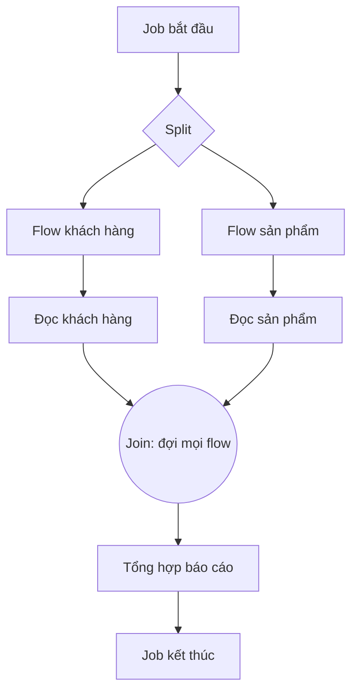
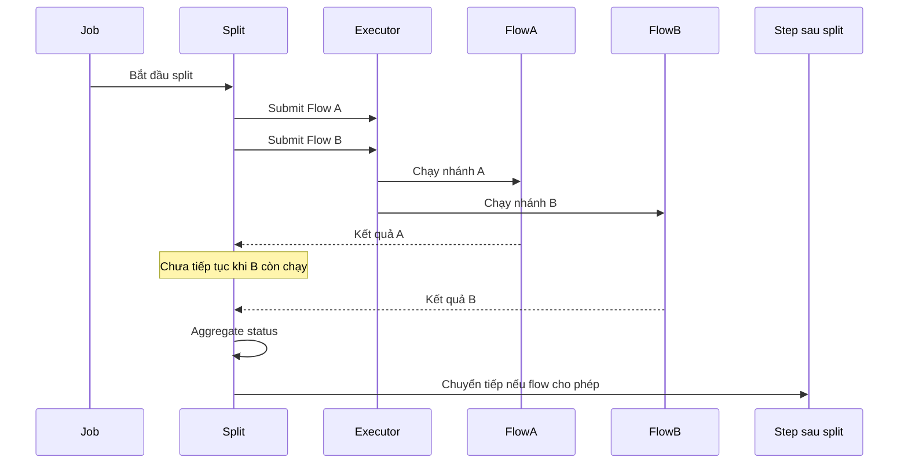
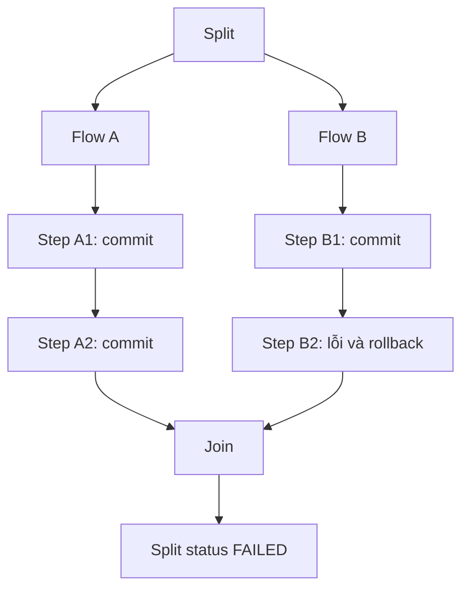
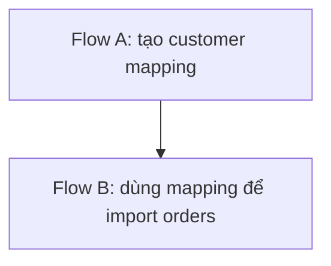
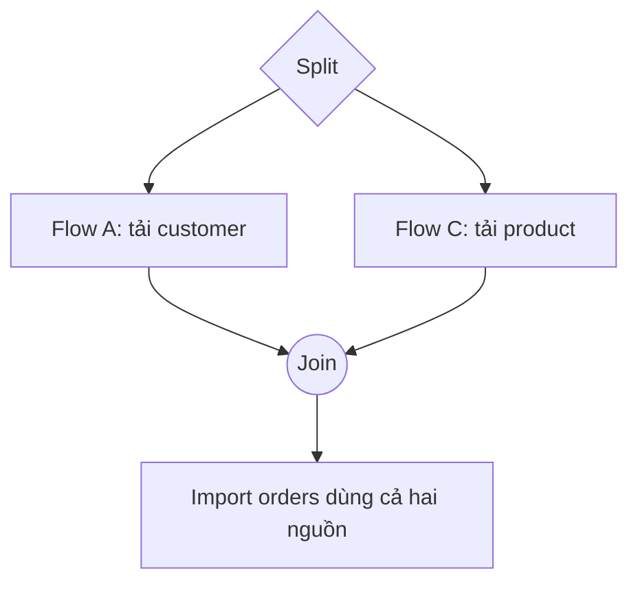
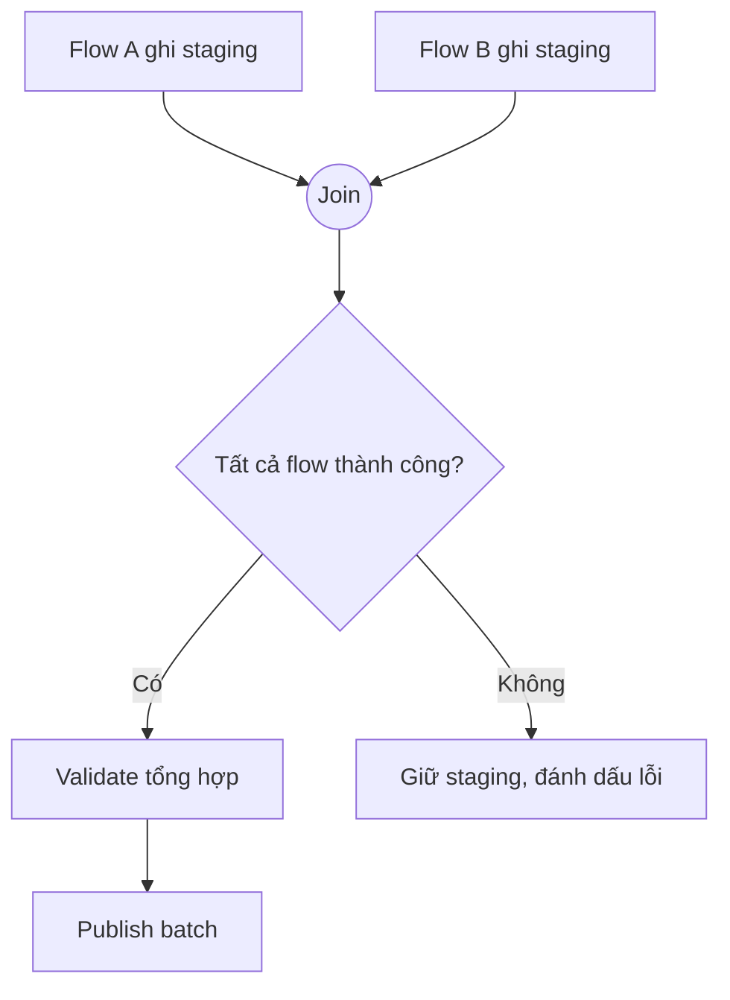

# Đồng bộ khi các flow hoàn tất

Trong Spring Batch, một job có thể chạy nhiều flow độc lập song song bằng cơ chế split. Mỗi flow thực hiện một nhóm step riêng, thường trên các thread khác nhau. Khi cần chạy một step tổng hợp sau các nhánh đó, job phải biết tất cả flow đã hoàn tất.

Spring Batch giải quyết việc này bằng **điểm đồng bộ (join barrier) của split**: các flow trong một split được thực thi đồng thời theo TaskExecutor, framework thu thập kết quả của chúng và chỉ tiếp tục phần flow phía sau khi các nhánh đã trả kết quả. Step đặt sau split vì thế có thể dùng kết quả do các nhánh tạo ra.

Điểm đồng bộ này chỉ điều phối thời điểm tiếp tục. Nó **không tạo một transaction chung cho mọi flow**. Mỗi step vẫn quản lý transaction của mình; một nhánh có thể đã commit dữ liệu trước khi nhánh khác thất bại. Thiết kế parallel flow cần tính đến cả join, trạng thái lỗi, dữ liệu chia sẻ và khả năng phục hồi.

## 1. Parallel flow và điểm đồng bộ

Một flow là chuỗi step hoặc các transition mô tả một phần workflow. Khi các phần việc độc lập, có thể đặt chúng vào các flow riêng rồi dùng split để chạy song song.

Ví dụ, job chuẩn bị báo cáo cần tải dữ liệu khách hàng và dữ liệu sản phẩm. Hai việc này độc lập, nhưng bước tổng hợp cần cả hai nguồn:



Điểm join là ranh giới logic giữa phần xử lý song song và phần xử lý cần kết quả của tất cả nhánh. Khi một flow kết thúc sớm hơn, nó không làm step tổng hợp chạy ngay; job còn phải thu thập kết quả của các flow khác trong cùng split.

### Đồng bộ không có nghĩa là chạy tuần tự

Split có thể dùng TaskExecutor bất đồng bộ để chạy các flow trên nhiều thread. Dù vậy, flow sau split chỉ tiếp tục sau khi split đã thu được kết quả của các nhánh.

Có thể phân biệt:

- **Execution song song**: các flow có thể chạy đồng thời.
- **Join đồng bộ**: phần workflow sau split chờ kết quả của tất cả flow.
- **Transaction**: từng step/chunk quản lý commit hoặc rollback theo transaction manager của nó.

Join là cơ chế phối hợp workflow. Nó không gộp các transaction và không hoàn tác dữ liệu của nhánh đã commit.

## 2. Cấu hình split với TaskExecutor

Spring Batch cung cấp FlowBuilder để mô tả split. Một flow được đưa vào start và các flow còn lại được thêm qua split(...).add(...).

Ví dụ:

```java
@Bean
Flow customerFlow(Step loadCustomersStep) {
    return new FlowBuilder<SimpleFlow>("customerFlow")
            .start(loadCustomersStep)
            .build();
}

@Bean
Flow productFlow(Step loadProductsStep) {
    return new FlowBuilder<SimpleFlow>("productFlow")
            .start(loadProductsStep)
            .build();
}

@Bean
Flow parallelPreparationFlow(
        TaskExecutor parallelFlowTaskExecutor,
        Flow customerFlow,
        Flow productFlow) {

    return new FlowBuilder<SimpleFlow>("parallelPreparationFlow")
            .start(customerFlow)
            .split(parallelFlowTaskExecutor)
            .add(productFlow)
            .build();
}
```

Trong cấu hình này, customerFlow và productFlow là hai nhánh của cùng split. TaskExecutor quyết định cách thực thi chúng. Sau khi flow tổng hợp được tạo, job cha có thể đặt step phụ thuộc vào kết quả của cả hai flow:

```java
@Bean
Job customerProductReportJob(
        JobRepository jobRepository,
        Flow parallelPreparationFlow,
        Step buildReportStep) {

    return new JobBuilder("customerProductReportJob", jobRepository)
            .start(parallelPreparationFlow)
            .next(buildReportStep)
            .end()
            .build();
}
```

buildReportStep chỉ được thực thi sau khi split flow kết thúc và kết quả các nhánh đã được tổng hợp. Đây là vị trí thích hợp cho thao tác cần dữ liệu của cả customerFlow và productFlow.

### TaskExecutor phải thực sự bất đồng bộ

Split nhận một TaskExecutor. Nếu dùng SyncTaskExecutor, các flow sẽ chạy trên thread gọi và không tạo concurrency thực sự. Muốn chạy song song, cấu hình một executor bất đồng bộ phù hợp.

Ví dụ dùng thread pool có giới hạn:

```java
@Bean
ThreadPoolTaskExecutor parallelFlowTaskExecutor() {
    ThreadPoolTaskExecutor executor = new ThreadPoolTaskExecutor();
    executor.setCorePoolSize(2);
    executor.setMaxPoolSize(2);
    executor.setQueueCapacity(10);
    executor.setThreadNamePrefix("batch-flow-");
    return executor;
}
```

Spring quản lý lifecycle của bean executor. Trong production, chọn số thread theo số flow đồng thời, giới hạn kết nối database, CPU và năng lực hệ thống đích. Không mặc định tạo một thread không giới hạn cho mỗi lần launch.

## 3. Join barrier hoạt động như thế nào?

Ở mức logic, split thực hiện các bước:

1. Nhận danh sách flow cần chạy.
2. Gửi từng flow đến TaskExecutor.
3. Mỗi flow thực hiện step và transition của chính nó.
4. Split thu kết quả thực thi từ các flow.
5. FlowExecutionAggregator tổng hợp các trạng thái.
6. Workflow tiếp tục theo kết quả split sau khi các nhánh đã trả kết quả.



Nếu Flow A hoàn tất sau 5 giây nhưng Flow B cần 30 giây, phần sau split phải chờ Flow B trả kết quả. Thời gian chờ của split ít nhất phụ thuộc vào nhánh hoàn tất chậm nhất, cộng thêm overhead điều phối.

Đây là lý do step sau split có thể giả định các flow đã kết thúc về mặt thực thi. Tuy nhiên, step sau vẫn cần kiểm tra kết quả nghiệp vụ: một flow có thể hoàn tất nhưng không tạo bản ghi nào, hoặc hoàn tất với cảnh báo theo quy tắc ứng dụng.

## 4. FlowExecutionAggregator và kết quả của split

Mỗi flow trả về một FlowExecutionStatus. Split cần tổng hợp các status đó thành một status chung để flow cha quyết định transition tiếp theo.

Spring Batch sử dụng FlowExecutionAggregator; cách tổng hợp mặc định chọn status có mức ưu tiên cao nhất theo thứ tự so sánh của FlowExecutionStatus. Vì vậy, một nhánh trả FAILED không thể bị xem như split hoàn tất bình thường chỉ vì nhánh khác trả COMPLETED.

Các status thường gặp:

| FlowExecutionStatus | Ý nghĩa |
|---|---|
| COMPLETED | Flow hoàn tất |
| FAILED | Flow thất bại |
| STOPPED | Flow dừng |
| UNKNOWN | Trạng thái không xác định |

Ví dụ:

| Flow A | Flow B | Kết quả cần xử lý |
|---|---|---|
| COMPLETED | COMPLETED | Split hoàn tất; có thể đi tiếp |
| COMPLETED | FAILED | Split phản ánh thất bại; không chạy nhánh success thông thường |
| FAILED | FAILED | Split thất bại |
| STOPPED | COMPLETED | Xử lý trạng thái dừng theo flow policy |

Nếu ứng dụng cấu hình aggregator tùy chỉnh, quy tắc kết hợp có thể khác. Không nên viết custom aggregator làm mất thông tin lỗi của một nhánh hoặc biến trạng thái không thành công thành COMPLETED nếu không có chính sách nghiệp vụ rõ ràng.

### Điều hướng sau split theo kết quả

Có thể định nghĩa transition dựa trên kết quả của split flow:

```java
@Bean
Job parallelJob(
        JobRepository jobRepository,
        Flow parallelPreparationFlow,
        Step buildReportStep,
        Step recordFailureStep) {

    return new JobBuilder("parallelJob", jobRepository)
            .start(parallelPreparationFlow)
                .on("COMPLETED").to(buildReportStep)
            .from(parallelPreparationFlow)
                .on("FAILED").to(recordFailureStep)
            .from(recordFailureStep)
                .on("*").fail()
            .end()
            .build();
}
```

Ở đây, nhánh tổng hợp báo cáo chỉ chạy khi split trả COMPLETED. Nếu một flow thất bại và split trả FAILED, job đi theo nhánh ghi nhận lỗi. Các transition phải phù hợp với status mà flow thực sự phát ra.

## 5. Khi một flow chạy lâu hơn các flow khác

Join barrier khiến các flow nhanh phải đợi flow chậm nhất trước khi workflow đi tiếp. Đây là hành vi đúng nếu step sau phụ thuộc vào mọi nhánh.

Ví dụ:

| Flow | Thời gian giả định | Kết quả |
|---|---:|---|
| Khách hàng | 8 giây | COMPLETED |
| Sản phẩm | 45 giây | COMPLETED |
| Giá và khuyến mãi | 20 giây | COMPLETED |
| Join | Chờ đến khi cả ba trả kết quả | COMPLETED |
| Tổng hợp | Bắt đầu sau join | Chạy khi mọi flow xong |

Nếu một flow có thể bị treo vô hạn do HTTP call, database lock hoặc đọc file chờ, job cũng có thể chờ rất lâu ở split. Vì vậy, mỗi nhánh cần timeout phù hợp ở các điểm I/O, giới hạn retry và cách xử lý khi vượt deadline.

Không đặt timeout bằng cách tự ý bỏ qua một flow chưa hoàn tất rồi vẫn chạy step phụ thuộc. Nếu nghiệp vụ cho phép thiếu một nguồn, hãy biến điều đó thành status rõ ràng như PARTIAL hoặc DEGRADED và thiết kế step sau xử lý dữ liệu thiếu có chủ đích.

### Không nhầm timeout với join

Join chờ các flow kết thúc. Timeout của HTTP client, database query hoặc một cơ chế giám sát là cách giới hạn thời gian cho công việc bên trong flow. TaskExecutor không tự làm cho mọi step có timeout nghiệp vụ.

Nếu cần hủy một nhánh đang chạy khi nhánh khác thất bại, hãy thiết kế cơ chế cancellation có kiểm soát. Không giả định một flow thất bại sẽ luôn tự động dừng tức thì các flow còn lại; một step đang gọi hệ thống ngoài có thể tiếp tục cho đến khi thao tác đó kết thúc hoặc timeout.

## 6. Transaction của các flow vẫn độc lập

Split đồng bộ kết quả thực thi, không đồng bộ transaction. Mỗi step trong các flow vẫn tạo transaction theo cấu hình của step đó.

Ví dụ:



Trong tình huống này, các transaction đã commit ở Flow A và Step B1 vẫn tồn tại. Chunk hoặc step lỗi có thể rollback theo transaction manager của nó. Job không có một transaction bao ngoài để undo mọi nhánh.

Do đó:

- Một nhánh có thể đã ghi dữ liệu dù split cuối cùng thất bại.
- Step sau split thường không chạy theo nhánh success nếu kết quả tổng hợp là FAILED.
- Restart phải biết nhánh nào đã hoàn tất, nhánh nào thất bại và dữ liệu nào đã commit.
- Writer cần idempotent hoặc có khóa nghiệp vụ để tránh ghi trùng khi một flow được chạy lại.

Join là barrier về control flow, không phải commit barrier cho nhiều resource.

## 7. Dữ liệu chia sẻ giữa các flow

Các flow trong cùng job có thể truy cập cùng JobParameters và cùng JobExecution context. Điều đó không có nghĩa nhiều nhánh có thể ghi tùy ý vào cùng một key mà không có tranh chấp.

Tránh để hai flow cùng cập nhật một giá trị mutable hoặc cùng ghi một key trong JobExecutionContext. Việc cập nhật đồng thời có thể tạo race condition, mất cập nhật hoặc kết quả phụ thuộc thời điểm ghi.

### Dùng StepExecutionContext cho checkpoint riêng

Mỗi step có StepExecution và Step ExecutionContext riêng. Reader của Flow A nên lưu checkpoint trong context của step A; reader của Flow B lưu checkpoint trong context của step B.

Không dùng JobExecutionContext như một vùng chia sẻ thread-safe. Nếu các flow cần trao đổi kết quả, nên dùng một cơ chế dữ liệu có hợp đồng rõ ràng:

- Mỗi flow ghi vào bảng staging riêng, có batch ID.
- Mỗi flow ghi vào một file/object có tên xác định.
- Dùng bảng kết quả với unique key theo batch và loại dữ liệu.
- Dùng một service thread-safe hoặc cơ chế đồng bộ phù hợp nếu chỉ chia sẻ trạng thái nhỏ trong bộ nhớ.

Sau join, step tổng hợp đọc kết quả từ các nguồn đã được ghi và commit. Cách này làm cho dữ liệu giữa các nhánh có thể quan sát, kiểm tra và phục hồi.

### Không truyền cả object mutable qua context

Không lưu collection lớn hoặc entity mutable vào job context để flow khác đọc. Hãy lưu ID, version, checksum hoặc một trạng thái nhỏ. Dữ liệu thật nằm trong staging/database/object storage và được đọc lại sau join.

## 8. Thiết kế step sau split

Step sau split thường là nơi:

- Đối chiếu số lượng đầu ra từ từng flow.
- Kết hợp dữ liệu staging.
- Kiểm tra checksum hoặc phiên bản nguồn.
- Tạo báo cáo tổng hợp.
- Công bố kết quả cuối cùng.

Ví dụ tasklet tổng hợp:

```java
@Bean
Step buildReportStep(
        JobRepository jobRepository,
        PlatformTransactionManager transactionManager,
        ReportAssembler reportAssembler) {

    return new StepBuilder("buildReportStep", jobRepository)
            .tasklet((contribution, chunkContext) -> {
                String batchId = chunkContext.getStepContext()
                        .getJobParameters()
                        .get("batchId")
                        .toString();

                reportAssembler.buildFor(batchId);
                return RepeatStatus.FINISHED;
            }, transactionManager)
            .build();
}
```

Ví dụ giả định hai flow đã ghi dữ liệu vào staging theo cùng batchId. Step tổng hợp chỉ chạy sau split hoàn tất và đọc staging để tạo báo cáo. Trong production, nên kiểm tra mỗi nguồn đã tạo artifact hợp lệ, số lượng mong đợi và trạng thái flow trước khi publish.

Không nên để step tổng hợp dựa vào một biến Java static hoặc singleton được các flow cập nhật. Dùng dữ liệu bền vững có batch ID giúp restart và quan sát rõ hơn.

## 9. Xác định các flow có thực sự độc lập không

Chỉ đưa các flow vào split khi chúng có thể tiến hành độc lập. Nếu Flow B cần kết quả do Flow A tạo ra, hai flow không nên chạy song song theo cách đó.

Ví dụ không phù hợp:



Nếu B cần dữ liệu A, hãy nối chúng tuần tự trong cùng flow hoặc đặt step B sau split:



Một cách khác là đặt các step phụ thuộc liên tiếp bên trong cùng một nhánh, rồi chỉ split các nhánh độc lập với nhau.

### Dependency ẩn

Hai flow có thể trông độc lập nhưng cùng:

- Cập nhật một bảng control hoặc một bản ghi tổng hợp.
- Đọc và ghi cùng file.
- Gọi API có rate limit hoặc trạng thái dùng chung.
- Lấy lock trên cùng business key.
- Cập nhật một singleton bean hoặc cache mutable.

Hãy xác định dependency dữ liệu và tài nguyên trước khi bật parallel execution. Nếu hai nhánh tranh chấp cùng resource, chạy song song có thể chậm hơn hoặc gây deadlock.

## 10. Cấu hình concurrency và giới hạn tài nguyên

Một TaskExecutor riêng cho split giúp kiểm soát số flow chạy cùng lúc. Ví dụ thread pool có hai worker cho hai flow:

```java
@Bean
ThreadPoolTaskExecutor parallelFlowTaskExecutor() {
    ThreadPoolTaskExecutor executor = new ThreadPoolTaskExecutor();
    executor.setCorePoolSize(2);
    executor.setMaxPoolSize(2);
    executor.setQueueCapacity(0);
    executor.setThreadNamePrefix("split-flow-");
    return executor;
}
```

Nếu có 5 flow nhưng pool chỉ có 2 thread, một số flow phải chờ worker rảnh. Join vẫn đợi mọi flow hoàn tất. Số thread lớn hơn không luôn làm job nhanh hơn nếu database pool, API quota hoặc CPU là nút thắt.

Hãy tính đồng thời trên toàn hệ thống, không chỉ trong một job. Nếu scheduler chạy 10 job cùng lúc và mỗi job tạo 4 flow, hệ thống có thể cần xử lý tới 40 flow cùng lúc.

Các giới hạn nên xem xét:

- Số thread tối đa cho split.
- Kích thước connection pool của metadata và business database.
- Giới hạn kết nối HTTP và rate limit của partner API.
- CPU, heap và tốc độ đọc/ghi filesystem.
- Số job có thể chạy đồng thời.
- Queue capacity và chính sách từ chối công việc khi quá tải.

## 11. JobRepository và thread safety

Parallel flow tạo nhiều StepExecution hoạt động đồng thời. JobRepository phải hỗ trợ các thao tác metadata đồng thời theo cấu hình database và transaction manager. Dùng repository JDBC chuẩn với cấu hình phù hợp giúp Spring Batch quản lý metadata, nhưng ứng dụng vẫn cần tránh tranh chấp dữ liệu nghiệp vụ.

Không chia sẻ một reader/writer có state mutable giữa các flow trừ khi implementation được thiết kế thread-safe. Thông thường, mỗi step nên có instance reader/writer riêng hoặc dùng scope phù hợp để state không bị trộn.

Các bean singleton chỉ nên giữ dependency bất biến hoặc thread-safe. Không lưu current item, current batch cursor hoặc dữ liệu riêng của một flow trong field mutable của singleton dùng chung.

## 12. Xử lý lỗi và trạng thái partial success

Một split có thể kết thúc không thành công dù một hoặc nhiều flow đã hoàn tất. Hãy ghi nhận kết quả riêng của từng nhánh thay vì chỉ nhìn trạng thái job cha.

Ví dụ:

| Flow | Trạng thái | Dữ liệu đã commit | Hành động |
|---|---|---|---|
| Customer flow | COMPLETED | Có | Giữ staging và đánh dấu hoàn tất |
| Product flow | FAILED | Có thể có một phần | Restart hoặc cách ly theo batch |
| Pricing flow | COMPLETED | Có | Giữ kết quả để đối soát |
| Split | FAILED | Không có một kết quả chung thành công | Không publish báo cáo |

Nếu job restart, các step đã hoàn tất thường được Spring Batch xử lý theo restart semantics của job; step lỗi có thể được thực thi lại. Tuy nhiên, cần xác nhận từng flow và từng step có restartable, reader checkpoint đúng và writer idempotent.

Không xóa dữ liệu staging của flow thành công chỉ vì flow khác thất bại. Có thể cần giữ lại để restart, đối soát hoặc cleanup theo retention sau khi batch đã kết thúc.

### Có nên hủy các flow còn lại khi một flow thất bại?

Điều đó phụ thuộc nghiệp vụ. Nếu các flow khác vẫn có giá trị cho điều tra hoặc restart, để chúng hoàn tất và ghi nhận kết quả có thể phù hợp. Nếu tiếp tục sẽ tạo side effect không mong muốn, cần một cơ chế cancellation được thiết kế rõ ràng và có thể kiểm soát.

Đừng giả định framework sẽ tự động dừng mọi thread ngay khi một flow báo lỗi. Step đang chạy có thể đang ở giữa thao tác I/O hoặc transaction. Dùng timeout, cancellation token ở tầng ứng dụng và idempotency cho thao tác có thể được thử lại.

## 13. Đồng bộ kết quả không đồng nghĩa với atomic commit

Có ba khái niệm cần tách biệt:

| Khái niệm | Câu hỏi được trả lời |
|---|---|
| Parallel execution | Các flow có thể chạy cùng lúc không? |
| Join synchronization | Khi nào flow phía sau được phép tiếp tục? |
| Transaction atomicity | Những thay đổi dữ liệu nào cùng commit hoặc rollback? |

Ví dụ, customer flow ghi 10.000 dòng vào database và commit. Product flow ghi 5.000 dòng rồi thất bại. Split chờ các nhánh trả kết quả và kết luận thất bại. Customer data vẫn tồn tại vì transaction của nó đã commit.

Nếu yêu cầu nghiệp vụ là “chỉ công bố dữ liệu khi tất cả nhánh thành công”, hãy ghi vào staging theo batch ID. Sau join, step tổng hợp kiểm tra mọi nhánh và mới chuyển trạng thái batch sang PUBLISHED. Nếu có lỗi, staging được giữ ở trạng thái chưa công bố để restart hoặc cleanup.



Đây là publish barrier ở tầng ứng dụng. Nó tạo quy tắc rõ ràng cho consumer nhưng không thay thế transaction phân tán nếu nhiều hệ thống cần atomic commit thực sự.

## 14. Restart và dữ liệu đã tạo bởi flow song song

Khi restart một job có split, cần xác định:

- Flow nào đã hoàn tất?
- Flow nào thất bại hoặc dừng?
- Step nào trong mỗi flow đã commit?
- Checkpoint của từng reader nằm ở đâu?
- Artifact staging nào đã hoàn tất?
- Có output nào đã được công bố cho downstream chưa?

Các step đã hoàn tất thường không chạy lại khi restart cùng JobInstance theo hành vi mặc định, còn step thất bại/chưa hoàn tất có thể chạy lại. Nếu một flow đã tạo file hoặc gửi message trước khi lỗi, cần dùng batch ID, manifest và idempotency để tránh lặp side effect.

Identifying JobParameters của parent job phải giữ nguyên để restart cùng JobInstance. Nếu dùng timestamp mới làm identifying parameter, lần chạy có thể trở thành job instance mới và các flow có thể chạy lại từ đầu.

Với input thay đổi theo thời gian, chốt version, watermark hoặc snapshot ID cho từng batch. Join chỉ bảo đảm các flow đã hoàn tất; nó không bảo đảm chúng đã đọc cùng một snapshot nếu nguồn dữ liệu thay đổi giữa lúc chạy.

## 15. Quan sát thời gian chờ và hiệu năng của split

Để hiểu split có thực sự giúp tăng throughput, hãy ghi nhận:

- Thời gian bắt đầu/kết thúc của từng flow.
- Thời gian chạy từng step.
- Thời gian từ lúc flow nhanh nhất hoàn tất đến khi flow cuối cùng hoàn tất.
- Thời gian chờ tại join.
- Số lần retry, skip và lỗi theo từng nhánh.
- Mức sử dụng thread pool, connection pool và hệ thống đích.

Ví dụ:

| Flow | Duration | Kết quả |
|---|---:|---|
| Customer | 12 giây | COMPLETED |
| Product | 28 giây | COMPLETED |
| Pricing | 18 giây | COMPLETED |
| Split total | Khoảng 28 giây cộng overhead | COMPLETED |

Nếu tổng thời gian split gần bằng tổng thời gian các flow thay vì thời gian của flow chậm nhất, hãy kiểm tra TaskExecutor có đang chạy đồng bộ, pool có bị giới hạn hoặc các flow có tranh chấp tài nguyên không.

Không dùng riêng tổng thời gian job để kết luận parallel flow hoạt động hiệu quả. Theo dõi từng nhánh giúp nhận ra bottleneck và thời gian chờ tại join.

## 16. Kiểm thử việc chờ tất cả flow

Một integration test nên chứng minh step sau split không chạy khi còn một flow chưa hoàn tất.

Có thể thiết kế các tasklet test:

- Flow A ghi marker A rồi kết thúc.
- Flow B chờ một tín hiệu test, sau đó ghi marker B rồi kết thúc.
- Step sau split kiểm tra cả marker A và marker B đều tồn tại.

Trong test, dùng latch hoặc một cơ chế đồng bộ có timeout để điều khiển Flow B. Xác nhận step sau split chỉ được gọi sau khi B hoàn tất. Luôn đặt timeout trong test để tránh test treo vô hạn.

Các tình huống nên kiểm tra:

| Kịch bản | Kết quả cần xác nhận |
|---|---|
| Hai flow hoàn tất thành công | Step sau split chạy |
| Flow A nhanh, Flow B chậm | Step sau split chờ Flow B |
| Một flow thất bại | Split trả kết quả không thành công theo aggregator |
| Một flow trả STOPPED | Flow/job xử lý theo terminal policy |
| TaskExecutor là SyncTaskExecutor | Các flow không chạy song song thực sự nhưng join vẫn đúng |
| Executor hết thread hoặc queue đầy | Lỗi thực thi được quan sát và job không publish kết quả thiếu |
| Một flow ghi staging rồi flow khác thất bại | Staging không được công bố |
| Restart sau partial success | Không ghi trùng dữ liệu đã commit |

Để kiểm tra concurrency thật, có thể ghi nhận thread name và timestamp ở mỗi flow. Không dùng sleep dài làm cơ chế đồng bộ duy nhất; latch và timeout giúp test ổn định hơn.

## 17. Những lỗi thường gặp

**Cho rằng step sau split chạy ngay khi flow đầu tiên xong.** Split chờ kết quả của các flow trong nhóm trước khi tiếp tục.

**Dùng SyncTaskExecutor nhưng kỳ vọng chạy song song.** Executor đồng bộ thực thi trên thread gọi. Dùng executor bất đồng bộ có giới hạn nếu cần concurrency.

**Nhầm join với transaction commit.** Join đợi flow trả kết quả; nó không rollback các commit của nhánh khác.

**Để các flow phụ thuộc dữ liệu chạy đồng thời.** Nếu B cần output A, hãy đặt B sau join hoặc cùng chuỗi flow với A.

**Ghi cùng key trong JobExecutionContext từ nhiều nhánh.** Dễ tạo race condition hoặc mất cập nhật. Dùng step context riêng hoặc staging có khóa.

**Chia sẻ reader/writer mutable giữa các flow.** State có thể bị trộn và gây lỗi khó tái hiện. Mỗi step cần instance/state riêng hoặc implementation thread-safe.

**Không giới hạn concurrency.** Thread và connection tăng quá mức có thể làm database hoặc API quá tải. Cấu hình pool và capacity theo tải toàn hệ thống.

**Giả định một flow thất bại sẽ hủy ngay các flow còn lại.** Thiết kế timeout/cancellation rõ ràng và không dựa vào side effect có thể tự rollback.

**Publish dữ liệu trước khi join thành công.** Consumer có thể thấy kết quả thiếu một nhánh. Dùng staging và chỉ công bố sau bước tổng hợp/validation.

## 18. Quy trình thiết kế parallel flow có join

Trước khi cấu hình split, hãy trả lời:

1. Những nhánh nào thực sự độc lập?
2. Step nào cần kết quả của tất cả nhánh?
3. TaskExecutor có thực sự bất đồng bộ và giới hạn tài nguyên hợp lý không?
4. Mỗi flow tạo ra kết quả ở đâu và gắn với batch ID nào?
5. Các nhánh có ghi vào state hoặc resource dùng chung không?
6. Nếu một nhánh thất bại sau khi nhánh khác commit, dữ liệu nào còn lại?
7. FlowExecutionAggregator sẽ tạo status nào và parent flow xử lý status đó ra sao?
8. Timeout và cancellation được thực hiện ở tầng nào?
9. Restart có tiếp tục đúng checkpoint và tránh side effect trùng không?
10. Step sau join xác minh đủ dữ liệu trước khi publish như thế nào?

Sau khi trả lời, hãy vẽ flow và join trước khi viết builder. Điều này giúp nhận diện dependency ẩn và xác định chính xác điểm mà dữ liệu được phép tổng hợp/công bố.

## 19. Kết luận thực hành

Parallel flow trong Spring Batch cho phép các nhánh độc lập chạy đồng thời qua split và TaskExecutor. Split tạo điểm đồng bộ: flow phía sau chỉ tiếp tục sau khi các nhánh đã trả kết quả và status được tổng hợp. Vì thế, step tổng hợp có thể đợi đủ dữ liệu từ mọi flow.

Join chỉ đồng bộ control flow. Mỗi step vẫn có transaction riêng; dữ liệu đã commit ở một nhánh không tự rollback nếu nhánh khác thất bại. Hãy dùng staging hoặc bảng kết quả theo batch ID, xác minh trạng thái từng nhánh sau join rồi mới publish. Giữ state riêng theo StepExecution, tránh chia sẻ object mutable, giới hạn thread/connections và thiết kế restart/idempotency cho partial success.

Khi các flow độc lập, điểm join rõ ràng và quy trình phục hồi được định nghĩa trước, parallel flow giúp rút ngắn thời gian chạy mà vẫn giữ được khả năng quan sát và kiểm soát kết quả.
