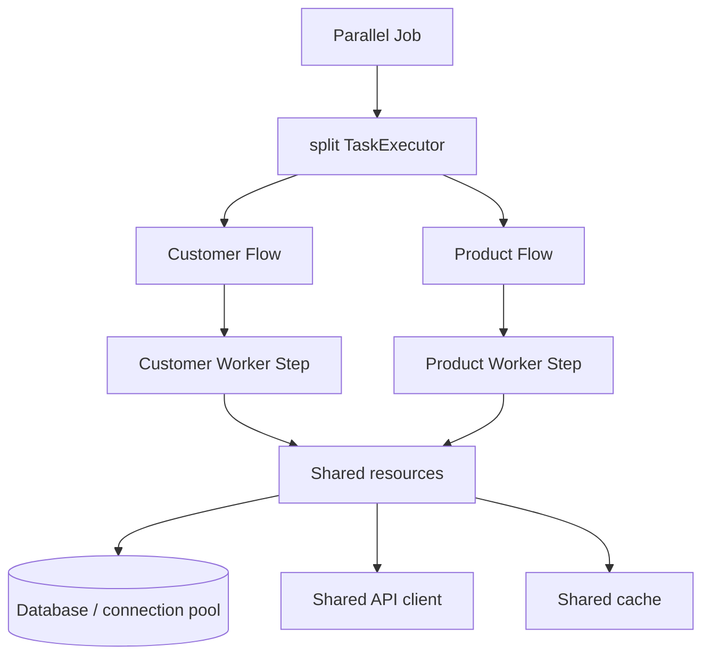

# Tài nguyên dùng chung giữa các flow

Trong Spring Batch, một job có thể chạy nhiều flow song song bằng `split(TaskExecutor)`. Các flow có thể cùng sử dụng những bean Spring, database, cache, file system, HTTP client hoặc dịch vụ bên ngoài. Việc dùng chung tài nguyên giúp tránh tạo nhiều kết nối và cấu hình trùng lặp, nhưng cũng tạo ra yêu cầu về thread safety, transaction boundary và kiểm soát tranh chấp.

Khi hai flow chạy đồng thời, mỗi flow có thể thực thi step trên thread khác nhau. Vì vậy, một bean singleton được inject vào cả hai flow có thể được gọi đồng thời. Nếu bean giữ state mutable mà không có cơ chế đồng bộ, dữ liệu của flow này có thể ghi đè dữ liệu của flow kia. Tương tự, hai step có thể cùng cập nhật một hàng database, ghi vào cùng một file hoặc gọi chung API vượt quá giới hạn rate limit.

Nguyên tắc thiết kế là phân biệt tài nguyên có thể chia sẻ an toàn với state thuộc riêng một lần thực thi. Các service stateless, repository và connection pool thường có thể được chia sẻ; reader có state, cursor, file handle và dữ liệu tạm theo step cần scope hoặc instance riêng. Transaction của các flow là độc lập; không có một transaction duy nhất bao trùm toàn bộ các flow song song.

## 1. Parallel flow và tài nguyên dùng chung

`split()` cho phép nhiều flow trong cùng job được thực thi đồng thời thông qua một `TaskExecutor`. Ví dụ job có hai flow: một flow nhập dữ liệu khách hàng và flow còn lại nhập dữ liệu sản phẩm.

```java
@Bean
Job parallelImportJob(
        JobRepository jobRepository,
        TaskExecutor flowTaskExecutor,
        Flow customerFlow,
        Flow productFlow) {

    return new JobBuilder("parallelImportJob", jobRepository)
            .start(customerFlow)
            .split(flowTaskExecutor)
            .add(productFlow)
            .end()
            .build();
}
```

Hai flow có thể chạy trên các thread khác nhau. Nếu cả hai cùng inject `CustomerLookupService`, `DataSource`, `MeterRegistry` hoặc một HTTP client, những đối tượng đó trở thành tài nguyên dùng chung trong khoảng thời gian thực thi song song.



Chia sẻ cùng một object không có nghĩa mọi thao tác trên object đó tự động an toàn. Cần hiểu object có state hay không, API của nó có hỗ trợ concurrent calls không và các flow có thể tác động lên cùng dữ liệu hay không.

## 2. Phân biệt shared resource và execution state

Không phải mọi thứ được inject vào nhiều flow đều nên được chia sẻ như nhau.

| Loại tài nguyên | Cách dùng giữa các flow |
|---|---|
| Service stateless, chỉ chứa dependency và logic | Thường có thể dùng chung nếu các dependency cũng an toàn khi gọi đồng thời |
| Spring Data repository / `JdbcTemplate` | Thường có thể dùng chung; transaction và connection được quản lý theo thread |
| `DataSource` và connection pool | Được thiết kế để cấp connection cho nhiều thread, nhưng phải giới hạn pool phù hợp |
| HTTP client thread-safe | Có thể dùng chung; cần kiểm soát connection pool, timeout và rate limit |
| Cache concurrent | Có thể dùng chung nếu semantics cập nhật và eviction phù hợp |
| Mutable singleton bean | Chỉ dùng chung khi state được đồng bộ và semantics rõ; thường nên loại bỏ mutable state |
| Reader có cursor hoặc vị trí đọc | Tạo instance riêng theo step/flow, thường dùng `@StepScope` |
| Writer giữ file handle hoặc buffer riêng | Tạo instance riêng hoặc cấp file/path riêng cho mỗi flow |
| `ExecutionContext` của step | Thuộc riêng `StepExecution`; không dùng chung giữa các step |
| Job `ExecutionContext` | Có phạm vi toàn job; tránh để nhiều flow cập nhật cùng khóa đồng thời |

Một câu hỏi hữu ích khi thiết kế là: “Nếu hai flow gọi phương thức này cùng một thời điểm, có thể xảy ra việc đọc state giữa chừng, ghi đè state hoặc tạo side effect trùng không?” Nếu câu trả lời là có, cần tách instance, đồng bộ, khóa dữ liệu hoặc thay đổi thiết kế.

## 3. Chia sẻ service stateless

Service không giữ state riêng của từng item hoặc từng lần gọi thường có thể được khai báo singleton và dùng chung giữa các flow. Ví dụ service chỉ gọi repository để tìm thông tin khách hàng:

```java
@Service
public class CustomerLookupService {

    private final CustomerRepository customerRepository;

    public CustomerLookupService(CustomerRepository customerRepository) {
        this.customerRepository = customerRepository;
    }

    public Customer findRequired(String customerId) {
        return customerRepository.findById(customerId)
                .orElseThrow(() ->
                        new CustomerNotFoundException(customerId));
    }
}
```

Service này không lưu `customerId` hiện tại vào field. Mỗi lần gọi dùng tham số cục bộ và repository. Hai flow có thể gọi đồng thời mà không ghi đè dữ liệu của nhau, với điều kiện repository và tầng persistence được cấu hình đúng.

Ngược lại, không nên viết singleton service như sau:

```java
@Service
public class UnsafeImportState {

    private String currentBatchId;

    public void setCurrentBatchId(String batchId) {
        this.currentBatchId = batchId;
    }

    public void process(Order order) {
        // Có thể đọc batchId do flow khác vừa ghi đè.
        save(order, currentBatchId);
    }
}
```

Nếu hai flow gọi `setCurrentBatchId()` và `process()` xen kẽ, một item có thể bị gắn nhầm batch. Hãy truyền `batchId` như tham số của phương thức, hoặc lưu state theo đúng scope/execution thay vì giữ trong field singleton.

## 4. Scope của bean: Singleton, JobScope và StepScope

Scope quyết định vòng đời và phạm vi chia sẻ của bean. Với parallel flow, chọn scope sai có thể làm các step dùng chung state ngoài ý muốn.

| Scope | Vòng đời | Lưu ý khi chạy parallel flow |
|---|---|---|
| Singleton (mặc định) | Một instance trong application context | Có thể được nhiều flow gọi đồng thời; nên stateless hoặc thread-safe |
| `@JobScope` | Một instance trong phạm vi một `JobExecution` | Các step trong cùng job có thể dùng chung instance; không coi là state riêng của từng flow |
| `@StepScope` | Một instance trong phạm vi `StepExecution` | Phù hợp với reader/writer/processor có cấu hình hoặc state riêng theo step |

### 4.1. Dùng StepScope cho state riêng của step

Ví dụ hai flow dùng cùng định nghĩa reader nhưng nhận file khác nhau từ Job ExecutionContext:

```java
@Bean
@StepScope
FlatFileItemReader<InputRow> inputReader(
        @Value("#{stepExecutionContext['inputFile']}") Resource inputFile) {

    return new FlatFileItemReaderBuilder<InputRow>()
            .name("inputReader")
            .resource(inputFile)
            .delimited()
            .names("id", "value")
            .targetType(InputRow.class)
            .saveState(true)
            .build();
}
```

`@StepScope` làm reader được tạo cho từng `StepExecution`. Mỗi flow có reader instance và execution context riêng, vì vậy vị trí đọc và file resource không bị chia sẻ giữa các lần thực thi step.

Nếu reader là singleton và giữ cursor hoặc vị trí đọc trong field, hai flow có thể cùng thay đổi state đó. Khi dùng `@StepScope`, vẫn cần bảo đảm step đăng ký reader như `ItemStream` để Spring Batch gọi `open()`, `update()` và `close()` đúng vòng đời.

### 4.2. Cẩn trọng với JobScope

`@JobScope` tạo bean trong phạm vi một `JobExecution`, không phải một instance cho mỗi flow. Nếu nhiều flow truy cập cùng một job-scoped bean, chúng có thể gọi nó đồng thời. Job-scoped bean phù hợp với cấu hình hoặc dữ liệu chung bất biến; nếu bean có mutable state, phải bảo đảm thread safety hoặc chuyển state xuống StepScope.

Không nên dùng `@JobScope` chỉ vì muốn “mỗi job có một bean” mà quên rằng các flow của job đó chạy song song. Scope không tự thêm khóa hay đồng bộ cho các phương thức của bean.

## 5. StepExecutionContext riêng và JobExecutionContext dùng chung

Mỗi `StepExecution` có một Step ExecutionContext riêng. Đây là nơi phù hợp để lưu checkpoint, offset reader, partition range hoặc state chỉ thuộc step đó.

Ngược lại, các step trong cùng job execution có thể truy cập cùng Job ExecutionContext. Điều này hữu ích khi một step tạo giá trị và step sau sử dụng nó theo luồng tuần tự. Nhưng trong parallel flow, hai flow có thể cùng cập nhật Job ExecutionContext tại thời điểm gần nhau.

Ví dụ rủi ro:

```java
// Flow A
jobExecution.getExecutionContext().putString("result", "CUSTOMERS_DONE");

// Flow B
jobExecution.getExecutionContext().putString("result", "PRODUCTS_DONE");
```

Hai flow cùng ghi khóa `result`; giá trị cuối phụ thuộc thứ tự cập nhật. Ngay cả khi dùng hai khóa riêng như `customers.result` và `products.result`, không nên coi Job ExecutionContext là cơ chế đồng bộ hoặc message passing giữa các flow. Việc persist context và cập nhật metadata còn chịu ảnh hưởng bởi vòng đời step và transaction repository.

Các lựa chọn an toàn hơn:

- Mỗi flow ghi kết quả vào bảng riêng theo `jobExecutionId` hoặc `batchId`.
- Dùng khóa context có namespace riêng nếu chỉ cần metadata nhỏ và có quy trình merge sau khi các flow kết thúc.
- Để step sau phần `split()` đọc kết quả từ kho dữ liệu sau khi cả hai flow đã hoàn tất.
- Nếu cần phối hợp trong lúc các flow đang chạy, dùng cơ chế đồng bộ hoặc coordination store có semantics rõ ràng.

Ví dụ, flow khách hàng ghi vào `customer_import_result`, flow sản phẩm ghi vào `product_import_result`. Step tổng hợp chạy sau `split()` và đọc cả hai bảng. Như vậy, các flow không cần ghi chung một key trong Job ExecutionContext.

## 6. Database, DataSource và connection pool

Nhiều flow thường dùng chung một `DataSource` và connection pool. Đây là cách dùng bình thường: mỗi transaction lấy connection phù hợp từ pool và trả lại khi transaction kết thúc. Không nên lấy một `Connection` rồi lưu trong singleton bean để nhiều flow cùng sử dụng.

Ví dụ hai flow dùng chung `JdbcTemplate`:

```java
@Bean
JdbcTemplate jdbcTemplate(DataSource dataSource) {
    return new JdbcTemplate(dataSource);
}
```

`JdbcTemplate` được thiết kế để chia sẻ giữa các thread; nó lấy connection qua `DataSource` và tham gia transaction đang gắn với thread hiện tại khi cấu hình phù hợp. Không chia sẻ trực tiếp một JDBC `Connection`, `Statement` hoặc `ResultSet` giữa các flow.

### 6.1. Tính toán sức chứa connection pool

Nếu `split()` chạy đồng thời bốn flow và mỗi flow có một worker step cần một connection trong lúc chunk transaction, pool phải có đủ connection cho các worker đó cùng các thành phần khác như web request, JobRepository và scheduler.

Không nên đặt pool size chỉ bằng số flow. Một flow có thể có nhiều step hoặc nhiều transaction/worker bên trong; đồng thời ứng dụng còn có traffic ngoài batch. Hãy đo số connection đang active, thời gian chờ lấy connection và lock wait trong database.

Các triệu chứng pool quá nhỏ:

- Worker chờ connection dù CPU còn thấp.
- Step kéo dài bất thường khi chạy song song.
- Connection acquisition timeout.
- Request API bị ảnh hưởng vì batch chiếm hết pool dùng chung.

Tăng pool quá lớn cũng có thể làm database quá tải, tăng context switching hoặc vượt giới hạn connection của server. Cần đặt giới hạn concurrency và connection pool dựa trên năng lực database.

### 6.2. Tranh chấp dữ liệu

Hai flow có thể dùng connection riêng nhưng vẫn cập nhật cùng một hàng. Khi đó, database có thể phát sinh lock wait, deadlock hoặc lost update nếu logic cập nhật không phù hợp.

Ví dụ flow A cập nhật trạng thái đơn hàng trong khi flow B tính lại tổng tiền cho cùng đơn hàng. Hãy xác định quyền sở hữu dữ liệu, thứ tự cập nhật, isolation level và cơ chế optimistic/pessimistic locking phù hợp. Nếu hai công việc không thể chạy đồng thời an toàn, hãy tách phạm vi dữ liệu hoặc sắp xếp chúng tuần tự.

## 7. Transaction không được chia sẻ giữa các flow

Spring quản lý transaction theo thread (với các transaction manager phổ biến như JDBC/JPA). Khi mỗi flow chạy trên thread riêng, transaction của step trong flow A không tự động bao trùm thao tác của flow B.

Điều này có nghĩa:

- Chunk của flow A có thể commit trong khi flow B vẫn đang xử lý.
- Flow B rollback không hoàn tác chunk đã commit của flow A.
- Một exception ở flow A không tự rollback mọi transaction đã commit ở flow B.
- Job `split()` không tạo một transaction nguyên tử bao trùm toàn bộ các flow.

Không chia sẻ `TransactionStatus`, JDBC `Connection` hoặc `EntityManager` đang gắn với transaction giữa các thread. Hãy để mỗi step dùng transaction manager được cấu hình và để Spring mở/commit/rollback transaction trong thread thực thi step đó.

Nếu nghiệp vụ chỉ được công bố khi tất cả flow thành công, có thể ghi kết quả từng flow vào staging theo cùng `batchId`, sau đó dùng một step tổng hợp/commit logic sau `split()`. Step này xác nhận các kết quả cần thiết rồi cập nhật trạng thái batch nghiệp vụ. Cách tổ chức này không làm các transaction trước đó trở thành một transaction phân tán, nhưng tạo được ranh giới công bố kết quả rõ ràng.

## 8. Chia sẻ file và tài nguyên filesystem

File handle, writer buffer và tên file đầu ra thường là stateful. Nếu hai flow cùng ghi một file mà không có giao thức phối hợp, nội dung có thể xen kẽ, bị ghi đè hoặc hỏng định dạng.

Nên:

- Mỗi flow ghi file riêng, ví dụ `customers-{batchId}.csv` và `products-{batchId}.csv`.
- Nếu một flow có nhiều worker, thêm partition ID vào tên file.
- Dùng thư mục tạm riêng cho mỗi lần chạy.
- Chỉ ghép hoặc đổi tên file sau khi các flow đã hoàn tất.
- Dùng rename nguyên tử trong cùng filesystem nếu cần công bố file hoàn chỉnh.
- Không dùng chung một `FlatFileItemWriter` instance có mutable state giữa nhiều step song song.

Ví dụ cấu hình writer theo step:

```java
@Bean
@StepScope
FlatFileItemWriter<ImportedRow> outputWriter(
        @Value("#{stepExecutionContext['outputFile']}") String outputFile) {

    return new FlatFileItemWriterBuilder<ImportedRow>()
            .name("outputWriter")
            .resource(new FileSystemResource(outputFile))
            .delimited()
            .names("id", "value")
            .build();
}
```

Mỗi `StepExecution` nhận đường dẫn output riêng từ context. Nếu cần một file tổng hợp, hãy dùng step tiếp theo sau khi các flow song song kết thúc để ghép file theo thứ tự xác định.

## 9. HTTP client, message broker và giới hạn dịch vụ ngoài

Một HTTP client thread-safe có thể được chia sẻ giữa các flow để tận dụng connection pool. Tuy nhiên, cần kiểm soát:

- Số connection tối đa và thời gian chờ lấy connection.
- Connect timeout, response timeout và retry timeout.
- Rate limit của API đối tác.
- Circuit breaker hoặc bulkhead nếu một dịch vụ chậm ảnh hưởng nhiều flow.
- Idempotency key khi cùng item có thể được gửi lại.
- Chính sách backoff để nhiều flow không retry đồng thời tạo ra đợt tải lớn.

Không nên tạo một HTTP client mới cho mỗi item nếu client cần quản lý connection pool. Cũng không nên giả định client thread-safe chỉ vì nó được khai báo là Spring bean; cần kiểm tra hợp đồng của implementation cụ thể.

Với message broker, các flow có thể dùng chung connection factory hoặc template được thiết kế cho concurrent use. Tuy nhiên, thứ tự message giữa các flow không được bảo đảm chỉ vì chúng cùng dùng một template. Nếu thứ tự theo aggregate hoặc batch quan trọng, cần partition key, ordering semantics và consumer idempotency phù hợp.

Nếu writer gửi message trong transaction database, cần cân nhắc transactional outbox. Transaction của database không tự rollback một message đã được broker xác nhận nếu broker không tham gia cùng transaction được cấu hình.

## 10. Cache và dữ liệu tham chiếu dùng chung

Cache có thể giúp nhiều flow tránh truy vấn lặp cùng dữ liệu tham chiếu. Một cache concurrent phù hợp có thể được chia sẻ, nhưng cần quyết định rõ:

- Dữ liệu có bất biến trong suốt một job hay có thể thay đổi?
- Khi cache miss, nhiều flow cùng tải một key có gây request trùng không?
- Cache có giới hạn dung lượng và eviction policy không?
- Có cần invalidation khi flow khác cập nhật dữ liệu không?
- Kết quả cache có phụ thuộc tenant, batch hoặc quyền truy cập không?

Không dùng một `HashMap` mutable singleton để làm cache nếu nhiều flow cập nhật đồng thời. Có thể dùng cache implementation hỗ trợ concurrency hoặc repository/database làm nguồn dữ liệu có thẩm quyền.

Nếu dữ liệu tham chiếu cần nhất quán tại một thời điểm, hãy xác định snapshot hoặc version. Nếu flow A cập nhật dữ liệu tham chiếu trong khi flow B đọc cache, kết quả có thể phụ thuộc thời điểm. Một cache thread-safe chỉ bảo vệ cấu trúc dữ liệu; nó không tự giải quyết consistency của nghiệp vụ.

## 11. JobRepository và metadata dùng chung

Các flow trong cùng job dùng chung `JobRepository` để lưu `JobExecution`, `StepExecution` và execution context. Repository được thiết kế để quản lý metadata thực thi, nhưng ứng dụng vẫn cần tránh tự ghi trực tiếp vào các bảng `BATCH_*`.

Mỗi step có `StepExecution` riêng. Khi các flow chạy đồng thời, metadata của các step được cập nhật theo execution tương ứng. `JobExecution` và Job ExecutionContext có phạm vi chung của job, vì vậy không nên coi chúng là một vùng đồng bộ tùy ý giữa các thread.

Đặc biệt, tránh để hai flow promotion cùng một key từ Step ExecutionContext lên Job ExecutionContext. Nếu cần lưu kết quả riêng, dùng key namespace riêng và tốt nhất để một step sau `split()` tổng hợp các kết quả. Với dữ liệu quan trọng hoặc cần phối hợp trong lúc chạy, dùng bảng điều phối hoặc cơ chế lưu trữ có transaction/locking rõ ràng.

## 12. Đồng bộ khi thật sự cần cập nhật state chung

Thiết kế tốt nhất thường là tránh state mutable dùng chung. Tuy nhiên, đôi khi các flow cần cập nhật một trạng thái chung như số partition đã hoàn thành hoặc số lỗi nghiệp vụ.

Một số lựa chọn:

**Atomic counter trong bộ nhớ:** phù hợp với metric tạm thời trong một JVM, không phải dữ liệu bền vững. Nếu process restart, giá trị mất; nếu chạy nhiều node, mỗi node có counter riêng.

**Database counter có update nguyên tử:** dùng câu lệnh tăng hoặc upsert trong database, kèm khóa batch và transaction phù hợp. Cần tránh biến counter thành điểm nghẽn khi tần suất cập nhật cao.

**Bảng kết quả theo flow:** mỗi flow ghi một bản ghi kết quả với khóa duy nhất như `(batch_id, flow_name)`. Step sau đọc các bản ghi và tổng hợp khi tất cả flow đã hoàn thành.

**Distributed lock hoặc coordination service:** dùng khi cần bảo đảm chỉ một worker thực hiện một thao tác trên tài nguyên chung. Cần lease, timeout và xử lý trường hợp worker chết khi đang giữ lock.

Không dùng `synchronized` trên singleton bean như giải pháp mặc định cho mọi vấn đề. Nó chỉ đồng bộ trong một JVM, có thể làm mất lợi ích song song và không bảo vệ khi job chạy trên nhiều process/node.

## 13. Thiết kế executor và giới hạn concurrency

`TaskExecutor` điều khiển cách flow được thực thi. Dùng executor có giới hạn để kiểm soát số flow chạy đồng thời:

```java
@Bean
ThreadPoolTaskExecutor flowTaskExecutor() {
    ThreadPoolTaskExecutor executor = new ThreadPoolTaskExecutor();
    executor.setCorePoolSize(2);
    executor.setMaxPoolSize(2);
    executor.setQueueCapacity(4);
    executor.setThreadNamePrefix("parallel-flow-");
    executor.setWaitForTasksToCompleteOnShutdown(true);
    executor.setAwaitTerminationSeconds(60);
    return executor;
}
```

Nếu job có hai flow độc lập, pool hai thread có thể chạy đồng thời cả hai. Nếu có nhiều flow hơn số thread, một số flow phải chờ. Trong thực tế, concurrency còn bị giới hạn bởi database, API ngoài, CPU, memory và các task khác trong ứng dụng.

Không dùng executor không giới hạn cho batch job dài. Khi tăng số flow song song, cần đo:

- Throughput và thời gian từng flow.
- Active thread và queue depth.
- Connection pool usage và thời gian chờ connection.
- Database lock wait/deadlock.
- API latency, error rate và rate-limit responses.
- Heap, garbage collection và CPU.

Tăng concurrency chỉ hữu ích nếu tài nguyên downstream còn khả năng phục vụ. Nếu database là bottleneck, thêm thread có thể làm thời gian tổng thể dài hơn do tranh chấp.

## 14. Chia sẻ dữ liệu giữa các flow: nên phối hợp sau split

Nếu flow B cần kết quả do flow A tạo ra, hai flow không nên dựa vào việc flow A chạy trước trừ khi flow được nối tuần tự. Trong parallel flow, thứ tự hoàn thành không xác định.

Ví dụ không an toàn:

```text
Flow A: tạo customer mapping trong memory
Flow B: đọc customer mapping ngay khi bắt đầu
```

Flow B có thể chạy trước khi flow A tạo xong mapping. Thay vào đó, có thể:

1. Chạy một step chuẩn bị dữ liệu trước `split()` để tạo mapping dùng chung bất biến.
2. Lưu mapping vào database hoặc cache có lifecycle rõ ràng.
3. Để cả hai flow đọc dữ liệu đã chuẩn bị.
4. Sau khi `split()` hoàn tất, chạy step tổng hợp/đối soát để sử dụng kết quả của cả hai flow.

Ví dụ cấu trúc job:

```java
@Bean
Job prepareRunAndFinalizeJob(
        JobRepository jobRepository,
        Step prepareReferenceDataStep,
        Flow customerFlow,
        Flow productFlow,
        TaskExecutor flowTaskExecutor,
        Step finalizeBatchStep) {

    return new JobBuilder("prepareRunAndFinalizeJob", jobRepository)
            .start(prepareReferenceDataStep)
            .next(customerFlow)
            .split(flowTaskExecutor)
            .add(productFlow)
            .next(finalizeBatchStep)
            .end()
            .build();
}
```

Ví dụ minh họa ý tưởng tổ chức: chuẩn bị dữ liệu trước, chạy các flow độc lập, rồi tổng hợp sau khi các flow trong split kết thúc. Khi cấu hình flow thực tế, cần kiểm tra graph được tạo bởi builder và xác nhận step cuối chỉ chạy sau khi tất cả nhánh split đã hoàn tất.

## 15. Kiểm thử tài nguyên dùng chung

Kiểm thử cần tái hiện việc hai flow thực sự chạy đồng thời và xác nhận tài nguyên dùng chung không làm sai kết quả.

Các tình huống quan trọng:

1. **Concurrent invocation:** dùng hai flow gọi cùng service stateless; xác nhận dữ liệu đầu vào/đầu ra không bị trộn.
2. **Mutable state:** nếu có bean giữ state, chạy đồng thời với dữ liệu khác nhau để phát hiện ghi đè hoặc race condition.
3. **StepScope:** xác nhận mỗi step execution nhận đúng file, range hoặc tham số riêng.
4. **JobScope:** xác nhận bean job-scoped được nhiều flow dùng đồng thời an toàn nếu nó được chia sẻ.
5. **Database pool:** chạy với số flow dự kiến và kiểm tra không cạn connection hoặc tạo lock contention không mong muốn.
6. **Transaction isolation:** làm một flow rollback trong khi flow kia commit; xác nhận dữ liệu đã commit của flow kia vẫn tồn tại.
7. **File output:** xác nhận mỗi flow ghi đúng file riêng và step tổng hợp chỉ chạy sau khi các output hoàn tất.
8. **Job ExecutionContext:** kiểm tra các flow không ghi trùng key hoặc ghi đè kết quả của nhau.
9. **External service:** mô phỏng rate limit, timeout và retry đồng thời; xác nhận idempotency key và backoff hoạt động.
10. **Shutdown/restart:** dừng ứng dụng khi flow đang chạy và xác nhận trạng thái step cùng tài nguyên được phục hồi theo thiết kế.

Có thể dùng latch/barrier trong test để buộc hai flow cùng đi vào một đoạn code gần như đồng thời, từ đó kiểm tra race condition có tính tái lập. Tránh dùng `Thread.sleep()` dài để đoán thời điểm thread; đồng bộ test bằng `CountDownLatch`, `CyclicBarrier` hoặc công cụ test phù hợp.

Ngoài `JobExecution` status, hãy kiểm tra dữ liệu trong database, nội dung file, số request gửi ra ngoài và metadata của từng `StepExecution`. Một job có trạng thái `COMPLETED` nhưng một flow ghi nhầm dữ liệu do shared mutable state vẫn là lỗi.

## 16. Những lỗi thường gặp

**Cho rằng singleton bean luôn an toàn khi chia sẻ.** Spring singleton chỉ nói về số instance, không tự bảo đảm thread safety. Giữ service stateless hoặc dùng cơ chế đồng bộ phù hợp.

**Chia sẻ reader/writer có state giữa flow.** Cursor, offset, buffer và file handle có thể bị thay đổi đồng thời. Dùng `@StepScope` hoặc instance riêng cho từng step execution.

**Dùng JobScope như StepScope.** Job-scoped bean được chia sẻ trong phạm vi một job execution; nhiều flow có thể gọi nó cùng lúc. Chỉ dùng cho state chung an toàn.

**Coi Job ExecutionContext là vùng trao đổi đồng thời.** Các flow có thể cập nhật cùng key hoặc ghi state cạnh tranh. Dùng Step ExecutionContext riêng và kho kết quả/coordination có thiết kế rõ.

**Chia sẻ JDBC Connection hoặc EntityManager trực tiếp.** Những đối tượng gắn với transaction không nên được dùng đồng thời giữa các thread. Dùng `JdbcTemplate`, repository và transaction manager để lấy resource theo thread.

**Cho rằng split tạo một transaction chung.** Mỗi step/chunk có transaction riêng. Một flow rollback không hoàn tác các chunk đã commit của flow khác.

**Hai flow ghi cùng file.** Dữ liệu có thể xen kẽ hoặc ghi đè. Tạo output riêng và tổng hợp sau split.

**Tăng số thread mà không tính connection pool và API quota.** Downstream có thể quá tải dù CPU còn rảnh. Đặt giới hạn concurrency và theo dõi tài nguyên.

**Giả định flow chạy theo thứ tự khai báo.** Parallel flow có thể bắt đầu và kết thúc theo thứ tự khác nhau. Chỉ chia sẻ dữ liệu sau khi có cơ chế đồng bộ hoặc sau split.

## Kết luận

Các flow song song có thể dùng chung service stateless, repository, `JdbcTemplate`, connection pool, HTTP client hoặc cache nếu các thành phần đó hỗ trợ concurrent use và tài nguyên downstream đủ sức phục vụ. Những thành phần giữ state riêng của step như reader, writer có cursor/buffer hoặc file output cần instance và scope phù hợp, thường là `@StepScope`.

Không có transaction duy nhất bao trùm các flow của `split()`. Mỗi step/chunk quản lý transaction riêng; Job ExecutionContext có phạm vi chung nên không nên dùng làm cơ chế đồng bộ mutable state giữa các flow. Hãy chia dữ liệu theo khóa rõ ràng, ghi kết quả riêng, giới hạn concurrency và tổng hợp sau split. Khi cần phối hợp trong lúc chạy, dùng database coordination, lock hoặc cơ chế đồng bộ có semantics xác định. Thiết kế như vậy giúp parallel flow tận dụng tài nguyên chung mà vẫn tránh race condition, lost update, deadlock và side effect trùng lặp.
