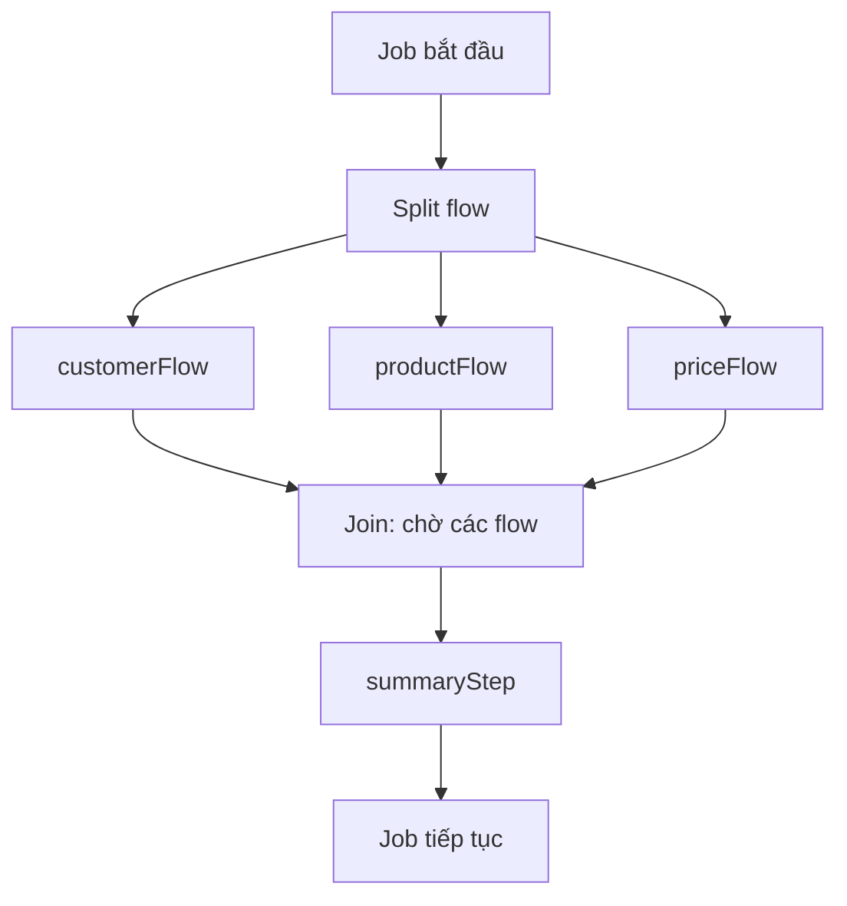

# Thứ tự kết quả của parallel flow

Trong Spring Batch, `split` cho phép nhiều flow chạy đồng thời trong cùng một job. Cách này giúp rút ngắn thời gian khi các nhánh độc lập, nhưng cũng có một hệ quả quan trọng: **thứ tự các flow bắt đầu hoặc hoàn tất không được bảo đảm**. Flow được khai báo trước chưa chắc chạy trước hoặc kết thúc trước. Thứ tự hoàn tất có thể thay đổi theo tải CPU, database, network, thread scheduling và thời gian xử lý của từng nhánh.

Nếu các flow tạo dữ liệu đầu ra, ứng dụng không nên dựa vào thứ tự thread hoàn tất để quyết định thứ tự bản ghi. Muốn kết quả ổn định, cần xác định một khóa sắp xếp có ý nghĩa nghiệp vụ, lưu output của từng nhánh ở nơi phù hợp, chờ split hoàn tất rồi tổng hợp hoặc sắp xếp ở bước tiếp theo.

## 1. Parallel flow bảo đảm điều gì về thứ tự?

Giả sử job có hai flow:

```text
customerFlow: readCustomers -> normalizeCustomers -> writeCustomers
productFlow:  readProducts  -> validateProducts  -> writeProducts
```

Khi dùng `split(taskExecutor)`, hai flow có thể chạy đồng thời. Trong mỗi flow, thứ tự step vẫn tuân theo flow definition. Nhưng không có thứ tự toàn cục giữa các step của hai flow.

Ví dụ một lần chạy có thể diễn ra như sau:

```text
Thời gian  --->

customerFlow: C1 -------- C2 ---------------- C3
productFlow:  P1 ---------------- P2 ---- P3
```

Lần chạy khác có thể cho kết quả:

```text
Thời gian  --->

customerFlow: C1 ---------------- C2 ---- C3
productFlow:  P1 ------ P2 ---------------- P3
```

Các quan hệ được bảo đảm:

- Step sau trong cùng một flow chỉ chạy theo thứ tự mà flow đó định nghĩa.
- Split flow chờ các nhánh được điều phối hoàn tất trước khi job đi tiếp qua điểm nối.
- Mỗi step có execution và trạng thái riêng để theo dõi.

Các quan hệ không được bảo đảm:

- Flow được truyền đầu tiên vào `.add(...)` sẽ bắt đầu trước.
- Flow được truyền đầu tiên sẽ hoàn tất trước.
- Các log của flow A luôn xuất hiện trước log của flow B.
- Các bản ghi được ghi bởi flow A luôn đứng trước bản ghi của flow B trong một output dùng chung.

Thứ tự trong cấu hình là cách tổ chức flow, không phải hợp đồng về thứ tự thực thi đồng thời.

## 2. Thứ tự hoàn tất flow không phải thứ tự dữ liệu đầu ra

Có ba loại thứ tự thường bị nhầm lẫn:

1. **Thứ tự thực thi:** flow hoặc step nào được scheduler chạy trước.
2. **Thứ tự hoàn tất:** flow hoặc step nào kết thúc trước.
3. **Thứ tự dữ liệu:** bản ghi nào xuất hiện trước trong file, bảng hoặc message stream cuối cùng.

Parallel flow không bảo đảm một thứ tự toàn cục cho ba loại này. Ví dụ, `productFlow` có thể hoàn tất trước `customerFlow`, nhưng file báo cáo cuối cùng vẫn có thể sắp xếp khách hàng trước sản phẩm theo một quy tắc nghiệp vụ rõ ràng.

Nếu writer của hai flow cùng ghi vào một bảng, thứ tự commit của các transaction cũng không tạo ra thứ tự đọc ổn định. Database không cam kết thứ tự hàng trả về nếu câu query không có `ORDER BY`. Ngay cả khi dữ liệu được insert theo một thứ tự quan sát được trong lần chạy thử, lần chạy sau có thể trả về thứ tự khác.

Vì vậy, hãy xem thứ tự dữ liệu là một yêu cầu riêng cần được mô hình hóa và thực hiện rõ ràng.

## 3. Split flow có điểm join trước step tiếp theo

Khi một job gọi split flow rồi khai báo `.next(summaryStep)`, step tổng hợp chỉ được điều phối sau khi split flow trả kết quả. Đây là điểm join/barrier của các nhánh.



Điểm join bảo đảm các flow con đã kết thúc theo cơ chế điều phối trước khi `summaryStep` chạy. Nó không tự sắp xếp dữ liệu, ghép file hoặc hợp nhất các collection trong bộ nhớ.

Một cấu hình đơn giản:

```java
@Bean
public Flow parallelImportFlow(
        TaskExecutor flowExecutor,
        Flow customerFlow,
        Flow productFlow) {

    return new FlowBuilder<SimpleFlow>("parallelImportFlow")
            .split(flowExecutor)
            .add(customerFlow, productFlow)
            .build();
}

@Bean
public Job importJob(
        JobRepository jobRepository,
        Flow parallelImportFlow,
        Step summaryStep) {

    return new JobBuilder("importJob", jobRepository)
            .start(parallelImportFlow)
            .next(summaryStep)
            .end()
            .build();
}
```

`summaryStep` là nơi thích hợp để đọc dữ liệu đã được các nhánh lưu bền vững, kiểm tra kết quả và tạo output cuối cùng. Nếu một nhánh thất bại, flow tổng hợp trạng thái có thể thất bại và job phải xử lý nhánh lỗi theo cấu hình.

## 4. FlowExecutionStatus chỉ mô tả trạng thái flow

Khi split flow hoàn tất, Spring Batch cần tổng hợp kết quả thực thi của các flow con. Cơ chế này làm việc với `FlowExecution` và `FlowExecutionStatus`.

`FlowExecutionStatus` biểu diễn trạng thái như `COMPLETED`, `FAILED`, `STOPPED` hoặc một mã tùy chỉnh. `FlowExecutionAggregator` tổng hợp trạng thái từ các flow con thành trạng thái của split flow.

Điều cần phân biệt:

- Aggregator của split flow tổng hợp trạng thái điều phối.
- Nó không tự thu thập các object nghiệp vụ mà các flow tạo ra.
- Nó không sắp xếp bản ghi trong database hoặc file.
- Nó không tạo một thứ tự hoàn tất cố định giữa các flow.

Ví dụ, `customerFlow` hoàn tất với `COMPLETED` và `productFlow` kết thúc `FAILED`. Trạng thái split thường phản ánh nhánh thất bại theo aggregator mặc định, khiến job có thể đi vào transition `FAILED`. Việc một flow thành công không làm flow khác tự động thành công.

Nếu ứng dụng cần tổng hợp số lượng bản ghi, đường dẫn file hoặc kết quả nghiệp vụ, hãy lưu các kết quả đó riêng và đọc chúng ở bước sau join.

## 5. Vì sao không nên dựa vào thứ tự hoàn tất?

Thời gian chạy của một flow phụ thuộc nhiều yếu tố không ổn định:

- Một flow đọc ít dữ liệu hơn flow khác.
- Một query có thể gặp lock wait hoặc cache miss.
- Một API có thể phản hồi chậm hoặc bị rate limit.
- JVM có thể tạm dừng do garbage collection.
- Thread executor có thể phân phối thời gian CPU khác nhau.
- Database có thể thực thi query theo kế hoạch khác khi dữ liệu thay đổi.
- Retry hoặc backoff có thể kéo dài một nhánh.

Do đó, flow hoàn tất trước trong lần chạy hiện tại có thể hoàn tất sau trong lần chạy tiếp theo. Restart cũng có thể làm thời gian từng nhánh thay đổi vì một số step đã hoàn tất và một số step cần tiếp tục từ checkpoint.

Không nên viết logic như “flow nào hoàn tất trước thì ghi trước” nếu yêu cầu nghiệp vụ cần một thứ tự ổn định. Cách đó biến kết quả thành phụ thuộc vào tải hệ thống và khó tái lập khi điều tra sự cố.

## 6. Giữ thứ tự bản ghi bằng khóa nghiệp vụ

Nếu cần output có thứ tự, hãy xác định tiêu chí sắp xếp theo nghiệp vụ. Ví dụ:

- Ngày giao dịch rồi đến mã giao dịch.
- Số thứ tự dòng nguồn.
- Mã khách hàng tăng dần.
- Thứ tự ưu tiên loại bản ghi, sau đó đến timestamp và business key.

Một comparator nên tạo ra thứ tự xác định. Nếu trường sắp xếp chính có thể trùng, hãy thêm tie-breaker duy nhất.

Ví dụ model đầu ra:

```java
public record ExportRow(
        long sourceSequence,
        int sourceRank,
        String businessKey,
        String payload) {
}
```

Comparator:

```java
Comparator<ExportRow> exportOrder =
        Comparator.comparingLong(ExportRow::sourceSequence)
                .thenComparingInt(ExportRow::sourceRank)
                .thenComparing(ExportRow::businessKey);
```

Trong ví dụ, `sourceSequence` quyết định thứ tự chính; `sourceRank` xác định thứ tự giữa các nguồn khi sequence trùng; `businessKey` tạo tie-breaker cuối cùng. Nếu `businessKey` cũng có thể trùng, cần thêm một định danh ổn định khác để tạo thứ tự toàn phần.

Không dùng thời điểm thread hoàn tất làm khóa sắp xếp nếu yêu cầu là thứ tự nghiệp vụ. Timestamp phát sinh đồng thời có thể trùng và vẫn phụ thuộc timing của hệ thống.

## 7. Gán sequence trước khi chia công việc

Nếu cần giữ thứ tự ban đầu của một tập dữ liệu rồi chia thành nhiều nhánh xử lý, sequence nên được xác định trước khi các nhánh chạy song song.

Ví dụ, nguồn đầu vào có các bản ghi theo thứ tự:

```text
sequence 1 -> Customer A
sequence 2 -> Product X
sequence 3 -> Customer B
sequence 4 -> Product Y
```

Job có thể gán `sourceSequence` khi đọc hoặc chuẩn bị dữ liệu, sau đó phân phối bản ghi cho các nhánh phù hợp. Mỗi nhánh xử lý độc lập và giữ sequence gốc trong output. Sau khi join, `summaryStep` sắp xếp theo `sourceSequence` để khôi phục thứ tự ban đầu.

Không nên để mỗi flow tự tăng một bộ đếm toàn cục không đồng bộ rồi coi số đó là thứ tự nguồn. Thread nào lấy được lock trước sẽ nhận sequence trước; kết quả vẫn phụ thuộc timing. Nếu sequence phải phản ánh thứ tự đầu vào, nó cần được tạo từ nguồn có thứ tự xác định hoặc trong bước chuẩn bị tuần tự.

Nếu dữ liệu đầu vào đến từ database, hãy dùng query có `ORDER BY` trên khóa ổn định khi gán sequence. Nếu nguồn không có thứ tự tự nhiên, hãy xác định thứ tự nghiệp vụ thay vì dựa vào thứ tự vật lý của bản ghi.

## 8. Ghi output riêng cho từng flow rồi merge

Một cách đơn giản để tránh tranh chấp là cho mỗi flow ghi ra một vùng output riêng. Sau khi split hoàn tất, step tiếp theo đọc các output đó và hợp nhất theo quy tắc xác định.

Ví dụ:

```text
staging/
  customer-flow/
    customers-part.csv
  product-flow/
    products-part.csv

published/
  catalog-export.csv
```

`customerFlow` chỉ ghi `customers-part.csv`; `productFlow` chỉ ghi `products-part.csv`. `mergeStep` đọc hai file sau join, thêm thông tin nguồn hoặc sequence, sắp xếp theo quy tắc rồi tạo `catalog-export.csv`.

Ưu điểm:

- Các writer không ghi đồng thời vào cùng một file.
- Mỗi flow có thể retry hoặc restart với output riêng.
- Có thể xác định nhánh nào tạo ra một bản ghi lỗi.
- Step merge có một nơi tập trung để áp dụng thứ tự cuối cùng.

Cần quản lý file tạm theo `JobInstance` hoặc business key để tránh lần chạy khác ghi đè. Chỉ publish file cuối sau khi xác nhận các nhánh cần thiết hoàn tất. Nếu file lớn, dùng external merge sort hoặc database staging thay vì nạp toàn bộ vào heap.

## 9. Sắp xếp và merge dữ liệu trong database

Nếu các flow ghi vào cùng một bảng staging, hãy lưu thông tin nguồn và khóa thứ tự cùng bản ghi.

Ví dụ schema:

```sql
create table batch_output_stage (
    job_key         varchar(100) not null,
    source_name     varchar(40) not null,
    source_sequence bigint not null,
    business_key    varchar(100) not null,
    payload         text not null,
    primary key (job_key, source_name, business_key)
);
```

Step tổng hợp truy vấn:

```sql
select source_name, source_sequence, business_key, payload
from batch_output_stage
where job_key = :jobKey
order by source_sequence, source_name, business_key;
```

`ORDER BY` xác định thứ tự dữ liệu đầu ra. Khóa `job_key` cô lập dữ liệu theo lần chạy nghiệp vụ; unique key giúp ngăn ghi trùng theo quy tắc đã chọn. Cần điều chỉnh schema và kiểu dữ liệu theo database thực tế.

Lưu ý rằng thứ tự `INSERT` không phải thứ tự đọc. Database được tự do trả hàng theo kế hoạch thực thi nếu query không yêu cầu sắp xếp. Ngay cả khi index hiện tại tình cờ trả hàng theo thứ tự mong muốn, ứng dụng không nên dựa vào hành vi đó.

Với paging reader, `ORDER BY` cần ổn định và có tie-breaker duy nhất. Nếu sort key không duy nhất, các trang có thể trả dữ liệu không nhất quán ở ranh giới trang, đặc biệt khi nguồn thay đổi trong lúc job chạy.

## 10. Dùng step tổng hợp sau split để tạo kết quả cuối

Step tổng hợp có thể thực hiện các công việc:

1. Đọc trạng thái của các step trong từng flow.
2. Xác nhận các nhánh bắt buộc đã hoàn tất.
3. Lấy đường dẫn file hoặc khóa staging mà từng nhánh tạo ra.
4. Đọc dữ liệu đầu ra.
5. Sắp xếp, loại trùng hoặc hợp nhất theo quy tắc nghiệp vụ.
6. Ghi output cuối và đánh dấu trạng thái publish.

Không nên để `summaryStep` chạy khi một nhánh vẫn đang ghi dữ liệu. Đặt nó sau split flow để tận dụng điểm join của framework.

Ví dụ đọc metadata các step đã hoàn tất từ `JobExecution`:

```java
public class SummaryTasklet implements Tasklet {

    @Override
    public RepeatStatus execute(
            StepContribution contribution,
            ChunkContext chunkContext) {

        JobExecution jobExecution = chunkContext
                .getStepContext()
                .getStepExecution()
                .getJobExecution();

        for (StepExecution stepExecution : jobExecution.getStepExecutions()) {
            log.info("Step {} ended with {}",
                    stepExecution.getStepName(),
                    stepExecution.getExitStatus().getExitCode());
        }

        // Đọc staging data, merge và ghi kết quả cuối.
        return RepeatStatus.FINISHED;
    }
}
```

Đoạn mã minh họa cách quan sát các step executions thuộc job. Phần merge thực tế nên đọc dữ liệu bền vững bằng reader/repository/service phù hợp. Không coi thứ tự duyệt collection `getStepExecutions()` là thứ tự nghiệp vụ của output; hãy sort theo tên step hoặc metadata nếu cần hiển thị có thứ tự.

## 11. ExecutionContext không tự sắp xếp kết quả

Mỗi `StepExecution` có `ExecutionContext` riêng, thích hợp để lưu checkpoint và kết quả nhỏ của step. `JobExecution` có job context ở phạm vi toàn job. Khi các flow chạy đồng thời, không nên để nhiều nhánh cùng cập nhật một key hoặc một object mutable trong job context.

Ví dụ thiết kế an toàn hơn:

- `customerFlow` lưu `customerOutputPath` trong step context của step tạo file khách hàng.
- `productFlow` lưu `productOutputPath` trong step context của step tạo file sản phẩm.
- Sau khi split join, `summaryStep` đọc metadata của hai step và lấy hai đường dẫn.

Tránh cách làm như sau:

```java
// Không nên: nhiều flow cùng sửa một collection dùng chung.
jobExecution.getExecutionContext()
        .put("allResults", sharedMutableList);
```

`ExecutionContext` không phải một collection đồng bộ để nhiều thread ghi kết quả cùng lúc. Việc serialize context ở các thời điểm cập nhật metadata cũng không tạo ra một phép merge an toàn cho các thay đổi đồng thời.

Nếu cần truyền một giá trị từ step này sang step khác, hãy lưu trong step context rồi promote sang job context khi step hoàn tất, hoặc lưu vào kho dữ liệu bền vững. Với parallel flow, cách đơn giản thường là để mỗi nhánh ghi một key riêng và chỉ đọc/tổng hợp sau khi join; tuy nhiên, việc cập nhật job context đồng thời vẫn cần được điều phối rõ ràng.

## 12. Kết quả trong database: thứ tự phải nằm trong query

Khi các flow ghi dữ liệu vào database, có thể có nhiều transaction commit theo thứ tự khác với thứ tự khởi chạy. Thứ tự commit cũng không quyết định thứ tự query trả về.

Ví dụ hai flow cùng insert:

```text
customerFlow: INSERT C1, C2, C3
productFlow:  INSERT P1, P2, P3
```

Database có thể commit theo một trình tự như P1, C1, P2, P3, C2, C3. Một query không có `ORDER BY` có thể trả dữ liệu theo thứ tự khác nữa.

Nếu output cần khách hàng trước sản phẩm, hãy biểu diễn yêu cầu đó bằng cột `record_type_rank` hoặc một sort key khác:

```sql
select record_type, business_key, payload
from batch_output_stage
where job_key = :jobKey
order by record_type_rank, source_sequence, business_key;
```

Không dùng cột identity/autogenerated ID làm thứ tự nghiệp vụ nếu ID được cấp theo concurrency và không đại diện cho thứ tự nguồn. ID có thể hữu ích như tie-breaker kỹ thuật, nhưng không nên tự suy ra thứ tự đầu vào từ nó.

## 13. Kết quả file: không ghi chung một file từ nhiều flow nếu không có thiết kế riêng

Nếu nhiều flow cùng mở một file ở chế độ append, dữ liệu có thể xen kẽ theo thời điểm ghi. Một số API ghi file không thread-safe; ngay cả khi thao tác ghi từng dòng là atomic trong một môi trường cụ thể, thứ tự dòng vẫn không được bảo đảm.

Nên dùng một trong các cách:

- Mỗi flow tạo file riêng, step sau merge.
- Mỗi flow ghi vào bảng staging, step sau xuất file theo `ORDER BY`.
- Đẩy record vào một hệ thống trung gian có key partition và ordering semantics rõ ràng.
- Dùng một writer trung tâm với queue và một thread ghi duy nhất nếu throughput và độ phức tạp cho phép.

Với file rất lớn, merge có thể dùng external sort: mỗi flow tạo một file đã sắp xếp theo cùng comparator; merge step đọc từng dòng đầu của mỗi file và chọn phần tử nhỏ nhất tiếp theo. Cách này tránh nạp toàn bộ dữ liệu vào bộ nhớ.

Trước khi publish file cuối, hãy kiểm tra số lượng record, checksum hoặc các invariant nghiệp vụ. Ghi vào file staging rồi move/rename sang tên cuối sau khi hoàn tất giúp người đọc bên ngoài không thấy output đang được tạo dở.

## 14. Kết quả message: ordering thường chỉ có phạm vi partition/key

Nếu các flow publish message tới broker, không nên mặc định broker giữ thứ tự toàn cục giữa nhiều producer hoặc nhiều partition.

Nhiều message broker chỉ bảo đảm thứ tự trong phạm vi một partition hoặc một key/queue cụ thể. Nếu cần thứ tự cho cùng một aggregate, hãy dùng cùng partition key (ví dụ `customerId` hoặc `orderId`) và sequence nghiệp vụ để consumer có thể phát hiện message đến sai thứ tự.

Nếu cần thứ tự toàn cục giữa nhiều loại sự kiện, có thể phải dùng một luồng publish tập trung sau join. Đổi lại, điểm publish tập trung có thể trở thành bottleneck. Hãy xác định phạm vi ordering cần thiết: toàn hệ thống, theo tenant, theo aggregate hay chỉ trong một file export.

Với transactional outbox, relay có thể publish event theo `created_at` hoặc sequence, nhưng nhiều relay worker có thể làm đảo thứ tự nếu cùng xử lý một aggregate. Nếu ordering quan trọng, cần partition/lock theo aggregate hoặc chỉ cho một worker xử lý cùng một khóa tại một thời điểm.

## 15. Thứ tự kết quả khi restart

Khi parallel flow thất bại, một nhánh có thể đã hoàn tất và nhánh khác có thể thất bại. Khi restart cùng `JobInstance`, Spring Batch sử dụng metadata từng step để xác định phần cần thực hiện lại. Các step đã hoàn tất thường không chạy lại theo restart semantics thông thường; step chưa hoàn tất có thể tiếp tục từ checkpoint nếu hỗ trợ restart.

Thứ tự hoàn tất của các nhánh trong lần restart có thể khác lần đầu. Ví dụ, `customerFlow` đã hoàn tất trước lỗi và được giữ trạng thái hoàn tất, trong khi `productFlow` được restart. Kết quả cuối vẫn cần được sắp xếp theo business key, không phụ thuộc nhánh nào chạy lại.

Để restart cho kết quả xác định:

- Dùng cùng identifying job parameters để tiếp tục cùng `JobInstance`.
- Giữ nguồn dữ liệu và quy tắc sắp xếp ổn định.
- Ghi output staging theo job key và flow/step key.
- Thiết kế writer idempotent để chunk chưa commit có thể chạy lại.
- Xóa hoặc thay thế staging artifact theo một quy trình an toàn, không xóa dữ liệu của nhánh đã hoàn tất nếu vẫn cần dùng.
- Chỉ tạo output cuối sau khi xác nhận tất cả nhánh bắt buộc đã hoàn tất.

Không dùng thời gian hoàn tất hoặc thứ tự log của lần chạy trước để tái tạo thứ tự output khi restart.

## 16. Nếu cần một flow chạy trước flow khác

Nếu yêu cầu là flow B phải bắt đầu sau khi flow A hoàn tất, hai flow không thực sự độc lập theo cách cần thiết cho split. Hãy mô hình hóa chúng tuần tự:

```java
return new JobBuilder("orderedJob", jobRepository)
        .start(flowA)
        .next(flowB)
        .next(summaryStep)
        .end()
        .build();
```

Nếu A và B có thể chạy song song nhưng step C cần kết quả của cả hai, hãy dùng split rồi đặt C sau split:

```java
return new JobBuilder("parallelThenMergeJob", jobRepository)
        .start(parallelFlow)
        .next(mergeStep)
        .end()
        .build();
```

Nếu chỉ một phần step cần chạy đồng thời, hãy tách flow ở đúng ranh giới: chuẩn bị chung tuần tự, split các nhánh độc lập, join, rồi thực hiện bước phụ thuộc.

Không dùng `Thread.sleep`, polling biến mutable hoặc kiểm tra thread name để tạo thứ tự giữa các flow. Những cách đó không biểu diễn dependency trong job flow và dễ lỗi khi tải hoặc lịch thread thay đổi.

## 17. FlowExecutionAggregator không phải bộ sắp xếp output

`FlowExecutionAggregator` nhận kết quả thực thi của các flow con và tạo ra trạng thái tổng hợp cho split flow. Nó hữu ích khi cần điều chỉnh quy tắc tổng hợp trạng thái, ví dụ xử lý một số mã cảnh báo theo chính sách riêng.

Aggregator không phải nơi phù hợp để:

- Sắp xếp hàng triệu bản ghi nghiệp vụ.
- Ghép nội dung file từ các nhánh.
- Đồng bộ các writer đang chạy.
- Chọn flow hoàn tất trước làm nguồn dữ liệu ưu tiên.
- Thay thế bước merge sau join.

Nếu cần custom aggregator, hãy giới hạn nó ở quyết định trạng thái flow. Logic sắp xếp và hợp nhất dữ liệu nên nằm trong một step/service chuyên biệt, nơi có thể đọc dữ liệu bền vững, kiểm thử comparator và kiểm soát bộ nhớ.

## 18. Kiểm thử thứ tự kết quả

Test parallel flow nên kiểm tra hai vấn đề riêng: các nhánh có thể thực sự chạy đồng thời, và dữ liệu cuối có thứ tự xác định theo yêu cầu.

### Kiểm tra concurrency

Có thể dùng `CountDownLatch` trong test để xác nhận hai nhánh cùng bắt đầu trước khi một nhánh được phép tiếp tục. Dùng timeout để test không treo nếu executor vô tình chạy đồng bộ.

Không nên assert rằng flow A phải hoàn tất trước flow B hoặc ngược lại. Đó không phải hợp đồng của parallel flow.

### Kiểm tra thứ tự dữ liệu

Sau khi job hoàn tất, đọc output cuối và so sánh với thứ tự kỳ vọng theo comparator nghiệp vụ:

```java
List<ExportRow> rows = exportRepository.findByJobKeyOrderBySequence(jobKey);

assertEquals(
        List.of("C-001", "P-010", "C-002", "P-011"),
        rows.stream().map(ExportRow::businessKey).toList());
```

Test này xác nhận thứ tự output, không quan tâm flow nào hoàn tất trước. Có thể chạy test nhiều lần với độ trễ giả lập khác nhau ở mỗi flow để bảo đảm kết quả vẫn ổn định.

### Các trường hợp cần kiểm tra

- Flow A nhanh hơn B và B nhanh hơn A.
- Một flow có retry/backoff nhưng output cuối vẫn đúng thứ tự.
- Một flow thất bại: step merge không chạy nếu flow bắt buộc chưa hoàn tất.
- Restart sau khi một nhánh đã hoàn tất: output cuối không bị thiếu hoặc trùng.
- Bản ghi có cùng sort key chính: tie-breaker tạo thứ tự xác định.
- Database query không dựa vào thứ tự insert mà dùng `ORDER BY` rõ ràng.
- Output file được publish chỉ sau khi merge hoàn tất.

## 19. Theo dõi thứ tự trong log và metadata

Log của parallel flow thường xen kẽ. Đó là biểu hiện bình thường của concurrency, không phải bằng chứng flow bị chạy sai thứ tự.

Để điều tra, nên ghi:

- Job name và `JobExecution` ID.
- Flow/step name và `StepExecution` ID.
- Thread name.
- Business key hoặc source sequence của item.
- Thời điểm bắt đầu/kết thúc step.
- `BatchStatus`, `ExitStatus`, read/write/skip counts.
- Correlation ID của dữ liệu đầu ra.

Khi hiển thị kết quả trong dashboard, hãy sắp xếp theo trường nghiệp vụ nếu cần một danh sách có thứ tự. Không dùng thứ tự bản ghi log hoặc thứ tự collection metadata làm thứ tự dữ liệu.

## 20. Các lỗi thiết kế thường gặp

| Tình huống | Nguyên nhân | Cách xử lý |
|---|---|---|
| Output thay đổi thứ tự giữa các lần chạy | Dựa vào thời gian hoàn tất của flow | Dùng sequence hoặc business key ổn định |
| Flow khai báo trước không chạy trước | Nhầm thứ tự `.add(...)` với thứ tự thực thi | Không phụ thuộc thứ tự bắt đầu; dùng flow tuần tự nếu cần |
| Bản ghi database trả về không theo thứ tự insert | Query thiếu `ORDER BY` | Sắp xếp bằng cột nghiệp vụ và tie-breaker |
| File output bị xen kẽ | Nhiều flow ghi chung file | Ghi file riêng rồi merge sau join |
| Summary đọc dữ liệu chưa đủ | Không đặt summary sau split/join | Dùng `.next(summaryStep)` sau split flow |
| Aggregator không trả danh sách kết quả | Nhầm status aggregator với data merger | Lưu output bền vững và dùng merge step |
| Job context bị ghi đè | Nhiều flow cập nhật cùng key/object | Dùng step context riêng và tổng hợp sau join |
| Restart tạo thứ tự khác | Thời gian chạy và nhánh cần restart thay đổi | Sắp xếp theo khóa ổn định, không theo timing |
| Message đến sai thứ tự | Nhiều producer/partition không có ordering toàn cục | Dùng partition key/sequence hoặc publish tập trung |
| Test chập chờn | Assert flow A luôn kết thúc trước B | Assert output và trạng thái, không assert timing |

## 21. Quy trình thiết kế kết quả có thứ tự

1. **Xác định phạm vi thứ tự:** toàn bộ output, theo loại dữ liệu, theo tenant hay theo aggregate.
2. **Chọn khóa nghiệp vụ:** sequence nguồn, timestamp nghiệp vụ, priority và business key.
3. **Tạo khóa trước concurrency nếu cần giữ thứ tự nguồn:** không dùng bộ đếm mutable tăng từ nhiều thread.
4. **Tách output theo flow:** dùng file hoặc staging table riêng để tránh tranh chấp writer.
5. **Đặt merge step sau split:** chỉ đọc dữ liệu sau khi các flow bắt buộc hoàn tất.
6. **Sắp xếp bằng comparator hoặc SQL `ORDER BY`:** thêm tie-breaker để thứ tự xác định.
7. **Quản lý restart:** dùng job key, checkpoint và output staging có thể nhận diện lại.
8. **Kiểm thử với timing khác nhau:** thay đổi độ trễ từng flow và xác nhận output không đổi.
9. **Theo dõi trạng thái:** phân biệt flow status với kết quả nghiệp vụ đã ghi.

## 22. Những nguyên tắc cần nhớ

- Parallel flow không bảo đảm thứ tự bắt đầu hoặc hoàn tất giữa các nhánh.
- Step trong cùng một flow vẫn theo thứ tự flow definition.
- Split flow có điểm join; step tiếp theo chỉ chạy sau khi các flow con được điều phối hoàn tất.
- `FlowExecutionAggregator` tổng hợp trạng thái flow, không sắp xếp hoặc hợp nhất dữ liệu nghiệp vụ.
- Thứ tự insert hoặc commit không bảo đảm thứ tự query; database cần `ORDER BY` rõ ràng.
- Nếu cần giữ thứ tự nguồn, gán sequence ổn định trước khi chia công việc.
- Mỗi flow nên ghi output riêng hoặc vào staging có khóa phân biệt; merge sau join.
- Dùng comparator có tie-breaker hoặc SQL `ORDER BY` tạo thứ tự toàn phần.
- Không để nhiều flow cập nhật chung một object mutable hoặc key context mà không có cơ chế điều phối.
- Với message, xác định phạm vi ordering và dùng partition key/sequence phù hợp.
- Restart có thể làm thứ tự hoàn tất thay đổi; output vẫn phải ổn định nhờ khóa nghiệp vụ.
- Test concurrency bằng overlap, nhưng test ordering bằng dữ liệu cuối; không assert flow nào hoàn tất trước.

Parallel flow tối ưu thời gian bằng cách cho các nhánh độc lập chạy đồng thời. Kết quả có thứ tự cần được tạo bằng quy tắc dữ liệu rõ ràng sau điểm join: giữ sequence nghiệp vụ, lưu output riêng, rồi merge hoặc query có sắp xếp. Khi tách bạch thứ tự thực thi với thứ tự dữ liệu, job vừa tận dụng được concurrency vừa tạo output ổn định qua các lần chạy và restart.
