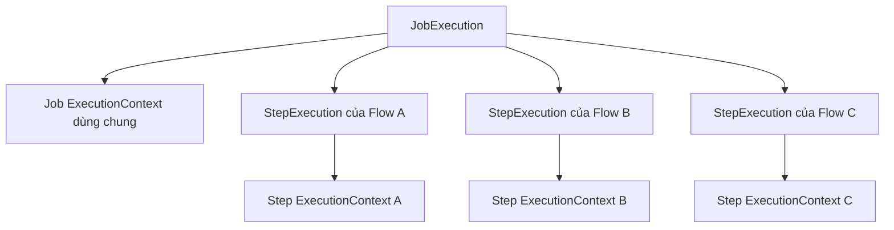
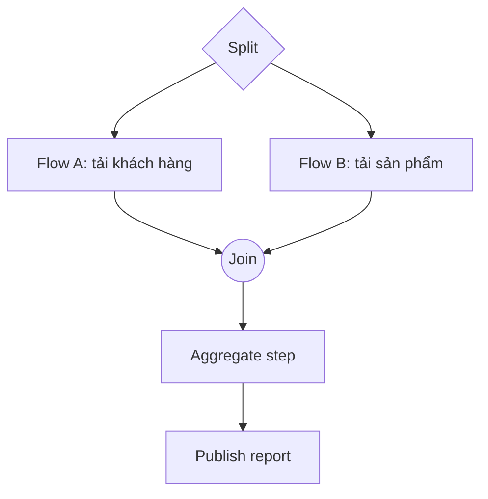
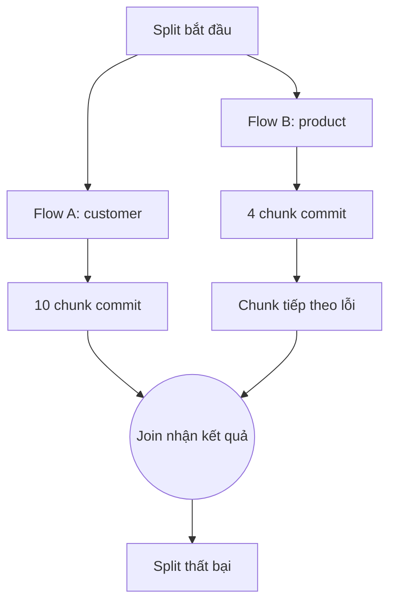

# ExecutionContext trong flow song song

Trong Spring Batch, một job có thể dùng split để chạy nhiều flow độc lập trên các thread khác nhau. Các flow đó vẫn thuộc cùng một JobExecution, nhưng mỗi step trong từng flow có StepExecution riêng. Vì vậy, khi lưu checkpoint hoặc trao đổi kết quả giữa các nhánh, cần chọn đúng phạm vi ExecutionContext.

Quy tắc quan trọng là: **Step ExecutionContext dành cho trạng thái riêng của từng step; Job ExecutionContext dành cho trạng thái chung của toàn job.** Các flow chạy song song có thể cùng nhìn thấy JobExecutionContext. Nếu nhiều nhánh cùng cập nhật một key hoặc cùng thực hiện thao tác đọc-sửa-ghi, kết quả có thể phụ thuộc thứ tự chạy và gây mất cập nhật. JobExecutionContext không phải một cơ chế đồng bộ giữa các flow.

Hãy lưu checkpoint riêng của reader trong StepExecutionContext. Nếu cần tổng hợp kết quả của nhiều nhánh, ưu tiên ghi kết quả vào nơi lưu trữ bền vững theo batch ID, rồi đọc sau điểm join. Chỉ đưa một số giá trị nhỏ sang JobExecutionContext khi đã có một bước tổng hợp tuần tự và rõ ràng.

## 1. Hai phạm vi ExecutionContext

Spring Batch cung cấp ExecutionContext để lưu trạng thái key/value phục vụ restart và điều phối. Trong một job có hai phạm vi chính:

| Phạm vi | Gắn với | Mục đích |
|---|---|---|
| Step ExecutionContext | Một StepExecution | Checkpoint của reader/writer, offset, khóa cuối cùng đã đọc, trạng thái riêng của step |
| Job ExecutionContext | Một JobExecution | Thông tin nhỏ cần được chia sẻ giữa các step trong cùng job execution |

Mỗi StepExecution có context riêng. Khi job có nhiều flow song song, các step ở những nhánh khác nhau vẫn có context riêng biệt.

Ngược lại, các StepExecution trong cùng JobExecution cùng tham chiếu đến execution context ở cấp job. Vì thế, hai flow có thể cùng đọc và ghi JobExecutionContext. Đây là điểm cần đặc biệt lưu ý khi chuyển từ flow tuần tự sang flow song song.



Job context là trạng thái chung của một lần chạy job. Step context là trạng thái của một lần chạy step cụ thể. Không nên dùng job context thay cho step context chỉ vì nhiều step có thể truy cập nó.

## 2. Flow song song vẫn dùng chung một JobExecution

Khi dùng split, Spring Batch chạy nhiều Flow trong cùng một JobExecution. Mỗi nhánh có StepExecution riêng, nhưng không tự động tạo một JobExecution mới cho mỗi nhánh.

Ví dụ:

```java
@Bean
Flow customerFlow(Step loadCustomersStep) {
    return new FlowBuilder<SimpleFlow>("customerFlow")
            .start(loadCustomersStep)
            .build();
}

@Bean
Flow productFlow(Step loadProductsStep) {
    return new FlowBuilder<SimpleFlow>("productFlow")
            .start(loadProductsStep)
            .build();
}

@Bean
Flow preparationFlow(
        TaskExecutor parallelFlowTaskExecutor,
        Flow customerFlow,
        Flow productFlow) {

    return new FlowBuilder<SimpleFlow>("preparationFlow")
            .start(customerFlow)
            .split(parallelFlowTaskExecutor)
            .add(productFlow)
            .build();
}
```

Hai flow được chạy trong cùng job execution. Nếu mỗi flow chạy một step, ta có hai StepExecution riêng:

- StepExecution của loadCustomersStep.
- StepExecution của loadProductsStep.

Mỗi step có ExecutionContext riêng để lưu checkpoint. Cả hai StepExecution đều liên kết đến cùng JobExecution và do đó có thể truy cập JobExecutionContext.

Điều này không có nghĩa hai nhánh nên ghi chung vào job context. Việc cùng truy cập được một object không tạo ra một quy tắc phối hợp dữ liệu hoặc bảo đảm thứ tự cập nhật.

## 3. Dùng Step ExecutionContext cho checkpoint riêng

Checkpoint của một reader thuộc về step đang chạy reader đó. Khi hai flow có hai reader độc lập, mỗi reader nên lưu vị trí riêng trong StepExecutionContext của chính step.

Ví dụ reader của flow khách hàng:

```java
public class CustomerReader implements ItemStreamReader<Customer> {

    private static final String LAST_ID_KEY = "customer.lastId";

    private final CustomerRepository repository;
    private long lastId;

    public CustomerReader(CustomerRepository repository) {
        this.repository = repository;
    }

    @Override
    public void open(ExecutionContext context) {
        lastId = context.getLong(LAST_ID_KEY, 0L);
    }

    @Override
    public Customer read() {
        Customer customer = repository.findNextAfter(lastId);
        if (customer == null) {
            return null;
        }

        lastId = customer.id();
        return customer;
    }

    @Override
    public void update(ExecutionContext context) {
        context.putLong(LAST_ID_KEY, lastId);
    }

    @Override
    public void close() {
        // Đóng resource nếu reader sở hữu resource.
    }
}
```

Reader của flow sản phẩm có key và state riêng:

```java
public class ProductReader implements ItemStreamReader<Product> {

    private static final String LAST_ID_KEY = "product.lastId";

    private final ProductRepository repository;
    private long lastId;

    public ProductReader(ProductRepository repository) {
        this.repository = repository;
    }

    @Override
    public void open(ExecutionContext context) {
        lastId = context.getLong(LAST_ID_KEY, 0L);
    }

    @Override
    public Product read() {
        Product product = repository.findNextAfter(lastId);
        if (product == null) {
            return null;
        }

        lastId = product.id();
        return product;
    }

    @Override
    public void update(ExecutionContext context) {
        context.putLong(LAST_ID_KEY, lastId);
    }

    @Override
    public void close() {
        // Đóng resource nếu reader sở hữu resource.
    }
}
```

Hai reader dùng cùng tên key LAST_ID_KEY trong code riêng cũng không gây xung đột vì mỗi reader nhận StepExecutionContext khác nhau. Dùng tên key có namespace theo domain vẫn có ích để người đọc metadata dễ hiểu.

Với reader do Spring Batch cung cấp như FlatFileItemReader hoặc JdbcPagingItemReader, hãy bật saveState phù hợp và đặt tên reader ổn định. Framework sẽ quản lý checkpoint trong context của step. Không tự sao chép checkpoint của reader sang JobExecutionContext nếu không có nhu cầu điều phối cụ thể.

## 4. Vì sao không nên ghi checkpoint của các nhánh vào JobExecutionContext?

Giả sử hai flow cùng cập nhật một key chung:

```java
// Không nên: cả hai flow cùng ghi key lastProcessedId.
jobExecution.getExecutionContext()
        .putLong("lastProcessedId", currentId);
```

Flow A đọc khách hàng, Flow B đọc sản phẩm. Nếu cả hai ghi lastProcessedId, giá trị cuối cùng sẽ phụ thuộc nhánh nào cập nhật sau. Một giá trị duy nhất không thể đại diện đồng thời cho tiến độ của hai reader độc lập.

Ngay cả khi dùng key riêng:

```java
// Vẫn cần thận trọng khi nhiều flow cùng cập nhật job context.
jobContext.putLong("customer.lastId", customerId);
jobContext.putLong("product.lastId", productId);
```

Việc ghi hai key khác nhau giảm nguy cơ ghi đè cùng key, nhưng không biến toàn bộ thao tác cập nhật và lưu metadata thành một giao thức đồng bộ. Các thao tác đọc-sửa-ghi, các giá trị phụ thuộc lẫn nhau hoặc các lần persist đồng thời vẫn cần được thiết kế rõ ràng.

Đặc biệt, một thao tác như sau không phải là một phép tăng nguyên tử chỉ vì nó dùng ExecutionContext:

```java
long count = jobContext.getLong("processedCount", 0L);
jobContext.putLong("processedCount", count + 1L);
```

Hai flow có thể cùng đọc một giá trị rồi cùng ghi kết quả tăng một đơn vị. Một lần tăng có thể bị mất. Nếu cần bộ đếm tổng hợp, hãy dùng bộ đếm nguyên tử phù hợp trong bộ nhớ với lifecycle được quản lý, hoặc tốt hơn là tính từ dữ liệu bền vững sau join.

## 5. ExecutionContext không phải join barrier

JobExecutionContext giúp lưu trạng thái; nó không làm một flow chờ flow khác. Nếu Flow A ghi kết quả vào context và Flow B đọc ngay trong lúc A còn chạy, B có thể đọc giá trị cũ hoặc chưa có giá trị.

Muốn dùng kết quả của nhiều nhánh, hãy đặt bước tiêu thụ dữ liệu sau split:



Join đảm bảo các flow trong split đã trả kết quả trước khi flow phía sau tiếp tục. Step tổng hợp là nơi thích hợp để đọc kết quả của các nhánh và tạo trạng thái chung.

Không dùng một key trong JobExecutionContext như cờ báo hoàn tất giữa các flow, ví dụ flow A ghi customerDone=true để flow B polling. Cơ chế join đã xử lý việc chờ flow; tự tạo polling bằng context làm tăng race condition và có thể gây vòng lặp chờ không giới hạn.

## 6. Ghi kết quả riêng trong Step ExecutionContext

Một step có thể lưu một số kết quả nhỏ vào StepExecutionContext trước khi kết thúc. Ví dụ listener ghi lại số item đã ghi và một mã artifact:

```java
public class BranchResultListener implements StepExecutionListener {

    @Override
    public ExitStatus afterStep(StepExecution stepExecution) {
        ExecutionContext context = stepExecution.getExecutionContext();
        context.putLong("result.writeCount", stepExecution.getWriteCount());
        context.putLong("result.filterCount", stepExecution.getFilterCount());
        return null;
    }
}
```

Mỗi step ghi vào context riêng của nó. Step tổng hợp sau join có thể đọc metadata của các StepExecution đã hoàn tất để lấy kết quả, nếu các giá trị nhỏ và chỉ phục vụ cùng JobExecution.

Ví dụ minh họa cách tìm StepExecution theo tên:

```java
public long readBranchCount(
        JobExecution jobExecution,
        String stepName) {

    return jobExecution.getStepExecutions().stream()
            .filter(step -> step.getStepName().equals(stepName))
            .findFirst()
            .orElseThrow()
            .getExecutionContext()
            .getLong("result.writeCount");
}
```

Trong hệ thống thật, cần bảo đảm step name là duy nhất trong phạm vi job hoặc chọn đúng execution nếu flow có thể lặp step. Nếu cần tra cứu qua repository hoặc qua process boundary, có thể dùng JobExplorer để tải metadata theo execution ID.

Step context phù hợp cho checkpoint và kết quả nhỏ. Nếu kết quả là danh sách hàng nghìn ID, payload lớn hoặc dữ liệu nghiệp vụ cần downstream sử dụng lâu dài, hãy lưu nó vào bảng staging hoặc object storage rồi chỉ giữ reference trong context.

## 7. Chuyển key từ Step context sang Job context

Spring Batch cung cấp ExecutionContextPromotionListener để đưa một số key từ StepExecutionContext lên JobExecutionContext sau khi step kết thúc.

Ví dụ:

```java
@Bean
ExecutionContextPromotionListener customerResultPromotionListener() {
    ExecutionContextPromotionListener listener =
            new ExecutionContextPromotionListener();

    listener.setKeys(new String[] {
            "customer.resultCount",
            "customer.snapshotId"
    });
    listener.setStatuses(new String[] { "COMPLETED" });

    return listener;
}
```

Gắn listener vào step:

```java
@Bean
Step loadCustomersStep(
        JobRepository jobRepository,
        PlatformTransactionManager transactionManager,
        ItemReader<Customer> customerReader,
        ItemWriter<Customer> customerWriter,
        ExecutionContextPromotionListener customerResultPromotionListener) {

    return new StepBuilder("loadCustomersStep", jobRepository)
            .<Customer, Customer>chunk(500, transactionManager)
            .reader(customerReader)
            .writer(customerWriter)
            .listener(customerResultPromotionListener)
            .build();
}
```

Listener chỉ promote những key được cấu hình và chỉ khi exit status khớp status được phép. Cần xác nhận tên key được ghi trong StepExecutionContext trùng chính xác với tên trong listener.

### Promotion trong flow song song cần cẩn thận

Nếu hai step ở hai flow cùng dùng promotion listener và cùng promote key customer.resultCount, giá trị có thể bị ghi đè. Ngay cả khi mỗi nhánh dùng key khác nhau, việc nhiều nhánh cùng cập nhật JobExecutionContext vẫn là một thao tác chia sẻ cần cân nhắc về concurrency và persistence.

Nếu bắt buộc phải promote kết quả riêng của từng nhánh, hãy:

- Dùng key có namespace riêng cho từng step.
- Chỉ promote giá trị nhỏ, bất biến sau khi step kết thúc.
- Không dùng read-modify-write trên job context từ các nhánh.
- Không để nhiều nhánh cùng sở hữu một key.
- Kiểm tra metadata và restart bằng integration test trên đúng phiên bản Spring Batch.

Đối với workflow quan trọng, cách rõ ràng hơn thường là để mỗi nhánh ghi kết quả vào staging riêng và để một step sau join đọc/đối soát rồi cập nhật JobExecutionContext tuần tự nếu thật sự cần.

## 8. Mẫu khuyến nghị: mỗi nhánh ghi staging theo batch ID

Khi kết quả của nhánh là dữ liệu nghiệp vụ, hãy lưu vào bảng staging hoặc object storage thay vì nhét payload vào context.

Ví dụ:

```java
public record BranchResult(
        String batchId,
        String branchName,
        long recordCount,
        String snapshotId) {
}
```

Mỗi flow ghi kết quả riêng:

```java
public class CustomerResultWriter implements ItemWriter<Customer> {

    private final CustomerStagingRepository stagingRepository;
    private final String batchId;

    public CustomerResultWriter(
            CustomerStagingRepository stagingRepository,
            String batchId) {
        this.stagingRepository = stagingRepository;
        this.batchId = batchId;
    }

    @Override
    public void write(Chunk<? extends Customer> chunk) {
        stagingRepository.saveCustomers(batchId, chunk.getItems());
    }
}
```

Flow sản phẩm có writer và vùng dữ liệu riêng, nhưng cùng batch ID. Sau join, aggregate step truy vấn cả hai tập dữ liệu theo batch ID:

```java
public void aggregate(String batchId) {
    long customerCount =
            stagingRepository.countCustomers(batchId);
    long productCount =
            stagingRepository.countProducts(batchId);

    if (customerCount == 0 || productCount == 0) {
        throw new IllegalStateException(
                "Required branch output is missing");
    }

    reportRepository.createReport(
            batchId,
            customerCount,
            productCount);
}
```

Ví dụ rút gọn để thể hiện nguyên tắc. Trong production, bảng staging nên có khóa duy nhất theo batch ID và source record ID, quy tắc cleanup, trạng thái hoàn tất của từng nhánh và cơ chế idempotency cho restart.

Lợi ích:

- Mỗi flow sở hữu dữ liệu đầu ra của mình.
- Không cần nhiều thread cùng sửa một context map.
- Step tổng hợp có thể đối soát số lượng và nội dung.
- Dữ liệu có thể được giữ lại khi một nhánh thất bại để phục hồi.
- Có thể cleanup sau khi batch hoàn tất và hết thời hạn retention.

## 9. Lưu trạng thái nào vào JobExecutionContext?

JobExecutionContext phù hợp với một số thông tin nhỏ, ổn định và cần dùng chung sau khi các nhánh đã hoàn tất.

Ví dụ:

- Batch ID đã được xác nhận.
- Snapshot/version của tập nguồn.
- Mã kết quả tổng hợp.
- Số lượng tổng sau khi aggregate step tính xong.
- Reference đến manifest đã publish.

Ví dụ step tổng hợp ghi kết quả tuần tự:

```java
public class AggregateResultTasklet implements Tasklet {

    @Override
    public RepeatStatus execute(
            StepContribution contribution,
            ChunkContext chunkContext) {

        StepExecution stepExecution =
                chunkContext.getStepContext().getStepExecution();

        JobExecution jobExecution = stepExecution.getJobExecution();
        ExecutionContext jobContext = jobExecution.getExecutionContext();

        long total = calculateTotalFromStaging();
        jobContext.putLong("report.totalRecords", total);

        return RepeatStatus.FINISHED;
    }
}
```

Ở đây chỉ có aggregate step ghi kết quả chung sau join. Các nhánh song song không cùng ghi key report.totalRecords. Giá trị được tính từ staging, nên có thể kiểm tra và tái lập nếu step cần restart.

Không lưu toàn bộ danh sách item, entity mutable, file content, credential hoặc response body vào job context. Dùng reference đến dữ liệu được lưu ở nơi phù hợp.

## 10. Đặt tên key để tránh xung đột

Khi có nhiều flow, key nên thể hiện rõ chủ sở hữu và ý nghĩa:

| Step/flow | Key gợi ý trong Step context |
|---|---|
| customerFlow | customer.lastId |
| productFlow | product.lastId |
| pricingFlow | pricing.lastId |
| customerFlow | customer.resultCount |
| productFlow | product.resultCount |
| aggregateStep | aggregate.totalRecords |

Không dùng key chung như lastId, count hoặc status nếu nhiều step có thể lưu các ý nghĩa khác nhau. Namespace giúp người vận hành hiểu checkpoint thuộc nhánh nào và giảm lỗi do copy cấu hình.

Với JobExecutionContext, dùng prefix job hoặc domain, ví dụ report.batchId, report.totalRecords, source.snapshotId. Tuy nhiên, namespace không tự giải quyết race condition nếu nhiều flow cùng ghi một key.

## 11. StepScope và state riêng của từng nhánh

Trong parallel flow, bean có state mutable nên được tạo với scope phù hợp. StepScope giúp tạo instance bean gắn với StepExecution hiện tại, nhờ đó reader/writer của hai step song song không dùng chung một object có cursor hoặc buffer mutable.

Ví dụ reader step-scoped:

```java
@Bean
@StepScope
JdbcPagingItemReader<Customer> customerReader(
        DataSource dataSource,
        @Value("#{jobParameters['batchId']}") String batchId) {

    return new JdbcPagingItemReaderBuilder<Customer>()
            .name("customerReader")
            .dataSource(dataSource)
            .selectClause("select id, name")
            .fromClause("from customer")
            .whereClause("where batch_id = :batchId")
            .parameterValues(Map.of("batchId", batchId))
            .sortKeys(Map.of("id", Order.ASCENDING))
            .rowMapper((rs, rowNum) ->
                    new Customer(
                            rs.getLong("id"),
                            rs.getString("name")))
            .pageSize(500)
            .saveState(true)
            .build();
}
```

StepScope không tự làm mọi dependency thread-safe. Nếu reader dùng một singleton cache mutable hoặc service không thread-safe, race condition vẫn có thể xảy ra. Hãy kiểm tra toàn bộ object graph được chia sẻ giữa các flow.

JobParameters thường được dùng như input bất biến chung cho các nhánh. Đừng thay đổi parameters trong runtime; hãy ghi kết quả thực thi vào context hoặc staging theo đúng scope.

## 12. Transaction và thời điểm lưu ExecutionContext

ExecutionContext không chỉ là map trong bộ nhớ. Spring Batch lưu nội dung context vào JobRepository để có thể khôi phục khi restart.

Với step dùng ItemStream, lifecycle cơ bản gồm:

1. Step mở reader/writer và truyền StepExecutionContext vào phương thức open.
2. Reader/writer cập nhật state trong quá trình xử lý.
3. Tại checkpoint, phương thức update ghi state cần thiết vào context.
4. Spring Batch lưu execution context cùng metadata theo transaction/lifecycle của step.
5. Khi restart, open nhận lại context đã lưu để khôi phục state.

Chunk-oriented step thường cập nhật checkpoint tại ranh giới commit của chunk. Nếu process dừng giữa chunk, checkpoint được lưu gần nhất được dùng khi restart; reader phải có khả năng tiếp tục từ checkpoint đó mà không bỏ sót hoặc đọc trùng ngoài chính sách.

JobExecutionContext được lưu ở cấp job execution. Việc cập nhật job context từ các step cần được thực hiện theo lifecycle phù hợp; không nên giả định mọi lần put từ một flow đều được persist ngay lập tức hoặc có thể được một flow khác đọc tức thì.

### Đừng dùng context như kênh truyền tín hiệu trực tiếp

Nếu Flow A put một giá trị rồi Flow B lập tức get giá trị đó, việc đọc trong bộ nhớ có thể thấy thay đổi tùy timing, nhưng không có nghĩa checkpoint đã được persist hoặc Flow A đã hoàn tất. Dùng join để đồng bộ workflow; dùng staging/repository để truyền dữ liệu bền vững.

## 13. Restart khi một nhánh thất bại

Giả sử Flow A đọc khách hàng và commit 10 chunk. Flow B đọc sản phẩm và thất bại sau 4 chunk:



Khi job restart cùng JobInstance:

- Step của Flow A đã hoàn tất có thể được bỏ qua theo restart semantics.
- Step của Flow B được khởi chạy lại theo trạng thái và checkpoint đã lưu.
- Reader của Flow B khôi phục product.lastId từ StepExecutionContext của nó.
- Dữ liệu đã commit ở Flow A vẫn tồn tại.
- Aggregate step chỉ chạy khi split hoàn tất theo kết quả flow được cấu hình.

Đây là lý do checkpoint phải được lưu theo step. Nếu cả hai reader cùng dùng một lastId trong JobExecutionContext, restart có thể khôi phục nhầm vị trí của nhánh này bằng vị trí của nhánh kia.

### Input phải ổn định qua restart

Checkpoint chỉ có ý nghĩa nếu reader restart trên cùng tập dữ liệu hoặc một snapshot tương thích. Hãy lưu batch ID, source version hoặc watermark để xác định input. Nếu dữ liệu nguồn thay đổi giữa lần chạy và restart, reader có thể bỏ sót hoặc xử lý trùng dù checkpoint đúng.

## 14. Promotion và restart

Khi dùng ExecutionContextPromotionListener, giá trị được promote sang JobExecutionContext sau khi step kết thúc theo exit status đã cấu hình. Điều này hữu ích trong flow tuần tự, khi step sau cần một kết quả nhỏ từ step trước.

Trong split, nhiều step có thể hoàn tất gần nhau. Nếu nhiều listener cùng promote vào job context, cần tránh:

- Hai step promote cùng key.
- Một step ghi giá trị mặc định đè kết quả của step khác.
- Một nhánh đọc giá trị trước khi nhánh sở hữu nó hoàn tất.
- Một nhánh dùng kết quả chỉ được tạo khi tất cả nhánh hoàn tất.

Nếu cần dùng promotion, hãy dùng key riêng theo nhánh và chỉ đọc ở flow sau join. Với dữ liệu quan trọng hoặc cần đối soát, lưu kết quả trong staging và để aggregate step kiểm tra trước khi ghi trạng thái chung.

## 15. Tránh chia sẻ mutable state ngoài ExecutionContext

Race condition không chỉ xảy ra trong job context. Các flow có thể vô tình chia sẻ:

- Singleton bean chứa counter hoặc current item.
- Reader/writer có cursor mutable.
- List hoặc Map dùng chung.
- File output dùng chung một writer.
- Cache không hỗ trợ concurrency.
- Một entity mutable được nhiều nhánh cùng sửa.

Ví dụ không an toàn:

```java
@Component
public class BatchProgress {

    private long processedCount;

    public void increment() {
        processedCount++;
    }
}
```

Nếu hai flow gọi increment đồng thời, phép tăng trên long không phải thao tác nguyên tử. Có thể dùng AtomicLong nếu chỉ cần counter trong bộ nhớ của một process và không cần checkpoint bền vững; nhưng khi cần số liệu đáng tin cậy sau restart, hãy tính từ database hoặc ghi theo từng nhánh.

Đối với writer, dùng staging table có batch ID và branch name, hoặc file riêng cho từng flow. Tránh để hai flow ghi cùng một file mà không có cơ chế phối hợp rõ ràng.

## 16. Dữ liệu nhạy cảm và payload lớn

Parallel flow không làm thay đổi nguyên tắc bảo vệ dữ liệu của ExecutionContext:

- Không lưu password, access token, private key hoặc signed URL.
- Không lưu toàn bộ entity hoặc payload lớn.
- Không lưu dữ liệu cá nhân chỉ để tiện cho step khác truy cập.
- Dùng secret manager cho credential.
- Dùng database/object storage được kiểm soát cho payload.
- Chỉ lưu ID, version, checksum hoặc checkpoint nhỏ trong context.

JobExecutionContext có phạm vi rộng hơn step context, nên một giá trị đặt ở đó có thể được nhiều thành phần trong cùng job đọc. Hãy giới hạn dữ liệu ở mức cần thiết và kiểm soát quyền truy cập metadata repository.

## 17. Quan sát và debug context của từng flow

Khi điều tra một job song song, hãy kiểm tra riêng:

- JobExecution ID và job parameters.
- Tên flow/step và StepExecution ID.
- Batch ID hoặc snapshot ID của từng nhánh.
- Step ExecutionContext của mỗi step.
- Job ExecutionContext sau khi các step đã hoàn tất.
- ExitStatus và BatchStatus của từng step.
- Checkpoint cuối cùng được lưu.
- Thời gian bắt đầu/kết thúc và thread name.

Không chỉ nhìn JobExecutionContext rồi kết luận cả hai nhánh đã lưu checkpoint đúng. Checkpoint của reader thường nằm trong StepExecutionContext.

Log nên ghi step name, execution ID, batch ID, key checkpoint không nhạy cảm và số lượng xử lý. Không dump toàn bộ context vào log vì context có thể chứa dữ liệu không phù hợp để hiển thị.

Ví dụ:

```text
jobExecutionId=4201
stepExecutionId=4204
step=loadCustomersStep
batchId=daily-20261115
checkpointKey=customer.lastId
checkpointValue=845200
writeCount=12000
exitStatus=COMPLETED
```

Đây là log minh họa. Không ghi access token, customer payload hoặc thông tin xác thực vào log.

## 18. Kiểm thử ExecutionContext trong parallel flow

Unit test cho một reader riêng không đủ để xác nhận hai nhánh dùng context đúng cách. Nên có integration test với split và JobRepository thật trong môi trường test.

Các tình huống cần kiểm tra:

| Kịch bản | Điều cần xác nhận |
|---|---|
| Hai reader chạy song song | Mỗi reader có StepExecutionContext riêng |
| Hai reader cùng dùng key lastId | Không có xung đột vì context thuộc hai step khác nhau |
| Hai flow ghi cùng job key | Test phát hiện overwrite hoặc kết quả không xác định |
| Flow A nhanh, Flow B chậm | Step sau join chỉ chạy sau khi cả hai hoàn tất |
| Một flow thất bại sau nhiều chunk | Checkpoint và dữ liệu đã commit của từng nhánh được giữ đúng |
| Restart job | Mỗi reader khôi phục checkpoint của chính step nó |
| Promotion listener | Chỉ key và exit status được cấu hình được promote |
| Hai flow promote cùng key | Test phát hiện xung đột và policy được định nghĩa |
| Aggregate step | Đọc đủ kết quả của các nhánh sau join |
| Dữ liệu nguồn đổi giữa restart | Job phát hiện version/checksum không khớp |

Một test hữu ích là chạy hai flow với checkpoint ID có miền khác nhau, ví dụ customer ID và product ID. Cố ý làm Flow B thất bại sau vài chunk, sau đó restart cùng JobInstance. Kiểm tra Flow A không bị chạy lại ngoài ý muốn và Flow B tiếp tục từ checkpoint của chính nó.

Nếu kiểm tra race condition, dùng latch/barrier trong test để điều khiển thời điểm hai flow cập nhật dữ liệu. Không dựa vào sleep tùy ý vì test có thể chập chờn theo tốc độ máy.

## 19. Những lỗi thường gặp

**Dùng một key lastId cho nhiều reader song song trong JobExecutionContext.** Mỗi reader có checkpoint riêng; lưu trong StepExecutionContext để không trộn tiến độ.

**Coi JobExecutionContext là thread-safe coordination channel.** Context không thay thế join, lock hoặc cơ chế atomic update. Không dùng nó để polling trạng thái giữa các flow.

**Hai flow cùng ghi một key kết quả.** Giá trị cuối phụ thuộc thứ tự cập nhật. Dùng key có owner duy nhất hoặc staging riêng theo nhánh.

**Dùng job context làm counter tăng dần từ nhiều thread.** Read-modify-write có thể mất cập nhật. Tính lại sau join hoặc dùng cơ chế counter có concurrency và persistence rõ ràng.

**Đưa payload lớn vào context để nhánh khác đọc.** Context phình to và khó restart. Lưu payload trong staging/object storage rồi truyền reference.

**Promote cùng key từ nhiều step.** Promotion có thể ghi đè giá trị của nhánh khác. Dùng key riêng và aggregate sau join.

**Đọc kết quả trước khi join.** Nhánh tiêu thụ có thể đọc trạng thái chưa hoàn tất. Đặt consumer sau split.

**Dùng singleton reader/writer có state mutable.** State có thể bị chia sẻ giữa flow. Dùng instance theo step và scope phù hợp.

**Cho rằng checkpoint đúng nghĩa là input không đổi.** Lưu source version hoặc checksum để bảo đảm restart đọc cùng tập dữ liệu.

**Dump toàn bộ context ra log.** Có thể làm lộ payload hoặc secret. Log các key/value vận hành đã chọn lọc.

## 20. Quy trình chọn nơi lưu state

Với mỗi giá trị cần lưu hoặc trao đổi giữa các flow, hãy quyết định theo thứ tự:

1. Giá trị là checkpoint của một reader/writer cụ thể? Lưu trong StepExecutionContext của step đó.
2. Giá trị cần được dùng chung sau khi một step tuần tự hoàn tất? Cân nhắc JobExecutionContext hoặc promotion listener.
3. Nhiều flow cùng tạo ra giá trị? Mỗi flow ghi kết quả riêng; aggregate step đọc sau join.
4. Giá trị là payload lớn hoặc dữ liệu nghiệp vụ? Lưu ở database staging/object storage.
5. Giá trị cần cập nhật đồng thời? Dùng cơ chế atomic/transactional phù hợp, không dựa vào map context như một lock.
6. Giá trị có nhạy cảm không? Dùng reference và secret manager; không lưu secret trực tiếp.
7. Giá trị có cần tồn tại qua restart không? Bảo đảm nó được persist, có version và có chính sách cleanup.

Quyết định rõ chủ sở hữu của từng key. Mỗi key nên có một thành phần chịu trách nhiệm ghi, thời điểm ghi và quy tắc đọc được xác định.

## 21. Kết luận thực hành

Trong parallel flow, các nhánh thuộc cùng JobExecution nhưng mỗi step có StepExecutionContext riêng. Dùng step context để lưu checkpoint của từng reader/writer; nhờ đó Flow A không ghi đè vị trí đọc của Flow B. JobExecutionContext là vùng trạng thái chung của job, nên tránh để nhiều flow cùng cập nhật một key hoặc dùng nó làm kênh báo hiệu đồng bộ.

Nếu cần kết quả của nhiều nhánh, hãy chờ điểm join rồi tổng hợp. Mỗi flow có thể ghi dữ liệu vào staging theo batch ID hoặc lưu kết quả nhỏ trong StepExecutionContext. Một aggregate step sau split đọc kết quả, đối soát và cập nhật trạng thái chung theo cách tuần tự. ExecutionContextPromotionListener có thể chuyển một số key từ step context sang job context, nhưng cần key riêng theo nhánh và phải cân nhắc việc nhiều listener chạy đồng thời.

Thiết kế tốt xác định rõ phạm vi, chủ sở hữu và lifecycle của từng giá trị. Khi checkpoint nằm đúng step, dữ liệu liên nhánh được lưu bền vững và join được dùng để đồng bộ workflow, parallel flow có thể restart mà không trộn state hoặc tạo kết quả phụ thuộc thời điểm chạy.
