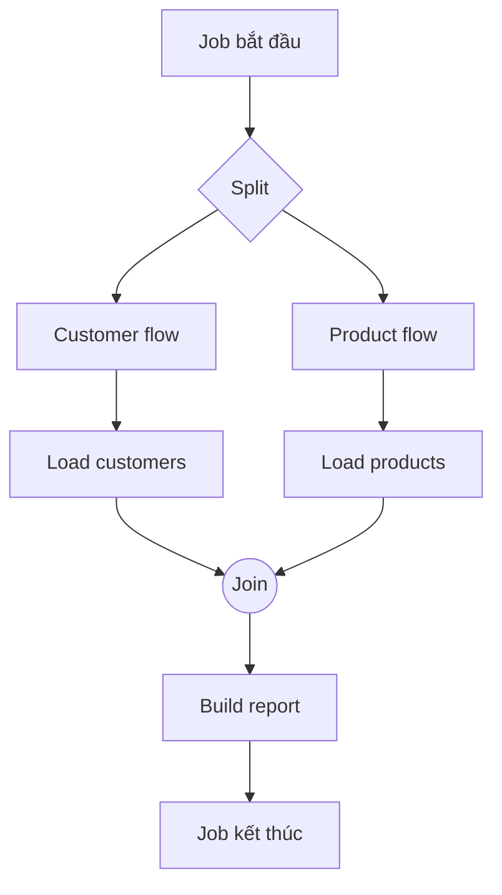

# Kiểm thử parallel flow

Parallel flow giúp Spring Batch chạy các nhánh độc lập đồng thời bằng split và TaskExecutor. Khi các nhánh hoàn tất, split tổng hợp kết quả rồi mới cho flow phía sau tiếp tục. Kiểm thử loại workflow này cần xác nhận nhiều điều cùng lúc: các nhánh có thực sự chạy đồng thời, step sau join có chờ đủ nhánh, trạng thái lỗi được truyền đúng, dữ liệu đã commit được giữ đúng và restart không tạo kết quả trùng.

Một test chỉ launch job và kiểm tra BatchStatus là chưa đủ. Job có thể hoàn tất dù cấu hình executor đang chạy tuần tự; step tổng hợp có thể chạy sai thời điểm; hoặc một nhánh có thể ghi dữ liệu một phần mà test không phát hiện. Bài này trình bày cách xây dựng integration test có đồng bộ xác định, kiểm tra join, failure, transaction, restart, state riêng của từng flow và cách tránh test chập chờn.

## 1. Xác định hành vi cần kiểm thử

Trước khi viết test, hãy mô tả hợp đồng của parallel flow:

- Những flow nào được phép chạy đồng thời?
- Mỗi flow ghi kết quả vào resource hoặc vùng dữ liệu nào?
- Step nào chỉ được chạy sau khi tất cả flow hoàn tất?
- Nếu một flow thất bại, flow tổng hợp có được chạy không?
- Dữ liệu đã commit ở nhánh thành công được giữ lại hay cần bù trừ?
- Khi restart, nhánh nào được chạy lại và checkpoint nào được khôi phục?
- Các external side effect có được bảo vệ bằng idempotency không?

Ví dụ job chuẩn bị báo cáo có hai nhánh độc lập: tải dữ liệu khách hàng và tải dữ liệu sản phẩm. Step tổng hợp chỉ được chạy khi cả hai nhánh đã kết thúc thành công.



Các assertion quan trọng:

1. Customer flow và product flow có thời gian thực thi chồng lấn.
2. Build report không chạy khi một trong hai flow còn hoạt động.
3. Build report đọc được kết quả của cả hai nhánh.
4. Nếu một nhánh thất bại, job không publish báo cáo thành công.
5. Restart giữ đúng dữ liệu đã commit và không tạo bản ghi trùng.

## 2. Phân biệt parallel flow với multi-threaded step

Spring Batch có nhiều cách thực thi song song. Test phải nhắm đúng loại concurrency đang dùng:

| Cơ chế | Đơn vị chạy đồng thời | Điều cần kiểm tra |
|---|---|---|
| Split parallel flow | Nhiều Flow trong cùng job | Các flow chạy trên executor và join đợi tất cả |
| Multi-threaded step | Nhiều chunk/item trong một step | Thread safety của reader, processor, writer và transaction |
| Partitioning | Nhiều StepExecution xử lý partition riêng | Phân vùng dữ liệu, worker execution và tổng hợp kết quả |
| Remote chunking/partitioning | Công việc qua process hoặc worker khác | Messaging, delivery, idempotency và worker recovery |

Bài này tập trung vào split parallel flow. Một test xác nhận nhiều item được xử lý trên nhiều thread trong cùng step không chứng minh split giữa các flow hoạt động đúng.

## 3. Cấu hình một job test có split

Ví dụ dưới đây có hai flow độc lập và một aggregate step:

```java
@Bean
ThreadPoolTaskExecutor parallelFlowTaskExecutor() {
    ThreadPoolTaskExecutor executor = new ThreadPoolTaskExecutor();
    executor.setCorePoolSize(2);
    executor.setMaxPoolSize(2);
    executor.setQueueCapacity(2);
    executor.setThreadNamePrefix("parallel-test-");
    return executor;
}

@Bean
Flow customerFlow(Step loadCustomersStep) {
    return new FlowBuilder<SimpleFlow>("customerFlow")
            .start(loadCustomersStep)
            .build();
}

@Bean
Flow productFlow(Step loadProductsStep) {
    return new FlowBuilder<SimpleFlow>("productFlow")
            .start(loadProductsStep)
            .build();
}

@Bean
Flow preparationFlow(
        TaskExecutor parallelFlowTaskExecutor,
        Flow customerFlow,
        Flow productFlow) {
    return new FlowBuilder<SimpleFlow>("preparationFlow")
            .start(customerFlow)
            .split(parallelFlowTaskExecutor)
            .add(productFlow)
            .build();
}

@Bean
Job preparationJob(
        JobRepository jobRepository,
        Flow preparationFlow,
        Step buildReportStep) {
    return new JobBuilder("preparationJob", jobRepository)
            .start(preparationFlow)
            .next(buildReportStep)
            .end()
            .build();
}
```

Executor có hai worker để hai flow có thể chạy đồng thời. Trong test, executor phải được Spring quản lý lifecycle và được shutdown khi ApplicationContext đóng. Không tạo một thread pool mới trong mỗi lần gọi tasklet hoặc trong mỗi test method.

Khi kiểm thử concurrency, không cần số thread lớn. Một pool có hai worker thường đủ cho hai flow và làm test dễ kiểm soát hơn.

## 4. Dùng Spring Batch test support

Spring Batch cung cấp test support để khởi chạy job và đọc kết quả execution. Với cấu hình Spring test, có thể dùng `@SpringBatchTest` và `JobLauncherTestUtils`.

Ví dụ:

```java
@SpringBatchTest
@SpringJUnitConfig(PreparationJobTestConfig.class)
class PreparationJobIntegrationTest {

    @Autowired
    private JobLauncherTestUtils jobLauncherTestUtils;

    @Test
    void jobCompletesAfterBothFlows() throws Exception {
        JobParameters parameters = new JobParametersBuilder()
                .addString("batchId", "test-batch-001")
                .toJobParameters();

        JobExecution execution =
                jobLauncherTestUtils.launchJob(parameters);

        assertEquals(BatchStatus.COMPLETED, execution.getStatus());
    }
}
```

Ví dụ giả định test context đã cấu hình đúng job cần launch. Nếu application context có nhiều Job bean, hãy chỉ định job mục tiêu cho JobLauncherTestUtils theo cách phù hợp với phiên bản Spring Batch và cấu hình test.

JobLauncherTestUtils giúp launch job qua hạ tầng Spring Batch thật. Đối với parallel flow, nên dùng JobRepository và transaction manager test thực tế, thường là database test, để kiểm tra cả metadata và transaction behavior.

Không chỉ gọi trực tiếp phương thức của từng tasklet rồi kết luận job flow đúng. Cần launch job chứa split để framework thực thi executor, join và transition.

## 5. Kiểm tra hai flow thực sự chạy đồng thời

Một test dễ viết nhưng yếu là đo tổng thời gian bằng sleep: mỗi flow ngủ một giây và kỳ vọng job chạy trong một giây. Test này phụ thuộc scheduler, CPU và tải máy, nên dễ chập chờn.

Hãy dùng CountDownLatch hoặc một cơ chế đồng bộ xác định. Mỗi flow báo rằng nó đã bắt đầu, sau đó cùng chờ cho đến khi cả hai đã đến barrier. Nếu executor chỉ có một thread, flow đầu tiên sẽ timeout trước khi flow thứ hai có cơ hội chạy; test phát hiện cấu hình không thực sự song song.

Ví dụ probe chỉ dùng trong test:

```java
final class ParallelProbe {

    private final CountDownLatch bothFlowsEntered = new CountDownLatch(2);
    private final AtomicInteger activeFlows = new AtomicInteger();
    private final AtomicInteger maxConcurrentFlows = new AtomicInteger();

    void enterFlow() throws InterruptedException {
        int active = activeFlows.incrementAndGet();
        maxConcurrentFlows.accumulateAndGet(active, Math::max);
        bothFlowsEntered.countDown();

        try {
            boolean bothStarted =
                    bothFlowsEntered.await(5, TimeUnit.SECONDS);
            if (!bothStarted) {
                throw new IllegalStateException(
                        "Both flows did not start concurrently");
            }
        } finally {
            activeFlows.decrementAndGet();
        }
    }

    int maxConcurrentFlows() {
        return maxConcurrentFlows.get();
    }
}
```

Hai tasklet gọi cùng probe:

```java
@Bean
Step loadCustomersStep(
        JobRepository jobRepository,
        PlatformTransactionManager transactionManager,
        ParallelProbe probe) {
    return new StepBuilder("loadCustomersStep", jobRepository)
            .tasklet((contribution, chunkContext) -> {
                probe.enterFlow();
                return RepeatStatus.FINISHED;
            }, transactionManager)
            .build();
}

@Bean
Step loadProductsStep(
        JobRepository jobRepository,
        PlatformTransactionManager transactionManager,
        ParallelProbe probe) {
    return new StepBuilder("loadProductsStep", jobRepository)
            .tasklet((contribution, chunkContext) -> {
                probe.enterFlow();
                return RepeatStatus.FINISHED;
            }, transactionManager)
            .build();
}
```

Sau khi launch job:

```java
assertEquals(BatchStatus.COMPLETED, execution.getStatus());
assertEquals(2, parallelProbe.maxConcurrentFlows());
```

Barrier có timeout hữu hạn để test không treo vô hạn nếu executor bị cấu hình sai. Trong test thật, nên dùng timeout đủ rộng cho CI chậm nhưng vẫn ngắn để phát hiện deadlock.

Probe trên chỉ là công cụ quan sát concurrency trong test. Không đưa latch hoặc counter test vào production flow.

## 6. Kiểm tra step sau split chờ đủ flow

Một assertion quan trọng là aggregate step chỉ chạy sau khi cả hai flow kết thúc. Có thể dùng hai marker trong test:

```java
final class BranchCompletionState {

    private final AtomicBoolean customersDone = new AtomicBoolean();
    private final AtomicBoolean productsDone = new AtomicBoolean();

    void customersCompleted() {
        customersDone.set(true);
    }

    void productsCompleted() {
        productsDone.set(true);
    }

    boolean bothCompleted() {
        return customersDone.get() && productsDone.get();
    }
}
```

Tasklet của từng nhánh đánh dấu hoàn tất sau khi công việc của nhánh kết thúc:

```java
@Bean
Step loadCustomersStep(
        JobRepository jobRepository,
        PlatformTransactionManager transactionManager,
        BranchCompletionState state) {
    return new StepBuilder("loadCustomersStep", jobRepository)
            .tasklet((contribution, chunkContext) -> {
                // Thực hiện công việc của customer flow.
                state.customersCompleted();
                return RepeatStatus.FINISHED;
            }, transactionManager)
            .build();
}
```

Aggregate step kiểm tra cả hai marker:

```java
@Bean
Step buildReportStep(
        JobRepository jobRepository,
        PlatformTransactionManager transactionManager,
        BranchCompletionState state) {
    return new StepBuilder("buildReportStep", jobRepository)
            .tasklet((contribution, chunkContext) -> {
                if (!state.bothCompleted()) {
                    throw new IllegalStateException(
                            "Aggregate started before both flows completed");
                }
                return RepeatStatus.FINISHED;
            }, transactionManager)
            .build();
}
```

Test này xác nhận join ở mức workflow. Trong ứng dụng thực tế, aggregate step nên kiểm tra dữ liệu bền vững của từng nhánh như staging records, manifest hoặc branch status trong database; biến AtomicBoolean chỉ phù hợp làm probe trong test.

Không nên dùng static field hoặc singleton mutable làm cơ chế trao đổi kết quả production giữa các flow. Cách đó có thể làm các lần chạy job khác nhau ảnh hưởng lẫn nhau.

## 7. Kiểm tra flow nhanh phải đợi flow chậm

Để kiểm tra rõ hành vi join, điều khiển một nhánh hoàn tất muộn bằng latch:

1. Flow A ghi nhận đã xong.
2. Flow B báo bắt đầu nhưng chờ tín hiệu release.
3. Aggregate step kiểm tra Flow B đã hoàn tất.
4. Test xác nhận aggregate chưa được gọi trước khi release Flow B.
5. Test gửi tín hiệu release.
6. Flow B kết thúc và aggregate step được phép chạy.

Ví dụ trạng thái test:

```java
final class JoinProbe {

    final CountDownLatch slowFlowStarted = new CountDownLatch(1);
    final CountDownLatch releaseSlowFlow = new CountDownLatch(1);
    final AtomicBoolean slowFlowCompleted = new AtomicBoolean();
    final AtomicBoolean aggregateStarted = new AtomicBoolean();
}
```

Tasklet nhánh chậm:

```java
slowFlowStarted.countDown();
boolean released = releaseSlowFlow.await(5, TimeUnit.SECONDS);
if (!released) {
    throw new IllegalStateException("Test did not release slow flow");
}
slowFlowCompleted.set(true);
return RepeatStatus.FINISHED;
```

Aggregate step:

```java
if (!slowFlowCompleted.get()) {
    throw new IllegalStateException("Join did not wait for slow flow");
}
joinProbe.aggregateStarted.set(true);
return RepeatStatus.FINISHED;
```

Test có thể chạy job trên thread riêng bằng executor của test, đợi slowFlowStarted, xác nhận aggregate chưa bắt đầu, rồi release nhánh chậm và đợi JobExecution hoàn tất. Mọi thao tác chờ phải có timeout; không để test giữ thread vô thời hạn khi assertion thất bại.

Nếu cần điều khiển JobLauncher ở thread riêng, hãy dùng executor dành cho test và luôn shutdown trong finally hoặc lifecycle hook. Không dùng chung thread pool của split để launch job trong test vì có thể làm cạn worker và tạo deadlock giả.

## 8. Kiểm tra trạng thái cuối của từng flow và step

Sau khi job hoàn tất, đọc các StepExecution và kiểm tra:

- Step của từng nhánh đã chạy.
- BatchStatus và ExitStatus đúng mong đợi.
- Step tổng hợp chỉ chạy sau split.
- Các step không thuộc nhánh được chọn không chạy.
- Read/write/skip count phù hợp với fixture.

Ví dụ assertion:

```java
Map<String, StepExecution> stepsByName =
        execution.getStepExecutions().stream()
                .collect(Collectors.toMap(
                        StepExecution::getStepName,
                        Function.identity()));

assertEquals(
        BatchStatus.COMPLETED,
        stepsByName.get("loadCustomersStep").getStatus());
assertEquals(
        BatchStatus.COMPLETED,
        stepsByName.get("loadProductsStep").getStatus());
assertEquals(
        BatchStatus.COMPLETED,
        stepsByName.get("buildReportStep").getStatus());
```

Nếu cùng một step name có thể được thực thi nhiều lần trong job, không gom map bằng step name duy nhất. Hãy chọn execution phù hợp theo ID, flow hoặc lần chạy.

Ngoài BatchStatus, kiểm tra ExitStatus nếu flow sử dụng custom exit code. Job có thể có BatchStatus COMPLETED nhưng một step có exit code nghiệp vụ như COMPLETED_WITH_WARNINGS.

## 9. Kiểm tra flow failure

Một test cần chứng minh rằng nếu một nhánh thất bại, step tổng hợp thành công không chạy.

Ví dụ tasklet nhánh sản phẩm cố ý ném lỗi:

```java
@Bean
Step loadProductsStep(
        JobRepository jobRepository,
        PlatformTransactionManager transactionManager) {
    return new StepBuilder("loadProductsStep", jobRepository)
            .tasklet((contribution, chunkContext) -> {
                throw new IllegalStateException("Simulated product failure");
            }, transactionManager)
            .build();
}
```

Test nên xác nhận:

- Step sản phẩm có trạng thái FAILED.
- Split không đi vào nhánh success thông thường.
- Aggregate/publish step không được gọi.
- Job có trạng thái cuối theo flow policy đã định nghĩa.
- Step xử lý lỗi, nếu có, chạy đúng nhánh.

Không chỉ assert job FAILED. Nếu flow có nhánh xử lý lỗi rồi kết thúc COMPLETED, trạng thái cuối của job có thể không phản ánh trực tiếp rằng một nhánh ban đầu đã thất bại. Khi đó cần assert trạng thái của step và nhánh xử lý lỗi.

## 10. Kiểm tra partial success và transaction

Join không tạo transaction chung cho các flow. Một nhánh có thể commit dữ liệu trước khi nhánh khác thất bại. Test cần xác nhận chính sách partial success của ứng dụng.

Ví dụ:

| Flow | Thao tác | Kết quả khi flow kia lỗi |
|---|---|---|
| Customer | Ghi customer staging và commit | Dữ liệu đã commit vẫn tồn tại |
| Product | Ghi một chunk rồi lỗi ở chunk kế | Chunk lỗi rollback; chunk trước có thể còn |
| Aggregate | Đọc kết quả hai nhánh | Không chạy theo nhánh success nếu split thất bại |

Một integration test nên dùng database test và transaction manager thật:

1. Customer flow ghi một số record vào bảng customer staging.
2. Product flow ghi chunk đầu rồi cố ý lỗi ở chunk sau.
3. Launch job chứa split.
4. Kiểm tra customer records đã commit vẫn tồn tại.
5. Kiểm tra chunk product bị lỗi đã rollback.
6. Kiểm tra aggregate/publish không chạy.

Đừng bọc toàn bộ test method trong một transaction test rồi kỳ vọng transaction đó đại diện cho transaction của các flow. JobLauncher có thể chạy trên thread khác; transaction của test thread không tự lan sang thread của split. Hãy xác minh dữ liệu đã commit bằng một transaction hoặc connection độc lập sau khi job kết thúc.

## 11. Kiểm tra restart sau khi một nhánh thất bại

Restart test là phần quan trọng vì parallel flow có thể đã tạo dữ liệu ở một số nhánh trước khi job thất bại.

Kịch bản:

1. Launch job với identifying parameters cố định, ví dụ batchId = test-batch-42.
2. Customer flow hoàn tất và commit kết quả.
3. Product flow commit một số chunk rồi thất bại có chủ đích.
4. Xác nhận JobExecution đầu tiên FAILED và dữ liệu đã commit còn tồn tại.
5. Tắt điều kiện lỗi của product flow.
6. Launch lại cùng job với đúng identifying parameters.
7. Xác nhận cùng JobInstance được restart bằng JobExecution mới.
8. Xác nhận customer flow không tạo bản ghi trùng và product flow tiếp tục từ checkpoint.
9. Xác nhận aggregate step chạy sau khi cả hai flow hoàn tất.

Ví dụ tạo parameters:

```java
JobParameters parameters = new JobParametersBuilder()
        .addString("batchId", "test-batch-42", true)
        .toJobParameters();
```

Không thêm timestamp identifying mới trong lần restart. Nếu parameters khác, Spring Batch có thể tạo JobInstance mới và xử lý lại dữ liệu như một batch khác.

### Làm cho lỗi chỉ xảy ra ở lần đầu

Trong test có thể dùng một test-controlled failure switch, chẳng hạn AtomicBoolean hoặc một fake repository chỉ ném lỗi một lần. State này chỉ phục vụ test; không dùng nó để thay thế checkpoint hoặc idempotency trong production.

Đảm bảo switch được reset giữa test method. Nếu Spring context dùng chung, state còn sót từ test trước có thể khiến kết quả phụ thuộc thứ tự chạy.

## 12. Kiểm tra StepExecutionContext riêng của từng flow

Mỗi nhánh thường có reader checkpoint riêng. Test nên xác nhận:

- Customer reader lưu customer.lastId trong StepExecutionContext của customer step.
- Product reader lưu product.lastId trong StepExecutionContext của product step.
- Restart khôi phục đúng checkpoint cho từng reader.
- Không có một key chung trong JobExecutionContext làm trộn vị trí đọc.

Sau job execution, có thể kiểm tra context của từng StepExecution:

```java
StepExecution customerExecution =
        execution.getStepExecutions().stream()
                .filter(step -> step.getStepName().equals("loadCustomersStep"))
                .findFirst()
                .orElseThrow();

long customerLastId = customerExecution.getExecutionContext()
        .getLong("customer.lastId");

assertEquals(5000L, customerLastId);
```

Giá trị mong đợi phụ thuộc reader fixture và checkpoint strategy. Không kiểm tra một con số cứng nếu paging reader có cách lưu page/offset khác. Với reader do framework cung cấp, hãy kiểm tra hành vi restart qua dữ liệu đầu ra và execution context theo contract của reader.

Nếu test promotion listener, xác nhận chỉ các key được cấu hình được đưa lên JobExecutionContext và step sau join mới đọc chúng. Nếu nhiều flow promote cùng key, test cần làm rõ quy tắc sở hữu key để tránh kết quả không xác định.

## 13. Kiểm tra idempotency của side effect

Parallel flow có thể gọi nhiều hệ thống ngoài. Khi một nhánh thất bại hoặc job restart, request đã gửi có thể được gửi lại.

Ví dụ fake partner client trong test:

```java
final class IdempotentPartnerFake {

    private final Set<String> acceptedKeys =
            ConcurrentHashMap.newKeySet();

    boolean publish(String idempotencyKey) {
        return acceptedKeys.add(idempotencyKey);
    }

    int acceptedCount() {
        return acceptedKeys.size();
    }
}
```

Test gửi cùng idempotency key hai lần và xác nhận hệ thống đích chỉ tạo một kết quả logic. Trong production, idempotency phải được thực hiện ở hệ thống đích hoặc một lớp lưu trữ bền vững có unique constraint; set trong bộ nhớ chỉ là fake để kiểm tra hợp đồng.

Với message hoặc database outbox, test thêm các tình huống:

- Publisher gửi thành công rồi process dừng trước khi đánh dấu delivered.
- Publisher chạy lại và gửi cùng message.
- Consumer nhận duplicate nhưng không xử lý nghiệp vụ lần thứ hai.
- Một nhánh thành công còn nhánh khác thất bại; batch chưa được publish tổng thể.

## 14. Kiểm tra custom FlowExecutionAggregator

Nếu ứng dụng dùng aggregator mặc định, test các tổ hợp status quan trọng để xác nhận split không bị coi là thành công khi một nhánh thất bại.

Nếu có custom FlowExecutionAggregator, cần test trực tiếp quy tắc kết hợp:

| Flow A | Flow B | Kết quả aggregate theo policy |
|---|---|---|
| COMPLETED | COMPLETED | COMPLETED |
| COMPLETED | FAILED | FAILED |
| FAILED | FAILED | FAILED |
| COMPLETED | STOPPED | Theo policy đã định nghĩa |
| UNKNOWN | COMPLETED | Theo policy đã định nghĩa |

Không chỉ test hai nhánh đều thành công. Lỗi thường xuất hiện khi một nhánh trả custom status, STOPPED hoặc UNKNOWN.

Custom aggregator không nên nuốt lỗi bằng cách luôn trả COMPLETED. Nếu nghiệp vụ chấp nhận một nhánh thiếu dữ liệu, hãy dùng một status riêng như PARTIAL và cấu hình flow phía sau xử lý rõ ràng; đừng làm mất dấu việc nhánh đã thất bại.

## 15. Kiểm tra timeout và nhánh bị treo

Một flow có thể chờ vô hạn do:

- HTTP call không có timeout.
- Database query hoặc lock chờ quá lâu.
- Reader chờ file hoặc resource chưa xuất hiện.
- Một latch/test synchronization không được release.
- External system bị gián đoạn.

Test nên kiểm tra timeout ở nơi thực hiện I/O hoặc ở cơ chế điều phối tương ứng. Không giả định TaskExecutor tự đặt timeout cho toàn bộ flow.

Với test dùng latch:

```java
boolean released = releaseLatch.await(5, TimeUnit.SECONDS);
if (!released) {
    throw new IllegalStateException("Timed out waiting for test signal");
}
```

Nếu timeout xảy ra, test phải fail rõ ràng và giải phóng latch trong cleanup để không giữ worker thread. Tránh test dùng Thread.sleep lâu vì nó làm suite chậm và không chứng minh được join.

## 16. Tránh test chập chờn

Parallel test dễ flaky nếu dựa vào thứ tự thread, thời gian thực hoặc state dùng chung. Một số nguyên tắc:

- Dùng CountDownLatch, CyclicBarrier hoặc Semaphore với timeout thay vì sleep.
- Không assert flow A luôn chạy trước flow B; thứ tự đó không được bảo đảm.
- Chỉ assert overlap/concurrency khi executor và test barrier được thiết kế để chứng minh điều đó.
- Dùng AtomicBoolean/AtomicInteger hoặc cấu trúc concurrent cho probe trong test.
- Không chia sẻ reader/writer mutable giữa hai flow.
- Tạo batch ID riêng cho mỗi test để tránh JobInstance trùng.
- Reset fake, latch, counter và dữ liệu test giữa các lần chạy.
- Không chạy đồng thời hai test dùng cùng JobRepository và cùng identifying parameters.
- Dùng timeout cho Future.get, latch.await và job completion.
- Luôn shutdown executor và release mọi latch trong finally/cleanup.

Đừng assert một thứ tự chính xác của log giữa hai flow. Log có thể xen kẽ khác nhau ở mỗi lần chạy. Hãy kiểm tra trạng thái, marker và kết quả bền vững.

## 17. Test database và transaction isolation

Nếu mục tiêu là kiểm tra commit/rollback, dùng database test tương thích với transaction manager đang triển khai. Cần chú ý:

- JobLauncher có thể chạy flow trên thread khác với test thread.
- Transaction test của JUnit không bao trùm tự động các transaction của flow.
- Connection pool phải đủ connection cho các nhánh và metadata operations.
- Database test cần hỗ trợ các kiểu lock/constraint mà production dựa vào nếu test behavior đó.
- Kiểm tra dữ liệu bằng transaction độc lập sau khi job đã hoàn tất.

Nếu dùng H2 cho test nhanh nhưng production dùng PostgreSQL/Oracle/MySQL với locking behavior khác, deadlock và isolation test có thể không phản ánh production. Những test cần xác nhận transaction semantics quan trọng nên chạy thêm trên database tương thích production.

## 18. Test isolation và JobRepository metadata

JobRepository lưu lịch sử JobInstance, JobExecution và StepExecution. Nếu test dùng cùng tên job và identifying parameters giống nhau, lần chạy sau có thể gặp JobInstanceAlreadyCompleteException hoặc restart nhầm execution cũ.

Có hai cách phổ biến:

1. Dùng identifying parameter riêng cho mỗi test method.
2. Dọn metadata test sau mỗi test bằng tiện ích test của Spring Batch, nếu phù hợp với cấu hình repository.

Ví dụ tạo batch ID theo test:

```java
JobParameters parameters = new JobParametersBuilder()
        .addString("batchId", UUID.randomUUID().toString(), true)
        .toJobParameters();
```

Với test restart, phải giữ nguyên cùng parameters giữa lần chạy thất bại và lần restart. Không tạo UUID mới ở lần restart.

Nếu test xóa metadata, hãy bảo đảm không xóa execution của test đang chạy song song. Cách ly database/schema hoặc chạy các test phụ thuộc repository theo thứ tự có thể phù hợp hơn.

## 19. Kiểm tra executor và resource lifecycle

Test nên xác nhận executor được cấu hình với giới hạn phù hợp:

- Pool có đủ worker cho số flow cần chạy đồng thời.
- Queue capacity không tạo hàng đợi vô hạn.
- Thread name prefix giúp quan sát log.
- ApplicationContext đóng sẽ shutdown executor.
- Test timeout không để worker thread bị giữ lại.

Không gọi shutdown executor ngay sau khi launch job nếu job còn đang chạy. Đợi job hoàn tất hoặc test kết thúc theo cleanup có kiểm soát.

Nếu test tự tạo executor ngoài Spring context, dùng try/finally để shutdown và đợi termination. Tránh để non-daemon worker còn sống khiến test suite không thoát.

## 20. Ví dụ test tổng hợp

Một test integration có thể kết hợp các assertion quan trọng:

```java
@Test
void parallelFlowsCompleteBeforeAggregate() throws Exception {
    JobParameters parameters = new JobParametersBuilder()
            .addString("batchId", "parallel-test-100", true)
            .toJobParameters();

    JobExecution execution =
            jobLauncherTestUtils.launchJob(parameters);

    assertEquals(BatchStatus.COMPLETED, execution.getStatus());
    assertEquals(2, parallelProbe.maxConcurrentFlows());
    assertTrue(branchCompletionState.bothCompleted());
    assertTrue(joinProbe.aggregateStarted.get());

    assertEquals(
            expectedCustomerCount,
            customerStagingRepository.countByBatchId("parallel-test-100"));
    assertEquals(
            expectedProductCount,
            productStagingRepository.countByBatchId("parallel-test-100"));

    assertEquals(
            1,
            reportRepository.countByBatchId("parallel-test-100"));
}
```

Đây là khung minh họa; các probe và repository là dependency test được cấu hình trong context. Trong test thật, cần tạo dữ liệu fixture, dọn dữ liệu theo batch ID và tránh tái sử dụng cùng identifying parameters ngoài test restart.

Một test khác nên ép một flow thất bại và xác nhận aggregate/publish không chạy. Một test riêng nên restart sau partial success để tránh nhồi mọi tình huống vào một test lớn khó chẩn đoán.

## 21. Checklist các kịch bản test

| Nhóm | Kịch bản | Assertion chính |
|---|---|---|
| Concurrency | Hai flow đến barrier | Có ít nhất hai flow active cùng lúc |
| Join | Một flow chậm hơn | Aggregate đợi flow chậm |
| Success | Tất cả flow thành công | Job và aggregate step hoàn tất |
| Failure | Một flow thất bại | Nhánh success không chạy |
| Status | Custom status/aggregator | Kết quả split đúng policy |
| Transaction | Một nhánh commit, nhánh khác rollback | Commit của nhánh kia được xử lý theo policy |
| Context | Mỗi reader có checkpoint riêng | Restart không trộn vị trí đọc |
| Restart | Một nhánh lỗi sau vài chunk | Cùng JobInstance tiếp tục đúng |
| Idempotency | External request được gửi lại | Không tạo side effect trùng |
| Isolation | Test chạy lặp | Không va chạm metadata hoặc state |
| Resource | Job kết thúc hoặc test timeout | Executor và worker được giải phóng |

## 22. Những lỗi thường gặp khi kiểm thử parallel flow

**Chỉ assert JobExecution COMPLETED.** Điều đó không chứng minh các flow đã chạy đồng thời hoặc join đã chờ đúng. Kiểm tra overlap và trạng thái từng step.

**Dùng Thread.sleep để tạo concurrency.** Test phụ thuộc tốc độ máy và dễ flaky. Dùng latch/barrier có timeout.

**Chỉ gọi trực tiếp tasklet.** Cách đó bỏ qua split, TaskExecutor, join và FlowExecutionAggregator. Launch job chứa parallel flow.

**Bọc test trong một transaction rồi mong mọi flow dùng transaction đó.** Các flow có thể chạy trên thread khác. Kiểm tra commit/rollback qua database sau khi job kết thúc.

**Assert thứ tự chạy cố định.** Executor không bảo đảm flow A luôn trước flow B. Chỉ assert điều kiện đồng thời và dependency đã định nghĩa.

**Dùng chung state mutable giữa các flow.** Probe phải thread-safe; production reader/writer cần state riêng hoặc implementation thread-safe.

**Không reset latch và counter.** State test còn lại từ lần chạy trước làm kết quả không ổn định.

**Dùng parameters mới khi restart.** Test sẽ tạo JobInstance mới thay vì restart instance thất bại. Giữ nguyên identifying parameters.

**Không kiểm tra dữ liệu đã commit.** Job status không chứng minh dữ liệu partial success được xử lý đúng. Query staging/business tables sau execution.

**Không kiểm tra resource cleanup.** Thread còn chạy có thể ảnh hưởng test khác hoặc làm JVM không thoát.

## 23. Quy trình xây dựng test cho parallel flow

Hãy xây dựng test theo từng lớp:

1. Tạo một job test có hai flow độc lập và một aggregate step.
2. Xác nhận split dùng executor bất đồng bộ có đủ worker.
3. Dùng latch để chứng minh hai flow có thời gian chạy chồng lấn.
4. Giữ một flow chưa hoàn tất và xác nhận aggregate chưa chạy.
5. Release flow còn lại, xác nhận join và aggregate hoàn tất.
6. Ép một flow thất bại, xác nhận status tổng hợp và nhánh lỗi.
7. Kiểm tra transaction của từng nhánh bằng dữ liệu database thực.
8. Restart cùng JobInstance sau partial success và xác nhận không ghi trùng.
9. Kiểm tra context/checkpoint riêng của từng step.
10. Xác nhận executor, latch và dữ liệu test được cleanup.

Tách các test success, failure, restart và idempotency thành những test case riêng. Khi một test thất bại, tên test nên cho biết hợp đồng nào bị vi phạm thay vì chỉ báo job không hoàn tất.

## 24. Kết luận thực hành

Kiểm thử parallel flow phải chứng minh cả concurrency lẫn synchronization. Dùng split job thật với TaskExecutor, latch có timeout để xác nhận các nhánh thực sự chạy đồng thời và một flow chậm để chứng minh step sau split đợi đủ kết quả. Kiểm tra status của từng StepExecution, trạng thái aggregate và dữ liệu mà mỗi nhánh đã ghi.

Một nhánh thất bại không tự rollback commit của nhánh khác. Vì vậy, integration test cần xác nhận partial success, restart cùng identifying parameters, checkpoint riêng và idempotency của side effect. Dùng database test và transaction manager phù hợp, tránh dựa vào transaction của test thread, Thread.sleep hoặc thứ tự log. Cuối cùng, reset state và giải phóng executor để suite chạy ổn định khi lặp lại và trong CI.
