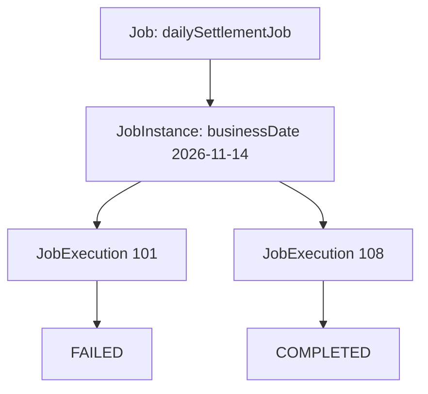
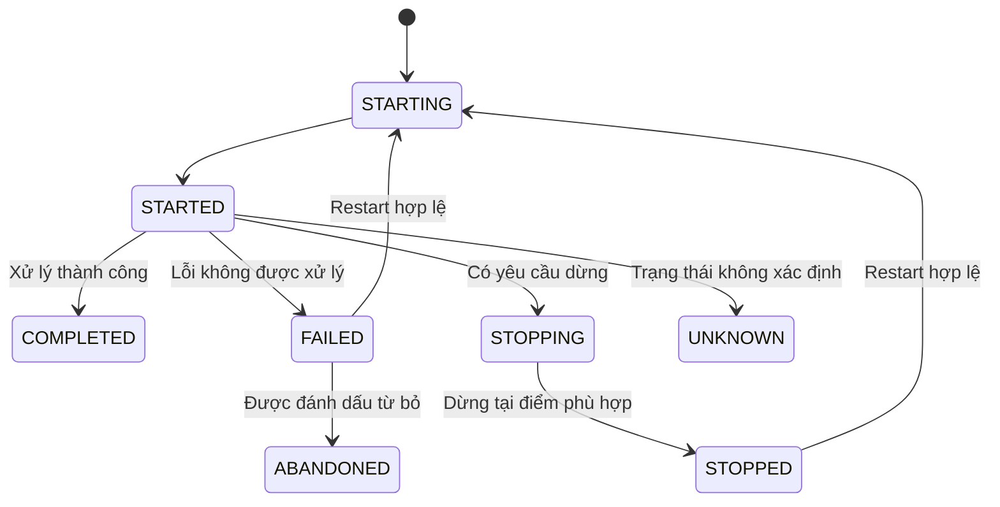

# Job chưa chạy, đang chạy, hoàn tất và thất bại

Trong Spring Batch, một job không chỉ có hai kết quả đơn giản là chạy thành công hoặc chạy thất bại. Framework theo dõi **vòng đời của từng lần thực thi job**, từ lúc được khởi chạy, trong khi xử lý, cho đến khi hoàn tất, dừng theo yêu cầu hoặc gặp lỗi. Trạng thái này giúp ứng dụng biết công việc đang ở đâu, có thể tiếp tục sau gián đoạn hay cần người vận hành can thiệp.

Để hiểu vòng đời đó, cần phân biệt `JobInstance`, `JobExecution` và `BatchStatus`. Một job là định nghĩa công việc; một `JobInstance` xác định một lần nghiệp vụ theo các tham số nhận diện; còn `JobExecution` ghi nhận một lần thực thi cụ thể của instance đó. Trạng thái được gắn với `JobExecution`.

## 1. Phân biệt Job, JobInstance và JobExecution

Giả sử hệ thống có job `dailySettlementJob`, dùng để đối soát giao dịch theo ngày nghiệp vụ.

- **Job** là định nghĩa quy trình `dailySettlementJob`, gồm các step đọc giao dịch, đối soát và ghi kết quả.
- **JobInstance** đại diện cho công việc đối soát của một ngày nghiệp vụ cụ thể. Thông thường, nó được xác định bởi tên job cùng các `JobParameters` được đánh dấu là identifying.
- **JobExecution** đại diện cho một lần chạy cụ thể của `JobInstance`. Nếu lần chạy đầu tiên thất bại và được restart, lần chạy tiếp theo tạo một `JobExecution` mới nhưng vẫn thuộc cùng `JobInstance`.

Ví dụ:

| Thành phần | Ví dụ | Ý nghĩa |
|---|---|---|
| Job | `dailySettlementJob` | Định nghĩa quy trình đối soát hằng ngày |
| JobParameters | `businessDate=2026-11-14` | Ngày nghiệp vụ cần xử lý |
| JobInstance | `dailySettlementJob` cho ngày `2026-11-14` | Một công việc nghiệp vụ xác định |
| JobExecution lần 1 | Execution ID `101` | Lần chạy đầu tiên, kết thúc với `FAILED` |
| JobExecution lần 2 | Execution ID `108` | Lần restart, kết thúc với `COMPLETED` |

Hai execution trong ví dụ thuộc cùng một instance vì chúng dùng cùng định danh job và bộ identifying parameters. Chúng có ID, thời điểm bắt đầu, thời điểm kết thúc và trạng thái riêng.



Điểm cần nhớ: `JobInstance` mô tả công việc nghiệp vụ cần thực hiện; `JobExecution` mô tả một lần thử thực thi công việc đó. Vì vậy, trạng thái chạy không phải thuộc tính cố định của định nghĩa `Job`.

## 2. Job chưa chạy: chưa có JobExecution

Một job được cấu hình trong ứng dụng chưa có nghĩa là nó đã được thực thi. Trước lần khởi chạy đầu tiên cho một bộ identifying parameters, chưa có `JobExecution` tương ứng được lưu trong `JobRepository`.

Spring Batch **không có giá trị `BatchStatus.NOT_STARTED`** để biểu thị một job chưa từng chạy. Trạng thái “chưa chạy” thường được hiểu từ việc chưa tồn tại execution cho `JobInstance` và bộ tham số đang xét.

Ví dụ, ứng dụng định nghĩa `dailySettlementJob` nhưng scheduler chỉ được cấu hình chạy lúc 01:00. Trước thời điểm scheduler kích hoạt job, quy trình chưa được thực thi và chưa có execution của ngày nghiệp vụ đó. Khi `JobLauncher` nhận yêu cầu khởi chạy, Spring Batch tạo metadata thực thi và bắt đầu chuyển qua các trạng thái vòng đời.

Phân biệt ba tình huống:

1. **Job đã được định nghĩa:** ứng dụng có cấu hình job, nhưng chưa có lần chạy nào.
2. **Job được lên lịch:** scheduler biết thời điểm cần gọi job, nhưng job có thể vẫn chưa được khởi chạy.
3. **Job đã được khởi chạy:** Spring Batch tạo `JobExecution`; từ đây trạng thái thực thi được theo dõi trong repository.

Không nên suy luận rằng một job chưa chạy chỉ vì không tìm thấy log trong thời gian gần đây. Cần xem đúng job name, identifying parameters, khoảng thời gian và metadata trong `JobRepository`.

## 3. Job đang chạy: STARTING và STARTED

Khi `JobLauncher` khởi chạy job, Spring Batch tạo một `JobExecution` và lưu thông tin ban đầu. Vòng đời thường đi qua hai trạng thái khởi đầu:

### STARTING

`STARTING` cho biết execution đã được tạo và đang trong giai đoạn bắt đầu. Framework đang chuẩn bị thực thi job; các bước xử lý có thể chưa bắt đầu.

Trong hệ thống có job chạy bất đồng bộ, người vận hành có thể nhìn thấy trạng thái này trong một khoảng thời gian trước khi execution chuyển sang `STARTED`.

### STARTED

`STARTED` cho biết job đã bắt đầu thực thi. Các step được điều phối theo flow đã cấu hình. Với step xử lý theo chunk, reader đọc item, processor xử lý và writer ghi dữ liệu theo từng chunk.

Khi job đang chạy, `JobExecution` lưu các thông tin như thời điểm bắt đầu, trạng thái, execution context và các thông tin thực thi liên quan. Metadata của step cũng giúp theo dõi từng giai đoạn bên trong job.

Một job có thể chạy trong vài giây hoặc nhiều giờ. Vì vậy, trạng thái `STARTED` tự nó không cho biết job đang tiến triển tốt hay bị treo. Để theo dõi tiến độ, cần xem thêm số item đã đọc/ghi, trạng thái step, thời gian chạy, log và các chỉ số của hệ thống nguồn/đích.

## 4. Các trạng thái trong vòng đời JobExecution

Spring Batch dùng enum `BatchStatus` để biểu diễn trạng thái thực thi. Các trạng thái thường gặp gồm:

| BatchStatus | Ý nghĩa | Cách hiểu khi vận hành |
|---|---|---|
| `STARTING` | Execution đang trong giai đoạn bắt đầu | Đã tạo execution nhưng job chưa đi vào xử lý bình thường |
| `STARTED` | Job đang thực thi | Theo dõi step, tiến độ và thời gian chạy |
| `STOPPING` | Đã có yêu cầu dừng và framework đang xử lý yêu cầu đó | Job chưa dừng hẳn; có thể cần chờ đến điểm dừng phù hợp |
| `STOPPED` | Job đã dừng theo yêu cầu | Có thể restart nếu job và trạng thái step cho phép |
| `COMPLETED` | Job kết thúc thành công theo flow thực thi | Instance đã hoàn tất; không thể chạy lại như một instance mới với cùng identifying parameters |
| `FAILED` | Job kết thúc do lỗi không được xử lý thành công | Có thể restart nếu job được cấu hình restartable và các điều kiện liên quan được đáp ứng |
| `ABANDONED` | Execution được đánh dấu là từ bỏ | Framework không xem execution này là một lần chạy có thể restart theo cách thông thường |
| `UNKNOWN` | Không xác định chắc chắn trạng thái thực thi | Cần điều tra metadata và tác động nghiệp vụ trước khi quyết định xử lý tiếp |

Luồng phổ biến có thể hình dung như sau:



Đây là sơ đồ khái quát, không phải mọi chuyển trạng thái đều được ứng dụng gọi trực tiếp. Spring Batch và các thao tác vận hành quản lý những chuyển đổi hợp lệ theo vòng đời execution.

### COMPLETED — hoàn tất thành công

`COMPLETED` cho biết job đã kết thúc thành công theo flow được thực thi. Các step cần thiết đã kết thúc và job không còn ở trạng thái chạy.

Khi một `JobInstance` đã `COMPLETED`, việc khởi chạy lại cùng job với cùng identifying parameters thông thường sẽ bị từ chối bằng lỗi `JobInstanceAlreadyCompleteException`. Đây là hành vi bảo vệ để tránh vô tình xử lý trùng cùng một công việc nghiệp vụ.

Nếu cần chạy cho ngày nghiệp vụ khác, truyền identifying parameter khác, ví dụ `businessDate=2026-11-15`. Khi đó Spring Batch tạo một `JobInstance` mới. Nếu thật sự cần chạy lại cùng ngày đã hoàn tất, cần xác định rõ đó là một công việc nghiệp vụ mới hay thao tác sửa chữa có kiểm soát; có thể dùng một identifying parameter như `runId` hoặc `reprocessVersion` theo thiết kế của ứng dụng.

### FAILED — thất bại

`FAILED` cho biết job kết thúc do một lỗi khiến flow không hoàn tất thành công. Ví dụ:

- Cơ sở dữ liệu không thể kết nối và lỗi vượt qua chính sách retry.
- Một bản ghi vi phạm quy tắc bắt buộc và chính sách skip không cho phép bỏ qua.
- Writer gặp lỗi khi ghi dữ liệu và giao dịch chunk bị rollback.
- Một step thất bại và flow không có nhánh xử lý tiếp phù hợp.

Job thất bại không nhất thiết có nghĩa mọi dữ liệu đều chưa được xử lý. Các chunk đã commit trước đó có thể đã được ghi thành công. Vì thế, khi restart, framework cần metadata và checkpoint để xác định phần công việc có thể tiếp tục. Các tác dụng phụ ngoài giao dịch cơ sở dữ liệu cũng cần được xem xét riêng.

### STOPPING và STOPPED — dừng theo yêu cầu

`STOPPING` xuất hiện khi có yêu cầu dừng execution đang chạy. Đây là giai đoạn framework đang xử lý yêu cầu, chưa phải trạng thái đã dừng hoàn toàn.

Khi job dừng có kiểm soát, trạng thái cuối là `STOPPED`. Spring Batch thường phối hợp dừng tại một ranh giới thực thi phù hợp, chẳng hạn sau khi phần xử lý hiện tại đạt điểm có thể kiểm tra tín hiệu dừng. Vì vậy, yêu cầu dừng không có nghĩa là mọi lệnh đang chạy sẽ bị ngắt ngay tức thì.

`STOPPED` khác `FAILED`: job dừng do yêu cầu vận hành, còn `FAILED` phản ánh execution kết thúc vì lỗi. Một job đã dừng có thể được restart nếu cấu hình job, metadata và trạng thái step cho phép.

### ABANDONED và UNKNOWN

`ABANDONED` thường được dùng khi người vận hành quyết định không tiếp tục một execution hoặc step đã thất bại. Framework coi trạng thái này là đã từ bỏ và không tự restart nó theo quy trình thông thường. Chỉ nên đánh dấu abandoned sau khi hiểu rõ tác động của phần dữ liệu đã xử lý.

`UNKNOWN` biểu thị trạng thái không thể xác định an toàn. Tình huống này có thể xuất hiện khi metadata không phản ánh rõ kết quả thực thi, ví dụ sự cố nghiêm trọng xảy ra giữa các thao tác cập nhật trạng thái. Không nên tự động restart chỉ dựa trên giả định rằng job chưa làm gì; cần kiểm tra repository, log và hệ thống đích trước.

## 5. BatchStatus khác ExitStatus như thế nào?

Hai khái niệm này có liên quan nhưng không đồng nghĩa:

- **`BatchStatus`** mô tả trạng thái vòng đời của execution, ví dụ `STARTED`, `COMPLETED`, `FAILED` hoặc `STOPPED`.
- **`ExitStatus`** mô tả mã kết quả mà step hoặc job trả về khi kết thúc. Mã này được dùng trong flow và có thể chứa mã tùy chỉnh theo nghiệp vụ.

Ví dụ, job có thể hoàn tất về mặt kỹ thuật nhưng phát hiện một số bản ghi đã bị skip. Ứng dụng có thể giữ `BatchStatus.COMPLETED` và dùng một `ExitStatus` tùy chỉnh như `COMPLETED_WITH_SKIPS` để báo kết quả nghiệp vụ cho bước điều phối hoặc hệ thống giám sát.

Flow có thể dùng exit code để quyết định step tiếp theo. Chẳng hạn, sau step kiểm tra dữ liệu:

- `COMPLETED` có thể chuyển sang step ghi dữ liệu chính.
- `COMPLETED_WITH_WARNINGS` có thể chuyển sang step tạo báo cáo cảnh báo.
- `FAILED` có thể kết thúc job hoặc chuyển sang nhánh xử lý lỗi nếu flow được thiết kế như vậy.

Do đó, khi xem trạng thái job, không nên chỉ nhìn một chuỗi `COMPLETED` hoặc `FAILED` trong log mà bỏ qua loại trạng thái đang được hiển thị. Cần phân biệt `JobExecution.getStatus()` và `JobExecution.getExitStatus()`.

## 6. Step thất bại có luôn làm Job thất bại không?

Không phải trong mọi cấu hình. `StepExecution` có trạng thái riêng. Nếu một step thất bại, flow có thể được cấu hình để kết thúc job với `FAILED`, hoặc chuyển sang một nhánh xử lý khác.

Ví dụ, một job nhập dữ liệu có thể gồm:

1. `importStep`: đọc và kiểm tra dữ liệu đầu vào.
2. `errorReportStep`: tạo báo cáo nếu có dữ liệu lỗi.
3. `archiveStep`: lưu trữ tệp đầu vào và báo cáo.

Nếu flow được thiết kế để xử lý `ExitStatus.FAILED` từ `importStep` bằng cách chạy `errorReportStep` rồi hoàn tất quy trình báo cáo, trạng thái cuối của job có thể phản ánh việc flow đã kết thúc thành công theo nhánh được định nghĩa. Điều đó không có nghĩa step nhập dữ liệu đã thành công; trạng thái step và kết quả nghiệp vụ vẫn cần được kiểm tra.

Ngược lại, nếu step thất bại và không có transition xử lý phù hợp, job thường kết thúc với trạng thái `FAILED`.

## 7. Restart sau khi FAILED hoặc STOPPED

Một ưu điểm quan trọng của Spring Batch là khả năng restart job sau khi execution thất bại hoặc dừng. Khi restart đúng cách, Spring Batch tạo một `JobExecution` mới cho cùng `JobInstance` và sử dụng metadata đã lưu để tiếp tục theo cấu hình của job.

Ví dụ:

```text
JobInstance: dailySettlementJob, businessDate=2026-11-14

JobExecution 101
  STARTING -> STARTED -> FAILED
  Đã commit 320 chunk

JobExecution 108 (restart)
  STARTING -> STARTED -> COMPLETED
  Tiếp tục từ checkpoint phù hợp
```

Restart phụ thuộc vào nhiều điều kiện:

- Job phải cho phép restart. Một job được cấu hình không restartable sẽ không thể tiếp tục theo cơ chế restart thông thường.
- Lần khởi chạy phải xác định đúng `JobInstance`, thường bằng cùng job name và cùng identifying parameters.
- `JobRepository` phải lưu được metadata cần thiết. Execution context và reader/step phải hỗ trợ khôi phục trạng thái theo cách được thiết kế.
- Step và writer cần có hành vi an toàn khi chạy lại. Những thao tác ghi ra hệ thống bên ngoài cần được thiết kế để tránh tạo dữ liệu trùng.
- Execution không được ở trạng thái khiến framework từ chối restart, chẳng hạn instance đã `COMPLETED` hoặc execution đã bị đánh dấu `ABANDONED`.

Không phải mọi reader đều tự động nhớ vị trí đã đọc. Một reader có khả năng lưu trạng thái có thể ghi checkpoint vào execution context; một reader không lưu trạng thái có thể bắt đầu đọc lại từ đầu khi restart. Thiết kế nguồn dữ liệu, thứ tự sắp xếp và checkpoint cần nhất quán để không bỏ sót hoặc xử lý trùng dữ liệu.

### Vì sao cần idempotency?

Giả sử một chunk ghi dữ liệu vào cơ sở dữ liệu rồi gọi API đối tác. Cơ sở dữ liệu rollback khi API thất bại, nhưng API đối tác có thể đã nhận và xử lý request. Khi chunk được chạy lại, API có nguy cơ nhận cùng yêu cầu lần thứ hai.

Để giảm rủi ro, có thể:

- Dùng khóa nghiệp vụ duy nhất để ngăn tạo bản ghi trùng.
- Gửi idempotency key khi gọi API nếu hệ thống đích hỗ trợ.
- Dùng transactional outbox để tách việc commit dữ liệu nghiệp vụ khỏi quá trình gửi thông điệp.
- Lưu trạng thái xử lý và xây dựng quy trình đối soát khi không thể bảo đảm tính nguyên tử giữa các hệ thống.

Restart là khả năng tiếp tục quy trình dựa trên metadata; nó không tự động bảo đảm mọi tác dụng phụ bên ngoài chỉ xảy ra đúng một lần.

## 8. Dừng job chủ động

Trong vận hành, có thể cần dừng một job vì dữ liệu đầu vào sai, hệ thống đích đang bảo trì hoặc công việc chạy quá lâu. Spring Batch hỗ trợ yêu cầu dừng execution thông qua cơ chế điều khiển như `JobOperator.stop`.

Quy trình khái quát:

1. Người vận hành xác định đúng execution ID đang chạy.
2. Hệ thống gửi yêu cầu stop.
3. Execution chuyển sang `STOPPING` khi yêu cầu đang được xử lý.
4. Framework dừng tại điểm phù hợp và cập nhật trạng thái thành `STOPPED`.
5. Sau khi xử lý nguyên nhân, người vận hành có thể restart nếu job cho phép.

Yêu cầu stop là yêu cầu dừng có kiểm soát. Nếu processor đang gọi một API mất nhiều phút mới trả về, job có thể chưa dừng ngay. Cần thiết kế timeout cho I/O, kiểm tra tín hiệu dừng ở các điểm phù hợp và giới hạn thời gian xử lý mỗi đơn vị công việc.

Nếu tiến trình JVM bị kill đột ngột hoặc máy chủ mất điện, framework có thể không kịp ghi trạng thái cuối. Repository có thể còn execution mang trạng thái `STARTED` hoặc `STARTING`. Khi đó, cần xác minh tiến trình thực sự đã dừng, kiểm tra tác động đã commit và xử lý metadata theo quy trình vận hành. Không nên sửa trạng thái thủ công khi chưa xác định được dữ liệu thực tế.

## 9. Theo dõi trạng thái job trong ứng dụng

`JobRepository` lưu metadata thực thi. Ứng dụng có thể dùng `JobExplorer` để đọc thông tin job/instance/execution và dùng `JobOperator` cho các thao tác vận hành được hỗ trợ như khởi chạy, restart hoặc stop.

Khi kiểm tra một `JobExecution`, nên xem ít nhất:

- Job name và identifying parameters để xác nhận đúng công việc nghiệp vụ.
- Execution ID và trạng thái `BatchStatus` hiện tại.
- `ExitStatus` để hiểu mã kết quả cuối cùng.
- Thời điểm bắt đầu, thời điểm kết thúc và thời gian chạy.
- Trạng thái của từng step.
- Số lượng item đọc, ghi, filter, skip và thông tin lỗi.
- Execution context hoặc checkpoint liên quan đến khả năng restart.

Ví dụ minh họa cách đọc trạng thái từ một đối tượng `JobExecution` đã được truy xuất:

```java
BatchStatus batchStatus = jobExecution.getStatus();
ExitStatus exitStatus = jobExecution.getExitStatus();

System.out.println("Execution ID: " + jobExecution.getId());
System.out.println("Batch status: " + batchStatus);
System.out.println("Exit code: " + exitStatus.getExitCode());
System.out.println("Start time: " + jobExecution.getStartTime());
System.out.println("End time: " + jobExecution.getEndTime());
```

Đoạn mã chỉ minh họa việc đọc trạng thái của execution. Để lấy đối tượng `JobExecution`, ứng dụng thường truy vấn `JobExplorer` theo job instance và execution tương ứng. Cách truy vấn cụ thể tùy vào phiên bản Spring Batch và cấu trúc ứng dụng.

Trong môi trường production, nên có dashboard hoặc log có cấu trúc để tìm execution theo job name, tham số nghiệp vụ và ID. Cảnh báo nên phân biệt job chạy quá thời gian dự kiến, job thất bại, job bị dừng và job có số lượng bản ghi lỗi vượt ngưỡng.

## 10. Ví dụ vòng đời của một job đối soát

Một job đối soát giao dịch theo ngày có thể diễn ra như sau:

**Lần chạy đầu tiên**

1. Scheduler kích hoạt `dailySettlementJob` với `businessDate=2026-11-14`.
2. Spring Batch tạo `JobInstance` cho ngày đó và `JobExecution` đầu tiên ở trạng thái `STARTING`.
3. Job chuyển sang `STARTED`, sau đó thực thi các step đọc, so khớp và ghi kết quả.
4. Sau khi commit 320 chunk, kết nối tới hệ thống dữ liệu đích bị lỗi kéo dài. Retry hết giới hạn và writer làm step thất bại.
5. Job kết thúc với `BatchStatus.FAILED`. Metadata của các chunk đã commit vẫn được lưu.

**Sau khi khắc phục sự cố**

1. Nhóm vận hành khôi phục kết nối tới hệ thống đích.
2. Job được restart với cùng identifying parameters để tiếp tục cùng `JobInstance`.
3. Spring Batch tạo `JobExecution` mới và khôi phục checkpoint phù hợp.
4. Các chunk còn lại được xử lý; kết quả được ghi thành công.
5. Job kết thúc với `BatchStatus.COMPLETED`.

**Ngày nghiệp vụ tiếp theo**

Scheduler chạy job với `businessDate=2026-11-15`. Do identifying parameter thay đổi, Spring Batch tạo `JobInstance` mới cho ngày mới. Lịch sử execution của ngày trước vẫn được giữ để tra cứu và kiểm toán.

Ví dụ này cho thấy trạng thái không chỉ phục vụ hiển thị. Nó quyết định cách hệ thống phản ứng khi khởi chạy trùng, restart sau lỗi và theo dõi từng ngày nghiệp vụ.

## 11. Một số lỗi vận hành thường gặp

| Tình huống | Nguyên nhân có thể gặp | Hướng xử lý |
|---|---|---|
| Job vẫn hiển thị `STARTED` sau khi máy chủ khởi động lại | Tiến trình dừng đột ngột trước khi cập nhật metadata cuối | Xác minh tiến trình cũ, log, dữ liệu đã commit và trạng thái repository trước khi xử lý execution |
| Khởi chạy lại nhưng nhận `JobExecutionAlreadyRunningException` | Cùng `JobInstance` đang có execution hoạt động | Kiểm tra execution đang chạy; xác minh nó còn sống trước khi can thiệp |
| Khởi chạy lại nhưng nhận `JobInstanceAlreadyCompleteException` | Instance với identifying parameters đó đã hoàn tất | Dùng tham số nhận diện mới nếu đây là kỳ chạy mới; nếu là sửa chữa, thiết kế quy trình reprocess rõ ràng |
| Restart nhưng đọc lại từ đầu | Reader không lưu checkpoint hoặc không khôi phục trạng thái | Kiểm tra khả năng lưu state của reader, execution context và cấu hình step |
| Job `COMPLETED` nhưng nghiệp vụ vẫn có bản ghi lỗi | Một số bản ghi đã được skip hoặc flow hoàn tất theo nhánh xử lý lỗi | Kiểm tra `ExitStatus`, skip count, báo cáo lỗi và trạng thái nghiệp vụ |
| Job không dừng ngay sau yêu cầu stop | Tác vụ hiện tại chưa tới điểm kiểm tra tín hiệu dừng hoặc I/O đang chờ | Kiểm tra timeout và thiết kế điểm dừng an toàn trong xử lý |

Trạng thái trong repository là một phần bằng chứng vận hành. Khi điều tra sự cố, cần đối chiếu nó với log, trạng thái dữ liệu đích và trạng thái của các hệ thống bên ngoài.

## 12. Những nguyên tắc cần nhớ

- Một job được định nghĩa nhưng chưa khởi chạy chưa có `BatchStatus.NOT_STARTED`; hãy kiểm tra xem đã có `JobExecution` cho instance và tham số đó hay chưa.
- `STARTING` và `STARTED` biểu thị các giai đoạn bắt đầu và thực thi.
- `COMPLETED` là kết thúc thành công; cùng identifying parameters không thể dùng để khởi chạy lại một instance đã hoàn tất theo cách thông thường.
- `FAILED` biểu thị kết thúc do lỗi; restart có thể thực hiện được nếu job và metadata đáp ứng điều kiện.
- `STOPPING` là yêu cầu dừng đang được xử lý; `STOPPED` là trạng thái đã dừng.
- `ABANDONED` và `UNKNOWN` cần được hiểu cẩn thận trước khi thực hiện thao tác tiếp theo.
- `BatchStatus` mô tả vòng đời execution, còn `ExitStatus` cung cấp mã kết quả của step/job và có thể được tùy chỉnh.
- Trạng thái job và trạng thái step có liên quan nhưng không luôn giống nhau; flow có thể xử lý một step lỗi bằng nhánh riêng.
- Restart cần checkpoint phù hợp và thiết kế idempotent cho tác dụng phụ; nó không tự bảo đảm exactly-once trên mọi hệ thống.

Hiểu đúng các trạng thái `JobExecution` giúp nhóm phát triển và vận hành biết một job chưa được khởi chạy, đang xử lý, đã hoàn tất, đã dừng hay thất bại; từ đó chọn đúng hành động theo dõi, restart hoặc điều tra mà không làm trùng dữ liệu nghiệp vụ.
